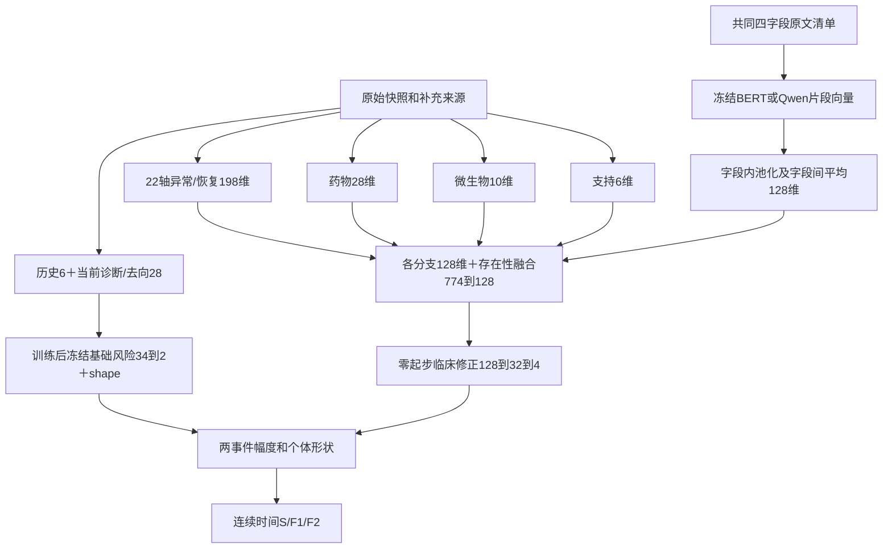

# V6 当前输入全清单：来源、数值、缺失与网络位置

核对日期2026-10-11。以`training/v6/data.py`、`compact_context_data.py`、`compact_model.py`及最新90天目标/文本对照为依据，不把设计候选或其他实验误列为当前输入。机器可读清单和原数据覆盖元数据见[本轮input_catalog.json](../training_runs/v6_bert_qwen_same_fields_2026-10-11/input_catalog.json)。

## 0. 两种参照必须区分

| 配方 | 基础风险 | 临床修正中的诊断/去向 | 文本 |
| --- | --- | --- | --- |
| 既有compact参照 | 历史H，6维 | 14个值＋14个标记保留 | B四字段ClinicalBERT |
| 最新90天目标／Qwen对照 | 扩展基础风险，34维=H6＋诊断/去向14＋标记14 | 值和标记全部置零，保留网络槽位 | 同一B四字段ClinicalBERT／Qwen／空文本 |

扩展基础风险是机制实验参照，未满足替换原默认参照的证据条件；旧模型不覆盖。冻结的是基础风险模型参数，不是患者输入或所有患者的风险。

## 1. 队列、预测点、标签

患者曾有一次前三位诊断包含既定v1 COPD/肺气肿清单编码即可入组，保留该患者任意诊断位含清单编码的全部住院；从最早保留住院开始。完整清单与条件见[任务合同](CURRENT_TASK_AND_COHORT.md)及队列SQL，本轮不改清单。

- 原始底账5,390人/19,774次；预测点5,351人/19,401次存活且正时长出院。
- 每次出院重预测；train/validation/test=13,592/2,949/2,860次，患者不跨折。
- 未来首次非转院严格491.21/J44.1再入院为事件1；该事件前的可观察死亡为事件2；未观察到为事件0，行政上限365天。
- 时间、事件类型只送损失和评价。患者/住院ID、未来住院、未来死亡日、划分名称不送编码器。
- 本库未观察到不等于院外无事件；最终小结可晚存档，当前不是实时出院部署验证。

## 2. 历史H：完整6项

来源：原始patients、保留住院底账、已结束历史。只计本次入院前已出院且正时长的保留COPD住院，不读取未来住院，不使用跨住院Transformer。

| 顺序/Key | 中文 | 实际构造 |
| --- | --- | --- |
| 0 `age` | 本次入院年龄 | anchor_age＋入院年−anchor_year |
| 1 `female` | 女性标志 | F=1、M=0；未知性别报错，不默认填男性 |
| 2 `log_prior_completed_copd` | 既往已结束COPD住院次数 | log(1＋次数) |
| 3 `log_prior_completed_strict` | 其中严格AECOPD次数 | log(1＋严格次数) |
| 4 `log_previous_discharge_gap_days` | 最近历史出院至本次入院间隔 | log(1＋天数)；无历史为占位0 |
| 5 `no_completed_history` | 无合格既往住院 | 无历史=1、有=0 |

年龄、两计数、历史间隔用训练折median/IQR标准化、裁剪至[-8,8]；零IQR按标准差再常数尺度回退。间隔拟合不包含无历史占位值。性别/无历史仍0/1；后者区分未知间隔与真实0间隔。底账保存历史顺序，但本模型仅消费这六项，不读取全部历史检验/文本序列。

## 3. 当前诊断与出院去向：完整14值＋14标记

来源：本次diagnoses_icd（所有诊断位、ICD9/10统一家族）和admissions.discharge_location。不是把所有非COPD编码都当既往共病。

| 序号/Key | 中文 | 定义 |
| --- | --- | --- |
| 0 `current_strict_code` | 本次严格AECOPD编码 | 底账is_strict_aecopd |
| 1 `current_code:heart_failure` | 心力衰竭 | I50/I110/I130/I132；428 |
| 2 `current_code:cardiac_other` | 缺血性心脏病/房颤 | I20–I25/I48；410–414/42731 |
| 3 `current_code:ckd` | 慢性肾病 | N18；585 |
| 4 `current_code:diabetes` | 糖尿病 | E08/E09/E10/E11/E13；250 |
| 5 `current_code:malignancy` | 恶性肿瘤 | C00–C99；140–208 |
| 6 `current_code:chronic_respiratory` | 慢性呼衰/OSA | J961/J962/G4733；51883/51884/32723 |
| 7 `current_code:acute_resp_failure` | 急性/急慢性呼衰 | J960/J962；51881/51884 |
| 8 `current_code:pneumonia_or_aspiration` | 肺炎/吸入性肺损伤 | J12–J18/J69；480–486/507 |
| 9 `current_code:sepsis` | 脓毒症 | A40/A41/R652；038/99591/99592 |
| 10 `current_code:aki` | 急性肾损伤 | N17；584 |
| 11 `disposition_home` | 出院回家 | 原词包含HOME |
| 12 `disposition_facility` | 康复/护理/长期机构 | 非HOME，包含REHAB/SKILLED/NURSING/LONG TERM |
| 13 `disposition_other` | 其他去向 | 非以上、有记录的类别 |

编码去点/空格后按前缀映射，实际定义见`training/v5/clinical_concepts.py`。急慢性呼衰可同时命中两组，并非互斥疾病。前11项mask为1，0只表示未映射到编码，不证明没有疾病。去向缺失三个值和mask均0；有记录时三个mask都1、三个值one-hot。包含HOME先归home，即HOME WITH SERVICES也在home，当前未单列照护服务。

## 4. 检验：完整22轴，不是22个不同项目

按异常方向构造轴，同一项目可贡献高/低两轴；有测正常也保留。表中“有测”指通过当前单位、时间、数值、参考范围和标本规则的住院数，不代表异常人数。来源`raw/labevents.csv.gz`及r2 manifest；动脉识别还依赖原标本校验。

| 顺序/Key | 中文轴 | itemid / 原单位 | 有测住院 |
| --- | --- | --- | ---: |
| 0 `arterial_low_ph` | 动脉pH低 | 50820 / units | 2,684 |
| 1 `arterial_high_pco2` | 动脉pCO₂高 | 50818 / mm Hg | 2,662 |
| 2 `bicarbonate_low` | 碳酸氢根低 | 50882 / mEq/L | 17,042 |
| 3 `bicarbonate_high` | 碳酸氢根高 | 同上 | 17,042 |
| 4 `wbc_high` | 白细胞高 | 51301 / K/uL | 16,972 |
| 5 `albumin_low` | 白蛋白低 | 50862 / g/dL | 4,615 |
| 6 `hemoglobin_low` | 血红蛋白低 | 51222 / g/dL | 16,988 |
| 7 `creatinine_high` | 肌酐高 | 50912 / mg/dL | 17,234 |
| 8 `arterial_hypercapnic_acidosis` | 动脉高碳酸性酸中毒 | 同标本pH＋pCO₂，两者时间差≤1h | 2,662 |
| 9 `wbc_low` | 白细胞低 | 51301 / K/uL | 16,972 |
| 10 `sodium_low` | 钠低 | 50983 / mEq/L | 17,151 |
| 11 `sodium_high` | 钠高 | 同上 | 17,151 |
| 12 `potassium_low` | 钾低 | 50971 / mEq/L | 17,228 |
| 13 `potassium_high` | 钾高 | 同上 | 17,228 |
| 14 `urea_nitrogen_high` | 尿素氮高 | 51006 / mg/dL | 17,177 |
| 15 `glucose_low` | 血糖低 | 50931 / mg/dL | 16,996 |
| 16 `glucose_high` | 血糖高 | 同上 | 16,996 |
| 17 `platelet_low` | 血小板低 | 51265 / K/uL | 17,055 |
| 18 `magnesium_low` | 镁低 | 50960 / mg/dL | 16,317 |
| 19 `lactate_high` | 乳酸高 | 50813 / mmol/L | 4,073 |
| 20 `crp_high` | CRP高 | 50889 / mg/L | 851 |
| 21 `ntprobnp_high` | NT-proBNP高 | 50963 / pg/mL | 1,305 |

乳酸是该检验项目的合格记录，**没有像pH/pCO₂一样额外保证动脉标本**。不将乳酸统称动脉血乳酸。

### 每轴实际9通道：6数值＋3标记，合计22×9=198

| 槽位/Key | 中文 | 计算/缺失 |
| --- | --- | --- |
| 0 `first_observed_severity` | 首次观测异常程度 | 全住院第一合格时点 |
| 1 `observed_peak_severity` | 最大观测异常程度 | 全住院观测最大值 |
| 2 `latest_observed_severity` | 最新观测异常程度 | 可早于出院数日，不限48h |
| 3 `recovery_delta` | 观测峰后恢复差 | 有更晚峰后复查时：峰−最新；否则占位0 |
| 4 `latest_measurement_age` | 最新观测距出院 | log(1＋天数) |
| 5 `peak_to_latest_elapsed` | 最早峰至最新观测间隔 | log(1＋天数)；不可估计置0 |
| 6 `axis_observed` | 有合格观测 | 有=1；无=0、整轴零 |
| 7 `post_peak_recheck_valid` | 有效峰后复测 | 最新时刻晚于最早峰时刻=1 |
| 8 `latest_at_abnormal_peak` | 最新观测仍处异常峰 | 峰>0且最新≈峰=1；不保证出院当日测量 |

同轴同时间取中位数，不给同刻项目强加先后。峰用未截顶异常程度定位；第8标记与第7标记可同时为1（先有峰、后来又在峰）。恢复差0需结合最新严重度和标记，不能独自判断平稳。

原始异常程度：pH=`max(0,(7.35−pH)/0.10)`；pCO₂=`max(0,(pCO₂−45)/15)`；其他低轴=`max(0,(下限−值)/(上限−下限))`、高轴=`max(0,(值−上限)/(上限−下限))`。联合酸中毒取同标本两方向异常程度的最小值，因此只有两者都异常才>0。

必须满足住院内`admittime≤charttime≤storetime≤dischtime`、单位完全匹配、有限正数、有效上下限；参考范围缺失或单位不符会被排除而非自动修补，覆盖限制保留审计。pH/pCO₂也需有效参考字段，尽管它们使用固定临床阈值。

前4数值log1p，两个时间通道已log1p；各轴各数值只以训练折有效观测拟合median/IQR并裁剪[-8,8]，零IQR回退std/1。恢复差/峰间隔只有标记7有效时参与拟合，其余占位0；三标记保持0/1。完整逐值有效mask另存，但网络输入仅这9通道，不额外送六个mask。正常值仍含有测标志；不是把未测当正常。

## 5. 药物：完整7药效类别×4通道=28

多来源：eMAR实际执行记录、pharmacy及通过pharmacy_id关联的prescriptions。时间仅用于上游可见性/住院区间核验；**没有给药次数、涉及日数、首末日期、跨度、剂量、持续时间或药物序列进入网络**。多次和同类多药按存在性OR合并；复方可以命中多个药效类。

| Key | 中文/缩写 | 映射药物例子 | 执行住院 / 仅医嘱住院 |
| --- | --- | --- | ---: |
| `short_beta_agonist` | 短效β₂激动剂 SABA | albuterol、salbutamol、levalbuterol | 5,962 / 8,340 |
| `short_muscarinic_antagonist` | 短效抗胆碱剂 SAMA | ipratropium | 4,491 / 4,840 |
| `long_beta_agonist` | 长效β₂激动剂 LABA | salmeterol、formoterol、arformoterol、indacaterol、olodaterol、vilanterol | 4,299 / 3,197 |
| `long_muscarinic_antagonist` | 长效抗胆碱剂 LAMA | tiotropium、umeclidinium、吸入glycopyrrolate、aclidinium、revefenacin | 3,559 / 2,576 |
| `inhaled_corticosteroid` | 吸入糖皮质激素 ICS | 吸入budesonide、fluticasone、beclomethasone、mometasone、ciclesonide | 4,890 / 4,103 |
| `systemic_corticosteroid` | 全身糖皮质激素 | prednisone、prednisolone、methylprednisolone、dexamethasone、hydrocortisone | 3,722 / 2,708 |
| `common_systemic_antibacterial` | 常见全身抗菌药 | 大环内酯＋β内酰胺＋氟喹诺酮＋四环素四药效族合并 | 6,004 / 4,267 |

抗菌药不是全部抗菌药表：例如vancomycin/linezolid等`other_antibiotic`不在这7类；利尿剂也不在。映射完整规则及复方商品名见`training/v5/clinical_concepts.py`，按途径/剂型排除鼻喷、眼药、外用和不合格系统治疗；不能只凭药名判吸入药。系统抗菌药记录没有自动裁定呼吸适应证。

四通道对每类均固定如下：

| Key | 含义 |
| --- | --- |
| `execution_evidence` | 至少一条被接受的实际执行证据=1 |
| `order_only_evidence` | 有有效医嘱且该类无执行证据=1；不能说实际已用 |
| `execution_source_observed` | 执行来源可用标志；不是该类完整用药观察证明 |
| `order_source_observed` | 住院内有效医嘱来源可用标志；不是实际给药 |

两个来源标记是住院级来源可用性复制到7类，不是逐药核验全部记录；实际执行与仅医嘱互斥。药房与处方同一pharmacy_id/类别去重。无法关联录入时间的处方仅审计，不补为确认给药；取消/暂停、出院后录入、区间不相交医嘱排除。出院带药方案、实际累积剂量不因有prescriptions表就自动存在于本接口。

## 6. 微生物：完整5值＋5标记=10

来源独立补导的microbiologyevents：仅合格呼吸常规培养/病毒检测、出院前结果可见、有效标本，按菌株去重，尿/便/非呼吸专项不伪装常规细菌检测。以下是阳性住院数，不等于感染人数。

| Key | 中文 | 阳性 / 来源可用住院 |
| --- | --- | ---: |
| `common_copd_bacteria` | 肺炎链球菌、卡他莫拉菌、流感嗜血杆菌任一检出 | 71 / 1,222 |
| `pseudomonas_aeruginosa` | 铜绿假单胞菌检出 | 114 / 1,222 |
| `other_named_respiratory_bacteria` | 固定其他呼吸标本细菌白名单任一检出 | 252 / 1,222 |
| `respiratory_virus_positive` | 接受的呼吸病毒检测阳性 | 38 / 618 |
| `named_bacteria_resistance` | 接受细菌任一药敏R | 236 / 334 |

其他细菌白名单来自`compact_multisource.OTHER_BACTERIA`，包含金葡菌、大肠埃希菌、肺炎/产酸克雷伯菌、黏质沙雷菌、阴沟/产气肠杆菌、不动杆菌、嗜麦芽窄食单胞菌、变形杆菌、普罗威登菌、摩根菌、哈夫尼菌、无色杆菌/相关别名、伊丽莎白菌及非铜绿假单胞菌/荧光假单胞菌。精确字符串全集在[源代码](../patient_data/compact_multisource.py)，不自行扩菌种。

各值0配mask0=无可用来源，值0配mask1=有该检查来源但未检出对应保留阳性；后者不能把“未报告”严格等同实验室明确阴性。耐药mask仅在有S/I/R时有效，R表示任一药耐药，不是多重耐药。培养检出不区分活动性感染/定植，模型不作病因裁定。

## 7. 呼吸支持：完整3值＋3标记=6

来源补导受限ICU chartevents、procedureevents及ICU关联，压缩为支持证据，不包含全量高频体征。

| Key | 中文 | 阳性 / 来源可用住院 |
| --- | --- | ---: |
| `recorded_invasive_support` | 已记录有创支持/气管导管证据 | 1,043 / 3,455 |
| `recorded_noninvasive_support` | 已记录无创支持证据 | 768 / 3,454 |
| `recorded_supplemental_oxygen` | 已记录补充给氧证据 | 3,235 / 3,457 |

气切独立存在不算有创通气，CPAP/PSV或品牌名独立存在不算急性NIV；给氧来自明确设备/氧流量/FiO₂证据。这些数值/时间只上游生成存在性，不作为新连续变量送入网络。支持0且mask0表示未知；不将非ICU无记录当无需支持，也未全面裁定COPD急性、OSA或麻醉适应证。

## 8. 文本：完整四字段，变长片段列表

模型身份：冻结`emilyalsentzer/Bio_ClinicalBERT`768维（医学BERT）；Qwen为冻结`Qwen3-Embedding-4B`2560维。不是Bonsai推理输出，不是通用BERT，也未接入未核实的COPD-BERT。

| field_id / Key | 中文 | 片段数 |
| --- | --- | ---: |
| 0 `history_of_present_illness` | 出院小结现病史 | 21,827 |
| 1 `past_medical_history` | 出院小结既往史 | 15,335 |
| 2 `hospital_course` | 出院小结住院经过 | 27,459 |
| 3 `discharge_condition` | 出院小结出院状态 | 12,353 |
| 合计 | 14,206次有文本住院；5,195次无文本预测点保留 | 76,974 |

规则筛选来源章节并分块，前缀为`Clinical field: <字段英文名称>`。同一shared_text.csv.gz行号分别对应BERT/Qwen矩阵，两个状态complete、清单SHA256一致；不新加prompt或生成摘要。ClinicalBERT为内容均值/L2策略，Qwen保存为last_token_l2、none_document_baseline；实际每行最大BERT395、Qwen531 token，不等于Qwen配置2048预算。向量FP16落盘，进网络转FP32。

片段输入`[K,768或2560]`＋`[K,2]`索引（批内住院位置、字段ID），不是每人只有一个768向量。投影后每字段内学习注意力汇总片段，再对实际存在的字段等权平均。不存在字段不填“正常”也不输入NONE嵌入；整个文本分支为空时向量0、存在标志0。

**本套不含独立影像报告向量、不单列出院药物/说明/重要检查章节**；住院经过里的相关内容可能存在但不等于单独提取这些字段。现病史是最终小结回顾入院，不能叫独立入院小结。既往史可重述频次，这轮没有屏蔽它，历史代理仍是边界。

## 9. 从张量到输出：真实底层维度

固定非文本标量按概念合计276=历史6＋当前14×2＋检验22×9＋药物7×4＋微生物5×2＋支持3×2。不是把276全部直接拼一层；最新实验将前34送冻结基础风险，诊断/去向临床槽位保持空。

| 分支 | 网络处理 |
| --- | --- |
| 冻结扩展基础 | 34→2风险幅度＋2共享raw_shape，共72参数；每患者输入不同 |
| 当前诊断/去向（最新实验为空） | 每概念[值,mask]2→32→128＋14类ID嵌入→带mask注意力汇总 |
| 检验 | 每轴9→32→128＋22轴ID嵌入→带mask注意力汇总 |
| 药物 | 28→32→128 |
| 微生物 | 10→32→128 |
| 呼吸支持 | 6→32→128 |
| 文本 | 每片段D经LayerNorm→Linear(D,128)→GELU→LayerNorm；加4字段ID；字段内注意力、字段间等权平均 |
| 融合 | 六个128分支＋六个存在标志=774→128→128，GELU、Dropout0.1、LayerNorm |
| 临床修正 | 128→32→4，末层权重/偏置为0 |
| 输出 | 两事件各[对数风险幅度修正,形状修正]，与冻结基础组合；联合Weibull NLL |

空分支在LayerNorm后再次按存在性屏蔽，防止偏置伪造观测。当前骨干是小型深度神经网络/MLP＋注意力池化；冻结文本编码器内部为Transformer，但风险骨干**不是跨模态Cross-Attention，也不是跨住院Transformer或RNN**。

风险累计量采用`H_e(t)=exp(a_e)×(t/365)^k_e`，a是幅度，不是传统Weibull尺度；k=softplus(冻结raw_shape＋个体shape修正)+0.1。联合处理死亡和再入院，积分输出无事件S(t)、再入院F1(t)、死亡F2(t)，三者和为1；不能将两个独立CDF直接相加。

## 10. 已保存但不在本轮输入的资料

| 资料 | 状态和理由 |
| --- | --- |
| 完整原始315万检验 | 原始全保留；网络仅上述受控22轴，尚未映射的项目不默默输入 |
| pO₂/PaO₂及静脉/不明血气 | 原始/预处理可存在；不在22轴，避免未处理给氧背景时伪称单独氧合恢复 |
| EOS绝对值/百分比及首剂激素关系 | r3派生已核验；独立候选，未纳入最新compact网络 |
| PCT、其他炎症项目 | 不在22轴；不能仅凭临床重要就称已纳入，也不声称原库一定有可用覆盖 |
| 药物剂量/时间、出院吸入方案 | 原始/文本可有；当前药物输入未估算，医嘱不替代实际剂量 |
| FEV1/FVC、吸入技术、家庭照护事实 | 本轮没有专门事实字段；部分可能在四字段文本，但不能说已准确抽取 |
| NLR/SII及原成分 | 同标本派生/双种子对照已完成，无稳定增量，不默认入网 |
| CheXbert、RadBERT、RadGraph-XL | 影像独立实验已完成，未证明整体增益，不默认追加 |
| 规则r4候选原句/新ClinicalBERT | 已筛选、审计、编码及风险对照；未证实比旧B稳定改善 |
| Bonsai事实、其他机器抽取 | 另一路先导与审计，不自动替换B四字段；本轮不调LLM |
| A完整章节编码/MIMIC-III | 保留资料，成员/角色/行合同不同，不直接拼进本轮 |

文档中的“当前输入”由实际加载/训练合同决定，不由文件是否存在或曾提出决定。研究结果与目录入口见[当前研究状态](PROJECT_RESEARCH_STATUS_2026-10-11.md)。
