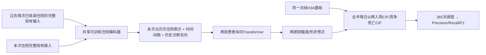

# 一年F1：统一异常检验与完整可学习历史的单种子实验

本轮按用户新授权完成有限任务，**没有恢复长期heartbeat或Goal**。一年365天严格AECOPD再入院为主F1结局，30/90天仅辅助；原全年每日竞争风险输出、患者队列/划分不变。

## 1. 已实际做完什么

1. 统一检验接口`patient_data/processed/v6_unified_lab_state_2026-10-14`：原核心与五额外检验/EOS都用九通道异常/复测摘要，共同检验MLP及注意力池化，不再让额外90维在融合后另加。特殊EOS激素前后语境留在同检验分支；不同单位/异常方向及生理阈值没有混为相同数值。
2. 纵向结构：每个预测点读取所有此前已经出院的合格住院的现有临床表格/全部B四字段向量，共享住院编码器可训练，再两层128维/4头/FFN256/Dropout.1的时间间隔Transformer。历史诊断/去向另外编码；不是使用固定教师C128或过去风险。BERT仍冻结，临床编码/文本投影/时间网络共同更新。
3. 四条件2×2：仅本次/完整历史 × 原检验/统一检验。每个seed42，临床全部从相同新鲜权重、共同冻结H34开始，零初始化末风险层；原完整V6权重只作强参照、不再暖启动所有候选。按一年F1选epoch及阈值，F1并列按IBS，早停10/7/1e-4/45。

**F1**为精确率与召回率的调和平均，`2TP/(2TP+FP+FN)`，不是准确率。采用常见“监督概率训练+验证F1阈值调优”，不强行对硬阈值F1求梯度；每个模型都按同样规则找一年最佳阈值，不固定0.5、不在测试调阈值。训练损失保留连续时间双原因NLL；F1成为本轮选点/早停主量，概率校准继续单列。

## 2. 主结果：F1目标选出了不同模型

同1531指定调参出院/402患者，一年内严格再入院359次。以下阈值/epoch均在该已曝光调参折选择，**不是独立泛化F1**。

|模型|实际/最佳轮|一年阈值|一年F1|精确率|召回率|误报率FP/(FP+TN)|全年再入院IBS↓|
|---|---:|---:|---:|---:|---:|---:|---:|
|保留原完整V6|本轮不训练|23.33%|.564706|48.88%|66.85%|21.42%|.098729|
|新鲜仅本次＋原检验对照|16/9|19.05%|**.587112**|51.36%|68.52%|19.88%|.101853|
|仅本次＋统一异常检验|15/8|28.06%|.571429|54.41%|60.17%|15.44%|.100030|
|完整历史＋原检验|10/1|26.47%|.571053|54.11%|60.45%|15.70%|.099804|
|完整历史＋统一异常检验|12/5|25.47%|.573281|53.64%|61.56%|16.30%|.099664|

四条件实际53epoch/5671优化器更新，无一固定满45或100轮；最佳点全非0。有效临床/新参数约251174、250342、521454、520622。原V6参数不是每轮冻结候选clinical权重。

|模型|预警次数|真阳性|假阳性|漏报|
|---|---:|---:|---:|---:|
|原V6|491|240|251|119|
|新鲜本次对照|479|246|233|113|
|统一检验本次|397|216|181|143|
|原检验历史|401|217|184|142|
|统一检验历史|412|221|191|138|

新鲜本次对照的调参F1比原V6高.022406（F1尺度约2.24点），同各自验证选阈值下少12次预警、多6次检出、少18次假阳性。但IBS相对变差约3.16%，一年平均风险17.916%低于库内事件比例23.449%（原V622.179%）。它适合更好的本折分类读出，并没有同时更好的概率输出。不能把F1提高等同个体风险校准改善。

统一检验＋历史F1 .573281比原V6小有利，也高于原检验历史.571053；但未胜新鲜本次对照.587112。统一检验本次F1反而低于同新鲜原检验。因此本轮**没有把统一数据/历史改造的效果与改变选点目标混为一谈**。

调参排序锁定`selected=current_original`，`nominated=null`。按本轮事前规则，新增数据/纵向候选需同时胜新鲜匹配对照与旧V6才能入围，当前未入围，不读取1418确认/历史测试重挑模型或阈值，不改原默认。本次有限实验已完成，不机械续跑多种子；用户若后续优先选择F1对照，再做一个独立锁阈值验证是另一有限步骤，不能声称本轮已完成该验证。

## 3. 数据真的统一了

全部检验方向token共同九通道：首测异常、观测峰异常、末测异常、峰后恢复差、末测年龄、峰至末时间、有观测、有效峰后复查、末次处于异常峰。不同检验仍保留不同名称/单位、低高异常方向和参考界限。核心pH/pCO2保留原已核验阈值，不能把静脉与动脉混同。

新方向来自五项目与EOS绝对/%各自低高方向，共14，连同旧22内部方向36；这是统一编码token数，不是36个独立检验。正常测量仍observed=true，异常程度0；缺测observed=false。每个方向使用训练尺度，未观测不补正常。原真实数值文件保留，模型现在显式强调异常，正常范围内变化可能被压缩，这是该表示的特性而非数据删除。

训练有效覆盖（低/高共用同原始观测，不可加倍当患者数）：中性比例3631、淋巴比例3631、RDW11798、阴离子间隙11856、氯11917、EOS绝对1912、EOS%3631。新记录要求本次住院内chart<=store<=discharge、单位和参考范围有效；没有有效参考范围不猜阈值。EOS时间上下文保留，但原额外原值分支删除，与原处理完全一样是本实验差异而不是归一化改名。

源3152512常规检验只为新增七概念解析一次，无高频chartevents/设备轨迹。新接口原22九通道数值对照通过，原NPZ不覆盖。

## 4. 历史不再只是H34摘要

训练13592出院/3766患者，9826次有可用过去合格住院；58107当前—过去关系，最长102个过去住院，未截断历史。43803关系的对应B选中文书已在当前入院前存档；其余14304包括无文本/未存档/未知对应文书，关闭历史文本，不去掉该住院表格。实际绑定B section→源note→storetime，不取所有小结的最大时间猜文书。

“完整”指所有既往合格住院都读取**现有核验V6内容**：常规检验/7药效/微生物/旧三支持/B四字段全部片段、过去诊断去向。不是原数据库所有表、所有药名剂量或全集影像。住院层128仍压缩，但每步可学习而非固定teacher表示；BERT backbone冻结是算力选择，不等历史clinical encoder冻结。

真实GPU两步证明lab/text/fusion风险头更新、纵向temporal/history_head更新；历史输入梯度L1在两历史条件分别.411171/.056186，去掉历史mask风险参数改变.113289/.093882，H34权重不变。动态读取历史确实进入训练，不能用这两个预检差值当医学效应。

## 5. 全局F1没有解决所有人群

对每个模型使用**整体已锁阈值**，不在次数层重调：

|模型|无既往层F1|1–2次层F1|≥3次层F1|
|---|---:|---:|---:|
|原V6|.252874|.463415|.637730|
|新鲜本次对照|.345679|.457831|.656514|
|统一检验本次|.225806|.427586|.648452|
|原检验历史|.000000|.417266|.649396|
|统一检验历史|.078431|.455172|.646957|

历史候选的全局阈值会漏掉很多无既往患者，不能因为整体F1略有利忽略这个实际问题。无历史仍输出本次编码风险，而非没有预测；共享encoder训练与整体阈值会影响其检出。不是依据一个层的点估计就删历史，但本轮不能采用这条全局预警策略。

## 6. 核验/开销/失败现场

- 8项合成回归：低高方向、缺参考、正常已测、单测/峰后恢复、F1同分/无病例/暴力阈值核对/非法数值，均通过。
- source/index实际核验全部19401住院的同患者/同折/入院前已出院/无自引用，无未来历史；当前FINAL仍回顾性政策。
- 四条件共同初始幅度/shape误差0，H34冻结；训练前真实共享/历史梯度更新已核验。训练期间没有修改受保护源码。
- 正式训练容器UTC06:47:01.587→06:49:03.014约121.43秒含来源/缓存/预检与四拟合；一次独立GPU核验UTC06:50:17.133→06:50:34.115约16.98秒，均退出0。缓存分配约.522GB，实际训练有动态中间张量，不把缓存大小说总显存峰值。
- 新进程重建全部输入/历史文书可见性/尺度hash、重载五模型（含旧参照）/每日概率/指标/F1阈值/早停/选点，误差0，proof绑定report SHA `51c1c81f115ad3a78017ad2e0a4a3dde83d6eadc91dfdfaab5ff6b57a6395d59`。无重复拟合。图training_f1_ibs.png/annual_decision.png已实际查看。
- 初版实际checked第5返回值是ExpandedBaseline，不是config；完整预检错误保留Docker后按定义修复，尚未拟合。随后原参照数值路径检查失败也未拟合，现场在无r2目录及work快照。正式r2旧参照保留TF32/256路径，新四条件统一FP32/128；真实探针显示差异源为精度/批形状，旧路径恢复幅度shape曲线误差0，不提高容差掩盖。新四条件重放误差0，不称FP32是模型性能改善根因。
- 原V6/data/labels/向量/索引不改，长期任务未恢复，无外部AI/高频/全文重新编码。

## 本轮结论

三个要求已实际落地并完成实验，不是仅讨论“有可能”。一年F1确实让选点从概率误差最优转向不同模型，并出现相对原V6更好的调参分类读出；统一异常与完整可学习历史完成了真实接口/网络接入，但本轮没有胜新鲜对照。下一轮若继续，应围绕已观察到的“历史候选无既往检出下降”和“F1候选概率低估”做明确机制改进，而不是否定历史方向或重复同一四条件。没有自动继续授权，后续按用户直接指令。
