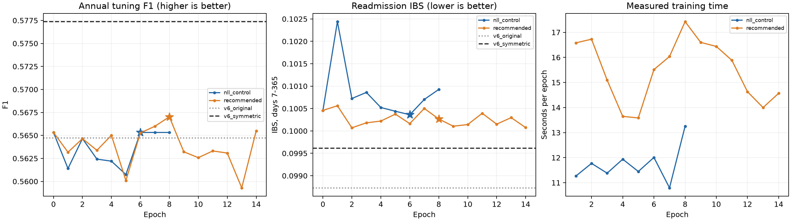

# V7首轮正式实验结果

2026-10-15，用户直接授权的首轮已完成。正式输出为`training_runs/v7_first_2026-10-15_r2`。V7两条件均完成实际GPU训练及早停；该单seed调参结果尚未支持替换原V6默认。

## 实际实现与冻结范围

全部有效临床表示256；8头/每头32；M4字段与住院读取、历史M4；FFN1024；历史Transformer2层；编码/attention Dropout=.1、融合/风险头=.3。冻结Bio_ClinicalBERT/RadBERT，文本768→256、影像类别聚合1536→256；BERT骨干仍是12层12头，不把V7的8头改进它内部。显式历史偏置`−softplus(lambda)×log1p(gap_days)`，是内容分数上的正值幂律时间衰减。

实际BERT参数108,310,272，去pooler为107,719,680；本轮BERT优化器参数0。V7有效可训练11,180,112参数，H34另冻结72参数。文本/影像投影591,360参数lr1e-4；其余新模块10,588,752参数lr3e-4；AdamW衰减.01、梯度clip1。

三层读取为文本字段内M4、字段→住院M4、住院→历史M4。38药物身份、10药效父类、剂量/频率有效mask和单位因子化；保留旧七药效四来源、常规36检验九通道/EOS语境、五微生物/三支持与H34背景。药物Query读取字段查询和影像token；影像Query读取文本。冻结向量内不重建逐词交互，CXR/CT为类别聚合而非逐报告表示。

尚未接入药物升级斜率、完整route/duration或新的隐式生物标志物规则字典；本轮不能回答这些独立机制的效果。

## 数据与损失

建模队列19401出院/5351患者，训练13592出院/3766患者，指定调参1531出院/402患者。全部58107条训练历史关系保留，最多102次过去住院，不截断；43803条历史文本可见，14304条因存档时间边界关闭文本，表格继续可用。细药训练覆盖11323出院，影像覆盖4005出院。严格AECOPD与竞争死亡/WorldA365标签保留，确认和历史测试不用于本轮选择。

对照：竞争NLL+1e-4修正平方。推荐：以上+1.0多期限Focal-smoothed+.1对比。Focal gamma2/alpha.75，标签平滑epsilon.05，即负/正目标.025/.975；7/14/30/60/90/180/365日×两原因等权。对比margin.5，文本↔药/检验/影像，同住院正对、不同患者负对，所有同患者负对与缺源排除，来源独立投影/L2范数。联合损失系数1/.1为首轮固定实施选择，外部报告未提供这两个系数。

两个条件同seed42新初始化，共同冻结H34，第0轮风险完全相同。最多30轮，至少8轮，patience6/min_delta1e-4，年度调参F1选点、并列选较低再入院IBS。对照最佳6轮，推荐最佳8轮；对照与推荐完成8/14轮。此配对分离联合损失效果；V7与V6比较仍混合了容量、输入和架构变化。

## 已选检查点结果

| 模型 | 一年F1 | PPV | 召回 | 平均AUC 7–365 | 一年AP | 再入院IBS | 死亡IBS |
|---|---:|---:|---:|---:|---:|---:|---:|
| 原V6 | 0.564706 | 0.488798 | 0.668524 | 0.802141 | 0.597872 | 0.098729 | 0.064127 |
| V6统一历史 | 0.573281 | 0.536408 | 0.615599 | 0.805225 | 0.595851 | 0.099664 | 0.064971 |
| V6对称背景 | 0.577373 | 0.541463 | 0.618384 | 0.806332 | 0.598865 | 0.099614 | 0.065008 |
| V7 NLL对照 | 0.565321 | 0.492754 | 0.662953 | 0.790024 | 0.586543 | 0.100361 | 0.065531 |
| V7 推荐联合损失 | 0.567023 | 0.493802 | 0.665738 | 0.790124 | 0.587351 | 0.100266 | 0.066214 |

F1/阈值均在同一暴露调参折选择，不能称独立验证成绩。IBS越低越好，AUC/AP/F1越高越好。多期限和双原因完整结果见`readout.json`与各条件`result.json`，以下摘30/90/365再入院：

| 天数 | 模型 | F1 | PPV | 召回 | AUC | AP | Brier | 平均预测 | 本库观察比例 |
|---|---|---:|---:|---:|---:|---:|---:|---:|---:|
| 30 | 原V6 | 0.372093 | 0.351648 | 0.395062 | 0.797710 | 0.255111 | 0.044166 | 0.055435 | 0.052907 |
| 30 | V6对称背景 | 0.358491 | 0.290076 | 0.469136 | 0.791103 | 0.285832 | 0.043938 | 0.047036 | 0.052907 |
| 30 | V7 NLL对照 | 0.361809 | 0.305085 | 0.444444 | 0.773359 | 0.267504 | 0.044291 | 0.060522 | 0.052907 |
| 30 | V7 推荐联合损失 | 0.358974 | 0.307018 | 0.432099 | 0.774117 | 0.266829 | 0.044304 | 0.064965 | 0.052907 |
| 90 | 原V6 | 0.451613 | 0.396226 | 0.525000 | 0.796093 | 0.380197 | 0.077665 | 0.108434 | 0.104507 |
| 90 | V6对称背景 | 0.457300 | 0.408867 | 0.518750 | 0.798710 | 0.388450 | 0.077917 | 0.099132 | 0.104507 |
| 90 | V7 NLL对照 | 0.465116 | 0.434783 | 0.500000 | 0.783789 | 0.376500 | 0.078285 | 0.113410 | 0.104507 |
| 90 | V7 推荐联合损失 | 0.457143 | 0.421053 | 0.500000 | 0.783110 | 0.380615 | 0.078266 | 0.118646 | 0.104507 |
| 365 | 原V6 | 0.564706 | 0.488798 | 0.668524 | 0.794785 | 0.597872 | 0.135978 | 0.221786 | 0.234487 |
| 365 | V6对称背景 | 0.577373 | 0.541463 | 0.618384 | 0.802597 | 0.598865 | 0.135964 | 0.223236 | 0.234487 |
| 365 | V7 NLL对照 | 0.565321 | 0.492754 | 0.662953 | 0.780660 | 0.586543 | 0.138829 | 0.223726 | 0.234487 |
| 365 | V7 推荐联合损失 | 0.567023 | 0.493802 | 0.665738 | 0.780864 | 0.587351 | 0.138720 | 0.226824 | 0.234487 |

本次采用性判断：推荐方案未在年度F1与全年概率误差上超过已保存的V6对称背景参照；小幅胜过V7 NLL对照并不证明整组超参数均有效。每来源/药物语义/时间衰减的独立增量需匹配消融，不能由组合结果直接接受或否定。

- `recommended_minus_nll_control`：年度F1差+0.001702，患者聚类95%区间[-0.004235710272275547, 0.007630462956418328]；IBS差-0.000095，95%区间[-0.00038144532610730176, 0.00018409741058113746]。
- `recommended_minus_v6_symmetric`：年度F1差-0.010351，患者聚类95%区间[-0.04227614337838799, 0.033114942673126334]；IBS差+0.000652，95%区间[-0.0016966298043252007, 0.0031975158991006153]。

区间为200次患者聚类配对抽样，固定已选模型/阈值；不消除调参选择偏差，单seed，未做多重比较校正。

## 实测耗时

GPU `NVIDIA GeForce RTX 4070 Ti`，FP32/关闭TF32，既有BERT向量复用，不重新编码或微调BERT。正式两条件及来源核验/缓存/统计合计348.56秒；来源核验11.55秒，CPU稀疏缓存0.90秒、479.1MiB。下列显存为进程Torch峰值，不含桌面等其他GPU进程。

| 条件 | 完成轮 | 最佳轮 | 更新步 | 纯训练秒 | 每轮评价合计秒 | fit总秒 | 训练中位秒/轮 | allocated MiB | reserved MiB |
|---|---:|---:|---:|---:|---:|---:|---:|---:|---:|
| V7 NLL对照 | 8 | 6 | 1704 | 93.86 | 5.31 | 102.62 | 11.61 | 801.6 | 932.0 |
| V7 推荐联合损失 | 14 | 8 | 2982 | 216.73 | 9.31 | 230.44 | 15.70 | 792.1 | 926.0 |

这些是冻结BERT的V7训练成本；BERT微调时间尚未测量。报告、重放与实现修复时间另外记载，不把它们混入纯训练时间。

## 来源内容敏感性

在已选best上，对当前与过去来源同时关闭其真实mask，H34基础风险保持；历史项仅关闭过去关系。以下为年度概率变化。它是内容依赖诊断，不能代替重训后的价值消融；不用于重新选点。

| 条件 | 关闭来源 | 再入院平均绝对变化 | 再入院最大绝对变化 | 死亡平均绝对变化 |
|---|---|---:|---:|---:|
| V7 NLL对照 | text | 0.00000810 | 0.00086564 | 0.00000333 |
| V7 NLL对照 | drugs | 0.00003448 | 0.00792910 | 0.00001979 |
| V7 NLL对照 | labs | 0.00009010 | 0.00232967 | 0.00003327 |
| V7 NLL对照 | radiology | 0.00000913 | 0.00217239 | 0.00000328 |
| V7 NLL对照 | history | 0.00008659 | 0.00247968 | 0.00003379 |
| V7 推荐联合损失 | text | 0.00010265 | 0.00085614 | 0.00019738 |
| V7 推荐联合损失 | drugs | 0.00111098 | 0.04001851 | 0.00177151 |
| V7 推荐联合损失 | labs | 0.00021039 | 0.01591291 | 0.00051647 |
| V7 推荐联合损失 | radiology | 0.00005399 | 0.00204673 | 0.00014193 |
| V7 推荐联合损失 | history | 0.00289817 | 0.01303819 | 0.00682776 |

已选推荐权重中，关闭药物后的年度再入院平均概率变化约0.1111个百分点，关闭过去历史约0.2898个百分点；检验/文本/影像也有非零影响。对照风险修正的记录间标准差较小，推荐权重的记录间修正变化更明显。该现象支持继续研究有效学习与来源使用，但不能把内容敏感性当作预测增量，也不能据此直接认定任一来源没有价值。

推荐末轮在线NLL2.752402、Focal0.119871、对比0.124361，正对22282、合法负对1122158；完整分项和梯度范数见`history.json`。

## 验证与实现问题

24项相关测试全部通过，其中CPU运行暂跳过的真实CUDA精度检查另在GPU通过。真实三步预检核对所有四字段压缩参数非零梯度/更新、活跃模块更新、无悬空可训练参数、冻结H34、历史内容梯度、共同初值。新的独立进程重建原来源/合同，best每日概率/分数/选点/早停误差0；last重建对照末轮记录并再次重放每日曲线误差0；AP/校准/F1患者区间及内容敏感性也独立重算一致。

初次运行发现字段M4压缩结果被丢弃，已停止并保留源码、日志和检查点于`training_runs/v7_first_2026-10-15`。修正后两条件在r2从头初始化，不接续旧优化器或权重；初次运行不作为性能结论。该问题已加入单元回归和GPU逐参数检查。

原V6默认、旧数据/向量/权重保留；本轮未恢复长期automation，未推送。冻结的BERT骨干与现有向量仍可继续用于V7后续有明确机制的匹配实验。
