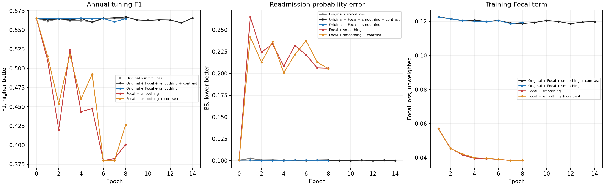

# V7损失组成核对与补充实验

2026-10-15。用户要求继续研究，并要求直接解释实际损失组成，追问为何没有采用外部报告推荐的损失。此次固定V7架构/输入/初值，只改变原竞争风险损失、Focal和平滑标签、对比项的组合，补做三次训练。

## 先回答原问题

上轮用过外部报告给出的Focal gamma2/alpha.75、Label Smoothing epsilon.05与对比margin.5。但实际总损失是：

`原竞争风险损失 + Focal(平滑标签) + .1×对比 + 1e-4×风险修正平方`。

其中，保留原竞争风险损失、设置对比相对权重.1、选用七个期限/两原因适配都属于实施选择，不能用“推荐联合损失”这种简称代替解释，更不能把上轮结果当作只用外部建议损失的效果。保留原损失的理由是增加对具体事件时间与竞争死亡的直接监督；它不是训练当前风险模型的必要条件，是否有益须实测。

用户提供的外部研究2第97行（原文未公开）没有给完整总损失/对比配对及权重。0.5是距离裕度，.1才是此处对比损失相对权重。标签平滑先将二元0/1目标变为.025/.975，再计算Focal，不是额外独立加一个未知损失。本次仍固定.1来隔离原竞争风险损失是否加入，并不把.1称为原文给定值。锁定合同把该行误标为98，实际定位为97，参数内容无差别；原合同保留以便核验。

Focal减少易分类样本对训练的影响，原始证据来自分类/检测，不保证本队列PPV或风险概率必然改善。[Focal原论文](https://arxiv.org/abs/1708.02002)。均匀标签平滑按`(1-epsilon)y+epsilon/K`定义；本次K=2。[标签平滑原论文第7节](https://arxiv.org/pdf/1512.00567)。两者结合采用上轮明确的软标签公式，原报告未定义唯一结合方式。

## 实验范围与结果

同19401建模出院/5351患者，train13592、指定调参1531/402患者；冻结BERT/RadBERT/H34，256维/8头/M4/FFN1024及全部历史保持，seed42新初始化，差分LR/Dropout/优化器不变。新增三种：Focal＋标签平滑＋.1对比；Focal＋标签平滑；原竞争风险损失＋Focal＋标签平滑。共同风险修正平方系数1e-4仍保留。

上一轮两个已核验条件直接复用，不重训。所有新模型第0轮风险逐项等于上一轮；相同最多30/min8/patience6早停，仍按年度调参F1选点、并列低IBS。

| 实际损失组成 | 最佳轮 | 一年F1 | 平均AUC 7–365 | 一年AP | 再入院IBS | 死亡IBS |
|---|---:|---:|---:|---:|---:|---:|
| 原竞争风险损失 | 6 | 0.565321 | 0.790024 | 0.586543 | 0.100361 | 0.065531 |
| 原竞争风险损失＋Focal＋标签平滑＋对比 | 8 | 0.567023 | 0.790124 | 0.587351 | 0.100266 | 0.066214 |
| 原竞争风险损失＋Focal＋标签平滑 | 4 | 0.565321 | 0.790187 | 0.586626 | 0.100127 | 0.065551 |
| Focal＋标签平滑 | 0（初始化） | 0.565321 | 0.790051 | 0.586675 | 0.100458 | 0.065634 |
| Focal＋标签平滑＋对比 | 0（初始化） | 0.565321 | 0.790051 | 0.586675 | 0.100458 | 0.065634 |

**最佳0表示初始化，没有接受训练后的临床权重；不能把该行分数当作Focal训练带来的收益。** 对应真实训练末轮另外列出：

| 实际损失组成 | 实际完成轮 | 末轮一年F1 | 末轮再入院IBS | 末轮死亡IBS |
|---|---:|---:|---:|---:|
| 原竞争风险损失＋Focal＋标签平滑 | 8 | 0.564706 | 0.100189 | 0.066036 |
| Focal＋标签平滑 | 8 | 0.400818 | 0.205970 | 0.202514 |
| Focal＋标签平滑＋对比 | 8 | 0.426304 | 0.205471 | 0.195554 |

Focal直接替代原损失的两个条件均实际完成训练，未超过初始化；这只说明当前V7、参数与七期限双原因适配没有得到可接受收益，不能据此否定Focal在其他分类设计中的价值，也不能独立否定标签平滑或对比学习。已保存的原V6/对称背景仍作强参照，默认不替换。

| 实际损失组成 | 天数 | F1 | PPV | 召回 | AUC | Brier |
|---|---:|---:|---:|---:|---:|---:|
| 原竞争风险损失 | 30 | 0.361809 | 0.305085 | 0.444444 | 0.773359 | 0.044291 |
| 原竞争风险损失 | 90 | 0.465116 | 0.434783 | 0.500000 | 0.783789 | 0.078285 |
| 原竞争风险损失 | 365 | 0.565321 | 0.492754 | 0.662953 | 0.780660 | 0.138829 |
| 原竞争风险损失＋Focal＋标签平滑＋对比 | 30 | 0.358974 | 0.307018 | 0.432099 | 0.774117 | 0.044304 |
| 原竞争风险损失＋Focal＋标签平滑＋对比 | 90 | 0.457143 | 0.421053 | 0.500000 | 0.783110 | 0.078266 |
| 原竞争风险损失＋Focal＋标签平滑＋对比 | 365 | 0.567023 | 0.493802 | 0.665738 | 0.780864 | 0.138720 |
| 原竞争风险损失＋Focal＋标签平滑 | 30 | 0.363636 | 0.307692 | 0.444444 | 0.773648 | 0.044457 |
| 原竞争风险损失＋Focal＋标签平滑 | 90 | 0.463768 | 0.432432 | 0.500000 | 0.783990 | 0.078464 |
| 原竞争风险损失＋Focal＋标签平滑 | 365 | 0.565321 | 0.492754 | 0.662953 | 0.780698 | 0.138385 |
| Focal＋标签平滑 | 30 | 0.361809 | 0.305085 | 0.444444 | 0.773325 | 0.044304 |
| Focal＋标签平滑 | 90 | 0.465116 | 0.434783 | 0.500000 | 0.783785 | 0.078302 |
| Focal＋标签平滑 | 365 | 0.565321 | 0.492754 | 0.662953 | 0.780740 | 0.138940 |
| Focal＋标签平滑＋对比 | 30 | 0.361809 | 0.305085 | 0.444444 | 0.773325 | 0.044304 |
| Focal＋标签平滑＋对比 | 90 | 0.465116 | 0.434783 | 0.500000 | 0.783785 | 0.078302 |
| Focal＋标签平滑＋对比 | 365 | 0.565321 | 0.492754 | 0.662953 | 0.780740 | 0.138940 |

- Focal＋标签平滑＋对比 减 原竞争风险损失＋Focal＋标签平滑＋对比：一年F1差-0.001702、95%区间[-0.007630462956418327, 0.004235710272275549]；再入院IBS差+0.000192、95%区间[-0.0002859627195801891, 0.0006346418651514753]。
- Focal＋标签平滑＋对比 减 Focal＋标签平滑：一年F1差+0.000000、95%区间[0.0, 0.0]；再入院IBS差+0.000000、95%区间[0.0, 0.0]。
- 原竞争风险损失＋Focal＋标签平滑 减 原竞争风险损失＋Focal＋标签平滑＋对比：一年F1差-0.001702、95%区间[-0.007630462956418327, 0.004235710272275549]；再入院IBS差-0.000140、95%区间[-0.0007981477924530233, 0.0005351790396602233]。
- 原竞争风险损失＋Focal＋标签平滑 减 Focal＋标签平滑：一年F1差+0.000000、95%区间[0.0, 0.0]；再入院IBS差-0.000331、95%区间[-0.0013564284122185818, 0.0007691138934994689]。

200次患者聚类配对区间，固定已选阈值/模型，单seed暴露调参，不能替代独立验证。两个直接Focal条件均选第0轮，故两者区间为0只反映共同初始化，不能证明两种训练等效。全部7/14/30/60/90/180/365读出、AP/校准见`readout.json`。

## 为什么损失下降，风险概率却可能更差

按本次明确公式计算一个简化例子：假设单一二元任务中，所有人具有相同真实发生率，模型只能输出一个分数。对该参数组合取期望损失并数值求最小值，可得：

| 假设真实发生率 | 本次Focal＋平滑公式偏好的分数 |
|---|---:|
| 1% | 30.30% |
| 5% | 36.78% |
| 10% | 41.73% |

这是独立数学例子，不是本队列患者预测，也不保证神经网络达到这些最优值。它说明加权分类分数不能自动当作真实风险概率；把该损失直接用于多期限风险曲线，需要另外核对概率误差。公式、数值重算和普通二元交叉熵的最小值检验保存在`probability_probe.json`及独立证明。

同一初始、含较长历史/影像的真实预检批次，各项梯度范数：原竞争风险损失4.806987，Focal 0.305576，.1加权对比0.750256；原损失与Focal方向余弦-0.361666。负值表示该批次存在更新方向冲突，不能用上轮混合训练代替只用Focal。该批次并非总体随机样本，不能把此数值外推全部训练；也未据此调权重。

## 时间与核验

| 新训练损失组成 | 完成轮 | 更新步 | 纯训练秒 | 含评价保存fit秒 |
|---|---:|---:|---:|---:|
| 原竞争风险损失＋Focal＋标签平滑 | 8 | 1704 | 101.21 | 111.42 |
| Focal＋标签平滑 | 8 | 1704 | 97.27 | 107.28 |
| Focal＋标签平滑＋对比 | 8 | 1704 | 111.28 | 121.09 |

此次三次训练/核验前统计合计359.77秒，RTX4070Ti，冻结向量复用。15相关测试通过，含去掉原损失后的梯度等价/时间约束排除、旧公式一致性和来源mask回归。实际GPU三种均验证有效风险/临床路径更新、基础风险冻结；不加对比时仅其独立投影头按设计没有梯度。

新的独立GPU进程重建来源/合同及best/last，保存幅度/shape/366日概率/每日事件概率和条件概率误差0；全部基础指标/早停/选点一致。补充读出逐项核对保存的最佳/末轮多期限结果、患者配对统计并独立重算一致。未使用确认/测试选点，未恢复长期automation，原资产保留。
