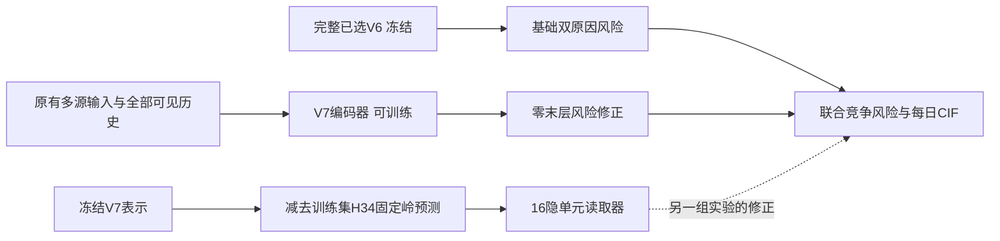
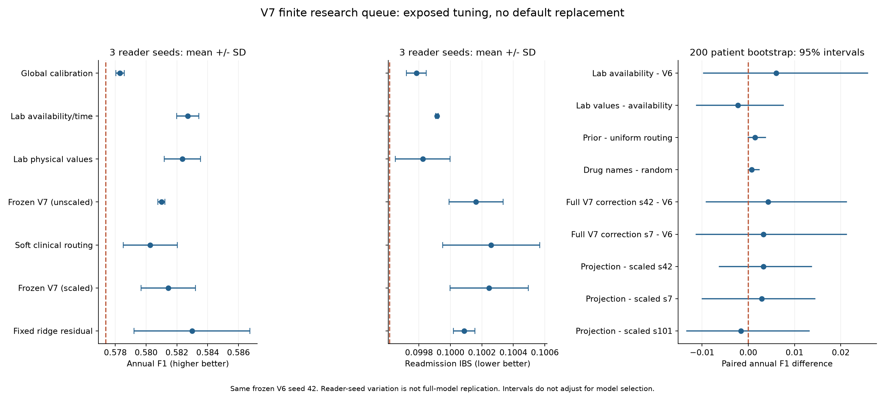

# V7现有研究线索顺序实验结果（2026-10-15）

本轮完成56次新模型拟合：47次神经模型/小读取器拟合及519实际神经epoch，另有两折3家族的6个成员和全训练集3个成员。复用了已核验旧对照，没有重训相同配方来增加数量。56指每个种子、每个条件或每个内折成员一次拟合，不把等权/加权/温度三种读出再算成新模型。

当前最有价值的线索是：**冻结完整强V6后，V7只学习风险修正**，两个种子均有小幅年度F1提升；**固定训练集线性去重**在三个读取器种子中有两个优于匹配对照，但方差较大。新检验物理表示、复杂临床路由和异构融合尚未显示足以替换原默认的稳定综合收益。所有候选与对照的权重、初值、末轮和失败证据原位保存。

这里的完成是把用户提供的具体线索逐项转化为实验、既有证据或已查明的数据条件；不声称所有可能改善已被穷尽。本轮停止扩大弱配方网格，原默认保留。

## 共同评价与时间边界

队列保持19401次出院/5351患者，训练13592次/3766患者，指定调参1531次/402患者。只使用训练及该调参数据开发；确认和历史测试的结局未进入本轮选择。BERT/RadBERT冻结，复用既有向量；药物名称另用冻结BERT编码38个公开标准名称，没有微调BERT。

任务仍为本库记录可观察的首次严格AECOPD再入院和在先竞争死亡（World A），一年每日S/F1/F2，当前FINAL小结属于回顾性研究可见范围。原有院外不可见性不被新增网络消除。World A的365日前没有提前删失，本轮Brier权重为1；没有编造失访时间或把竞争死亡当普通失访。

选点统一为年度调参F1最大，并列较低再入院IBS，再并列较早epoch。阈值由已保存模型在调参折确定。IBS越低越好；F1是选定阈值下的决策表现，平均AUC是排序，三个指标不能互相替代。8个新神经条件选中第0轮，意味着训练未超过初始风险，不能称为训练提升。

计算按缓存优先、弱条件早停、有限追加种子和并行重放安排。完整V7通常最多16/至少8/patience6；Query第二种子一对匹配缩短为最多12/至少6/patience4，因预算不同不当成完全同预算两种子估计。小读取器最多24/至少8/patience6。OOF从五折缩短为两折，所有内折处理和监督仍按患者隔离。

## 原建议的逐项处理与决定

|线索|本轮实际处理|结果与决定|
|---|---|---|
|高维新增模块可能干扰稳健主干|完整已选V6风险冻结，整个V7编码器端到端学习修正，seed42/7|两种子F1均小幅上升，IBS均略差；保留候选，不替换默认|
|OOF冻结基座|两折融合中基座/预处理从内折重新拟合；强V6修正实验明确使用完整训练冻结模型|后者不是OOF锚定模型；未把完整训练监督表示偷放入OOF|
|批次内正交|原公式已用合成例验证批次依赖/秩风险；改为仅训练集拟合固定岭映射H34→V7表示，再移除可预测部分|三个读取器种子2胜1负；岭残差不是严格正交，更不保证剩余信息有用|
|零初始化门|α=0配非零随机末层，合成测试确认门梯度可动且epoch0等于强V6|F1仅0.578125；合法实现可训练，但无自动性能下界或优势|
|临床阈值PLE|九个物理项目，有限训练分位点与临床节点，同容量原值线性读取为对照|首种子未超过线性；不扩分箱/嵌入网格|
|出院未纠正异常|复用原36异常方向状态；新增首末值、末次距出院、物理方向与节点表示|没有另用未来“稳态”标签，也不把最后测量当真实出院时化验|
|恢复斜率|按物理项目、唯一标本时刻构造首末变化/时间，方向和缺测mask保留|未超过来源/时间对照，暂缓扩大|
|恢复曲率|至少三个唯一时点才估计末三点速度变化|已快筛；稀疏项目可用性有限，未得到清楚增量|
|抽血密度|log1p(唯一采样次数/住院天数)，独立显式输入，保留LOS与观测来源|已比较；未超过简单可用性/时间对照|
|再入院/死亡原因分支与软路由|同容量普通与先验偏置来源路由，全部合法来源仍可学习；先验另追加两读取器种子|首种子小增量未呈稳定优势；不detach合法竞争风险梯度|
|EOS与出院ICS失配|只使用可判定的EOS与明确出院ICS记录，比较组成主效应和额外交互|F1相同，IBS略差；这是记录组合，不定性为治疗不足|
|高碳酸血症/家庭NIV交互|核对已有支持/过渡接口与文本事实目录|住院NIV不等于出院家庭NIV，尚缺全量可回溯的家庭设备处方/明确否认，不能未知填0|
|频繁加重/单药交互|复用严格既往次数与出院吸入方案资产核对|药物成分计数不等于治疗方案级别；需先锁定单方/复方、停用/保留语义，不把现有字段直接乘作治疗不足|
|心肺叠加/出院心衰管理交互|查既有CXR四状态、BNP和吸入药方案接口|吸入方案不是完整心衰/利尿治疗清单，缺少可判定完整管理状态，保留为数据依赖项|
|Focal＋标签平滑|新增无平滑直接Focal和NLL＋Focal；与旧平滑及对比结果合并解释|直接Focal去掉平滑仍明显退化，不能把差表现只归给平滑；保留竞争NLL|
|NLL＋指定时点Brier|固定系数1，30/90/180/365双原因，World A权重1|未超过初值；仅否定此配方的扩展优先级，不否定恰当评分原则|
|温度缩放|仅训练OOF四时点双原因Brier拟合共同温度1.006562|概率误差稍改善，未超过强V6；没有把标签平滑称为严格恰当目标|
|跨源Query|原NLL下保留/关闭，第二种子再做匹配对照|seed42关闭F1较高但IBS较差，seed7两者均选初值，未稳定复现|
|显式时间衰减|只关历史注意力时间偏置，保留全部历史和gap|该配方未超过初值；不能推成时间或历史没有价值|
|药物Query增加检验键|编码结构已实现并训练，检验token和mask进入键值|未超过初值，不扩大此连接|
|药物复合表示|原V7已有因子化药物身份/父类/剂量等相加投影|保留已有实现，不重复命名为新增创新|
|药物名称语义迁移|冻结ClinicalBERT编码38药名，比较来源、身份、同维随机和语义向量|语义相对随机仅小幅差异；名称词义不等于药理知识蒸馏|
|长期/升级记录|同药前后24h都有执行才比较频次/可核对剂量，保留记录跨度及route|已8条件筛查；坡度相对来源仅弱增量，完整疗程时长与执行跨度区分|
|文本隐式标志物的规则—神经抽取|复核已有clinical_facts目录、断言/时间/证据守卫和已验证局部接口|未找到已完成全量facts.npz；不能把目录或字典当已抽取数据。本轮不启动全队列本地LLM重抽或付费调用|
|三层M4、差分LR及超参数|沿用已修复M4风险路径、256/8头/FFN1024及.1/.3Dropout、差分LR|冻结BERT仍只训练其投影等网络；不引入BERT微调耗时|
|Cox＋树＋神经OOF融合|患者两折，3家族共6成员；固定24轮紧凑神经成员，另完整训练集3成员重拟合|融合改善部分单成员但未超过强V6；不预设+0.012～0.025 AUC|
|跨数据集教师蒸馏|目标医保字段、可见模态及标签对应未知|缺少可定义的教师输入/学生输入及监督桥，不能用别的数据集名称代替对齐证据|

## 最有希望的结构到底是什么

完整V6已经形成每日两原因风险，后续训练不改变其参数。V7接收原有全部合法输入，只输出幅度和形状的有限修正。另一种廉价实验先固定已训练V7的256维表示，再用训练集H34线性预测并移除其中可预测部分，最后训练一个16隐单元的小读取器。二者是不同实验，不把小读取器结果当成完整V7重训结果。

原批次Gram–Schmidt和双重零初始化未照搬，具体数学原因见[外部设计核对](V7_EXTERNAL_MATH_ENGINEERING_REVIEW_2026-10-15.md)。固定岭投影降低训练集内可线性解释成分，推断时不依赖同批其他患者；α零门仅保证初始化风险相同，训练后验证表现可以低于基座。

## 关键指标

下表是已锁定选点，不因另一轮IBS更低就重新挑选epoch。完整强基座seed42在第7与10轮年度F1相同，按IBS选择第10轮；第6轮虽IBS更低但F1较低，未事后改选。

|条件|年度F1↑|再入院IBS↓|死亡IBS↓|平均AUC↑|选定epoch|
|---|---:|---:|---:|---:|---:|
|reference/strong_v6|0.577373|0.099614|0.065008|0.806332|5|
|reference/v7_nll_control|0.565321|0.100361|0.065531|0.790024|6|
|reference/v7_recommended|0.567023|0.100266|0.066214|0.790124|8|
|phase1/without_cross_query|0.577075|0.100667|0.065362|0.804515|10|
|strong_anchor|0.581683|0.099908|0.065145|0.807360|10|
|strong_replication|0.580645|0.099634|0.065378|0.807419|2|
|cached/availability|0.583436|0.099924|0.065074|0.806428|15|
|cached/linear|0.581218|0.099705|0.064821|0.806862|1|
|cached/ple|0.579634|0.099864|0.065103|0.806876|1|
|residual_controls/scaled_v7|0.583439|0.100033|0.064767|0.805882|9|
|residual_controls/fixed_projection|0.586735|0.100100|0.064742|0.806095|10|
|residual_controls/zero_gate|0.578125|0.099649|0.064996|0.806255|1|
|two_fold/cox|0.560000|0.100308|0.064486|0.797896|—|
|two_fold/weighted_temperature|0.568922|0.101438|0.064467|0.805353|—|
|full_refit/weighted_temperature|0.571429|0.100945|0.064325|0.803711|—|

## 追加种子与患者配对区间

以下三个种子只改变读取器，完整V6及冻结V7表示都保持seed42，不能称为三个独立完整模型。标准差度量读取器随机性，不包含重新抽取数据、基座重训或选点的不确定性。

|条件|F1均值±样本标准差|再入院IBS均值±样本标准差|
|---|---:|---:|
|global|0.578302 ± 0.000273|0.099783 ± 0.000063|
|availability|0.582717 ± 0.000719|0.099915 ± 0.000008|
|linear|0.582355 ± 0.001177|0.099824 ± 0.000174|
|v7_frozen|0.580997 ± 0.000235|0.100163 ± 0.000172|
|routing_prior|0.580268 ± 0.001758|0.100259 ± 0.000309|
|scaled_v7|0.581441 ± 0.001769|0.100246 ± 0.000249|
|fixed_projection|0.582986 ± 0.003763|0.100087 ± 0.000067|

按402名患者做200次共同配对重采样，同患者全部重复出院保留，阈值固定为原选定值。区间条件于已拟合模型和已暴露调参折，未作多重比较校正，不是独立验证，也不用于再次选模型。以下差值均为候选减对照；F1正值较好，IBS负值较好。区间端点为0或零宽区间可能来自相同分类决定，不能证明总体等效或真实收益。

|候选－对照|ΔF1|患者配对95%区间|ΔIBS|患者配对95%区间|
|---|---:|---|---:|---|
|cached/availability − reference/strong_v6|+0.006063|[-0.009656, +0.025773]|+0.000310|[-0.000361, +0.001158]|
|cached/availability − cached/global|+0.005311|[-0.009829, +0.024483]|+0.000192|[-0.000219, +0.000691]|
|cached/linear − cached/availability|-0.002218|[-0.011182, +0.007558]|-0.000219|[-0.000661, +0.000151]|
|cached/clinical_interaction − cached/clinical_main|+0.000000|[+0.000000, +0.000000]|+0.000042|[-0.000021, +0.000113]|
|cached/routing_prior − cached/routing_uniform|+0.001444|[+0.000000, +0.003696]|+0.000003|[-0.000026, +0.000036]|
|drug_screen/name_semantic − drug_screen/name_random|+0.000750|[+0.000000, +0.002359]|-0.000028|[-0.000067, +0.000004]|
|drug_screen/dynamics_slope − drug_screen/dynamics_source|+0.000895|[-0.009632, +0.010540]|-0.000303|[-0.001128, +0.000344]|
|phase1/without_cross_query − reference/v7_nll_control|+0.011754|[-0.010769, +0.031474]|+0.000305|[-0.001468, +0.002205]|
|query_replication/without_cross_query − query_replication/control|+0.000000|[+0.000000, +0.000000]|+0.000000|[+0.000000, +0.000000]|
|strong_anchor − reference/strong_v6|+0.004310|[-0.009069, +0.021231]|+0.000293|[-0.000429, +0.001209]|
|strong_replication − reference/strong_v6|+0.003272|[-0.011258, +0.021244]|+0.000020|[-0.000456, +0.000625]|
|residual_controls/fixed_projection − residual_controls/scaled_v7|+0.003295|[-0.006209, +0.013669]|+0.000067|[-0.000231, +0.000335]|
|residual_controls/fixed_projection − reference/strong_v6|+0.009361|[-0.002911, +0.025154]|+0.000486|[-0.000472, +0.001552]|
|residual_controls/zero_gate − residual_controls/scaled_v7|-0.005314|[-0.020780, +0.006528]|-0.000384|[-0.001258, +0.000375]|
|two_fold/weighted_temperature − two_fold/cox|+0.008922|[-0.011369, +0.036392]|+0.001130|[-0.001027, +0.004388]|
|full_refit/weighted_temperature − full_refit/cox|+0.012200|[-0.011611, +0.046431]|+0.000905|[-0.001105, +0.003734]|
|full_refit/weighted_temperature − reference/strong_v6|-0.005945|[-0.039324, +0.025156]|+0.001330|[-0.000927, +0.003707]|
|residual_followup/7/fixed_projection − residual_followup/7/scaled_v7|+0.002941|[-0.009911, +0.014424]|-0.000037|[-0.000371, +0.000358]|
|residual_followup/101/fixed_projection − residual_followup/101/scaled_v7|-0.001600|[-0.013249, +0.013180]|-0.000506|[-0.001275, +0.000090]|

## 数据新接口与覆盖边界

普通检验源单次解析3152512行，新建九项物理轨迹：动脉pH/PaCO2、血红蛋白、白蛋白、肌酐、碳酸氢根、白细胞、NT-proBNP和绝对嗜酸细胞。保留来源标本/单位/时间规则，同刻取中位数后计算首末、极值、采样计数、速率和末三点曲率。五项旧物理首末与EOS独立对照误差0。仅训练行拟合缩放和有限PLE尾节点，不用调参分布定边界。

EOS/ICS有明确记录的训练组合为1211次出院；未知记录不作为无ICS。药物动态仅在首末24小时均有同药明确执行时计算频次变化；剂量需要组成与单位可核对。复方未知单成分剂量保留未知，不跨药比较毫克，不把无执行记录当停药。route规范化与记录跨度进入独立条件，但这些不是完整家庭设备、心衰管理或真实药物疗程。

文本补充抽取应沿用项目已有证据目录：保留原文证据、肯定/否认/不确定、当前/既往/计划、测量时间与提及时间、单位和来源。以训练样本人工核对再定字典，直接结构化检验冲突单列、未知保留；规则提候选、神经模型判断上下文、守卫拒绝无逐字证据。当前没有经过全量完成与来源验证的通用facts接口，因此没有据此声称已训练完整隐式标志物模型。现有经过验证的局部呼吸事实/PFT背景证据仍被保留。

## OOF融合的隔离和实际范围

两折成员均重新拟合自己的缩放、PCA和有监督参数。神经成员使用未在本队列标签训练的冻结BERT当前/既往文本缓存加结构化输入，是256→32→4的紧凑模型；不是11M参数完整V7的两折复现，也未用全训练V7表示充当OOF。Cox为双原因L2=10；树为100棵/深度3的离散人时风险集三分类，每段转为恒定强度，输出共同每日S/F1/F2。

OOF共同凸权重为Cox 0.601374、树0.165176、紧凑神经0.233450，两原因和全部时点共用；共同温度1.006562也仅在训练OOF估计。外层用两个内折模型概率均值；随后3个家族按相同超参数重拟合完整训练集，继续使用原OOF权重/温度。没有根据外层调参改权重。当前融合没有超过强V6，停止这一固定配方的扩展。

## 独立验证、失败修复与复现

36项相关合成回归全部通过。11个训练批次的best/last或成员权重已在新进程独立重载，源合同、每日风险、指标、早停和选点一致，最大预测误差0；检验和药物动态接口均从原始来源重建，误差0。统计汇总另用新进程重算0。不能把这些工程一致性写成临床泛化验证。

保留了两种实际错误现场：XGBoost2.1.3与sklearn1.6.1的包装器重载报`AttributeError: 'super' object has no attribute '__sklearn_tags__'`，改用原生Booster读取相同权重后独立重放0，没有重新调参；第一次残差验证容器遗漏GPU参数报无NVIDIA驱动，保留日志后用声明GPU的容器完成验证，不改训练源。原失败容器与日志均保留。

正式本地输出在`training_runs/v7_sequential_research_2026-10-15/`，包含每批合同/来源hash、best/last及每日概率、独立证明、`readout.json`和`readout_verification.json`。其中含受限派生数据和权重，不公开。代码/合成测试、合同及本报告和聚合PNG可以审阅；公开不包含患者行、标签/划分/预测、向量或权重。

复现入口和各批合同见[运行说明](../training/v7/README.md)。真实来源/hash/本地模型缺一时入口拒绝执行；克隆公开源码仅能运行不依赖患者数据的合成回归。

## 全部模型读出附表

附表包含47个新神经拟合的选点、3个复用旧参考和两组各6种融合读出。Cox/树每内折计一个家族成员；融合读出不额外计拟合。实际519神经epoch不包含epoch0，也不包含旧模型训练；树迭代和Cox优化步不混入神经epoch。

|条件/种子|实际神经epoch|选定epoch|年度F1↑|再入院IBS↓|死亡IBS↓|
|---|---:|---:|---:|---:|---:|
|reference/strong_v6|—|5|0.577373|0.099614|0.065008|
|reference/v7_nll_control|—|6|0.565321|0.100361|0.065531|
|reference/v7_recommended|—|8|0.567023|0.100266|0.066214|
|phase1/focal_no_smoothing|8|0|0.565321|0.100458|0.065634|
|phase1/nll_focal_no_smoothing|14|8|0.567023|0.100253|0.065791|
|phase1/without_cross_query|16|10|0.577075|0.100667|0.065362|
|phase1/without_explicit_decay|8|0|0.565321|0.100458|0.065634|
|phase1/drug_query_labs|8|0|0.565321|0.100458|0.065634|
|phase1/nll_brier|8|0|0.565321|0.100458|0.065634|
|cached/global|8|2|0.578125|0.099732|0.064905|
|cached/v7_frozen|10|4|0.581132|0.100298|0.064721|
|cached/availability|18|15|0.583436|0.099924|0.065074|
|cached/linear|8|1|0.581218|0.099705|0.064821|
|cached/ple|8|1|0.579634|0.099864|0.065103|
|cached/velocity|8|1|0.579634|0.099862|0.065143|
|cached/density|11|5|0.580729|0.099910|0.065646|
|cached/curvature|11|5|0.581725|0.100020|0.065543|
|cached/clinical_main|13|7|0.579017|0.099825|0.065052|
|cached/clinical_interaction|12|6|0.579017|0.099867|0.065041|
|cached/routing_uniform|8|1|0.580645|0.099906|0.065417|
|cached/routing_prior|8|1|0.582090|0.099909|0.065384|
|cached_followup/7/global|8|8|0.578164|0.099853|0.064931|
|cached_followup/7/availability|16|10|0.582716|0.099913|0.065028|
|cached_followup/7/linear|12|6|0.583569|0.100024|0.065174|
|cached_followup/7/v7_frozen|18|12|0.581132|0.099969|0.064764|
|cached_followup/7/routing_prior|8|2|0.578581|0.100491|0.065606|
|cached_followup/101/global|8|2|0.578616|0.099764|0.064908|
|cached_followup/101/availability|18|12|0.581998|0.099908|0.065071|
|cached_followup/101/linear|10|4|0.582278|0.099744|0.064899|
|cached_followup/101/v7_frozen|8|2|0.580726|0.100221|0.064823|
|cached_followup/101/routing_prior|11|5|0.580132|0.100378|0.065007|
|drug_screen/name_source|9|3|0.581725|0.099913|0.065161|
|drug_screen/name_identity|9|3|0.579897|0.099954|0.065406|
|drug_screen/name_random|9|3|0.581725|0.099910|0.065166|
|drug_screen/name_semantic|9|3|0.582474|0.099882|0.065114|
|drug_screen/dynamics_source|16|10|0.579750|0.100576|0.065495|
|drug_screen/dynamics_main|8|0|0.577373|0.099614|0.065008|
|drug_screen/dynamics_slope|11|5|0.580645|0.100273|0.065508|
|drug_screen/dynamics_route|8|0|0.577373|0.099614|0.065008|
|strong_anchor|13|10|0.581683|0.099908|0.065145|
|query_replication/control|6|0|0.565321|0.100458|0.065634|
|query_replication/without_cross_query|6|0|0.565321|0.100458|0.065634|
|residual_controls/scaled_v7|15|9|0.583439|0.100033|0.064767|
|residual_controls/fixed_projection|16|10|0.586735|0.100100|0.064742|
|residual_controls/zero_gate|8|1|0.578125|0.099649|0.064996|
|strong_replication|8|2|0.580645|0.099634|0.065378|
|residual_followup/7/scaled_v7|19|13|0.580076|0.100185|0.064857|
|residual_followup/7/fixed_projection|19|13|0.583016|0.100148|0.065035|
|residual_followup/101/scaled_v7|18|12|0.580808|0.100520|0.064930|
|residual_followup/101/fixed_projection|10|4|0.579208|0.100014|0.064395|
|two_fold/cox|—|—|0.560000|0.100308|0.064486|
|two_fold/tree|—|—|0.555233|0.103835|0.067660|
|two_fold/neural|—|—|0.504965|0.112438|0.068869|
|two_fold/equal|—|—|0.572840|0.103169|0.064840|
|two_fold/weighted|—|—|0.569270|0.101715|0.064413|
|two_fold/weighted_temperature|—|—|0.568922|0.101438|0.064467|
|full_refit/cox|—|—|0.559229|0.100040|0.064363|
|full_refit/tree|—|—|0.565149|0.102984|0.067432|
|full_refit/neural|—|—|0.489945|0.113700|0.072978|
|full_refit/equal|—|—|0.570713|0.102587|0.064832|
|full_refit/weighted|—|—|0.569987|0.101178|0.064249|
|full_refit/weighted_temperature|—|—|0.571429|0.100945|0.064325|
