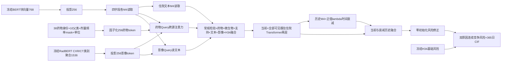
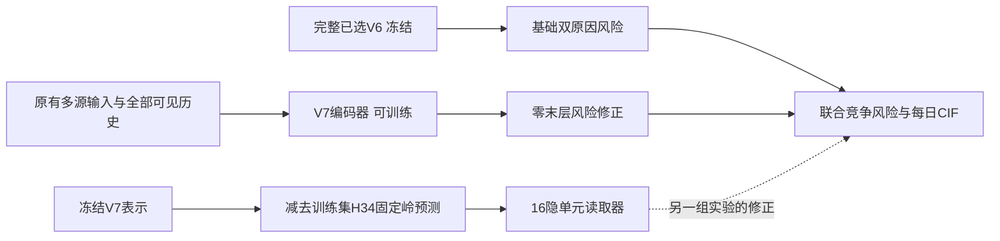

# 06_V7_TESTS_AND_TOOLS

源文件正文或经过字段白名单提取的汇总数据，来源身份见每段元数据。

## .gitignore · lines 1–90

<!-- REVIEW_FRAGMENT {"path":".gitignore","part":1,"start_line":1,"end_line":90,"source_sha256":"0b228e7850e17b86534260fc63f07e24ee3d4b9ff01359b9d8e48775988f6861","fragment_sha256":"0b228e7850e17b86534260fc63f07e24ee3d4b9ff01359b9d8e48775988f6861","added_terminal_newline":false} -->
````text
# Public repository: source and aggregate documents only.
# Never add MIMIC data, identifiers, predictions, embeddings or model weights.
.env
.env.*
*.env
*.pem
*.key
*.p12
*.pfx
.pgpass
pgpass.conf
*credentials*
*secrets*
__pycache__/
*.py[cod]
.pytest_cache/
.mypy_cache/
.ruff_cache/
.venv/
venv/
node_modules/
.idea/
.vscode/
*.log
*.out
*.tmp
*.bak
*.csv
*.tsv
*.json
*.jsonl
*.ndjson
*.parquet
*.arrow
*.feather
*.sqlite*
*.db*
*.gz
*.bz2
*.xz
*.zip
*.7z
*.tar
*.rar
*.npy
*.npz
*.pt
*.pth
*.ckpt
*.safetensors
*.bin
*.gguf
*.onnx
*.pkl
*.pickle
*.joblib
*.h5
*.hdf5
*.png
*.jpg
*.jpeg
*.webp
*.pdf
*.pptx
*.docx
*.xlsx
/outputs/
/training_runs/
/transfer/
/Bonsai2_Extraction_Pipeline/
/.agents/
/.build_architecture/
/.codex-finalizer-architecture/
/training/model_cache/
/training/cv/
/training/reports/
/training/runtime/*/
/patient_data/**
!/patient_data/**/
!/patient_data/*.py
!/patient_data/clinical_facts/*.py
/work/**
!/work/prepare_public_snapshot.py
!/config/clinical_feature_contract.csv
!/config/clinical_feature_contract_v2_diagnosis.csv

# Reviewed aggregate-only V7 figures, not patient images or record-level outputs.
!/docs/figures/v7_first_experiment_2026-10-15.png
!/docs/figures/v7_loss_comparison_2026-10-15.png
!/docs/figures/v7_sequential_research_2026-10-15.png
````
<!-- END REVIEW_FRAGMENT -->

## model_loader/tests/test_aecopd_loader.py · lines 1–324

<!-- REVIEW_FRAGMENT {"path":"model_loader/tests/test_aecopd_loader.py","part":1,"start_line":1,"end_line":324,"source_sha256":"4f736c5f4692e97a2a481a079cbc30e89628ad48d2efe209e14462453850c59e","fragment_sha256":"4f736c5f4692e97a2a481a079cbc30e89628ad48d2efe209e14462453850c59e","added_terminal_newline":false} -->
````python
from __future__ import annotations

import csv
import gzip
import json
import math
import sys
import tempfile
import unittest
from pathlib import Path

sys.path.insert(0, str(Path(__file__).resolve().parents[1]))

from aecopd_loader import AecopdDataBundle, buffered_shuffle


def write_gzip_csv(path: Path, fieldnames: list[str], rows: list[dict[str, object]]) -> None:
    with gzip.open(path, "wt", encoding="utf-8", newline="") as handle:
        writer = csv.DictWriter(handle, fieldnames=fieldnames)
        writer.writeheader()
        writer.writerows(rows)


class AecopdLoaderContractTest(unittest.TestCase):
    def setUp(self) -> None:
        self.temp_dir = tempfile.TemporaryDirectory()
        self.root = Path(self.temp_dir.name)

        cohort_fields = [
            "subject_id", "hadm_id", "data_split", "training_eligible", "admittime", "dischtime",
            "event_type", "event_name", "time_days", "next_observed_aecopd_days", "observed_death_days",
            "aecopd_by_90d", "aecopd_by_180d", "aecopd_by_365d", "death_by_90d", "death_by_180d",
            "death_by_365d", "age_at_admission", "gender", "admission_type", "admission_location",
            "discharge_location", "via_ed", "ed_hours", "hospital_los_hours", "prior_aecopd_count",
            "prior_all_admission_count", "days_since_previous_aecopd", "entered_icu", "icu_stay_count",
            "icu_los_days", "prior_weight_kg", "prior_height_cm", "prior_bmi", "prior_sbp", "prior_dbp",
            "days_since_prior_weight", "days_since_prior_bmi", "days_since_prior_bp",
        ]
        base = {field: "" for field in cohort_fields}
        rows = []
        for subject_id, hadm_id, split, age, gender, event_type in [
            (1, 101, "train", 60, "M", 0),
            (2, 102, "train", 80, "F", 1),
            (3, 103, "validation", 1000, "X", 2),
        ]:
            row = dict(base)
            row.update({
                "subject_id": subject_id, "hadm_id": hadm_id, "data_split": split,
                "training_eligible": "t", "event_type": event_type,
                "event_name": ["CENSORED_365D", "AECOPD_READMISSION", "ALL_CAUSE_DEATH"][event_type],
                "time_days": 30, "age_at_admission": age, "gender": gender,
                "aecopd_by_90d": "t" if event_type == 1 else "f",
                "admission_type": "URGENT", "admission_location": "ED",
                "discharge_location": "HOME", "via_ed": "t", "hospital_los_hours": 48,
                "prior_aecopd_count": 0, "prior_all_admission_count": 1, "entered_icu": "f",
                "icu_stay_count": 0,
            })
            rows.append(row)
        write_gzip_csv(self.root / "cohort_labels_static.csv.gz", cohort_fields, rows)

        event_fields = [
            "event_id", "subject_id", "hadm_id", "data_split", "event_domain", "concept_name",
            "raw_code", "raw_name", "event_time", "end_time", "store_time", "hours_from_admission",
            "hours_before_discharge", "value_num", "value_text", "unit", "specimen", "route", "status",
            "evidence_type", "source_table", "model_scope", "availability_note", "value_clipped",
            "value_scaled", "normalization_available", "normalization_method",
        ]
        write_gzip_csv(self.root / "events.csv.gz", event_fields, [
            {**{f: "" for f in event_fields}, "event_id": "e1", "subject_id": 1, "hadm_id": 101,
             "data_split": "train", "event_domain": "检验", "concept_name": "白细胞", "value_num": 10,
             "unit": "k/uL", "hours_from_admission": 1, "hours_before_discharge": 47,
             "value_scaled": 0.5, "normalization_available": "t", "normalization_method": "train_iqr",
             "model_scope": "main_model"},
            {**{f: "" for f in event_fields}, "event_id": "e1a", "subject_id": 1, "hadm_id": 101,
             "data_split": "train", "event_domain": "药物", "concept_name": "泼尼松或泼尼松龙",
             "raw_code": "Prednisone", "raw_name": "Prednisone", "hours_from_admission": 2,
             "hours_before_discharge": 46, "route": "PO", "status": "Administered",
             "evidence_type": "actual_administration", "source_table": "mimiciv_hosp.emar",
             "model_scope": "main_model"},
            {**{f: "" for f in event_fields}, "event_id": "e1b", "subject_id": 1, "hadm_id": 101,
             "data_split": "train", "event_domain": "药物", "concept_name": "甲泼尼龙",
             "raw_code": "Methylprednisolone", "raw_name": "Methylprednisolone",
             "hours_from_admission": 3, "hours_before_discharge": 45, "route": "IV",
             "status": "Administered", "evidence_type": "actual_administration",
             "source_table": "mimiciv_hosp.emar", "model_scope": "main_model"},
            {**{f: "" for f in event_fields}, "event_id": "e1c", "subject_id": 1, "hadm_id": 101,
             "data_split": "train", "event_domain": "药物", "concept_name": "地塞米松",
             "raw_code": "Dexamethasone", "raw_name": "Dexamethasone",
             "hours_from_admission": 4, "hours_before_discharge": 44, "route": "IV",
             "status": "Not Given", "evidence_type": "actual_administration",
             "source_table": "mimiciv_hosp.emar", "model_scope": "main_model"},
            {**{f: "" for f in event_fields}, "event_id": "e1d", "subject_id": 1, "hadm_id": 101,
             "data_split": "train", "event_domain": "药物", "concept_name": "甲泼尼龙",
             "raw_code": "Methylprednisolone", "raw_name": "Prescription only steroid",
             "hours_from_admission": 5, "hours_before_discharge": 43, "route": "IV",
             "status": "", "evidence_type": "prescription_only",
             "source_table": "mimiciv_hosp.prescriptions", "model_scope": "main_model"},
            {**{f: "" for f in event_fields}, "event_id": "e1e", "subject_id": 1, "hadm_id": 101,
             "data_split": "train", "event_domain": "药物", "concept_name": "甲泼尼龙",
             "raw_code": "Methylprednisolone", "raw_name": "Held steroid",
             "hours_from_admission": 6, "hours_before_discharge": 42, "route": "IV",
             "status": "Hold Dose", "evidence_type": "actual_administration",
             "source_table": "mimiciv_hosp.emar", "model_scope": "main_model"},
            {**{f: "" for f in event_fields}, "event_id": "e1f", "subject_id": 1, "hadm_id": 101,
             "data_split": "train", "event_domain": "药物", "concept_name": "甲泼尼龙",
             "raw_code": "Methylprednisolone", "raw_name": "Paused steroid",
             "hours_from_admission": 7, "hours_before_discharge": 41, "route": "IV",
             "status": "Paused", "evidence_type": "actual_administration",
             "source_table": "mimiciv_hosp.emar", "model_scope": "main_model"},
            {**{f: "" for f in event_fields}, "event_id": "e1g", "subject_id": 1, "hadm_id": 101,
             "data_split": "train", "event_domain": "药物", "concept_name": "甲泼尼龙",
             "raw_code": "Methylprednisolone", "raw_name": "Untimed steroid",
             "route": "IV", "status": "Administered",
             "evidence_type": "actual_administration",
             "source_table": "mimiciv_hosp.emar", "model_scope": "main_model"},
            {**{f: "" for f in event_fields}, "event_id": "e1h", "subject_id": 1, "hadm_id": 101,
             "data_split": "train", "event_domain": "药物", "concept_name": "甲泼尼龙",
             "raw_code": "Methylprednisolone", "raw_name": "No steroid",
             "hours_from_admission": 8, "hours_before_discharge": 40, "route": "IV",
             "status": "No", "evidence_type": "actual_administration",
             "source_table": "mimiciv_hosp.emar", "model_scope": "main_model"},
            {**{f: "" for f in event_fields}, "event_id": "e1i", "subject_id": 1, "hadm_id": 101,
             "data_split": "train", "event_domain": "药物", "concept_name": "甲泼尼龙",
             "raw_code": "Methylprednisolone", "raw_name": "Unconfirmed steroid",
             "hours_from_admission": 9, "hours_before_discharge": 39, "route": "IV",
             "status": "Not Confirmed", "evidence_type": "actual_administration",
             "source_table": "mimiciv_hosp.emar", "model_scope": "main_model"},
            {**{f: "" for f in event_fields}, "event_id": "e1j", "subject_id": 1, "hadm_id": 101,
             "data_split": "train", "event_domain": "药物", "concept_name": "甲泼尼龙",
             "raw_code": "Methylprednisolone", "raw_name": "Delayed steroid",
             "hours_from_admission": 10, "hours_before_discharge": 38, "route": "IV",
             "status": "Delayed", "evidence_type": "actual_administration",
             "source_table": "mimiciv_hosp.emar", "model_scope": "main_model"},
            {**{f: "" for f in event_fields}, "event_id": "e2", "subject_id": 3, "hadm_id": 103,
             "data_split": "validation", "event_domain": "检验", "concept_name": "C反应蛋白",
             "value_num": 5, "hours_from_admission": 2, "hours_before_discharge": 46,
             "value_scaled": 0, "normalization_available": "f", "normalization_method": "unseen_in_train",
             "model_scope": "main_model"},
        ])

        summary_fields = [
            "subject_id", "hadm_id", "data_split", "event_domain", "concept_name", "canonical_unit",
            "measurement_count", "min_value", "max_value", "mean_value", "sd_value", "first_value",
            "last_value", "first_to_last_change", "slope_per_hour", "hours_before_discharge_last",
            "min_value_scaled", "max_value_scaled", "mean_value_scaled", "sd_value_scaled",
            "first_value_scaled", "last_value_scaled", "first_to_last_change_scaled",
            "slope_per_hour_scaled", "unseen_value_count", "normalization_available", "normalization_method",
        ]
        write_gzip_csv(self.root / "numeric_summary.csv.gz", summary_fields, [])

        stats_fields = ["event_domain", "concept_name", "canonical_unit", "train_n", "p005", "p25", "median", "p75", "p995"]
        write_gzip_csv(self.root / "numeric_normalization_stats.csv.gz", stats_fields, [
            {"event_domain": "检验", "concept_name": "白细胞", "canonical_unit": "k/ul", "train_n": 1,
             "p005": 10, "p25": 10, "median": 10, "p75": 10, "p995": 10},
        ])

        text_fields = [
            "document_key", "subject_id", "hadm_id", "source_hadm_id", "data_split", "document_role",
            "document_rank", "days_before_landmark", "chunk_index", "token_start", "token_end",
            "char_start", "char_end", "token_count", "chunk_text",
        ]
        write_gzip_csv(self.root / "qwen_text_chunks.csv.gz", text_fields, [
            {"document_key": "d1", "subject_id": 1, "hadm_id": 101, "source_hadm_id": 101,
             "data_split": "train", "document_role": "current_discharge", "document_rank": 1,
             "days_before_landmark": 0, "chunk_index": 0, "token_start": 0, "token_end": 3,
             "char_start": 0, "char_end": 4, "token_count": 3, "chunk_text": "test"},
        ])
        index_fields = [
            "embedding_row", "document_key", "chunk_index", "hadm_id", "data_split",
            "document_role", "document_rank", "days_before_landmark", "token_count",
        ]
        write_gzip_csv(self.root / "qwen_embedding_index.csv.gz", index_fields, [
            {"embedding_row": 0, "document_key": "d1", "chunk_index": 0, "hadm_id": 101,
             "data_split": "train", "document_role": "current_discharge", "document_rank": 1,
             "days_before_landmark": 0, "token_count": 3},
        ])

        self.section_text_root = self.root / "model_v2"
        self.section_text_root.mkdir()
        section_index_fields = [
            *index_fields,
            "source_document_key",
            "modality",
            "section_role",
            "section_order",
            "section_instance",
        ]
        write_gzip_csv(
            self.section_text_root / "qwen_section_embedding_index.csv.gz",
            section_index_fields,
            [
                {
                    "embedding_row": 0,
                    "document_key": "d1::section::000",
                    "chunk_index": 0,
                    "hadm_id": 101,
                    "data_split": "train",
                    "document_role": "current_discharge",
                    "document_rank": 1,
                    "days_before_landmark": 0,
                    "token_count": 5,
                    "source_document_key": "d1",
                    "modality": "discharge_summary",
                    "section_role": "chief_complaint",
                    "section_order": 0,
                    "section_instance": 1,
                },
                {
                    "embedding_row": 1,
                    "document_key": "d1::section::001",
                    "chunk_index": 0,
                    "hadm_id": 101,
                    "data_split": "train",
                    "document_role": "current_discharge",
                    "document_rank": 1,
                    "days_before_landmark": 0,
                    "token_count": 9,
                    "source_document_key": "d1",
                    "modality": "discharge_summary",
                    "section_role": "hospital_course",
                    "section_order": 1,
                    "section_instance": 1,
                },
            ],
        )

    def tearDown(self) -> None:
        self.temp_dir.cleanup()

    def test_preprocessing_is_fit_from_train_only(self) -> None:
        bundle = AecopdDataBundle(self.root)
        artifacts = bundle.fit_preprocessing()

        age = artifacts["static_continuous"]["age_at_admission"]
        self.assertEqual(age["median"], 70.0)
        self.assertNotIn("X", artifacts["static_categorical"]["gender"]["vocabulary"])
        self.assertNotIn("patient_state|C反应蛋白", artifacts["event_vocabulary"])

    def test_treatments_use_canonical_identity_without_route_or_source_vocabularies(self) -> None:
        bundle = AecopdDataBundle(self.root)
        artifacts = bundle.fit_preprocessing()

        vocabulary = artifacts["event_vocabulary"]
        self.assertIn("care_process|全身糖皮质激素", vocabulary)
        self.assertNotIn("Prednisone", "\n".join(vocabulary))
        self.assertNotIn("Methylprednisolone", "\n".join(vocabulary))
        self.assertEqual(artifacts["event_route_vocabulary"], ["<PAD>", "<UNK>", "<MISSING>"])
        self.assertEqual(
            artifacts["event_evidence_vocabulary"],
            ["<PAD>", "<UNK>", "<MISSING>", "observed_time"],
        )

    def test_real_sample_contract_has_finite_values_and_unknown_mapping(self) -> None:
        bundle = AecopdDataBundle(self.root)
        artifacts = bundle.fit_preprocessing()
        validation = list(bundle.iter_samples("validation", artifacts=artifacts))

        self.assertEqual(len(validation), 1)
        sample = validation[0]
        self.assertEqual(sample.hadm_id, 103)
        self.assertEqual(sample.event_type, 2)
        self.assertEqual(sample.horizon_labels["aecopd_by_90d"], 0)
        self.assertEqual(sample.static_categorical["gender"], 1)  # <UNK>
        self.assertEqual(sample.events[0].concept_id, 1)  # <UNK>
        self.assertFalse(sample.events[0].normalization_available)
        self.assertTrue(all(math.isfinite(v) for v in sample.static_continuous.values()))

    def test_not_given_treatment_does_not_create_an_exposure_event(self) -> None:
        bundle = AecopdDataBundle(self.root)
        artifacts = bundle.fit_preprocessing()
        sample = next(bundle.iter_samples("train", artifacts=artifacts))

        self.assertNotIn("Dexamethasone", {event.raw_name for event in sample.events})
        self.assertNotIn("Prescription only steroid", {event.raw_name for event in sample.events})
        self.assertNotIn("Held steroid", {event.raw_name for event in sample.events})
        self.assertNotIn("Paused steroid", {event.raw_name for event in sample.events})
        self.assertNotIn("Untimed steroid", {event.raw_name for event in sample.events})
        self.assertNotIn("No steroid", {event.raw_name for event in sample.events})
        self.assertNotIn("Unconfirmed steroid", {event.raw_name for event in sample.events})
        self.assertNotIn("Delayed steroid", {event.raw_name for event in sample.events})
        steroids = [
            event for event in sample.events if event.concept_name == "全身糖皮质激素"
        ]
        self.assertEqual(len(steroids), 2)
        self.assertTrue(all(event.value_type == "binary_exposure" for event in steroids))
        self.assertTrue(all(event.route == "" for event in steroids))

    def test_buffer_shuffle_is_seeded_and_lossless(self) -> None:
        first = list(buffered_shuffle(range(20), buffer_size=4, seed=7))
        second = list(buffered_shuffle(range(20), buffer_size=4, seed=7))
        third = list(buffered_shuffle(range(20), buffer_size=4, seed=8))

        self.assertEqual(first, second)
        self.assertNotEqual(first, third)
        self.assertEqual(sorted(first), list(range(20)))

    def test_training_can_load_text_metadata_without_decompressing_raw_text(self) -> None:
        bundle = AecopdDataBundle(self.root, text_metadata_only=True)
        artifacts = bundle.fit_preprocessing()
        sample = next(bundle.iter_samples("train", artifacts=artifacts))

        self.assertEqual(sample.text_chunks[0].document_key, "d1")
        self.assertEqual(sample.text_chunks[0].token_count, 3)
        self.assertEqual(sample.text_chunks[0].chunk_text, "")

    def test_section_text_directory_preserves_document_and_section_metadata(self) -> None:
        bundle = AecopdDataBundle(
            self.root,
            text_metadata_only=True,
            text_dir=self.section_text_root,
        )
        artifacts = bundle.fit_preprocessing()
        sample = next(bundle.iter_samples("train", artifacts=artifacts))

        self.assertEqual(len(sample.text_chunks), 2)
        self.assertEqual(sample.text_chunks[0].source_document_key, "d1")
        self.assertEqual(sample.text_chunks[0].section_role, "chief_complaint")
        self.assertEqual(sample.text_chunks[1].section_role, "hospital_course")
        self.assertEqual(sample.text_chunks[1].section_order, 1)
        self.assertEqual(sample.text_chunks[1].modality, "discharge_summary")


if __name__ == "__main__":
    unittest.main()
````
<!-- END REVIEW_FRAGMENT -->

## model_loader/tests/test_clinical_feature_contract.py · lines 1–122

<!-- REVIEW_FRAGMENT {"path":"model_loader/tests/test_clinical_feature_contract.py","part":1,"start_line":1,"end_line":122,"source_sha256":"0d0432edc2e3f1db5ca1f8f0a496dc2f0ce3043268e92bc03ceabf44f3f65366","fragment_sha256":"0d0432edc2e3f1db5ca1f8f0a496dc2f0ce3043268e92bc03ceabf44f3f65366","added_terminal_newline":false} -->
````python
from __future__ import annotations

import sys
import tempfile
import unittest
from pathlib import Path

sys.path.insert(0, str(Path(__file__).resolve().parents[1]))

from clinical_feature_contract import ClinicalFeatureContract


CONTRACT_PATH = Path(__file__).resolve().parents[2] / "config" / "clinical_feature_contract.csv"
DIAGNOSIS_V2_CONTRACT_PATH = (
    Path(__file__).resolve().parents[2]
    / "config"
    / "clinical_feature_contract_v2_diagnosis.csv"
)


def event(
    concept_name: str,
    *,
    event_domain: str = "药物",
    model_scope: str = "main_model",
    status: str = "Administered",
) -> dict[str, str]:
    return {
        "event_domain": event_domain,
        "concept_name": concept_name,
        "model_scope": model_scope,
        "status": status,
        "route": "IV",
        "evidence_type": "actual_administration",
        "source_table": "mimiciv_hosp.emar",
    }


class ClinicalFeatureContractTest(unittest.TestCase):
    @classmethod
    def setUpClass(cls) -> None:
        cls.contract = ClinicalFeatureContract.from_csv(CONTRACT_PATH)

    def test_systemic_steroids_share_one_canonical_treatment_class(self) -> None:
        prednisone = self.contract.map_event(event("泼尼松或泼尼松龙"))
        methylprednisolone = self.contract.map_event(event("甲泼尼龙"))

        self.assertEqual([item.canonical_concept for item in prednisone], ["全身糖皮质激素"])
        self.assertEqual(
            [item.canonical_concept for item in methylprednisolone],
            ["全身糖皮质激素"],
        )
        self.assertEqual(prednisone[0].feature_layer, "care_process")
        self.assertEqual(prednisone[0].value_type, "binary_exposure")

    def test_combination_inhaler_can_emit_two_clinical_treatment_classes(self) -> None:
        mapped = self.contract.map_event(event("ICS/LABA复方"))

        self.assertEqual(
            {item.canonical_concept for item in mapped},
            {"支气管扩张剂", "吸入糖皮质激素"},
        )

    def test_uncurated_encoder_drugs_are_excluded_by_default(self) -> None:
        mapped = self.contract.map_event(
            event("药物名称/制剂代码嵌入", model_scope="main_model_encoder")
        )

        self.assertEqual(mapped, ())

    def test_invalid_keep_value_fails_contract_loading(self) -> None:
        with tempfile.TemporaryDirectory() as directory:
            path = Path(directory) / "invalid.csv"
            path.write_text(
                "rule_id,source_domain,source_concept,model_scope,canonical_concept,"
                "feature_layer,value_type,keep\n"
                "BAD,药物,甲泼尼龙,main_model,全身糖皮质激素,"
                "care_process,binary_exposure,treu\n",
                encoding="utf-8",
            )

            with self.assertRaisesRegex(ValueError, "keep"):
                ClinicalFeatureContract.from_csv(path)


class DiagnosisV2ContractTest(unittest.TestCase):
    @classmethod
    def setUpClass(cls) -> None:
        cls.contract = ClinicalFeatureContract.from_csv(DIAGNOSIS_V2_CONTRACT_PATH)

    def test_chronic_comorbidities_are_grouped_without_renaming_as_prior_history(self) -> None:
        asthma = self.contract.map_event(event("哮喘", event_domain="诊断"))
        bronchiectasis = self.contract.map_event(event("支气管扩张症", event_domain="诊断"))
        self.assertEqual([item.canonical_concept for item in asthma], ["其他慢性呼吸疾病"])
        self.assertEqual(
            [item.canonical_concept for item in bronchiectasis],
            ["其他慢性呼吸疾病"],
        )

    def test_acute_diagnoses_are_separate_from_chronic_comorbidities(self) -> None:
        pneumonia = self.contract.map_event(event("肺炎", event_domain="诊断"))
        sepsis = self.contract.map_event(event("脓毒症", event_domain="诊断"))
        heart_failure = self.contract.map_event(event("充血性心力衰竭", event_domain="诊断"))
        self.assertEqual(pneumonia[0].canonical_concept, "本次住院肺部感染或误吸")
        self.assertEqual(sepsis[0].canonical_concept, "本次住院脓毒症")
        self.assertEqual(heart_failure[0].canonical_concept, "心力衰竭")

    def test_mixed_or_redundant_diagnoses_are_excluded(self) -> None:
        for concept in ("肺栓塞", "静脉血栓栓塞", "肺气肿", "贫血"):
            with self.subTest(concept=concept):
                self.assertEqual(
                    self.contract.map_event(event(concept, event_domain="诊断")),
                    (),
                )

    def test_non_diagnosis_treatment_mapping_is_unchanged(self) -> None:
        mapped = self.contract.map_event(event("甲泼尼龙"))
        self.assertEqual([item.canonical_concept for item in mapped], ["全身糖皮质激素"])


if __name__ == "__main__":
    unittest.main()
````
<!-- END REVIEW_FRAGMENT -->

## model_loader/tests/test_timeline_collator.py · lines 1–461

<!-- REVIEW_FRAGMENT {"path":"model_loader/tests/test_timeline_collator.py","part":1,"start_line":1,"end_line":461,"source_sha256":"160614d93780662684d9b2e1d724056f0380a4385ea51c78fd6277f36ead16ca","fragment_sha256":"160614d93780662684d9b2e1d724056f0380a4385ea51c78fd6277f36ead16ca","added_terminal_newline":false} -->
````python
from __future__ import annotations

import sys
import unittest
from dataclasses import replace
from pathlib import Path
from unittest.mock import patch

sys.path.insert(0, str(Path(__file__).resolve().parents[1]))

from aecopd_loader import AdmissionSample, EventInput, NumericSummaryInput
from timeline_collator import SharedTimelineCollator, TimelineConfig


def make_event(
    event_id: str,
    *,
    concept_id: int,
    hours_before_discharge: float,
    hours_from_admission: float | None = None,
    value_scaled: float = 0.0,
    numeric_mask: bool = False,
    event_domain: str = "检验",
    concept_name: str = "白细胞",
    unit: str = "K/uL",
    route: str = "",
    evidence_type: str = "measured",
    status: str = "",
    duration_hours: float = 0.0,
    duration_mask: bool = False,
    feature_layer: str = "patient_state",
    value_type: str = "clinical_state",
    source_priority: int = 0,
    dedup_identity: str = "",
    dedup_route: str = "",
) -> EventInput:
    return EventInput(
        event_id=event_id,
        concept_id=concept_id,
        event_domain=event_domain,
        concept_name=concept_name,
        hours_from_admission=(
            48.0 - hours_before_discharge
            if hours_from_admission is None
            else hours_from_admission
        ),
        hours_before_discharge=hours_before_discharge,
        value_scaled=value_scaled,
        numeric_mask=numeric_mask,
        normalization_available=numeric_mask,
        normalization_method="train_iqr" if numeric_mask else "",
        raw_code="",
        raw_name=concept_name,
        value_text="",
        unit=unit,
        route=route,
        status=status,
        evidence_type=evidence_type,
        model_scope="main_model",
        duration_hours=duration_hours,
        duration_mask=duration_mask,
        feature_layer=feature_layer,
        value_type=value_type,
        source_priority=source_priority,
        dedup_identity=dedup_identity,
        dedup_route=dedup_route,
    )


def make_sample(events: list[EventInput]) -> AdmissionSample:
    return AdmissionSample(
        subject_id=1,
        hadm_id=101,
        data_split="train",
        event_type=1,
        event_name="AECOPD_READMISSION",
        time_days=30.0,
        horizon_labels={"aecopd_by_90d": 1},
        static_continuous={},
        static_missing_mask={},
        static_categorical={},
        static_binary={},
        events=events,
        numeric_summaries=[],
        text_chunks=[],
    )


class SharedTimelineCollatorTest(unittest.TestCase):
    def test_empty_curated_timeline_receives_only_a_missing_placeholder(self) -> None:
        batch = SharedTimelineCollator(TimelineConfig())([make_sample([])])

        self.assertEqual(batch.timeline_lengths, [1])
        self.assertEqual(batch.timeline_concept_ids[0][0], 2)
        self.assertEqual(batch.timeline_window_ids[0][0], 17)
        self.assertTrue(batch.timeline_attention_mask[0][0])
        self.assertFalse(any(batch.timeline_feature_masks[0][0]))

    def test_patient_state_only_configuration_excludes_care_process_tokens(self) -> None:
        sample = replace(make_sample([
            make_event(
                "lab",
                concept_id=10,
                hours_before_discharge=10,
                feature_layer="patient_state",
            ),
            make_event(
                "treatment",
                concept_id=70,
                hours_before_discharge=10,
                event_domain="care_process",
                concept_name="抗菌药物",
                feature_layer="care_process",
                value_type="binary_exposure",
            ),
        ]),
            static_continuous={"age_at_admission": 0.5, "hospital_los_hours": 2.0},
            static_missing_mask={"age_at_admission": False, "hospital_los_hours": False},
            static_categorical={"gender": 3, "discharge_location": 4},
            static_binary={"via_ed": 1, "entered_icu": 1},
        )

        batch = SharedTimelineCollator(
            TimelineConfig(included_layers=("patient_state",))
        )([sample])

        self.assertEqual(batch.timeline_lengths, [1])
        self.assertEqual(batch.timeline_concept_ids[0][0], 10)
        continuous = dict(zip(batch.static_continuous_names, batch.static_continuous[0]))
        continuous_masks = dict(
            zip(batch.static_continuous_names, batch.static_continuous_masks[0])
        )
        categorical = dict(zip(batch.static_categorical_names, batch.static_categorical[0]))
        binary = dict(zip(batch.static_binary_names, batch.static_binary[0]))
        self.assertEqual(continuous["age_at_admission"], 0.5)
        self.assertEqual(continuous["hospital_los_hours"], 0.0)
        self.assertFalse(continuous_masks["hospital_los_hours"])
        self.assertEqual(categorical["gender"], 3)
        self.assertEqual(categorical["discharge_location"], 2)
        self.assertEqual(binary["via_ed"], 0)
        self.assertEqual(binary["entered_icu"], 0)

    def test_distinct_unknown_concepts_do_not_merge_or_mix_value_types(self) -> None:
        sample = make_sample([
            make_event(
                "unknown-numeric",
                concept_id=1,
                hours_before_discharge=10,
                concept_name="训练未见数值概念",
                value_scaled=1.0,
                numeric_mask=True,
                value_type="numeric_trajectory",
            ),
            make_event(
                "unknown-state",
                concept_id=1,
                hours_before_discharge=10,
                concept_name="训练未见状态概念",
                value_type="clinical_state",
            ),
        ])

        batch = SharedTimelineCollator(TimelineConfig())([sample])

        self.assertEqual(batch.timeline_lengths, [2])
        self.assertEqual(batch.timeline_concept_ids[0][:2], [1, 1])

    def test_treatment_is_one_binary_token_independent_of_route_source_and_record_count(self) -> None:
        sample = make_sample([
            make_event(
                "lower-priority-source",
                concept_id=70,
                hours_from_admission=2.5,
                hours_before_discharge=45.5,
                event_domain="care_process",
                concept_name="全身糖皮质激素",
                route="IV",
                evidence_type="icu_input",
                status="administered",
                feature_layer="care_process",
                value_type="binary_exposure",
                source_priority=1,
                dedup_identity="methylprednisolone",
                dedup_route="po",
            ),
            make_event(
                "steroid-po",
                concept_id=70,
                hours_from_admission=2,
                hours_before_discharge=46,
                event_domain="care_process",
                concept_name="全身糖皮质激素",
                route="PO",
                evidence_type="actual_administration",
                status="administered",
                feature_layer="care_process",
                value_type="binary_exposure",
                source_priority=3,
                dedup_identity="methylprednisolone",
                dedup_route="po",
            ),
            make_event(
                "steroid-iv",
                concept_id=70,
                hours_from_admission=20,
                hours_before_discharge=28,
                event_domain="care_process",
                concept_name="全身糖皮质激素",
                route="IV",
                evidence_type="icu_input",
                status="administered",
                feature_layer="care_process",
                value_type="binary_exposure",
                source_priority=3,
                dedup_identity="methylprednisolone",
                dedup_route="iv",
            ),
        ])

        batch = SharedTimelineCollator(TimelineConfig())([sample])

        self.assertEqual(batch.timeline_lengths, [1])
        self.assertEqual(batch.timeline_route_ids[0][0], 2)
        self.assertEqual(batch.timeline_evidence_ids[0][0], 2)
        features = dict(zip(batch.timeline_feature_names, batch.timeline_features[0][0]))
        masks = dict(zip(batch.timeline_feature_names, batch.timeline_feature_masks[0][0]))
        self.assertAlmostEqual(features["count_log1p"], __import__("math").log1p(1))
        self.assertAlmostEqual(
            features["duration_hours_max_log1p"], __import__("math").log1p(18.0)
        )
        self.assertTrue(masks["duration_hours_max_log1p"])
        self.assertEqual(features["status_administered_fraction"], 1.0)

    def test_distinct_lower_priority_treatment_time_is_not_discarded(self) -> None:
        sample = make_sample([
            make_event(
                "icu-distinct-time",
                concept_id=70,
                hours_from_admission=0,
                hours_before_discharge=48,
                event_domain="care_process",
                concept_name="全身糖皮质激素",
                feature_layer="care_process",
                value_type="binary_exposure",
                source_priority=2,
                dedup_identity="methylprednisolone",
                dedup_route="iv",
            ),
            make_event(
                "emar-later",
                concept_id=70,
                hours_from_admission=20,
                hours_before_discharge=28,
                event_domain="care_process",
                concept_name="全身糖皮质激素",
                feature_layer="care_process",
                value_type="binary_exposure",
                source_priority=3,
                dedup_identity="methylprednisolone",
                dedup_route="iv",
            ),
        ])

        batch = SharedTimelineCollator(TimelineConfig())([sample])

        features = dict(zip(batch.timeline_feature_names, batch.timeline_features[0][0]))
        self.assertAlmostEqual(
            features["duration_hours_max_log1p"], __import__("math").log1p(20.0)
        )

    def test_single_treatment_without_end_time_has_unknown_duration(self) -> None:
        sample = make_sample([
            make_event(
                "single-dose",
                concept_id=70,
                hours_from_admission=2,
                hours_before_discharge=46,
                event_domain="care_process",
                concept_name="全身糖皮质激素",
                feature_layer="care_process",
                value_type="binary_exposure",
                source_priority=3,
            )
        ])

        batch = SharedTimelineCollator(TimelineConfig())([sample])

        duration_index = batch.timeline_feature_names.index("duration_hours_max_log1p")
        self.assertFalse(batch.timeline_feature_masks[0][0][duration_index])

    def test_timeline_length_matches_collated_batch_length(self) -> None:
        sample = make_sample([
            make_event("e1", concept_id=10, hours_before_discharge=10),
            make_event("e2", concept_id=11, hours_before_discharge=10),
        ])
        collator = SharedTimelineCollator(TimelineConfig())

        observed = collator.timeline_length(sample)

        self.assertEqual(observed, collator([sample]).timeline_lengths[0])

    def test_same_concept_and_window_become_one_token_with_numeric_trajectory(self) -> None:
        sample = make_sample([
            make_event("e1", concept_id=10, hours_before_discharge=10, value_scaled=1.0, numeric_mask=True),
            make_event("e2", concept_id=10, hours_before_discharge=8, value_scaled=3.0, numeric_mask=True),
        ])

        batch = SharedTimelineCollator(TimelineConfig())([sample])

        self.assertEqual(batch.timeline_lengths, [1])
        self.assertEqual(batch.timeline_concept_ids[0][0], 10)
        self.assertEqual(batch.timeline_window_ids[0][0], 2)  # 入院第2天
        features = dict(zip(batch.timeline_feature_names, batch.timeline_features[0][0]))
        masks = dict(zip(batch.timeline_feature_names, batch.timeline_feature_masks[0][0]))
        self.assertAlmostEqual(features["first_scaled"], 1.0)
        self.assertAlmostEqual(features["last_scaled"], 3.0)
        self.assertAlmostEqual(features["delta_scaled"], 2.0)
        self.assertAlmostEqual(features["mean_scaled"], 2.0)
        self.assertTrue(masks["slope_scaled_per_hour"])

    def test_token_limit_never_silently_discards_clinical_events(self) -> None:
        sample = make_sample([
            make_event("e1", concept_id=10, hours_before_discharge=10),
            make_event("e2", concept_id=11, hours_before_discharge=10),
        ])

        collator = SharedTimelineCollator(TimelineConfig(max_tokens=1))

        with self.assertRaisesRegex(ValueError, "hadm_id=101"):
            collator([sample])

    def test_batch_contains_padded_static_and_global_numeric_inputs(self) -> None:
        summary = NumericSummaryInput(
            concept_id=21,
            event_domain="检验",
            concept_name="白细胞",
            canonical_unit="k/ul",
            measurement_count_log1p=1.5,
            scaled_values={"mean_value_scaled": 0.25},
            missing_mask={"mean_value_scaled": False},
            normalization_available=True,
            unseen_value_count=0,
        )
        first = replace(
            make_sample([make_event("e1", concept_id=10, hours_before_discharge=10)]),
            static_continuous={"age_at_admission": -0.5},
            static_missing_mask={"age_at_admission": False},
            static_categorical={"gender": 3},
            static_binary={"via_ed": 1},
            numeric_summaries=[summary],
        )
        second = replace(make_sample([]), subject_id=2, hadm_id=102, event_type=0, numeric_summaries=[])

        batch = SharedTimelineCollator(TimelineConfig())([first, second])

        self.assertEqual(batch.timeline_attention_mask, [[True], [True]])
        self.assertEqual(batch.timeline_concept_ids[1][0], 2)
        self.assertEqual(batch.static_continuous[0][0], -0.5)
        self.assertEqual(batch.static_continuous_masks[0][0], True)
        self.assertEqual(batch.global_summary_lengths, [1, 0])
        self.assertEqual(batch.global_summary_concept_ids, [[21], [0]])
        mean_index = batch.global_summary_feature_names.index("mean_value_scaled")
        self.assertEqual(batch.global_summary_features[0][0][mean_index], 0.25)
        self.assertTrue(batch.global_summary_feature_masks[0][0][mean_index])

    def test_treatment_duration_is_retained_without_expanding_every_raw_event(self) -> None:
        sample = make_sample([
            make_event(
                "t1",
                concept_id=30,
                hours_before_discharge=30,
                event_domain="ICU操作",
                concept_name="无创通气",
                evidence_type="actual_icu_procedure",
                duration_hours=18.0,
                duration_mask=True,
            )
        ])

        batch = SharedTimelineCollator(TimelineConfig())([sample])

        features = dict(zip(batch.timeline_feature_names, batch.timeline_features[0][0]))
        masks = dict(zip(batch.timeline_feature_names, batch.timeline_feature_masks[0][0]))
        self.assertAlmostEqual(features["duration_hours_max_log1p"], __import__("math").log1p(18.0))
        self.assertTrue(masks["duration_hours_max_log1p"])

    def test_retrospective_codes_are_not_given_false_clinical_timing(self) -> None:
        sample = make_sample([
            make_event(
                "dx1",
                concept_id=40,
                hours_before_discharge=0,
                event_domain="诊断",
                concept_name="慢性呼吸衰竭",
                evidence_type="retrospective_discharge_code",
            )
        ])

        batch = SharedTimelineCollator(TimelineConfig())([sample])

        self.assertEqual(batch.timeline_window_ids[0][0], 16)
        masks = dict(zip(batch.timeline_feature_names, batch.timeline_feature_masks[0][0]))
        self.assertFalse(masks["hours_before_discharge_first_log1p"])
        self.assertFalse(masks["hours_before_discharge_last_log1p"])

    def test_dual_anchor_windows_preserve_admission_start_middle_and_discharge_end(self) -> None:
        sample = make_sample([
            make_event(
                "early", concept_id=61, hours_from_admission=12, hours_before_discharge=468,
            ),
            make_event(
                "middle", concept_id=62, hours_from_admission=200, hours_before_discharge=280,
            ),
            make_event(
                "late", concept_id=63, hours_from_admission=468, hours_before_discharge=12,
            ),
        ])

        batch = SharedTimelineCollator(TimelineConfig())([sample])

        self.assertEqual(batch.timeline_window_ids[0][:3], [1, 8, 15])
        self.assertEqual(batch.timeline_window_names[1], "入院第1天（0～24小时）")
        self.assertEqual(batch.timeline_window_names[8], "长住院中间阶段")
        self.assertEqual(batch.timeline_window_names[15], "出院前第1天（0～24小时）")

    def test_torch_adapter_has_an_explicit_dependency_error(self) -> None:
        batch = SharedTimelineCollator(TimelineConfig())([make_sample([])])

        original_import = __import__

        def import_without_torch(name: str, *args: object, **kwargs: object) -> object:
            if name == "torch":
                raise ImportError("simulated missing optional dependency")
            return original_import(name, *args, **kwargs)

        with patch("builtins.__import__", side_effect=import_without_torch):
            with self.assertRaisesRegex(RuntimeError, "PyTorch"):
                batch.to_torch()

    def test_medication_states_distinguish_administered_from_not_given(self) -> None:
        sample = make_sample([
            make_event(
                "m1", concept_id=50, hours_before_discharge=8, event_domain="药物",
                concept_name="抗菌药物", status="Administered", evidence_type="actual_administration",
            ),
            make_event(
                "m2", concept_id=50, hours_before_discharge=7, event_domain="药物",
                concept_name="抗菌药物", status="Not Given", evidence_type="actual_administration",
            ),
        ])

        batch = SharedTimelineCollator(TimelineConfig())([sample])

        self.assertEqual(batch.timeline_lengths, [1])
        features = dict(zip(batch.timeline_feature_names, batch.timeline_features[0][0]))
        self.assertEqual(features["status_administered_fraction"], 0.5)
        self.assertEqual(features["status_not_given_fraction"], 0.5)


if __name__ == "__main__":
    unittest.main()
````
<!-- END REVIEW_FRAGMENT -->

## patient_data/test_audit_v6_input_candidates.py · lines 1–38

<!-- REVIEW_FRAGMENT {"path":"patient_data/test_audit_v6_input_candidates.py","part":1,"start_line":1,"end_line":38,"source_sha256":"d2ddf3863b8169cf9fe4f554af6a5f40e8c84edc1cf3c88fe9e92bdd6ead6560","fragment_sha256":"d2ddf3863b8169cf9fe4f554af6a5f40e8c84edc1cf3c88fe9e92bdd6ead6560","added_terminal_newline":false} -->
````python
"""只读统计的边界测试；不加载真实患者文件。"""
import unittest
from datetime import datetime, timedelta

from patient_data.audit_v6_input_candidates import CHEST_CT, measurement_stats, number


class InputAuditTests(unittest.TestCase):
    def test_recheck_before_last_48h_is_retained(self):
        start = datetime(2020, 1, 1)
        result = measurement_stats(
            {"a": {start, start + timedelta(days=2)}},
            {"a": (start, start + timedelta(days=8))}, {"a": "person"})
        self.assertEqual(result["two_distinct_timestamps"], 1)
        self.assertEqual(result["last_measurement_older_than_48h"], 1)
        self.assertEqual(result["first_in_24h_and_last_in_48h"], 0)

    def test_single_measurement_not_repeated(self):
        moment = datetime(2020, 1, 1)
        result = measurement_stats({"a": {moment}},
                                  {"a": (moment, moment + timedelta(days=1))}, {"a": "person"})
        self.assertEqual(result["observed_admissions"], 1)
        self.assertEqual(result["two_distinct_timestamps"], 0)

    def test_ct_title_is_candidate_not_general_chest_radiograph(self):
        self.assertIsNotNone(CHEST_CT.search("EXAMINATION: CT CHEST W/O CONTRAST"))
        self.assertIsNotNone(CHEST_CT.search("CTA PULMONARY"))
        self.assertIsNone(CHEST_CT.search("CHEST (PORTABLE AP)"))
        self.assertIsNone(CHEST_CT.search("CT HEAD WITHOUT CONTRAST"))

    def test_nonfinite_is_not_numeric_observation(self):
        for value in ("NaN", "inf", "\\N", ""):
            self.assertIsNone(number(value))
        self.assertEqual(number("0"), 0)


if __name__ == "__main__":
    unittest.main()
````
<!-- END REVIEW_FRAGMENT -->

## patient_data/test_clinical_facts.py · lines 1–77

<!-- REVIEW_FRAGMENT {"path":"patient_data/test_clinical_facts.py","part":1,"start_line":1,"end_line":77,"source_sha256":"799cae4725c6f0fdeb19590abede740ea53e247a92a35a7471ec2b623df99ee1","fragment_sha256":"799cae4725c6f0fdeb19590abede740ea53e247a92a35a7471ec2b623df99ee1","added_terminal_newline":false} -->
````python
import unittest
from patient_data.clinical_facts.imaging import modality, sections
from patient_data.clinical_facts.llm import validate, LocalBonsai
from patient_data.clinical_facts.cxr_trajectory import aggregate, SELECTED
from patient_data.clinical_facts.tasks import blocks
from patient_data.clinical_facts.guards import guard

class SourceTests(unittest.TestCase):
    def test_current_not_comparison(self):
        self.assertEqual(modality('FINDINGS: Compared to a chest radiograph from yesterday, no change.')[0],'unknown')
        self.assertEqual(modality('HISTORY: COPD and CT chest\nEXAM: CHEST PA AND LATERAL\nFINDINGS: No edema.')[0],'cxr')
        self.assertEqual(modality('TECHNIQUE: CT of the chest obtained.\nFINDINGS: AP chest shows prior effusion.')[0],'chest_ct')
        self.assertEqual(modality('FINDINGS: AP and lateral chest demonstrate no edema.')[0],'cxr')
        self.assertEqual(modality('EXAM: CT HEAD\nFINDINGS: Chest radiograph showed edema.')[0],'other')

    def test_exact_sections(self):
        text='HISTORY: cough\nFINDINGS:  No edema.\nIMPRESSION: Emphysema.\n'
        result=sections(text)
        self.assertEqual(len(result),2)
        for span in result: self.assertEqual(text[span['start_char']:span['end_char']],span['text'])

    def test_quote_failure_removes_fact(self):
        facts,errors=validate({'facts':[['emphysema','present','Invented quote']]},'chest_ct','No emphysema.')
        self.assertEqual(facts,[]); self.assertEqual(errors,['nonverbatim_evidence'])
        facts,errors=validate({'facts':[['emphysema','absent','No emphysema.']]},'chest_ct','No emphysema.')
        self.assertEqual(len(facts),1); self.assertEqual(errors,[])

    def test_no_remote(self):
        with self.assertRaises(ValueError): LocalBonsai('https://example.com')

    def test_temporal_negation(self):
        def record(t,state):
            return {'charttime':t,'labels14':{k:state for k in SELECTED},'chunk_conflicts':{}}
        same=aggregate([record('01',1),record('01',2)])
        self.assertEqual(same[0,10],0); self.assertEqual(same[0,12],1)
        later=aggregate([record('01',1),record('02',0)])
        self.assertEqual(later[0,10],0)
        later=aggregate([record('01',1),record('02',2)])
        self.assertEqual(later[0,10],1)
        self.assertTrue((aggregate([])==0).all())

    def test_whitespace_only_evidence_equivalence(self):
        source='No pleural\r\n  effusion.'
        facts,errors=validate({'facts':[['pleural_effusion','absent','No pleural effusion.']]},'chest_ct',source)
        self.assertEqual(facts[0]['quote'],source); self.assertEqual(errors,[])
        facts,errors=validate({'facts':[['pleural_effusion','absent','No pleural effusions.']]},'chest_ct',source)
        self.assertEqual(facts,[])

    def test_complete_source_chunks(self):
        text=('Clinical narrative. '*1000)+'END'
        result=blocks([{'role':'hospital_course','text':text,'start_char':50,'end_char':50+len(text)}],limit=1000)
        recovered=''.join(b['text'][m['input_start']:m['input_end']] for b in result for m in b['source_maps'])
        self.assertEqual(recovered,text)

    def test_concept_mismatch_rejected(self):
        source='No intraluminal filling defect in the pulmonary artery.'
        fact={'field':'enlarged_pulmonary_artery','value':'absent','quote':source,'local_start':0,'local_end':len(source)}
        task={'text':source,'source_maps':[{'role':'FINDINGS','input_start':0,'input_end':len(source),'original_start':20}]}
        self.assertEqual(guard(fact,task)[1],'pulmonary_artery_patency_not_size')
        source='Bronchial wall thickening.'
        fact=dict(fact,field='bronchiectasis',value='present',quote=source,local_end=len(source))
        task={'text':source,'source_maps':[{'role':'FINDINGS','input_start':0,'input_end':len(source),'original_start':20}]}
        self.assertEqual(guard(fact,task)[1],'unsupported_CT_concept')

    def test_semantically_wrong_quote_not_enough(self):
        cases=[('oxygen_at_discharge','room_air','discharge_condition','Activity Status: Ambulatory - Independent.'),
               ('ventilation_at_discharge','weaned','hospital_course','Unable to wean him off O2.'),
               ('care_limits','dnr','hospital_course','Code Status: Full (confirmed)'),
               ('living_alone','present','discharge_disposition','Home'),
               ('steroid_discharge_course','completed','hospital_course','Resolved with antibiotic therapy.'),
               ('residual_dyspnea','absent','discharge_physical_exam','No acute distress.')]
        for field,value,role,text in cases:
            fact={'field':field,'value':value,'quote':text,'local_start':0,'local_end':len(text)}
            task={'text':text,'source_maps':[{'role':role,'input_start':0,'input_end':len(text),'original_start':0}]}
            self.assertIsNone(guard(fact,task)[0],field)

if __name__=='__main__': unittest.main()
````
<!-- END REVIEW_FRAGMENT -->

## patient_data/test_compact_multisource.py · lines 1–87

<!-- REVIEW_FRAGMENT {"path":"patient_data/test_compact_multisource.py","part":1,"start_line":1,"end_line":87,"source_sha256":"0343b7c1e5e41be96d61651893de49561430988f64a9a4e8ca7ac17eb68a3a99","fragment_sha256":"0343b7c1e5e41be96d61651893de49561430988f64a9a4e8ca7ac17eb68a3a99","added_terminal_newline":false} -->
````python
"""多来源药物和紧凑临床概念的边界；不读取患者文本、不训练。"""
from datetime import datetime, timedelta
import unittest
import numpy as np
from patient_data.compact_multisource import order_available, order_groups, bacteria_group, compact_support, compact_micro_scope


class CompactTests(unittest.TestCase):
    def setUp(self):
        self.start = datetime(2100, 1, 1)
        self.end = self.start + timedelta(days=5)
        self.row = {'starttime': str(self.start), 'stoptime': str(self.end),
                    'entertime': str(self.start), 'status': 'Discontinued via patient discharge'}

    def test_historical_discontinuation_is_not_cancellation(self):
        self.assertTrue(order_available(self.row, (self.start, self.end))[0])
        self.assertFalse(order_available({**self.row, 'status': 'H'}, (self.start, self.end))[0])
        self.assertFalse(order_available({**self.row, 'status': 'Cancelled'}, (self.start, self.end))[0])

    def test_missing_entry_time_not_replaced_by_start(self):
        self.assertFalse(order_available({**self.row, 'entertime': r'\N'}, (self.start, self.end))[0])
        self.assertTrue(order_available({**self.row, 'entertime': r'\N'}, (self.start, self.end), entered=self.start)[0])

    def test_future_and_pre_admission_intervals(self):
        self.assertFalse(order_available({**self.row, 'entertime': str(self.end+timedelta(hours=1))}, (self.start, self.end))[0])
        self.assertFalse(order_available({**self.row, 'starttime': str(self.end+timedelta(hours=1)), 'stoptime': r'\N'}, (self.start, self.end))[0])
        # 入院前开立且延续到本次住院的医嘱仍有交集。
        self.assertTrue(order_available({**self.row, 'starttime': str(self.start-timedelta(days=2))}, (self.start, self.end))[0])
        self.assertFalse(order_available({**self.row, 'stoptime': str(self.start-timedelta(hours=1))}, (self.start, self.end))[0])

    def test_invalid_stop_and_negative_interval(self):
        self.assertFalse(order_available({**self.row, 'stoptime': 'bad'}, (self.start, self.end))[0])
        self.assertFalse(order_available({**self.row, 'starttime': str(self.end), 'stoptime': str(self.start)}, (self.start, self.end))[0])

    def test_combo_classes_and_route_guard(self):
        self.assertEqual(order_groups('DuoNeb', 'NEB'), {0, 1})
        self.assertEqual(order_groups('Trelegy Ellipta', 'IH'), {2, 3, 4})
        self.assertEqual(order_groups('budesonide', 'PO'), set())
        self.assertEqual(order_groups('budesonide', 'IH'), {4})
        self.assertEqual(order_groups('hydrocortisone cream', 'TP'), set())
        self.assertEqual(order_groups('hydrocortisone', 'IV'), {5})
        self.assertEqual(order_groups('azithromycin', 'PO/NG'), {6})
        self.assertEqual(order_groups('gentamicin', 'IV'), set())
        self.assertEqual(order_groups('azithromycin', 'NEB'), set())
        self.assertEqual(order_groups('prednisone', r'\N'), set())

    def test_bacterial_compression_and_no_negation_false_positive(self):
        for org in ('HAEMOPHILUS INFLUENZAE, BETA-LACTAMASE NEGATIVE', 'STREPTOCOCCUS PNEUMONIAE', 'MORAXELLA CATARRHALIS'):
            self.assertEqual(bacteria_group(org), 0)
        self.assertEqual(bacteria_group('PSEUDOMONAS AERUGINOSA'), 1)
        self.assertEqual(bacteria_group('STAPH AUREUS COAG +'), 2)
        for org in ('NON-FERMENTER, NOT PSEUDOMONAS AERUGINOSA', 'GRAM NEGATIVE ROD(S)', 'YEAST', 'MIXED BACTERIAL FLORA', r'\N'):
            self.assertIsNone(bacteria_group(org))

    def test_targeted_culture_does_not_prove_routine_bacteria_assessed(self):
        row = {'spec_type_desc': 'SPUTUM', 'test_name': 'RESPIRATORY CULTURE'}
        self.assertEqual(compact_micro_scope(row), 'bacteria')
        for test in ('FUNGAL CULTURE', 'ACID FAST CULTURE', 'LEGIONELLA CULTURE', 'GRAM STAIN'):
            self.assertEqual(compact_micro_scope({**row, 'test_name': test}), 'excluded_targeted_or_nonculture_test')
        self.assertEqual(compact_micro_scope({**row, 'test_name': 'Respiratory Viral Antigen Screen'}), 'virus')

    def test_support_union_and_oxygen_threshold(self):
        s = np.zeros((4, 9), np.float32); sm = np.zeros_like(s, bool)
        s[0, 2] = 1; sm[0, 2] = True
        s[1, 3] = 1; sm[1, 3] = True
        v = np.zeros((4, 8, 5)); vm = np.zeros_like(v, bool)
        v[2, 5, 2] = 21; vm[2, 5, 2] = True
        v[3, 5, 2] = 30; vm[3, 5, 2] = True
        out, masks = compact_support(s, sm, v, vm, [])
        self.assertEqual(out[0, 0], 1); self.assertEqual(out[1, 1], 1)
        self.assertEqual(out[2, 2], 0); self.assertTrue(masks[2, 2])
        self.assertEqual(out[3, 2], 1)

    def test_cpap_trach_and_brand_are_not_niv_or_invasive(self):
        s = np.zeros((3, 9), np.float32); sm = np.zeros_like(s, bool)
        s[0, 4] = 1; sm[0, 4] = True; s[1, 6] = 1; sm[1, 6] = True
        v = np.zeros((3, 8, 5)); vm = np.zeros_like(v, bool)
        out, masks = compact_support(s, sm, v, vm, [(0, '223849', 'CPAP/PSV'), (1, '223848', 'Drager'), (2, '229314', 'NIV-ST')])
        self.assertFalse(out[:2, :2].any()); self.assertFalse(masks[:2, :2].any())
        self.assertEqual(out[2, 1], 1); self.assertTrue(masks[2, 1])

    def test_missing_support_not_normal(self):
        out, masks = compact_support(np.zeros((1, 9)), np.zeros((1, 9), bool), np.zeros((1, 8, 5)), np.zeros((1, 8, 5), bool), [])
        self.assertFalse(out.any()); self.assertFalse(masks.any())


if __name__ == '__main__': unittest.main()
````
<!-- END REVIEW_FRAGMENT -->

## patient_data/test_cxr_report_selection.py · lines 1–39

<!-- REVIEW_FRAGMENT {"path":"patient_data/test_cxr_report_selection.py","part":1,"start_line":1,"end_line":39,"source_sha256":"3d02d8ecc4bc811488a8b62a895e6c06ffe20993e66f2ee38abd9f6b49f3d3b4","fragment_sha256":"3d02d8ecc4bc811488a8b62a895e6c06ffe20993e66f2ee38abd9f6b49f3d3b4","added_terminal_newline":false} -->
````python
import unittest
from patient_data.cxr_report_selection import identify, report_section, usable, choose


class SelectionTests(unittest.TestCase):
    def test_cxr_exam_without_confusion_from_comparison(self):
        self.assertTrue(identify('EXAMINATION: CHEST (PORTABLE AP)\nCOMPARISON: CT chest yesterday.\nIMPRESSION: Clear.')[0].startswith('cxr_'))
        self.assertFalse(identify('EXAMINATION: CT CHEST W/O CONTRAST\nCOMPARISON: chest x-ray\nIMPRESSION: opacity.')[0].startswith('cxr_'))
        self.assertFalse(identify('HISTORY: Evaluate pneumonia.\nCOMPARISON: Chest radiograph yesterday.')[0].startswith('cxr_'))

    def test_section_exact_and_impression_preferred(self):
        source='CHEST RADIOGRAPH\nFINDINGS:\nOld finding.\nIMPRESSION:\n  No pneumonia. \nNOTIFICATION: told team.'
        text, kind, start, end=report_section(source)
        self.assertEqual((text,kind),('No pneumonia.','impression'))
        self.assertEqual(source[start:end],text)
        self.assertEqual(report_section('CHEST RADIOGRAPH\nHISTORY: pneumonia')[0],'')

    def test_future_store_or_exam_missing_times_and_subject_rejected(self):
        adm={'subject_id':'1','admittime':'2020-01-01 00:00:00','dischtime':'2020-01-05 00:00:00'}
        r={'subject_id':'1','charttime':'2020-01-02 00:00:00','storetime':'2020-01-03 00:00:00'}
        self.assertTrue(usable(r,adm)[0])
        for update in ({'charttime':'2020-01-06 00:00:00'}, {'storetime':'2020-01-06 00:00:00'},
                       {'charttime':'2019-12-31 00:00:00'}, {'storetime':'\\N'}, {'subject_id':'2'}):
            self.assertFalse(usable(dict(r,**update),adm)[0])
        self.assertIsNone(choose([]))

    def test_latest_selection_and_tie_determinism(self):
        a=dict(charttime='2020-01-02',storetime='2020-01-03',note_id='a')
        b=dict(charttime='2020-01-03',storetime='2020-01-03',note_id='b')
        self.assertEqual(choose([b,a]),b)
        self.assertEqual(choose([a,b]),b)

    def test_reason_for_exam_does_not_override_mdct_technique(self):
        text='REASON FOR EXAMINATION: New opacity on chest radiograph.\nCOMPARISON: yesterday.\nTECHNIQUE: MDCT of the chest with axial and coronal reformats.\nFINDINGS: lung nodule.'
        self.assertFalse(identify(text)[0].startswith('cxr_'))
        self.assertFalse(identify('REASON FOR EXAM: Preop chest x-ray.\nFINDINGS: opacity.')[0].startswith('cxr_'))


if __name__=='__main__': unittest.main()
````
<!-- END REVIEW_FRAGMENT -->

## patient_data/test_eos_med_context.py · lines 1–40

<!-- REVIEW_FRAGMENT {"path":"patient_data/test_eos_med_context.py","part":1,"start_line":1,"end_line":40,"source_sha256":"7faa603facc04c831a9775a2b94207ef161a13cee4b5478694253cf4d074c4cb","fragment_sha256":"7faa603facc04c831a9775a2b94207ef161a13cee4b5478694253cf4d074c4cb","added_terminal_newline":false} -->
````python
import unittest
from datetime import datetime,timedelta
import numpy as np
from patient_data.eos_med_context import canonical_eos, relation, summarize_eos


class EosTests(unittest.TestCase):
    def setUp(self): self.t=datetime(2100,1,1)
    def test_units_and_zero_valid(self):
        self.assertEqual(canonical_eos('.3','K/uL','absolute'),300)
        self.assertEqual(canonical_eos('300','#/uL','absolute'),300)
        self.assertEqual(canonical_eos('0','%','percent'),0)
        self.assertIsNone(canonical_eos('2','mg/dL','absolute'))
        self.assertIsNone(canonical_eos('101','%','percent'))
    def test_before_after_tie_unknown_and_earlier_ambiguity(self):
        self.assertEqual(relation(self.t,self.t+timedelta(hours=1)),0)
        self.assertEqual(relation(self.t+timedelta(hours=2),self.t),1)
        self.assertEqual(relation(self.t,self.t),2)
        self.assertEqual(relation(self.t,None),3)
        self.assertEqual(relation(self.t,self.t+timedelta(hours=1),[self.t-timedelta(hours=1)]),3)
    def test_missing_differs_from_observed_zero(self):
        end=self.t+timedelta(days=8)
        v,m,c=summarize_eos([],end,None)
        self.assertFalse(m.any()); self.assertEqual(c.sum(),0)
        v,m,c=summarize_eos([(self.t,0)],end,None)
        self.assertTrue(m[0]); self.assertFalse(m[4]); self.assertEqual(c[3],1)
    def test_pre_value_and_latest_after_preserved(self):
        end=self.t+timedelta(days=8); steroid=self.t+timedelta(hours=4)
        v,m,c=summarize_eos([(self.t,300),(self.t+timedelta(days=1),0)],end,steroid)
        np.testing.assert_array_equal(v[:5],[300,0,300,0,300]); self.assertTrue(m[4])
        self.assertEqual(c[0],1); self.assertEqual(c[5],1)
    def test_same_timestamp_no_order_and_permutation(self):
        samples=[(self.t,0),(self.t,200),(self.t+timedelta(days=1),50)]
        a=summarize_eos(samples,self.t+timedelta(days=3),self.t)
        b=summarize_eos(list(reversed(samples)),self.t+timedelta(days=3),self.t)
        for x,y in zip(a,b): np.testing.assert_array_equal(x,y)
        self.assertEqual(a[0][0],100); self.assertEqual(a[2][2],1)


if __name__=='__main__': unittest.main()
````
<!-- END REVIEW_FRAGMENT -->

## patient_data/test_expanded_abnormality_features.py · lines 1–24

<!-- REVIEW_FRAGMENT {"path":"patient_data/test_expanded_abnormality_features.py","part":1,"start_line":1,"end_line":24,"source_sha256":"639d1db2bc2f46636d01c8f87d2cfc13a8f174668397e33430164ebc1ba2c8b8","fragment_sha256":"639d1db2bc2f46636d01c8f87d2cfc13a8f174668397e33430164ebc1ba2c8b8","added_terminal_newline":false} -->
````python
"""新增异常方向与输出词表的基本约束。"""

import unittest

from patient_data.expanded_abnormality_features import ADDED_AXES, AXES, FEATURE_NAMES, directional_severity


class ExpandedAbnormalityFeatureTests(unittest.TestCase):
    def test_directional_reference_boundaries(self):
        self.assertEqual(directional_severity(140, 135, 145, "low"), 0)
        self.assertAlmostEqual(directional_severity(130, 135, 145, "low"), .5)
        self.assertAlmostEqual(directional_severity(150, 135, 145, "high"), .5)
        self.assertEqual(directional_severity(140, 135, 145, "high"), 0)
        self.assertEqual(directional_severity(210, 135, 145, "high"), 5)
        self.assertGreater(directional_severity(210, 135, 145, "high", severity_cap=None), 5)

    def test_fixed_six_values_per_axis_and_distinct_concepts(self):
        self.assertEqual(len(FEATURE_NAMES), len(AXES) * 6)
        self.assertEqual(len(set(FEATURE_NAMES)), len(FEATURE_NAMES))
        self.assertEqual(len(ADDED_AXES), 13)


if __name__ == "__main__":
    unittest.main()
````
<!-- END REVIEW_FRAGMENT -->

## patient_data/test_export_mimiciv.py · lines 1–42

<!-- REVIEW_FRAGMENT {"path":"patient_data/test_export_mimiciv.py","part":1,"start_line":1,"end_line":42,"source_sha256":"2b992881eabf6644b6d07c465f602d000c28758d952e2ee65a8227c512c66272","fragment_sha256":"2b992881eabf6644b6d07c465f602d000c28758d952e2ee65a8227c512c66272","added_terminal_newline":false} -->
````python
"""原始层导出合同测试，不访问或显示患者正文。"""
import gzip
import tempfile
import unittest
from pathlib import Path

from export_mimiciv import export, patient_split, rows, sources


class ExportContractTests(unittest.TestCase):
    def test_raw_labs_have_no_model_filters(self) -> None:
        sql = next(s.select for s in sources() if s.name == "raw/labevents")
        self.assertIn("SELECT *", sql)
        for token in ("itemid", "valuenum", "storetime", "charttime"):
            self.assertNotIn(token, sql)
        names = {s.name for s in sources()}
        self.assertIn("raw/emar_detail", names)
        self.assertIn("outcomes/readmission_death_labels", names)
        self.assertFalse(any("chartevents" in n for n in names))

    def test_multiline_text_and_null(self) -> None:
        with tempfile.TemporaryDirectory() as directory:
            path = Path(directory) / "test.csv.gz"
            with gzip.open(path, "wt", encoding="utf-8", newline="") as handle:
                handle.write('id,text,value\n1,"line one\nline two",\\N\n')
            records = list(rows(path))
            self.assertEqual(records[0]["text"], "line one\nline two")
            self.assertEqual(records[0]["value"], "\\N")

    def test_refuses_overwrite(self) -> None:
        with tempfile.TemporaryDirectory() as directory:
            with self.assertRaises(FileExistsError):
                export(Path(directory), Path("missing-psql"), "unused")

    def test_split_is_deterministic(self) -> None:
        for subject in ("1", "2", "3", "100"):
            self.assertEqual(patient_split(subject), patient_split(subject))
            self.assertIn(patient_split(subject), ("train", "validation", "test"))


if __name__ == "__main__":
    unittest.main()
````
<!-- END REVIEW_FRAGMENT -->

## patient_data/test_normalization_regression.py · lines 1–52

<!-- REVIEW_FRAGMENT {"path":"patient_data/test_normalization_regression.py","part":1,"start_line":1,"end_line":52,"source_sha256":"3f4d095a6b1e5bc90959fca5dead864093fa21cd5e211c30cdbfbe80c93b9f89","fragment_sha256":"3f4d095a6b1e5bc90959fca5dead864093fa21cd5e211c30cdbfbe80c93b9f89","added_terminal_newline":false} -->
````python
"""在无 PyTorch 环境下直接执行旧加载器的实际归一化函数。"""
from __future__ import annotations

import ast
import unittest
from dataclasses import dataclass, replace
from pathlib import Path

import numpy as np


@dataclass
class Fixture:
    hadm_ids: np.ndarray
    splits: np.ndarray
    token_values: np.ndarray
    token_masks: np.ndarray
    token_concepts: np.ndarray
    tokens_by_admission: tuple[np.ndarray, ...]
    concept_names: tuple[str, ...]


class NormalizationRegression(unittest.TestCase):
    def test_actual_static_normalizer_preserves_small_iqr(self) -> None:
        path = Path(__file__).resolve().parents[1] / "training/v5/independent_data.py"
        tree = ast.parse(path.read_text(encoding="utf-8"))
        function = next(node for node in tree.body if isinstance(node, ast.FunctionDef)
                        and node.name == "normalize_on_training_patients")
        module = ast.Module(body=[ast.ImportFrom(module="__future__", names=[ast.alias(name="annotations")], level=0), function], type_ignores=[])
        namespace = {"np": np, "replace": replace, "robust_parameters": None}
        # 修正后函数从纯数值模块使用同一尺度策略。
        try:
            from training.v5.numeric_preprocessing import robust_parameters
            namespace["robust_parameters"] = robust_parameters
        except ModuleNotFoundError:
            pass
        exec(compile(ast.fix_missing_locations(module), str(path), "exec"), namespace)
        values = np.zeros((5, 5), dtype=np.float32)
        values[:, 0] = [7.30, 7.35, 7.40, 7.45, 90.0]
        masks = np.zeros_like(values)
        masks[:, 0] = 1
        fixture = Fixture(np.array([1, 2]), np.array(["train", "test"]), values, masks,
                          np.ones(5, dtype=np.int64), (np.arange(4), np.array([4])), ("ph",))
        _, parameters = namespace["normalize_on_training_patients"](fixture)
        self.assertAlmostEqual(parameters["ph"]["scale"][0], 0.075, places=5)
        fixture.token_values[:4, 0] = [0.0, 0.0, 0.0, 1.0]
        _, parameters = namespace["normalize_on_training_patients"](fixture)
        self.assertEqual(parameters["ph"]["scale"][0], 1.0)


if __name__ == "__main__":
    unittest.main()
````
<!-- END REVIEW_FRAGMENT -->

## patient_data/test_preprocess_events.py · lines 1–122

<!-- REVIEW_FRAGMENT {"path":"patient_data/test_preprocess_events.py","part":1,"start_line":1,"end_line":122,"source_sha256":"ffdb07e7ab0adca8b5875b8393b7de8e2caae2d1fdd00970f4b367865ed4e377","fragment_sha256":"ffdb07e7ab0adca8b5875b8393b7de8e2caae2d1fdd00970f4b367865ed4e377","added_terminal_newline":false} -->
````python
"""使用合成记录验证预处理合同，不读取患者正文。"""
from __future__ import annotations

import csv
import gzip
import json
import tempfile
import unittest
from unittest.mock import patch
from datetime import datetime
from pathlib import Path

import numpy as np

from patient_data.export_mimiciv import NULL, patient_split, rows, sha256
from patient_data.preprocess_events import Admission, Event, accepted_lab, fit_lab_parameters, preprocess, specimen_type
from training.v5.numeric_preprocessing import robust_parameters


def write_records(root: Path, name: str, records: list[dict[str, str]], fields: tuple[str, ...] = ()) -> None:
    path = root / (name + ".csv.gz")
    path.parent.mkdir(parents=True, exist_ok=True)
    with gzip.open(path, "wt", encoding="utf-8", newline="") as handle:
        writer = csv.DictWriter(handle, fieldnames=tuple(records[0]) if records else fields)
        writer.writeheader()
        writer.writerows(records)


class PreprocessingTests(unittest.TestCase):
    def setUp(self) -> None:
        self.admission = Admission("1", "10", datetime(2020, 1, 1), datetime(2020, 1, 4), "train", True)
        self.lab = {"subject_id": "1", "hadm_id": "10", "itemid": "50818", "labevent_id": "100",
                    "specimen_id": "200", "charttime": "2020-01-02 00:00:00", "storetime": "2020-01-02 01:00:00",
                    "valuenum": "45", "valueuom": "mm Hg", "value": "45"}

    def test_small_iqr_and_zero_fallback(self) -> None:
        self.assertAlmostEqual(robust_parameters(np.array([7.3, 7.35, 7.4, 7.45]))["scale"], .075)
        constant = robust_parameters(np.array([2.0, 2.0]))
        self.assertEqual(constant["method"], "constant")
        self.assertEqual(constant["scale"], 1.0)
        self.assertEqual(robust_parameters(np.array([1., 1., 1., 1., 2.]))["method"], "std_fallback")

    def test_training_only_fit(self) -> None:
        test_admission = Admission("2", "20", self.admission.start, self.admission.end, "test", False)
        events = [Event("10", "lab", "ph:arterial", "arterial", str(i), "2", self.admission.start,
                        self.admission.start, value, "units") for i, value in enumerate([7.3, 7.35, 7.4, 7.45])]
        parameters = fit_lab_parameters(events, {"10": self.admission, "20": test_admission})
        events.append(Event("20", "lab", "ph:arterial", "arterial", "test", "3", self.admission.start,
                            self.admission.start, 90., "units"))
        self.assertEqual(parameters, fit_lab_parameters(events, {"10": self.admission, "20": test_admission}))

    def test_specimen_types_do_not_merge(self) -> None:
        artery, _ = accepted_lab(self.lab, self.admission, "arterial")
        vein, _ = accepted_lab({**self.lab, "labevent_id": "101", "specimen_id": "201"}, self.admission, "venous")
        self.assertNotEqual(artery.concept, vein.concept)
        self.assertEqual(artery.moment, vein.moment)

    def test_unknown_and_conflicting_specimens(self) -> None:
        future = datetime(2020, 1, 5)
        self.assertEqual(specimen_type([("arterial", future, future)], self.admission.end), "unknown")
        moment = self.admission.start
        self.assertEqual(specimen_type([("arterial", moment, moment), ("venous", moment, moment)], self.admission.end), "conflict")

    def test_timestamp_unit_and_value_checks(self) -> None:
        for updates, expected in (({"storetime": "2020-01-05"}, "unavailable_at_discharge"),
                                  ({"charttime": "2019-12-31"}, "outside_admission"),
                                  ({"storetime": NULL}, "missing_or_invalid_timestamp"),
                                  ({"valueuom": "kPa"}, "unit_mismatch_or_missing"),
                                  ({"valuenum": "0"}, "nonfinite_or_nonpositive_value"),
                                  ({"valuenum": "nan"}, "nonfinite_or_nonpositive_value")):
            self.assertEqual(accepted_lab({**self.lab, **updates}, self.admission, "unknown")[1], expected)

    def test_end_to_end_files_and_history(self) -> None:
        train_subject = next(str(i) for i in range(1, 100) if patient_split(str(i)) == "train")
        test_subject = next(str(i) for i in range(1, 100) if patient_split(str(i)) == "test")
        with tempfile.TemporaryDirectory() as directory:
            root, output = Path(directory) / "raw", Path(directory) / "processed"
            cohort = [{"subject_id": subject, "hadm_id": hadm, "admittime": start, "dischtime": end,
                       "discharge_landmark_eligible": "t", "is_strict_aecopd": "t"}
                      for subject, hadm, start, end in ((train_subject, "10", "2020-01-01", "2020-01-04"),
                                                      (train_subject, "11", "2020-02-01", "2020-02-04"),
                                                      (test_subject, "20", "2020-01-01", "2020-01-04"))]
            write_records(root, "cohort/admissions", cohort)
            write_records(root, "cohort/patient_splits", [{"subject_id": s, "patient_split": patient_split(s)} for s in (train_subject, test_subject)])
            write_records(root, "raw/patients", [{"subject_id": s, "anchor_age": "60", "anchor_year": "2020", "gender": "F"} for s in (train_subject, test_subject)])
            labs = [{**self.lab, "subject_id": train_subject, "itemid": "50820", "valueuom": "units", "valuenum": str(v),
                     "labevent_id": str(i)} for i, v in enumerate([7.30, 7.35, 7.40, 7.45])]
            labs.append({**labs[0], "subject_id": test_subject, "hadm_id": "20", "labevent_id": "5", "valuenum": "90"})
            write_records(root, "raw/labevents", labs)
            write_records(root, "raw/diagnoses_icd", [{"subject_id": train_subject, "hadm_id": "11", "icd_code": "E119", "icd_version": "10"}])
            write_records(root, "raw/emar", [], ("subject_id", "hadm_id", "emar_id", "emar_seq", "medication", "event_txt", "charttime", "storetime"))
            write_records(root, "raw/emar_detail", [], ("emar_id", "emar_seq", "route"))
            write_records(root, "outcomes/readmission_death_labels", [{"subject_id": r["subject_id"], "hadm_id": r["hadm_id"]} for r in cohort])
            names = ("cohort/admissions", "cohort/patient_splits", "raw/patients", "raw/labevents", "raw/diagnoses_icd", "raw/emar", "raw/emar_detail", "outcomes/readmission_death_labels")
            manifest = {"status": "validated", "sources": {name: {"sha256": sha256(root / (name + ".csv.gz"))} for name in names}}
            (root / "metadata").mkdir()
            (root / "metadata/manifest.json").write_text(json.dumps(manifest), encoding="utf-8")
            accesses: list[str] = []
            original_getitem = np.lib.npyio.NpzFile.__getitem__
            def counted_getitem(archive, key):
                accesses.append(key)
                return original_getitem(archive, key)
            with patch.object(np.lib.npyio.NpzFile, "__getitem__", counted_getitem):
                result = preprocess(root, output)
            # 逐行从压缩包取数组会反复解压整列，复杂度近似平方级。
            self.assertLessEqual(max(accesses.count(key) for key in set(accesses)), 1)
            self.assertEqual(result["admissions"], 3)
            self.assertEqual(result["admissions_without_events"], 1)
            parameters = json.loads((output / "normalization.json").read_text(encoding="utf-8"))
            self.assertAlmostEqual(parameters["lab"]["ph:unknown"]["scale"], .075)
            features = {(r["hadm_id"], r["feature"]): float(r["value_raw"]) for r in rows(output / "static_features.csv.gz")}
            self.assertEqual(features[("10", "prior_code:diabetes")], 0)
            self.assertEqual(features[("11", "current_code:diabetes")], 1)
            with np.load(output / "event_arrays.npz", allow_pickle=False) as arrays:
                self.assertNotIn("event_type", arrays.files)
                self.assertNotIn("time_days", arrays.files)
            with self.assertRaises(FileExistsError):
                preprocess(root, output)


if __name__ == "__main__":
    unittest.main()
````
<!-- END REVIEW_FRAGMENT -->

## patient_data/test_radiology_compare.py · lines 1–46

<!-- REVIEW_FRAGMENT {"path":"patient_data/test_radiology_compare.py","part":1,"start_line":1,"end_line":46,"source_sha256":"fb165fd05c0281caada27789047e50bc84cb628d4e2b0fd85e4f09a906d29858","fragment_sha256":"fb165fd05c0281caada27789047e50bc84cb628d4e2b0fd85e4f09a906d29858","added_terminal_newline":false} -->
````python
import unittest
from patient_data.clinical_facts.radiology_compare import graph_chunks, graph_facts
from patient_data.clinical_facts.short_topics import candidates


class RadiologyComparisonTest(unittest.TestCase):
    def test_chunks_preserve_all_characters(self):
        text = ('A long imaging report.\n' * 500)
        chunks = graph_chunks(text)
        self.assertEqual(''.join(s for _, _, s in chunks), text)
        self.assertTrue(all(text[a:b] == s for a, b, s in chunks))

    def test_model_polarity_and_verbatim_offsets(self):
        source = 'No pleural effusion. Possible consolidation.'
        annotation = {'text': 'No pleural effusion . Possible consolidation .', 'entities': {
            '1': dict(tokens='pleural effusion', label='Observation::definitely absent', start_ix=1, end_ix=2, relations=[]),
            '2': dict(tokens='consolidation', label='Observation::uncertain', start_ix=5, end_ix=5, relations=[])}}
        cxr, ct, evidence = graph_facts(annotation, source)
        self.assertEqual(cxr['Pleural Effusion'], 2)
        self.assertEqual(cxr['Consolidation'], 3)
        self.assertTrue(all(source[e['start']:e['end']] == e['quote'] for e in evidence))

    def test_patent_artery_does_not_mean_enlarged(self):
        source = 'Patent pulmonary artery.'
        a = {'text': 'Patent pulmonary artery .', 'entities': {'1': dict(tokens='pulmonary artery', label='Observation::definitely present', start_ix=1, end_ix=2, relations=[])}}
        _, facts, _ = graph_facts(a, source)
        self.assertFalse(any(f['field'] == 'enlarged_pulmonary_artery' for f in facts))

    def test_modifier_polarity_not_copied_to_disease(self):
        source = 'Acute pneumonia.'
        a = {'text': 'Acute pneumonia .', 'entities': {
            '1': dict(tokens='Acute', label='Observation::definitely present', start_ix=0, end_ix=0, relations=[['modify', '2']]),
            '2': dict(tokens='pneumonia', label='Observation::uncertain', start_ix=1, end_ix=1, relations=[])}}
        cxr, _, evidence = graph_facts(a, source)
        self.assertEqual(cxr['Pneumonia'], 3)
        self.assertEqual(len(evidence), 1)

    def test_short_topic_maps_preserve_offsets(self):
        source = 'Kidney injury improved.\n\nAt discharge on home oxygen.'
        s = dict(text=source, role='hospital_course', start_char=100, end_char=100 + len(source))
        spans = candidates(s, 'respiratory')
        self.assertEqual(len(spans), 1)
        self.assertTrue(all(source[p['start_char'] - 100:p['end_char'] - 100] == p['text'] for p in spans))


if __name__ == '__main__': unittest.main()
````
<!-- END REVIEW_FRAGMENT -->

## patient_data/test_resp_micro_context.py · lines 1–46

<!-- REVIEW_FRAGMENT {"path":"patient_data/test_resp_micro_context.py","part":1,"start_line":1,"end_line":46,"source_sha256":"1bdcacd8307c71ffc416dd0c41cafdc32003207864149f526be52946256ebd75","fragment_sha256":"1bdcacd8307c71ffc416dd0c41cafdc32003207864149f526be52946256ebd75","added_terminal_newline":false} -->
````python
import unittest
from datetime import datetime,timedelta
from patient_data.resp_micro_context import (timestamp_interval,available_micro,micro_scope,invalid_micro,
                                            target_organism,union_hours,canonical_resp,viral_positive)


class ContextTests(unittest.TestCase):
    def setUp(self): self.t=datetime(2100,1,1)
    def test_date_only_is_interval_not_midnight(self):
        interval=timestamp_interval(r'\N','2100-01-01 00:00:00')
        self.assertGreater(interval[1],interval[0])
        self.assertIsNone(timestamp_interval(r'\N',r'\N'))
    def test_future_result_and_boundary_unknown(self):
        row={'charttime':'2100-01-01 01:00:00','chartdate':'2100-01-01','storetime':'2100-01-02 03:00:00','storedate':'2100-01-02'}
        self.assertFalse(available_micro(row,self.t,self.t+timedelta(days=1))[0])
        row['storetime']=r'\N'
        self.assertFalse(available_micro(row,self.t,self.t+timedelta(days=1,hours=10))[0])
        self.assertTrue(available_micro(row,self.t,self.t+timedelta(days=2))[0])
    def test_not_pseudomonas_and_hflu_aliases(self):
        self.assertIsNone(target_organism('NON-FERMENTER, NOT PSEUDOMONAS AERUGINOSA'))
        self.assertEqual(target_organism('PSEUDOMONAS AERUGINOSA'),1)
        self.assertEqual(target_organism('HAEMOPHILUS INFLUENZAE, BETA-LACTAMASE NEGATIVE'),2)
    def test_specimen_and_invalid_distinctions(self):
        self.assertEqual(micro_scope({'spec_type_desc':'URINE','test_name':'URINE CULTURE'}),'other')
        self.assertEqual(micro_scope({'spec_type_desc':'SPUTUM','test_name':'RESPIRATORY CULTURE'}),'lower')
        self.assertTrue(invalid_micro({'org_name':r'\N','comments':'Culture results are invalid due to contamination'}))
        self.assertFalse(invalid_micro({'org_name':r'\N','comments':'NO GROWTH'}))
    def test_union_no_duplicate_duration(self):
        a=self.t; b=a+timedelta(hours=4); c=a+timedelta(hours=6)
        self.assertEqual(union_hours([(a,b),(a,b),(b,c)]),6)
        self.assertEqual(union_hours([]),0)
        with self.assertRaises(ValueError): union_hours([(b,a)])
    def test_canonical_units_and_fraction_fio2(self):
        self.assertEqual(canonical_resp('223835','.4',r'\N'),40)
        self.assertEqual(canonical_resp('223835','40','%'),40)
        self.assertIsNone(canonical_resp('223835','4','%'))
        self.assertIsNone(canonical_resp('220277','150','%'))
        self.assertEqual(canonical_resp('223834','0','L/min'),0)
        self.assertIsNone(canonical_resp('220210','20','L/min'))
    def test_viral_negative_is_not_positive(self):
        self.assertFalse(viral_positive(r'\N','NOT DETECTED: INFLUENZA A'))
        self.assertFalse(viral_positive('NEGATIVE FOR INFLUENZA A',''))
        self.assertTrue(viral_positive(r'\N','POSITIVE FOR INFLUENZA A'))


if __name__=='__main__': unittest.main()
````
<!-- END REVIEW_FRAGMENT -->

## patient_data/test_sentence_screen.py · lines 1–85

<!-- REVIEW_FRAGMENT {"path":"patient_data/test_sentence_screen.py","part":1,"start_line":1,"end_line":85,"source_sha256":"73497b3fc86f3a98e0deccefc23d30a08066409473bd153a16ac9299e1bfcad0","fragment_sha256":"73497b3fc86f3a98e0deccefc23d30a08066409473bd153a16ac9299e1bfcad0","added_terminal_newline":false} -->
````python
import unittest
from patient_data.clinical_facts.sentence_screen import units, screen
from patient_data.clinical_facts.sentence_rules import classify


class SentenceScreenTests(unittest.TestCase):
    def test_exact_full_character_coverage(self):
        text = 'Dr. Smith prescribed prednisone 2.5 mg.\n1. Continue for 3 days.\n2. Stop thereafter.'
        spans = units(text)
        self.assertIn('Dr. Smith prescribed prednisone 2.5 mg.', [text[a:b] for a, b in spans])
        self.assertEqual(''.join(text[a:b] for a, b in spans).replace(' ', '').replace('\n', ''), text.replace(' ', '').replace('\n', ''))

    def test_negative_sentence_kept_without_forcing_polarity(self):
        r = classify('No pleural effusion or pneumothorax.', 'FINDINGS', 'cxr')
        self.assertTrue(r['selected']); self.assertIn('negation_words', r['context_cues'])
        self.assertNotIn('state', r)

    def test_devices_do_not_erase_disease(self):
        self.assertTrue(classify('ETT position normal but right basilar consolidation persists.', 'FINDINGS', 'cxr')['selected'])
        self.assertEqual(classify('ETT tip 2.5 cm above the carina.', 'FINDINGS', 'cxr')['reason'], 'device_only')

    def test_generic_warning_not_patient_status(self):
        self.assertFalse(classify('If you develop shortness of breath, call 911.', 'discharge_instructions', 'discharge')['selected'])
        self.assertTrue(classify('Patient still has dyspnea; if you develop worse breathing, call 911.', 'discharge_instructions', 'discharge')['selected'])

    def test_plan_not_completed(self):
        r = classify('Continue prednisone 40 mg for three more days.', 'discharge_medications', 'discharge')
        self.assertTrue(r['selected']); self.assertIn('plan_words', r['context_cues']); self.assertNotIn('completed', r)

    def test_dyspnea_is_not_desaturation(self):
        r = classify('Still dyspneic with exertion.', 'discharge_condition', 'discharge')
        self.assertEqual(r['topics'], ['respiratory_status'])

    def test_context_within_section_and_exact_offsets(self):
        original = 'Header\nShe has COPD. This improved.\nNext\nHome.'
        start = original.index('She'); end = original.index('\nNext')
        result = screen(original, [dict(role='hospital_course', start_char=start, end_char=end, text=original[start:end])], 'discharge')
        for r in result:
            self.assertEqual(original[r['start_char']:r['end_char']], r['quote'])
            self.assertLessEqual(r['context_end'], end)

    def test_invalid_reverse_offsets_rejected(self):
        with self.assertRaises(ValueError): screen('abc', [dict(role='x', start_char=2, end_char=1, text='')], 'discharge')

    def test_history_kept_separate_from_discharge(self):
        self.assertTrue(classify('History of COPD on home oxygen.', 'past_medical_history', 'discharge')['selected'])
        self.assertFalse(classify('Mother has COPD.', 'family_history', 'discharge')['selected'])

    def test_future_observed_outcome_excluded(self):
        self.assertFalse(classify('Subsequently readmitted for COPD.', 'hospital_course', 'discharge')['selected'])

    def test_explicit_normal_imaging_is_not_dropped(self):
        self.assertTrue(classify('No acute cardiopulmonary abnormality.', 'IMPRESSION', 'cxr')['selected'])

    def test_decimal_time_does_not_split(self):
        text = 'Oxygen at 2.5 L/min. FEV1 was 1.25 L.'
        self.assertEqual([text[a:b] for a, b in units(text)], ['Oxygen at 2.5 L/min.', 'FEV1 was 1.25 L.'])

    def test_numeric_bullets_remain_attached(self):
        text = '1. Severe emphysema.\n2. No pleural effusion.'
        self.assertEqual([text[a:b] for a, b in units(text)], ['1. Severe emphysema.', '2. No pleural effusion.'])

    def test_source_review_errors_regressions(self):
        self.assertTrue(classify('No areas of mucoid impaction.', 'FINDINGS', 'chest_ct')['selected'])
        self.assertTrue(classify('Re-expansion edema has cleared.', 'IMPRESSION', 'cxr')['selected'])
        self.assertFalse(classify('Right adrenal mass causes mass effect on liver.', 'IMPRESSION', 'chest_ct')['selected'])
        self.assertFalse(classify('Renal collection treated with 14d meropenem.', 'past_medical_history', 'discharge')['selected'])
        self.assertTrue(classify('Renal mass and right lower lobe consolidation.', 'FINDINGS', 'chest_ct')['selected'])

    def test_third_review_regressions(self):
        self.assertFalse(classify('Hydrocortisone Cream 2.5% TP TID PRN pruritis.', 'discharge_medications', 'discharge')['selected'])
        self.assertFalse(classify('Fluticasone nasal spray daily.', 'discharge_medications', 'discharge')['selected'])
        self.assertTrue(classify('Hydrocortisone cream for rash; COPD still symptomatic.', 'hospital_course', 'discharge')['selected'])
        self.assertTrue(classify('The ventilation at the left lung base is minimally improved.', 'FINDINGS', 'cxr')['selected'])
        self.assertTrue(classify('Home With Service', 'discharge_disposition', 'discharge')['selected'])

    def test_second_review_regressions(self):
        self.assertTrue(classify('Scarring at the right apex.', 'IMPRESSION', 'cxr')['selected'])
        self.assertTrue(classify('Increased opacification of the left hemithorax.', 'IMPRESSION', 'cxr')['selected'])
        self.assertFalse(classify('No definite colonic mass.', 'IMPRESSION', 'chest_ct')['selected'])
        self.assertFalse(classify('Vitals- BP 130/80 HR 80 O2 sat 96% on RA.', 'physical_exam', 'discharge')['selected'])
        self.assertTrue(classify('O2 sat 96% on RA after weaning oxygen.', 'discharge_condition', 'discharge')['selected'])


if __name__ == '__main__': unittest.main()
````
<!-- END REVIEW_FRAGMENT -->

## patient_data/test_v6_context.py · lines 1–46

<!-- REVIEW_FRAGMENT {"path":"patient_data/test_v6_context.py","part":1,"start_line":1,"end_line":46,"source_sha256":"36647f566078e464be87f5ac431ba4f6c6a34879d7d7ffed38bb069cfda953a1","fragment_sha256":"36647f566078e464be87f5ac431ba4f6c6a34879d7d7ffed38bb069cfda953a1","added_terminal_newline":false} -->
````python
"""V6 历史与去向边界；不依赖训练框架。"""
import unittest
import numpy as np
from training.v6.data import history_for, disposition, CURRENT_NAMES, HISTORY_NAMES


def admission(start, end, strict='f'):
    return {'admittime': start, 'dischtime': end, 'is_strict_aecopd': strict}


class ContextTests(unittest.TestCase):
    def test_only_previous_completed_positive_duration_admissions(self):
        row = admission('2100-01-10 00:00:00', '2100-01-15 00:00:00')
        previous = [admission('2100-01-01 00:00:00', '2100-01-03 00:00:00', 't'),
                    admission('2100-01-05 00:00:00', '2100-01-08 00:00:00'),
                    admission('2100-01-09 00:00:00', '2100-01-12 00:00:00'),
                    admission('2100-01-20 00:00:00', '2100-01-25 00:00:00'),
                    admission('2100-01-07 00:00:00', '2100-01-06 00:00:00')]
        h = history_for(row, previous, {'gender': 'M', 'anchor_age': '60', 'anchor_year': '2100'})
        np.testing.assert_allclose(h, [60, 0, np.log1p(2), np.log1p(1), np.log1p(2), 0])

    def test_no_history_and_future_cannot_change_it(self):
        row = admission('2100-01-10 00:00:00', '2100-01-15 00:00:00')
        p = {'gender': 'F', 'anchor_age': '65', 'anchor_year': '2100'}
        a = history_for(row, [], p)
        b = history_for(row, [admission('2100-02-01 00:00:00', '2100-02-02 00:00:00', 't')], p)
        np.testing.assert_array_equal(a, b)
        self.assertEqual(a[5], 1)

    def test_unknown_disposition_not_other(self):
        for unknown in ('', '\\N'):
            value, mask = disposition(unknown)
            self.assertEqual(value.sum(), 0)
            self.assertEqual(mask.sum(), 0)
        self.assertEqual(disposition('HOME HEALTH CARE')[0][0], 1)
        self.assertEqual(disposition('SKILLED NURSING FACILITY')[0][1], 1)
        self.assertEqual(disposition('HOSPICE')[0][2], 1)

    def test_current_branch_catalog_excludes_history(self):
        self.assertEqual(len(CURRENT_NAMES), 14)
        self.assertEqual(len(HISTORY_NAMES), 6)
        self.assertFalse(any('prior' in n or 'gap' in n for n in CURRENT_NAMES))


if __name__ == '__main__':
    unittest.main()
````
<!-- END REVIEW_FRAGMENT -->

## patient_data/test_v6_detail_extension.py · lines 1–31

<!-- REVIEW_FRAGMENT {"path":"patient_data/test_v6_detail_extension.py","part":1,"start_line":1,"end_line":31,"source_sha256":"edd2a437454d43e18827688584eb7c07898c8a45567b7021b24eb544d89f1bf7","fragment_sha256":"edd2a437454d43e18827688584eb7c07898c8a45567b7021b24eb544d89f1bf7","added_terminal_newline":false} -->
````python
import unittest
from patient_data.v6_detail_extension import dose_mg,molecule_matches,scale
import numpy as np


class DetailTests(unittest.TestCase):
    def row(self,ordinal,dose,unit='mg',product='prednisone'):
        return dict(parent_field_ordinal=ordinal,dose_given=str(dose),dose_given_unit=unit,product_description=product)

    def test_parent_not_added_and_duplicate_ordinal_not_recounted(self):
        x=[self.row(r'\N',40),self.row('1.1',20),self.row('1.2',20),self.row('1.2',20)]
        self.assertEqual(dose_mg(x,'prednisone'),(40.,'verified_component_sum'))

    def test_conflicting_or_unknown_dose(self):
        self.assertIsNone(dose_mg([self.row('1.1',20),self.row('1.1',30)],'prednisone')[0])
        self.assertIsNone(dose_mg([self.row('1.1',2,'NEB')],'prednisone')[0])
        self.assertIsNone(dose_mg([self.row('1.1',2,product='hydrocortisone')],'prednisone')[0])

    def test_units_and_combination(self):
        self.assertEqual(dose_mg([self.row('1.1',.02,'gm')],'prednisone')[0],20.)
        self.assertEqual(set(molecule_matches('albuterol / ipratropium')),{'albuterol','ipratropium'})
        self.assertEqual(molecule_matches('levalbuterol'),())

    def test_training_only_scale_zero_is_measured(self):
        v=np.array([[[0.]],[[2.]],[[1000.]]]); masks=np.ones_like(v,dtype=bool)
        a,p=scale(v,masks,np.array([True,True,False]))
        self.assertTrue(masks[0,0,0]); self.assertLess(p['0/0']['median'],1)
        self.assertEqual(a[2,0,0],8.)


if __name__=='__main__': unittest.main()
````
<!-- END REVIEW_FRAGMENT -->

## patient_data/test_v6_lab_state.py · lines 1–64

<!-- REVIEW_FRAGMENT {"path":"patient_data/test_v6_lab_state.py","part":1,"start_line":1,"end_line":64,"source_sha256":"469ee10ba5433fe5cb153d42a784e4bf812c15b5131580dd88501c15363c6503","fragment_sha256":"469ee10ba5433fe5cb153d42a784e4bf812c15b5131580dd88501c15363c6503","added_terminal_newline":false} -->
````python
"""V6 摘要边界；不使用患者原文。"""
import unittest
import numpy as np
from patient_data.v6_lab_state import summarize, scale_on_train, strict_interval_exposure, AXES


class LabStateTests(unittest.TestCase):
    def test_early_recovery_is_retained(self):
        x, _ = summarize([(1, .9), (3, 0)], 8)
        self.assertAlmostEqual(x[3], .9)
        self.assertAlmostEqual(x[4], np.log1p(5))
        self.assertEqual(x[7], 1)

    def test_single_plateau_normal_and_latest_peak(self):
        single, _ = summarize([(1, 2)], 8)
        plateau, _ = summarize([(1, 2), (3, 2)], 8)
        normal, _ = summarize([(1, 0), (3, 0)], 8)
        worsening, _ = summarize([(1, 0), (3, 2)], 8)
        self.assertEqual(tuple(single[7:]), (0, 1))
        self.assertEqual(tuple(plateau[7:]), (1, 1))
        self.assertEqual(tuple(normal[7:]), (1, 0))
        self.assertEqual(tuple(worsening[7:]), (0, 1))

    def test_missing_not_normal(self):
        empty, _ = summarize([], 8)
        normal, _ = summarize([(1, 0)], 8)
        self.assertEqual(empty[6], 0)
        self.assertEqual(normal[6], 1)

    def test_permutation_peak_and_no_cap(self):
        samples = [(1, 6), (3, 9), (5, 8), (5, 8)]
        a, m = summarize(samples, 8)
        b, _ = summarize(list(reversed(samples)), 8)
        np.testing.assert_array_equal(a, b)
        self.assertEqual(a[1], 9)
        self.assertEqual(a[3], 1)
        self.assertEqual(m["first_peak_day"], 3)

    def test_future_and_nonfinite_fail(self):
        for obs in [[(9, 1)], [(1, float('nan'))], [(1, -1)]]:
            with self.assertRaises(ValueError):
                summarize(obs, 8)

    def test_scaling_train_only_and_masks(self):
        raw = np.zeros((3, len(AXES), 9))
        for i, value in enumerate([.1, .2, 1000]):
            raw[i, 0], _ = summarize([(1, value)], 8)
        x, mask, p = scale_on_train(raw, np.array(['train', 'train', 'test']))
        raw[2, 0, :4] = 1000000
        _, _, changed = scale_on_train(raw, np.array(['train', 'train', 'test']))
        self.assertEqual(p, changed)
        self.assertTrue(mask[0, 0, 0])
        self.assertFalse(mask[0, 0, 3])
        self.assertTrue(np.isfinite(x).all())
        np.testing.assert_array_equal(x[:, :, 6:], raw[:, :, 6:])

    def test_drug_boundaries_do_not_imply_order(self):
        self.assertFalse(strict_interval_exposure(1, 3, [1, 3]))
        self.assertTrue(strict_interval_exposure(1, 3, [1, 2, 3]))
        self.assertFalse(strict_interval_exposure(1, 3, []))


if __name__ == '__main__':
    unittest.main()
````
<!-- END REVIEW_FRAGMENT -->

## tools/build_markdown_review.py · lines 1–181

<!-- REVIEW_FRAGMENT {"path":"tools/build_markdown_review.py","part":1,"start_line":1,"end_line":181,"source_sha256":"ac7b826a00e991a7a8566787fc3bb7d6006ceac0dd1e153c61f60d54f22f6819","fragment_sha256":"ac7b826a00e991a7a8566787fc3bb7d6006ceac0dd1e153c61f60d54f22f6819","added_terminal_newline":false} -->
````python
"""按已审查源码清单构建或核验 Markdown 阅读包；不自动发现私有数据。"""
import argparse
from bisect import bisect_left
import hashlib
import json
from pathlib import Path
import re

FOLDER = 'review_bundle'
AGGREGATE_FILES = tuple(f'02_AGGREGATE_RESULTS_{part:02d}.md' for part in range(1, 5))
GROUP_FILES = {
    '01_DATA_SNAPSHOT': ('01_DATA_SNAPSHOT_AND_REPORTS.md',),
    '02_AGGREGATE_RESULTS': AGGREGATE_FILES,
    '03_PROTOCOLS_AND_REPORTS': ('01_DATA_SNAPSHOT_AND_REPORTS.md',),
    '04_COHORT_SQL': ('03_COHORT_DATA_AND_LOADER.md',),
    '05_PATIENT_DATA_CODE': ('03_COHORT_DATA_AND_LOADER.md',),
    '06_LOADER_AND_CONTRACTS': ('03_COHORT_DATA_AND_LOADER.md',),
    '07_BASELINES_AND_COMMON': ('04_BASELINES_AND_V5.md',),
    '08_TRAINING_V5': ('04_BASELINES_AND_V5.md',),
    '09_TRAINING_V6': ('05_TRAINING_V6.md',),
    '10_TRAINING_V7': ('06_V7_TESTS_AND_TOOLS.md',),
    '11_TESTS': ('06_V7_TESTS_AND_TOOLS.md',),
    '12_TOOLS_AND_CONFIGURATION': ('06_V7_TESTS_AND_TOOLS.md',),
}
PAYLOAD_FILES = tuple(dict.fromkeys(name for names in GROUP_FILES.values() for name in names))
MARKDOWN_FILES = {'00_READ_FIRST.md', *PAYLOAD_FILES}


def digest(raw):
    return hashlib.sha256(raw).hexdigest()


def chunks(raw, parts=1):
    """按完整行切成指定份数，尽量均衡字节数，不删除或改写正文。"""
    lines = raw.splitlines(keepends=True)
    if not lines:
        if parts != 1:
            raise ValueError('not enough source lines for requested volumes')
        yield 1, 0, b''
        return
    if parts < 1 or parts > len(lines):
        raise ValueError('not enough source lines for requested volumes')
    offsets = [0]
    for line in lines:
        offsets.append(offsets[-1]+len(line))
    start = 0
    for part in range(1, parts+1):
        if part == parts:
            end = len(lines)
        else:
            target = (len(raw)*part+parts-1)//parts
            candidate = bisect_left(offsets, target)
            lower = start+1
            upper = len(lines)-(parts-part)
            choices = {max(lower, min(upper, value)) for value in (candidate-1, candidate)}
            end = min(choices, key=lambda value: (abs(offsets[value]*parts-len(raw)*part), value))
        yield start+1, end, b''.join(lines[start:end])
        start = end


def render(root, catalog):
    groups = {name: [] for name in PAYLOAD_FILES}; locations = {}
    if sum(item['group'] == '02_AGGREGATE_RESULTS' for item in catalog['sources']) != 1:
        raise ValueError('expected one reviewed aggregate source for four result volumes')
    for item in catalog['sources']:
        path = root/item['path']
        if not path.resolve().is_relative_to(root.resolve()):
            raise ValueError('catalog path escapes public checkout')
        raw = path.read_bytes()
        if digest(raw) != item['sha256'] or len(raw) != item['bytes']:
            raise ValueError('reviewed source changed: '+item['path'])
        raw.decode('utf-8')
        locations[item['path']] = []
        targets = GROUP_FILES[item['group']]
        for part, (start, end, fragment) in enumerate(chunks(raw, len(targets)), 1):
            text = fragment.decode('utf-8')
            runs = [len(v) for v in re.findall(r'`+', text)]
            fence = '`'*max(4, max(runs, default=0)+1)
            language = {'.py':'python', '.sql':'sql', '.json':'json', '.md':'markdown',
                        '.yaml':'yaml', '.yml':'yaml', '.ps1':'powershell', '.csv':'csv'}.get(path.suffix, 'text')
            added = not fragment.endswith(b'\n')
            meta = dict(path=item['path'], part=part, start_line=start, end_line=end,
                        source_sha256=item['sha256'], fragment_sha256=digest(fragment),
                        added_terminal_newline=added)
            block = ('\n## '+item['path']+f' · lines {start}–{end}\n\n'
                     +'<!-- REVIEW_FRAGMENT '+json.dumps(meta, ensure_ascii=False, separators=(',',':'))+' -->\n'
                     +fence+language+'\n'+text+('\n' if added else '')+fence+'\n'
                     +'<!-- END REVIEW_FRAGMENT -->\n')
            groups[targets[part-1]].append((item['path'], block))
    result = {}
    for name, blocks in groups.items():
        if not blocks:
            raise ValueError('empty required volume: '+name)
        current = f'# {Path(name).stem}\n\n源文件正文或经过字段白名单提取的汇总数据，来源身份见每段元数据。\n'
        for path, block in blocks:
            current += block
            locations[path].append(name)
        result[name] = current.encode('utf-8')
    index = ['# AECOPD 完整公开源码、汇总结果与数据结构快照', '',
        '这是替代旧00–07 TXT摘录的Markdown阅读包。每段都是可直接读取的正文；不需要解压ZIP，也不把文件目录当成已读源码。', '',
        '版本父提交：`'+catalog['base_public_commit']+'`。本次新增/更新内容以source_catalog.json中的SHA256绑定；最终发布身份以当前Git提交为准。', '',
        f"固定10个MD：本索引与{len(result)}个正文分卷，收录{len(catalog['sources'])}份文本文件；所有分卷合计正文可逐字节重建。"
        '这是无损合并，减少上传文件数量，不缩写或删减源文件正文。', '',
        '**阅读顺序**', '',
        '先读数据快照和结果，再按任务读取V7/V6及其依赖；历史V5/基线/SQL/测试全部保留。若会话上下文不够，可分批上传主题分卷。只有确实读取的正文才能作为源码证据。', '',
        '**边界与口径**', '',
        '“数据快照”包含表规模、划分统计、字段、数组shape/dtype、文件级hash；不包含患者行、ID取值、逐人标签/划分/预测、文本、向量或权重。'
        '历史汇总JSON经指标字段白名单提取，明确不是原始完整报告；不同任务/划分/标签的结果不可混排。合成测试不能证明独立临床有效性。', '',
        '当前任务总计19,401次合格出院/5,351患者：训练13,592/3,766，调参1,531/402，确认1,418/395，历史测试2,860/788。'
        '同患者不跨划分；历史确认/测试有项目早期曝光。本次发布不重训、不重新评估其结局。', '',
        '**分卷**', '', '| 文件 | 字节数 |', '|---|---:|']
    for name, raw in result.items():index.append(f'| [{name}]({name}) | {len(raw):,} |')
    index += ['', '**完整文件定位**', '', '| 原路径 | 正文分卷 |', '|---|---|']
    for path, names in sorted(locations.items()):
        index.append('| `'+path+'` | '+'、'.join(f'[{n}]({n})' for n in names)+' |')
    index += ['', '**不在公开范围内的源码**', '',
              '此前审查中以下9份原型含历史病例引用，保留本地，不把它们伪装成完整公开代码：', '']
    index.extend('- `'+name+'`' for name in catalog['withheld_code'])
    index += ['', '可重装依赖、缓存、重复发布现场、私有数据目录和本地旧Git历史不属于此公开源码包。'
        'PNG等既有汇总图仍在仓库原路径，本包索引列为二进制附件，不将其编码为伪Markdown数据。', '',
        '**仓库中保留的二进制汇总附件**', '']
    index.extend('- `'+item['path']+'` · '+str(item['bytes'])+' bytes · SHA256 `'+item['sha256']+'`' for item in catalog['binary_assets'])
    index += ['', '核验：`python tools/build_markdown_review.py --verify`。该工具仅读取已审查的清单路径，不递归收集本地数据。', '']
    result['00_READ_FIRST.md'] = '\n'.join(index).encode('utf-8')
    if set(result) != MARKDOWN_FILES or len(result) != 10:
        raise ValueError('review bundle must contain exactly ten Markdown files')
    manifest = dict(base_public_commit=catalog['base_public_commit'], source_catalog_sha256=digest(json.dumps(catalog,ensure_ascii=False,indent=2).encode('utf-8')+b'\n'),
                    source_count=len(catalog['sources']), markdown_files=len(result),
                    outputs={name:dict(bytes=len(raw),sha256=digest(raw)) for name,raw in result.items()},
                    payload_bytes=sum(item['bytes'] for item in catalog['sources']),
                    all_source_bytes_reconstructible=True, contains_patient_values=False)
    result['manifest.json'] = (json.dumps(manifest,ensure_ascii=False,indent=2)+'\n').encode('utf-8')
    return result


def reconstruct(root, catalog):
    collected = {}
    pattern = re.compile(r'<!-- REVIEW_FRAGMENT (\{[^\n]+\}) -->\n(?P<fence>`{4,})[^\n]*\n(?P<body>.*?)(?P=fence)\n<!-- END REVIEW_FRAGMENT -->', re.S)
    for p in sorted((root/FOLDER).glob('*.md')):
        for match in pattern.finditer(p.read_bytes().decode('utf-8')):
            meta = json.loads(match[1]); body = match['body'].encode('utf-8')
            if meta['added_terminal_newline']:
                if not body.endswith(b'\n'):raise ValueError('fragment terminator missing')
                body = body[:-1]
            if digest(body) != meta['fragment_sha256']:
                raise ValueError('fragment bytes differ: '+meta['path'])
            collected.setdefault(meta['path'], []).append((meta['part'], body))
    if set(collected) != {item['path'] for item in catalog['sources']}:
        raise ValueError('source coverage differs')
    for item in catalog['sources']:
        pieces = sorted(collected[item['path']])
        if [i for i,_ in pieces] != list(range(1,len(pieces)+1)):
            raise ValueError('missing or duplicate fragment')
        raw = b''.join(body for _,body in pieces)
        if raw != (root/item['path']).read_bytes() or digest(raw) != item['sha256']:
            raise ValueError('reconstructed source differs: '+item['path'])


def main():
    parser = argparse.ArgumentParser(); parser.add_argument('--verify', action='store_true'); args = parser.parse_args()
    root = Path(__file__).resolve().parents[1]
    catalog = json.loads((root/FOLDER/'source_catalog.json').read_text(encoding='utf-8'))
    files = render(root, catalog)
    for name, raw in files.items():
        target = root/FOLDER/name
        if args.verify:
            if not target.is_file() or target.read_bytes() != raw:
                raise ValueError('bundle differs: '+name)
        else:
            if target.exists():raise FileExistsError('existing bundle; use --verify')
            target.write_bytes(raw)
    if {path.name for path in (root/FOLDER).glob('*.md')} != MARKDOWN_FILES:
        raise ValueError('unexpected or missing Markdown file in review bundle')
    reconstruct(root, catalog)
    print(json.dumps(dict(source_files=len(catalog['sources']), markdown_files=sum(n.endswith('.md') for n in files),
                          markdown_bytes=sum(len(v) for n,v in files.items() if n.endswith('.md')),
                          reconstructed_source_bytes=True), ensure_ascii=False))


if __name__ == '__main__':
    main()
````
<!-- END REVIEW_FRAGMENT -->

## training/test_audit_broad_fragment_batch.py · lines 1–94

<!-- REVIEW_FRAGMENT {"path":"training/test_audit_broad_fragment_batch.py","part":1,"start_line":1,"end_line":94,"source_sha256":"873aa9fca58f74dc399ae84e26066fff634437e92c1edb1d690c9a10e832a4a4","fragment_sha256":"873aa9fca58f74dc399ae84e26066fff634437e92c1edb1d690c9a10e832a4a4","added_terminal_newline":false} -->
````python
"""原文与严格结局审核的边界回归，不需要GPU。"""
import csv
import gzip
import hashlib
import json
import tempfile
import unittest
from pathlib import Path

from training.audit_broad_fragment_batch import audit, sha


class BatchAuditTests(unittest.TestCase):
    def setUp(self):
        self.tmp = tempfile.TemporaryDirectory()
        self.addCleanup(self.tmp.cleanup)
        self.root = Path(self.tmp.name)
        self.batch, self.snapshot = self.root/'batch', self.root/'snapshot'
        self.labels = self.root/'labels/labels.csv.gz'
        text = 'Admission symptom.\nAt discharge needs oxygen.'
        source_hash = hashlib.sha256(text.encode()).hexdigest()
        member = dict(subject_id=1, hadm_id=10, note_id='n', patient_split='train', source_sha256=source_hash)
        self.csv(self.batch/'members.csv', [member])
        self.json(self.batch/'selection.json', dict(members=[member], selected_notes=1,
                  members_file='members.csv', member_sha256=sha(self.batch/'members.csv')))
        self.csv(self.snapshot/'raw/discharge.csv.gz', [dict(subject_id='1', hadm_id='10', note_id='n', text=text)])
        self.json(self.snapshot/'metadata/manifest.json', dict(status='validated', sources={
                  'raw/discharge': {'sha256': sha(self.snapshot/'raw/discharge.csv.gz')}}))
        chunk = 'Clinical excerpt. Source section: hospital course. '+text
        self.record = dict(embedding_row=0, subject_id='1', hadm_id='10', note_id='n',
                           patient_split='train', source_sha256=source_hash, start_char=0,
                           end_char=len(text), chunk_text=chunk,
                           text_sha256=hashlib.sha256(chunk.encode()).hexdigest())
        self.manifest()
        self.csv(self.labels, [dict(subject_id='1', hadm_id='10', event_type='1')])
        self.json(self.labels.parent/'summary.json', dict(status='strict_labels_reconstructed_and_checked',
                  label_sha256=sha(self.labels), primary_event='strict test endpoint'))

    @staticmethod
    def json(path, value):
        path.parent.mkdir(parents=True, exist_ok=True)
        path.write_text(json.dumps(value), encoding='utf-8')

    @staticmethod
    def csv(path, value):
        path.parent.mkdir(parents=True, exist_ok=True)
        opener = gzip.open if path.suffix == '.gz' else open
        with opener(path, 'wt', encoding='utf-8', newline='') as f:
            writer = csv.DictWriter(f, fieldnames=list(value[0]))
            writer.writeheader()
            writer.writerows(value)

    def manifest(self):
        path = self.batch/'encoding/shared_text.csv.gz'
        self.csv(path, [self.record])
        self.json(self.batch/'encoding/manifest_summary.json', dict(rows=1, manifest_sha256=sha(path)))

    def run_audit(self):
        return audit(self.batch, self.snapshot, self.labels, self.root/'audit')

    def test_multiline_source_and_event_support(self):
        result = self.run_audit()
        self.assertEqual(result['encoding_rows_checked'], 1)
        self.assertEqual(result['support']['train']['strict_readmission_events'], 1)
        self.assertFalse(result['support']['validation']['enough_for_existing_auc_case_minimum_20'])
        self.assertFalse(result['training_started'])

    def test_wrong_patient(self):
        self.record['subject_id'] = '2'
        self.manifest()
        with self.assertRaisesRegex(ValueError, 'identity'):
            self.run_audit()

    def test_invalid_reverse_span(self):
        self.record['start_char'], self.record['end_char'] = 8, 3
        self.manifest()
        with self.assertRaisesRegex(ValueError, 'span'):
            self.run_audit()

    def test_changed_quote(self):
        self.record['chunk_text'] = 'Invented text.'
        self.record['text_sha256'] = hashlib.sha256(b'Invented text.').hexdigest()
        self.manifest()
        with self.assertRaisesRegex(ValueError, 'span'):
            self.run_audit()

    def test_member_manifest_change(self):
        (self.batch/'members.csv').write_text('changed', encoding='utf-8')
        with self.assertRaisesRegex(ValueError, 'member'):
            self.run_audit()


if __name__ == '__main__':
    unittest.main()
````
<!-- END REVIEW_FRAGMENT -->

## training/test_bonsai_benchmark.py · lines 1–31

<!-- REVIEW_FRAGMENT {"path":"training/test_bonsai_benchmark.py","part":1,"start_line":1,"end_line":31,"source_sha256":"85f0588c34f20d01209cded0634def6c93ec281bc704712affb50022434dfc01","fragment_sha256":"85f0588c34f20d01209cded0634def6c93ec281bc704712affb50022434dfc01","added_terminal_newline":false} -->
````python
import unittest

from training.benchmark_bonsai_verbatim import checkpoint_report


class BenchmarkTests(unittest.TestCase):
    def setUp(self):
        self.case = {'positive': [{'field': 'dyspnea', 'anchors': ['dyspnea', 'improved']}],
                     'empty': ['inhaler_technique']}

    def test_failures_do_not_earn_negative_credit(self):
        report = checkpoint_report({'status': 'request_failed'}, self.case)
        self.assertFalse(report['negative'][0]['pass'])

    def test_schema_failure_does_not_earn_negative_credit(self):
        result = {'finish_reason': 'stop', 'evidence': {}, 'validation_issues': [{'type': 'schema_keys'}]}
        self.assertFalse(checkpoint_report(result, self.case)['negative'][0]['pass'])

    def test_supported_checkpoint(self):
        result = {'finish_reason': 'stop', 'evidence': {'dyspnea': [{'quote': 'Dyspnea improved.'}]}}
        report = checkpoint_report(result, self.case)
        self.assertTrue(report['positive'][0]['detected'])
        self.assertTrue(report['negative'][0]['pass'])

    def test_absent_quote_cannot_earn_positive_credit(self):
        result = {'finish_reason': 'stop', 'evidence': {}, 'validation_issues': [{'type': 'quote_absent'}]}
        self.assertFalse(checkpoint_report(result, self.case)['positive'][0]['detected'])


if __name__ == '__main__':
    unittest.main()
````
<!-- END REVIEW_FRAGMENT -->

## training/test_bonsai_broad_fragments.py · lines 1–95

<!-- REVIEW_FRAGMENT {"path":"training/test_bonsai_broad_fragments.py","part":1,"start_line":1,"end_line":95,"source_sha256":"e427a8f547007e824043e02269a32fe634621720655f75f275de475e6a8b99b1","fragment_sha256":"e427a8f547007e824043e02269a32fe634621720655f75f275de475e6a8b99b1","added_terminal_newline":false} -->
````python
import json
import unittest
from unittest.mock import patch

from training.bonsai_broad_fragments import TOPICS, PATTERNS, units, payload, extract_note, refined_fragments


class BroadFragmentsTests(unittest.TestCase):
    def test_admission_symptom_allowed_and_no_discharge_claim(self):
        note = 'History of Present Illness:\nThree days of worsening shortness of breath.\n'
        items = units(note)
        self.assertTrue(any(PATTERNS['respiratory_course'].search(u['text']) for u in items))
        self.assertIn('Admission symptoms ARE allowed', payload('respiratory_course', items)['messages'][0]['content'])

    def test_offsets_unicode_and_long_source(self):
        note = 'Brief Hospital Course:\n# COPD\n'+('Oxygen was weaned.\u0085 '+ 'x'*350+'\n')*15
        items = units(note)
        self.assertTrue(items)
        for item in items:
            self.assertLessEqual(len(item['text']), 1000)
            self.assertEqual(note[item['start']:item['end']], item['text'])
        observed = ''.join(u['text'] for u in items)
        self.assertEqual(observed.count('x'), note.count('x'))

    def test_one_original_multi_topic_duplicate_collapsed(self):
        text = 'Brief Hospital Course:\nCOPD improved with albuterol and oxygen.\n'
        def fake_api(base, endpoint, body=None):
            quotes = [s['text'] for s in json.loads(body['messages'][1]['content'])]
            return {'choices': [{'finish_reason': 'stop', 'message': {'content': json.dumps({'quotes': quotes+quotes})}}]}
        row = {'text': text, 'hadm_id': 1, 'subject_id': 2, 'source_sha256': 'test'}
        with patch('training.bonsai_broad_fragments.batches', side_effect=lambda t,c,n: [c] if c else []), patch('training.bonsai_broad_fragments.local_api', side_effect=fake_api):
            result = extract_note(row, 8192)
        self.assertEqual(result['status'], 'complete')
        self.assertEqual(len(result['fragments']), 1)
        self.assertGreaterEqual(len(result['fragments'][0]['topics']), 3)

    def test_hallucination_rejected_but_good_quote_survives(self):
        text = 'Chief Complaint:\nShortness of breath.\n'
        def fake_api(base, endpoint, body=None):
            candidates = json.loads(body['messages'][1]['content'])
            return {'choices': [{'finish_reason': 'stop', 'message': {'content': json.dumps({'quotes': [candidates[0]['text'], 'Invented disease']})}}]}
        with patch('training.bonsai_broad_fragments.batches', side_effect=lambda t,c,n: [c] if c else []), patch('training.bonsai_broad_fragments.local_api', side_effect=fake_api):
            result = extract_note({'text': text}, 8192)
        self.assertEqual(result['status'], 'partial')
        self.assertEqual(len(result['fragments']), 1)
        self.assertEqual(result['hard_failures'][0]['type'], 'unverifiable_quote')

    def test_truncated_not_empty_normal(self):
        with patch('training.bonsai_broad_fragments.batches', side_effect=lambda t,c,n: [c] if c else []), patch('training.bonsai_broad_fragments.local_api', return_value={'choices': [{'finish_reason': 'length', 'message': {'content': '{}'}}]}):
            result = extract_note({'text': 'Chief Complaint:\nShortness of breath.\n'}, 8192)
        self.assertEqual(result['status'], 'partial')
        self.assertEqual(result['topic_status']['respiratory_course'], 'PARTIAL_OR_FAILED_NOT_MISSING')

    def test_prompt_exact_original_and_soft_uncertainty(self):
        for topic in TOPICS:
            body = payload(topic, [{'text': 'No wheezing at discharge.', 'start': 0, 'end': 24}])
            self.assertEqual(body['response_format']['schema']['properties']['quotes']['items']['enum'], ['No wheezing at discharge.'])
            self.assertIn('Overlap with other topics is allowed', body['messages'][0]['content'])
            self.assertTrue(body['chat_template_kwargs']['enable_thinking'])

    def test_head_ct_baseline_not_respiratory_candidate(self):
        note = 'Brief Hospital Course:\nHead CT remained stable with baseline deltoid weakness.\n'
        self.assertFalse(any(PATTERNS['respiratory_course'].search(u['text']) for u in units(note)))

    def test_sentence_refinement_does_not_copy_whole_neuro_paragraph(self):
        note = 'Brief Hospital Course:\nShe has COPD and CHF. Head CT showed a contusion.\n'
        section = [u for u in units(note) if 'COPD' in u['text']][0]
        first = section['start']
        last = note.index('\n', first)
        old = {'start': first, 'end': last, 'text': note[first:last], 'topics': ['respiratory_course']}
        refined = refined_fragments([old], note)
        self.assertTrue(refined)
        self.assertNotIn('Head CT', '\n'.join(f['text'] for f in refined))

    def test_refined_context_never_overlaps_twice(self):
        note = 'Brief Hospital Course:\nThe patient was ambulating with assistance. The patient uses home oxygen.\n'
        a = note.index('The patient')
        b = len(note)-1
        source = {'start': a, 'end': b, 'text': note[a:b], 'topics': ['respiratory_support', 'comorbidity_function_care']}
        refined = refined_fragments([source], note)
        self.assertTrue(refined)
        for left, right in zip(refined, refined[1:]):
            self.assertLessEqual(left['end'], right['start'])

    def test_unrelated_medication_list_and_routine_normal_not_encoded(self):
        note = 'Discharge Medications:\nzoloft\nlasix\naspirin 81 qd\n'
        u = units(note)[0]
        self.assertEqual(refined_fragments([{**u, 'topics': ['comorbidity_function_care']}], note), [])
        note = 'Physical Exam:\nLungs: CTA bilaterally.\n'
        u = units(note)[0]
        self.assertEqual(refined_fragments([{**u, 'topics': ['respiratory_course']}], note), [])


if __name__ == '__main__':
    unittest.main()
````
<!-- END REVIEW_FRAGMENT -->

## training/test_bonsai_catalog16.py · lines 1–46

<!-- REVIEW_FRAGMENT {"path":"training/test_bonsai_catalog16.py","part":1,"start_line":1,"end_line":46,"source_sha256":"2783fefb8a836c4effb63e286022343a1af1e02d901e46ace50420245312837f","fragment_sha256":"2783fefb8a836c4effb63e286022343a1af1e02d901e46ace50420245312837f","added_terminal_newline":false} -->
````python
import unittest

from training.bonsai_catalog16 import FIELDS, TASKS, candidate_sources, make_payload, field_status


class Catalog16Tests(unittest.TestCase):
    def test_unique_ownership(self):
        keys = [k for _, group in TASKS for k in group]
        self.assertEqual(len(keys), 16)
        self.assertEqual(set(keys), {f.key for f in FIELDS})
        self.assertEqual(len(set(keys)), len(keys))

    def test_source_offsets_and_blank_paragraph(self):
        note = 'Pertinent Results:\nWBC-5\n\nCXR: Small pleural effusion.\n'
        candidates, _ = candidate_sources(note, 'chest_imaging_findings')
        self.assertTrue(candidates)
        for s in candidates:
            self.assertEqual(note[s['start']:s['end']], s['text'])
            self.assertNotIn('WBC', s['text'])

    def test_no_hard_section_gate(self):
        note = 'Imaging:\nAt discharge she was weaned to room air.\n'
        candidates, _ = candidate_sources(note, 'oxygen_trajectory_discharge')
        self.assertTrue(candidates)

    def test_indication_context_retained(self):
        note = 'Brief Hospital Course:\n# UTI\nCiprofloxacin was given for complicated UTI.\n\nDischarge Medications:\n1. Ciprofloxacin 500 mg PO BID.\n'
        candidates, _ = candidate_sources(note, 'respiratory_antibiotic_course')
        self.assertTrue(candidates)
        self.assertIn('UTI', '\n'.join(s['context'] for s in candidates))

    def test_no_candidate_not_normal(self):
        self.assertEqual(field_status([], [], []), 'NO_CANDIDATE')

    def test_schema_exact_quote_only(self):
        note = 'Brief Hospital Course:\nAt discharge she was on room air.\n'
        sources, _ = candidate_sources(note, 'oxygen_trajectory_discharge')
        payload = make_payload(('oxygen_trajectory_discharge',), {'oxygen_trajectory_discharge': sources})
        schema = payload['response_format']['schema']
        self.assertEqual(schema['required'], ['oxygen_trajectory_discharge'])
        self.assertFalse(schema['additionalProperties'])
        self.assertEqual(schema['properties']['oxygen_trajectory_discharge']['items']['enum'], [s['text'] for s in sources])


if __name__ == '__main__':
    unittest.main()
````
<!-- END REVIEW_FRAGMENT -->

## training/test_bonsai_catalog16_guarded.py · lines 1–43

<!-- REVIEW_FRAGMENT {"path":"training/test_bonsai_catalog16_guarded.py","part":1,"start_line":1,"end_line":43,"source_sha256":"47f604cbd6a00a4af9862e501c561e65a61ebdb7e4af5ae9af55bb61edaa9b40","fragment_sha256":"47f604cbd6a00a4af9862e501c561e65a61ebdb7e4af5ae9af55bb61edaa9b40","added_terminal_newline":false} -->
````python
import unittest

from training.bonsai_catalog16_guarded import guarded_sources


class GuardedTests(unittest.TestCase):
    def test_admission_and_prn_not_residual(self):
        note = 'History of Present Illness:\nShe has SOB worse than baseline.\n\nDischarge Medications:\n1. Albuterol IH PRN sob.\n'
        sources, _ = guarded_sources(note, 'discharge_residual_dyspnea')
        self.assertFalse(sources)

    def test_discharge_exam_line_not_whole_exam(self):
        note = 'Physical Exam:\nDISCHARGE PHYSICAL EXAM:\nVITALS: Stable\nHEENT: Normal\nLUNGS: Breathing comfortably on RA\nNECK: Supple.\n'
        sources, _ = guarded_sources(note, 'oxygen_trajectory_discharge')
        self.assertTrue(sources)
        self.assertEqual(sources[0]['text'], 'LUNGS: Breathing comfortably on RA')
        self.assertEqual(note[sources[0]['start']:sources[0]['end']], sources[0]['text'])

    def test_catch_breath_retrieved_in_discharge_subsection(self):
        note = 'Physical Exam:\nAdmission\nGeneral: No acute distress.\n\nDischarge\nGeneral: pauses intermittently when speaking to catch breath, improved from prior\n'
        sources, _ = guarded_sources(note, 'discharge_residual_dyspnea')
        self.assertTrue(sources)
        self.assertIn('catch breath', sources[0]['text'])

    def test_generic_adherence_not_inhaler_assessment(self):
        note = 'History of Present Illness:\nShe reports medication adherence.\n\nDischarge Instructions:\nPlease remember to take inhalers as prescribed.\n'
        sources, _ = guarded_sources(note, 'inhaler_technique_adherence')
        self.assertFalse(sources)

    def test_respiratory_antibiotic_nonadherence_retained(self):
        note = 'History of Present Illness:\nShe was started on Azithromycin; however, she did not tolerate this due to GI upset and did not take it as prescribed.\n'
        sources, _ = guarded_sources(note, 'inhaler_technique_adherence')
        self.assertTrue(sources)

    def test_next_item_number_not_attached(self):
        note = 'Discharge Medications:\n1. Albuterol IH PRN sob\n2. Aspirin PO daily.\n'
        sources, _ = guarded_sources(note, 'inhaled_medication_changes')
        self.assertTrue(sources)
        self.assertNotIn('2.', sources[0]['text'])


if __name__ == '__main__':
    unittest.main()
````
<!-- END REVIEW_FRAGMENT -->

## training/test_bonsai_sections.py · lines 1–45

<!-- REVIEW_FRAGMENT {"path":"training/test_bonsai_sections.py","part":1,"start_line":1,"end_line":45,"source_sha256":"739164b85546884280b846e821beefed068351b74e1f1594cc73d4822cff445f","fragment_sha256":"739164b85546884280b846e821beefed068351b74e1f1594cc73d4822cff445f","added_terminal_newline":false} -->
````python
import unittest

from training.benchmark_bonsai_sections import TASKS, section_sources, task_sources
from training.clinical_text_catalog import FIELDS


class SectionTests(unittest.TestCase):
    def test_fixed_fields_have_one_owner(self):
        keys = [k for _, ks, _ in TASKS for k in ks]
        self.assertEqual(len(keys), len(set(keys)))
        self.assertEqual(set(keys), {f.key for f in FIELDS})

    def test_note_without_heading_preserved(self):
        text = 'Dyspnea worse. No standard headings.'
        parts = section_sources(text)
        self.assertEqual(parts[0]['text'], text)
        self.assertEqual(parts[0]['role'], 'unclassified')

    def test_original_offsets_and_nonwhitespace_coverage(self):
        text = 'Leading clinical text\nHistory of Present Illness:\nDyspnea.\nUnknown:\nMore.\nDischarge Medications:\nAlbuterol.'
        parts = section_sources(text)
        covered = set()
        for s in parts:
            self.assertEqual(text[s['start']:s['end']], s['text'])
            covered.update(range(s['start'], s['end']))
        self.assertTrue(all(i in covered for i, c in enumerate(text) if not c.isspace()))

    def test_problem_headings_preserve_nonrespiratory_indication(self):
        text = 'Brief Hospital Course:\n# COPD: Improved.\n# Cholangitis: Antibiotics.\n'
        parts = section_sources(text)
        self.assertTrue(any('Cholangitis' in s['text'] for s in parts))
        self.assertTrue(any(s.get('problem_heading', '').startswith('# COPD') for s in parts))

    def test_medication_task_has_indication_context(self):
        _, _, roles = next(t for t in TASKS if t[0] == 'treatment')
        self.assertIn('hospital_course', roles)
        self.assertIn('discharge_medications', roles)

    def test_unknown_source_goes_to_fallback(self):
        sources = [{'role': 'unclassified'}, {'role': 'social_history'}, {'role': 'discharge_medications'}]
        self.assertEqual(task_sources(sources, ('social_history',)), sources[:2])


if __name__ == '__main__':
    unittest.main()
````
<!-- END REVIEW_FRAGMENT -->

## training/test_bonsai_simple_extraction.py · lines 1–59

<!-- REVIEW_FRAGMENT {"path":"training/test_bonsai_simple_extraction.py","part":1,"start_line":1,"end_line":59,"source_sha256":"2db186e562a1bf9a9ab05cc88ba0e2c4f8b4774657899666456f21e1c6585206","fragment_sha256":"2db186e562a1bf9a9ab05cc88ba0e2c4f8b4774657899666456f21e1c6585206","added_terminal_newline":false} -->
````python
import unittest

from training.bonsai_simple_extraction import FIELDS, TASKS, build_job
from training.bonsai_clinical_evidence_pilot import validate_evidence


class SimpleExtractionTests(unittest.TestCase):
    def test_six_concrete_fields_owned_once(self):
        keys = [key for _, group, _ in TASKS for key in group]
        self.assertEqual(len(keys), 6)
        self.assertEqual(len(set(keys)), 6)
        self.assertEqual(set(keys), {f.key for f in FIELDS})

    def test_routing_original_not_truncated(self):
        row = {'review_id': 'synthetic', 'text': 'History of Present Illness:\nCough worsened.\nDischarge Medications:\nAlbuterol IH BID.'}
        job = build_job(row, TASKS[1])
        self.assertTrue(any('Cough worsened.' in s['text'] for s in job['sources']))
        self.assertTrue(any('Albuterol IH BID.' in s['text'] for s in job['sources']))
        for s in job['sources']:
            self.assertEqual(s['text'], row['text'][s['start']:s['end']])

    def test_nonverbatim_is_rejected(self):
        row = {'review_id': 'synthetic', 'text': 'Discharge Medications:\nAlbuterol IH BID.'}
        job = build_job(row, TASKS[1])
        evidence, issues = validate_evidence({'inhaled_medications': ['Albuterol IH DAILY.']},
                                             job['sources'], row['text'], job['fields'])
        self.assertFalse(evidence['inhaled_medications'])
        self.assertEqual(issues[0]['type'], 'quote_absent')

    def test_state_keeps_course_under_imaging_heading(self):
        row = {'review_id': 'synthetic', 'text': 'Imaging:\nCXR: LLL opacity.\n# CAP: Weaned from 4L oxygen to room air.\nDischarge Medications:\nAzithromycin.'}
        job = build_job(row, TASKS[0])
        self.assertTrue(any('Weaned from 4L oxygen to room air.' in s['text'] for s in job['sources']))

    def test_candidate_offsets_and_context(self):
        from training.bonsai_candidate_probe import candidates
        text = 'History of Present Illness:\nShe was given oxygen in the field.\nShe had cough.\nDischarge Condition:\nBreathing on room air without supplemental oxygen.'
        parts = candidates(text, 'oxygen_support')
        self.assertEqual(len(parts), 2)
        for part in parts:
            self.assertEqual(part['text'], text[part['start']:part['end']])
        self.assertTrue(any('without supplemental oxygen' in p['text'] for p in parts))

    def test_candidate_filter_not_vitals_or_ecg(self):
        from training.bonsai_candidate_probe import candidates
        self.assertFalse(candidates('Physical Exam:\nO2 99% 2L.', 'oxygen_support'))
        self.assertFalse(candidates('Pertinent Results:\nThe ST segments showed LVH on ECG.', 'chest_abnormality'))

    def test_candidate_lab_and_image_do_not_merge(self):
        from training.bonsai_candidate_probe import candidates
        text = 'Pertinent Results:\r\r\nWBC-19.1 HGB-13.0\r\r\n\r\r\nIMPRESSION: New left opacity concerning for pneumonia.'
        parts = candidates(text, 'chest_abnormality')
        self.assertEqual(len(parts), 1)
        self.assertNotIn('WBC', parts[0]['text'])
        self.assertIn('concerning for pneumonia', parts[0]['text'])


if __name__ == '__main__':
    unittest.main()
````
<!-- END REVIEW_FRAGMENT -->

## training/test_bonsai_validation_report.py · lines 1–34

<!-- REVIEW_FRAGMENT {"path":"training/test_bonsai_validation_report.py","part":1,"start_line":1,"end_line":34,"source_sha256":"fd5d58b69c7b7ddb3ce4a7720b8ae69dcdcdf238cb03d921740e32532ef506b1","fragment_sha256":"fd5d58b69c7b7ddb3ce4a7720b8ae69dcdcdf238cb03d921740e32532ef506b1","added_terminal_newline":false} -->
````python
import unittest

from training.report_bonsai_validation import summarize


class AuditedReportTests(unittest.TestCase):
    def test_focused_quote_comparison_preserves_whitespace_equivalence_and_field(self):
        result = {'review_id': 'R', 'reasoning': 'none', 'finish_reason': 'stop',
                  'end_to_end_seconds': 1, 'evidence': {
                      'dyspnea': [{'quote': 'Dyspnea\r\n improved.'}],
                      'respiratory_recovery': [{'quote': 'Dyspnea\r\n improved.'}]}}
        entries = [dict(review_id='R', reasoning='none', field='dyspnea',
                        quote='Dyspnea improved.', source_found=True, clinical_grade='correct'),
                   dict(review_id='R', reasoning='none', field='respiratory_recovery',
                        quote='Dyspnea improved.', source_found=True, clinical_grade='incorrect')]
        protocol = {'cases': {'R': {'positive': [
            {'field': 'dyspnea', 'anchors': ['improved']},
            {'field': 'respiratory_recovery', 'anchors': ['improved']}], 'empty': []}}}
        report = summarize([result], entries, protocol, {})['none']
        self.assertEqual(report['key_facts_present_in_source_verified_quotes'], 2)
        self.assertEqual(report['key_facts_present_in_directly_usable_quotes'], 1)

    def test_invalid_annotation_excluded_without_changing_positives(self):
        result = {'review_id': 'R', 'reasoning': 'none', 'finish_reason': 'stop',
                  'end_to_end_seconds': 1, 'evidence': {}}
        protocol = {'cases': {'R': {'positive': [], 'empty': ['dyspnea', 'hypercapnia_acidosis']}}}
        report = summarize([result], [], protocol, {'R': ['hypercapnia_acidosis']})['none']
        self.assertEqual(report['valid_empty_checkpoints'], 1)
        self.assertEqual(report['valid_empty_passed'], 1)
        self.assertEqual(report['all_quotes_clinically_correct_nonempty_documents'], 0)


if __name__ == '__main__':
    unittest.main()
````
<!-- END REVIEW_FRAGMENT -->

## training/test_clinical_evidence_checks.py · lines 1–34

<!-- REVIEW_FRAGMENT {"path":"training/test_clinical_evidence_checks.py","part":1,"start_line":1,"end_line":34,"source_sha256":"fb536238d63fcb4b7b040152378c75052164986727baae876209461032a06a2d","fragment_sha256":"fb536238d63fcb4b7b040152378c75052164986727baae876209461032a06a2d","added_terminal_newline":false} -->
````python
import unittest

from training.clinical_evidence_checks import assess, gate_evidence


class ClinicalCheckTests(unittest.TestCase):
    def test_bare_copd_not_severity_but_episode_preserved(self):
        self.assertEqual(assess('baseline_respiratory_severity', 'COPD')[0], 'reject')
        self.assertEqual(assess('baseline_respiratory_severity', 'Severe COPD on home O2.')[0], 'pass')
        self.assertEqual(assess('episode_diagnosis', 'COPD: No evidence of exacerbation.')[0], 'pass')

    def test_routes(self):
        self.assertEqual(assess('maintenance_rescue_inhalers', 'Fluticasone NASAL 1 SPRY NU DAILY')[0], 'reject')
        self.assertEqual(assess('maintenance_rescue_inhalers', 'Ipratropium 0.06% NU DAILY')[0], 'reject')
        self.assertEqual(assess('maintenance_rescue_inhalers', 'Fluticasone-Salmeterol 1 INH IH BID')[0], 'pass')
        self.assertEqual(assess('maintenance_rescue_inhalers', 'Flonase NASAL, albuterol IH PRN')[0], 'needs_review')

    def test_support_indication(self):
        self.assertEqual(assess('ventilation_support', 'NRB then nasal cannula')[0], 'reject')
        self.assertEqual(assess('ventilation_support', 'NRB then BiPAP')[0], 'pass')

    def test_no_blanket_long_span_deletion(self):
        self.assertEqual(assess('dyspnea', 'Worsening dyspnea. ' * 100)[0], 'needs_review')

    def test_withheld_is_not_missing(self):
        quote = 'Fluticasone NASAL 1 SPRY NU DAILY'
        result = gate_evidence({'maintenance_rescue_inhalers': [{'quote': quote}]})
        self.assertEqual(result['rejected'][0]['quote'], quote)
        self.assertEqual(result['field_states']['maintenance_rescue_inhalers'], 'rejected_candidates')
        self.assertFalse(result['clinical_truth_validated'])


if __name__ == '__main__':
    unittest.main()
````
<!-- END REVIEW_FRAGMENT -->

## training/test_clinical_evidence_pilot.py · lines 1–87

<!-- REVIEW_FRAGMENT {"path":"training/test_clinical_evidence_pilot.py","part":1,"start_line":1,"end_line":87,"source_sha256":"3bf349b28fbdf1ed3e82b615c5e83e8ae191d79eeb48238d50c8003dfdc4e419","fragment_sha256":"3bf349b28fbdf1ed3e82b615c5e83e8ae191d79eeb48238d50c8003dfdc4e419","added_terminal_newline":false} -->
````python
"""结构与逐字溯源测试不等于临床抽取准确率。"""
import unittest

from training.bonsai_clinical_evidence_pilot import (
    decode_content, find_source_spans, local_api, sources_for_note, validate_evidence,
)
from training.clinical_text_catalog import FIELDS


class EvidenceTests(unittest.TestCase):
    def setUp(self):
        self.original = 'At discharge: improved\r\n dyspnea, but still on 3 L oxygen.'
        self.sources = sources_for_note(self.original, radiology=True)
        self.data = {f.key: [] for f in FIELDS}

    def add(self, quote):
        self.data['dyspnea'] = [quote]

    def test_whitespace_and_offsets(self):
        self.add('improved dyspnea, but still on 3 L oxygen.')
        accepted, errors = validate_evidence(self.data, self.sources, self.original)
        self.assertEqual(errors, [])
        item = accepted['dyspnea'][0]
        match = item['source_matches'][0]
        self.assertEqual(item['quote'], self.original[match['start_char']:match['end_char']])
        self.assertEqual(item['clinical_review_status'], 'not_reviewed')

    def test_paraphrase_rejected(self):
        self.add('dyspnea resolved')
        accepted, errors = validate_evidence(self.data, self.sources, self.original)
        self.assertEqual(accepted['dyspnea'], [])
        self.assertEqual(errors[0]['type'], 'quote_absent')

    def test_unknown_field_invalidates_schema(self):
        self.data['invented'] = []
        self.assertEqual(validate_evidence(self.data, self.sources, self.original)[1][0]['type'], 'schema_keys')

    def test_table_is_created_by_code_not_model(self):
        accepted, errors = validate_evidence({}, self.sources, self.original)
        self.assertFalse(errors)
        self.assertEqual(set(accepted), {f.key for f in FIELDS})

    def test_model_metadata_not_accepted(self):
        self.data['dyspnea'] = [{'quote': 'improved', 'time_role': 'discharge'}]
        self.assertTrue(validate_evidence(self.data, self.sources, self.original)[1])

    def test_ambiguous_quote(self):
        self.assertEqual(len(find_source_spans('improved', 'improved, improved')), 2)

    def test_no_ellipsis_substitution(self):
        self.assertEqual(find_source_spans('improved ... oxygen.', self.original), [])

    def test_invalid_source_offsets_rejected(self):
        self.sources[0]['start'] = 2
        with self.assertRaises(ValueError):
            validate_evidence(self.data, self.sources, self.original)

    def test_repeated_original_preserves_all_locations(self):
        original = 'Dyspnea improved. Dyspnea improved.'
        self.add('Dyspnea improved.')
        accepted, errors = validate_evidence(self.data, sources_for_note(original, True), original)
        self.assertFalse(errors)
        self.assertEqual(len(accepted['dyspnea'][0]['source_matches']), 2)

    def test_remote_endpoint_rejected(self):
        with self.assertRaises(ValueError):
            local_api('https://example.com', '/v1/chat/completions', {})

    def test_malformed_json_not_empty_success(self):
        with self.assertRaises(ValueError):
            decode_content('{"dyspnea":')

    def test_duplicate_keys_cannot_silently_erase_evidence(self):
        with self.assertRaisesRegex(ValueError, 'Duplicate JSON field'):
            decode_content('{"dyspnea":["Dyspnea"],"dyspnea":[]}')

    def test_valid_object_still_decodes(self):
        self.assertEqual(decode_content('{"dyspnea":["Dyspnea"]}'), {'dyspnea': ['Dyspnea']})

    def test_exact_quote_can_still_be_semantically_wrong(self):
        # 自动匹配不能证明字段类别或完整否定语境正确。
        self.add('improved')
        self.assertFalse(validate_evidence(self.data, self.sources, self.original)[1])


if __name__ == '__main__':
    unittest.main()
````
<!-- END REVIEW_FRAGMENT -->

## training/test_gemini_semantic_extract.py · lines 1–63

<!-- REVIEW_FRAGMENT {"path":"training/test_gemini_semantic_extract.py","part":1,"start_line":1,"end_line":63,"source_sha256":"0e76bccff6134b6a7d86a8eacf0f229268f3e590becf5ea53a9eebe2da7be9e0","fragment_sha256":"0e76bccff6134b6a7d86a8eacf0f229268f3e590becf5ea53a9eebe2da7be9e0","added_terminal_newline":false} -->
````python
import json
from pathlib import Path
import tempfile
import unittest

from training.gemini_semantic_extract import atomic_json, ingest, parse_json, prompt_for, split_batches
from training.gemini_field_catalog import FIELDS, field_table


class GeminiExtractionTests(unittest.TestCase):
    def test_fenced_and_pty_json(self):
        self.assertEqual(parse_json('\x1b[0m\r\n```json\n{"x":1}\n```'), {'x': 1})
        with self.assertRaises(ValueError):
            parse_json('{"x":')

    def test_budgets_never_drop_units(self):
        candidates = [{'unit_id': str(i), 'text': 'x'*1000, 'section': 'course',
                       'problem_heading': ''} for i in range(35)]
        batches = split_batches(candidates, 'course_results')
        self.assertEqual([c for batch in batches for c in batch], candidates)
        self.assertGreater(len(batches), 1)

    def test_exact_offsets_reject_invented_and_duplicate(self):
        with tempfile.TemporaryDirectory() as folder:
            output = Path(folder)
            text = 'No wheezing. She improved with oxygen.'
            request = {'id': '00000_course_results_00', 'note_id': 'synthetic', 'subject_id': 1,
                       'hadm_id': 2, 'patient_split': 'train', 'source_sha256': 'test',
                       'prompt_sha256': 'test', 'route': 'course_results',
                       'candidates': [{'unit_id': 'U0000', 'text': text, 'start': 0, 'end': len(text),
                                       'section': 'brief_hospital_course', 'problem_heading': ''}]}
            atomic_json(output/'requests'/f"{request['id']}.json", request)
            atomic_json(output/'sources/00000.json', {'text': text})
            item = {'unit_id': 'U0000', 'quote': 'No wheezing.', 'fields': ['wheezing_respiratory_effort']}
            second = {**item, 'fields': ['dyspnea_activity_course']}
            data = {'fragments': [item, second, {**item, 'quote': 'Invented fever.'}]}
            envelope = {'status': 'SUCCESS', 'response': json.dumps(data), 'duration_seconds': 1}
            result = ingest(output, request['id'], {'output': json.dumps(envelope)})
            self.assertEqual(result['status'], 'partial')
            self.assertEqual(result['fragments'], 1)
            saved = json.loads((output/'results'/f"{request['id']}.json").read_text())
            fragment = saved['fragments'][0]
            self.assertEqual(text[fragment['start']:fragment['end']], fragment['text'])
            self.assertEqual(fragment['fields'], ['wheezing_respiratory_effort', 'dyspnea_activity_course'])
            self.assertEqual(set(saved['fields']), set(FIELDS))
            self.assertEqual(saved['fields']['oxygen_requirement_course'], [])
            with self.assertRaises(ValueError):
                ingest(output, request['id'], {'output': json.dumps(envelope)})

    def test_catalog_is_complete_and_empty_is_not_normal(self):
        self.assertEqual(len(FIELDS), 16)
        self.assertEqual(field_table([]), {key: [] for key in FIELDS})
        prompt = prompt_for([], 'baseline')
        self.assertIn('not normal', prompt)
        self.assertIn('Admission', prompt)
        self.assertIn('NOT a hard filter', prompt)
        self.assertIn('default alert/coherent/independent', prompt)
        for key in FIELDS:
            self.assertIn(key, prompt)


if __name__ == '__main__':
    unittest.main()
````
<!-- END REVIEW_FRAGMENT -->

## training/tests/test_aligned_model.py · lines 1–122

<!-- REVIEW_FRAGMENT {"path":"training/tests/test_aligned_model.py","part":1,"start_line":1,"end_line":122,"source_sha256":"17079b1ae6d8cd072e7ec16f4052314f8562e76bf4cce8fdd57500cda545f481","fragment_sha256":"17079b1ae6d8cd072e7ec16f4052314f8562e76bf4cce8fdd57500cda545f481","added_terminal_newline":false} -->
````python
from __future__ import annotations

import unittest

import torch

from aecopd_training.aligned_model import AlignedModelConfig, TimeAlignedAecopdRiskModel
from test_model import synthetic_batch


def aligned_batch() -> dict[str, torch.Tensor]:
    batch = synthetic_batch()
    batch.update(
        {
            "text_embeddings": torch.randn(2, 4, 8),
            "text_role_ids": torch.tensor([[1, 2, 3, 0], [2, 4, 0, 0]]),
            "text_features": torch.randn(2, 4, 3),
            "text_attention_mask": torch.tensor(
                [[True, True, True, False], [True, True, False, False]]
            ),
            "text_window_ids": torch.tensor([[0, 2, 0, 0], [1, 0, 0, 0]]),
            "text_chunk_position_ids": torch.tensor([[1, 1, 1, 0], [1, 1, 0, 0]]),
            "text_document_ids": torch.tensor([[1, 1, 2, 0], [1, 2, 0, 0]]),
            "text_section_role_ids": torch.tensor([[1, 5, 15, 0], [14, 16, 0, 0]]),
            "text_modality_ids": torch.tensor([[1, 1, 2, 0], [3, 1, 0, 0]]),
            "text_section_position_ids": torch.tensor([[1, 2, 1, 0], [1, 1, 0, 0]]),
            "text_section_instance_ids": torch.tensor([[1, 1, 1, 0], [1, 1, 0, 0]]),
            "text_document_role_ids": torch.tensor([[1, 3], [2, 4]]),
            "text_document_window_ids": torch.tensor([[0, 0], [1, 0]]),
            "text_document_attention_mask": torch.tensor([[True, True], [True, True]]),
        }
    )
    return batch


def config() -> AlignedModelConfig:
    return AlignedModelConfig(
        concept_vocab_size=20,
        domain_vocab_size=10,
        window_vocab_size=18,
        unit_vocab_size=10,
        route_vocab_size=10,
        evidence_vocab_size=10,
        summary_vocab_size=20,
        static_category_sizes=(8, 12, 14, 16),
        hidden_size=32,
        attention_heads=4,
        text_embedding_dim=8,
        temporal_layers=1,
        patient_layers=1,
        dropout=0.0,
    )


class TimeAlignedAecopdRiskModelTest(unittest.TestCase):
    def test_structured_only_model_runs_without_any_text_tensors(self) -> None:
        structured_only_config = AlignedModelConfig(
            **{
                **config().__dict__,
                "use_text": False,
                "text_embedding_dim": 0,
            }
        )

        output = TimeAlignedAecopdRiskModel(structured_only_config).eval()(synthetic_batch())

        self.assertEqual(output.logits.shape, (2, 365, 3))
        self.assertTrue(torch.isfinite(output.logits).all())

    def test_forward_is_finite_and_has_competing_risk_contract(self) -> None:
        output = TimeAlignedAecopdRiskModel(config()).eval()(aligned_batch())
        self.assertEqual(output.logits.shape, (2, 365, 3))
        self.assertTrue(torch.isfinite(output.logits).all())
        self.assertTrue(
            torch.all(output.cumulative_incidence[:, 1:] >= output.cumulative_incidence[:, :-1])
        )
        self.assertTrue(torch.all(output.cumulative_incidence.sum(dim=-1) <= 1.00001))

    def test_cause_specific_heads_both_receive_gradients(self) -> None:
        specific_config = AlignedModelConfig(**{**config().__dict__, "cause_specific_heads": True})
        model = TimeAlignedAecopdRiskModel(specific_config)
        output = model(aligned_batch())
        output.logits.sum().backward()
        self.assertIsNotNone(model.aecopd_head)
        self.assertIsNotNone(model.death_head)
        assert model.aecopd_head is not None
        assert model.death_head is not None
        self.assertIsNotNone(model.aecopd_head.weight.grad)
        self.assertIsNotNone(model.death_head.weight.grad)

    def test_padding_values_do_not_change_predictions(self) -> None:
        model = TimeAlignedAecopdRiskModel(config()).eval()
        original = aligned_batch()
        changed = {name: value.clone() for name, value in original.items()}
        changed["text_embeddings"][0, 3] = 999.0
        changed["text_embeddings"][1, 2:] = -999.0
        changed["text_role_ids"][:, 3] = 5
        changed["text_window_ids"][:, 3] = 15
        changed["text_document_ids"][:, 3] = 2
        changed["text_section_role_ids"][:, 3] = 17
        changed["text_modality_ids"][:, 3] = 8
        changed["text_section_position_ids"][:, 3] = 63
        changed["text_section_instance_ids"][:, 3] = 31
        changed["timeline_features"][:, 2] = 999.0
        changed["timeline_concept_ids"][:, 2] = 19
        self.assertTrue(torch.equal(model(original).logits, model(changed).logits))

    def test_document_boundaries_change_hierarchical_text_representation(self) -> None:
        torch.manual_seed(7)
        model = TimeAlignedAecopdRiskModel(config()).eval()
        grouped = aligned_batch()
        regrouped = {name: value.clone() for name, value in grouped.items()}
        regrouped["text_document_ids"][0] = torch.tensor([1, 2, 2, 0])

        grouped_output = model(grouped)
        regrouped_output = model(regrouped)

        self.assertFalse(torch.equal(grouped_output.representation, regrouped_output.representation))


if __name__ == "__main__":
    unittest.main()
````
<!-- END REVIEW_FRAGMENT -->

## training/tests/test_audit_discharge_headings.py · lines 1–38

<!-- REVIEW_FRAGMENT {"path":"training/tests/test_audit_discharge_headings.py","part":1,"start_line":1,"end_line":38,"source_sha256":"057522e7b5f03bb1589c0b397de53c48e2a3ad4b48dde55c238f5d3000030fc6","fragment_sha256":"057522e7b5f03bb1589c0b397de53c48e2a3ad4b48dde55c238f5d3000030fc6","added_terminal_newline":false} -->
````python
"""小标题统计只识别独立成行的章节标签。"""

from __future__ import annotations

import csv
import gzip
import tempfile
import unittest
from pathlib import Path

from training.audit_discharge_headings import HEADING, audit, normalize_title


class DischargeHeadingAuditTests(unittest.TestCase):
    def test_heading_definition_excludes_inline_and_numbered_problems(self) -> None:
        self.assertEqual(HEADING.fullmatch("Discharge Medications:").group(1),
                         "Discharge Medications")
        self.assertIsNone(HEADING.fullmatch("Discharge Medications: aspirin"))
        self.assertIsNone(HEADING.fullmatch("1. COPD:"))
        self.assertEqual(normalize_title("  DISCHARGE   Condition  "),
                         "discharge condition")

    def test_document_frequency_not_repeated_heading_count(self) -> None:
        with tempfile.TemporaryDirectory() as temp:
            source = Path(temp) / "notes.csv.gz"
            with gzip.open(source, "wt", encoding="utf-8", newline="") as handle:
                writer = csv.DictWriter(handle, fieldnames=["document_text"])
                writer.writeheader()
                writer.writerow({"document_text": "Allergies:\nNone\nAllergies:\nNone\n"})
                writer.writerow({"document_text": "ALLERGIES:\nUnknown\n"})
            result = audit(source)
        self.assertEqual(result["documents"], 2)
        self.assertEqual(result["distinct_normalized_titles"], 1)
        self.assertEqual(result["titles_in_at_least_five_documents"], 0)


if __name__ == "__main__":
    unittest.main()
````
<!-- END REVIEW_FRAGMENT -->

## training/tests/test_batching.py · lines 1–68

<!-- REVIEW_FRAGMENT {"path":"training/tests/test_batching.py","part":1,"start_line":1,"end_line":68,"source_sha256":"8ca686491fd6946172c22e6fb61ed3d8eefcab530e2acb7c00c1d9f656a760e2","fragment_sha256":"8ca686491fd6946172c22e6fb61ed3d8eefcab530e2acb7c00c1d9f656a760e2","added_terminal_newline":false} -->
````python
from __future__ import annotations

import unittest
from dataclasses import dataclass

from aecopd_training.batching import BatchingConfig, LengthBucketBatcher


@dataclass(frozen=True)
class Sample:
    hadm_id: int


class LengthBucketBatcherTest(unittest.TestCase):
    def test_each_sample_appears_once_and_every_batch_respects_token_budget(self) -> None:
        samples = [Sample(hadm_id=value) for value in range(1, 9)]
        lengths = {1: 11, 2: 40, 3: 120, 4: 250, 5: 300, 6: 500, 7: 700, 8: 1200}
        batcher = LengthBucketBatcher(
            lengths,
            BatchingConfig(
                max_padded_tokens=1200,
                max_batch_size=4,
                buffer_size=8,
                bucket_boundaries=(256, 512, 768, 1024, 1280),
            ),
            shuffle=True,
            seed=17,
        )

        batches = list(batcher.iter_batches(samples, epoch=0))

        observed = [sample.hadm_id for batch in batches for sample in batch]
        self.assertEqual(sorted(observed), list(range(1, 9)))
        self.assertEqual(len(observed), len(set(observed)))
        for batch in batches:
            padded_tokens = max(lengths[sample.hadm_id] for sample in batch) * len(batch)
            self.assertLessEqual(padded_tokens, 1200)

    def test_seed_and_epoch_make_training_order_reproducible(self) -> None:
        samples = [Sample(hadm_id=value) for value in range(1, 13)]
        lengths = {value: 100 for value in range(1, 13)}
        config = BatchingConfig(max_padded_tokens=400, max_batch_size=4, buffer_size=12)
        batcher = LengthBucketBatcher(lengths, config, shuffle=True, seed=9)

        first = [[sample.hadm_id for sample in batch] for batch in batcher.iter_batches(samples, epoch=2)]
        repeated = [[sample.hadm_id for sample in batch] for batch in batcher.iter_batches(samples, epoch=2)]
        next_epoch = [[sample.hadm_id for sample in batch] for batch in batcher.iter_batches(samples, epoch=3)]

        self.assertEqual(first, repeated)
        self.assertNotEqual(first, next_epoch)
        self.assertCountEqual(
            [value for batch in next_epoch for value in batch],
            lengths,
        )

    def test_missing_length_is_reported_instead_of_guessing(self) -> None:
        batcher = LengthBucketBatcher(
            {1: 20},
            BatchingConfig(max_padded_tokens=100, max_batch_size=2, buffer_size=2),
            shuffle=False,
        )

        with self.assertRaisesRegex(KeyError, "hadm_id=2"):
            list(batcher.iter_batches([Sample(1), Sample(2)]))


if __name__ == "__main__":
    unittest.main()
````
<!-- END REVIEW_FRAGMENT -->

## training/tests/test_build_embedding_index.py · lines 1–66

<!-- REVIEW_FRAGMENT {"path":"training/tests/test_build_embedding_index.py","part":1,"start_line":1,"end_line":66,"source_sha256":"a9c3498e2a1d25d65903d2a0483170d7233bed2e84fb75307fa1cfb3d5ef3a5a","fragment_sha256":"a9c3498e2a1d25d65903d2a0483170d7233bed2e84fb75307fa1cfb3d5ef3a5a","added_terminal_newline":false} -->
````python
from __future__ import annotations

import csv
import gzip
import tempfile
import unittest
from pathlib import Path

from build_embedding_index import build_embedding_index


class EmbeddingIndexTests(unittest.TestCase):
    def test_section_metadata_is_retained_when_present(self) -> None:
        with tempfile.TemporaryDirectory() as directory:
            root = Path(directory)
            metadata = root / "metadata.csv"
            output = root / "index.csv.gz"
            fields = [
                "document_key",
                "chunk_index",
                "hadm_id",
                "data_split",
                "document_role",
                "document_rank",
                "days_before_landmark",
                "token_count",
                "source_document_key",
                "modality",
                "section_role",
                "section_order",
                "section_instance",
            ]
            with metadata.open("w", encoding="utf-8", newline="") as handle:
                writer = csv.DictWriter(handle, fieldnames=fields)
                writer.writeheader()
                writer.writerow(
                    {
                        "document_key": "d1::section::000",
                        "chunk_index": 0,
                        "hadm_id": 101,
                        "data_split": "train",
                        "document_role": "current_discharge",
                        "document_rank": 1,
                        "days_before_landmark": 0,
                        "token_count": 25,
                        "source_document_key": "d1",
                        "modality": "discharge_summary",
                        "section_role": "hospital_course",
                        "section_order": 0,
                        "section_instance": 1,
                    }
                )

            result = build_embedding_index(metadata, output)

            self.assertEqual(result["rows"], 1)
            with gzip.open(output, "rt", encoding="utf-8", newline="") as handle:
                row = next(csv.DictReader(handle))
            self.assertEqual(row["embedding_row"], "0")
            self.assertEqual(row["source_document_key"], "d1")
            self.assertEqual(row["section_role"], "hospital_course")
            self.assertEqual(row["section_instance"], "1")


if __name__ == "__main__":
    unittest.main()
````
<!-- END REVIEW_FRAGMENT -->

## training/tests/test_chexbert_adapter.py · lines 1–36

<!-- REVIEW_FRAGMENT {"path":"training/tests/test_chexbert_adapter.py","part":1,"start_line":1,"end_line":36,"source_sha256":"16fb24f59dffb3af8a7ac06aa16f5fdfe9329fa23d197f18040491e6af5d2a55","fragment_sha256":"16fb24f59dffb3af8a7ac06aa16f5fdfe9329fa23d197f18040491e6af5d2a55","added_terminal_newline":false} -->
````python
"""无需真实患者或检查点的token/四状态接口回归。"""
import unittest
import numpy as np
from transformers import BertTokenizer
from training.v6.chexbert_inference import encode_ids, one_hot_states


class AdapterTests(unittest.TestCase):
    @classmethod
    def setUpClass(cls):
        cls.tokenizer=BertTokenizer.from_pretrained('training/model_cache/CheXbert_stanford_2026-10-09/bert-base-uncased',local_files_only=True)

    def test_official_token_contract_empty_normalized_and_truncated(self):
        t=self.tokenizer
        ids,_=encode_ids('  No\n evidence   of pneumonia. ',t)
        # transformers5已移除旧encode_plus；与公开BERT词表的固定token及标准接口核对。
        expected=[101,2053,3350,1997,18583,1012,102]
        self.assertEqual(t('No evidence of pneumonia.')['input_ids'],expected)
        self.assertEqual(ids,expected)
        self.assertEqual(encode_ids('',t)[0],[101,102])
        ids,n=encode_ids('pneumonia '*800,t)
        self.assertEqual((len(ids),n,ids[-1]),(512,802,102))

    def test_four_states_not_ordinal_and_no_report_not_blank(self):
        codes=np.array([[0]*7,[1]*7,[2]*7,[3]*7,[0]*7],np.int8)
        result=one_hot_states(codes,np.array([1,1,1,1,0],bool)).reshape(5,7,4)
        for i in range(4): np.testing.assert_array_equal(result[i,:,i],np.ones(7))
        self.assertEqual(result[-1].sum(),0)
        self.assertFalse(np.array_equal(result[0],result[-1]))

    def test_invalid_class_rejected(self):
        with self.assertRaises(ValueError): one_hot_states(np.full((1,7),4),np.ones(1,bool))
        with self.assertRaises(ValueError): one_hot_states(np.zeros((1,7)),np.ones(1,float))


if __name__=='__main__': unittest.main()
````
<!-- END REVIEW_FRAGMENT -->

## training/tests/test_cleanup_shared_baselines.py · lines 1–62

<!-- REVIEW_FRAGMENT {"path":"training/tests/test_cleanup_shared_baselines.py","part":1,"start_line":1,"end_line":62,"source_sha256":"9077c01cafd8cf56664143dfb5c354d330e75e0ee682022a08d7e49e7c65e3c4","fragment_sha256":"9077c01cafd8cf56664143dfb5c354d330e75e0ee682022a08d7e49e7c65e3c4","added_terminal_newline":false} -->
````python
"""目录整理的算法回归：只用合成数据，不训练患者模型。"""

from __future__ import annotations

import ast
from pathlib import Path
import unittest

import numpy as np

from training.baselines.continuous_competing_cox import (
    fit_competing_cox,
    integrated_competing_brier,
    predict_cumulative_incidence,
)
from training.baselines.rank_metrics import auc_rank


ROOT = Path(__file__).resolve().parents[2]


class SharedBaselineCleanupTests(unittest.TestCase):
    def test_rank_auc_perfect_reversed_and_tied(self) -> None:
        labels = np.array([0] * 10 + [1] * 10)
        scores = np.arange(20, dtype=float)
        self.assertEqual(auc_rank(scores, labels), 1.0)
        self.assertEqual(auc_rank(-scores, labels), 0.0)
        self.assertEqual(auc_rank(np.zeros(20), labels), 0.5)

    def test_rank_auc_preserves_small_sample_threshold(self) -> None:
        self.assertTrue(np.isnan(auc_rank(np.arange(19), np.array([0] * 10 + [1] * 9))))

    def test_cox_curves_are_coherent(self) -> None:
        x = np.array([[0.0], [1.0], [0.0], [1.0], [0.0], [1.0]])
        times = np.array([10.0, 20.0, 30.0, 50.0, 365.0, 365.0])
        events = np.array([1, 2, 1, 2, 0, 0])
        model = fit_competing_cox(x, times, events, l2=2.0)
        curves = predict_cumulative_incidence(model, x, [0.0, 15.0, 35.0, 365.0])
        np.testing.assert_allclose(curves[:, 0], [[1.0, 0.0, 0.0]] * len(x))
        np.testing.assert_allclose(curves.sum(axis=2), 1.0, atol=1e-10)
        self.assertTrue(np.all(np.diff(curves[:, :, 1:], axis=1) >= -1e-12))

    def test_brier_retains_competing_event_semantics(self) -> None:
        times = np.array([10.0, 20.0, 365.0])
        events = np.array([1, 2, 0])
        grid = np.array([0.0, 15.0, 25.0])
        cif = np.array([[0.0, 1.0, 1.0], [0.0, 0.0, 0.0], [0.0, 0.0, 0.0]])
        self.assertEqual(integrated_competing_brier(times, events, cif, grid), 0.0)
        with self.assertRaises(ValueError):
            integrated_competing_brier([10.0, 20.0, 5.0], events, cif, grid)

    def test_current_v5_no_longer_imports_legacy_risk_experiments(self) -> None:
        for path in (ROOT / "training/v5").rglob("*.py"):
            tree = ast.parse(path.read_text(encoding="utf-8-sig"))
            for node in ast.walk(tree):
                if isinstance(node, ast.ImportFrom):
                    self.assertNotEqual(node.module, "training.run_coded_cohort_v1", str(path))
                    self.assertFalse((node.module or "").startswith("training.v4_survival"), str(path))


if __name__ == "__main__":
    unittest.main()
````
<!-- END REVIEW_FRAGMENT -->

## training/tests/test_clinical_bonsai_quotes.py · lines 1–68

<!-- REVIEW_FRAGMENT {"path":"training/tests/test_clinical_bonsai_quotes.py","part":1,"start_line":1,"end_line":68,"source_sha256":"d870d753dadeb350c84c1742f044be0a5f409115634c3cc321cde37517bbf350","fragment_sha256":"d870d753dadeb350c84c1742f044be0a5f409115634c3cc321cde37517bbf350","added_terminal_newline":false} -->
````python
"""原文摘录允许换行差异，但不允许模型改写。"""

from __future__ import annotations

import json
import unittest

from training.clinical_bonsai_quotes import complete_note, parse_quotes
from training.clinical_discharge_sections import field_contexts, split_major_sections
from training.clinical_discharge_rules_v2 import FIELDS


class BonsaiQuoteTests(unittest.TestCase):
    def test_verbatim_multiline_quote(self) -> None:
        note = "At discharge,\nshe required 2 L oxygen.\n"
        response = {field: [] for field in FIELDS}
        response["oxygen_or_niv_at_discharge"] = ["At discharge, she required 2 L oxygen."]
        accepted, rejected = parse_quotes(json.dumps(response), note)
        self.assertEqual(rejected, {})
        self.assertEqual([(q.field, q.text) for q in accepted], [
            ("oxygen_or_niv_at_discharge", "At discharge, she required 2 L oxygen.")
        ])

    def test_paraphrase_rejects_just_its_field(self) -> None:
        note = "Discharge: Breathing comfortably.\nAmbulatory with assistance."
        response = {field: [] for field in FIELDS}
        response["residual_dyspnea"] = ["No shortness of breath at discharge."]
        response["mobility_at_discharge"] = ["Ambulatory with assistance."]
        accepted, rejected = parse_quotes(json.dumps(response), note)
        self.assertEqual([q.field for q in accepted], ["mobility_at_discharge"])
        self.assertEqual(rejected, {"residual_dyspnea": "not_verbatim_source"})

    def test_invalid_quote_does_not_keep_other_quotes_in_same_field(self) -> None:
        note = "At discharge breathing comfortably."
        response = {field: [] for field in FIELDS}
        response["residual_dyspnea"] = ["breathing comfortably.", "No wheeze."]
        accepted, rejected = parse_quotes(json.dumps(response), note)
        self.assertEqual(accepted, [])
        self.assertEqual(rejected, {"residual_dyspnea": "not_verbatim_source"})

    def test_complete_note_refuses_silent_truncation(self) -> None:
        self.assertEqual(complete_note("First\nSecond"), "First\nSecond")
        with self.assertRaises(ValueError):
            complete_note("x" * 30, max_chars=20)

    def test_section_filter_keeps_nested_problem_in_parent(self) -> None:
        note = (
            "History of Present Illness:\nDyspnea on admission.\n"
            "Brief Hospital Course:\nCOPD:\nAt discharge, breathing comfortably.\n"
            "Discharge Medications:\nAlbuterol inhaler daily.\n"
        )
        sections = split_major_sections(note)
        self.assertEqual([section.title for section in sections], [
            "history of present illness", "brief hospital course", "discharge medications",
        ])
        context, allowed = field_contexts(note)
        self.assertNotIn("Dyspnea on admission.", context)
        self.assertIn("COPD:\nAt discharge, breathing comfortably.", context)
        response = {field: [] for field in FIELDS}
        response["residual_dyspnea"] = ["At discharge, breathing comfortably."]
        response["inhaler_use_or_adherence"] = ["Albuterol inhaler daily."]
        accepted, rejected = parse_quotes(json.dumps(response), note, allowed)
        self.assertEqual([quote.field for quote in accepted], ["residual_dyspnea"])
        self.assertEqual(rejected, {"inhaler_use_or_adherence": "outside_allowed_section"})


if __name__ == "__main__":
    unittest.main()
````
<!-- END REVIEW_FRAGMENT -->

## training/tests/test_clinical_bonsai_spans.py · lines 1–47

<!-- REVIEW_FRAGMENT {"path":"training/tests/test_clinical_bonsai_spans.py","part":1,"start_line":1,"end_line":47,"source_sha256":"8195b794d484cfc97ba6242e0e23a7f9f144aefe46f4a3f91cac4b860b27a6bd","fragment_sha256":"8195b794d484cfc97ba6242e0e23a7f9f144aefe46f4a3f91cac4b860b27a6bd","added_terminal_newline":false} -->
````python
"""Bonsai 2 片段抽取合同的轻量测试，不调用模型或读取病历。"""

from __future__ import annotations

import json
import unittest

from training.clinical_bonsai_spans import (
    FIELDS, parse_evidence, parse_evidence_partial, select_note_context,
)


class BonsaiSpanTests(unittest.TestCase):
    def test_discharge_lines_survive_long_unrelated_section(self) -> None:
        note = "HISTORY OF PRESENT ILLNESS:\n" + ("unrelated history\n" * 1500)
        note += "DISCHARGE CONDITION:\nNo dyspnea at rest.\nLives alone.\n"
        context = select_note_context(note, max_chars=2000)
        self.assertIn("No dyspnea at rest.", context)
        self.assertIn("Lives alone.", context)
        self.assertLessEqual(len(context), 2000)

    def test_only_existing_context_lines_are_accepted(self) -> None:
        note = "DISCHARGE CONDITION:\nNo dyspnea at rest.\n"
        response = {field: None for field in FIELDS}
        response["residual_dyspnea"] = 2
        span = parse_evidence(json.dumps(response), note, select_note_context(note))
        self.assertEqual((span[0].line, span[0].quote), (2, "No dyspnea at rest."))
        response["residual_dyspnea"] = 99
        with self.assertRaisesRegex(ValueError, "invalid source line"):
            parse_evidence(json.dumps(response), note, select_note_context(note))

    def test_partial_parser_keeps_other_fields_when_one_line_is_invalid(self) -> None:
        note = "DISCHARGE CONDITION:\nNo dyspnea at rest.\n\nActivity Status: Ambulatory.\n"
        response = {field: None for field in FIELDS}
        response["residual_dyspnea"] = 2
        response["residual_cough_sputum"] = 3
        response["mobility_at_discharge"] = 4
        spans, rejected = parse_evidence_partial(
            json.dumps(response), note, select_note_context(note)
        )
        self.assertEqual({span.field for span in spans},
                         {"residual_dyspnea", "mobility_at_discharge"})
        self.assertEqual(rejected, {"residual_cough_sputum": "blank_source_line"})


if __name__ == "__main__":
    unittest.main()
````
<!-- END REVIEW_FRAGMENT -->

## training/tests/test_clinical_bonsai_summaries.py · lines 1–46

<!-- REVIEW_FRAGMENT {"path":"training/tests/test_clinical_bonsai_summaries.py","part":1,"start_line":1,"end_line":46,"source_sha256":"460fe252424b6142342ca7e8752af616615ceb35855fe9f49c0a2256efd14205","fragment_sha256":"460fe252424b6142342ca7e8752af616615ceb35855fe9f49c0a2256efd14205","added_terminal_newline":false} -->
````python
"""Bonsai2 语义摘要输出既保留综合表述，又限制证据行号。"""

from __future__ import annotations

import json
import unittest

from training.clinical_bonsai_summaries import numbered_note, parse_summaries
from training.clinical_discharge_rules_v2 import FIELDS


class BonsaiSemanticSummariesTests(unittest.TestCase):
    def test_synthesis_is_accepted_without_copying_source_sentence(self) -> None:
        note = "DISCHARGE CONDITION:\nAt discharge, she was comfortable at rest.\nShe had dyspnea on walking.\n"
        response = {field: None for field in FIELDS}
        response["residual_dyspnea"] = {
            "summary": "At discharge, no dyspnea at rest but breathlessness with walking.",
            "evidence_lines": [2, 3],
        }
        accepted, rejected = parse_summaries(json.dumps(response), note)
        self.assertEqual(rejected, {})
        self.assertEqual(len(accepted), 1)
        self.assertNotIn(accepted[0].summary, note)
        self.assertEqual(accepted[0].evidence_lines, (2, 3))

    def test_invalid_line_rejects_only_its_field(self) -> None:
        note = "DISCHARGE CONDITION:\nBreathing comfortably.\nAmbulatory with assistance.\n"
        response = {field: None for field in FIELDS}
        response["residual_dyspnea"] = {
            "summary": "At discharge, breathing comfortably.", "evidence_lines": [99],
        }
        response["mobility_at_discharge"] = {
            "summary": "At discharge, ambulation required assistance.", "evidence_lines": [3],
        }
        accepted, rejected = parse_summaries(json.dumps(response), note)
        self.assertEqual([item.field for item in accepted], ["mobility_at_discharge"])
        self.assertEqual(rejected, {"residual_dyspnea": "invalid_evidence_line"})

    def test_complete_context_refuses_silent_truncation(self) -> None:
        self.assertEqual(numbered_note("First\nSecond"), "L1: First\nL2: Second")
        with self.assertRaises(ValueError):
            numbered_note("x" * 30, max_chars=20)


if __name__ == "__main__":
    unittest.main()
````
<!-- END REVIEW_FRAGMENT -->

## training/tests/test_clinical_discharge_rules_v2.py · lines 1–84

<!-- REVIEW_FRAGMENT {"path":"training/tests/test_clinical_discharge_rules_v2.py","part":1,"start_line":1,"end_line":84,"source_sha256":"78cc76a5874575d95ab33be258056f39f4454a2420565fc7ef95fe6bf6e03b92","fragment_sha256":"78cc76a5874575d95ab33be258056f39f4454a2420565fc7ef95fe6bf6e03b92","added_terminal_newline":false} -->
````python
"""全文候选、换行重组和出院时点判定的无病历回归测试。"""

from __future__ import annotations

import unittest

from training.clinical_discharge_rules_v2 import extract_mentions, text_units


class DischargeRulesV2Tests(unittest.TestCase):
    def test_wrapped_shortness_of_breath_is_a_single_candidate(self) -> None:
        note = "DISCHARGE CONDITION:\nNo shortness of\nbreath at rest.\n"
        matches = [item for item in extract_mentions(note) if item.field == "residual_dyspnea"]
        self.assertEqual(len(matches), 1)
        self.assertEqual((matches[0].start_line, matches[0].end_line), (2, 3))
        self.assertTrue(matches[0].eligible)

    def test_admission_cough_is_retained_but_not_eligible(self) -> None:
        note = ("HISTORY OF PRESENT ILLNESS:\nProductive cough on arrival.\n"
                "DISCHARGE CONDITION:\nCough resolved before discharge.\n")
        matches = [item for item in extract_mentions(note) if item.field == "residual_cough_sputum"]
        self.assertEqual(len(matches), 2)
        self.assertEqual([item.eligible for item in matches], [False, True])
        self.assertEqual(matches[0].temporality, "admission")

    def test_followup_heading_does_not_inherit_discharge_condition(self) -> None:
        note = ("DISCHARGE CONDITION:\nActivity Status: Ambulatory - Independent\n"
                "FOLLOWUP INSTRUCTIONS:\nRepeat chest CT for lung nodule.\n")
        units = text_units(note)
        self.assertEqual(units[-1].section, "FOLLOWUP INSTRUCTIONS")
        imaging = [item for item in extract_mentions(note)
                   if item.field == "unresolved_infection_or_imaging"]
        self.assertEqual(imaging[-1].section, "FOLLOWUP INSTRUCTIONS")
        self.assertTrue(imaging[-1].eligible)

    def test_medication_list_is_candidate_but_not_adherence(self) -> None:
        note = "DISCHARGE MEDICATIONS:\nAlbuterol inhaler one puff every four hours.\n"
        matches = [item for item in extract_mentions(note) if item.field == "inhaler_use_or_adherence"]
        self.assertEqual(len(matches), 1)
        self.assertFalse(matches[0].eligible)
        self.assertEqual(matches[0].exclusion_reason, "drug_or_device_mention_only")

    def test_unmentioned_field_has_no_negative_candidate(self) -> None:
        note = "DISCHARGE CONDITION:\nAwake and comfortable.\n"
        self.assertEqual(extract_mentions(note), [])

    def test_discharge_sentence_does_not_relabel_presenting_dyspnea(self) -> None:
        note = ("BRIEF HOSPITAL COURSE:\nPatient presented with shortness of breath. "
                "She improved and was discharged on prednisone.\n")
        dyspnea = [item for item in extract_mentions(note) if item.field == "residual_dyspnea"]
        self.assertEqual(len(dyspnea), 1)
        self.assertFalse(dyspnea[0].eligible)

    def test_sputum_culture_is_not_residual_sputum_symptom(self) -> None:
        note = "BRIEF HOSPITAL COURSE:\nSputum culture was pending at discharge.\n"
        sputum = [item for item in extract_mentions(note) if item.field == "residual_cough_sputum"]
        self.assertEqual(len(sputum), 1)
        self.assertFalse(sputum[0].eligible)

    def test_oxygen_saturation_alone_is_not_oxygen_support(self) -> None:
        note = "DISCHARGE CONDITION:\nO2 saturation was 96%.\n"
        oxygen = [item for item in extract_mentions(note)
                  if item.field == "oxygen_or_niv_at_discharge"]
        self.assertEqual(len(oxygen), 1)
        self.assertFalse(oxygen[0].eligible)

    def test_corpus_discovered_doe_and_group_home_are_candidates(self) -> None:
        note = ("SOCIAL HISTORY:\nLives in group home with two roommates.\n"
                "DISCHARGE CONDITION:\nStable DOE on walking.\n")
        mentions = extract_mentions(note)
        self.assertTrue(any(item.field == "social_support" for item in mentions))
        self.assertTrue(any(item.field == "residual_dyspnea" and item.eligible
                            for item in mentions))

    def test_by_the_day_of_discharge_cough_is_retained(self) -> None:
        note = "BRIEF HOSPITAL COURSE:\nBy the day of discharge, cough had improved.\n"
        cough = [item for item in extract_mentions(note)
                 if item.field == "residual_cough_sputum"]
        self.assertEqual(len(cough), 1)
        self.assertTrue(cough[0].eligible)


if __name__ == "__main__":
    unittest.main()
````
<!-- END REVIEW_FRAGMENT -->

## training/tests/test_clinical_text_rules.py · lines 1–132

<!-- REVIEW_FRAGMENT {"path":"training/tests/test_clinical_text_rules.py","part":1,"start_line":1,"end_line":132,"source_sha256":"bd23d37818d9316dc0d9206943e3aae9e8262336ad36961d3b6ef3253ba8960c","fragment_sha256":"bd23d37818d9316dc0d9206943e3aae9e8262336ad36961d3b6ef3253ba8960c","added_terminal_newline":false} -->
````python
"""临床文本规则的时态、否定与未知值契约测试。"""

from __future__ import annotations

import csv
import tempfile
import unittest
from pathlib import Path

from training.analyze_clinical_text_gold import analyze
from training.clinical_text_rules import (
    extract_discharge,
    extract_radiology,
    has_possible_post_discharge_fact,
)
from training.prepare_clinical_text_pilot import prepare


class ClinicalTextRuleTests(unittest.TestCase):
    def test_admission_wheeze_not_misread_as_discharge_wheeze(self) -> None:
        text = (
            "PHYSICAL EXAM:\nDiffuse wheezing.\n"
            "DISCHARGE CONDITION:\nLungs clear, no wheezing.\n"
        )
        self.assertEqual(extract_discharge(text)["residual_wheeze"].value, "0")

    def test_unmentioned_is_not_negative(self) -> None:
        result = extract_discharge("DISCHARGE CONDITION:\nStable.\n")
        self.assertEqual(result["discharge_oxygen_support"].value, "unknown")
        self.assertEqual(result["new_or_escalated_home_oxygen"].value, "unknown")
        self.assertEqual(result["discharge_mobility"].value, "unknown")

    def test_mobility_and_taper_are_section_anchored(self) -> None:
        text = (
            "DISCHARGE CONDITION:\nActivity Status: Ambulatory - Independent.\n"
            "DISCHARGE MEDICATIONS:\nPrednisone taper prescribed.\n"
        )
        result = extract_discharge(text)
        self.assertEqual(result["discharge_mobility"].value, "independent")
        self.assertEqual(result["discharge_steroid_taper"].value, "1")

    def test_post_discharge_is_flagged_not_deleted(self) -> None:
        text = (
            "DISCHARGE CONDITION:\nRoom air.\n"
            "BRIEF HOSPITAL COURSE:\nPost-discharge phone call was made.\n"
        )
        self.assertTrue(has_possible_post_discharge_fact(text))
        self.assertEqual(extract_discharge(text)["discharge_oxygen_support"].value, "0")
        self.assertEqual(extract_discharge(text)["new_or_escalated_home_oxygen"].value, "0")

    def test_oxygen_support_does_not_imply_new_oxygen(self) -> None:
        result = extract_discharge("DISCHARGE CONDITION:\nStable on 2 L nasal cannula.\n")
        self.assertEqual(result["discharge_oxygen_support"].value, "1")
        self.assertEqual(result["new_or_escalated_home_oxygen"].value, "unknown")

    def test_radiology_negation_and_unknown(self) -> None:
        self.assertEqual(
            extract_radiology("IMPRESSION:\nNo pulmonary edema.")["pulmonary_edema"].value,
            "0",
        )
        self.assertEqual(
            extract_radiology("FINDINGS:\nPersistent right lower lobe consolidation.")["persistent_consolidation"].value,
            "1",
        )
        self.assertEqual(
            extract_radiology("IMPRESSION:\nNo change.")["persistent_consolidation"].value,
            "unknown",
        )

    def test_gold_template_has_no_text_or_outcome(self) -> None:
        with tempfile.TemporaryDirectory() as directory:
            root = Path(directory)
            source = root / "review"
            source.mkdir()
            manifest = []
            index = 0
            for document_type, cohort_group, count in (
                ("discharge", "other_coded", 5),
                ("discharge", "strict_index", 15),
                ("radiology", "strict_index", 4),
            ):
                for band in (1, 2, 3):
                    for _ in range(count):
                        index += 1
                        review_id = f"R{index:03d}"
                        filename = review_id + ".txt"
                        (source / filename).write_text(
                            "DISCHARGE CONDITION:\nStable.\n", encoding="utf-8"
                        )
                        manifest.append({
                            "review_id": review_id, "filename": filename,
                            "document_type": document_type,
                            "cohort_group": cohort_group, "length_band": str(band),
                        })
            with (source / "manifest.csv").open("w", encoding="utf-8", newline="") as handle:
                writer = csv.DictWriter(handle, fieldnames=tuple(manifest[0]))
                writer.writeheader()
                writer.writerows(manifest)
            summary = prepare(source, root / "pilot")
            self.assertEqual(summary["documents"], 24)
            gold = (root / "pilot" / "gold_template.csv").read_text(encoding="utf-8")
            self.assertNotIn("Stable.", gold)
            self.assertNotIn("event_type", gold)
            with self.assertRaisesRegex(ValueError, "manual gold incomplete"):
                analyze(root / "pilot" / "gold_template.csv", root / "pilot" / "rule_predictions.csv")

    def test_gold_analysis_classifies_rule_errors(self) -> None:
        with tempfile.TemporaryDirectory() as directory:
            root = Path(directory)
            gold_path = root / "gold.csv"
            rules_path = root / "rules.csv"
            with gold_path.open("w", encoding="utf-8", newline="") as handle:
                writer = csv.DictWriter(handle, fieldnames=(
                    "review_id", "field", "gold_value", "gold_time",
                    "gold_assertion", "reviewer", "review_complete",
                ))
                writer.writeheader()
                writer.writerow({
                    "review_id": "R001", "field": "residual_wheeze", "gold_value": "1",
                    "gold_time": "discharge", "gold_assertion": "affirmed",
                    "reviewer": "reviewer-1", "review_complete": "1",
                })
            with rules_path.open("w", encoding="utf-8", newline="") as handle:
                writer = csv.DictWriter(handle, fieldnames=("review_id", "field", "rule_value"))
                writer.writeheader()
                writer.writerow({"review_id": "R001", "field": "residual_wheeze", "rule_value": "unknown"})
            report = analyze(gold_path, rules_path)
            self.assertEqual(report["by_field"]["residual_wheeze"]["missed_information"], 1)


if __name__ == "__main__":
    unittest.main()
````
<!-- END REVIEW_FRAGMENT -->

## training/tests/test_clinicalbert_embeddings.py · lines 1–77

<!-- REVIEW_FRAGMENT {"path":"training/tests/test_clinicalbert_embeddings.py","part":1,"start_line":1,"end_line":77,"source_sha256":"2f0937ed44bf3348a0e09ad3514ec4087f9445ed92a8d538e8b27f8bb3d38fac","fragment_sha256":"2f0937ed44bf3348a0e09ad3514ec4087f9445ed92a8d538e8b27f8bb3d38fac","added_terminal_newline":false} -->
````python
"""临床 BERT 分块与池化不能漏掉长病历尾部或混入 padding。"""

import csv
import gzip
import tempfile
import unittest
from pathlib import Path
from unittest.mock import patch

import torch

from aecopd_training.clinicalbert_embeddings import (
    TokenWindow,
    masked_content_mean,
    pack_token_windows,
    split_token_windows,
)
from generate_clinicalbert_embeddings import _write_state_with_retry, validate_index_alignment


class ClinicalBertEmbeddingTests(unittest.TestCase):
    def test_long_section_is_fully_covered_without_double_weight(self) -> None:
        windows = split_token_windows(list(range(1000)), 7, max_content_tokens=510, overlap_tokens=64)
        self.assertEqual([len(window.token_ids) for window in windows], [510, 510, 108])
        self.assertEqual(sum(window.aggregation_weight for window in windows), 1000)
        self.assertEqual(windows[-1].token_ids[-1], 999)
        self.assertTrue(all(window.source_row == 7 for window in windows))

    def test_batch_budget_uses_padded_length(self) -> None:
        windows = [TokenWindow(index, (1,) * 510, 510) for index in range(9)]
        batches = pack_token_windows(windows, token_budget=4096, max_batch_size=32)
        self.assertEqual([len(batch) for batch in batches], [8, 1])

    def test_masked_mean_excludes_special_and_padding(self) -> None:
        hidden = torch.tensor([[[9.0], [2.0], [4.0], [8.0], [100.0]]])
        mask = torch.tensor([[1, 1, 1, 1, 0]])
        pooled = masked_content_mean(hidden, mask)
        self.assertAlmostEqual(float(pooled[0, 0]), 3.0)

    def test_embedding_rows_must_match_existing_text_index(self) -> None:
        with tempfile.TemporaryDirectory() as folder:
            chunks_path = Path(folder) / "chunks.csv.gz"
            index_path = Path(folder) / "index.csv.gz"
            with gzip.open(chunks_path, "wt", encoding="utf-8", newline="") as handle:
                writer = csv.DictWriter(
                    handle, fieldnames=("document_key", "chunk_index", "hadm_id", "document_role")
                )
                writer.writeheader()
                writer.writerow({"document_key": "a", "chunk_index": 0, "hadm_id": 1, "document_role": "current_discharge"})
            with gzip.open(index_path, "wt", encoding="utf-8", newline="") as handle:
                writer = csv.DictWriter(
                    handle, fieldnames=("embedding_row", "document_key", "chunk_index", "hadm_id", "document_role")
                )
                writer.writeheader()
                writer.writerow({"embedding_row": 0, "document_key": "a", "chunk_index": 0, "hadm_id": 1, "document_role": "current_discharge"})
            self.assertEqual(validate_index_alignment(chunks_path, index_path), 1)
            with gzip.open(index_path, "wt", encoding="utf-8", newline="") as handle:
                writer = csv.DictWriter(
                    handle, fieldnames=("embedding_row", "document_key", "chunk_index", "hadm_id", "document_role")
                )
                writer.writeheader()
                writer.writerow({"embedding_row": 0, "document_key": "wrong", "chunk_index": 0, "hadm_id": 1, "document_role": "current_discharge"})
            with self.assertRaisesRegex(ValueError, "misaligned"):
                validate_index_alignment(chunks_path, index_path)

    def test_transient_windows_state_lock_is_retried(self) -> None:
        with patch(
            "generate_clinicalbert_embeddings.atomic_write_json",
            side_effect=[PermissionError("locked"), PermissionError("locked"), None],
        ) as write:
            with patch("generate_clinicalbert_embeddings.time.sleep"):
                _write_state_with_retry(Path("state.json"), {"status": "in_progress"})
        self.assertEqual(write.call_count, 3)


if __name__ == "__main__":
    unittest.main()
````
<!-- END REVIEW_FRAGMENT -->

## training/tests/test_conditional_losses.py · lines 1–140

<!-- REVIEW_FRAGMENT {"path":"training/tests/test_conditional_losses.py","part":1,"start_line":1,"end_line":140,"source_sha256":"9828a8ee71cc18df5725806674fe7ed09fb7b6c133b6cc31f952e5e45501bc11","fragment_sha256":"9828a8ee71cc18df5725806674fe7ed09fb7b6c133b6cc31f952e5e45501bc11","added_terminal_newline":false} -->
````python
from __future__ import annotations

import unittest

import torch

from aecopd_training.conditional_losses import (
    conditional_admission_equal_loss,
    conditional_patient_equal_loss,
)


class ConditionalPatientEqualLossTests(unittest.TestCase):
    def _loss(
        self,
        interval_logits: torch.Tensor,
        tail_logits: torch.Tensor,
        *,
        interval_labels: torch.Tensor | None = None,
        interval_mask: torch.Tensor | None = None,
        tail_labels: torch.Tensor | None = None,
        tail_mask: torch.Tensor | None = None,
        patient_ids: torch.Tensor | None = None,
    ) -> torch.Tensor:
        batch_size = interval_logits.shape[0]
        return conditional_patient_equal_loss(
            interval_logits,
            tail_logits,
            interval_labels
            if interval_labels is not None
            else torch.zeros((batch_size, 3), dtype=torch.long),
            interval_mask
            if interval_mask is not None
            else torch.ones((batch_size, 3), dtype=torch.bool),
            tail_labels
            if tail_labels is not None
            else torch.zeros(batch_size, dtype=torch.long),
            tail_mask
            if tail_mask is not None
            else torch.ones(batch_size, dtype=torch.bool),
            patient_ids
            if patient_ids is not None
            else torch.arange(batch_size, dtype=torch.long),
        )

    def test_correct_interval_and_tail_logits_have_lower_loss(self) -> None:
        labels = torch.tensor([[1, 2, 0]], dtype=torch.long)
        correct_interval = torch.full((1, 3, 3), -4.0)
        correct_interval[0, torch.arange(3), labels[0]] = 4.0
        wrong_interval = -correct_interval
        correct_tail = torch.tensor([[-4.0, 4.0, -4.0]])
        wrong_tail = torch.tensor([[4.0, -4.0, -4.0]])

        correct = self._loss(
            correct_interval,
            correct_tail,
            interval_labels=labels,
            tail_labels=torch.tensor([1]),
        )
        wrong = self._loss(
            wrong_interval,
            wrong_tail,
            interval_labels=labels,
            tail_labels=torch.tensor([1]),
        )

        self.assertLess(correct.item(), wrong.item())

    def test_masked_interval_and_tail_logits_do_not_change_loss(self) -> None:
        interval_logits = torch.zeros((1, 3, 3))
        tail_logits = torch.zeros((1, 3))
        interval_mask = torch.tensor([[True, False, False]])
        tail_mask = torch.tensor([False])
        original = self._loss(
            interval_logits,
            tail_logits,
            interval_mask=interval_mask,
            tail_mask=tail_mask,
        )
        changed_interval = interval_logits.clone()
        changed_interval[:, 1:] = torch.tensor([1000.0, -1000.0, 0.0])
        changed_tail = torch.tensor([[1000.0, -1000.0, 0.0]])
        changed = self._loss(
            changed_interval,
            changed_tail,
            interval_mask=interval_mask,
            tail_mask=tail_mask,
        )

        self.assertTrue(torch.allclose(original, changed))

    def test_duplicate_admission_does_not_upweight_a_patient(self) -> None:
        high_interval = torch.tensor([[[0.0, -4.0, 4.0]] * 3])
        low_interval = torch.tensor([[[4.0, -4.0, -4.0]] * 3])
        high_tail = torch.tensor([[0.0, -4.0, 4.0]])
        low_tail = torch.tensor([[4.0, -4.0, -4.0]])
        original = self._loss(
            torch.cat((high_interval, low_interval)),
            torch.cat((high_tail, low_tail)),
            patient_ids=torch.tensor([10, 20]),
        )
        duplicated = self._loss(
            torch.cat((high_interval, high_interval, low_interval)),
            torch.cat((high_tail, high_tail, low_tail)),
            patient_ids=torch.tensor([10, 10, 20]),
        )

        self.assertTrue(torch.allclose(original, duplicated))

    def test_admission_equal_loss_weights_every_index_discharge_equally(self) -> None:
        high_interval = torch.tensor([[[0.0, -4.0, 4.0]] * 3])
        low_interval = torch.tensor([[[4.0, -4.0, -4.0]] * 3])
        high_tail = torch.tensor([[0.0, -4.0, 4.0]])
        low_tail = torch.tensor([[4.0, -4.0, -4.0]])

        def admission_loss(interval: torch.Tensor, tail: torch.Tensor) -> torch.Tensor:
            batch_size = interval.shape[0]
            return conditional_admission_equal_loss(
                interval,
                tail,
                torch.zeros((batch_size, 3), dtype=torch.long),
                torch.ones((batch_size, 3), dtype=torch.bool),
                torch.zeros(batch_size, dtype=torch.long),
                torch.ones(batch_size, dtype=torch.bool),
            )

        original = admission_loss(
            torch.cat((high_interval, low_interval)),
            torch.cat((high_tail, low_tail)),
        )
        duplicated = admission_loss(
            torch.cat((high_interval, high_interval, low_interval)),
            torch.cat((high_tail, high_tail, low_tail)),
        )

        self.assertGreater(duplicated.item(), original.item())


if __name__ == "__main__":
    unittest.main()
````
<!-- END REVIEW_FRAGMENT -->

## training/tests/test_conditional_metrics.py · lines 1–44

<!-- REVIEW_FRAGMENT {"path":"training/tests/test_conditional_metrics.py","part":1,"start_line":1,"end_line":44,"source_sha256":"d561a5d4ad4aa47dfcbc81ddce2f56622ebb13c84936a02e77322af79cdc31d7","fragment_sha256":"d561a5d4ad4aa47dfcbc81ddce2f56622ebb13c84936a02e77322af79cdc31d7","added_terminal_newline":false} -->
````python
from __future__ import annotations

import unittest

import numpy as np

from aecopd_training.conditional_metrics import conditional_metrics


class ConditionalMetricsTests(unittest.TestCase):
    def test_metrics_use_each_conditional_risk_set_and_open_tail(self) -> None:
        interval_probabilities = np.array(
            [
                [[0.1, 0.8, 0.1], [0.8, 0.1, 0.1], [0.8, 0.1, 0.1]],
                [[0.8, 0.1, 0.1], [0.1, 0.1, 0.8], [0.8, 0.1, 0.1]],
            ]
        )
        interval_labels = np.array([[1, 0, 0], [0, 2, 0]])
        interval_mask = np.array([[True, False, False], [True, True, False]])
        tail_probabilities = np.array([[0.8, 0.1, 0.1], [0.1, 0.1, 0.8]])
        tail_labels = np.array([0, 2])
        tail_mask = np.array([True, False])

        metrics, calibration = conditional_metrics(
            interval_probabilities,
            interval_labels,
            interval_mask,
            tail_probabilities,
            tail_labels,
            tail_mask,
            prefix="validation",
        )

        self.assertEqual(metrics["validation_count_days_0_30"], 2.0)
        self.assertEqual(metrics["validation_count_days_31_90"], 1.0)
        self.assertEqual(metrics["validation_count_days_91_365"], 0.0)
        self.assertEqual(metrics["validation_tail_count"], 1.0)
        self.assertAlmostEqual(metrics["validation_aecopd_brier_days_0_30"], 0.025)
        self.assertIn("validation_aecopd_days_0_30", calibration)
        self.assertIn("validation_tail_none_observed", calibration)


if __name__ == "__main__":
    unittest.main()
````
<!-- END REVIEW_FRAGMENT -->

## training/tests/test_conditional_model.py · lines 1–83

<!-- REVIEW_FRAGMENT {"path":"training/tests/test_conditional_model.py","part":1,"start_line":1,"end_line":83,"source_sha256":"9a7656281a981937ba3fad41d278c744a87b9ae7db06377067d11e34e6693cd3","fragment_sha256":"9a7656281a981937ba3fad41d278c744a87b9ae7db06377067d11e34e6693cd3","added_terminal_newline":false} -->
````python
from __future__ import annotations

import unittest

import torch

from aecopd_training.conditional_model import ConditionalIntervalAecopdModel
from aecopd_training.conditional_losses import conditional_patient_equal_loss
from test_aligned_model import aligned_batch, config


class ConditionalIntervalAecopdModelTests(unittest.TestCase):
    @staticmethod
    def _longitudinal_batch() -> dict[str, torch.Tensor]:
        batch = aligned_batch()
        batch.update(
            {
                "longitudinal_patient_indices": torch.tensor([0, 0]),
                "longitudinal_position_indices": torch.tensor([0, 1]),
                "longitudinal_gap_days": torch.tensor([0.0, 30.0]),
                "longitudinal_attention_mask": torch.tensor([[True, True]]),
            }
        )
        return batch

    def test_outputs_three_conditional_intervals_and_one_open_tail(self) -> None:
        model = ConditionalIntervalAecopdModel(
            config(), longitudinal_layers=1, max_admissions=8
        ).eval()
        batch = self._longitudinal_batch()

        output = model(batch)

        self.assertEqual(output.interval_logits.shape, (2, 3, 3))
        self.assertEqual(output.tail_logits.shape, (2, 3))
        self.assertTrue(torch.allclose(output.interval_probabilities.sum(-1), torch.ones(2, 3)))
        self.assertTrue(torch.allclose(output.tail_probabilities.sum(-1), torch.ones(2)))
        self.assertFalse(
            any("risk_head" in name for name, _ in model.named_parameters())
        )

    def test_loss_reaches_every_major_new_architecture_module(self) -> None:
        torch.manual_seed(2026)
        model = ConditionalIntervalAecopdModel(
            config(), longitudinal_layers=1, max_admissions=8
        ).train()
        output = model(self._longitudinal_batch())
        loss = conditional_patient_equal_loss(
            output.interval_logits,
            output.tail_logits,
            torch.tensor([[1, 0, 0], [0, 2, 0]]),
            torch.ones((2, 3), dtype=torch.bool),
            torch.tensor([0, 2]),
            torch.ones(2, dtype=torch.bool),
            torch.tensor([0, 0]),
        )
        loss.backward()

        for prefix in (
            "encoder.admission_model.",
            "encoder.admission_encoder.",
            "interval_head.",
            "tail_head.",
        ):
            gradients = [
                parameter.grad
                for name, parameter in model.named_parameters()
                if name.startswith(prefix) and parameter.requires_grad
            ]
            self.assertTrue(gradients, prefix)
            self.assertTrue(
                any(
                    gradient is not None
                    and torch.isfinite(gradient).all()
                    and torch.count_nonzero(gradient) > 0
                    for gradient in gradients
                ),
                prefix,
            )


if __name__ == "__main__":
    unittest.main()
````
<!-- END REVIEW_FRAGMENT -->

## training/tests/test_conditional_outcomes.py · lines 1–51

<!-- REVIEW_FRAGMENT {"path":"training/tests/test_conditional_outcomes.py","part":1,"start_line":1,"end_line":51,"source_sha256":"ea6d4f7bc0bf1f085d6671831407a5bc4ac00accd98d05e302e10ad111bda127","fragment_sha256":"ea6d4f7bc0bf1f085d6671831407a5bc4ac00accd98d05e302e10ad111bda127","added_terminal_newline":false} -->
````python
from __future__ import annotations

import csv
import gzip
import tempfile
import unittest
from pathlib import Path

from aecopd_training.conditional_outcomes import ConditionalOutcomeStore


class ConditionalOutcomeStoreTests(unittest.TestCase):
    def test_builds_mutually_exclusive_interval_and_open_tail_targets(self) -> None:
        with tempfile.TemporaryDirectory() as directory:
            path = Path(directory) / "cohort.csv.gz"
            fields = (
                "hadm_id", "event_type", "time_days",
                "next_observed_aecopd_days", "observed_death_days",
            )
            rows = (
                (1, 1, 30, 30, ""),
                (2, 2, 90, "", 90),
                (3, 1, 365, 365, ""),
                (4, 0, 365, 500, 400),
                (5, 0, 365, 500, 500),
                (6, 0, 365, "", ""),
            )
            with gzip.open(path, "wt", encoding="utf-8", newline="") as handle:
                writer = csv.DictWriter(handle, fieldnames=fields)
                writer.writeheader()
                for row in rows:
                    writer.writerow(dict(zip(fields, row)))

            store = ConditionalOutcomeStore.from_cohort(path)

            self.assertEqual(store[1].interval_labels, (1, 0, 0))
            self.assertEqual(store[1].interval_mask, (True, False, False))
            self.assertFalse(store[1].tail_mask)
            self.assertEqual(store[2].interval_labels, (0, 2, 0))
            self.assertEqual(store[2].interval_mask, (True, True, False))
            self.assertEqual(store[3].interval_labels, (0, 0, 1))
            self.assertEqual(store[4].tail_label, 2)
            self.assertTrue(store[4].tail_mask)
            self.assertEqual(store[5].tail_label, 1)  # ties follow existing AECOPD-first rule
            self.assertEqual(store[6].interval_labels, (0, 0, 0))
            self.assertEqual(store[6].interval_mask, (True, True, True))
            self.assertEqual(store[6].tail_label, 0)


if __name__ == "__main__":
    unittest.main()
````
<!-- END REVIEW_FRAGMENT -->

## training/tests/test_curate_bonsai2_evidence.py · lines 1–47

<!-- REVIEW_FRAGMENT {"path":"training/tests/test_curate_bonsai2_evidence.py","part":1,"start_line":1,"end_line":47,"source_sha256":"b1a4a705903d43abb45c6fd2c8799d8be992ccbd012179dcb1fe10bd5939c259","fragment_sha256":"b1a4a705903d43abb45c6fd2c8799d8be992ccbd012179dcb1fe10bd5939c259","added_terminal_newline":false} -->
````python
"""出院时点与字段语义质量门的无病历测试。"""

from __future__ import annotations

import unittest

from training.curate_bonsai2_evidence import curate_span


class CurateEvidenceTests(unittest.TestCase):
    def test_admission_cough_is_not_residual_discharge_cough(self) -> None:
        note = "HISTORY OF PRESENT ILLNESS:\nPatient reports productive cough.\n"
        result = curate_span("residual_cough_sputum", 2, note)
        self.assertIsNone(result.quote)
        self.assertEqual(result.reason, "not_discharge_state")

    def test_discharge_cough_is_retained(self) -> None:
        note = "DISCHARGE CONDITION:\nCough had resolved at discharge.\n"
        result = curate_span("residual_cough_sputum", 2, note)
        self.assertEqual(result.reason, "accepted")

    def test_inhaler_medication_list_is_not_adherence(self) -> None:
        note = "DISCHARGE MEDICATIONS:\nAlbuterol inhaler one puff every four hours.\n"
        result = curate_span("inhaler_use_or_adherence", 2, note)
        self.assertEqual(result.reason, "medication_list_not_adherence")

    def test_wrapped_inhaler_education_is_rejoined(self) -> None:
        note = ("TRANSITIONAL ISSUES:\nHome nurse will ensure the patient is taught\n"
                "how to use her inhaler correctly.\n")
        result = curate_span("inhaler_use_or_adherence", 2, note)
        self.assertEqual(result.reason, "accepted")
        self.assertIn("how to use", result.quote or "")

    def test_raw_radiology_result_is_not_unresolved_discharge_problem(self) -> None:
        note = "PERTINENT RESULTS:\nChest radiograph showed bibasilar opacities.\n"
        result = curate_span("unresolved_infection_or_imaging", 2, note)
        self.assertEqual(result.reason, "raw_imaging_not_discharge_status")

    def test_discharge_followup_nodule_is_retained(self) -> None:
        note = ("TRANSITIONAL ISSUES:\nPulmonary nodule remains on chest CT;\n"
                "repeat imaging is planned after discharge.\n")
        result = curate_span("unresolved_infection_or_imaging", 2, note)
        self.assertEqual(result.reason, "accepted")


if __name__ == "__main__":
    unittest.main()
````
<!-- END REVIEW_FRAGMENT -->

## training/tests/test_discharge_regimen_audit.py · lines 1–40

<!-- REVIEW_FRAGMENT {"path":"training/tests/test_discharge_regimen_audit.py","part":1,"start_line":1,"end_line":40,"source_sha256":"9c8773fa8a22fe2988263d774fd435f748696995ccdf03f8af9fee75cbb4ef1d","fragment_sha256":"9c8773fa8a22fe2988263d774fd435f748696995ccdf03f8af9fee75cbb4ef1d","added_terminal_newline":false} -->
````python
import unittest
from patient_data.discharge_regimen_audit import lexical,span,check_maps,covered


class RegimenInventoryTests(unittest.TestCase):
    def test_combination_mapping(self):
        self.assertEqual(lexical('Advair Diskus one puff BID')['classes'],['inhaled_steroid','laba'])
        self.assertEqual(lexical('Trelegy Ellipta inhale daily')['classes'],['inhaled_steroid','laba','lama'])

    def test_nasal_not_pulmonary(self):
        self.assertEqual(lexical('Fluticasone nasal spray daily')['classes'],[])

    def test_oral_and_bare_name(self):
        for s in ('Budesonide','Budesonide capsule PO daily','Glycopyrrolate tablet PO'):
            self.assertEqual(lexical(s)['classes'],[])

    def test_stop_and_condition_remain_candidates(self):
        v=lexical('Stop Advair Diskus if instructed')
        self.assertIn('stop_hold_words',v['flags']);self.assertIn('conditional_words',v['flags'])
        self.assertFalse(v['clinically_verified']);self.assertNotIn('prescribed',v)

    def test_dose_frequency_strings_not_values(self):
        v=lexical('Spiriva inhale 18 mcg daily')
        self.assertIn('dose_string_present',v['flags']);self.assertIn('frequency_string_present',v['flags'])
        self.assertNotIn('dose',v)

    def test_exact_offset_and_reverse_empty(self):
        span('abc',0,3,'abc')
        with self.assertRaises(ValueError):span('abc',2,1,'')

    def test_task_section_coverage(self):
        source=dict(text='abcdef',sections=[dict(role='discharge_medications',start_char=0,end_char=6)])
        task=dict(text='abc',source_maps=[dict(role='discharge_medications',original_start=0,original_end=3,input_start=0,input_end=3)])
        self.assertEqual(check_maps(source,task),[(0,3)])
        covered(source['sections'][0],[(0,3),(3,6)])
        for rr in ([(0,3),(4,6)],[(0,3),(2,6)],[(0,3)]):
            with self.assertRaises(ValueError):covered(source['sections'][0],rr)


if __name__=='__main__':unittest.main()
````
<!-- END REVIEW_FRAGMENT -->

## training/tests/test_discharge_regimen_entries.py · lines 1–79

<!-- REVIEW_FRAGMENT {"path":"training/tests/test_discharge_regimen_entries.py","part":1,"start_line":1,"end_line":79,"source_sha256":"6d6e4533c551f2664de45d85dd0b65d8e2cd9eb8069a12ae3f9f393dd9806a42","fragment_sha256":"6d6e4533c551f2664de45d85dd0b65d8e2cd9eb8069a12ae3f9f393dd9806a42","added_terminal_newline":false} -->
````python
import unittest
from pathlib import Path
from patient_data.discharge_regimen_entries import read_entry,read_unit,masked


class RegimenEntryTests(unittest.TestCase):
    def test_list_combination(self):
        r=read_entry('4. Advair Diskus 250-50 mcg/dose Sig: one puff inhalation BID')
        self.assertEqual(r['status'],'listed');self.assertEqual(r['classes'],['inhaled_steroid','laba'])
        self.assertEqual(r['product_name'],'Advair Diskus')

    def test_explicit_ih_budesonide(self):
        r=read_entry('1. Budesonide 0.5 mg IH BID')
        self.assertEqual(r['classes'],['inhaled_steroid']);self.assertEqual(r['status'],'listed')
        self.assertEqual(r['route_spans'][0][2],'IH')

    def test_direct_stopped(self):
        r=read_entry('2. Discontinued- Spiriva Respimat 2.5 mcg inhalation daily')
        self.assertEqual(r['status'],'explicit_stop');self.assertEqual(r['classes'],['lama'])

    def test_prn_does_not_stop(self):
        r=read_entry('3. Tiotropium Bromide 18 mcg IH daily:PRN')
        self.assertEqual(r['status'],'listed');self.assertTrue(r['as_needed'])

    def test_conditional_unknown(self):
        self.assertEqual(read_entry('Hold Advair Diskus 250 mcg if instructed')['status'],'conditional_unknown')

    def test_do_not_stop_not_stopped(self):
        self.assertNotEqual(read_entry('Do not stop Advair Diskus inhalation BID')['status'],'explicit_stop')

    def test_nasal_or_oral(self):
        for s in ('Fluticasone 50 mcg nasal daily','Budesonide 3 mg PO daily','Glycopyrrolate tablet PO daily'):
            self.assertEqual(read_entry(s)['classes'],[])

    def test_bare_forms_unknown(self):
        for s in ('Budesonide 3 mg daily','Fluticasone 50 mcg daily','Glycopyrrolate 1 mg daily'):
            self.assertEqual(read_entry(s)['status'],'unresolved')

    def test_multiple_header_not_combo(self):
        r=read_entry('Advair and Spiriva inhalation daily')
        self.assertEqual(r['status'],'unresolved')

    def test_other_po_after_semicolon_not_applied(self):
        r=read_entry('Advair Diskus 250 mcg IH BID; Prednisone 20 mg PO daily')
        self.assertEqual(r['classes'],['inhaled_steroid','laba']);self.assertEqual(r['status'],'listed')

    def test_other_stop_after_semicolon_not_applied(self):
        self.assertEqual(read_entry('Advair Diskus 250 mcg IH BID; stop prednisone')['status'],'listed')

    def test_numbered_entries_separate_route(self):
        rr=read_unit('1. Advair Diskus 250 mcg IH BID\n2. Budesonide 3 mg PO daily')
        self.assertEqual(len(rr),2);self.assertEqual(rr[0]['status'],'listed');self.assertEqual(rr[1]['classes'],[])

    def test_name_and_route_offsets(self):
        s=' 2. Tiotropium Bromide 18 mcg IH daily';r=read_entry(s)
        self.assertEqual(s[slice(*r['product_span'])],r['product_name'])
        for a,b,t in r['route_spans']:self.assertEqual(s[a:b],t)

    def test_no_dose_total_or_prescribed_claim(self):
        r=read_entry('Spiriva 18 mcg IH daily')
        self.assertFalse(r['clinically_verified']);self.assertNotIn('prescribed',r);self.assertNotIn('total_dose',r)

    def test_mask_hides_other_words_and_digits(self):
        s=masked('PrivateName 2040-01-01 Advair IH')
        self.assertNotIn('PrivateName',s);self.assertNotIn('2040',s);self.assertIn('advair',s)

    def test_absolute_parent_relative_child_hash(self):
        from patient_data.discharge_regimen_entry_audit import inherited_hash
        p=Path('patient_data/discharge_regimen_audit.py')
        self.assertEqual(inherited_hash({str(p.resolve()):'frozen'},p),'frozen')

    def test_missing_or_ambiguous_hash_key(self):
        from patient_data.discharge_regimen_entry_audit import inherited_hash
        p=Path('patient_data/discharge_regimen_audit.py')
        for mapping in ({},{str(p):'a',str(p.resolve()):'b'}):
            with self.assertRaises(ValueError):inherited_hash(mapping,p)


if __name__=='__main__':unittest.main()
````
<!-- END REVIEW_FRAGMENT -->

## training/tests/test_discharge_regimen_entries_checked.py · lines 1–23

<!-- REVIEW_FRAGMENT {"path":"training/tests/test_discharge_regimen_entries_checked.py","part":1,"start_line":1,"end_line":23,"source_sha256":"c9485a13617d40869bfeb63ef0635941beebbe2f29abcf417a593fd7984eb03c","fragment_sha256":"c9485a13617d40869bfeb63ef0635941beebbe2f29abcf417a593fd7984eb03c","added_terminal_newline":false} -->
````python
import unittest
from patient_data.discharge_regimen_entries_checked import read_entry


class CanonicalEntryTests(unittest.TestCase):
    def test_salt_and_form_do_not_bypass(self):
        for text in ('Fluticasone propionate 50 mcg daily','Budesonide EC 3 mg daily','Mometasone furoate 100 mcg daily'):
            self.assertEqual(read_entry(text)['status'],'unresolved')

    def test_corrected_combo_priority(self):
        r=read_entry('Anoro Ellipta (umeclidinium-vilanterol) 62.5-25 mcg inhalation daily')
        self.assertEqual(r['canonical_identity'],'umeclidinium_vilanterol')

    def test_original_action_is_retained(self):
        self.assertEqual(read_entry('Held- Spiriva 18 mcg IH daily')['prefix_action'],'held')
        self.assertEqual(read_entry('Discontinued- Spiriva 18 mcg IH daily')['prefix_action'],'discontinued')

    def test_explicit_ih_and_brand_remain_eligible(self):
        for text in ('Budesonide 0.5 mg IH BID','Pulmicort 0.5 mg daily','Flovent HFA 110 mcg BID'):
            self.assertEqual(read_entry(text)['status'],'listed')


if __name__=='__main__':unittest.main()
````
<!-- END REVIEW_FRAGMENT -->

## training/tests/test_discharge_regimen_interface.py · lines 1–58

<!-- REVIEW_FRAGMENT {"path":"training/tests/test_discharge_regimen_interface.py","part":1,"start_line":1,"end_line":58,"source_sha256":"a96e218240d73b9337e064cf0c4d4f8aa5348c14e037737df4eaa051323d0c55","fragment_sha256":"a96e218240d73b9337e064cf0c4d4f8aa5348c14e037737df4eaa051323d0c55","added_terminal_newline":false} -->
````python
import copy
import unittest
import numpy as np
from patient_data.discharge_regimen_interface import collect,encode,role


def record(key='a',product='tiotropium',action=None,status='listed'):
    return dict(hadm_id='1',entry_key=key,quote='example',reading=dict(canonical_identity=product,
        product_name='Spiriva',classes=['lama'],status=status,prefix_action=action,as_needed=False))


class RegimenInterfaceTests(unittest.TestCase):
    def base(self):
        return dict(hadm_ids=np.array([1,2]),subject_ids=np.array([1,2]),patient_splits=np.array(['train','test']))

    def test_hold_not_stop(self):
        self.assertEqual(role(record(action='held',status='explicit_stop')['reading']),'held')
        self.assertEqual(role(record(action='discontinued',status='explicit_stop')['reading']),'stopped')

    def test_unknown_action_rejected(self):
        with self.assertRaises(ValueError):role(record(action='maybe',status='explicit_stop')['reading'])

    def test_dedup_retains_references(self):
        a,b=record(),record('b');members=collect([a,b,a],{'1':0})
        self.assertEqual(len(members),1);self.assertEqual(len(members[0]['evidence']),2)

    def test_permutation(self):
        a,b=record(),record('b',action='held',status='explicit_stop')
        self.assertEqual(collect([a,b],{'1':0}),collect([b,a],{'1':0}))

    def test_joint_product_keeps_multiclass(self):
        a=record(product='umeclidinium_vilanterol');a['reading']['classes']=['laba','lama']
        m=collect([a],{'1':0});self.assertEqual(len(m),1);self.assertEqual(len(m[0]['classes']),2)

    def test_nontraining_vocabulary_unknown(self):
        a,b=record(),record('b','new_identity');b['hadm_id']='2'
        m=collect([a,b],{'1':0,'2':1});arr,meta=encode(m,self.base(),np.ones(2,bool),np.ones(2,bool))
        self.assertNotIn('new_identity',meta['product_vocabulary']);self.assertEqual(arr['products'][1],0)

    def test_source_absent_not_no_mention(self):
        arr,_=encode([],self.base(),np.array([True,False]),np.zeros(2,bool))
        self.assertEqual(arr['features'].sum(),0);self.assertNotEqual(*arr['section_available'])

    def test_evidence_frequency_not_feature(self):
        a,b=record(),record('b');x,_=encode(collect([a],{'1':0}),self.base(),np.ones(2,bool),np.array([True,False]))
        y,_=encode(collect([a,b],{'1':0}),self.base(),np.ones(2,bool),np.array([True,False]))
        np.testing.assert_array_equal(x['features'],y['features'])

    def test_unresolved_not_listed(self):
        a=record(status='unresolved');a['reading']['classes']=[]
        m=collect([a],{'1':0});x,_=encode(m,self.base(),np.ones(2,bool),np.array([True,False]))
        self.assertEqual(x['features'][0,:15].sum(),0);self.assertEqual(x['features'][0,19],1)

    def test_invalid_source_relation(self):
        with self.assertRaises(ValueError):encode([],self.base(),np.zeros(2,bool),np.ones(2,bool))


if __name__=='__main__':unittest.main()
````
<!-- END REVIEW_FRAGMENT -->

## training/tests/test_extract_mimiciv_discharge_rules_v2.py · lines 1–54

<!-- REVIEW_FRAGMENT {"path":"training/tests/test_extract_mimiciv_discharge_rules_v2.py","part":1,"start_line":1,"end_line":54,"source_sha256":"6ca3351b36996df6a4ed2af46d6481fe5461567a9f4ac702ef24904edb46c748","fragment_sha256":"6ca3351b36996df6a4ed2af46d6481fe5461567a9f4ac702ef24904edb46c748","added_terminal_newline":false} -->
````python
"""规则全量导出合同的小样本集成测试。"""

from __future__ import annotations

import csv
import gzip
import sqlite3
import tempfile
import unittest
from pathlib import Path

from training.extract_mimiciv_discharge_rules_v2 import extract


class RuleExportTests(unittest.TestCase):
    def test_all_notes_and_multiple_mentions_are_preserved(self) -> None:
        with tempfile.TemporaryDirectory() as temporary:
            root = Path(temporary)
            source = root / "notes.csv.gz"
            with gzip.open(source, "wt", encoding="utf-8", newline="") as handle:
                writer = csv.DictWriter(handle, fieldnames=(
                    "subject_id", "hadm_id", "timestamp_relation", "document_text",
                ))
                writer.writeheader()
                writer.writerow({
                    "subject_id": 1, "hadm_id": 10, "timestamp_relation": "by_discharge",
                    "document_text": ("HISTORY OF PRESENT ILLNESS:\nCough on admission.\n"
                                      "DISCHARGE CONDITION:\nCough resolved.\n"),
                })
                writer.writerow({
                    "subject_id": 2, "hadm_id": 20, "timestamp_relation": "after_discharge",
                    "document_text": "DISCHARGE CONDITION:\nAwake and comfortable.\n",
                })
            output = root / "rules"
            summary = extract(source, output)
            self.assertEqual(summary["documents"], 2)
            self.assertTrue(summary["unmatched_means_unknown_not_negative"])
            connection = sqlite3.connect(output / "rule_evidence.sqlite3")
            try:
                rows = connection.execute("""
                    SELECT temporality,eligible FROM mentions
                    WHERE hadm_id=10 AND field='residual_cough_sputum'
                    ORDER BY mention_id
                """).fetchall()
                self.assertEqual(rows, [("admission", 0), ("discharge_state", 1)])
                self.assertEqual(connection.execute(
                    "SELECT candidate_mentions FROM documents WHERE hadm_id=20"
                ).fetchone()[0], 0)
            finally:
                connection.close()


if __name__ == "__main__":
    unittest.main()
````
<!-- END REVIEW_FRAGMENT -->

## training/tests/test_incremental_evidence_chain.py · lines 1–249

<!-- REVIEW_FRAGMENT {"path":"training/tests/test_incremental_evidence_chain.py","part":1,"start_line":1,"end_line":249,"source_sha256":"9b3f16352b4898a88abf46bbbeb85533d388925eae88b6885d7fc27d1ce08e3e","fragment_sha256":"9b3f16352b4898a88abf46bbbeb85533d388925eae88b6885d7fc27d1ce08e3e","added_terminal_newline":false} -->
````python
from __future__ import annotations

import csv
import gzip
import tempfile
import unittest
from pathlib import Path

import numpy as np

from baselines.incremental_evidence_chain import (
    FeatureBlocks,
    IncrementalEvidenceConfig,
    RetainedModel,
    StagePrediction,
    advance_retained_model,
    compose_competing_probabilities,
    fit_binary_logit,
    fit_stage,
    paired_patient_bootstrap_auc_delta,
    stage_gate_exclusion_reason,
    validate_feature_split_contract,
)
from baselines.shared_contract import SplitContract


class IncrementalEvidenceChainTests(unittest.TestCase):
    def test_competing_probabilities_are_valid_and_preserve_aecopd_ranking(self) -> None:
        aecopd_logits = np.array([-2.0, 0.0, 2.0])
        first = compose_competing_probabilities(aecopd_logits, np.array([-5.0, 0.0, 5.0]))
        second = compose_competing_probabilities(aecopd_logits, np.array([5.0, 0.0, -5.0]))

        np.testing.assert_allclose(first.sum(axis=1), 1.0)
        np.testing.assert_allclose(second.sum(axis=1), 1.0)
        np.testing.assert_allclose(first[:, 1], second[:, 1])
        self.assertTrue(np.all(np.diff(first[:, 1]) > 0.0))

    def test_anchor_logit_enforces_nonnegative_prior_count_direction(self) -> None:
        features = np.arange(8, dtype=np.float64).reshape(-1, 1)
        labels = np.array([0, 0, 0, 0, 1, 1, 1, 1])

        model = fit_binary_logit(
            features,
            labels,
            l2=1e-8,
            nonnegative_first_coefficient=True,
        )
        scores = model.decision_function(features)

        self.assertGreater(model.coefficients[0], 0.0)
        self.assertTrue(np.all(np.diff(scores) > 0.0))

    def test_paired_cluster_bootstrap_returns_zero_for_identical_predictions(self) -> None:
        probabilities = np.array(
            [
                [[0.8, 0.1, 0.1], [0.7, 0.2, 0.1], [0.6, 0.3, 0.1]],
                [[0.6, 0.3, 0.1], [0.5, 0.4, 0.1], [0.4, 0.5, 0.1]],
                [[0.4, 0.5, 0.1], [0.3, 0.6, 0.1], [0.2, 0.7, 0.1]],
                [[0.2, 0.7, 0.1], [0.1, 0.8, 0.1], [0.05, 0.9, 0.05]],
            ],
            dtype=np.float64,
        )
        labels = np.array([[0, 0, 0], [0, 0, 0], [1, 1, 1], [1, 1, 1]])
        mask = np.ones((4, 3), dtype=bool)
        subjects = np.array([10, 10, 20, 30])

        result = paired_patient_bootstrap_auc_delta(
            probabilities,
            probabilities,
            labels,
            mask,
            subjects,
            n_resamples=50,
            confidence=0.95,
            seed=2026,
        )

        self.assertEqual(result["mean"]["point"], 0.0)
        self.assertEqual(result["mean"]["lower"], 0.0)
        self.assertEqual(result["mean"]["upper"], 0.0)

    def test_architecture_selection_refuses_the_repeatedly_inspected_test_split(self) -> None:
        with self.assertRaisesRegex(ValueError, "restricted to validation"):
            IncrementalEvidenceConfig(
                data_dir=Path("model_v3"),
                artifacts_path=Path("artifacts.json"),
                split=SplitContract(Path("index.csv.gz")),
                eval_split="test",
            )

    def test_text_pca_budget_cannot_drop_a_document_role(self) -> None:
        with self.assertRaisesRegex(ValueError, "at least 4"):
            IncrementalEvidenceConfig(
                data_dir=Path("model_v3"),
                artifacts_path=Path("artifacts.json"),
                split=SplitContract(Path("index.csv.gz")),
                text_pca_dim=3,
            )

    def test_constant_binary_label_uses_finite_smoothed_fallback(self) -> None:
        features = np.arange(6, dtype=np.float64).reshape(-1, 1)
        model = fit_binary_logit(features, np.ones(6), l2=0.01)

        self.assertTrue(model.converged)
        np.testing.assert_array_equal(model.coefficients, np.zeros(1))
        self.assertTrue(np.isfinite(model.decision_function(features)).all())

    def test_feature_rows_must_match_authoritative_split_contract(self) -> None:
        with tempfile.TemporaryDirectory() as directory:
            index_path = Path(directory) / "index.csv.gz"
            with gzip.open(index_path, "wt", encoding="utf-8", newline="") as handle:
                writer = csv.DictWriter(
                    handle,
                    fieldnames=("subject_id", "hadm_id", "data_split"),
                )
                writer.writeheader()
                writer.writerow(
                    {"subject_id": 10, "hadm_id": 100, "data_split": "train"}
                )
            blocks = FeatureBlocks(
                hadm_ids=np.array([100]),
                subject_ids=np.array([10]),
                splits=np.array(["validation"]),
                blocks={"anchor": np.zeros((1, 1))},
                feature_names={"anchor": ("prior",)},
            )

            with self.assertRaisesRegex(ValueError, "disagree"):
                validate_feature_split_contract(blocks, SplitContract(index_path))

    def test_all_aecopd_risk_set_has_safe_empty_death_head(self) -> None:
        blocks = FeatureBlocks(
            hadm_ids=np.arange(5),
            subject_ids=np.arange(5),
            splits=np.array(["train", "train", "train", "validation", "validation"]),
            blocks={"anchor": np.arange(5, dtype=np.float64).reshape(-1, 1)},
            feature_names={"anchor": ("prior",)},
        )
        prediction = fit_stage(
            blocks,
            np.ones((5, 3), dtype=np.int64),
            np.ones((5, 3), dtype=bool),
            np.ones(5, dtype=np.int64),
            np.ones(5, dtype=bool),
            name="B0_prior_count",
            label="anchor",
            blocks=("anchor",),
            residual_anchor=False,
            l2=1e-8,
        )

        self.assertTrue(np.isfinite(prediction.interval_probabilities).all())
        np.testing.assert_allclose(prediction.interval_probabilities.sum(axis=2), 1.0)
        self.assertLess(prediction.converged_heads, prediction.total_heads)
        self.assertEqual(
            stage_gate_exclusion_reason(
                prediction,
                {"days_0_30": 0.7, "days_31_90": 0.7, "days_91_365": 0.7},
            ),
            "not_all_heads_converged_or_estimable",
        )

    def test_empty_training_risk_set_is_marked_not_estimable(self) -> None:
        blocks = FeatureBlocks(
            hadm_ids=np.arange(5),
            subject_ids=np.arange(5),
            splits=np.array(["train", "train", "train", "validation", "validation"]),
            blocks={"anchor": np.arange(5, dtype=np.float64).reshape(-1, 1)},
            feature_names={"anchor": ("prior",)},
        )
        interval_mask = np.ones((5, 3), dtype=bool)
        interval_mask[:3, 0] = False
        prediction = fit_stage(
            blocks,
            np.zeros((5, 3), dtype=np.int64),
            interval_mask,
            np.zeros(5, dtype=np.int64),
            np.ones(5, dtype=bool),
            name="B0_prior_count",
            label="anchor",
            blocks=("anchor",),
            residual_anchor=False,
            l2=1e-8,
        )

        np.testing.assert_allclose(prediction.interval_probabilities[:, 0], 1.0 / 3.0)
        self.assertLess(prediction.converged_heads, prediction.total_heads)

    def test_nonconverged_stage_is_ineligible_for_gate(self) -> None:
        prediction = StagePrediction(
            name="candidate",
            label="candidate",
            interval_probabilities=np.zeros((1, 3, 3)),
            tail_probabilities=np.zeros((1, 3)),
            feature_count=1,
            converged_heads=7,
            total_heads=8,
        )

        self.assertEqual(
            stage_gate_exclusion_reason(
                prediction,
                {"days_0_30": 0.7, "days_31_90": 0.7, "days_91_365": 0.7},
            ),
            "not_all_heads_converged_or_estimable",
        )

    def test_bootstrap_mean_requires_all_three_intervals_to_be_valid(self) -> None:
        probabilities = np.full((4, 3, 3), 0.0)
        probabilities[:, :, 0] = 0.6
        probabilities[:, :, 1] = np.array(
            [[0.1, 0.2, 0.3], [0.2, 0.4, 0.1], [0.8, 0.1, 0.5], [0.7, 0.8, 0.9]]
        )
        probabilities[:, :, 2] = 1.0 - probabilities[:, :, :2].sum(axis=2)
        labels = np.array([[1, 0, 0], [0, 1, 0], [0, 0, 1], [0, 0, 0]])
        result = paired_patient_bootstrap_auc_delta(
            probabilities,
            probabilities,
            labels,
            np.ones((4, 3), dtype=bool),
            np.arange(4),
            n_resamples=100,
            confidence=0.95,
            seed=7,
        )

        interval_valid = [result[name]["valid_resamples"] for name in result if name != "mean"]
        self.assertLessEqual(result["mean"]["valid_resamples"], min(interval_valid))

    def test_supported_candidate_becomes_next_reference_model(self) -> None:
        anchor = RetainedModel(index=0, blocks=(), residual_anchor=True)
        patient_state = RetainedModel(
            index=1,
            blocks=("anchor", "core"),
            residual_anchor=False,
        )

        self.assertEqual(
            advance_retained_model(anchor, patient_state, supported=True),
            patient_state,
        )
        self.assertEqual(
            advance_retained_model(anchor, patient_state, supported=False),
            anchor,
        )


if __name__ == "__main__":
    unittest.main()
````
<!-- END REVIEW_FRAGMENT -->

## training/tests/test_longitudinal_batching.py · lines 1–72

<!-- REVIEW_FRAGMENT {"path":"training/tests/test_longitudinal_batching.py","part":1,"start_line":1,"end_line":72,"source_sha256":"c9e0bb13ddb0b4fca16de2d67b3597fc6ac964c297f791021b07169182298f35","fragment_sha256":"c9e0bb13ddb0b4fca16de2d67b3597fc6ac964c297f791021b07169182298f35","added_terminal_newline":false} -->
````python
from __future__ import annotations

import unittest
from dataclasses import dataclass

from aecopd_training.longitudinal_batching import (
    LongitudinalBatchingConfig,
    PatientSequenceBatcher,
)
from aecopd_training.longitudinal_collator import PatientSequenceInput


@dataclass(frozen=True)
class Sample:
    subject_id: int
    hadm_id: int


def sequence(subject_id: int, *hadm_ids: int) -> PatientSequenceInput:
    return PatientSequenceInput(
        admissions=tuple(Sample(subject_id, hadm_id) for hadm_id in hadm_ids),
        gap_days=tuple(0.0 if index == 0 else 1.0 for index in range(len(hadm_ids))),
    )


class PatientSequenceBatcherTests(unittest.TestCase):
    def test_preserves_complete_patients_and_respects_padding_budget(self) -> None:
        sequences = [sequence(1, 11, 12), sequence(2, 21), sequence(3, 31, 32)]
        lengths = {11: 3, 12: 4, 21: 8, 31: 2, 32: 2}
        batcher = PatientSequenceBatcher(
            lengths,
            LongitudinalBatchingConfig(
                max_padded_tokens=12,
                max_patients=2,
                max_admissions=4,
                buffer_size=3,
            ),
            shuffle=False,
        )

        batches = list(batcher.iter_batches(sequences))
        flattened = [item for batch in batches for item in batch]
        self.assertEqual(
            sorted(item.admissions[0].subject_id for item in flattened),
            [1, 2, 3],
        )
        self.assertTrue(all(len({sample.subject_id for sample in item.admissions}) == 1 for item in flattened))
        for batch in batches:
            admission_lengths = [lengths[sample.hadm_id] for item in batch for sample in item.admissions]
            cost = len(admission_lengths) * max(admission_lengths)
            self.assertLessEqual(cost, 12)

    def test_oversize_patient_is_yielded_once_as_singleton_without_truncation(self) -> None:
        long_sequence = sequence(9, 91, 92, 93)
        batcher = PatientSequenceBatcher(
            {91: 10, 92: 10, 93: 10},
            LongitudinalBatchingConfig(
                max_padded_tokens=20,
                max_patients=2,
                max_admissions=2,
                buffer_size=2,
            ),
            shuffle=False,
        )

        batches = list(batcher.iter_batches([long_sequence]))
        self.assertEqual(batches, [[long_sequence]])
        self.assertEqual(batcher.last_oversize_singletons, 1)


if __name__ == "__main__":
    unittest.main()
````
<!-- END REVIEW_FRAGMENT -->

## training/tests/test_longitudinal_collator.py · lines 1–71

<!-- REVIEW_FRAGMENT {"path":"training/tests/test_longitudinal_collator.py","part":1,"start_line":1,"end_line":71,"source_sha256":"72e71229fcfe34a507b5591f78727717b0a4014ce4af21000613aad5330be38a","fragment_sha256":"72e71229fcfe34a507b5591f78727717b0a4014ce4af21000613aad5330be38a","added_terminal_newline":false} -->
````python
from __future__ import annotations

import unittest
from dataclasses import dataclass

import torch

from aecopd_training.longitudinal_collator import (
    LongitudinalBatchCollator,
    PatientSequenceInput,
)


@dataclass(frozen=True)
class Sample:
    subject_id: int
    hadm_id: int


class RecordingAdmissionCollator:
    def __init__(self) -> None:
        self.hadm_ids: list[int] = []

    def __call__(self, samples: list[Sample], *, device: str | None = None):
        del device
        self.hadm_ids = [sample.hadm_id for sample in samples]
        return "admission-batch", {"existing": torch.tensor([1])}


class LongitudinalBatchCollatorTests(unittest.TestCase):
    def test_flattens_patient_sequences_and_adds_causal_mapping(self) -> None:
        admission_collator = RecordingAdmissionCollator()
        collator = LongitudinalBatchCollator(admission_collator)
        sequences = [
            PatientSequenceInput(
                admissions=(Sample(10, 101), Sample(10, 102)),
                gap_days=(0.0, 30.0),
            ),
            PatientSequenceInput(
                admissions=(Sample(20, 201),),
                gap_days=(0.0,),
            ),
        ]

        base_batch, tensors = collator(sequences)

        self.assertEqual(base_batch, "admission-batch")
        self.assertEqual(admission_collator.hadm_ids, [101, 102, 201])
        self.assertEqual(tensors["longitudinal_patient_indices"].tolist(), [0, 0, 1])
        self.assertEqual(tensors["longitudinal_position_indices"].tolist(), [0, 1, 0])
        self.assertEqual(tensors["longitudinal_gap_days"].tolist(), [0.0, 30.0, 0.0])
        self.assertEqual(
            tensors["longitudinal_attention_mask"].tolist(),
            [[True, True], [True, False]],
        )

    def test_rejects_mixed_patient_sequence(self) -> None:
        collator = LongitudinalBatchCollator(RecordingAdmissionCollator())
        with self.assertRaises(ValueError):
            collator(
                [
                    PatientSequenceInput(
                        admissions=(Sample(10, 101), Sample(20, 201)),
                        gap_days=(0.0, 30.0),
                    )
                ]
            )


if __name__ == "__main__":
    unittest.main()
````
<!-- END REVIEW_FRAGMENT -->

## training/tests/test_longitudinal_model.py · lines 1–41

<!-- REVIEW_FRAGMENT {"path":"training/tests/test_longitudinal_model.py","part":1,"start_line":1,"end_line":41,"source_sha256":"14bdd0bb10731041c7819b6af222d4be8d84d92a826869b3214361d28e19aa7c","fragment_sha256":"14bdd0bb10731041c7819b6af222d4be8d84d92a826869b3214361d28e19aa7c","added_terminal_newline":false} -->
````python
from __future__ import annotations

import unittest

import torch

from aecopd_training.longitudinal_model import LongitudinalAecopdRiskModel
from test_aligned_model import aligned_batch, config


class LongitudinalAecopdRiskModelTests(unittest.TestCase):
    def test_future_admission_cannot_change_earlier_prediction(self) -> None:
        torch.manual_seed(11)
        model = LongitudinalAecopdRiskModel(
            config(),
            admission_layers=1,
            max_admissions=8,
        ).eval()
        original = aligned_batch()
        original.update(
            {
                "longitudinal_patient_indices": torch.tensor([0, 0]),
                "longitudinal_position_indices": torch.tensor([0, 1]),
                "longitudinal_gap_days": torch.tensor([0.0, 30.0]),
                "longitudinal_attention_mask": torch.tensor([[True, True]]),
            }
        )
        changed = {name: value.clone() for name, value in original.items()}
        changed["timeline_features"][1] += 100.0
        changed["text_embeddings"][1] -= 100.0
        changed["static_continuous"][1] += 100.0

        first = model(original)
        second = model(changed)

        self.assertTrue(torch.equal(first.logits[0], second.logits[0]))
        self.assertFalse(torch.equal(first.logits[1], second.logits[1]))


if __name__ == "__main__":
    unittest.main()
````
<!-- END REVIEW_FRAGMENT -->

## training/tests/test_losses.py · lines 1–51

<!-- REVIEW_FRAGMENT {"path":"training/tests/test_losses.py","part":1,"start_line":1,"end_line":51,"source_sha256":"e7d55e7780446da3c48721ef0ca7d30d287157ae7b13a417ab8c0c3b4751c14e","fragment_sha256":"e7d55e7780446da3c48721ef0ca7d30d287157ae7b13a417ab8c0c3b4751c14e","added_terminal_newline":false} -->
````python
from __future__ import annotations

import unittest

import torch

from aecopd_training.losses import (
    discrete_competing_risk_nll,
    patient_equal_competing_risk_nll,
)


class DiscreteCompetingRiskLossTest(unittest.TestCase):
    def test_correct_event_probability_has_lower_loss(self) -> None:
        event_types = torch.tensor([1], dtype=torch.long)
        time_days = torch.tensor([2.0])
        correct = torch.tensor([
            [[4.0, -4.0, -4.0], [0.0, 4.0, -4.0], [0.0, 0.0, 0.0]],
        ])
        wrong = torch.tensor([
            [[4.0, -4.0, -4.0], [0.0, -4.0, 4.0], [0.0, 0.0, 0.0]],
        ])

        correct_loss = discrete_competing_risk_nll(correct, event_types, time_days)
        wrong_loss = discrete_competing_risk_nll(wrong, event_types, time_days)

        self.assertLess(correct_loss.item(), wrong_loss.item())

    def test_patient_equal_loss_is_invariant_to_duplicate_admissions_within_patient(self) -> None:
        high_loss = torch.tensor([[[0.0, -4.0, 4.0]]])
        low_loss = torch.tensor([[[0.0, 4.0, -4.0]]])
        logits = torch.cat([high_loss, low_loss], dim=0)
        event_types = torch.tensor([1, 1], dtype=torch.long)
        time_days = torch.tensor([1.0, 1.0])
        patient_ids = torch.tensor([10, 20], dtype=torch.long)
        original = patient_equal_competing_risk_nll(
            logits, event_types, time_days, patient_ids
        )

        duplicated = patient_equal_competing_risk_nll(
            torch.cat([high_loss, high_loss, low_loss], dim=0),
            torch.tensor([1, 1, 1], dtype=torch.long),
            torch.tensor([1.0, 1.0, 1.0]),
            torch.tensor([10, 10, 20], dtype=torch.long),
        )

        self.assertTrue(torch.allclose(original, duplicated))


if __name__ == "__main__":
    unittest.main()
````
<!-- END REVIEW_FRAGMENT -->

## training/tests/test_metrics.py · lines 1–37

<!-- REVIEW_FRAGMENT {"path":"training/tests/test_metrics.py","part":1,"start_line":1,"end_line":37,"source_sha256":"0fbf067456bc91a787aff041cbd41328f5afa21b0cbd147dc0c48e48e91bd5d1","fragment_sha256":"0fbf067456bc91a787aff041cbd41328f5afa21b0cbd147dc0c48e48e91bd5d1","added_terminal_newline":false} -->
````python
from __future__ import annotations

import unittest

import numpy as np

from aecopd_training.metrics import binary_auc, calibration_bins, horizon_metrics


class CompetingRiskMetricTests(unittest.TestCase):
    def test_binary_auc_is_one_for_perfect_ranking_and_handles_ties(self) -> None:
        self.assertEqual(binary_auc(np.array([0, 0, 1, 1]), np.array([0.1, 0.2, 0.8, 0.9])), 1.0)
        self.assertEqual(binary_auc(np.array([0, 1]), np.array([0.5, 0.5])), 0.5)

    def test_horizon_metrics_report_auc_brier_and_observed_rate(self) -> None:
        metrics = horizon_metrics(
            risks=np.array([0.1, 0.2, 0.8, 0.9]),
            outcomes=np.array([0, 0, 1, 1]),
        )
        self.assertAlmostEqual(metrics["auc"], 1.0)
        self.assertAlmostEqual(metrics["brier"], 0.025)
        self.assertAlmostEqual(metrics["observed_rate"], 0.5)
        self.assertAlmostEqual(metrics["mean_predicted_risk"], 0.5)

    def test_calibration_bins_keep_every_sample_exactly_once(self) -> None:
        bins = calibration_bins(
            risks=np.array([0.05, 0.10, 0.20, 0.80, 0.90]),
            outcomes=np.array([0, 0, 1, 1, 1]),
            bin_count=3,
        )
        self.assertEqual(sum(item["count"] for item in bins), 5)
        self.assertTrue(all(0.0 <= item["mean_predicted"] <= 1.0 for item in bins))
        self.assertTrue(all(0.0 <= item["observed_rate"] <= 1.0 for item in bins))


if __name__ == "__main__":
    unittest.main()
````
<!-- END REVIEW_FRAGMENT -->

## training/tests/test_mimiciv_discharge_export.py · lines 1–52

<!-- REVIEW_FRAGMENT {"path":"training/tests/test_mimiciv_discharge_export.py","part":1,"start_line":1,"end_line":52,"source_sha256":"05fdc63044f80eea3a0b06a9670098b8579ea52680a830183b6bcb33f8028c23","fragment_sha256":"05fdc63044f80eea3a0b06a9670098b8579ea52680a830183b6bcb33f8028c23","added_terminal_newline":false} -->
````python
"""全量出院小结导出与规则聚合的口径测试。"""

from __future__ import annotations

import csv
import gzip
import tempfile
import unittest
from pathlib import Path

from training.export_mimiciv_discharge_all import copy_sql
from training.extract_mimiciv_discharge_rules import extract


class MimicIVDischargeExportTests(unittest.TestCase):
    def test_sql_keeps_notes_saved_after_discharge_without_outcomes(self) -> None:
        sql = copy_sql()
        self.assertIn("mimiciv_note.discharge", sql)
        self.assertIn("n.storetime>c.dischtime", sql)
        self.assertNotIn("n.storetime<=c.dischtime", sql)
        self.assertNotIn("event_type", sql)

    def test_first_coded_index_export_is_separate_from_strict_v1(self) -> None:
        sql = copy_sql("first-coded-v2")
        self.assertIn("copd_coded_first_index_labels_v2", sql)
        self.assertNotIn("copd_coded_strict_index_labels_v1", sql)
        with self.assertRaises(ValueError):
            copy_sql("untrusted-table-name")

    def test_rule_export_never_copies_note_text(self) -> None:
        with tempfile.TemporaryDirectory() as directory:
            root = Path(directory)
            source = root / "notes.csv.gz"
            with gzip.open(source, "wt", encoding="utf-8", newline="") as handle:
                writer = csv.DictWriter(handle, fieldnames=(
                    "subject_id", "hadm_id", "timestamp_relation", "document_text",
                ))
                writer.writeheader()
                writer.writerow({
                    "subject_id": "1", "hadm_id": "2",
                    "timestamp_relation": "after_discharge",
                    "document_text": "DISCHARGE CONDITION:\nActivity Status: Ambulatory - Independent.\n",
                })
            summary = extract(source, root / "features")
            self.assertEqual(summary["admissions_with_note"], 1)
            output = (root / "features" / "features.csv").read_text(encoding="utf-8")
            self.assertIn("independent", output)
            self.assertNotIn("Activity Status", output)


if __name__ == "__main__":
    unittest.main()
````
<!-- END REVIEW_FRAGMENT -->

## training/tests/test_model.py · lines 1–129

<!-- REVIEW_FRAGMENT {"path":"training/tests/test_model.py","part":1,"start_line":1,"end_line":129,"source_sha256":"bad01e1853d4033d774f3cbd4b3733b6777be35f62fedba8edc1c99bbb03367b","fragment_sha256":"bad01e1853d4033d774f3cbd4b3733b6777be35f62fedba8edc1c99bbb03367b","added_terminal_newline":false} -->
````python
from __future__ import annotations

import unittest

import torch

from aecopd_training.model import AecopdRiskModel, ModelConfig


def synthetic_batch() -> dict[str, torch.Tensor]:
    return {
        "timeline_concept_ids": torch.tensor([[3, 4, 0], [5, 0, 0]]),
        "timeline_domain_ids": torch.tensor([[3, 4, 0], [3, 0, 0]]),
        "timeline_window_ids": torch.tensor([[1, 2, 0], [16, 0, 0]]),
        "timeline_unit_ids": torch.tensor([[3, 2, 0], [2, 0, 0]]),
        "timeline_route_ids": torch.tensor([[2, 3, 0], [2, 0, 0]]),
        "timeline_evidence_ids": torch.tensor([[3, 4, 0], [5, 0, 0]]),
        "timeline_encoder_flags": torch.tensor([[False, True, False], [False, False, False]]),
        "timeline_features": torch.randn(2, 3, 25),
        "timeline_feature_masks": torch.ones(2, 3, 25, dtype=torch.bool),
        "timeline_attention_mask": torch.tensor([[True, True, False], [True, False, False]]),
        "static_continuous": torch.randn(2, 16),
        "static_continuous_masks": torch.ones(2, 16, dtype=torch.bool),
        "static_categorical": torch.tensor([[3, 4, 5, 6], [4, 3, 4, 3]]),
        "static_binary": torch.tensor([[1.0, 0.0], [1.0, 1.0]]),
        "global_summary_concept_ids": torch.tensor([[3, 4], [5, 0]]),
        "global_summary_features": torch.randn(2, 2, 11),
        "global_summary_feature_masks": torch.ones(2, 2, 11, dtype=torch.bool),
        "global_summary_attention_mask": torch.tensor([[True, True], [True, False]]),
    }


class AecopdRiskModelTest(unittest.TestCase):
    def test_forward_returns_valid_monotone_competing_risks(self) -> None:
        config = ModelConfig(
            concept_vocab_size=20,
            domain_vocab_size=10,
            window_vocab_size=18,
            unit_vocab_size=10,
            route_vocab_size=10,
            evidence_vocab_size=10,
            summary_vocab_size=20,
            static_category_sizes=(5, 12, 14, 16),
            hidden_size=32,
            attention_heads=4,
            temporal_layers=1,
            dropout=0.0,
            horizon_days=365,
        )
        model = AecopdRiskModel(config).eval()

        output = model(synthetic_batch())

        self.assertEqual(output.logits.shape, (2, 365, 3))
        self.assertEqual(output.cumulative_incidence.shape, (2, 365, 2))
        self.assertTrue(torch.isfinite(output.logits).all())
        self.assertTrue(torch.all(output.cumulative_incidence[:, 1:] >= output.cumulative_incidence[:, :-1]))
        self.assertTrue(torch.all(output.cumulative_incidence.sum(dim=-1) <= 1.00001))
        self.assertEqual(output.risk_at(90).shape, (2, 2))
        self.assertTrue(torch.equal(output.risk_at(365), output.cumulative_incidence[:, 364]))
        self.assertTrue(torch.all(output.risk_at(90) < output.risk_at(365)))
        self.assertTrue(torch.all(output.survival[:, -1] > 0.05))

    def test_padding_values_do_not_change_predictions(self) -> None:
        config = ModelConfig(
            concept_vocab_size=20,
            domain_vocab_size=10,
            window_vocab_size=18,
            unit_vocab_size=10,
            route_vocab_size=10,
            evidence_vocab_size=10,
            summary_vocab_size=20,
            static_category_sizes=(5, 12, 14, 16),
            hidden_size=32,
            attention_heads=4,
            temporal_layers=1,
            dropout=0.0,
        )
        model = AecopdRiskModel(config).eval()
        original = synthetic_batch()
        changed = {name: value.clone() for name, value in original.items()}
        changed["timeline_features"][:, 2] = 999.0
        changed["timeline_concept_ids"][:, 2] = 19
        changed["global_summary_features"][1, 1] = -999.0
        changed["global_summary_concept_ids"][1, 1] = 19

        first = model(original).logits
        second = model(changed).logits

        self.assertTrue(torch.equal(first, second))

    def test_text_document_padding_does_not_change_predictions(self) -> None:
        config = ModelConfig(
            concept_vocab_size=20,
            domain_vocab_size=10,
            window_vocab_size=18,
            unit_vocab_size=10,
            route_vocab_size=10,
            evidence_vocab_size=10,
            summary_vocab_size=20,
            static_category_sizes=(5, 12, 14, 16),
            hidden_size=32,
            attention_heads=4,
            temporal_layers=1,
            dropout=0.0,
            text_embedding_dim=8,
        )
        model = AecopdRiskModel(config).eval()
        original = synthetic_batch()
        original.update({
            "text_embeddings": torch.randn(2, 3, 8),
            "text_role_ids": torch.tensor([[1, 2, 0], [3, 0, 0]]),
            "text_features": torch.randn(2, 3, 3),
            "text_attention_mask": torch.tensor([[True, True, False], [True, False, False]]),
        })
        changed = {name: value.clone() for name, value in original.items()}
        changed["text_embeddings"][0, 2] = 999.0
        changed["text_embeddings"][1, 1:] = -999.0
        changed["text_role_ids"][:, 2] = 5
        changed["text_features"][:, 2] = 88.0

        first = model(original).logits
        second = model(changed).logits

        self.assertTrue(torch.equal(first, second))


if __name__ == "__main__":
    unittest.main()
````
<!-- END REVIEW_FRAGMENT -->

## training/tests/test_multimodal_collator.py · lines 1–172

<!-- REVIEW_FRAGMENT {"path":"training/tests/test_multimodal_collator.py","part":1,"start_line":1,"end_line":172,"source_sha256":"ab711f555bc951ec326624234e26f74a9bde9195a93cf54baf5d797eeb57119a","fragment_sha256":"ab711f555bc951ec326624234e26f74a9bde9195a93cf54baf5d797eeb57119a","added_terminal_newline":false} -->
````python
from __future__ import annotations

import csv
import gzip
import json
import tempfile
import unittest
from dataclasses import dataclass
from pathlib import Path

import numpy as np
import torch

from aecopd_training.multimodal_collator import FrozenTextEmbeddingStore, StructuredBatchCollator


@dataclass(frozen=True)
class Chunk:
    document_key: str
    document_role: str
    document_rank: int
    days_before_landmark: float
    chunk_index: int
    token_count: int
    source_document_key: str = ""
    modality: str = "<UNK>"
    section_role: str = "<UNK>"
    section_order: int = 0
    section_instance: int = 1


class FrozenTextEmbeddingStoreTests(unittest.TestCase):
    def test_structured_collator_returns_no_text_model_inputs(self) -> None:
        class TimelineBatch:
            def to_torch(self, device: str | None = None) -> dict[str, torch.Tensor]:
                return {"timeline_concept_ids": torch.tensor([[2]], device=device)}

        class TimelineCollator:
            def __call__(self, samples: object) -> TimelineBatch:
                return TimelineBatch()

        batch, tensors = StructuredBatchCollator(TimelineCollator())([object()], device="cpu")

        self.assertIsInstance(batch, TimelineBatch)
        self.assertEqual(set(tensors), {"timeline_concept_ids"})

    def test_collate_preserves_document_order_and_pads_missing_admission(self) -> None:
        with tempfile.TemporaryDirectory() as directory:
            root = Path(directory)
            embeddings = root / "vectors.npy"
            index = root / "index.csv.gz"
            np.save(embeddings, np.asarray([[1, 2, 3], [4, 5, 6]], dtype=np.float16))
            with gzip.open(index, "wt", encoding="utf-8", newline="") as handle:
                writer = csv.DictWriter(handle, fieldnames=["embedding_row", "document_key", "chunk_index"])
                writer.writeheader()
                writer.writerow({"embedding_row": 0, "document_key": "a", "chunk_index": 0})
                writer.writerow({"embedding_row": 1, "document_key": "b", "chunk_index": 0})
            store = FrozenTextEmbeddingStore(embeddings, index)

            result = store.collate([
                [Chunk("b", "prior_radiology", 2, 5.0, 0, 100), Chunk("a", "current_discharge", 1, 0.0, 0, 20)],
                [],
            ])

            self.assertEqual(result.embeddings.shape, (2, 2, 3))
            self.assertEqual(result.lengths, [2, 0])
            self.assertEqual(result.embeddings[0, 0].tolist(), [4.0, 5.0, 6.0])
            self.assertEqual(result.embeddings[0, 1].tolist(), [1.0, 2.0, 3.0])
            self.assertEqual(result.attention_mask.tolist(), [[True, True], [False, False]])
            self.assertEqual(result.role_ids[0].tolist(), [4, 1])
            self.assertEqual(result.chunk_position_ids[0].tolist(), [1, 1])

    def test_current_radiology_is_aligned_to_shared_24_hour_window(self) -> None:
        with tempfile.TemporaryDirectory() as directory:
            root = Path(directory)
            embeddings = root / "vectors.npy"
            index = root / "index.csv.gz"
            np.save(embeddings, np.asarray([[1, 2]], dtype=np.float16))
            with gzip.open(index, "wt", encoding="utf-8", newline="") as handle:
                writer = csv.DictWriter(handle, fieldnames=["embedding_row", "document_key", "chunk_index"])
                writer.writeheader()
                writer.writerow({"embedding_row": 0, "document_key": "image", "chunk_index": 0})
            store = FrozenTextEmbeddingStore(embeddings, index)
            result = store.collate(
                [[Chunk("image", "current_radiology", 1, 4.0, 0, 20)]],
                hospital_los_hours=[240.0],
            )
            self.assertEqual(result.window_ids.tolist(), [[7]])

    def test_section_metadata_builds_ordered_document_groups(self) -> None:
        with tempfile.TemporaryDirectory() as directory:
            root = Path(directory)
            embeddings = root / "vectors.npy"
            index = root / "index.csv.gz"
            np.save(
                embeddings,
                np.asarray([[1, 0], [0, 1], [1, 1]], dtype=np.float16),
            )
            with gzip.open(index, "wt", encoding="utf-8", newline="") as handle:
                writer = csv.DictWriter(
                    handle,
                    fieldnames=["embedding_row", "document_key", "chunk_index"],
                )
                writer.writeheader()
                writer.writerow({"embedding_row": 0, "document_key": "a0", "chunk_index": 0})
                writer.writerow({"embedding_row": 1, "document_key": "a1", "chunk_index": 0})
                writer.writerow({"embedding_row": 2, "document_key": "b0", "chunk_index": 0})
            store = FrozenTextEmbeddingStore(embeddings, index)

            result = store.collate(
                [[
                    Chunk(
                        "a0", "current_discharge", 1, 0.0, 0, 10,
                        "doc-a", "discharge_summary", "chief_complaint", 0, 1,
                    ),
                    Chunk(
                        "a1", "current_discharge", 1, 0.0, 0, 20,
                        "doc-a", "discharge_summary", "hospital_course", 1, 1,
                    ),
                    Chunk(
                        "b0", "current_radiology", 1, 4.0, 0, 30,
                        "doc-b", "ct", "impression", 0, 1,
                    ),
                ]],
                hospital_los_hours=[240.0],
            )

            self.assertEqual(result.document_ids.tolist(), [[1, 1, 2]])
            self.assertEqual(result.section_position_ids.tolist(), [[1, 2, 1]])
            self.assertEqual(result.document_attention_mask.tolist(), [[True, True]])
            self.assertEqual(result.document_role_ids.tolist(), [[1, 2]])
            self.assertEqual(result.document_window_ids.tolist(), [[0, 7]])
            self.assertNotEqual(result.section_role_ids[0, 0], result.section_role_ids[0, 1])
            self.assertNotEqual(result.modality_ids[0, 0], result.modality_ids[0, 2])

    def test_missing_key_is_an_explicit_error(self) -> None:
        with tempfile.TemporaryDirectory() as directory:
            root = Path(directory)
            embeddings = root / "vectors.npy"
            index = root / "index.csv.gz"
            np.save(embeddings, np.asarray([[1, 2]], dtype=np.float16))
            with gzip.open(index, "wt", encoding="utf-8", newline="") as handle:
                writer = csv.DictWriter(handle, fieldnames=["embedding_row", "document_key", "chunk_index"])
                writer.writeheader()
                writer.writerow({"embedding_row": 0, "document_key": "a", "chunk_index": 0})
            store = FrozenTextEmbeddingStore(embeddings, index)
            with self.assertRaises(KeyError):
                store.collate([[Chunk("missing", "current_discharge", 1, 0.0, 0, 20)]])

    def test_incomplete_state_is_rejected_by_default(self) -> None:
        with tempfile.TemporaryDirectory() as directory:
            root = Path(directory)
            embeddings = root / "vectors.npy"
            index = root / "index.csv.gz"
            state = root / "state.json"
            np.save(embeddings, np.asarray([[1, 2], [3, 4]], dtype=np.float16))
            with gzip.open(index, "wt", encoding="utf-8", newline="") as handle:
                writer = csv.DictWriter(handle, fieldnames=["embedding_row", "document_key", "chunk_index"])
                writer.writeheader()
                writer.writerow({"embedding_row": 0, "document_key": "a", "chunk_index": 0})
                writer.writerow({"embedding_row": 1, "document_key": "b", "chunk_index": 0})
            state.write_text(json.dumps({"total_rows": 2, "completed_rows": 1, "status": "in_progress"}))
            with self.assertRaises(RuntimeError):
                FrozenTextEmbeddingStore(embeddings, index, state_path=state)

            store = FrozenTextEmbeddingStore(embeddings, index, state_path=state, require_complete=False)
            with self.assertRaises(RuntimeError):
                store.collate([[Chunk("b", "prior_radiology", 1, 2.0, 0, 10)]])


if __name__ == "__main__":
    unittest.main()
````
<!-- END REVIEW_FRAGMENT -->

## training/tests/test_patient_sequence_cache.py · lines 1–84

<!-- REVIEW_FRAGMENT {"path":"training/tests/test_patient_sequence_cache.py","part":1,"start_line":1,"end_line":84,"source_sha256":"70c0977f6d11d622dfb773a72f04dc5ee74e1b95e05f94c59fd08fac76f09069","fragment_sha256":"70c0977f6d11d622dfb773a72f04dc5ee74e1b95e05f94c59fd08fac76f09069","added_terminal_newline":false} -->
````python
from __future__ import annotations

import csv
import gzip
import tempfile
import unittest
from dataclasses import dataclass
from pathlib import Path

from aecopd_training.patient_sequence_cache import (
    PatientSequenceCache,
    build_patient_sequence_cache,
)


@dataclass(frozen=True)
class Sample:
    subject_id: int
    hadm_id: int
    data_split: str


class FakeBundle:
    def __init__(self, samples: list[Sample]) -> None:
        self.samples = samples

    def iter_samples(self, split, *, artifacts, include_text):
        del artifacts, include_text
        yield from (sample for sample in self.samples if split is None or sample.data_split == split)


class PatientSequenceCacheTests(unittest.TestCase):
    def test_builds_complete_causal_sequences_and_deterministic_patient_shuffle(self) -> None:
        with tempfile.TemporaryDirectory() as directory:
            root = Path(directory)
            index = root / "patient_sequence_index.csv.gz"
            with gzip.open(index, "wt", encoding="utf-8", newline="") as handle:
                writer = csv.DictWriter(
                    handle,
                    fieldnames=(
                        "subject_id",
                        "hadm_id",
                        "data_split",
                        "sequence_index",
                        "days_since_previous_discharge",
                    ),
                )
                writer.writeheader()
                writer.writerows(
                    (
                        {"subject_id": 10, "hadm_id": 101, "data_split": "train", "sequence_index": 0, "days_since_previous_discharge": ""},
                        {"subject_id": 10, "hadm_id": 102, "data_split": "train", "sequence_index": 1, "days_since_previous_discharge": 15.5},
                        {"subject_id": 20, "hadm_id": 201, "data_split": "train", "sequence_index": 0, "days_since_previous_discharge": ""},
                        {"subject_id": 30, "hadm_id": 301, "data_split": "validation", "sequence_index": 0, "days_since_previous_discharge": ""},
                    )
                )
            bundle = FakeBundle(
                [Sample(20, 201, "train"), Sample(10, 102, "train"), Sample(30, 301, "validation"), Sample(10, 101, "train")]
            )
            cache_path = root / "patient_sequences.sqlite"
            summary = build_patient_sequence_cache(
                bundle,
                artifacts={},
                sequence_index_path=index,
                output_path=cache_path,
            )

            self.assertEqual(summary["patients"], 3)
            self.assertEqual(summary["admissions"], 4)
            with PatientSequenceCache(cache_path) as cache:
                ordered = list(cache.iter_sequences("train", shuffle=False))
                self.assertEqual([sequence.admissions[0].subject_id for sequence in ordered], [10, 20])
                self.assertEqual([sample.hadm_id for sample in ordered[0].admissions], [101, 102])
                self.assertEqual(ordered[0].gap_days, (0.0, 15.5))
                first = [sequence.admissions[0].subject_id for sequence in cache.iter_sequences("train", shuffle=True, seed=7, epoch=2)]
                second = [sequence.admissions[0].subject_id for sequence in cache.iter_sequences("train", shuffle=True, seed=7, epoch=2)]
                self.assertEqual(first, second)
                self.assertEqual(sorted(first), [10, 20])
                validation = list(cache.iter_sequences("validation", shuffle=False))
                self.assertEqual([sample.hadm_id for sample in validation[0].admissions], [301])


if __name__ == "__main__":
    unittest.main()
````
<!-- END REVIEW_FRAGMENT -->

## training/tests/test_patient_sequences.py · lines 1–86

<!-- REVIEW_FRAGMENT {"path":"training/tests/test_patient_sequences.py","part":1,"start_line":1,"end_line":86,"source_sha256":"2853596ce40d965605443d3b2d9b54540e30a3e500791539927279802f4f6698","fragment_sha256":"2853596ce40d965605443d3b2d9b54540e30a3e500791539927279802f4f6698","added_terminal_newline":false} -->
````python
from __future__ import annotations

import csv
import gzip
import json
import tempfile
import unittest
from pathlib import Path

from aecopd_training.patient_sequences import build_patient_sequence_index


class PatientSequenceIndexTests(unittest.TestCase):
    def test_orders_admissions_causally_and_assigns_patient_equal_weights(self) -> None:
        with tempfile.TemporaryDirectory() as directory:
            root = Path(directory)
            cohort = root / "cohort.csv.gz"
            output = root / "patient_sequences.csv.gz"
            summary = root / "patient_sequences_summary.json"
            fields = ["subject_id", "hadm_id", "data_split", "admittime", "dischtime"]
            with gzip.open(cohort, "wt", encoding="utf-8", newline="") as handle:
                writer = csv.DictWriter(handle, fieldnames=fields)
                writer.writeheader()
                writer.writerows(
                    [
                        {
                            "subject_id": 10,
                            "hadm_id": 102,
                            "data_split": "train",
                            "admittime": "2020-03-01 00:00:00",
                            "dischtime": "2020-03-05 00:00:00",
                        },
                        {
                            "subject_id": 20,
                            "hadm_id": 201,
                            "data_split": "validation",
                            "admittime": "2020-02-01 00:00:00",
                            "dischtime": "2020-02-02 00:00:00",
                        },
                        {
                            "subject_id": 10,
                            "hadm_id": 101,
                            "data_split": "train",
                            "admittime": "2020-01-01 00:00:00",
                            "dischtime": "2020-01-05 00:00:00",
                        },
                    ]
                )

            result = build_patient_sequence_index(cohort, output, summary)

            with gzip.open(output, "rt", encoding="utf-8", newline="") as handle:
                rows = list(csv.DictReader(handle))
            patient_10 = [row for row in rows if row["subject_id"] == "10"]
            self.assertEqual([row["hadm_id"] for row in patient_10], ["101", "102"])
            self.assertEqual([row["sequence_index"] for row in patient_10], ["0", "1"])
            self.assertEqual([float(row["patient_loss_weight"]) for row in patient_10], [0.5, 0.5])
            self.assertEqual(float(patient_10[1]["days_since_previous_discharge"]), 56.0)
            self.assertEqual(result["patients"], 2)
            self.assertEqual(result["index_admissions"], 3)
            self.assertEqual(json.loads(summary.read_text(encoding="utf-8")), result)

    def test_patient_cannot_cross_data_splits(self) -> None:
        with tempfile.TemporaryDirectory() as directory:
            root = Path(directory)
            cohort = root / "cohort.csv.gz"
            fields = ["subject_id", "hadm_id", "data_split", "admittime", "dischtime"]
            with gzip.open(cohort, "wt", encoding="utf-8", newline="") as handle:
                writer = csv.DictWriter(handle, fieldnames=fields)
                writer.writeheader()
                writer.writerows(
                    [
                        {"subject_id": 10, "hadm_id": 101, "data_split": "train", "admittime": "2020-01-01", "dischtime": "2020-01-02"},
                        {"subject_id": 10, "hadm_id": 102, "data_split": "test", "admittime": "2020-02-01", "dischtime": "2020-02-02"},
                    ]
                )
            with self.assertRaises(ValueError):
                build_patient_sequence_index(
                    cohort,
                    root / "patient_sequences.csv.gz",
                    root / "summary.json",
                )


if __name__ == "__main__":
    unittest.main()
````
<!-- END REVIEW_FRAGMENT -->

## training/tests/test_prepare_mimiciv_text_review.py · lines 1–41

<!-- REVIEW_FRAGMENT {"path":"training/tests/test_prepare_mimiciv_text_review.py","part":1,"start_line":1,"end_line":41,"source_sha256":"ffae852c473b7dd8d137ac98e989a82e9f6bf72245a37d03ae7cce7ffe92b473","fragment_sha256":"ffae852c473b7dd8d137ac98e989a82e9f6bf72245a37d03ae7cce7ffe92b473","added_terminal_newline":false} -->
````python
"""原文审阅包的本地生成与无标签抽样合同测试。"""

from __future__ import annotations

import csv
import tempfile
import unittest
from pathlib import Path

from training.prepare_mimiciv_text_review import sample_sql, write_review_pack


class MimicIVTextReviewTests(unittest.TestCase):
    def test_sql_samples_without_future_outcome(self) -> None:
        sql = sample_sql()
        self.assertIn("mimiciv_note.discharge", sql)
        self.assertIn("mimiciv_note.radiology", sql)
        self.assertNotIn("event_type", sql)

    def test_pack_preserves_full_original_text_without_index_leak(self) -> None:
        text = "Admission: dyspnea\nDischarge: improved & stable\n"
        rows = [{
            "note_id": "note-1", "document_type": "discharge",
            "cohort_group": "strict_index", "length_band": "1",
            "text_chars": str(len(text)), "timestamp_relation": "after_discharge",
            "document_text": text,
        }]
        with tempfile.TemporaryDirectory() as directory:
            output = Path(directory) / "review"
            result = write_review_pack(rows, output)
            self.assertEqual(result["documents"], 1)
            self.assertEqual((output / "R001.txt").read_bytes(), text.encode("utf-8"))
            self.assertNotIn(text, (output / "INDEX.html").read_text(encoding="utf-8"))
            with (output / "manifest.csv").open(encoding="utf-8", newline="") as handle:
                item = next(csv.DictReader(handle))
            self.assertEqual(item["filename"], "R001.txt")
            self.assertNotIn("document_text", item)


if __name__ == "__main__":
    unittest.main()
````
<!-- END REVIEW_FRAGMENT -->

## training/tests/test_prepare_rule_text_encoding.py · lines 1–68

<!-- REVIEW_FRAGMENT {"path":"training/tests/test_prepare_rule_text_encoding.py","part":1,"start_line":1,"end_line":68,"source_sha256":"3f0d09b8e8798da64dceb1ab419effba932de41e2cb66fbc862870038cbc6bac","fragment_sha256":"3f0d09b8e8798da64dceb1ab419effba932de41e2cb66fbc862870038cbc6bac","added_terminal_newline":false} -->
````python
from __future__ import annotations

import csv
import gzip
import hashlib
import sqlite3
import tempfile
import unittest
from pathlib import Path

from training.prepare_rule_text_encoding import prepare


class RuleTextManifestTests(unittest.TestCase):
    def test_source_match_time_gate_and_dedup(self) -> None:
        with tempfile.TemporaryDirectory() as temporary:
            root = Path(temporary)
            source = root / "source.csv.gz"
            note = "DISCHARGE CONDITION: Breathing comfortably.\nHISTORY OF PRESENT ILLNESS: cough."
            with gzip.open(source, "wt", encoding="utf-8", newline="") as handle:
                writer = csv.writer(handle)
                writer.writerow(("subject_id", "hadm_id", "timestamp_relation", "document_text"))
                writer.writerow((1, 2, "by_discharge", note))
            database = root / "rules.sqlite3"
            connection = sqlite3.connect(database)
            connection.execute("CREATE TABLE documents (hadm_id INT,subject_id INT,source_sha256 TEXT)")
            connection.execute("""CREATE TABLE mentions (
                mention_id INT,hadm_id INT,field TEXT,start_line INT,end_line INT,
                evidence_text TEXT,temporality TEXT,assertion TEXT,eligible INT)""")
            connection.execute("INSERT INTO documents VALUES (2,1,?)", (hashlib.sha256(note.encode()).hexdigest(),))
            connection.executemany("INSERT INTO mentions VALUES (?,?,?,?,?,?,?,?,?)", (
                (1, 2, "residual_dyspnea", 1, 1, "Breathing comfortably.", "discharge_state", "explicit_negative_or_resolved", 1),
                (2, 2, "residual_dyspnea", 1, 1, "Breathing comfortably.", "discharge_state", "explicit_negative_or_resolved", 1),
                (3, 2, "residual_cough_sputum", 2, 2, "cough.", "admission", "unclassified", 1),
            ))
            connection.commit()
            connection.close()
            report = prepare(source, database, root / "out")
            self.assertEqual(report["shared_text_rows"], 1)
            self.assertEqual(report["excluded"], {"duplicate_same_field": 1, "non_discharge_time": 1})
            with gzip.open(root / "out" / "shared_text.csv.gz", "rt", encoding="utf-8", newline="") as handle:
                rows = list(csv.DictReader(handle))
            self.assertEqual(rows[0]["chunk_text"], "Breathing comfortably.")
            self.assertEqual(rows[0]["embedding_row"], "0")

    def test_changed_source_is_rejected(self) -> None:
        with tempfile.TemporaryDirectory() as temporary:
            root = Path(temporary)
            source = root / "source.csv.gz"
            with gzip.open(source, "wt", encoding="utf-8", newline="") as handle:
                writer = csv.writer(handle)
                writer.writerow(("subject_id", "hadm_id", "timestamp_relation", "document_text"))
                writer.writerow((1, 2, "by_discharge", "changed"))
            database = root / "rules.sqlite3"
            connection = sqlite3.connect(database)
            connection.execute("CREATE TABLE documents (hadm_id INT,subject_id INT,source_sha256 TEXT)")
            connection.execute("""CREATE TABLE mentions (
                mention_id INT,hadm_id INT,field TEXT,start_line INT,end_line INT,
                evidence_text TEXT,temporality TEXT,assertion TEXT,eligible INT)""")
            connection.execute("INSERT INTO documents VALUES (2,1,?)", ("0" * 64,))
            connection.commit()
            connection.close()
            with self.assertRaisesRegex(ValueError, "changed"):
                prepare(source, database, root / "out")


if __name__ == "__main__":
    unittest.main()
````
<!-- END REVIEW_FRAGMENT -->

## training/tests/test_reuse_coded_text_embeddings.py · lines 1–53

<!-- REVIEW_FRAGMENT {"path":"training/tests/test_reuse_coded_text_embeddings.py","part":1,"start_line":1,"end_line":53,"source_sha256":"2e6cd3471a8a97f16bb1aa7ed3aa7f2d9811ac643768e7eeb6fde957c0534299","fragment_sha256":"2e6cd3471a8a97f16bb1aa7ed3aa7f2d9811ac643768e7eeb6fde957c0534299","added_terminal_newline":false} -->
````python
"""精确文本复用及缺失行拼装的行号校验。"""

from __future__ import annotations

import csv
import gzip
import tempfile
import unittest
from pathlib import Path

import numpy as np

from training.reuse_coded_text_embeddings import assemble, prepare


FIELDS = ("document_key", "chunk_index", "hadm_id", "document_role", "chunk_text")


def write_chunks(path: Path, texts: list[str]) -> None:
    with gzip.open(path, "wt", encoding="utf-8", newline="") as handle:
        writer = csv.DictWriter(handle, fieldnames=FIELDS)
        writer.writeheader()
        for index, text in enumerate(texts):
            writer.writerow({
                "document_key": f"d{index}", "chunk_index": 0,
                "hadm_id": index + 1, "document_role": "current_radiology",
                "chunk_text": text,
            })


class ReuseCodedTextEmbeddingsTests(unittest.TestCase):
    def test_reuses_exact_text_and_assembles_in_new_order(self) -> None:
        with tempfile.TemporaryDirectory() as directory:
            root = Path(directory)
            old_chunks, new_chunks = root / "old.csv.gz", root / "new.csv.gz"
            write_chunks(old_chunks, ["same", "old-only"])
            write_chunks(new_chunks, ["new-only", "same", "same"])
            old_vectors = root / "old.npy"
            new_vectors = root / "new.npy"
            np.save(old_vectors, np.array([[1, 2], [3, 4]], dtype=np.float16))
            report = prepare(new_chunks, old_chunks, old_vectors, root / "reuse")
            self.assertEqual(report["exact_reuse_rows"], 2)
            self.assertEqual(report["rows_to_encode"], 1)
            np.save(new_vectors, np.array([[5, 6]], dtype=np.float16))
            assembled = root / "assembled.npy"
            assemble(root / "reuse/mapping.int32.npy", old_vectors, new_vectors, assembled)
            np.testing.assert_array_equal(
                np.load(assembled), np.array([[5, 6], [1, 2], [1, 2]], dtype=np.float16)
            )


if __name__ == "__main__":
    unittest.main()
````
<!-- END REVIEW_FRAGMENT -->

## training/tests/test_same_specimen_audit.py · lines 1–73

<!-- REVIEW_FRAGMENT {"path":"training/tests/test_same_specimen_audit.py","part":1,"start_line":1,"end_line":73,"source_sha256":"1c7af9bbd47221ecfbbb6ac6ddeaa38663afadd57175518fc915e9321d0a2d81","fragment_sha256":"1c7af9bbd47221ecfbbb6ac6ddeaa38663afadd57175518fc915e9321d0a2d81","added_terminal_newline":false} -->
````python
from datetime import datetime
import unittest
import numpy as np
from patient_data.same_specimen_audit import bind,pair_slot,latest_sets,collisions,AXES
from patient_data.preprocess_events import LABS


def record(j=0,**changes):
    r=dict(hadm_id='1',specimen_id='10',subject_id='3',axis=AXES[j],charttime='2020-01-01 01:00:00',
           storetime='2020-01-01 02:00:00',labevent_id=str(j+1),value=7.3 if j==0 else 60.,
           unit=LABS['50820' if j==0 else '50818'][1],lower=7.35 if j==0 else 35.,upper=7.45 if j==0 else 45.,
           severity=(7.35-7.3)/.1 if j==0 else 1.,day=1/24)
    return dict(r,**changes)


class SpecimenTests(unittest.TestCase):
    def test_pair(self):
        p,reason=pair_slot([record(),record(1)])
        self.assertEqual(reason,'paired');self.assertEqual(p['values'],[7.3,60.])

    def test_missing_specimen(self):
        self.assertEqual(pair_slot([record(specimen_id=''),record(1)])[1],'missing_specimen')

    def test_different_hospital_or_specimen(self):
        for changes in (dict(hadm_id='2'),dict(specimen_id='11')):
            self.assertEqual(pair_slot([record(),record(1,**changes)])[1],'different_admission_or_specimen')

    def test_missing_component(self):
        self.assertEqual(pair_slot([record()])[1],'missing_component')

    def test_duplicate_not_averaged(self):
        self.assertEqual(pair_slot([record(),record(value=7.4),record(1)])[1],'duplicate_component')

    def test_time_boundary(self):
        self.assertEqual(pair_slot([record(),record(1,charttime='2020-01-01 02:00:00')])[1],'paired')
        self.assertEqual(pair_slot([record(),record(1,charttime='2020-01-01 02:00:01')])[1],'chart_gap_over_one_hour')

    def event(self):
        r=record();return dict(kind='lab',concept='ph:arterial',specimen_type='arterial',patient_split='train',
            subject_id='3',hadm_id='1',source_id='1',specimen_id='10',value_unit=r['unit'],value_raw='7.3',
            charttime=r['charttime'],storetime=r['storetime'],elapsed_days=str(1/24))

    def test_binding(self):
        b=(datetime(2020,1,1),datetime(2020,1,2))
        self.assertEqual(bind(record(),self.event(),b,3)['value'],7.3)
        for k,v in (('specimen_type','venous'),('value_unit','pH'),('patient_split','validation'),('source_id','9')):
            with self.assertRaises(ValueError):bind(record(),dict(self.event(),**{k:v}),b,3)

    def test_post_discharge_not_bound(self):
        with self.assertRaises(ValueError):bind(record(),self.event(),(datetime(2020,1,1),datetime(2020,1,1,1,30)),3)

    def test_actual_inherited_ph_unit(self):
        from patient_data.preprocess_events import LABS
        unit=LABS['50820'][1]
        b=(datetime(2020,1,1),datetime(2020,1,2))
        bound=bind(record(unit=unit),dict(self.event(),value_unit=unit),b,3)
        self.assertEqual(bound['unit'],'units')

    def test_latest_same_time_set_keeps_multiple_pairs(self):
        p,_=pair_slot([record(),record(1)]);q=dict(p,values=[7.4,50.])
        self.assertEqual(latest_sets([p,q],[1])[0],((7.3,60.),(7.4,50.)))
        self.assertEqual(latest_sets([p,q],[2])[0],())

    def test_exact_signatures_and_patients(self):
        physical=[((7.3,60.),),((7.4,50.),),()];x=np.zeros((3,9))
        self.assertEqual(collisions(x,physical,np.array([1,2,3]))[0]['groups'],1)
        x[1,0]=1e-14
        self.assertEqual(collisions(x,physical,np.array([1,2,3]))[0]['groups'],0)
        x[:]=0
        self.assertEqual(collisions(x,physical,np.array([1,1,3]))[0]['groups'],0)


if __name__=='__main__':unittest.main()
````
<!-- END REVIEW_FRAGMENT -->

## training/tests/test_section_dataset.py · lines 1–96

<!-- REVIEW_FRAGMENT {"path":"training/tests/test_section_dataset.py","part":1,"start_line":1,"end_line":96,"source_sha256":"9ecab999c8449185ed301af2d72a7274db7a576d2ecd6ab2bd076e6c37be1bb9","fragment_sha256":"9ecab999c8449185ed301af2d72a7274db7a576d2ecd6ab2bd076e6c37be1bb9","added_terminal_newline":false} -->
````python
from __future__ import annotations

import csv
import gzip
import json
import tempfile
import unittest
from pathlib import Path

from aecopd_training.section_dataset import build_section_documents


class SectionDatasetTests(unittest.TestCase):
    def test_builds_compatible_section_documents_and_aggregate_summary(self) -> None:
        with tempfile.TemporaryDirectory() as directory:
            root = Path(directory)
            source = root / "documents.csv.gz"
            output = root / "v2" / "qwen_section_documents.csv.gz"
            summary = root / "v2" / "section_build_summary.json"
            fields = [
                "document_key",
                "subject_id",
                "hadm_id",
                "source_hadm_id",
                "data_split",
                "document_role",
                "document_rank",
                "days_before_landmark",
                "note_type",
                "charttime",
                "storetime",
                "document_text",
            ]
            with gzip.open(source, "wt", encoding="utf-8", newline="") as handle:
                writer = csv.DictWriter(handle, fieldnames=fields)
                writer.writeheader()
                writer.writerow(
                    {
                        "document_key": "d1",
                        "subject_id": "11",
                        "hadm_id": "101",
                        "source_hadm_id": "101",
                        "data_split": "train",
                        "document_role": "current_discharge",
                        "document_rank": "1",
                        "days_before_landmark": "0",
                        "note_type": "Discharge summary",
                        "charttime": "2024-01-01 12:00:00",
                        "storetime": "2024-01-02 12:00:00",
                        "document_text": "Chief Complaint: Dyspnea\nHospital Course: Better.",
                    }
                )
                writer.writerow(
                    {
                        "document_key": "d2",
                        "subject_id": "11",
                        "hadm_id": "101",
                        "source_hadm_id": "99",
                        "data_split": "train",
                        "document_role": "prior_radiology",
                        "document_rank": "2",
                        "days_before_landmark": "20",
                        "note_type": "Radiology",
                        "charttime": "2023-12-01 10:00:00",
                        "storetime": "",
                        "document_text": "EXAM: CT CHEST\nIMPRESSION: Stable.",
                    }
                )

            result = build_section_documents(source, output, summary)

            self.assertEqual(result["source_documents"], 2)
            self.assertEqual(result["sections"], 4)
            self.assertNotIn("subject_id", result)
            with gzip.open(output, "rt", encoding="utf-8", newline="") as handle:
                rows = list(csv.DictReader(handle))
            self.assertEqual(rows[0]["document_key"], "d1::section::000")
            self.assertEqual(rows[0]["source_document_key"], "d1")
            self.assertEqual(rows[0]["section_role"], "chief_complaint")
            self.assertEqual(rows[2]["modality"], "ct")
            self.assertIn("Document role: prior_radiology", rows[2]["document_text"])
            self.assertEqual(json.loads(summary.read_text(encoding="utf-8")), result)

    def test_refuses_to_overwrite_existing_outputs_by_default(self) -> None:
        with tempfile.TemporaryDirectory() as directory:
            root = Path(directory)
            source = root / "documents.csv.gz"
            output = root / "sections.csv.gz"
            summary = root / "summary.json"
            output.write_bytes(b"already here")
            with self.assertRaises(FileExistsError):
                build_section_documents(source, output, summary)


if __name__ == "__main__":
    unittest.main()
````
<!-- END REVIEW_FRAGMENT -->

## training/tests/test_section_tokenization.py · lines 1–128

<!-- REVIEW_FRAGMENT {"path":"training/tests/test_section_tokenization.py","part":1,"start_line":1,"end_line":128,"source_sha256":"2713d1ce6475e242f2deed4259cdba90f63cbf7ab7681d28b41f200b8e3216bc","fragment_sha256":"2713d1ce6475e242f2deed4259cdba90f63cbf7ab7681d28b41f200b8e3216bc","added_terminal_newline":false} -->
````python
from __future__ import annotations

import csv
import gzip
import json
import re
import tempfile
import unittest
from pathlib import Path

from aecopd_training.section_tokenization import tokenize_section_documents


class FakeFastTokenizer:
    is_fast = True

    def __call__(
        self,
        text: str,
        *,
        add_special_tokens: bool,
        return_offsets_mapping: bool,
        truncation: bool,
    ) -> dict[str, list[object]]:
        del add_special_tokens, return_offsets_mapping, truncation
        matches = list(re.finditer(r"\S+", text))
        return {
            "input_ids": list(range(len(matches))),
            "offset_mapping": [(match.start(), match.end()) for match in matches],
        }


class SectionTokenizationTests(unittest.TestCase):
    def test_tokenizes_long_section_and_propagates_section_metadata(self) -> None:
        with tempfile.TemporaryDirectory() as directory:
            root = Path(directory)
            source = root / "sections.csv.gz"
            chunks = root / "chunks.csv.gz"
            document_metadata = root / "documents.csv"
            chunk_metadata = root / "chunks.csv"
            summary = root / "summary.json"
            fields = [
                "document_key",
                "source_document_key",
                "subject_id",
                "hadm_id",
                "source_hadm_id",
                "data_split",
                "document_role",
                "document_rank",
                "days_before_landmark",
                "note_type",
                "charttime",
                "storetime",
                "modality",
                "section_role",
                "section_order",
                "section_instance",
                "document_text",
            ]
            with gzip.open(source, "wt", encoding="utf-8", newline="") as handle:
                writer = csv.DictWriter(handle, fieldnames=fields)
                writer.writeheader()
                writer.writerow(
                    {
                        "document_key": "d1::section::000",
                        "source_document_key": "d1",
                        "subject_id": "11",
                        "hadm_id": "101",
                        "source_hadm_id": "101",
                        "data_split": "train",
                        "document_role": "current_discharge",
                        "document_rank": "1",
                        "days_before_landmark": "0",
                        "note_type": "Discharge summary",
                        "charttime": "2024-01-01 12:00:00",
                        "storetime": "2024-01-02 12:00:00",
                        "modality": "discharge_summary",
                        "section_role": "hospital_course",
                        "section_order": "0",
                        "section_instance": "1",
                        "document_text": "one two three four five",
                    }
                )

            result = tokenize_section_documents(
                source_path=source,
                chunks_path=chunks,
                document_metadata_path=document_metadata,
                chunk_metadata_path=chunk_metadata,
                summary_path=summary,
                tokenizer=FakeFastTokenizer(),
                model_name="fake",
                whole_document_limit=4,
                long_document_chunk_tokens=3,
                overlap_tokens=1,
            )

            self.assertEqual(result["section_documents"], 1)
            self.assertEqual(result["chunks"], 2)
            with gzip.open(chunks, "rt", encoding="utf-8", newline="") as handle:
                rows = list(csv.DictReader(handle))
            self.assertEqual([row["chunk_text"] for row in rows], ["one two three", "three four five"])
            self.assertEqual(rows[0]["source_document_key"], "d1")
            self.assertEqual(rows[0]["section_role"], "hospital_course")
            self.assertEqual(rows[1]["chunk_index"], "1")
            self.assertEqual(json.loads(summary.read_text(encoding="utf-8")), result)

    def test_rejects_invalid_chunk_overlap(self) -> None:
        with tempfile.TemporaryDirectory() as directory:
            root = Path(directory)
            with self.assertRaises(ValueError):
                tokenize_section_documents(
                    source_path=root / "missing.csv.gz",
                    chunks_path=root / "chunks.csv.gz",
                    document_metadata_path=root / "documents.csv",
                    chunk_metadata_path=root / "chunks.csv",
                    summary_path=root / "summary.json",
                    tokenizer=FakeFastTokenizer(),
                    model_name="fake",
                    whole_document_limit=4,
                    long_document_chunk_tokens=3,
                    overlap_tokens=3,
                )


if __name__ == "__main__":
    unittest.main()
````
<!-- END REVIEW_FRAGMENT -->

## training/tests/test_text_embedding_batches.py · lines 1–61

<!-- REVIEW_FRAGMENT {"path":"training/tests/test_text_embedding_batches.py","part":1,"start_line":1,"end_line":61,"source_sha256":"f21d35e45e71ef1f94c0a91d34a7c1cafb0a80aec8096da1198a85ef8b81ddc3","fragment_sha256":"f21d35e45e71ef1f94c0a91d34a7c1cafb0a80aec8096da1198a85ef8b81ddc3","added_terminal_newline":false} -->
````python
from __future__ import annotations

import unittest
import csv
import gzip
import json
import tempfile
from pathlib import Path

from generate_text_embeddings import TextRow, count_rows, load_state, pack_batches, plan_reuse


class TextEmbeddingBatchTests(unittest.TestCase):
    def test_every_row_appears_once_and_budget_is_respected(self) -> None:
        rows = [TextRow(index, tokens, "x") for index, tokens in enumerate([10, 100, 200, 500, 1000, 9000])]
        batches = pack_batches(rows, token_budget=1024, max_batch_size=8)
        flattened = [row.row_number for batch in batches for row in batch]
        self.assertEqual(sorted(flattened), list(range(len(rows))))
        for batch in batches:
            padded = max(row.recorded_tokens + 1 for row in batch) * len(batch)
            if len(batch) > 1:
                self.assertLessEqual(padded, 1024)
        self.assertEqual([row.recorded_tokens for row in batches[-1]], [9000])

    def test_invalid_budget_is_rejected(self) -> None:
        with self.assertRaises(ValueError):
            pack_batches([TextRow(0, 10, "x")], token_budget=0, max_batch_size=1)

    def test_csv_record_count_does_not_treat_newlines_inside_text_as_rows(self) -> None:
        with tempfile.TemporaryDirectory() as directory:
            path = Path(directory) / "chunks.csv.gz"
            with gzip.open(path, "wt", encoding="utf-8", newline="") as handle:
                writer = csv.DictWriter(handle, fieldnames=["token_count", "chunk_text"])
                writer.writeheader()
                writer.writerow({"token_count": 3, "chunk_text": "line one\nline two"})
                writer.writerow({"token_count": 2, "chunk_text": "plain"})
            self.assertEqual(count_rows(path), 2)

    def test_exact_duplicate_text_is_reused_from_completed_and_current_rows(self) -> None:
        first = TextRow(10, 4, "same")
        second = TextRow(11, 4, "new")
        third = TextRow(12, 4, "new")
        digest_same = __import__("hashlib").sha256(b"same").digest()

        plan = plan_reuse([first, second, third], {digest_same: 2})

        self.assertEqual([(row.row_number, source) for row, source in plan.existing_copies], [(10, 2)])
        self.assertEqual(len(plan.new_groups), 1)
        self.assertEqual([row.row_number for row in next(iter(plan.new_groups.values()))], [11, 12])

    def test_resume_rejects_changed_manifest_with_same_row_count(self) -> None:
        with tempfile.TemporaryDirectory() as directory:
            path = Path(directory) / "state.json"
            path.write_text(json.dumps({"total_rows": 2, "completed_rows": 1,
                                        "manifest_sha256": "original"}), encoding="utf-8")
            with self.assertRaisesRegex(RuntimeError, "SHA-256"):
                load_state(path, 2, "changed")


if __name__ == "__main__":
    unittest.main()
````
<!-- END REVIEW_FRAGMENT -->

## training/tests/test_text_sections.py · lines 1–169

<!-- REVIEW_FRAGMENT {"path":"training/tests/test_text_sections.py","part":1,"start_line":1,"end_line":169,"source_sha256":"7de8bc8000406c21743b4d84744283f97bf17c50fb3bcf6716c9eec0cd77c826","fragment_sha256":"7de8bc8000406c21743b4d84744283f97bf17c50fb3bcf6716c9eec0cd77c826","added_terminal_newline":false} -->
````python
from __future__ import annotations

import unittest

from aecopd_training.text_sections import (
    build_section_embedding_text,
    split_clinical_document,
)


class ClinicalTextSectionTests(unittest.TestCase):
    def test_discharge_note_is_split_in_source_order_and_keeps_preamble(self) -> None:
        parsed = split_clinical_document(
            document_role="current_discharge",
            note_type="Discharge summary",
            text=(
                "Administrative preamble\r\n"
                "Chief Complaint: Worsening dyspnea\r\n"
                "HPI:\r\nThree days of cough.\r\n"
                "Brief Hospital Course:\r\nImproved after treatment.\r\n"
                "Follow-up: Pulmonary clinic"
            ),
        )

        self.assertEqual(parsed.modality, "discharge_summary")
        self.assertEqual(
            [section.section_role for section in parsed.sections],
            [
                "other",
                "chief_complaint",
                "history_of_present_illness",
                "hospital_course",
                "follow_up",
            ],
        )
        self.assertEqual(parsed.sections[0].text, "Administrative preamble")
        self.assertEqual(parsed.sections[1].text, "Worsening dyspnea")
        self.assertEqual(parsed.sections[2].text, "Three days of cough.")

    def test_repeated_headers_remain_separate_ordered_instances(self) -> None:
        parsed = split_clinical_document(
            document_role="prior_discharge",
            note_type="Discharge summary",
            text="Hospital Course:\nFirst phase.\nHospital Course:\nSecond phase.",
        )

        self.assertEqual(len(parsed.sections), 2)
        self.assertEqual([section.section_instance for section in parsed.sections], [1, 2])
        self.assertEqual([section.text for section in parsed.sections], ["First phase.", "Second phase."])

    def test_document_without_known_header_is_preserved_as_other(self) -> None:
        parsed = split_clinical_document(
            document_role="current_discharge",
            note_type="Discharge summary",
            text="Narrative discharge summary without a standard heading.",
        )

        self.assertEqual(len(parsed.sections), 1)
        self.assertEqual(parsed.sections[0].section_role, "other")
        self.assertEqual(parsed.sections[0].text, "Narrative discharge summary without a standard heading.")

    def test_radiology_headers_and_modality_are_detected_without_parsing_dates(self) -> None:
        parsed = split_clinical_document(
            document_role="current_radiology",
            note_type="Radiology",
            text=(
                "EXAMINATION: CT CHEST\n"
                "INDICATION: Dyspnea since 2024-03-02\n"
                "FINDINGS: Emphysema.\n"
                "IMPRESSION: No acute process."
            ),
        )

        self.assertEqual(parsed.modality, "ct")
        self.assertEqual(
            [section.section_role for section in parsed.sections],
            ["examination", "indication", "findings", "impression"],
        )
        self.assertIn("2024-03-02", parsed.sections[1].text)

    def test_header_word_inside_prose_does_not_create_a_section(self) -> None:
        parsed = split_clinical_document(
            document_role="prior_radiology",
            note_type="Radiology",
            text="Narrative says the findings are stable without using a titled line.",
        )

        self.assertEqual([section.section_role for section in parsed.sections], ["other"])

    def test_unknown_titled_paragraph_is_isolated_as_other(self) -> None:
        parsed = split_clinical_document(
            document_role="current_discharge",
            note_type="Discharge summary",
            text=(
                "Past Medical History:\nCOPD.\n"
                "Social History: Former smoker.\n"
                "Pertinent Results:\nFEV1 reduced."
            ),
        )

        self.assertEqual(
            [section.section_role for section in parsed.sections],
            ["past_medical_history", "other", "pertinent_results"],
        )
        self.assertEqual(parsed.sections[1].text, "Social History: Former smoker.")

    def test_arbitrary_key_value_line_does_not_create_an_other_section(self) -> None:
        parsed = split_clinical_document(
            document_role="current_discharge",
            note_type="Discharge summary",
            text=(
                "Hospital Course:\n"
                "HR: 90 bpm\n"
                "Improved after bronchodilators.\n"
                "Discharge Diagnosis: COPD exacerbation"
            ),
        )

        self.assertEqual(
            [section.section_role for section in parsed.sections],
            ["hospital_course", "discharge_diagnosis"],
        )
        self.assertIn("HR: 90 bpm", parsed.sections[0].text)

    def test_embedding_prefix_makes_section_context_part_of_deduplication_key(self) -> None:
        discharge = split_clinical_document(
            document_role="current_discharge",
            note_type="Discharge summary",
            text="IMPRESSION: Stable.",
        ).sections[0]
        radiology_parsed = split_clinical_document(
            document_role="current_radiology",
            note_type="Radiology",
            text="IMPRESSION: Stable.",
        )
        radiology = radiology_parsed.sections[0]

        discharge_text = build_section_embedding_text(
            document_role="current_discharge",
            modality="discharge_summary",
            section=discharge,
        )
        radiology_text = build_section_embedding_text(
            document_role="current_radiology",
            modality=radiology_parsed.modality,
            section=radiology,
        )

        self.assertNotEqual(discharge_text, radiology_text)
        self.assertIn("Document role: current_radiology", radiology_text)
        self.assertIn("Section: impression", radiology_text)

    def test_timed_mimiciii_clinical_note_keeps_role_and_note_type(self) -> None:
        parsed = split_clinical_document(
            document_role="current_clinical_note",
            note_type="Respiratory",
            text="  Dyspnea improved after treatment.  ",
        )
        self.assertEqual(parsed.modality, "clinical_note")
        self.assertEqual(len(parsed.sections), 1)
        self.assertEqual(parsed.sections[0].text, "Dyspnea improved after treatment.")
        encoded = build_section_embedding_text(
            "current_clinical_note", parsed.modality, parsed.sections[0], "Respiratory"
        )
        self.assertIn("Note type: Respiratory", encoded)


if __name__ == "__main__":
    unittest.main()
````
<!-- END REVIEW_FRAGMENT -->

## training/tests/test_v5_abnormality_model.py · lines 1–137

<!-- REVIEW_FRAGMENT {"path":"training/tests/test_v5_abnormality_model.py","part":1,"start_line":1,"end_line":137,"source_sha256":"57fb1ca970260326b44c420dd806e1cea443502b77cae2def0f0d0768a0bc65d","fragment_sha256":"57fb1ca970260326b44c420dd806e1cea443502b77cae2def0f0d0768a0bc65d","added_terminal_newline":false} -->
````python
"""异常分支必须独立于旧住院内原始事件编码。"""

import unittest
import hashlib
import json
import tempfile
from pathlib import Path
from types import SimpleNamespace

import numpy as np
import torch

from patient_data.expanded_abnormality_features import FEATURE_NAMES
from training.tests.test_v5_independent_fusion import _batch
from training.v5.abnormality_model import AbnormalityFusionModel
from training.v5.event_data import EventBatch, EventData
from training.v5.lab_recovery_data import (ABNORMALITY_GROUPS, CORE_RISK_GROUPS,
                                           SELECTED_AXIS_SCREEN, attach_abnormalities,
                                           _scale_abnormalities_on_train)


class AbnormalityModelTests(unittest.TestCase):
    def test_clinical_groups_cover_each_axis_once(self):
        axes = [axis for group in ABNORMALITY_GROUPS.values() for axis in group]
        self.assertEqual(len(axes), len(set(axes)))
        self.assertEqual(set(axes), set(name.removesuffix("__observed") for name in FEATURE_NAMES[::6]))

    def test_scaling_uses_training_rows_and_preserves_masks(self):
        values = np.zeros((3, len(FEATURE_NAMES)), dtype=np.float32)
        rows = values.reshape(3, -1, 6)
        rows[0, 0] = [1., 1., 2., .5, .5, 2.]
        rows[1, 0] = [1., 2., 4., 1., .5, 4.]
        rows[2, 0] = [1., 100., 200., 50., .5, 200.]
        scaled, parameters = _scale_abnormalities_on_train(
            values, np.array(["train", "train", "validation"]))
        axis = FEATURE_NAMES[0].removesuffix("__observed")
        self.assertLess(parameters["axes"][axis]["severity_log_p95_positive"], 5.)
        self.assertEqual(float(scaled[2, 0]), 1.)
        self.assertTrue(np.array_equal(scaled[:, ::6], values[:, ::6]))
        self.assertTrue(np.array_equal(scaled[:, 4::6], values[:, 4::6]))
        self.assertTrue(np.all(scaled[:, 6:] == 0))

    def test_raw_events_have_no_path_into_abnormality_model(self):
        torch.manual_seed(9)
        model = AbnormalityFusionModel(concept_count=3, type_count=2, field_count=2,
                                       text_width=8, width=32, abnormality_width=12).eval()
        self.assertFalse(hasattr(model, "event_encoder"))
        self.assertFalse(hasattr(model, "event_gru"))
        self.assertFalse(hasattr(model, "event_embedding"))
        features = torch.zeros((1, 2, 12))
        features[0, 1, :6] = torch.tensor([1., .5, 1., 0., 1., .7])
        common = _batch(text=False)
        empty = EventBatch(common, torch.empty((0, 4)), torch.empty((0,), dtype=torch.long),
                           torch.zeros((1, 2), dtype=torch.long), recovery_by_admission=features)
        synthetic = EventBatch(common, torch.tensor([[123., 5., 8., 13.]]),
                               torch.tensor([99]), torch.tensor([[0, 1]]),
                               recovery_by_admission=features)
        with torch.no_grad():
            first = model(empty).log_amplitude
            second = model(synthetic).log_amplitude
        self.assertTrue(torch.equal(first, second))

    def test_masked_arm_has_no_abnormality_signal(self):
        model = AbnormalityFusionModel(concept_count=3, type_count=2, field_count=2,
                                       text_width=8, width=32, abnormality_width=12).eval()
        common = _batch(text=False)
        values = torch.zeros((1, 2, 12))
        batch = EventBatch(common, torch.empty((0, 4)), torch.empty((0,), dtype=torch.long),
                           torch.zeros((1, 2), dtype=torch.long), recovery_by_admission=values)
        encoded, present = model._events(batch)
        self.assertFalse(bool(present.any()))
        self.assertTrue(torch.equal(encoded, torch.zeros_like(encoded)))

    def test_observed_abnormality_has_gradient(self):
        model = AbnormalityFusionModel(concept_count=3, type_count=2, field_count=2,
                                       text_width=8, width=32, abnormality_width=12)
        values = torch.zeros((1, 2, 12))
        values[0, 0, :6] = torch.tensor([1., .4, .8, .2, .75, 1.])
        batch = EventBatch(_batch(text=False), torch.empty((0, 4)),
                           torch.empty((0,), dtype=torch.long),
                           torch.zeros((1, 2), dtype=torch.long),
                           recovery_by_admission=values)
        model(batch).log_amplitude.sum().backward()
        self.assertGreater(float(model.axis_values[0].weight.grad.abs().sum()), 0.)

    def test_control_modes_mask_only_intended_values(self):
        with tempfile.TemporaryDirectory() as temporary:
            directory = Path(temporary)
            features = np.ones((1, len(FEATURE_NAMES)), dtype=np.float32)
            np.savez_compressed(directory / "abnormality.npz", hadm_ids=np.array([1]),
                                features=features, feature_names=np.asarray(FEATURE_NAMES))
            digest = hashlib.sha256((directory / "abnormality.npz").read_bytes()).hexdigest()
            (directory / "manifest.json").write_text(json.dumps({
                "status": "derived_not_yet_validated_by_prediction", "output_sha256": digest,
                "input_sha256": {"processed_arrays": "source"}}), encoding="utf-8")
            data = EventData(SimpleNamespace(hadm_ids=np.array([1])),
                             np.empty((0, 4)), np.empty(0), np.empty(0),
                             (np.empty(0),), {"event_arrays": "source"})
            core = attach_abnormalities(data, directory, mode="core9").recovery_by_admission
            process = attach_abnormalities(data, directory, mode="measurement_only").recovery_by_admission
            self.assertTrue(np.all(core[:, :54] == 1))
            self.assertTrue(np.all(core[:, 54:] == 0))
            self.assertTrue(np.all(process.reshape(1, -1, 6)[:, :, (0, 5)] == 1))
            self.assertTrue(np.all(process.reshape(1, -1, 6)[:, :, 1:5] == 0))
            without = attach_abnormalities(data, directory,
                                           mode="without_cardiac_burden").recovery_by_admission
            self.assertTrue(np.all(without.reshape(1, -1, 6)[:, -1] == 0))
            self.assertTrue(np.all(without.reshape(1, -1, 6)[:, :-1] == 1))
            selected = attach_abnormalities(data, directory, mode="core_risk").recovery_by_admission
            shaped = selected.reshape(1, -1, 6)
            axes = [name.removesuffix("__observed") for name in FEATURE_NAMES[::6]]
            kept = {axis for group in CORE_RISK_GROUPS for axis in ABNORMALITY_GROUPS[group]}
            for index, axis in enumerate(axes):
                self.assertTrue(np.all(shaped[:, index] == (1 if axis in kept else 0)))
            selected = attach_abnormalities(
                data, directory, mode="without_renal_metabolic_perfusion"
            ).recovery_by_admission.reshape(1, -1, 6)
            removed = set(ABNORMALITY_GROUPS["renal"]) | set(ABNORMALITY_GROUPS["metabolic_perfusion"])
            for index, axis in enumerate(axes):
                self.assertTrue(np.all(selected[:, index] == (0 if axis in removed else 1)))
            for candidate in SELECTED_AXIS_SCREEN:
                screened = attach_abnormalities(
                    data, directory, mode=f"without_renal_metabolic_perfusion_plus_{candidate}"
                ).recovery_by_admission.reshape(1, -1, 6)
                for index, axis in enumerate(axes):
                    self.assertTrue(np.all(screened[:, index] == (0 if axis in removed | {candidate} else 1)))
            for candidate in axes:
                with self.subTest(single_axis=candidate):
                    single = attach_abnormalities(
                        data, directory, mode=f"without_axis_{candidate}"
                    ).recovery_by_admission.reshape(1, -1, 6)
                    for index, axis in enumerate(axes):
                        self.assertTrue(np.all(single[:, index] == (0 if axis == candidate else 1)))


if __name__ == "__main__":
    unittest.main()
````
<!-- END REVIEW_FRAGMENT -->

## training/tests/test_v5_active_text_fields.py · lines 1–63

<!-- REVIEW_FRAGMENT {"path":"training/tests/test_v5_active_text_fields.py","part":1,"start_line":1,"end_line":63,"source_sha256":"49b9ec21f2039eb937d4f8d0b2860828fe361ce9327c5863eb67f919d76abdca","fragment_sha256":"49b9ec21f2039eb937d4f8d0b2860828fe361ce9327c5863eb67f919d76abdca","added_terminal_newline":false} -->
````python
"""候选章节消融保留同一字段词表和行索引。"""

from __future__ import annotations

import unittest
from dataclasses import dataclass

import numpy as np

from training.v5.permute_added_section import permute_role
from training.v5.train_event_sequence import select_active_text_fields


@dataclass(frozen=True)
class _MinimalData:
    field_roles: tuple[str, ...]
    text_by_admission: tuple[tuple[tuple[int, int], ...], ...]


class ActiveTextFieldTests(unittest.TestCase):
    def test_mask_preserves_vocabulary_and_vector_rows(self) -> None:
        source = _MinimalData(("hpi", "course", "discharge_medications"),
                              (((0, 7), (2, 12), (1, 9)), ((2, 3),)))
        baseline = select_active_text_fields(source, ("hpi", "course"))
        extended = select_active_text_fields(source, ("hpi", "course", "discharge_medications"))
        self.assertEqual(baseline.field_roles, extended.field_roles)
        self.assertEqual(baseline.text_by_admission, (((0, 7), (1, 9)), ()))
        self.assertEqual(extended.text_by_admission, source.text_by_admission)
        self.assertEqual(source.text_by_admission[1], ((2, 3),))

    def test_rejects_unknown_and_duplicate_roles(self) -> None:
        source = _MinimalData(("hpi",), (((0, 0),),))
        for names in ((), ("hpi", "hpi"), ("missing",)):
            with self.subTest(names=names), self.assertRaises(ValueError):
                select_active_text_fields(source, names)

    def test_candidate_permutation_keeps_other_fields_and_missing_pattern(self) -> None:
        @dataclass(frozen=True)
        class Base:
            field_roles: tuple[str, ...]
            subject_ids: np.ndarray
            text_by_admission: tuple[tuple[tuple[int, int], ...], ...]

        @dataclass(frozen=True)
        class Data:
            base: Base

        source = Data(Base(
            ("history_of_present_illness", "discharge_medications"),
            np.array([10, 20, 30]),
            (((0, 1), (1, 7)), ((0, 2), (1, 8)), ((0, 3),)),
        ))
        shuffled, count = permute_role(source, [np.array([0, 1, 2])], "discharge_medications", 71)
        self.assertEqual(count, 2)
        self.assertEqual([len(x) for x in shuffled.base.text_by_admission], [2, 2, 1])
        self.assertEqual([x[0] for x in shuffled.base.text_by_admission], [(0, 1), (0, 2), (0, 3)])
        self.assertEqual(shuffled.base.text_by_admission[0][1], (1, 8))
        self.assertEqual(shuffled.base.text_by_admission[1][1], (1, 7))
        self.assertEqual(source.base.text_by_admission[0][1], (1, 7))


if __name__ == "__main__":
    unittest.main()
````
<!-- END REVIEW_FRAGMENT -->

## training/tests/test_v5_broad_fragment_data.py · lines 1–160

<!-- REVIEW_FRAGMENT {"path":"training/tests/test_v5_broad_fragment_data.py","part":1,"start_line":1,"end_line":160,"source_sha256":"c07bcf2b4f8bb659cdc90a58b206495e991506050270e52079119f8687765509","fragment_sha256":"c07bcf2b4f8bb659cdc90a58b206495e991506050270e52079119f8687765509","added_terminal_newline":false} -->
````python
"""宽主题接入的来源、患者历史和共有初始化回归。"""
import csv
import gzip
import hashlib
import json
import unittest
from dataclasses import replace
from pathlib import Path
from tempfile import TemporaryDirectory

import numpy as np
import torch

from training.v5.broad_fragment_data import (
    attach_broad_text, checked_selection, common_roles, old_or_no_text, preserve_selected_histories, sha,
)
from training.v5.event_data import EventData
from training.v5.independent_data import IndependentData
from training.v5.run_broad_fragment_comparison import initial_shared_hash


class BroadFragmentDataTests(unittest.TestCase):
    def setUp(self):
        self.tmp = TemporaryDirectory()
        self.addCleanup(self.tmp.cleanup)
        self.root = Path(self.tmp.name)
        base = IndependentData(
            np.array([1, 1, 2, 2, 3, 3]), np.arange(10, 16),
            np.array(['train', 'train', 'validation', 'validation', 'test', 'test']),
            np.full(6, 365., np.float32), np.zeros(6, np.int64), np.zeros((6, 2), np.float32),
            (np.array([0, 1]), np.array([2, 3]), np.array([4, 5])),
            np.zeros((6, 5), np.float32), np.ones((6, 5), np.float32),
            np.ones(6, np.int64), np.ones(6, np.int64), tuple(np.array([i]) for i in range(6)),
            ('context:age',), ('context',), tuple(((0, i),) for i in range(6)),
            np.zeros((6, 768), np.float16), 768, 'old_manifest', 'labels', 'strict',
            field_roles=('history_of_present_illness', 'past_medical_history', 'hospital_course', 'discharge_condition'))
        self.data = EventData(base, np.empty((0, 4), np.float32), np.empty(0, np.int64),
            np.empty(0, bool), tuple(np.empty(0, np.int64) for _ in range(6)), {},
            recovery_by_admission=np.zeros((6, 6), np.float32),
            medication_by_admission=np.zeros((6, 48), np.float32))
        self.members = [dict(subject_id=1, hadm_id=10, note_id='n1', patient_split='train', source_sha256='s1'),
                        dict(subject_id=2, hadm_id=12, note_id='n2', patient_split='validation', source_sha256='s2')]
        self.selection = dict(members=self.members, selected_notes=2, members_file='members.csv')
        self.csv(self.root/'members.csv', self.members)
        self.selection['member_sha256'] = sha(self.root/'members.csv')
        self.json(self.root/'selection.json', self.selection)
        self.rows = []
        for i, member in enumerate(self.members):
            text = f'Original clinical sentence {i}.'
            self.rows.append(dict(member, embedding_row=i, start_char=0, end_char=len(text),
                             chunk_text=text, text_sha256=hashlib.sha256(text.encode()).hexdigest(),
                             field='respiratory_course|respiratory_support'))
        self.manifest()

    @staticmethod
    def json(path, value):
        path.parent.mkdir(parents=True, exist_ok=True)
        path.write_text(json.dumps(value), encoding='utf-8')

    @staticmethod
    def csv(path, value):
        path.parent.mkdir(parents=True, exist_ok=True)
        opener = gzip.open if path.suffix == '.gz' else open
        with opener(path, 'wt', encoding='utf-8', newline='') as f:
            writer = csv.DictWriter(f, fieldnames=list(value[0]))
            writer.writeheader()
            writer.writerows(value)

    def manifest(self):
        directory = self.root/'encoding'
        self.csv(directory/'shared_text.csv.gz', self.rows)
        digest = sha(directory/'shared_text.csv.gz')
        self.json(directory/'manifest_summary.json', dict(status='manifest_ready', rows=2,
                  provenance_validated=True, manifest_sha256=digest))
        self.json(directory/'vector_validation.json', dict(manifest_sha256=digest,
                  encoders={k: {'status': 'validated'} for k in ('bert', 'qwen')}))
        for name, width, filename in (('bert', 768, 'bioclinicalbert.float16.npy'),
                                      ('qwen', 2560, 'qwen3_embedding.float16.npy')):
            self.json(directory/name/'state.json', dict(status='complete', manifest_sha256=digest,
                completed_rows=2, model='Bio_ClinicalBERT', encoder='Qwen3-Embedding-4B'))
            vectors = np.zeros((2, width), np.float16)
            vectors[:, 0] = 1
            np.save(directory/name/filename, vectors)

    def test_frozen_membership_checked(self):
        result = checked_selection(self.data, self.root/'selection.json')
        self.assertEqual(result['selected_notes'], 2)
        (self.root/'members.csv').write_text('changed', encoding='utf-8')
        with self.assertRaisesRegex(ValueError, 'membership'):
            checked_selection(self.data, self.root/'selection.json')

    def test_wrong_patient_or_split_rejected(self):
        base = replace(self.data.base, subject_ids=np.array([99, 1, 2, 2, 3, 3]))
        with self.assertRaisesRegex(ValueError, 'patient/admission/split'):
            checked_selection(replace(self.data, base=base), self.root/'selection.json')

    def test_all_selected_histories_including_no_note_retained(self):
        data = preserve_selected_histories(self.data, self.selection)
        self.assertEqual([s.tolist() for s in data.base.sequences], [[0, 1], [2, 3]])
        self.assertEqual(len(data.base.hadm_ids), 6)  # 原始索引保持，不误重排其它张量。

    def test_truncated_source_history_rejected(self):
        base = replace(self.data.base, sequences=(np.array([0]), np.array([2, 3]), np.array([4, 5])))
        with self.assertRaisesRegex(ValueError, 'truncated'):
            preserve_selected_histories(replace(self.data, base=base), self.selection)

    def test_old_and_no_text_use_same_members_and_roles(self):
        old = old_or_no_text(self.data, self.selection, enabled=True)
        none = old_or_no_text(self.data, self.selection, enabled=False)
        self.assertTrue(old.base.text_by_admission[0])
        self.assertEqual(old.base.text_by_admission[1], ())
        self.assertFalse(any(none.base.text_by_admission))
        self.assertEqual(old.base.field_roles, none.base.field_roles)

    def test_new_refs_replace_not_append_and_multitopic_not_duplicated(self):
        result = attach_broad_text(self.data, self.selection, self.root/'encoding', 'bert')
        self.assertEqual(result.base.text_by_admission[0], ((4, 0),))
        self.assertEqual(result.base.text_by_admission[1], ())
        self.assertEqual(sum(map(len, result.base.text_by_admission)), 2)
        self.assertEqual(result.base.field_roles, common_roles(self.data))
        self.assertIs(result.base.token_values, self.data.base.token_values)
        self.assertIs(result.recovery_by_admission, self.data.recovery_by_admission)

    def test_both_encoders_same_refs_and_hash(self):
        bert = attach_broad_text(self.data, self.selection, self.root/'encoding', 'bert')
        qwen = attach_broad_text(self.data, self.selection, self.root/'encoding', 'qwen')
        self.assertEqual(bert.base.text_by_admission, qwen.base.text_by_admission)
        self.assertEqual(bert.base.manifest_sha256, qwen.base.manifest_sha256)
        self.assertEqual((bert.base.text_width, qwen.base.text_width), (768, 2560))

    def test_incomplete_encoder_rejected(self):
        path = self.root/'encoding/bert/state.json'
        state = json.loads(path.read_text())
        state['status'] = 'running'
        self.json(path, state)
        with self.assertRaisesRegex(ValueError, 'Incomplete'):
            attach_broad_text(self.data, self.selection, self.root/'encoding', 'bert')

    def test_wrong_embedding_row_or_subject_rejected(self):
        self.rows[0]['embedding_row'] = 9
        self.manifest()
        with self.assertRaisesRegex(ValueError, 'identity/order/content'):
            attach_broad_text(self.data, self.selection, self.root/'encoding', 'bert')

    def test_unnormalized_vectors_rejected(self):
        np.save(self.root/'encoding/bert/bioclinicalbert.float16.npy', np.zeros((2, 768), np.float16))
        with self.assertRaisesRegex(ValueError, 'unnormalized'):
            attach_broad_text(self.data, self.selection, self.root/'encoding', 'bert')

    def test_shared_initial_weights_do_not_depend_on_text_width(self):
        bert = attach_broad_text(self.data, self.selection, self.root/'encoding', 'bert')
        qwen = attach_broad_text(self.data, self.selection, self.root/'encoding', 'qwen')
        b, bp = initial_shared_hash(bert, 2026, torch.device('cpu'))
        q, qp = initial_shared_hash(qwen, 2026, torch.device('cpu'))
        self.assertEqual(b, q)
        self.assertGreater(qp, bp)


if __name__ == '__main__':
    unittest.main()
````
<!-- END REVIEW_FRAGMENT -->

## training/tests/test_v5_competing_concordance.py · lines 1–30

<!-- REVIEW_FRAGMENT {"path":"training/tests/test_v5_competing_concordance.py","part":1,"start_line":1,"end_line":30,"source_sha256":"3647a73f6572fb9e8fb621784120ef7e9eb9c0996f3de56e7bd90f452fab4514","fragment_sha256":"3647a73f6572fb9e8fb621784120ef7e9eb9c0996f3de56e7bd90f452fab4514","added_terminal_newline":false} -->
````python
"""原因别 C-index 的竞争事件、同日及提前删失边界。"""

import unittest

import numpy as np

from training.v5.competing_concordance import cif_concordance


class CompetingConcordanceTest(unittest.TestCase):
    def test_competing_death_is_comparator_even_when_earlier(self):
        result = cif_concordance(np.array([20, 5, 365]), np.array([1, 2, 0]),
                                 np.array([0.8, 0.2, 0.1]), horizon=90)
        self.assertEqual(result["comparable_pairs"], 2)
        self.assertEqual(result["c_index"], 1.0)

    def test_later_target_event_and_risk_tie(self):
        result = cif_concordance(np.array([10, 40, 10]), np.array([1, 1, 1]),
                                 np.array([0.5, 0.5, 0.9]), horizon=90)
        self.assertEqual(result["comparable_pairs"], 2)
        self.assertEqual(result["c_index"], 0.75)

    def test_censored_early_rejected(self):
        with self.assertRaisesRegex(ValueError, "IPCW"):
            cif_concordance(np.array([10, 20]), np.array([0, 1]),
                            np.array([0.1, 0.9]), horizon=90)


if __name__ == "__main__":
    unittest.main()
````
<!-- END REVIEW_FRAGMENT -->

## training/tests/test_v5_completed_evaluation.py · lines 1–65

<!-- REVIEW_FRAGMENT {"path":"training/tests/test_v5_completed_evaluation.py","part":1,"start_line":1,"end_line":65,"source_sha256":"8d72e87923d9c04e70f205b1379c5565a5a60732889c838af3a45bb36402ef65","fragment_sha256":"8d72e87923d9c04e70f205b1379c5565a5a60732889c838af3a45bb36402ef65","added_terminal_newline":false} -->
````python
"""补充评价只计算固定竞争风险曲线，不改变训练或患者成员。"""

from __future__ import annotations

import unittest

import numpy as np

from training.v5.evaluate_completed_event_run import (
    binary_roc, decision_curve, evaluate_split, patient_bootstrap_auc,
)


class CompletedEvaluationTests(unittest.TestCase):
    def test_roc_handles_ties_and_death_as_control(self) -> None:
        labels = np.array([True, True, False, False])
        fpr, tpr, auc = binary_roc(labels, np.array([0.9, 0.8, 0.8, 0.1]))
        self.assertAlmostEqual(auc, 0.875)
        self.assertEqual((fpr[0], tpr[0]), (0.0, 0.0))
        self.assertEqual((fpr[-1], tpr[-1]), (1.0, 1.0))

    def test_dca_matches_hand_calculation(self) -> None:
        result = decision_curve(np.array([True, False, False, False]),
                                np.array([0.8, 0.6, 0.2, 0.1]),
                                np.array([0.5]))
        self.assertAlmostEqual(result["model"][0], 0.0)
        self.assertAlmostEqual(result["treat_all"][0], -0.5)
        self.assertEqual(result["treat_none"][0], 0.0)

    def test_competing_death_not_a_readmission_case(self) -> None:
        n = 60
        times = np.full(n, 365.0)
        events = np.zeros(n, dtype=int)
        events[:30] = 1
        times[:30] = 20
        events[30:] = 2
        times[30:] = 10
        curves = np.zeros((n, 366, 3), dtype=float)
        curves[:, :, 0] = 0.6
        curves[:, :, 1] = 0.2
        curves[:, :, 2] = 0.2
        scores, detail = evaluate_split(np.arange(n).astype(str), times, events, curves, draws=20)
        self.assertEqual(scores["readmission"]["30"]["events"], 30)
        self.assertEqual(scores["death"]["30"]["events"], 30)
        self.assertEqual(len(detail["dca"][30]["threshold"]), 50)

    def test_early_censor_requires_new_contract(self) -> None:
        n = 60
        curves = np.empty((n, 366, 3), dtype=float)
        curves[:] = (0.6, 0.2, 0.2)
        times = np.full(n, 365.0)
        times[0] = 5
        with self.assertRaisesRegex(ValueError, "early censoring"):
            evaluate_split(np.arange(n).astype(str), times, np.zeros(n, dtype=int), curves)

    def test_patient_bootstrap_keeps_repeated_stays_together(self) -> None:
        subjects = np.repeat(np.arange(40), 2)
        labels = np.arange(80) % 2 == 0
        risk = np.where(labels, 0.8, 0.2)
        lower, upper = patient_bootstrap_auc(subjects, labels, risk, draws=20)
        self.assertEqual((lower, upper), (1.0, 1.0))


if __name__ == "__main__":
    unittest.main()
````
<!-- END REVIEW_FRAGMENT -->

## training/tests/test_v5_count_ablation.py · lines 1–54

<!-- REVIEW_FRAGMENT {"path":"training/tests/test_v5_count_ablation.py","part":1,"start_line":1,"end_line":54,"source_sha256":"2afd64385540afa99aa8a190e9f3538faea536b217bd02678750bc93877159a7","fragment_sha256":"2afd64385540afa99aa8a190e9f3538faea536b217bd02678750bc93877159a7","added_terminal_newline":false} -->
````python
"""计数字段消融必须完全屏蔽信息，且不改变输入槽位和参数尺寸。"""
from __future__ import annotations

import unittest
from types import SimpleNamespace

import numpy as np
import torch

from training.v5.independent_data import collate
from training.v5.independent_fusion import IndependentFusionModel
from training.v5.train_event_sequence import PRIOR_COUNT_CONCEPTS


class CountAblationTests(unittest.TestCase):
    def setUp(self) -> None:
        self.data = SimpleNamespace(
            tokens_by_admission=(np.array([0, 1, 2]),),
            concept_names=("context:age_at_admission", *PRIOR_COUNT_CONCEPTS),
            disabled_concepts=(), token_values=np.ones((3, 5), dtype=np.float32),
            token_masks=np.ones((3, 5), dtype=np.float32),
            token_concepts=np.array([1, 2, 3]), token_types=np.ones(3, dtype=np.int64),
            gap=np.zeros((1, 2), dtype=np.float32), times=np.array([365.], dtype=np.float32),
            events=np.array([0]), text_width=8, text_by_admission=((),), text_vectors=None)

    def test_mask_keeps_slots_and_clears_all_count_channels(self) -> None:
        full = collate(self.data, [np.array([0])], include_text=False)
        self.data.disabled_concepts = PRIOR_COUNT_CONCEPTS
        removed = collate(self.data, [np.array([0])], include_text=False)
        self.assertEqual(full.token_values.shape, removed.token_values.shape)
        self.assertEqual(removed.token_present.tolist(), [[[True, False, False]]])
        for array in (removed.token_values, removed.token_masks, removed.token_concepts,
                      removed.token_types):
            self.assertEqual(int(torch.count_nonzero(array[:, :, 1:])), 0)
        torch.testing.assert_close(full.token_values[:, :, 0], removed.token_values[:, :, 0])

    def test_disabled_values_cannot_change_prediction(self) -> None:
        self.data.disabled_concepts = PRIOR_COUNT_CONCEPTS
        model = IndependentFusionModel(concept_count=3, type_count=1, field_count=1,
                                       text_width=8, width=32).eval()
        with torch.no_grad():
            before = model(collate(self.data, [np.array([0])], include_text=False)).log_amplitude
            self.data.token_values[1:] = 10000
            after = model(collate(self.data, [np.array([0])], include_text=False)).log_amplitude
        torch.testing.assert_close(before, after, rtol=0, atol=0)

    def test_unknown_disabled_concept_fails(self) -> None:
        self.data.disabled_concepts = ("unknown",)
        with self.assertRaisesRegex(ValueError, "absent"):
            collate(self.data, [np.array([0])], include_text=False)


if __name__ == "__main__":
    unittest.main()
````
<!-- END REVIEW_FRAGMENT -->

## training/tests/test_v5_event_model.py · lines 1–50

<!-- REVIEW_FRAGMENT {"path":"training/tests/test_v5_event_model.py","part":1,"start_line":1,"end_line":50,"source_sha256":"2b5c7444a3e29099dc37e909b9e227c1fafa2000abf6cadfb9be473547c9f880","fragment_sha256":"2b5c7444a3e29099dc37e909b9e227c1fafa2000abf6cadfb9be473547c9f880","added_terminal_newline":false} -->
````python
"""原始事件模型的空序列、梯度和跨住院因果性。"""

from __future__ import annotations

import unittest

import torch

from training.tests.test_v5_independent_fusion import _batch
from training.v5.event_data import EventBatch
from training.v5.event_model import TemporalFusionModel
from training.v5.model import competing_nll


class TemporalFusionTests(unittest.TestCase):
    def _model(self) -> TemporalFusionModel:
        return TemporalFusionModel(concept_count=3, type_count=2, field_count=2,
                                   text_width=8, width=32, event_width=16)

    def test_irregular_events_receive_gradients(self) -> None:
        batch = EventBatch(_batch(text=False),
                           torch.tensor([[1.0, 0.1, 0.1, 1.0],
                                         [2.0, 0.4, 0.3, 0.7],
                                         [0.0, 0.2, 0.2, 0.8]]),
                           torch.tensor([1, 1, 9]), torch.tensor([[2, 1]]))
        model = self._model()
        loss = competing_nll(model(batch), batch.base)
        loss.backward()
        self.assertTrue(torch.isfinite(loss))
        self.assertGreater(float(model.event_gru.weight_ih_l0.grad.abs().sum()), 0.0)

    def test_missing_events_and_future_visit_are_safe(self) -> None:
        batch = EventBatch(_batch(text=False), torch.tensor([[0.0, 0.2, 0.2, 0.8]]),
                           torch.tensor([9]), torch.tensor([[0, 1]]))
        model = self._model().eval()
        with torch.no_grad():
            first = model(batch).log_amplitude[0, 0].clone()
            batch.event_values[0, 1] = 5.0
            second = model(batch).log_amplitude[0, 0]
        self.assertTrue(torch.allclose(first, second, atol=1e-6))

    def test_count_mismatch_rejected(self) -> None:
        batch = EventBatch(_batch(text=False), torch.zeros((1, 4)),
                           torch.tensor([1]), torch.tensor([[2, 0]]))
        with self.assertRaisesRegex(ValueError, "offsets"):
            self._model()(batch)


if __name__ == "__main__":
    unittest.main()
````
<!-- END REVIEW_FRAGMENT -->

## training/tests/test_v5_event_set_model.py · lines 1–100

<!-- REVIEW_FRAGMENT {"path":"training/tests/test_v5_event_set_model.py","part":1,"start_line":1,"end_line":100,"source_sha256":"1ec91e22eb9aad7e3c96f347a14b6451bd7b88208980f5eea6044979845486a1","fragment_sha256":"1ec91e22eb9aad7e3c96f347a14b6451bd7b88208980f5eea6044979845486a1","added_terminal_newline":false} -->
````python
"""事件集合的排列不变性、真实时间、初始化和因果性回归测试。"""

from __future__ import annotations

import unittest

import torch

from training.tests.test_v5_independent_fusion import _batch
from training.v5.event_data import EventBatch
from training.v5.event_model import TemporalFusionModel
from training.v5.event_set_model import EventSetFusionModel
from training.v5.model import competing_nll


class EventSetTests(unittest.TestCase):
    def test_new_vocabulary_uses_explicit_event_type(self) -> None:
        model = EventSetFusionModel(concept_count=3, type_count=2, field_count=2,
                                    text_width=8, width=32, event_width=16,
                                    event_concept_count=32).eval()
        batch = EventBatch(_batch(text=False), torch.tensor([[1., .1, 0., 0.], [0., .2, 0., 0.]]),
                           torch.tensor([31, 1]), torch.tensor([[1, 1]]),
                           event_is_lab=torch.tensor([True, False]),
                           event_numeric_mask=torch.tensor([True, False]))
        with torch.no_grad():
            before = model(batch).log_amplitude.clone()
            batch.event_values[1, 0] = 999.
            after = model(batch).log_amplitude
        self.assertTrue(torch.equal(before, after))
        with self.assertRaisesRegex(ValueError, "explicit"):
            model(EventBatch(batch.base, batch.event_values, batch.event_concepts, batch.event_counts))

    def _model(self) -> EventSetFusionModel:
        return EventSetFusionModel(concept_count=3, type_count=2, field_count=2,
                                   text_width=8, width=32, event_width=16)

    def _events(self) -> EventBatch:
        return EventBatch(_batch(text=True),
                          torch.tensor([[1., .1, .1, 1.], [2., .1, 0., 1.],
                                        [3., .5, .4, .6], [0., .2, .2, .8]]),
                          torch.tensor([1, 2, 1, 9]), torch.tensor([[3, 1]]))

    def test_reordering_records_preserves_predictions(self) -> None:
        model, batch = self._model().eval(), self._events()
        for order in ([1, 0, 2, 3], [2, 0, 1, 3]):
            permutation = torch.tensor(order)
            other = EventBatch(batch.base, batch.event_values[permutation],
                               batch.event_concepts[permutation], batch.event_counts)
            with torch.no_grad():
                self.assertTrue(torch.allclose(model(batch).log_amplitude,
                                               model(other).log_amplitude, atol=1e-5, rtol=1e-5))

    def test_gap_discharge_and_medication_numeric_value_are_ignored(self) -> None:
        model, batch = self._model().eval(), self._events()
        with torch.no_grad():
            before = model(batch).log_amplitude
            batch.event_values[:, 2:] = 999
            batch.event_values[-1, 0] = 999
            after = model(batch).log_amplitude
        self.assertTrue(torch.equal(before, after))

    def test_real_time_and_numeric_value_have_gradients(self) -> None:
        model, batch = self._model(), self._events()
        loss = competing_nll(model(batch), batch.base)
        loss.backward()
        self.assertTrue(torch.isfinite(loss))
        for module in (model.time_embedding, model.numeric_embedding):
            self.assertGreater(float(module[0].weight.grad.abs().sum()), 0.)

    def test_future_events_cannot_change_previous_risk(self) -> None:
        model, batch = self._model().eval(), self._events()
        with torch.no_grad():
            before = model(batch).log_amplitude[0, 0].clone()
            batch.event_values[-1, 1] = 999
            after = model(batch).log_amplitude[0, 0]
        self.assertTrue(torch.allclose(before, after, atol=1e-6))

    def test_empty_event_stays_and_bad_counts(self) -> None:
        model = self._model()
        empty = EventBatch(_batch(text=False), torch.empty((0, 4)),
                           torch.empty(0, dtype=torch.long), torch.zeros((1, 2), dtype=torch.long))
        self.assertTrue(torch.isfinite(model(empty).log_amplitude).all())
        bad = self._events()
        bad.event_counts[0, 0] += 1
        with self.assertRaisesRegex(ValueError, "offsets"):
            model(bad)

    def test_retained_shared_weights_match_gru_initialization(self) -> None:
        arguments = dict(concept_count=3, type_count=2, field_count=2, text_width=8, width=32)
        torch.manual_seed(2026)
        original = TemporalFusionModel(**arguments).state_dict()
        torch.manual_seed(2026)
        candidate = EventSetFusionModel(**arguments).state_dict()
        for name, value in original.items():
            if not name.startswith("event_") or name.startswith("event_gate."):
                self.assertTrue(torch.equal(value, candidate[name]), name)


if __name__ == "__main__":
    unittest.main()
````
<!-- END REVIEW_FRAGMENT -->

## training/tests/test_v5_field_text_baseline.py · lines 1–35

<!-- REVIEW_FRAGMENT {"path":"training/tests/test_v5_field_text_baseline.py","part":1,"start_line":1,"end_line":35,"source_sha256":"6af7c9a5299ea6a3df52fcd87faa8c50f092af600cc8915a369c1160c2fceca4","fragment_sha256":"6af7c9a5299ea6a3df52fcd87faa8c50f092af600cc8915a369c1160c2fceca4","added_terminal_newline":false} -->
````python
"""独立字段文本清单不会暗中生成章节与结构化事实的配对。"""

from __future__ import annotations

import unittest

from training.v5.field_text_baseline import eligible, field_text


class FieldTextBaselineTests(unittest.TestCase):
    def test_field_name_is_explicit_context(self) -> None:
        self.assertEqual(field_text("past_medical_history", "COPD on home oxygen"),
                         "Clinical field: Past Medical History\nCOPD on home oxygen")
        with self.assertRaises(ValueError):
            field_text("unknown", "Some text")

    def test_screening_keeps_narrative_but_flags_admin_header(self) -> None:
        self.assertEqual(eligible("hospital_course", "Heart failure treated.", "by_discharge"),
                         (True, "screened_candidate_not_clinically_validated"))
        self.assertEqual(eligible("history_of_present_illness", "PCP: ___\nDyspnea", "by_discharge"),
                         (False, "hpi_administrative_header_review"))

    def test_condition_keeps_function_but_not_template_or_long_mixed_note(self) -> None:
        self.assertTrue(eligible("discharge_condition", "Activity Status: Ambulatory - Independent.",
                                 "by_discharge")[0])
        self.assertFalse(eligible("discharge_condition", "Stable.", "by_discharge")[0])
        self.assertFalse(eligible("discharge_condition", "Activity Status: Ambulatory. " * 30,
                                  "by_discharge")[0])

    def test_medication_lists_wait_for_separate_semantic_pilot(self) -> None:
        self.assertFalse(eligible("discharge_medications", "Prednisone 20 mg PO daily", "by_discharge")[0])


if __name__ == "__main__":
    unittest.main()
````
<!-- END REVIEW_FRAGMENT -->

## training/tests/test_v5_group_aggregation.py · lines 1–41

<!-- REVIEW_FRAGMENT {"path":"training/tests/test_v5_group_aggregation.py","part":1,"start_line":1,"end_line":41,"source_sha256":"348d840bf08d3614c8bc93737435f5be6a82ce59b635a6f76f64d3d7aa4624e6","fragment_sha256":"348d840bf08d3614c8bc93737435f5be6a82ce59b635a6f76f64d3d7aa4624e6","added_terminal_newline":false} -->
````python
"""组消融总表必须同时保留两种结局的辨别与校准方向。"""

import csv
import json
from pathlib import Path
from tempfile import TemporaryDirectory
import unittest

from training.v5.aggregate_group_ablations import run


class GroupAggregationTests(unittest.TestCase):
    def test_preserves_both_competing_outcome_metrics(self):
        metrics = {
            "integrated_brier_7_365": .01,
            "mean_auc_7_365": -.02,
            "c_index_90": -.03,
            "c_index_365": -.04,
            "mean_absolute_population_curve_gap_7_365": .05,
            "absolute_mean_calibration_gap_90": .06,
        }
        cause = {"delta_removed_minus_full": metrics,
                 "brier_interval": {"patient_cluster_200_draw_95_interval": [.001, .02]}}
        payload = {"seeds": {str(seed): {"no_labs": {"validation": {
            "readmission": cause, "death": cause}}} for seed in (2026, 2027, 2028)}}
        with TemporaryDirectory() as temporary:
            root = Path(temporary)
            (root / "paired_group_metrics.json").write_text(json.dumps(payload), encoding="utf-8")
            output = run(root)
            with output.open(encoding="utf-8-sig", newline="") as handle:
                rows = list(csv.DictReader(handle))
        self.assertEqual(len(rows), 1)
        row = rows[0]
        self.assertEqual(row["seeds_removal_worsens_readmission_brier"], "3")
        self.assertEqual(row["seeds_removal_worsens_death_auc"], "3")
        self.assertEqual(row["seeds_removal_worsens_death_c_index_365"], "3")
        self.assertEqual(row["seeds_removal_worsens_death_calibration_90"], "3")


if __name__ == "__main__":
    unittest.main()
````
<!-- END REVIEW_FRAGMENT -->

## training/tests/test_v5_history_evidence.py · lines 1–31

<!-- REVIEW_FRAGMENT {"path":"training/tests/test_v5_history_evidence.py","part":1,"start_line":1,"end_line":31,"source_sha256":"bd48f60933a4d21f9d68873858efd2aa9ae7da2de513d5c6294fdf89324c4960","fragment_sha256":"bd48f60933a4d21f9d68873858efd2aa9ae7da2de513d5c6294fdf89324c4960","added_terminal_newline":false} -->
````python
"""纯历史基线只读取既往信息，不混入本次严格编码或未来住院。"""

import unittest

import numpy as np

from training.v5.analyze_incremental_evidence import history_features


class HistoryFeaturesTests(unittest.TestCase):
    def test_unsorted_rows_and_current_code_do_not_change_past_gap(self):
        earlier = {"subject_id": "1", "hadm_id": "11", "admittime": "2100-01-01 00:00:00",
                   "dischtime": "2100-01-03 00:00:00", "prior_coded_admission_count": "0",
                   "prior_strict_aecopd_count": "0", "age_at_admission": "70", "gender": "F",
                   "index_is_strict_aecopd": "f"}
        later = {"subject_id": "1", "hadm_id": "12", "admittime": "2100-01-13 00:00:00",
                 "dischtime": "2100-01-16 00:00:00", "prior_coded_admission_count": "1",
                 "prior_strict_aecopd_count": "0", "age_at_admission": "70", "gender": "F",
                 "index_is_strict_aecopd": "t"}
        x, names = history_features([later, earlier])
        self.assertEqual(x.shape, (2, 6))
        self.assertNotIn("current_strict_code", names)
        self.assertAlmostEqual(x[0, 4], np.log1p(10.0))
        self.assertEqual(x[1, 4], 0.0)
        alternate = dict(later, index_is_strict_aecopd="f")
        other, _ = history_features([alternate, earlier])
        np.testing.assert_array_equal(x, other)


if __name__ == "__main__":
    unittest.main()
````
<!-- END REVIEW_FRAGMENT -->

## training/tests/test_v5_history_matched_text.py · lines 1–56

<!-- REVIEW_FRAGMENT {"path":"training/tests/test_v5_history_matched_text.py","part":1,"start_line":1,"end_line":56,"source_sha256":"b88582b67b79fa125f5ea30f81295d2e34c6ad5baec6332ba2caa2b6953fbdfb","fragment_sha256":"b88582b67b79fa125f5ea30f81295d2e34c6ad5baec6332ba2caa2b6953fbdfb","added_terminal_newline":false} -->
````python
"""同层文本置换不跨患者、不跨历史层、保持字段片段数。"""

import unittest

import numpy as np

from training.v5.event_data import EventData
from training.v5.permute_history_matched_text import matched_field_swap, matched_lab_value_swap


class MatchedFieldSwapTests(unittest.TestCase):
    def test_matched_donor_and_unmatched_field(self):
        fields = (((0, 10), (0, 11), (1, 20)),
                  ((0, 30), (0, 31), (1, 40)),
                  ((0, 50),),
                  ((0, 60), (0, 61), (1, 70)))
        changed, count = matched_field_swap(
            fields, np.array([1, 2, 3, 4]), np.array([0, 0, 3, 0]),
            np.array([True, True, True, False]), np.arange(4), seed=7)
        self.assertEqual(changed[0], fields[1])
        self.assertEqual(changed[1], fields[0])
        self.assertEqual(changed[2], fields[2])
        self.assertEqual(changed[3], fields[3])
        self.assertEqual(count["fields_replaced"], 4)
        self.assertEqual(count["fields_unmatched"], 3)

    def test_same_patient_is_not_donor(self):
        fields = (((0, 10),), ((0, 20),))
        changed, count = matched_field_swap(fields, np.array([1, 1]), np.array([0, 0]),
                                            np.array([False, False]), np.arange(2), seed=7)
        self.assertEqual(changed, fields)
        self.assertEqual(count["fields_replaced"], 0)

    def test_matched_laboratory_swaps_values_but_not_time_or_events(self):
        events = EventData(
            base=None,
            event_values=np.array([[1., .1, 0., 0.], [2., .2, 0., 0.],
                                   [7., .3, 0., 0.], [8., .4, 0., 0.],
                                   [9., .5, 0., 0.]], dtype=np.float32),
            event_concepts=np.array([1, 1, 1, 1, 1]),
            event_is_lab=np.ones(5, dtype=bool),
            events_by_admission=(np.array([0, 1]), np.array([2, 3]), np.array([4])),
            source_hashes={}, event_numeric_mask=np.ones(5, dtype=bool),
        )
        changed, count = matched_lab_value_swap(
            events, np.array([1, 2, 3]), np.array([0, 0, 3]),
            np.array([True, True, True]), np.arange(3), seed=2)
        np.testing.assert_array_equal(changed[:4, 0], [7., 8., 1., 2.])
        np.testing.assert_array_equal(changed[:, 1], events.event_values[:, 1])
        np.testing.assert_array_equal(events.event_values[:, 0], [1., 2., 7., 8., 9.])
        self.assertEqual(count["trajectories_replaced"], 2)
        self.assertEqual(count["trajectories_unmatched"], 1)


if __name__ == "__main__":
    unittest.main()
````
<!-- END REVIEW_FRAGMENT -->

## training/tests/test_v5_incremental_ablations.py · lines 1–64

<!-- REVIEW_FRAGMENT {"path":"training/tests/test_v5_incremental_ablations.py","part":1,"start_line":1,"end_line":64,"source_sha256":"5bcd1fd47c3ce014caf336c07289943259983f048f9e443fcdf19a5576cbac0a","fragment_sha256":"5bcd1fd47c3ce014caf336c07289943259983f048f9e443fcdf19a5576cbac0a","added_terminal_newline":false} -->
````python
"""增量证据链中的事件消融应只改变声明的输入。"""

import unittest

import numpy as np

from training.v5.event_data import EventData
from training.v5.train_event_sequence import ablate_event_inputs


class IncrementalAblationTests(unittest.TestCase):
    def setUp(self):
        self.data = EventData(
            base=None,
            event_values=np.array([[1., 0.2, 0., 0.], [3., 0.5, 0., 0.],
                                   [0., 0.4, 0., 0.], [7., 0.8, 0., 0.],
                                   [0., 0.9, 0., 0.]], dtype=np.float32),
            event_concepts=np.array([1, 1, 2, 3, 2]),
            event_is_lab=np.array([True, True, False, True, False]),
            events_by_admission=(np.array([0, 1, 2]), np.array([3, 4])),
            source_hashes={},
            concept_names=("lab_one", "drug", "lab_two"),
            event_numeric_mask=np.array([True, True, False, False, False]),
        )

    def test_remove_medication_preserves_labs_and_original(self):
        changed = ablate_event_inputs(self.data, disable_medications=True)
        np.testing.assert_array_equal(changed.events_by_admission[0], [0, 1])
        np.testing.assert_array_equal(changed.events_by_admission[1], [3])
        np.testing.assert_array_equal(self.data.events_by_admission[0], [0, 1, 2])

    def test_no_time_keeps_values_and_frequency(self):
        changed = ablate_event_inputs(self.data, lab_process="no_time")
        np.testing.assert_array_equal(changed.event_values[:, 0], self.data.event_values[:, 0])
        np.testing.assert_allclose(changed.event_values[:, 1], [0., 0., 0.4, 0., 0.9], atol=1e-6)
        np.testing.assert_array_equal(changed.events_by_admission[0], [0, 1, 2])

    def test_one_per_concept_averages_observed_values_and_keeps_drugs(self):
        changed = ablate_event_inputs(self.data, lab_process="one_per_concept")
        np.testing.assert_array_equal(changed.events_by_admission[0], [0, 2])
        np.testing.assert_array_equal(changed.events_by_admission[1], [3, 4])
        self.assertEqual(float(changed.event_values[0, 0]), 2.0)
        self.assertEqual(float(changed.event_values[0, 1]), 0.0)
        self.assertEqual(float(changed.event_values[3, 0]), 0.0)

    def test_unknown_mode_rejected(self):
        with self.assertRaises(ValueError):
            ablate_event_inputs(self.data, lab_process="unknown")

    def test_selected_concept_group_removed_without_renumbering(self):
        changed = ablate_event_inputs(self.data, excluded_concepts=("lab_one", "drug"))
        np.testing.assert_array_equal(changed.events_by_admission[0], [])
        np.testing.assert_array_equal(changed.events_by_admission[1], [3])
        self.assertEqual(changed.concept_names, self.data.concept_names)
        np.testing.assert_array_equal(self.data.events_by_admission[0], [0, 1, 2])

    def test_unknown_or_repeated_concept_rejected(self):
        for names in (("not_a_concept",), ("drug", "drug")):
            with self.subTest(names=names), self.assertRaises(ValueError):
                ablate_event_inputs(self.data, excluded_concepts=names)


if __name__ == "__main__":
    unittest.main()
````
<!-- END REVIEW_FRAGMENT -->

## training/tests/test_v5_independent_fusion.py · lines 1–88

<!-- REVIEW_FRAGMENT {"path":"training/tests/test_v5_independent_fusion.py","part":1,"start_line":1,"end_line":88,"source_sha256":"8051d5ecf6c32c8734ca6f98d819f7464b2f0e86462a1e5fa213d820f272faa5","fragment_sha256":"8051d5ecf6c32c8734ca6f98d819f7464b2f0e86462a1e5fa213d820f272faa5","added_terminal_newline":false} -->
````python
"""独立分支的缺失、初始化、梯度和患者历史因果性。"""

from __future__ import annotations

import unittest

import torch

from training.v5.independent_fusion import IndependentBatch, IndependentFusionModel
from training.v5.model import competing_nll


def _batch(*, text: bool) -> IndependentBatch:
    values = torch.zeros((1, 2, 3, 5))
    masks = torch.zeros_like(values)
    masks[:, :, 0, 0] = 1
    values[0, 0, 0, 0] = 60
    values[0, 1, 0, 0] = 65
    concept = torch.tensor([[[1, 2, 0], [1, 2, 0]]])
    kinds = torch.tensor([[[1, 2, 0], [1, 2, 0]]])
    present = torch.tensor([[[True, True, False], [True, True, False]]])
    vectors = torch.randn((2, 8)) if text else torch.zeros((0, 8))
    index = torch.tensor([[0, 0], [1, 1]]) if text else torch.zeros((0, 2), dtype=torch.long)
    return IndependentBatch(values, masks, concept, kinds, present, vectors, index,
                            torch.zeros((1, 2, 2)), torch.ones((1, 2), dtype=torch.bool),
                            torch.tensor([[20.0, 365.0]]), torch.tensor([[1, 0]]))


class IndependentFusionTests(unittest.TestCase):
    def test_missing_text_has_zero_gate_and_finite_loss(self) -> None:
        model = IndependentFusionModel(concept_count=3, type_count=2, field_count=2,
                                       text_width=8, width=32)
        batch = _batch(text=False)
        output = model(batch)
        self.assertTrue(torch.equal(output.gate, torch.zeros_like(output.gate)))
        loss = competing_nll(output, batch)
        self.assertTrue(torch.isfinite(loss))
        loss.backward()
        self.assertIsNotNone(model.risk_head[0].weight.grad)

    def test_text_branch_has_gradient_without_structured_token(self) -> None:
        model = IndependentFusionModel(concept_count=3, type_count=2, field_count=2,
                                       text_width=8, width=32)
        batch = _batch(text=True)
        batch.token_present[:] = False
        loss = competing_nll(model(batch), batch)
        loss.backward()
        self.assertGreater(float(model.text_projection.weight.grad.abs().sum()), 0.0)

    def test_future_visit_cannot_change_previous_risk(self) -> None:
        model = IndependentFusionModel(concept_count=3, type_count=2, field_count=2,
                                       text_width=8, width=32).eval()
        batch = _batch(text=True)
        with torch.no_grad():
            before = model(batch).log_amplitude[0, 0].clone()
            batch.token_values[0, 1, 0, 0] = 999
            batch.snippet_vectors[1] *= -10
            after = model(batch).log_amplitude[0, 0]
        self.assertTrue(torch.allclose(before, after, atol=1e-6))

    def test_text_width_does_not_change_shared_initialization(self) -> None:
        torch.manual_seed(2026)
        small = IndependentFusionModel(concept_count=3, type_count=2, field_count=2,
                                       text_width=8, width=32).state_dict()
        torch.manual_seed(2026)
        large = IndependentFusionModel(concept_count=3, type_count=2, field_count=2,
                                       text_width=16, width=32).state_dict()
        for name, tensor in small.items():
            if not name.startswith("text_projection."):
                self.assertTrue(torch.equal(tensor, large[name]), name)

    def test_reset_after_construction_aligns_dropout_for_structured_comparator(self) -> None:
        batch = _batch(text=False)
        torch.manual_seed(2026)
        small = IndependentFusionModel(concept_count=3, type_count=2, field_count=2,
                                       text_width=8, width=32).train()
        torch.manual_seed(2026)
        small_output = small(batch).log_amplitude
        torch.manual_seed(2026)
        large = IndependentFusionModel(concept_count=3, type_count=2, field_count=2,
                                       text_width=16, width=32).train()
        torch.manual_seed(2026)
        large_output = large(batch).log_amplitude
        self.assertTrue(torch.equal(small_output, large_output))


if __name__ == "__main__":
    unittest.main()
````
<!-- END REVIEW_FRAGMENT -->

## training/tests/test_v5_lab_recovery_features.py · lines 1–61

<!-- REVIEW_FRAGMENT {"path":"training/tests/test_v5_lab_recovery_features.py","part":1,"start_line":1,"end_line":61,"source_sha256":"9803151487f375200342194b65b52469a3d546ba48700f1c2ffbaed781b11ef7","fragment_sha256":"9803151487f375200342194b65b52469a3d546ba48700f1c2ffbaed781b11ef7","added_terminal_newline":false} -->
````python
"""异常与恢复特征不能把缺测、同期重复或无复查误判为康复。"""

import unittest

import torch

from patient_data.lab_recovery_features import abnormal_severity, summarize_axis
from training.tests.test_v5_independent_fusion import _batch
from training.v5.event_data import EventBatch
from training.v5.event_set_model import EventSetFusionModel


class LabRecoveryFeatureTests(unittest.TestCase):
    def test_low_arterial_ph_then_normal_has_recovery(self):
        first = abnormal_severity("arterial_low_ph", 7.25, 7.35, 7.45)
        last = abnormal_severity("arterial_low_ph", 7.38, 7.35, 7.45)
        result = summarize_axis([(0.0, first), (1.0, last)])
        self.assertEqual(result[0], 1.0)
        self.assertAlmostEqual(result[1], result[2])
        self.assertEqual(result[3], 0.0)
        self.assertEqual(result[4], 1.0)

    def test_one_sample_or_same_time_cannot_claim_recovery(self):
        self.assertEqual(summarize_axis([(0.0, 2.0)])[4], 0.0)
        self.assertEqual(summarize_axis([(0.0, 2.0), (0.0, 0.0)])[4], 0.0)

    def test_reference_range_is_directional(self):
        self.assertAlmostEqual(abnormal_severity("creatinine_high", 1.8, .6, 1.2), 1.0)
        self.assertEqual(abnormal_severity("creatinine_high", .9, .6, 1.2), 0.0)
        self.assertEqual(abnormal_severity("albumin_low", 4.0, 3.5, 5.0), 0.0)
        self.assertEqual(abnormal_severity("creatinine_high", 12., .6, 1.2), 5.0)
        self.assertGreater(abnormal_severity("creatinine_high", 12., .6, 1.2,
                                             severity_cap=None), 5.0)

    def test_missing_is_not_normal(self):
        self.assertEqual(summarize_axis([]), (0., 0., 0., 0., 0., 0.))

    def test_recovery_branch_changes_only_observed_admission(self):
        torch.manual_seed(17)
        model = EventSetFusionModel(concept_count=3, type_count=2, field_count=2,
                                    text_width=8, width=32, event_width=16,
                                    event_concept_count=32, clinical_recovery_width=54).eval()
        events = torch.tensor([[1., .1, 0., 0.], [2., .2, 0., 0.]])
        common = (_batch(text=False), events, torch.tensor([1, 1]), torch.tensor([[1, 1]]))
        mask = torch.zeros((1, 2, 54))
        active = mask.clone()
        active[0, 1, 0] = 1.
        active[0, 1, 2] = 1.
        with torch.no_grad():
            sham, _ = model._events(EventBatch(*common, event_is_lab=torch.tensor([True, True]),
                                                 event_numeric_mask=torch.tensor([True, True]),
                                                 recovery_by_admission=mask))
            changed, _ = model._events(EventBatch(*common, event_is_lab=torch.tensor([True, True]),
                                                    event_numeric_mask=torch.tensor([True, True]),
                                                    recovery_by_admission=active))
        self.assertTrue(torch.equal(sham[0], changed[0]))
        self.assertFalse(torch.equal(sham[1], changed[1]))


if __name__ == "__main__":
    unittest.main()
````
<!-- END REVIEW_FRAGMENT -->

## training/tests/test_v5_medication_effect.py · lines 1–153

<!-- REVIEW_FRAGMENT {"path":"training/tests/test_v5_medication_effect.py","part":1,"start_line":1,"end_line":153,"source_sha256":"b3592df0894fb9a87317a7ee0fa67303b5ceeca5ca7963efc05061599e10babb","fragment_sha256":"b3592df0894fb9a87317a7ee0fa67303b5ceeca5ca7963efc05061599e10babb","added_terminal_newline":false} -->
````python
"""药理作用组的复方去重、消融隔离及模型通路。"""

import csv
import gzip
import hashlib
import json
import tempfile
import unittest
from pathlib import Path
from types import SimpleNamespace

import numpy as np
import torch

from training.tests.test_v5_independent_fusion import _batch
from training.v5.abnormality_model import AbnormalityFusionModel
from training.v5.event_data import EventBatch, EventData
from training.v5.medication_effect_data import EFFECT_GROUPS, attach_medication_effects
from training.v5.medication_effect_model import MedicationEffectFusionModel
from training.v5.train_event_sequence import _build_model_with_matched_text_initialization
from training.v5.train_event_sequence import deterministic_inference


class MedicationEffectTests(unittest.TestCase):
    @unittest.skipUnless(torch.cuda.is_available(), "CUDA required")
    def test_gpu_text_pooling_repeats_exactly_with_deterministic_inference(self):
        model = MedicationEffectFusionModel(concept_count=3, type_count=2, field_count=2,
                                             text_width=8, width=32, abnormality_width=12).cuda().eval()
        batch = EventBatch(_batch(text=True), torch.empty((0, 4)),
                           torch.empty((0,), dtype=torch.long), torch.zeros((1, 2), dtype=torch.long),
                           recovery_by_admission=torch.ones((1, 2, 12)),
                           medication_by_admission=torch.ones((1, 2, 48))).to(torch.device("cuda"))
        @deterministic_inference
        @torch.no_grad()
        def inference():
            return model(batch).log_amplitude
        first = inference()
        for _ in range(5):
            self.assertTrue(torch.equal(first, inference()))

    def test_deterministic_inference_restores_flags_on_exception(self):
        original = torch.are_deterministic_algorithms_enabled()
        original_warning = torch.is_deterministic_algorithms_warn_only_enabled()
        @deterministic_inference
        def failing():
            self.assertTrue(torch.are_deterministic_algorithms_enabled())
            raise RuntimeError("intentional")
        with self.assertRaisesRegex(RuntimeError, "intentional"):
            failing()
        self.assertEqual(torch.are_deterministic_algorithms_enabled(), original)
        self.assertEqual(torch.is_deterministic_algorithms_warn_only_enabled(), original_warning)

    def test_qwen_width_matches_bert_shared_initialization(self):
        arguments = dict(concept_count=3, type_count=2, field_count=2,
                         event_arguments={"abnormality_width": 12}, device=torch.device("cpu"))
        torch.manual_seed(2026)
        bert = _build_model_with_matched_text_initialization(
            MedicationEffectFusionModel, text_width=8,
            shared_text_init_width=None, **arguments).state_dict()
        torch.manual_seed(2026)
        qwen = _build_model_with_matched_text_initialization(
            MedicationEffectFusionModel, text_width=16,
            shared_text_init_width=8, **arguments).state_dict()
        self.assertEqual(qwen["text_projection.weight"].shape[1], 16)
        for name, value in bert.items():
            if not name.startswith("text_projection."):
                self.assertTrue(torch.equal(value, qwen[name]), name)

    def test_one_combination_administration_counts_once_per_effect_group(self):
        with tempfile.TemporaryDirectory() as temporary:
            folder = Path(temporary)
            path = folder / "events.csv.gz"
            with gzip.open(path, "wt", encoding="utf-8", newline="") as handle:
                writer = csv.DictWriter(handle, fieldnames=("kind", "concept", "hadm_id", "source_id", "elapsed_days"))
                writer.writeheader()
                for concept in ("macrolide", "beta_lactam", "tetracycline", "macrolide", "saba"):
                    writer.writerow({"kind": "medication", "concept": concept, "hadm_id": 1,
                                     "source_id": "emar:1", "elapsed_days": 2})
            digest = hashlib.sha256(path.read_bytes()).hexdigest()
            manifest = folder / "manifest.json"
            manifest.write_text(json.dumps({"status": "preprocessed_and_checked",
                                            "output_sha256": {"events.csv.gz": digest}}), encoding="utf-8")
            data = EventData(SimpleNamespace(hadm_ids=np.array([1])), np.empty((0, 4)),
                             np.empty(0), np.empty(0), (np.empty(0),),
                             {"processed_manifest": hashlib.sha256(manifest.read_bytes()).hexdigest()})
            active = attach_medication_effects(data, folder, mode="active").medication_by_admission
            antibiotic = list(EFFECT_GROUPS).index("common_systemic_antibacterial") * 6
            self.assertAlmostEqual(float(active[0, antibiotic + 1]), float(np.log1p(1)))
            excluded = attach_medication_effects(data, folder,
                mode="without_common_systemic_antibacterial").medication_by_admission
            self.assertTrue(np.all(excluded[0, antibiotic:antibiotic + 6] == 0))
            self.assertGreater(float(excluded[0, 0]), 0.)
            short_pair = attach_medication_effects(data, folder,
                mode="without_short_bronchodilators").medication_by_admission
            self.assertTrue(np.all(short_pair[0, :12] == 0))
            self.assertGreater(float(short_pair[0, antibiotic]), 0.)
            maintenance = attach_medication_effects(data, folder,
                mode="without_maintenance_inhalers").medication_by_admission
            self.assertGreater(float(maintenance[0, 0]), 0.)
            self.assertTrue(np.all(maintenance[0, 12:30] == 0))
            acute = attach_medication_effects(data, folder,
                mode="core_acute").medication_by_admission
            self.assertGreater(float(acute[0, 0]), 0.)
            self.assertGreater(float(acute[0, antibiotic]), 0.)
            self.assertTrue(np.all(acute[0, 12:30] == 0))
            masked = attach_medication_effects(data, folder, mode="masked").medication_by_admission
            self.assertTrue(np.all(masked == 0))
            exposure = attach_medication_effects(data, folder, mode="exposure_only").medication_by_admission
            self.assertTrue(np.array_equal(exposure[:, ::6], active[:, ::6]))
            self.assertTrue(np.all(exposure.reshape(1, -1, 6)[:, :, 1:] == 0))

    def test_medication_changes_prediction_but_raw_events_do_not(self):
        torch.manual_seed(5)
        model = MedicationEffectFusionModel(concept_count=3, type_count=2, field_count=2,
            text_width=8, width=32, abnormality_width=12).eval()
        common = _batch(text=False)
        laboratory = torch.zeros((1, 2, 12))
        medication = torch.zeros((1, 2, len(EFFECT_GROUPS) * 6))
        medication[0, 1, :6] = torch.tensor([1., .69, .69, .0, .0, .0])
        def batch(medication_features, raw_values):
            return EventBatch(common, raw_values, torch.empty((len(raw_values),), dtype=torch.long),
                              torch.zeros((1, 2), dtype=torch.long),
                              recovery_by_admission=laboratory,
                              medication_by_admission=medication_features)
        with torch.no_grad():
            active = model(batch(medication, torch.empty((0, 4)))).log_amplitude
            changed_raw = model(batch(medication, torch.tensor([[5., 6., 7., 8.]]))).log_amplitude
            masked = model(batch(torch.zeros_like(medication), torch.empty((0, 4)))).log_amplitude
        self.assertTrue(torch.equal(active, changed_raw))
        self.assertFalse(torch.equal(active, masked))

    def test_masked_medication_preserves_lab_only_forward(self):
        arguments = dict(concept_count=3, type_count=2, field_count=2,
                         text_width=8, width=32, abnormality_width=12)
        torch.manual_seed(17)
        old = AbnormalityFusionModel(**arguments).eval()
        torch.manual_seed(17)
        new = MedicationEffectFusionModel(**arguments).eval()
        for name, value in old.state_dict().items():
            self.assertTrue(torch.equal(value, new.state_dict()[name]), name)
        lab = torch.zeros((1, 2, 12))
        lab[0, 1, :6] = torch.tensor([1., .4, .8, .2, .75, 1.])
        batch = EventBatch(_batch(text=False), torch.empty((0, 4)),
                           torch.empty((0,), dtype=torch.long),
                           torch.zeros((1, 2), dtype=torch.long),
                           recovery_by_admission=lab,
                           medication_by_admission=torch.zeros((1, 2, len(EFFECT_GROUPS) * 6)))
        with torch.no_grad():
            self.assertTrue(torch.equal(old(batch).log_amplitude, new(batch).log_amplitude))


if __name__ == "__main__":
    unittest.main()
````
<!-- END REVIEW_FRAGMENT -->

## training/tests/test_v5_medication_mapping_screening.py · lines 1–67

<!-- REVIEW_FRAGMENT {"path":"training/tests/test_v5_medication_mapping_screening.py","part":1,"start_line":1,"end_line":67,"source_sha256":"8024c941c0475aa52b0aed0ba0df18166ba7eb01fe3f9da17b5ae2110105785b","fragment_sha256":"8024c941c0475aa52b0aed0ba0df18166ba7eb01fe3f9da17b5ae2110105785b","added_terminal_newline":false} -->
````python
"""药物商品名、复方、局部制剂与不确定剂型的分类边界。"""

import unittest

from training.v5.clinical_concepts import medication_classes


class MedicationMappingScreeningTest(unittest.TestCase):
    def test_inhaled_brands_and_combinations(self):
        expected = {
            "Symbicort": {"laba", "inhaled_steroid"},
            "Trelegy Ellipta": {"laba", "lama", "inhaled_steroid"},
            "Spiriva Respimat": {"lama"},
            "Anoro Ellipta": {"laba", "lama"},
            "DuoNeb": {"saba", "sama"},
        }
        for name, classes in expected.items():
            with self.subTest(name=name):
                self.assertEqual(medication_classes(name), classes)

    def test_local_formulations_not_systemic_or_inhaled(self):
        for name in ("Ciprofloxacin 0.3% Ophth Soln", "Erythromycin 0.5% Ophth Oint",
                     "PrednisoLONE Acetate 1% Ophth. Susp.", "Hydrocortisone Oint 2.5%",
                     "Hydrocortisone Enema", "Hydrocortisone Acetate Suppository", "Vancomycin Enema",
                     "Clindamycin 1% Solution", "prednisolone-moxiflo-nepafenac"):
            with self.subTest(name=name):
                self.assertEqual(medication_classes(name), set())

    def test_antibiotic_word_does_not_trigger_otic_local_filter(self):
        self.assertEqual(medication_classes("Ceftriaxone", product_descriptions=("Antibiotic vial",)),
                         {"beta_lactam"})

    def test_tetracyclines_are_separate_only_in_revised_mapping(self):
        self.assertEqual(medication_classes("Doxycycline Hyclate"), {"other_antibiotic"})
        self.assertEqual(medication_classes("Doxycycline Hyclate", mapping_version="gold_review_v2"),
                         {"tetracycline"})
        self.assertEqual(medication_classes("Minocycline", mapping_version="gold_review_v2"),
                         {"tetracycline"})
        self.assertEqual(medication_classes("Vancomycin", mapping_version="gold_review_v2"),
                         {"other_antibiotic"})
        self.assertEqual(medication_classes("Doxycycline Ophth Solution", mapping_version="gold_review_v2"),
                         set())

    def test_clinically_reviewed_mapping_excludes_nontherapeutic_records(self):
        version = "clinical_reviewed_2026_09"
        self.assertEqual(medication_classes("CefTAZidime-Heparin Lock", mapping_version=version), set())
        self.assertEqual(medication_classes("Cefepime Graded Challenge", mapping_version=version), set())
        self.assertEqual(medication_classes("Hydrocortisone study drug", mapping_version=version), set())
        self.assertEqual(medication_classes("mometasone", mapping_version=version), set())
        self.assertEqual(medication_classes("fluticasone-umeclidin-vilanter", mapping_version=version),
                         {"inhaled_steroid", "lama", "laba"})

    def test_plain_budesonide_needs_formulation(self):
        self.assertEqual(medication_classes("Budesonide"), set())
        self.assertEqual(medication_classes("Budesonide", product_descriptions=("Budesonide Neb Solution",)),
                         {"inhaled_steroid"})
        self.assertEqual(medication_classes("Budesonide", product_descriptions=("Budesonide 3mg Capsule",)),
                         set())

    def test_glycopyrrolate_not_assumed_lama(self):
        self.assertEqual(medication_classes("Glycopyrrolate"), set())
        self.assertEqual(medication_classes("Glycopyrrolate (CVICU Reversal Protocol)"), set())
        self.assertEqual(medication_classes("Glycopyrrolate", routes=("PO",)), set())


if __name__ == "__main__":
    unittest.main()
````
<!-- END REVIEW_FRAGMENT -->

## training/tests/test_v5_model.py · lines 1–102

<!-- REVIEW_FRAGMENT {"path":"training/tests/test_v5_model.py","part":1,"start_line":1,"end_line":102,"source_sha256":"8ba5c9daf6dbb29eb78593103df0fdd2af13d1c57d1de30a480d91d320424241","fragment_sha256":"8ba5c9daf6dbb29eb78593103df0fdd2af13d1c57d1de30a480d91d320424241","added_terminal_newline":false} -->
````python
"""V5 核心张量合同与时间泄漏防护测试。"""

from __future__ import annotations

import unittest
from dataclasses import replace

import numpy as np
import torch

from training.v5.data import (GROUP_WIDTHS, V5Batch, V5Data, collate,
                              diagnosis_groups, medication_classes)
from training.v5.model import V5Model, competing_nll, predict_cif


def batch_with_two_visits(*, text: bool) -> V5Batch:
    values = tuple(torch.zeros((1, 2, width), dtype=torch.float32) for width in GROUP_WIDTHS)
    masks = tuple(torch.ones_like(value) for value in values)
    values[0][0, 0, 0] = 60.0
    values[0][0, 1, 0] = 72.0
    vectors = torch.ones((1, 768)) if text else torch.zeros((0, 768))
    index = torch.tensor([[0, 2]], dtype=torch.int64) if text else torch.zeros((0, 2), dtype=torch.int64)
    return V5Batch(values, masks, torch.zeros((1, 2, 2)),
                   torch.ones((1, 2), dtype=torch.bool),
                   torch.tensor([[15.0, 365.0]]), torch.tensor([[1, 0]]),
                   vectors, index)


class V5ModelTests(unittest.TestCase):
    def test_medication_and_diagnosis_mapping_is_conservative(self) -> None:
        self.assertEqual(medication_classes("Ipratropium-Albuterol neb"), {"saba", "sama"})
        self.assertIn("inhaled_steroid", medication_classes("Fluticasone-Salmeterol diskus"))
        self.assertNotIn("inhaled_steroid", medication_classes("Fluticasone propionate nasal"))
        self.assertEqual(diagnosis_groups("I50.9", 10), {"heart_failure"})
        self.assertEqual(diagnosis_groups("51881", 9), {"acute_resp_failure"})

    def test_missing_text_gate_is_zero_and_loss_has_gradient(self) -> None:
        torch.manual_seed(7)
        model = V5Model(width=32)
        batch = batch_with_two_visits(text=False)
        result = model(batch)
        self.assertTrue(torch.equal(result.gate, torch.zeros_like(result.gate)))
        loss = competing_nll(result, batch)
        self.assertTrue(torch.isfinite(loss))
        loss.backward()
        self.assertIsNotNone(model.risk_head[0].weight.grad)

    def test_future_visit_does_not_change_first_prediction(self) -> None:
        torch.manual_seed(8)
        model = V5Model(width=32).eval()
        batch = batch_with_two_visits(text=True)
        with torch.no_grad():
            before = model(batch).log_amplitude[0, 0].clone()
            batch.group_values[0][0, 1, 0] = 20.0
            after = model(batch).log_amplitude[0, 0]
        self.assertTrue(torch.allclose(before, after, atol=1e-6))

    def test_competing_probabilities_sum_to_one(self) -> None:
        curve = predict_cif(np.array([[-1.5, -3.0], [-1.0, -2.0]]),
                            np.array([0.8, 1.2]), np.arange(366))
        self.assertEqual(curve.shape, (2, 366, 3))
        np.testing.assert_allclose(curve.sum(axis=2), 1.0, atol=1e-9)
        self.assertTrue(np.all(np.diff(curve[:, :, 1:], axis=1) >= -1e-12))

    def test_qwen_prefix_is_renormalized_and_full_width_runs(self) -> None:
        vectors = np.zeros((1, 2560), dtype=np.float16)
        vectors[0, :2] = (3, 4)
        base = V5Data(np.array([1]), np.array([10]), np.array(["train"]),
                      np.array([30], dtype=np.float32), np.array([1]),
                      tuple(np.zeros((1, width), dtype=np.float32) for width in GROUP_WIDTHS),
                      tuple(np.ones((1, width), dtype=np.float32) for width in GROUP_WIDTHS),
                      np.zeros((1, 2), dtype=np.float32), (np.array([0]),),
                      (((0, 0),),), vectors, 128, {})
        prefix_batch = collate(base, [base.sequences[0]], include_text=True)
        self.assertEqual(tuple(prefix_batch.snippet_vectors.shape), (1, 128))
        self.assertAlmostEqual(float(prefix_batch.snippet_vectors.norm()), 1.0, places=6)
        full_batch = collate(replace(base, text_width=2560),
                             [base.sequences[0]], include_text=True)
        self.assertEqual(tuple(V5Model(width=32, text_width=2560)(full_batch).log_amplitude.shape),
                         (1, 1, 2))

    def test_text_width_does_not_change_shared_initialization(self) -> None:
        torch.manual_seed(2026)
        narrow = V5Model(width=32, text_width=768).state_dict()
        torch.manual_seed(2026)
        full = V5Model(width=32, text_width=2560).state_dict()
        for name, tensor in narrow.items():
            if not name.startswith("text_projection."):
                self.assertTrue(torch.equal(tensor, full[name]), name)

    def test_balanced_text_branch_keeps_content_gradient(self) -> None:
        model = V5Model(width=32, balance_text=True)
        batch = batch_with_two_visits(text=True)
        loss = competing_nll(model(batch), batch)
        self.assertTrue(torch.isfinite(loss))
        loss.backward()
        self.assertIsNotNone(model.text_projection.weight.grad)
        self.assertGreater(float(model.text_projection.weight.grad.abs().sum()), 0.0)


if __name__ == "__main__":
    unittest.main()
````
<!-- END REVIEW_FRAGMENT -->

## training/tests/test_v5_processed_event_data.py · lines 1–50

<!-- REVIEW_FRAGMENT {"path":"training/tests/test_v5_processed_event_data.py","part":1,"start_line":1,"end_line":50,"source_sha256":"9dfddc4bf76b494021ac5fd56766eed3c4adc5fb2ea2c60d75e5131acfb4c802","fragment_sha256":"9dfddc4bf76b494021ac5fd56766eed3c4adc5fb2ea2c60d75e5131acfb4c802","added_terminal_newline":false} -->
````python
"""新事件输入的住院对齐、数值直通和显式类型测试。"""
from __future__ import annotations

import unittest
from types import SimpleNamespace

import numpy as np

from training.v5.processed_event_data import attach_arrays


class ProcessedEventDataTests(unittest.TestCase):
    def setUp(self) -> None:
        self.base = SimpleNamespace(hadm_ids=np.array([20, 10]), subject_ids=np.array([2, 1]))
        self.arrays = {"hadm_ids": np.array([10, 20]), "subject_ids": np.array([1, 2]),
                       "offsets": np.array([0, 2, 3]), "concept_ids": np.array([2, 1, 2]),
                       "values": np.array([1.25, 0., -0.5], dtype=np.float32),
                       "numeric_mask": np.array([True, False, True]),
                       "elapsed_log_days": np.array([.1, .2, .3], dtype=np.float32)}

    def test_reorder_by_admission_and_do_not_renormalize(self) -> None:
        data = attach_arrays(self.base, self.arrays, ("saba", "ph:arterial"), {})
        self.assertEqual(data.events_by_admission[0].tolist(), [2])
        self.assertEqual(data.events_by_admission[1].tolist(), [0, 1])
        np.testing.assert_array_equal(data.event_values[:, 0], self.arrays["values"])
        np.testing.assert_array_equal(data.event_values[:, 2:], np.zeros((3, 2)))
        self.assertEqual(data.event_is_lab.tolist(), [True, False, True])

    def test_patient_mismatch_is_rejected(self) -> None:
        self.arrays["subject_ids"][0] = 99
        with self.assertRaisesRegex(ValueError, "identity"):
            attach_arrays(self.base, self.arrays, ("saba", "ph:arterial"), {})

    def test_cohort_mismatch_is_rejected(self) -> None:
        self.arrays["hadm_ids"][0] = 99
        with self.assertRaisesRegex(ValueError, "cohort"):
            attach_arrays(self.base, self.arrays, ("saba", "ph:arterial"), {})

    def test_medication_numeric_mask_is_rejected(self) -> None:
        self.arrays["numeric_mask"][1] = True
        with self.assertRaisesRegex(ValueError, "medication"):
            attach_arrays(self.base, self.arrays, ("saba", "ph:arterial"), {})

    def test_revised_tetracycline_is_a_medication_not_a_laboratory_value(self) -> None:
        data = attach_arrays(self.base, self.arrays, ("tetracycline", "ph:arterial"), {})
        self.assertEqual(data.event_is_lab.tolist(), [True, False, True])


if __name__ == "__main__":
    unittest.main()
````
<!-- END REVIEW_FRAGMENT -->

## training/tests/test_v5_section_alignment_data.py · lines 1–154

<!-- REVIEW_FRAGMENT {"path":"training/tests/test_v5_section_alignment_data.py","part":1,"start_line":1,"end_line":154,"source_sha256":"b8be25f6ba89ac1bdd3529569896f09de0a59de42b59eb03ca7d4fb1d678b048","fragment_sha256":"b8be25f6ba89ac1bdd3529569896f09de0a59de42b59eb03ca7d4fb1d678b048","added_terminal_newline":false} -->
````python
"""V5 章节切分与原文位置的回归测试。"""

from __future__ import annotations

import unittest
import csv
import gzip
import tempfile
from pathlib import Path

from training.v5.section_alignment_data.audit_old_export_parity import _labs_parity
from training.v5.section_alignment_data.build_dataset import build_dataset
from training.v5.section_alignment_data.section_parser import parse_sections


class SectionParserTests(unittest.TestCase):
    def test_empty_section_has_nonreversed_offsets(self) -> None:
        note = "Admission Physical Exam:\n \nDischarge Physical Exam:\nStable\n"
        sections = parse_sections(note)
        self.assertEqual(sections[0].content_status, "placeholder")
        self.assertLessEqual(sections[0].start_char, sections[0].end_char)
        self.assertEqual(note[sections[0].start_char:sections[0].end_char], "")

    def test_attending_does_not_contaminate_allergies(self) -> None:
        note = "Allergies:\nPenicillin\nAttending: ___\nChief Complaint:\nShortness of breath\n"
        sections = parse_sections(note)
        self.assertEqual(sections[0].role, "allergies")
        self.assertEqual(sections[0].text, "Penicillin")
        self.assertEqual(sections[1].role, "metadata")
        self.assertEqual(sections[2].role, "chief_complaint")
        for section in sections:
            self.assertEqual(note[section.start_char:section.end_char].strip(), section.text)


class SectionDatasetTests(unittest.TestCase):
    @staticmethod
    def _write(path: Path, fields: tuple[str, ...], rows: list[tuple[str, ...]]) -> None:
        with gzip.open(path, "wt", encoding="utf-8", newline="") as handle:
            writer = csv.writer(handle)
            writer.writerow(fields)
            writer.writerows(rows)

    def test_sources_stay_distinct_and_candidates_are_not_evidence(self) -> None:
        with tempfile.TemporaryDirectory() as temporary:
            root = Path(temporary)
            raw = root / "raw"
            raw.mkdir()
            self._write(raw / "cohort.csv.gz",
                        ("subject_id", "hadm_id", "admittime", "dischtime", "index_is_strict_aecopd"),
                        [("1", "10", "2020-01-01 00:00:00", "2020-01-04 00:00:00", "t")])
            self._write(root / "notes.csv.gz",
                        ("subject_id", "hadm_id", "note_id", "charttime", "storetime", "dischtime", "timestamp_relation", "document_text"),
                        [("1", "10", "N1", "", "2020-01-05 00:00:00", "2020-01-04 00:00:00", "after_discharge",
                          "Pertinent Results:\nCr 1.2\nBrief Hospital Course:\nImproved\nDischarge Medications:\nInhaler\n")])
            self._write(raw / "labs.csv.gz",
                        ("subject_id", "hadm_id", "labevent_id", "itemid", "charttime", "storetime", "valuenum", "valueuom", "flag"),
                        [("1", "10", "L1", "50912", "2020-01-02 00:00:00", "2020-01-02 01:00:00", "1.2", "mg/dL", "")])
            self._write(raw / "diagnoses.csv.gz",
                        ("subject_id", "hadm_id", "seq_num", "icd_code", "icd_version"),
                        [("1", "10", "1", "J441", "10"),
                         ("1", "10", "1", "J449", "10")])
            self._write(raw / "emar.csv.gz",
                        ("subject_id", "hadm_id", "emar_id", "emar_seq", "pharmacy_id", "charttime", "storetime", "medication", "event_txt"),
                        [("1", "10", "E1", "1", "P1", "2020-01-02 00:00:00", "2020-01-02 01:00:00", "Drug X", "Administered")])
            self._write(raw / "prescriptions.csv.gz",
                        ("subject_id", "hadm_id", "pharmacy_id", "poe_id", "starttime", "stoptime", "drug_type", "drug", "gsn", "route"),
                        [("1", "10", "P1", "O1", "2020-01-03 12:00:00", "", "MAIN", "Drug X", "", "PO")])
            with (root / "base.csv").open("w", encoding="utf-8", newline="") as handle:
                writer = csv.writer(handle)
                writer.writerow(("subject_id", "hadm_id", "admittime", "dischtime", "age_at_admission",
                                 "gender", "discharge_location", "prior_coded_admission_count",
                                 "prior_strict_aecopd_count", "coded_admission_order", "event_type", "time_days"))
                writer.writerow(("1", "10", "2020-01-01 00:00:00", "2020-01-04 00:00:00",
                                 "60", "F", "HOME", "0", "0", "1", "death", "7"))
            result = build_dataset(raw, root / "notes.csv.gz", root / "built", root / "base.csv")
            self.assertEqual(result["cohort_admissions"], 1)
            self.assertEqual(result["facts"], 11)
            with gzip.open(root / "built" / "candidate_alignment.csv.gz", "rt", newline="") as handle:
                candidates = list(csv.DictReader(handle))
            self.assertIn("lab_to_pertinent_results", {row["rule_id"] for row in candidates})
            self.assertIn("emar_to_hospital_course", {row["rule_id"] for row in candidates})
            self.assertNotIn("prescription_as_confirmed_discharge_med", {row["rule_id"] for row in candidates})
            with gzip.open(root / "built" / "structured_facts.csv.gz", "rt", newline="") as handle:
                fact_rows = list(csv.DictReader(handle))
            self.assertNotIn("death", {row["value"] for row in fact_rows})
            self.assertNotIn("7", {row["value"] for row in fact_rows})
            diagnosis_keys = [row["source_row_key"] for row in fact_rows
                              if row["source_table"] == "mimiciv_hosp.diagnoses_icd"]
            self.assertEqual(len(set(diagnosis_keys)), 2)
            with gzip.open(root / "built" / "note_sections.csv.gz", "rt", newline="") as handle:
                sections = list(csv.DictReader(handle))
            self.assertEqual({row["timestamp_relation"] for row in sections}, {"after_discharge"})


class OldExportParityTests(unittest.TestCase):
    def test_lab_parity_detects_changed_extreme(self) -> None:
        with tempfile.TemporaryDirectory() as temporary:
            root = Path(temporary)
            raw, old = root / "raw", root / "old"
            raw.mkdir()
            old.mkdir()
            SectionDatasetTests._write(
                raw / "labs.csv.gz",
                ("hadm_id", "itemid", "valuenum"),
                [("10", "50912", "1.2"), ("10", "50912", "1.5")],
            )
            with (old / "labs.csv").open("w", encoding="utf-8", newline="") as handle:
                writer = csv.writer(handle)
                writer.writerow(("hadm_id", "itemid", "measurement_count", "first_value",
                                 "last_value", "min_value", "max_value"))
                writer.writerow(("10", "50912", "2", "1.2", "1.5", "1.2", "1.5"))
            self.assertEqual(_labs_parity(raw, old).get("value_or_count_mismatch", 0), 0)
            with (old / "labs.csv").open("w", encoding="utf-8", newline="") as handle:
                writer = csv.writer(handle)
                writer.writerow(("hadm_id", "itemid", "measurement_count", "first_value",
                                 "last_value", "min_value", "max_value"))
                writer.writerow(("10", "50912", "2", "1.2", "1.5", "1.2", "1.7"))
            self.assertEqual(_labs_parity(raw, old)["value_or_count_mismatch"], 1)

    def test_diagnosis_after_disposition_is_its_own_section(self) -> None:
        note = (
            "Discharge Disposition:\nHome With Service\nFacility: ___\n"
            "Diagnosis:\nPrimary: COPD exacerbation\n"
            "Followup Instructions:\n___\n"
        )
        sections = parse_sections(note)
        self.assertEqual([section.role for section in sections], [
            "discharge_disposition", "discharge_diagnosis", "followup_instructions",
        ])
        self.assertNotIn("COPD", sections[0].text)
        self.assertEqual(sections[2].content_status, "placeholder")

    def test_ambiguous_history_cannot_be_claimed_as_social_history(self) -> None:
        note = "Social History:\n___\nHistory:\nFather died of stroke\nFamily History:\nUnknown\n"
        sections = parse_sections(note)
        self.assertEqual(sections[0].role, "social_history")
        self.assertEqual(sections[0].content_status, "placeholder")
        self.assertEqual(sections[1].role, "unclassified")
        self.assertEqual(sections[1].parse_status, "uncertain")
        self.assertEqual(sections[2].role, "family_history")

    def test_inline_heading_and_duplicate_section_keep_source_offsets(self) -> None:
        note = "Discharge Condition: Stable on room air\nDischarge Condition:\nAmbulatory with cane\n"
        sections = parse_sections(note)
        self.assertEqual(len(sections), 2)
        self.assertEqual(sections[0].text, "Stable on room air")
        self.assertEqual(sections[1].text, "Ambulatory with cane")
        self.assertEqual([section.ordinal for section in sections], [0, 1])
        for section in sections:
            self.assertEqual(note[section.start_char:section.end_char].strip(), section.text)


if __name__ == "__main__":
    unittest.main()
````
<!-- END REVIEW_FRAGMENT -->

## training/tests/test_v5_section_content_screen.py · lines 1–35

<!-- REVIEW_FRAGMENT {"path":"training/tests/test_v5_section_content_screen.py","part":1,"start_line":1,"end_line":35,"source_sha256":"9420d497dfcf6d8f9ca21fb6dad98c88bfeffa17137e8cd85cebb66ab7c7a128","fragment_sha256":"9420d497dfcf6d8f9ca21fb6dad98c88bfeffa17137e8cd85cebb66ab7c7a128","added_terminal_newline":false} -->
````python
"""章节文本风险标记只能提示人工核对，不可静默删除临床内容。"""

from __future__ import annotations

import unittest

from training.v5.section_alignment_data.screen_section_content import screen_flags


class SectionContentScreenTests(unittest.TestCase):
    def test_admin_header_is_local_to_hpi(self) -> None:
        text = "PCP: [redacted]\nPatient has dyspnea and cough."
        self.assertIn("administrative_header_first_500_chars",
                      screen_flags("history_of_present_illness", text, "by_discharge"))
        self.assertNotIn("administrative_header_first_500_chars",
                         screen_flags("hospital_course", text, "by_discharge"))

    def test_condition_boundary_and_function_are_separate_flags(self) -> None:
        self.assertIn("generic_condition_only", screen_flags("discharge_condition", "Stable.", "by_discharge"))
        self.assertIn("function_or_respiratory_cue", screen_flags(
            "discharge_condition", "Activity Status: Ambulatory - Independent.", "after_discharge"))
        self.assertIn("condition_over_500_chars_review_boundary", screen_flags(
            "discharge_condition", "Discharge examination: " + "breathing comfortably. " * 30,
            "by_discharge"))

    def test_medication_and_course_flags_do_not_claim_relevance(self) -> None:
        self.assertIn("drug_list_format", screen_flags(
            "discharge_medications", "Prednisone 20 mg PO DAILY", "by_discharge"))
        self.assertIn("problem_subheadings", screen_flags(
            "hospital_course", "# Heart failure\nDiuresed.\n# COPD\nTreated.", "by_discharge"))
        self.assertEqual(screen_flags("hospital_course", "Heart failure treated.", "by_discharge"), ())


if __name__ == "__main__":
    unittest.main()
````
<!-- END REVIEW_FRAGMENT -->

## training/tests/test_v5_section_inputs.py · lines 1–58

<!-- REVIEW_FRAGMENT {"path":"training/tests/test_v5_section_inputs.py","part":1,"start_line":1,"end_line":58,"source_sha256":"5b5b1bb16bf34736411008e242d0a858ece791aa99aef32cc3fd82bd2616afa5","fragment_sha256":"5b5b1bb16bf34736411008e242d0a858ece791aa99aef32cc3fd82bd2616afa5","added_terminal_newline":false} -->
````python
"""章节级结构化输入的概念映射和数值槽位回归测试。"""

from __future__ import annotations

import unittest

from training.v5.clinical_concepts import LABS, MED_NAMES, diagnosis_groups, medication_classes
from training.v5.section_alignment_data.build_section_inputs import (
    SECTION_ROLES, _token, prior_chronic_history,
)
from training.v5.section_alignment_data.prepare_section_text import chunk_offsets


class ClinicalConceptTests(unittest.TestCase):
    def test_old_v5_concept_contract_is_preserved(self) -> None:
        self.assertEqual(len(LABS), 8)
        self.assertEqual(len(MED_NAMES), 12)
        self.assertEqual(medication_classes("Ipratropium-Albuterol neb"), {"saba", "sama"})
        self.assertIn("inhaled_steroid", medication_classes("Fluticasone-Salmeterol diskus"))
        self.assertNotIn("inhaled_steroid", medication_classes("Fluticasone propionate nasal"))
        self.assertEqual(diagnosis_groups("I50.9", 10), {"heart_failure"})
        self.assertEqual(diagnosis_groups("51881", 9), {"acute_resp_failure"})

    def test_text_only_chapters_remain_slots(self) -> None:
        self.assertIn("admission_medications", SECTION_ROLES)
        self.assertIn("discharge_medications", SECTION_ROLES)
        self.assertIn("discharge_condition", SECTION_ROLES)
        self.assertIn("social_history", SECTION_ROLES)

    def test_token_channels_are_padded_and_masked(self) -> None:
        token = _token("1", "10", "pertinent_results", "laboratory", "creatinine",
                       (1.0, 1.2), (1, 1), "mg/dL", "labevents")
        self.assertEqual(token[5:10], ("1.0", "1.2", "0.0", "0.0", "0.0"))
        self.assertEqual(token[10:15], ("1", "1", "0", "0", "0"))
        self.assertEqual(len(token), 17)

    def test_prior_history_excludes_current_future_and_overlapping_stays(self) -> None:
        cohort = {
            "10": {"subject_id": "1", "hadm_id": "10", "admittime": "2020-01-01", "dischtime": "2020-01-05"},
            "11": {"subject_id": "1", "hadm_id": "11", "admittime": "2020-01-04", "dischtime": "2020-01-06"},
            "12": {"subject_id": "1", "hadm_id": "12", "admittime": "2020-01-10", "dischtime": "2020-01-12"},
        }
        diagnosis = {"10": {"heart_failure"}, "11": {"ckd"}, "12": {"diabetes"}}
        history = prior_chronic_history(cohort, diagnosis)
        self.assertEqual(history["10"], set())
        self.assertEqual(history["11"], set())
        self.assertEqual(history["12"], {"heart_failure", "ckd"})

    def test_text_chunks_keep_original_character_boundaries(self) -> None:
        offsets = ((0, 3), (4, 7), (8, 11), (12, 15), (16, 19))
        self.assertEqual(chunk_offsets(offsets, 3, 1),
                         ((0, 11, 0), (8, 19, 1)))
        with self.assertRaises(ValueError):
            chunk_offsets(offsets, 3, 3)


if __name__ == "__main__":
    unittest.main()
````
<!-- END REVIEW_FRAGMENT -->

## training/tests/test_v5_strict_candidate_validation.py · lines 1–52

<!-- REVIEW_FRAGMENT {"path":"training/tests/test_v5_strict_candidate_validation.py","part":1,"start_line":1,"end_line":52,"source_sha256":"08d940230e5301592178fb4204b3e2362e95cd074fecb197779c572382d33736","fragment_sha256":"08d940230e5301592178fb4204b3e2362e95cd074fecb197779c572382d33736","added_terminal_newline":false} -->
````python
"""严格结局验证脚本的低维参照和审计分层边界。"""

from __future__ import annotations

import unittest

import numpy as np

from training.v5.validate_strict_candidate import _features
from training.v5.compare_strict_ablations import _paired_auc_interval


class StrictCandidateValidationTests(unittest.TestCase):
    def test_five_features_use_training_center_and_boolean_code(self) -> None:
        rows = [
            {"age_at_admission": "60", "gender": "F", "prior_coded_admission_count": "0",
             "prior_strict_aecopd_count": "0", "index_is_strict_aecopd": "f"},
            {"age_at_admission": "80", "gender": "M", "prior_coded_admission_count": "3",
             "prior_strict_aecopd_count": "1", "index_is_strict_aecopd": "t"},
            {"age_at_admission": "100", "gender": "F", "prior_coded_admission_count": "1",
             "prior_strict_aecopd_count": "0", "index_is_strict_aecopd": "f"},
        ]
        x, names, preprocessing = _features(rows, np.array([True, True, False]))
        self.assertEqual(x.shape, (3, 5))
        self.assertEqual(len(names), 5)
        self.assertEqual(preprocessing["age_median_train"], 70.0)
        np.testing.assert_allclose(x[:, 0], [-1., 1., 3.])
        np.testing.assert_array_equal(x[:, 4], [0., 1., 0.])
        np.testing.assert_allclose(x[1, 2:4], np.log1p([3, 1]))

    def test_rejects_unexpected_code_flag(self) -> None:
        row = {"age_at_admission": "60", "gender": "F", "prior_coded_admission_count": "0",
               "prior_strict_aecopd_count": "0", "index_is_strict_aecopd": "unknown"}
        with self.assertRaisesRegex(ValueError, "unexpected"):
            _features([row], np.array([True]))

    def test_paired_auc_bootstrap_preserves_patient_clustering(self) -> None:
        n = 100
        subjects = np.repeat(np.arange(n // 2), 2)
        events = np.array([1] * 50 + [0] * 50)
        times = np.where(events == 1, 20., 365.)
        full = np.zeros((n, 366))
        other = np.zeros_like(full)
        full[:, 30] = np.where(events == 1, .8, .2)
        other[:, 30] = np.where(events == 1, .2, .8)
        comparison = _paired_auc_interval(subjects, times, events, full, other, 30, draws=20)
        self.assertAlmostEqual(comparison["point"], 1.)
        self.assertEqual(comparison["valid_draws"], 20)


if __name__ == "__main__":
    unittest.main()
````
<!-- END REVIEW_FRAGMENT -->

## training/tests/test_v5_strict_endpoint_labels.py · lines 1–56

<!-- REVIEW_FRAGMENT {"path":"training/tests/test_v5_strict_endpoint_labels.py","part":1,"start_line":1,"end_line":56,"source_sha256":"ef4ff292a3398d0c3046c2a717744bbe6821062de6d2a0a8e12760f88371aca4","fragment_sha256":"ef4ff292a3398d0c3046c2a717744bbe6821062de6d2a0a8e12760f88371aca4","added_terminal_newline":false} -->
````python
"""严格结局重建：不改变转院参照，不把其他住院错误地当作随访结束。"""
from __future__ import annotations

import unittest

from training.v5.strict_endpoint_labels import diagnosis_key, reconstruct


def admission(hadm: str, start: str, end: str, *, strict: bool = False,
              position: int = 1, location: str = "EMERGENCY ROOM") -> dict[str, str]:
    return {"subject_id": "1", "hadm_id": hadm, "admittime": start, "dischtime": end,
            "is_strict_aecopd": "t" if strict else "f", "best_copd_seq_num": str(position),
            "admission_location": location, "discharge_landmark_eligible": "t"}


class StrictEndpointTests(unittest.TestCase):
    def test_fixed_width_code_spaces_dots_and_case(self) -> None:
        self.assertEqual(diagnosis_key({"icd_version": "9", "icd_code": "49121  "}), (9, "49121"))
        self.assertEqual(diagnosis_key({"icd_version": "10", "icd_code": " j44.1  "}), (10, "J441"))
        self.assertNotEqual(diagnosis_key({"icd_version": "9", "icd_code": "491.22 "}), (9, "49121"))

    def test_skip_other_copd_and_use_later_strict_at_any_position(self) -> None:
        cohort = [admission("1", "2020-01-01", "2020-01-03"),
                  admission("2", "2020-01-10", "2020-01-12"),
                  admission("3", "2020-02-01", "2020-02-03", strict=True, position=8)]
        patients = {"1": {"dod": "\\N"}}
        broad = reconstruct(cohort, patients, strict_only=False)
        strict = reconstruct(cohort, patients, strict_only=True)
        self.assertEqual(broad["1"]["time_days"], 7)
        self.assertEqual(strict["1"]["time_days"], 29)
        self.assertEqual(strict["1"]["next_copd_hadm_id"], 3)

    def test_transfer_after_nonstrict_is_still_excluded(self) -> None:
        cohort = [admission("1", "2020-01-01", "2020-01-03"),
                  admission("2", "2020-01-10", "2020-01-12"),
                  admission("3", "2020-01-13", "2020-01-15", strict=True, location="TRANSFER FROM HOSPITAL")]
        strict = reconstruct(cohort, {"1": {"dod": "\\N"}}, strict_only=True)
        self.assertEqual(strict["1"]["event_type"], 0)

    def test_death_between_other_copd_and_strict_becomes_competing_event(self) -> None:
        cohort = [admission("1", "2020-01-01", "2020-01-03"),
                  admission("2", "2020-01-10", "2020-01-12"),
                  admission("3", "2020-02-01", "2020-02-03", strict=True)]
        strict = reconstruct(cohort, {"1": {"dod": "2020-01-20"}}, strict_only=True)
        self.assertEqual(strict["1"]["event_type"], 2)
        self.assertEqual(strict["1"]["time_days"], 17)

    def test_exact_death_day_tie_keeps_original_event_priority(self) -> None:
        cohort = [admission("1", "2020-01-01", "2020-01-03"),
                  admission("2", "2020-01-10", "2020-01-12", strict=True)]
        strict = reconstruct(cohort, {"1": {"dod": "2020-01-10"}}, strict_only=True)
        self.assertEqual(strict["1"]["event_type"], 1)


if __name__ == "__main__":
    unittest.main()
````
<!-- END REVIEW_FRAGMENT -->

## training/tests/test_v5_text_content_permutation.py · lines 1–63

<!-- REVIEW_FRAGMENT {"path":"training/tests/test_v5_text_content_permutation.py","part":1,"start_line":1,"end_line":63,"source_sha256":"432c9eadb34b57955169ee38d04913c31d6d823d51672e614b12824269fe1092","fragment_sha256":"432c9eadb34b57955169ee38d04913c31d6d823d51672e614b12824269fe1092","added_terminal_newline":false} -->
````python
"""跨患者同领域文本置换必须保持覆盖和患者隔离。"""

from __future__ import annotations

import unittest

import numpy as np

from training.v5.data import V5Data
from training.v5.text_content_permutation import permute_same_field_across_patients


class TextContentPermutationTests(unittest.TestCase):
    def test_same_fields_and_coverage_without_self_donation(self) -> None:
        snippets = (
            ((0, 0), (1, 4)),
            ((0, 1),),
            ((0, 2), (1, 5)),
            ((0, 3),),
        )
        data = V5Data(
            subject_ids=np.array([1, 1, 2, 3]),
            hadm_ids=np.array([10, 11, 20, 30]),
            splits=np.array(["validation"] * 4),
            times=np.full(4, 365.0), events=np.zeros(4, dtype=np.int64),
            group_values=(), group_masks=(), gap_features=np.zeros((4, 2)),
            sequences=(np.array([0, 1]), np.array([2]), np.array([3])),
            snippets=snippets, text_vectors=np.zeros((6, 768)), text_width=768,
            coverage={},
        )
        changed, audit = permute_same_field_across_patients(
            data, np.arange(4), tuple(f"text-{index}" for index in range(6)),
            seed=2026,
        )
        owner = {0: 1, 1: 1, 2: 2, 3: 3, 4: 1, 5: 2}
        for row, (original, shuffled) in enumerate(zip(snippets, changed.snippets, strict=True)):
            self.assertEqual([field for field, _ in original],
                             [field for field, _ in shuffled])
            for _, vector_row in shuffled:
                self.assertNotEqual(owner[vector_row], int(data.subject_ids[row]))
        self.assertEqual(audit["fields"]["residual_dyspnea"]["snippets"], 4)
        self.assertEqual(audit["fields"]["residual_cough_sputum"]["snippets"], 2)
        self.assertEqual(data.snippets, snippets)

    def test_unselected_admission_is_unchanged(self) -> None:
        snippets = (((0, 0),), ((0, 1),), ((0, 2),))
        data = V5Data(
            subject_ids=np.array([1, 2, 3]), hadm_ids=np.array([10, 20, 30]),
            splits=np.array(["validation", "validation", "train"]),
            times=np.full(3, 365.0), events=np.zeros(3, dtype=np.int64),
            group_values=(), group_masks=(), gap_features=np.zeros((3, 2)),
            sequences=(np.array([0]), np.array([1]), np.array([2])),
            snippets=snippets, text_vectors=np.zeros((3, 768)), text_width=768,
            coverage={},
        )
        changed, _ = permute_same_field_across_patients(
            data, np.array([0, 1]), ("a", "b", "c"), seed=7,
        )
        self.assertEqual(changed.snippets[2], snippets[2])


if __name__ == "__main__":
    unittest.main()
````
<!-- END REVIEW_FRAGMENT -->

## training/tests/test_v5_validate_vectors.py · lines 1–45

<!-- REVIEW_FRAGMENT {"path":"training/tests/test_v5_validate_vectors.py","part":1,"start_line":1,"end_line":45,"source_sha256":"c836c5f7d5abc38bc887977fe9d738defa67a1802198763e8ae8e696cba7e1f2","fragment_sha256":"c836c5f7d5abc38bc887977fe9d738defa67a1802198763e8ae8e696cba7e1f2","added_terminal_newline":false} -->
````python
"""V5 冻结文本向量的对齐和断点状态校验。"""

from __future__ import annotations

import csv
import gzip
import hashlib
import json
import tempfile
import unittest
from pathlib import Path

import numpy as np

from training.v5.validate_vectors import validate


class V5VectorValidationTests(unittest.TestCase):
    def test_accepts_same_manifest_and_reused_duplicate_vectors(self) -> None:
        with tempfile.TemporaryDirectory() as directory:
            root = Path(directory)
            manifest = root / "shared_text.csv.gz"
            with gzip.open(manifest, "wt", encoding="utf-8", newline="") as handle:
                writer = csv.DictWriter(handle, fieldnames=("embedding_row", "chunk_text", "text_sha256"))
                writer.writeheader()
                for index in range(2):
                    writer.writerow({"embedding_row": index, "chunk_text": "same text",
                                     "text_sha256": hashlib.sha256(b"same text").hexdigest()})
            vectors = root / "vectors.npy"
            value = np.zeros((2, 2560), dtype=np.float16)
            value[:, 0] = 1.0
            np.save(vectors, value)
            state = root / "state.json"
            state.write_text(json.dumps({"status": "complete", "completed_rows": 2,
                                         "manifest_sha256": hashlib.sha256(manifest.read_bytes()).hexdigest()}),
                             encoding="utf-8")
            self.assertEqual(validate(manifest, vectors, state)["duplicate_rows"], 1)
            state.write_text(json.dumps({"status": "complete", "completed_rows": 2,
                                         "manifest_sha256": "wrong"}), encoding="utf-8")
            with self.assertRaisesRegex(ValueError, "different manifest"):
                validate(manifest, vectors, state)


if __name__ == "__main__":
    unittest.main()
````
<!-- END REVIEW_FRAGMENT -->

## training/tests/test_v6_admission_context.py · lines 1–38

<!-- REVIEW_FRAGMENT {"path":"training/tests/test_v6_admission_context.py","part":1,"start_line":1,"end_line":38,"source_sha256":"a0a68eee57bee399b4aaab71a058aaf12d861c9c6f1ed36e973260220a1ae717","fragment_sha256":"a0a68eee57bee399b4aaab71a058aaf12d861c9c6f1ed36e973260220a1ae717","added_terminal_newline":false} -->
````python
import unittest
import numpy as np
import torch
from training.v6.admission_context import raw_row,encode,category,feature_view,Correction

class Tests(unittest.TestCase):
    def row(self,**kwargs):
        return dict(dict(admittime='2026-01-01',dischtime='2026-01-02',edregtime='2025-12-31T23:00:00',edouttime='2026-01-01T01:00:00',
                         admission_type='EW EMER.',admission_location='EMERGENCY ROOM'),**kwargs)
    def test_days_hours_and_overlap(self):
        v,m,c,r=raw_row(self.row());np.testing.assert_array_equal(v,[1,2]);self.assertTrue(m.all());self.assertFalse(r)
    def test_future_ed_not_current(self):
        v,m,c,r=raw_row(self.row(edouttime='2026-01-02T01:00:00'));self.assertFalse(m[1]);self.assertEqual(v[1],0);self.assertIn('ed_after_discharge',r)
    def test_missing_ed_is_not_zero(self):
        v,m,_,_=raw_row(self.row(edregtime='\\N',edouttime='\\N'));self.assertFalse(m[1]);self.assertEqual(v[1],0)
    def test_true_zero_ed_preserved(self):
        v,m,_,_=raw_row(self.row(edregtime='2026-01-01',edouttime='2026-01-01'));self.assertTrue(m[1]);self.assertEqual(v[1],0)
    def test_reverse_ed(self):
        v,m,_,r=raw_row(self.row(edregtime='2026-01-01T02:00:00'));self.assertFalse(m[1]);self.assertIn('ed_reverse_time',r)
    def test_unknown_category(self):
        for s in ('','\\N','INFORMATION NOT AVAILABLE',None):self.assertIsNone(category(s))
    def dataset(self):
        raw=np.column_stack((np.arange(101,dtype=float),np.arange(101,dtype=float)));m=np.ones((101,4),bool)
        cats=[('EW EMER.','EMERGENCY ROOM')]*100+[('NEW HELDOUT CATEGORY','UNSEEN LOCATION')];folds=np.asarray(['train']*100+['validation'])
        return raw,m,cats,folds
    def test_training_only_scale_vocab(self):
        raw,m,c,folds=self.dataset();a,meta=encode(raw,m,c,folds);raw[-1]=1e9;b,meta2=encode(raw,m,c,folds)
        self.assertEqual(meta,meta2);np.testing.assert_array_equal(a['features'][:-1],b['features'][:-1]);self.assertEqual(meta['vocab']['type'],['UNKNOWN','EW EMER.']);self.assertEqual(a['codes'][-1,0],0)
    def test_missing_onehot_zero(self):
        raw,m,c,folds=self.dataset();m[-1,2:]=False;a,_=encode(raw,m,c,folds);self.assertTrue((a['features'][-1,6:]==0).all())
    def test_content_truly_hidden(self):
        x=np.random.default_rng(42).normal(size=(8,32)).astype(np.float32);other=x.copy();other[:,:2]+=99;other[:,6:]*=5
        np.testing.assert_array_equal(feature_view(x,'availability'),feature_view(other,'availability'));self.assertFalse(np.array_equal(feature_view(x,'content'),feature_view(other,'content')))
    def test_model_capacity_fixed_initialization(self):
        a,b=Correction(),Correction();self.assertEqual(sum(p.numel() for p in a.parameters()),1140)
        self.assertTrue(all(torch.equal(v,b.state_dict()[k]) for k,v in a.state_dict().items()))

if __name__=='__main__':unittest.main()
````
<!-- END REVIEW_FRAGMENT -->

## training/tests/test_v6_admission_cox.py · lines 1–69

<!-- REVIEW_FRAGMENT {"path":"training/tests/test_v6_admission_cox.py","part":1,"start_line":1,"end_line":69,"source_sha256":"a0835d3634e52f87977c53617454eb2555099681f1468246c9c4260ec2d3b08d","fragment_sha256":"a0835d3634e52f87977c53617454eb2555099681f1468246c9c4260ec2d3b08d","added_terminal_newline":false} -->
````python
import tempfile
from pathlib import Path
import unittest
import numpy as np
from training.v6.admission_cox_diagnostic import (
    input_view, save_model, load_model, validate_curve, decision, SETTINGS,
)
from training.baselines.continuous_competing_cox import fit_competing_cox, predict_cumulative_incidence


class AdmissionCoxTests(unittest.TestCase):
    def setUp(self):
        self.h = np.ones((5,34), np.float32)
        self.m = np.ones((5,4), bool)
        self.x = np.zeros((5,32), np.float32); self.x[:,2:6] = self.m

    def test_width_and_common_columns(self):
        for arm, width in (('h34',34), ('availability',38), ('content',59)):
            value = input_view(self.h,self.x,self.m,arm)
            self.assertEqual(value.shape,(5,width)); np.testing.assert_array_equal(value[:,:34],self.h)

    def test_availability_hides_content(self):
        a = input_view(self.h,self.x,self.m,'availability')
        self.x[:,:2] = 7; self.x[:,6:25] = 1
        np.testing.assert_array_equal(a,input_view(self.h,self.x,self.m,'availability'))
        self.assertEqual(input_view(self.h,self.x,self.m,'content')[0,34],7)

    def test_padding_rejected(self):
        self.x[:,31] = 1
        with self.assertRaises(ValueError): input_view(self.h,self.x,self.m,'content')

    def test_mask_alignment(self):
        self.x[:,2] = 0
        with self.assertRaises(ValueError): input_view(self.h,self.x,self.m,'content')

    def test_nonfinite_and_unknown_arm(self):
        with self.assertRaises(ValueError): input_view(self.h,self.x,self.m,'fake')
        self.h[0,0] = np.nan
        with self.assertRaises(ValueError): input_view(self.h,self.x,self.m,'h34')

    def test_solver_conservation_and_replay(self):
        rng = np.random.default_rng(42); x = rng.normal(size=(60,3))
        e = np.tile([0,1,2],20); t = np.where(e==0,365.,np.arange(60)+1.)
        model = fit_competing_cox(x,t,e,**SETTINGS)
        self.assertTrue(model.readmission.converged and model.death.converged)
        curve = predict_cumulative_incidence(model,x,np.arange(366)); validate_curve(curve)
        with tempfile.TemporaryDirectory() as root:
            path = Path(root)/'model.npz'; save_model(path,model)
            np.testing.assert_array_equal(curve,predict_cumulative_incidence(load_model(path),x,np.arange(366)))

    def test_no_early_censoring(self):
        with self.assertRaises(ValueError): fit_competing_cox(np.ones((3,2)),[10.,20.,30.],[0,1,2])

    def test_invalid_probability(self):
        with self.assertRaises(ValueError): validate_curve(np.ones((2,366,3)))

    def test_lock_needs_both_comparators(self):
        def item(ibs,auc=.8,death=.05):
            return dict(metrics=dict(readmission=dict(integrated_brier_7_365=ibs,points={'90':{'auc':auc}}),
                                     death=dict(integrated_brier_7_365=death)))
        results = dict(h34=item(.1),availability=item(.098),content=item(.099,.81))
        self.assertIsNone(decision(results)['conditional_signal'])
        results['content'] = item(.097,.806)
        self.assertTrue(decision(results)['material_signal'])
        results['content'] = item(.097,.806,.06)
        self.assertFalse(decision(results)['material_signal'])


if __name__ == '__main__': unittest.main()
````
<!-- END REVIEW_FRAGMENT -->

## training/tests/test_v6_anchored_clock.py · lines 1–48

<!-- REVIEW_FRAGMENT {"path":"training/tests/test_v6_anchored_clock.py","part":1,"start_line":1,"end_line":48,"source_sha256":"676fafd319fbf9a5ccf3a47980a06e1673f2336bcc0e952c5acc54a43aec9ac1","fragment_sha256":"676fafd319fbf9a5ccf3a47980a06e1673f2336bcc0e952c5acc54a43aec9ac1","added_terminal_newline":false} -->
````python
import unittest
import numpy as np
import torch
from training.v6.anchored_clock import clock_nll,clock_curve,anchor_dense_to_daily
from training.v6.risk import RiskOutput,competing_nll,predict_cif


class Tests(unittest.TestCase):
    def test_identity_density_matches_original_joint_nll(self):
        a=torch.tensor([[-1.,-.7],[-.3,-1.2],[-2.,-2.]])
        k=torch.tensor([[.8,1.2],[1.3,.7],[.9,.8]])
        prior=RiskOutput(a,k);t=torch.tensor([20.,40.,365.]);e=torch.tensor([1,2,0])
        clock=torch.zeros(3,2,requires_grad=True)
        loss=clock_nll(prior,clock,t,e)
        torch.testing.assert_close(loss,competing_nll(prior,t,e),atol=1e-6,rtol=1e-6)
        loss.backward();self.assertTrue(torch.isfinite(clock.grad).all())
        self.assertEqual(float(clock.grad[2].abs().sum()),0.)

    def test_endpoint_preserved_and_competing_mass_coherent(self):
        days=np.arange(366);grid=np.arange(0,365.01,.5)
        a=np.array([[-1.,-.7],[-.3,-1.2]]);k=np.array([[.8,1.2],[1.3,.7]])
        curve=predict_cif(a,k,grid,step_days=.5)
        moved=clock_curve(curve,grid,np.array([[-.25,.25],[.2,-.2]]),days)
        np.testing.assert_array_equal(moved[:,-1],curve[:,-1])
        np.testing.assert_allclose(moved.sum(2),1,atol=1e-12,rtol=0)
        self.assertGreaterEqual(moved.min(),0.)
        self.assertTrue((np.diff(moved[:,:,1:],axis=1)>=-1e-12).all())
        unchanged=clock_curve(curve,grid,np.zeros((2,2)),days)
        np.testing.assert_array_equal(unchanged[:,:,1:],curve[:,::2,1:])

    def test_does_not_silently_accept_early_censoring(self):
        prior=RiskOutput(torch.zeros(1,2),torch.ones(1,2))
        with self.assertRaises(ValueError):clock_nll(prior,torch.zeros(1,2),torch.tensor([100.]),torch.tensor([0]))

    def test_daily_anchor_does_not_create_saturated_cif_sawtooth(self):
        grid=np.arange(0,365.01,.25)
        raw=np.zeros((1,len(grid),3));raw[:,:,1]=.4;raw[:,:,2]=.6;raw[:,:,0]=0.
        raw[:,0]=[1.,0.,0.]
        daily=raw[:,::4].copy();daily[:,1:,1]+=.0000008;daily[:,1:,2]-=.0000008
        broken=raw.copy();broken[:,::4]=daily
        self.assertLess(float(np.diff(broken[:,:,1:],axis=1).min()),-1e-10)
        fixed=anchor_dense_to_daily(raw,grid,daily)
        np.testing.assert_array_equal(fixed[:,::4],daily)
        self.assertTrue((np.diff(fixed[:,:,1:],axis=1)>=-1e-10).all())
        clock_curve(fixed,grid,np.zeros((1,2)),np.arange(366))


if __name__=='__main__':unittest.main()
````
<!-- END REVIEW_FRAGMENT -->

## training/tests/test_v6_audited_model.py · lines 1–76

<!-- REVIEW_FRAGMENT {"path":"training/tests/test_v6_audited_model.py","part":1,"start_line":1,"end_line":76,"source_sha256":"e203145bed57271b409e23c580b3e6ab4085acdeb8845f95fc3c9b170e8e8153","fragment_sha256":"e203145bed57271b409e23c580b3e6ab4085acdeb8845f95fc3c9b170e8e8153","added_terminal_newline":false} -->
````python
import copy
import numpy as np
import torch
from dataclasses import replace
from patient_data.v6_input_audit_compact import scalar_dose, scale_per_unit
from training.v6.audited_model import AuditedBatch, AuditedEncoder, AuditedModel, flat_features
from training.v6.model import HistoryBaseline


def batch():
    z=lambda *shape:torch.zeros(*shape)
    return AuditedBatch(z(3,4,24),torch.ones(3,4,dtype=torch.bool),z(3,2,11),torch.ones(3,2,dtype=torch.bool),
      torch.ones(3,10,2),z(3,8),torch.ones(3,dtype=torch.bool),z(3,6),torch.ones(3,dtype=torch.bool),
      torch.randn(3,5,768),torch.tensor([[0,0,1,2,3]]*3),torch.ones(3,5,dtype=torch.bool))


def test_scalar_units_do_not_parse_ranges_or_concentrations():
    assert scalar_dose('500','mcg')==(0.5,1)
    assert scalar_dose('2','puffs')==(2.,2)
    assert scalar_dose('1-2','mg') is None
    assert scalar_dose('5','mg/mL') is None


def test_scale_fits_train_only_and_separates_units():
    raw=np.array([[[1.,2.]],[[2.,3.]],[[9999.,9999.]]],np.float32)
    mask=np.ones_like(raw,bool);units=np.ones((3,1),int)
    a,p=scale_per_unit(raw,mask,units,np.array([True,True,False]),['a'])
    assert p['a/0/1']['median']<2
    assert np.isfinite(a).all() and a[2,0,0]==8


def test_epoch_zero_matches_baseline_and_frozen_parameters():
    base=HistoryBaseline();m=AuditedModel(copy.deepcopy(base),[0,0,1,2],np.eye(2,10),mode='interaction_cls').eval()
    h=torch.zeros(3,6);out=m(h,batch());expected=base(h)
    assert torch.equal(out.log_amplitude,expected.log_amplitude)
    assert torch.equal(out.shape,expected.shape)
    assert not any(p.requires_grad for p in m.baseline.parameters())


def test_no_early_pooling_keeps_all_tokens_and_permutation_invariance():
    m=AuditedEncoder([0,0,1,2],np.eye(2,10),mode='interaction_cls').eval();b=batch()
    x,p=m.tokens(b)
    assert x.shape==(3,30,128)  # 4labs+2drug+10parent+7labparent+2context+5text
    permutation=torch.tensor([4,1,3,0,2]);alt=replace(b,text=b.text[:,permutation],fields=b.fields[:,permutation],text_present=b.text_present[:,permutation])
    assert torch.allclose(m(b)[0],m(alt)[0],atol=2e-6)


def test_empty_clinical_is_finite_and_flat_matches_width():
    b=batch();b=replace(b,lab_present=b.lab_present&False,med_present=b.med_present&False,coarse=b.coarse*0,
      micro_present=b.micro_present&False,support_present=b.support_present&False,text_present=b.text_present&False)
    base=HistoryBaseline()
    for mode in ('pool','interaction_pool','interaction_cls','flat'):
        m=AuditedModel(copy.deepcopy(base),[0,0,1,2],np.eye(2,10),mode=mode).eval()
        assert torch.isfinite(m(torch.zeros(3,6),b).log_amplitude).all()
    assert flat_features(b).shape==(3,4*25+2*12+20+8+6+4*768+4)


def test_tree_cif_competition_and_mass_conservation():
    from training.v6.audited_simple_controls import tree_curve
    class ConstantRisk:
        def predict(self,x,output_margin=False):return np.zeros(len(x))
    models=[ConstantRisk(),ConstantRisk()];x=np.zeros((2,3))
    no_death=[(np.array([10.]),np.array([.2])),(np.array([]),np.array([]))]
    with_death=[no_death[0],(np.array([5.]),np.array([.4]))]
    a=tree_curve(models,no_death,x);b=tree_curve(models,with_death,x)
    assert np.allclose(b.sum(2),1,atol=1e-12)
    assert np.all(np.diff(b[:,:,1:],axis=1)>=-1e-12)
    assert np.all(b[:,90,1]<a[:,90,1])
    assert np.all(b[:,0,0]==1) and np.all(b[:,0,1:]==0)


def test_breslow_competing_patient_leaves_risk_set_at_death():
    from training.v6.audited_simple_controls import breslow
    t=np.array([2.,5.,10.]);e=np.array([2,1,0]);risk=np.array([100.,1.,1.])
    times,increments=breslow(t,e,risk,1)
    assert np.array_equal(times,[5.]) and np.allclose(increments,[.5])
````
<!-- END REVIEW_FRAGMENT -->

## training/tests/test_v6_clinical_facts.py · lines 1–72

<!-- REVIEW_FRAGMENT {"path":"training/tests/test_v6_clinical_facts.py","part":1,"start_line":1,"end_line":72,"source_sha256":"cbc4db08d408e8e7e55c1beb2b6323266e4329361b77ab67f24d7c1458dc009d","fragment_sha256":"cbc4db08d408e8e7e55c1beb2b6323266e4329361b77ab67f24d7c1458dc009d","added_terminal_newline":false} -->
````python
from dataclasses import replace
from pathlib import Path
import tempfile
import unittest
import numpy as np
import torch
from training.tests.test_v6_compact_model import compact
from training.v6.model import HistoryBaseline
from training.v6.clinical_facts_context import FactsBatch,FactsAnchoredModel,WIDTHS,mask
from training.v6.risk import competing_nll
from patient_data.clinical_facts.features import ct_vector,discharge_vector,CT_NAMES,DISCHARGE_NAMES,read_results

def batch(device='cpu'):
    return FactsBatch(compact(device),tuple(torch.zeros(3,width,device=device) for width in WIDTHS),torch.ones(3,3,dtype=torch.bool,device=device))

class FactsTests(unittest.TestCase):
    @classmethod
    def setUpClass(cls): torch.set_num_threads(1)

    def test_zero_initial_and_frozen_history(self):
        model=FactsAnchoredModel(HistoryBaseline(),8,width=16); b=batch(); h=torch.zeros(3,6)
        torch.testing.assert_close(model(h,b).log_amplitude,model.baseline(h).log_amplitude,rtol=0,atol=0)
        torch.nn.init.normal_(model.delta_head[-1].weight,std=.1)
        b.values[0][:,0]=1
        competing_nll(model(h,b),torch.tensor([3.,50.,365.]),torch.tensor([1,2,0])).backward()
        self.assertTrue(all(p.grad is None for p in model.baseline.parameters()))
        self.assertGreater(model.encoder.fact_branches[0][0].weight.grad.abs().sum(),0)

    def test_source_content_and_missing_masks(self):
        model=FactsAnchoredModel(HistoryBaseline(),8,width=16).eval(); b=batch()
        changed=replace(b,values=tuple(v.clone() for v in b.values)); changed.values[1][0,0]=1
        original,_=model.encoder(b); other,_=model.encoder(changed)
        self.assertGreater((other-original).abs().sum(),0)
        a,_=model.encoder(mask(b,'availability_only')); c,_=model.encoder(mask(changed,'availability_only'))
        torch.testing.assert_close(a,c,rtol=0,atol=0)
        _,branches=model.encoder(mask(b,'without_new'))
        for key in ('cxr','ct','discharge'): self.assertEqual(branches[key].abs().sum(),0)
        self.assertIs(mask(b,'without_new').compact,b.compact)

    def test_same_init_other_text_width(self):
        states=[]
        for d in (8,20):
            torch.manual_seed(42); m=FactsAnchoredModel(HistoryBaseline(),d,width=16)
            states.append({k:v for k,v in m.state_dict().items() if 'text_projection' not in k})
        for k in states[0]: torch.testing.assert_close(states[0][k],states[1][k],rtol=0,atol=0)

    def test_fact_conflicts_and_missing(self):
        self.assertEqual(len(ct_vector([])),len(CT_NAMES)); self.assertEqual(ct_vector([]).sum(),0)
        fs=[{'field':'emphysema','value':v,'charttime':'01'} for v in ('present','absent')]
        output=ct_vector(fs)
        self.assertEqual(output[CT_NAMES.index('emphysema:uncertain')],1)
        self.assertEqual(output[CT_NAMES.index('emphysema:conflict')],1)
        fs=[{'field':'care_limits','value':v,'section_role':'hospital_course'} for v in ('dnr','dni')]
        output=discharge_vector(fs)
        self.assertEqual(output[DISCHARGE_NAMES.index('care_limits:conflict')],0)
        self.assertEqual(output[DISCHARGE_NAMES.index('care_limits:dnr')],1)
        self.assertEqual(output[DISCHARGE_NAMES.index('care_limits:dni')],1)

    def test_partial_extraction_not_trainable(self):
        import json
        with tempfile.TemporaryDirectory() as folder:
            p=Path(folder); (p/'status.json').write_text(json.dumps({'status':'running'}))
            (p/'contract.json').write_text('{}')
            with self.assertRaises(ValueError): read_results(p,[])

    @unittest.skipUnless(torch.cuda.is_available(),'GPU unavailable')
    def test_cuda_forward_backward(self):
        m=FactsAnchoredModel(HistoryBaseline(),8,width=16).cuda()
        loss=competing_nll(m(torch.zeros(3,6,device='cuda'),batch('cuda')),torch.tensor([3.,50.,365.],device='cuda'),torch.tensor([1,2,0],device='cuda'))
        loss.backward(); self.assertTrue(torch.isfinite(loss))

if __name__=='__main__': unittest.main()
````
<!-- END REVIEW_FRAGMENT -->

## training/tests/test_v6_clinical_history_audit.py · lines 1–26

<!-- REVIEW_FRAGMENT {"path":"training/tests/test_v6_clinical_history_audit.py","part":1,"start_line":1,"end_line":26,"source_sha256":"de1569576ba25413c03c52f655749a4e9105535296eea39ab9c1fe56dae1e9b7","fragment_sha256":"de1569576ba25413c03c52f655749a4e9105535296eea39ab9c1fe56dae1e9b7","added_terminal_newline":false} -->
````python
import unittest
import numpy as np
from training.v6.clinical_history_audit import previous_positions


class Tests(unittest.TestCase):
    def test_completed_history_only_with_no_same_time_or_future(self):
        records=[dict(hadm_id=str(i),subject_id='1',admittime=a,dischtime=b) for i,a,b in (
            (11,'2020-01-01','2020-01-03'),(12,'2020-01-02','2020-01-06'),
            (13,'2020-01-03','2020-01-05'),(14,'2020-01-03','2020-01-04'),
            (15,'2020-01-07','2020-01-09'))]
        index,offset,gap=previous_positions(records,np.array([11,12,13,14,15]),np.ones(5,int),np.array(['train']*5))
        np.testing.assert_array_equal(index[offset[1]:offset[2]],[])
        np.testing.assert_array_equal(index[offset[2]:offset[3]],[0])
        np.testing.assert_array_equal(index[offset[3]:offset[4]],[0])
        np.testing.assert_array_equal(index[offset[4]:offset[5]],[0,3,2,1])
        self.assertTrue((gap>=0).all())

    def test_rejects_cross_patient_fold_and_duplicate_ids(self):
        rows=[dict(hadm_id='11',subject_id='1',admittime='2020-01-01',dischtime='2020-01-02'),
            dict(hadm_id='12',subject_id='1',admittime='2020-01-03',dischtime='2020-01-04')]
        with self.assertRaises(ValueError):previous_positions(rows,np.array([11,12]),np.ones(2,int),np.array(['train','val']))
        with self.assertRaises(ValueError):previous_positions(rows,np.array([11,11]),np.ones(2,int),np.array(['train']*2))


if __name__=='__main__':unittest.main()
````
<!-- END REVIEW_FRAGMENT -->

## training/tests/test_v6_clinical_history_model.py · lines 1–38

<!-- REVIEW_FRAGMENT {"path":"training/tests/test_v6_clinical_history_model.py","part":1,"start_line":1,"end_line":38,"source_sha256":"d1c94675aa6dbc0106a65ba7a61a65ab366be1da56728960f9269a92f6d88b99","fragment_sha256":"d1c94675aa6dbc0106a65ba7a61a65ab366be1da56728960f9269a92f6d88b99","added_terminal_newline":false} -->
````python
import unittest
import torch
from training.v6.clinical_history_model import HistoryReader,ARMS


class Tests(unittest.TestCase):
    def inputs(self):
        torch.manual_seed(3)
        return (torch.randn(3,128),torch.randn(3,4,128),torch.tensor([[3.,8.,8.,0.],[0.,0.,0.,0.],[2.,9.,1.,0.]]),
            torch.tensor([[1,1,1,0],[0,0,0,0],[1,1,1,0]],dtype=torch.bool),torch.randn(3,2),torch.rand(3,2)+.5)

    def test_initial_identity_shared_parameters_and_empty_history(self):
        x=self.inputs();states=[]
        for arm in ARMS:
            torch.manual_seed(42);m=HistoryReader(arm).eval();states.append(m.state_dict())
            out=m(*x)
            torch.testing.assert_close(out.log_amplitude,x[-2],atol=0,rtol=0)
            torch.testing.assert_close(out.shape,x[-1],atol=0,rtol=0)
            with torch.no_grad():m.head[-1].weight.fill_(.1)
            out=m(*x)
            torch.testing.assert_close(out.log_amplitude[1],x[-2][1],atol=0,rtol=0)
        for state in states[1:]:
            for key,value in states[0].items():torch.testing.assert_close(value,state[key],atol=0,rtol=0)

    def test_joint_permutation_and_padding_invariance(self):
        x=self.inputs();perm=torch.tensor([2,0,3,1])
        for arm in ARMS:
            m=HistoryReader(arm).eval()
            with torch.no_grad():m.head[-1].weight.normal_(0,.1)
            out=m(*x)
            shuffled=m(x[0],x[1][:,perm],x[2][:,perm],x[3][:,perm],x[4],x[5])
            torch.testing.assert_close(out.log_amplitude,shuffled.log_amplitude,atol=1e-6,rtol=1e-6)
            poisoned=x[1].clone();poisoned[~x[3]]=999.
            other=m(x[0],poisoned,x[2],x[3],x[4],x[5])
            torch.testing.assert_close(out.log_amplitude,other.log_amplitude,atol=0,rtol=0)


if __name__=='__main__':unittest.main()
````
<!-- END REVIEW_FRAGMENT -->

## training/tests/test_v6_clock_audit.py · lines 1–44

<!-- REVIEW_FRAGMENT {"path":"training/tests/test_v6_clock_audit.py","part":1,"start_line":1,"end_line":44,"source_sha256":"405dcded2d1443d058791e7657a3b48fd20181961a3cd73901bcfee2471db673","fragment_sha256":"405dcded2d1443d058791e7657a3b48fd20181961a3cd73901bcfee2471db673","added_terminal_newline":false} -->
````python
"""时钟读出精度及保存接口回归；无真实病历。"""
import tempfile
import unittest
from pathlib import Path
from types import SimpleNamespace
import numpy as np
import torch
from training.v6.clock_audit import refined_teacher,save_or_check
from training.v6.anchored_clock import clock_curve
from training.v6.risk import predict_cif


class Tests(unittest.TestCase):
    def test_refined_early_grid_preserves_identity_and_converges(self):
        # 复现低shape高早期事件概率的数值边界，不是患者记录。
        a=torch.tensor([[.09016468,2.26372838]])
        k=torch.tensor([[.69631469,.62271988]])
        cache=dict(amplitude=a,shape=k)
        days=np.arange(366)
        daily=predict_cif(a.numpy(),k.numpy(),days,step_days=.5)
        grid,dense=refined_teacher(cache,daily)
        fine_grid,fine=refined_teacher(cache,daily,fine=True)
        unchanged=clock_curve(dense,grid,np.zeros((1,2)),days)
        np.testing.assert_allclose(unchanged,daily,atol=1e-12,rtol=0)
        clocks=np.array([[.066802,.228160]])
        curve=clock_curve(dense,grid,clocks,days)
        refined=clock_curve(fine,fine_grid,clocks,days)
        self.assertLess(float(np.abs(curve-refined).max()),1e-4)
        np.testing.assert_array_equal(curve[:,-1],daily[:,-1])

    def test_clock_is_saved_and_replayed_separately_from_teacher_parameters(self):
        cache=dict(amplitude=torch.zeros(2,2),shape=torch.ones(2,2))
        curve=predict_cif(np.zeros((2,2)),np.ones((2,2)),np.arange(366))
        d=SimpleNamespace(arrays=dict(hadm_ids=np.array([11,12]),subject_ids=np.array([1,2])),
            times=np.array([90.,365.]),events=np.array([1,0]))
        ix=np.arange(2);clock=np.zeros((2,2),dtype=np.float32)
        with tempfile.TemporaryDirectory() as folder:
            path=Path(folder)/'prediction.npz'
            self.assertIsNone(save_or_check(path,d,ix,cache,clock,curve))
            self.assertEqual(save_or_check(path,d,ix,cache,clock,curve),0.)
            with self.assertRaises(AssertionError):save_or_check(path,d,ix,cache,clock+.1,curve)


if __name__=='__main__':unittest.main()
````
<!-- END REVIEW_FRAGMENT -->

## training/tests/test_v6_compact_context.py · lines 1–75

<!-- REVIEW_FRAGMENT {"path":"training/tests/test_v6_compact_context.py","part":1,"start_line":1,"end_line":75,"source_sha256":"bfbd56b334acec9e76b112f167445eaedb567021be310de388e14a0e56ce2db8","fragment_sha256":"bfbd56b334acec9e76b112f167445eaedb567021be310de388e14a0e56ce2db8","added_terminal_newline":false} -->
````python
"""紧凑接口不改变旧输入；患者关联/哈希、缺失和二元语义严格检查。"""
from dataclasses import fields
import json
from pathlib import Path
import tempfile
from types import SimpleNamespace
import unittest
import numpy as np
import torch
from patient_data.compact_multisource import MED_CHANNELS, MICRO_NAMES, SUPPORT_NAMES
from patient_data.export_mimiciv import sha256
from patient_data.v6_lab_state import AXES, MED_GROUPS
from training.v6.compact_context_data import attach, CompactContextBatch
from training.tests.test_v6_core import batch


class InterfaceTests(unittest.TestCase):
    def setUp(self):
        self.original = batch()
        self.arrays = {'hadm_ids': np.arange(3), 'subject_ids': np.arange(3), 'patient_splits': np.array(['train', 'validation', 'test']),
                       'med_exposure': self.original.med_exposure.numpy()}
        self.base = SimpleNamespace(arrays=self.arrays, provenance={'state_manifest_sha256': 'parent'},
            collate=lambda positions, device: (torch.zeros(3, 6, device=device), self.original, torch.ones(3, device=device), torch.zeros(3, device=device)))
        med = np.zeros((3, 7, 4), np.float32); med[:, :, 0] = self.arrays['med_exposure']; med[:, :, 2] = 1
        self.compact = {k: v for k, v in self.arrays.items() if k != 'med_exposure'}
        self.compact.update(med_features=med, micro_values=np.zeros((3, 5), np.float32), micro_masks=np.zeros((3, 5), bool),
            support_values=np.zeros((3, 3), np.float32), support_masks=np.zeros((3, 3), bool),
            med_group_names=np.array(tuple(MED_GROUPS)), med_channel_names=np.array(MED_CHANNELS),
            micro_names=np.array(MICRO_NAMES), support_names=np.array(SUPPORT_NAMES), axis_names=np.array(AXES))

    def save(self, directory):
        np.savez(directory/'compact_context.npz', **self.compact)
        meta = {'status': 'compact_multisource_validated_not_trained', 'parent_state_manifest_sha256': 'parent',
                'output_sha256': {'compact_context.npz': sha256(directory/'compact_context.npz')}}
        (directory/'manifest.json').write_text(json.dumps(meta))

    def test_batch_keeps_labs_old_exposure_and_separate_order_channel(self):
        # 测试中挑出未有执行证据的类，医嘱不能偷偷加进旧med_exposure。
        self.compact['med_features'][0, 6] = [0, 1, 1, 1]
        self.arrays['med_exposure'][0, 6] = 0
        with tempfile.TemporaryDirectory() as tmp:
            p = Path(tmp); self.save(p); data = attach(self.base, p)
            _, result, _, _ = data.collate(np.arange(3))
            self.assertEqual(result.med_features[0, 6, 1], 1)
            self.assertEqual(result.clinical.med_exposure[0, 6], 0)
            self.assertIs(result.clinical.lab_axis_inputs, self.original.lab_axis_inputs)
            self.assertFalse(result.micro_masks.any())
            self.assertFalse(result.support_masks.any())
            self.assertEqual([f.name for f in fields(result)], ['clinical', 'med_features', 'micro_values', 'micro_masks', 'support_values', 'support_masks'])
            self.assertIsNot(result.clinical, self.original)

    def test_member_order_checked(self):
        self.compact['hadm_ids'] = self.compact['hadm_ids'][::-1]
        with tempfile.TemporaryDirectory() as tmp:
            p = Path(tmp); self.save(p)
            with self.assertRaises(ValueError): attach(self.base, p)

    def test_invalid_positive_without_source(self):
        self.compact['micro_values'][0, 0] = 1
        with tempfile.TemporaryDirectory() as tmp:
            p = Path(tmp); self.save(p)
            with self.assertRaises(ValueError): attach(self.base, p)

    def test_order_only_not_execution_and_not_both(self):
        self.compact['med_features'][0, 0] = [1, 1, 1, 1]
        with tempfile.TemporaryDirectory() as tmp:
            p = Path(tmp); self.save(p)
            with self.assertRaises(ValueError): attach(self.base, p)

    def test_no_new_time_or_counts_in_batch(self):
        names = [f.name for f in fields(CompactContextBatch)]
        self.assertFalse(any(word in name for name in names for word in ('time', 'count', 'duration', 'dose')))


if __name__ == '__main__': unittest.main()
````
<!-- END REVIEW_FRAGMENT -->

## training/tests/test_v6_compact_model.py · lines 1–118

<!-- REVIEW_FRAGMENT {"path":"training/tests/test_v6_compact_model.py","part":1,"start_line":1,"end_line":118,"source_sha256":"8cd412f8cc4663ef76ef420cb538f1adf916c2fda0f3805e8d0d5a43d41d1f96","fragment_sha256":"8cd412f8cc4663ef76ef420cb538f1adf916c2fda0f3805e8d0d5a43d41d1f96","added_terminal_newline":false} -->
````python
"""合成输入：新增分支确实可影响表示/获得梯度；删组不改变其他输入。"""
import copy
from dataclasses import replace
import unittest
import torch
from training.tests.test_v6_core import batch
from training.v6.compact_context_data import CompactContextBatch
from training.v6.compact_model import ARMS, CompactAnchoredModel, mask_group
from training.v6.model import HistoryBaseline
from training.v6.risk import competing_nll


def compact(device='cpu'):
    clinical = batch(device=device)
    med = torch.zeros(3, 7, 4, device=device); med[:, :, 0] = 1; med[:, :, 2:] = 1
    return CompactContextBatch(clinical, med, torch.ones(3, 5, device=device),
                               torch.ones(3, 5, dtype=torch.bool, device=device), torch.ones(3, 3, device=device),
                               torch.ones(3, 3, dtype=torch.bool, device=device))


class CompactTests(unittest.TestCase):
    @classmethod
    def setUpClass(cls): torch.set_num_threads(1)

    def test_rejects_legacy_batch(self):
        model = CompactAnchoredModel(HistoryBaseline(), 8, width=16)
        with self.assertRaises(TypeError): model.encoder(batch())

    def test_zero_start_and_frozen_history(self):
        model = CompactAnchoredModel(HistoryBaseline(), 8, width=16)
        h = torch.randn(3, 6)
        expected, actual = model.baseline(h), model(h, compact())
        torch.testing.assert_close(expected.log_amplitude, actual.log_amplitude, rtol=0, atol=0)
        torch.testing.assert_close(expected.shape, actual.shape, rtol=0, atol=0)
        competing_nll(actual, torch.tensor([5., 50., 365.]), torch.tensor([1, 2, 0])).backward()
        self.assertTrue(all(p.grad is None for p in model.baseline.parameters()))

    def test_new_content_not_only_presence_changes_representation(self):
        torch.manual_seed(5)
        model = CompactAnchoredModel(HistoryBaseline(), 8, width=16).eval()
        b = compact(); expected, _ = model.encoder(b)
        changed = []
        med = b.med_features.clone(); med[:, :, 0] = 0; med[:, :, 1] = 1
        changed.append(replace(b, med_features=med))
        changed.append(replace(b, micro_values=torch.zeros_like(b.micro_values)))
        changed.append(replace(b, support_values=torch.zeros_like(b.support_values)))
        for other in changed:
            actual, _ = model.encoder(other)
            self.assertGreater((actual - expected).abs().max().item(), 1e-5)

    def test_all_new_branches_receive_gradient_after_head_unblocks(self):
        model = CompactAnchoredModel(HistoryBaseline(), 8, width=16)
        torch.nn.init.normal_(model.delta_head[-1].weight, std=.1)
        output = model(torch.randn(3, 6), compact())
        competing_nll(output, torch.tensor([5., 50., 365.]), torch.tensor([1, 2, 0])).backward()
        for branch in ('lab', 'med', 'microbiology', 'support'):
            self.assertGreater(getattr(model.encoder, branch)[0].weight.grad.abs().sum().item(), 0)

    def test_masks_remove_entire_group_and_preserve_other_branches(self):
        model = CompactAnchoredModel(HistoryBaseline(), 8, width=16).eval()
        b = compact(); _, reference = model.encoder(b)
        keys = dict(without_medications='medication', without_microbiology='microbiology', without_support='support', without_labs='lab')
        for arm in ARMS[1:]:
            omitted = mask_group(b, arm); _, result = model.encoder(omitted)
            self.assertEqual(result[keys[arm]].abs().sum().item(), 0)
            for key in ('structured', 'lab', 'medication', 'microbiology', 'support', 'text'):
                if key != keys[arm]: torch.testing.assert_close(result[key], reference[key], rtol=0, atol=0)
            # 仅改变被删组原值；再次屏蔽后预测表示应完全不变。
            if arm == 'without_labs':
                changed = replace(b, clinical=replace(b.clinical, lab_axis_inputs=b.clinical.lab_axis_inputs + 10))
            elif arm == 'without_medications':
                changed = replace(b, med_features=torch.zeros_like(b.med_features))
            elif arm == 'without_microbiology':
                changed = replace(b, micro_values=torch.zeros_like(b.micro_values), micro_masks=torch.zeros_like(b.micro_masks))
            else:
                changed = replace(b, support_values=torch.zeros_like(b.support_values), support_masks=torch.zeros_like(b.support_masks))
            a, _ = model.encoder(omitted); c, _ = model.encoder(mask_group(changed, arm))
            torch.testing.assert_close(a, c, rtol=0, atol=0)

    def test_all_missing_and_learned_norm_bias_stay_zero(self):
        model = CompactAnchoredModel(HistoryBaseline(), 8, width=16).eval()
        for norm in model.encoder.branch_norms: torch.nn.init.constant_(norm.bias, 1.)
        b = compact()
        for arm in ARMS[1:]: b = mask_group(b, arm)
        clinical = replace(b.clinical, current_masks=torch.zeros_like(b.clinical.current_masks),
                           snippet_vectors=b.clinical.snippet_vectors[:0], snippet_index=b.clinical.snippet_index[:0])
        hidden, branches = model.encoder(replace(b, clinical=clinical))
        self.assertTrue(torch.isfinite(hidden).all())
        self.assertTrue(all(v.abs().sum() == 0 for v in branches.values()))

    def test_nontext_initialization_invariant_and_arm_capacity(self):
        states = []
        for dim in (8, 20):
            torch.manual_seed(42)
            model = CompactAnchoredModel(HistoryBaseline(), dim, width=16)
            states.append({k: v for k, v in model.state_dict().items() if 'text_projection' not in k})
        for k in states[0]: torch.testing.assert_close(states[0][k], states[1][k], rtol=0, atol=0)
        torch.manual_seed(42); model = CompactAnchoredModel(HistoryBaseline(), 8, width=16)
        before = copy.deepcopy(model.state_dict())
        for arm in ARMS: mask_group(compact(), arm)
        for k, v in model.state_dict().items(): torch.testing.assert_close(v, before[k], rtol=0, atol=0)

    def test_invalid_sources_and_binary_values(self):
        model = CompactAnchoredModel(HistoryBaseline(), 8, width=16)
        b = compact(); b.med_features[:, :, 2] = 0
        with self.assertRaises(ValueError): model.encoder(b)
        b = compact(); b.micro_values[0, 0] = .5
        with self.assertRaises(ValueError): model.encoder(b)

    @unittest.skipUnless(torch.cuda.is_available(), 'GPU unavailable')
    def test_cuda_forward_backward(self):
        model = CompactAnchoredModel(HistoryBaseline(), 8, width=16).cuda()
        output = model(torch.zeros(3, 6, device='cuda'), compact('cuda'))
        loss = competing_nll(output, torch.tensor([5., 50., 365.], device='cuda'), torch.tensor([1, 2, 0], device='cuda'))
        loss.backward(); self.assertTrue(torch.isfinite(loss))


if __name__ == '__main__': unittest.main()
````
<!-- END REVIEW_FRAGMENT -->

## training/tests/test_v6_contextual_pipeline.py · lines 1–59

<!-- REVIEW_FRAGMENT {"path":"training/tests/test_v6_contextual_pipeline.py","part":1,"start_line":1,"end_line":59,"source_sha256":"281865958fca1b0ab91fef8b7035101fbd70a929c1dcd621ef9a5ec01f0e1966","fragment_sha256":"281865958fca1b0ab91fef8b7035101fbd70a929c1dcd621ef9a5ec01f0e1966","added_terminal_newline":false} -->
````python
import tempfile
from pathlib import Path
import unittest
import torch
from training.v6.contextual_residual_experiment import clinical_nomination
from training.v6.task_optimization_audit import load


class Tests(unittest.TestCase):
    def test_recalibration_winner_does_not_become_clinical_candidate(self):
        selected,names=clinical_nomination(dict(control=.10,baseline_only=.09,context_concat=.095))
        self.assertEqual(selected,'baseline_only');self.assertEqual(names,[])

    def test_clinical_candidate_must_beat_both_comparators(self):
        selected,names=clinical_nomination(dict(control=.10,baseline_only=.09,context_film=.085))
        self.assertEqual(selected,'context_film');self.assertEqual(names,['context_film'])
        self.assertEqual(clinical_nomination(dict(control=.10,baseline_only=.11,context_film=.10)),('control',[]))

    def test_load_uses_explicit_root_without_global_mutation(self):
        from training.v6.task_optimization_audit import ROOT
        from training.v6.contextual_residual import TRIALS
        with tempfile.TemporaryDirectory() as folder:
            path=Path(folder)
            with self.assertRaises(FileNotFoundError) as error:load(None,42,TRIALS[0],None,root=path)
            self.assertIn(str(path),str(error.exception))
        from training.v6.task_optimization_audit import ROOT as after
        self.assertEqual(ROOT,after)

    @unittest.skipUnless(torch.cuda.is_available(),'GPU not available')
    def test_real_100_epoch_toy_fits_reload_with_injected_factory(self):
        # 真实100轮小样本工程测试，不能冒称MIMIC队列训练或性能证据。
        import dataclasses
        import numpy as np
        from training.tests.test_v6_deep_interaction import example
        from training.v6.contextual_residual import TRIALS,build
        from training.v6.model import HistoryBaseline
        from training.v6.regularization_multiseed import fit
        from training.v6.module_surgery_experiment import validation
        def cuda(x):
            if isinstance(x,torch.Tensor):return x.cuda()
            if dataclasses.is_dataclass(x):return type(x)(**{f.name:cuda(getattr(x,f.name)) for f in dataclasses.fields(x)})
            return x
        torch.set_num_threads(1)
        b=cuda(example());h=torch.randn(3,6,device='cuda');t=torch.tensor([20.,50.,365.],device='cuda');e=torch.tensor([1,2,0],device='cuda')
        cache=dict(train=[(None,h,b,t,e)],tune=[(None,h,b,t,e)])
        factory=lambda base,seed,trial,bins:build(base,seed,trial,bins,text_width=8)
        with tempfile.TemporaryDirectory() as folder:
            root=Path(folder)
            for trial in (TRIALS[1],TRIALS[3]):
                base=HistoryBaseline().cuda();path=root/'seed42'/trial.name
                info=fit(base,42,trial,[[-1,1]]*132,cache,t.cpu().numpy(),e.cpu().numpy(),path,model_factory=factory)
                m,reloaded,best=load(base,42,trial,[[-1,1]]*132,root=root,model_factory=factory)
                self.assertEqual(info,reloaded);self.assertEqual(info['completed_epochs'],100)
                actual=validation(m,cache['tune'],t.cpu().numpy(),e.cpu().numpy())
                self.assertAlmostEqual(actual['ibs'],best['tuning_ibs'],places=10)
                self.assertTrue(np.isfinite(actual['nll']))


if __name__=='__main__':unittest.main()
````
<!-- END REVIEW_FRAGMENT -->

## training/tests/test_v6_contextual_residual.py · lines 1–75

<!-- REVIEW_FRAGMENT {"path":"training/tests/test_v6_contextual_residual.py","part":1,"start_line":1,"end_line":75,"source_sha256":"d4a702e90c5d7bb15296400fae75b078c24596d114137f9f4c924c2134a24173","fragment_sha256":"d4a702e90c5d7bb15296400fae75b078c24596d114137f9f4c924c2134a24173","added_terminal_newline":false} -->
````python
import unittest
import torch
from training.tests.test_v6_deep_interaction import example
from training.v6.model import HistoryBaseline
from training.v6.contextual_residual import TRIALS,build
from training.v6.risk import competing_nll


class Tests(unittest.TestCase):
    @classmethod
    def setUpClass(cls):torch.set_num_threads(1)

    def test_same_encoder_and_zero_initial_risk(self):
        base=HistoryBaseline();h=torch.randn(3,6);b=example()
        control=build(base,42,TRIALS[0],[[-1,1]]*132,text_width=8,device='cpu')
        for trial in TRIALS:
            m=build(base,42,trial,[[-1,1]]*132,text_width=8,device='cpu').eval()
            for key,value in control.encoder.state_dict().items():
                torch.testing.assert_close(value,m.encoder.state_dict()[key],atol=0,rtol=0)
            actual,expected=m(h,b),m.baseline(h)
            torch.testing.assert_close(actual.log_amplitude,expected.log_amplitude,atol=0,rtol=0)
            torch.testing.assert_close(actual.shape,expected.shape,atol=0,rtol=0)

    def test_baseline_only_has_no_clinical_gradient(self):
        m=build(HistoryBaseline(),42,TRIALS[1],[[-1,1]]*132,text_width=8,device='cpu')
        torch.nn.init.normal_(m.delta_head[-1].weight,std=.01)
        out=m(torch.randn(3,6),example());competing_nll(out,torch.tensor([20.,50.,365.]),torch.tensor([1,2,0])).backward()
        self.assertTrue(all(p.grad is None for p in m.encoder.parameters()))
        self.assertTrue(all(p.grad is None for p in m.baseline.parameters()))

    def test_context_routes_backpropagate_to_clinical_not_frozen_base(self):
        for trial in TRIALS[2:]:
            m=build(HistoryBaseline(),42,trial,[[-1,1]]*132,text_width=8,device='cpu')
            torch.nn.init.normal_(m.delta_head[-1].weight,std=.01)
            out=m(torch.randn(3,6),example());competing_nll(out,torch.tensor([20.,50.,365.]),torch.tensor([1,2,0])).backward()
            self.assertGreater(sum(float(p.grad.abs().sum()) for p in m.encoder.parameters() if p.grad is not None),0.)
            self.assertTrue(all(p.grad is None for p in m.baseline.parameters()))

    def test_context_changes_correction_not_just_base_prediction(self):
        base=HistoryBaseline()
        with torch.no_grad():base.amplitude.weight.fill_(.1)
        b=example();h=torch.zeros(3,6)
        for trial in TRIALS[1:]:
            m=build(base,42,trial,[[-1,1]]*132,text_width=8,device='cpu').eval()
            torch.nn.init.normal_(m.delta_head[-1].weight,std=.03)
            if trial.mode=='film':torch.nn.init.normal_(m.modulation[-1].weight,std=.03)
            left=m(h,b).delta;right=m(h+1,b).delta
            self.assertGreater(float((left-right).detach().abs().max()),1e-7)

    @unittest.skipUnless(torch.cuda.is_available(),'GPU not available')
    def test_gpu_fit_keeps_baseline_and_starts_at_base(self):
        # 真实GPU小样本六轮入口核验，不是队列性能实验。
        from pathlib import Path
        import tempfile
        from training.v6.regularization_multiseed import fit
        import training.v6.regularization_multiseed as engine
        b=example()
        # 示例对象为嵌套batch，完整搬移每个张量。
        import dataclasses
        def cuda(x):
            if isinstance(x,torch.Tensor):return x.cuda()
            if dataclasses.is_dataclass(x):return type(x)(**{f.name:cuda(getattr(x,f.name)) for f in dataclasses.fields(x)})
            return x
        b=cuda(b);h=torch.randn(3,6,device='cuda');t=torch.tensor([20.,50.,365.],device='cuda');e=torch.tensor([1,2,0],device='cuda')
        cache=dict(train=[(None,h,b,t,e)],tune=[(None,h,b,t,e)])
        old=engine.EPOCHS;engine.EPOCHS=6
        try:
            with tempfile.TemporaryDirectory() as folder:
                info=fit(HistoryBaseline().cuda(),42,TRIALS[3],[[-1,1]]*132,cache,t.cpu().numpy(),e.cpu().numpy(),
                         Path(folder),model_factory=lambda base,seed,trial,bins:build(base,seed,trial,bins,text_width=8))
                self.assertTrue(info['frozen_verified']);self.assertEqual(info['completed_epochs'],6)
        finally:engine.EPOCHS=old


if __name__=='__main__':unittest.main()
````
<!-- END REVIEW_FRAGMENT -->

## training/tests/test_v6_core.py · lines 1–124

<!-- REVIEW_FRAGMENT {"path":"training/tests/test_v6_core.py","part":1,"start_line":1,"end_line":124,"source_sha256":"86ca00aa87f7d8d6527c69c81347f65ad6cb258a0d2e9498385f6b28424c24ad","fragment_sha256":"86ca00aa87f7d8d6527c69c81347f65ad6cb258a0d2e9498385f6b28424c24ad","added_terminal_newline":false} -->
````python
"""历史隔离、零初始化、字段池化和连续概率；合成输入，不训练真实队列。"""
import unittest
from dataclasses import replace
import numpy as np
import torch
from training.v6.model import AnchoredModel, HistoryBaseline, ClinicalBatch
from training.v6.risk import competing_nll, predict_cif


def batch(text_width=8, device='cpu'):
    return ClinicalBatch(torch.randn(3, 14, device=device),
                         torch.ones(3, 14, dtype=torch.bool, device=device),
                         torch.cat((torch.randn(3, 22, 6, device=device), torch.ones(3, 22, 3, device=device)), 2),
                         torch.ones(3, 7, device=device),
                         torch.ones(3, 7, dtype=torch.bool, device=device),
                         torch.randn(6, text_width, device=device),
                         torch.tensor([[0, 0], [0, 1], [0, 2], [1, 0], [1, 3], [1, 3]], device=device))


class CoreTests(unittest.TestCase):
    @classmethod
    def setUpClass(cls):
        torch.set_num_threads(1)

    def test_initial_baseline_and_two_step_gradient(self):
        torch.manual_seed(17)
        base = HistoryBaseline()
        model = AnchoredModel(base, 8, width=16)
        h, b = torch.randn(3, 6), batch()
        initial, expected = model(h, b), base(h)
        torch.testing.assert_close(initial.log_amplitude, expected.log_amplitude, rtol=0, atol=0)
        torch.testing.assert_close(initial.shape, expected.shape, rtol=0, atol=0)
        opt = torch.optim.SGD([p for p in model.parameters() if p.requires_grad], lr=.1)
        t, e = torch.tensor([30., 90., 365.]), torch.tensor([1, 2, 0])
        loss = competing_nll(initial, t, e)
        loss.backward()
        self.assertTrue(all(p.grad is None for p in base.parameters()))
        self.assertGreater(model.delta_head[-1].weight.grad.abs().sum().item(), 0)
        self.assertEqual(model.encoder.lab[0].weight.grad.abs().sum().item(), 0)
        opt.step(); opt.zero_grad()
        competing_nll(model(h, b), t, e).backward()
        self.assertGreater(model.encoder.lab[0].weight.grad.abs().sum().item(), 0)
        self.assertTrue(all(p.grad is None for p in base.parameters()))

    def test_history_cannot_change_delta(self):
        model = AnchoredModel(HistoryBaseline(), 8, width=16).eval()
        torch.nn.init.normal_(model.delta_head[-1].weight, std=.01)
        b = batch()
        a = model(torch.zeros(3, 6), b)
        changed = model(torch.ones(3, 6), b)
        torch.testing.assert_close(a.delta, changed.delta, rtol=0, atol=0)
        self.assertFalse(torch.equal(a.log_amplitude, changed.log_amplitude))

    def test_text_permutation_pmh_and_empty(self):
        model = AnchoredModel(HistoryBaseline(), 8, width=16).eval()
        b = batch()
        expected, _ = model.encoder(b)
        order = torch.tensor([5, 4, 2, 1, 3, 0])
        shuffled = replace(b, snippet_vectors=b.snippet_vectors[order], snippet_index=b.snippet_index[order])
        actual, _ = model.encoder(shuffled)
        torch.testing.assert_close(expected, actual)
        changed = b.snippet_vectors.clone()
        changed[b.snippet_index[:, 1] == 1] = 10000
        masked, _ = model.encoder(b, mask_pmh=True)
        masked_changed, _ = model.encoder(replace(b, snippet_vectors=changed), mask_pmh=True)
        torch.testing.assert_close(masked, masked_changed, rtol=0, atol=0)
        empty = replace(b, current_masks=torch.zeros_like(b.current_masks),
                        lab_axis_inputs=torch.zeros_like(b.lab_axis_inputs),
                        med_source_mask=torch.zeros_like(b.med_source_mask),
                        snippet_vectors=b.snippet_vectors[:0], snippet_index=b.snippet_index[:0])
        result, branches = model.encoder(empty)
        self.assertTrue(torch.isfinite(result).all())
        self.assertTrue(all(branches[k].abs().sum() == 0 for k in ('structured', 'lab', 'medication', 'text')))

    def test_nontext_initialization_invariant(self):
        states = []
        for dimension in (8, 20):
            torch.manual_seed(33)
            model = AnchoredModel(HistoryBaseline(), dimension, width=16)
            states.append({k: v for k, v in model.state_dict().items() if 'text_projection' not in k})
        self.assertEqual(states[0].keys(), states[1].keys())
        for k in states[0]:
            torch.testing.assert_close(states[0][k], states[1][k], rtol=0, atol=0)

    def test_probability_conservation_and_common_shape(self):
        a = np.array([[-2., -3.], [-1., -4.]])
        days = np.array([0., .001, 7., 30., 90., 365.])
        k = np.array([[.5, .5], [1.2, 1.2]])
        curve = predict_cif(a, k, days)
        np.testing.assert_allclose(curve.sum(2), 1, atol=2e-12)
        self.assertTrue((curve >= 0).all() and (curve <= 1).all())
        self.assertTrue((np.diff(curve[:, :, 0], axis=1) <= 1e-12).all())
        self.assertTrue((np.diff(curve[:, :, 1:], axis=1) >= -1e-12).all())
        H = np.exp(a).sum(1)[:, None] * (days[None, :] / 365.) ** k[:, :1]
        np.testing.assert_allclose(curve[:, :, 0], np.exp(-H), atol=2e-12)
        share = np.exp(a) / np.exp(a).sum(1)[:, None]
        np.testing.assert_allclose(curve[:, :, 1:], (1 - np.exp(-H))[:, :, None] * share[:, None, :], atol=2e-12)

    def test_patient_shape_convergence_and_validation(self):
        a = np.array([[-1., -2.], [-2., -3.]])
        k = np.array([[.25, 1.4], [.7, 2.]])
        days = np.array([0., 7., 90., 365.])
        coarse = predict_cif(a, k, days, step_days=.25)
        fine = predict_cif(a, k, days, step_days=.125)
        np.testing.assert_allclose(coarse, fine, atol=1e-4, rtol=0)
        for invalid in (np.array([]), np.array([1., 10.]), np.array([0., 366.])):
            with self.assertRaises(ValueError):
                predict_cif(a, k, invalid)
        model = AnchoredModel(HistoryBaseline(), 8, width=16)
        with self.assertRaises(ValueError):
            competing_nll(model(torch.zeros(3, 6), batch()), torch.tensor([1., 2., 3.]), torch.tensor([1, 3, 0]))

    @unittest.skipUnless(torch.cuda.is_available(), 'CUDA unavailable')
    def test_cuda_forward_backward(self):
        model = AnchoredModel(HistoryBaseline(), 8, width=16).cuda()
        output = model(torch.zeros(3, 6, device='cuda'), batch(device='cuda'))
        loss = competing_nll(output, torch.tensor([0., 10., 365.], device='cuda'),
                             torch.tensor([1, 2, 0], device='cuda'))
        loss.backward()
        self.assertTrue(torch.isfinite(loss).item())


if __name__ == '__main__':
    unittest.main()
````
<!-- END REVIEW_FRAGMENT -->

## training/tests/test_v6_core_lab_continuous.py · lines 1–27

<!-- REVIEW_FRAGMENT {"path":"training/tests/test_v6_core_lab_continuous.py","part":1,"start_line":1,"end_line":27,"source_sha256":"3c66148ef2b792eb843bffcaba81b0c30177c0bae68896d8b70ebf2f6b0ba136","fragment_sha256":"3c66148ef2b792eb843bffcaba81b0c30177c0bae68896d8b70ebf2f6b0ba136","added_terminal_newline":false} -->
````python
import unittest
import numpy as np
from training.v6.core_lab_continuous import feature_view,scaled_values,lock

class ContinuousTests(unittest.TestCase):
    def test_actual_physical_blinding(self):
        x=np.arange(64,dtype=np.float32).reshape(2,32);a=feature_view(x,'summary')
        self.assertFalse(a[:,:10].any());np.testing.assert_array_equal(a[:,10:],x[:,10:])
        x[:,:10]=999;np.testing.assert_array_equal(a,feature_view(x,'summary'))
    def test_content_unchanged(self):
        x=np.ones((3,32));np.testing.assert_array_equal(x,feature_view(x,'continuous'))
    def test_training_only_true_iqr(self):
        x=np.zeros((5,5,2));x[:4]=np.array([7.36,7.38,7.40,7.42])[:,None,None];x[4]=100
        m=np.ones((5,5),bool);train=np.array([1,1,1,1,0],bool);a,s=scaled_values(x,m,train)
        self.assertLess(s['arterial_low_ph/0']['scale'],.1);self.assertEqual(a[4,0,0],8)
        x[4]=200;_,t=scaled_values(x,m,train);self.assertEqual(s,t)
    def test_missing_stays_masked(self):
        x=np.ones((4,5,2));m=np.ones((4,5),bool);m[3]=False
        a,_=scaled_values(x,m,np.ones(4,bool));self.assertFalse(a[3].any())
    def test_unknown_arm(self):
        with self.assertRaises(ValueError):feature_view(np.zeros((1,32)),'new')
    def test_lock_requires_both(self):
        def f(v):return dict(metrics=dict(readmission=dict(integrated_brier_7_365=v)))
        r=dict(fits=dict(summary=f(.1),continuous=f(.1)),reference=f(.1)['metrics']);self.assertFalse(lock(r)['nominated'])
        r['fits']['continuous']=f(.099);self.assertEqual(lock(r)['nominated'],['continuous'])

if __name__=='__main__':unittest.main()
````
<!-- END REVIEW_FRAGMENT -->

## training/tests/test_v6_core_lab_cox.py · lines 1–49

<!-- REVIEW_FRAGMENT {"path":"training/tests/test_v6_core_lab_cox.py","part":1,"start_line":1,"end_line":49,"source_sha256":"82eeb254608605854bc0f545bb79ed2c58474541669e01408b5139ef99a19d06","fragment_sha256":"82eeb254608605854bc0f545bb79ed2c58474541669e01408b5139ef99a19d06","added_terminal_newline":false} -->
````python
import unittest
import numpy as np
from training.v6.core_lab_cox_diagnostic import views,lock


class CoreLabCoxTests(unittest.TestCase):
    def setUp(self):
        self.h=np.ones((4,34),np.float32);self.x=np.zeros((4,32),np.float32)
        self.m=np.ones((4,5),bool);self.x[:,20:25]=self.m

    def test_common_columns(self):
        v=views(self.h,self.x,self.m)
        self.assertEqual(v['summary'].shape,(4,54));self.assertEqual(v['continuous'].shape,(4,64))
        np.testing.assert_array_equal(v['summary'][:,:34],v['continuous'][:,:34])
        np.testing.assert_array_equal(v['summary'][:,34:],v['continuous'][:,44:])

    def test_summary_blinds_physical_values(self):
        old=views(self.h,self.x,self.m);self.x[:,:10]=3
        new=views(self.h,self.x,self.m)
        np.testing.assert_array_equal(old['summary'],new['summary'])
        self.assertFalse(np.array_equal(old['continuous'],new['continuous']))

    def test_padding_rejected(self):
        self.x[:,30]=1
        with self.assertRaises(ValueError):views(self.h,self.x,self.m)

    def test_mask_must_match(self):
        self.m[:,0]=False
        with self.assertRaises(ValueError):views(self.h,self.x,self.m)

    def test_missing_physical_rejected(self):
        self.m[:,0]=False;self.x[:,20]=0;self.x[:,0]=4
        with self.assertRaises(ValueError):views(self.h,self.x,self.m)

    def test_nonfinite_rejected(self):
        self.x[0,0]=np.nan
        with self.assertRaises(ValueError):views(self.h,self.x,self.m)

    def test_decision_needs_combined_signal(self):
        def item(ibs,auc,death):
            return dict(metrics=dict(readmission=dict(integrated_brier_7_365=ibs,points={'90':dict(auc=auc)}),
                                     death=dict(integrated_brier_7_365=death)))
        r=dict(summary=item(.1,.78,.06),continuous=item(.0999,.79,.06))
        self.assertFalse(lock(r)['material_signal'])
        r['continuous']=item(.098,.786,.059);self.assertTrue(lock(r)['material_signal'])
        r['continuous']=item(.098,.786,.061);self.assertFalse(lock(r)['material_signal'])


if __name__=='__main__':unittest.main()
````
<!-- END REVIEW_FRAGMENT -->

## training/tests/test_v6_core_lab_value_audit.py · lines 1–35

<!-- REVIEW_FRAGMENT {"path":"training/tests/test_v6_core_lab_value_audit.py","part":1,"start_line":1,"end_line":35,"source_sha256":"014f0a2fe8c56e70ac3475fab21b1aab21de131e1e4014a952b08186954d43e3","fragment_sha256":"014f0a2fe8c56e70ac3475fab21b1aab21de131e1e4014a952b08186954d43e3","added_terminal_newline":false} -->
````python
from datetime import datetime
import unittest
import numpy as np
from patient_data.core_lab_value_audit import accepted,readout

class CoreValueTests(unittest.TestCase):
    def setUp(self):
        self.row=dict(charttime='2020-01-02',storetime='2020-01-02',valuenum='14',
            ref_range_lower='12',ref_range_upper='16',valueuom='g/dL',labevent_id='1')
        self.bounds=(datetime(2020,1,1),datetime(2020,1,3))
    def test_accept(self):self.assertIsNone(accepted(self.row,self.bounds,'g/dL')[1])
    def test_units(self):self.assertEqual(accepted(self.row,self.bounds,'mg/dL')[1],'unit_mismatch')
    def test_arterial_proof(self):
        self.assertEqual(accepted(self.row,self.bounds,'g/dL',set())[1],'not_old_verified_arterial')
        self.assertIsNone(accepted(self.row,self.bounds,'g/dL',{'1'})[1])
    def test_future_store(self):
        self.row['storetime']='2020-01-04';self.assertEqual(accepted(self.row,self.bounds,'g/dL')[1],'not_hospital_visible')
    def test_bad_values(self):
        for v in ('nan','0','-1',r'\N'):
            self.row['valuenum']=v;self.assertIsNotNone(accepted(self.row,self.bounds,'g/dL')[1])
    def test_no_observation_not_normal(self):
        raw,p,z,info=readout([],3);self.assertFalse(info['observed']);self.assertFalse(raw.any())
    def test_retains_values_with_zero_severity(self):
        x,p,_,info=readout([(.2,13,12,16,0),(2,15,12,16,0)],3)
        self.assertTrue(info['entirely_zero_direction'] and info['original_value_varies']);np.testing.assert_array_equal(p,[13,15])
        y,_,_,_=readout([(.2,14,12,16,0),(2,14,12,16,0)],3);np.testing.assert_array_equal(x,y)
    def test_same_time_not_repeated_draw(self):
        _,p,_,info=readout([(1,13,12,16,0),(1,15,12,16,0)],3)
        self.assertEqual(info['timestamps'],1);np.testing.assert_array_equal(p,[14,14])
    def test_reordering_invariant(self):
        samples=[(.2,14,12,16,0),(2,15,12,16,0)];a=readout(samples,3);b=readout(samples[::-1],3)
        for x,y in zip(a[:3],b[:3]):np.testing.assert_array_equal(x,y)
        self.assertEqual(a[3],b[3])

if __name__=='__main__':unittest.main()
````
<!-- END REVIEW_FRAGMENT -->

## training/tests/test_v6_curve_adaptation.py · lines 1–53

<!-- REVIEW_FRAGMENT {"path":"training/tests/test_v6_curve_adaptation.py","part":1,"start_line":1,"end_line":53,"source_sha256":"6ed607e18c02e987814de1fa248cd2accc455f29de16e04c57b2c859d921719e","fragment_sha256":"6ed607e18c02e987814de1fa248cd2accc455f29de16e04c57b2c859d921719e","added_terminal_newline":false} -->
````python
import unittest
from dataclasses import replace
import torch
from training.v6.curve_adaptation import Correction,FrozenBatch,objective
from training.v6.risk import RiskOutput
from training.v6.curve_score import daily_cif
from training.v6.curve_adaptation_audit import choose,NAMES


class Tests(unittest.TestCase):
    def batch(self):
        torch.manual_seed(12)
        return FrozenBatch(torch.randn(5,32),torch.randn(5,4)*.02,torch.randn(5,2)-2,
                           torch.tensor([-.4,.2]),torch.tensor([0.,30.,100.,365.,365.]),torch.tensor([1,2,1,0,0]))

    def test_exact_teacher_restore_all_arms(self):
        b=self.batch();r=b.raw.reshape(-1,2,2)
        expected=RiskOutput((b.prior+r[:,:,0]).clamp(-10,6),torch.nn.functional.softplus(b.shape_raw+r[:,:,1])+.1)
        for arm,n in [('clinical_nll',132),('clinical_curve',132),('global_curve',4)]:
            m=Correction(arm);out=m(b)
            self.assertEqual(sum(p.numel() for p in m.parameters()),n)
            torch.testing.assert_close(out.log_amplitude,expected.log_amplitude,atol=0,rtol=0)
            torch.testing.assert_close(out.shape,expected.shape,atol=0,rtol=0)
            torch.testing.assert_close(daily_cif(out),daily_cif(expected),atol=0,rtol=0)

    def test_global_does_not_read_current_hidden(self):
        b=self.batch();m=Correction('global_curve')
        with torch.no_grad():m.global_raw.add_(.2)
        a=m(b);c=m(replace(b,hidden=torch.full_like(b.hidden,999)))
        torch.testing.assert_close(a.log_amplitude,c.log_amplitude,atol=0,rtol=0)
        torch.testing.assert_close(a.shape,c.shape,atol=0,rtol=0)

    def test_finite_first_steps_and_no_source_mutation(self):
        b=self.batch();original=[v.clone() for v in (b.hidden,b.raw,b.prior,b.shape_raw)]
        for arm in ('clinical_nll','clinical_curve','global_curve'):
            m=Correction(arm);opt=torch.optim.AdamW(m.parameters(),lr=2e-5,weight_decay=1e-4)
            loss=objective(m,b);loss.backward()
            self.assertTrue(all(p.grad is not None and torch.isfinite(p.grad).all() for p in m.parameters()))
            opt.step();self.assertTrue(any(torch.count_nonzero(p) for p in m.parameters()))
        for a,c in zip(original,(b.hidden,b.raw,b.prior,b.shape_raw)):torch.testing.assert_close(a,c,atol=0,rtol=0)

    def test_nonclinical_and_tied_winners_never_nominate(self):
        scores={n:.1 for n in reversed(NAMES)}
        self.assertEqual(choose(scores),('original_teacher',[]))
        scores['global_curve']=.09
        self.assertEqual(choose(scores),('global_curve',[]))
        scores['clinical_curve']=.08
        self.assertEqual(choose(scores),('clinical_curve',['clinical_curve']))
        scores['clinical_nll']=float('nan')
        with self.assertRaises(ValueError):choose(scores)


if __name__=='__main__':unittest.main()
````
<!-- END REVIEW_FRAGMENT -->

## training/tests/test_v6_curve_score.py · lines 1–59

<!-- REVIEW_FRAGMENT {"path":"training/tests/test_v6_curve_score.py","part":1,"start_line":1,"end_line":59,"source_sha256":"024ebf8ba2b679341fb5fc5a607b7bbabc55f15b6fdb3c3a8b4f560fa8890e63","fragment_sha256":"024ebf8ba2b679341fb5fc5a607b7bbabc55f15b6fdb3c3a8b4f560fa8890e63","added_terminal_newline":false} -->
````python
import unittest
import numpy as np
import torch
from training.v6.curve_score import daily_cif,curve_scores
from training.v6.token_model import fast_cif
from training.v6.risk import RiskOutput
from training.v6.evaluation import metrics


class Tests(unittest.TestCase):
    def parameters(self):
        return (torch.tensor([[-3.,-2.],[1.,-1.],[-10.,6.]],dtype=torch.float64),
                torch.tensor([[.15,.8],[1.,2.],[3.,.1]],dtype=torch.float64))

    def test_official_forward_and_probability_conservation(self):
        a,k=self.parameters();curve=daily_cif(RiskOutput(a,k)).numpy()
        np.testing.assert_allclose(curve,fast_cif(a.numpy(),k.numpy()),atol=1e-12,rtol=0)
        np.testing.assert_allclose(curve.sum(2),1.,atol=1e-12,rtol=0)
        self.assertGreaterEqual(np.diff(curve[:,:,1:],axis=1).min(),-1e-12)
        np.testing.assert_array_equal(curve[:,0],np.tile([1.,0.,0.],(3,1)))

    def test_evaluation_ibs_identity_and_competing_labels(self):
        a,k=self.parameters();curve=daily_cif(RiskOutput(a,k))
        t=torch.tensor([0.,30.,365.]);e=torch.tensor([1,2,0])
        scores=curve_scores(curve,t,e)
        for name,cause in [('readmission',1),('death',2)]:
            reference=metrics(t.numpy(),e.numpy(),curve[:,:,cause].numpy(),cause=cause)
            self.assertAlmostEqual(float(scores[name].mean()),reference['integrated_brier_7_365'],places=13)
        self.assertTrue(torch.all(scores['joint']>=scores['readmission']+scores['death']))

    def test_gradcheck_with_subunit_and_superunit_shapes(self):
        a=torch.tensor([[-2.,-1.]],dtype=torch.float64,requires_grad=True)
        k=torch.tensor([[.3,1.7]],dtype=torch.float64,requires_grad=True)
        def f(a,k):
            return curve_scores(daily_cif(RiskOutput(a,k)),torch.tensor([22.]),torch.tensor([1]))['joint'].mean()
        self.assertTrue(torch.autograd.gradcheck(f,(a,k),eps=1e-6,atol=1e-6,rtol=1e-4))

    def test_invalid_early_censoring_rejected(self):
        a,k=self.parameters();curve=daily_cif(RiskOutput(a,k))
        with self.assertRaises(ValueError):curve_scores(curve,torch.tensor([10.,365.,365.]),torch.tensor([0,0,0]))

    @unittest.skipUnless(torch.cuda.is_available(),'real CUDA backward-precision regression')
    def test_fp32_backward_matches_double_linear_reference(self):
        torch.manual_seed(17);layer=torch.nn.Linear(32,4).cuda();hidden=torch.randn(256,32,device='cuda')
        original=torch.backends.cuda.matmul.allow_tf32
        try:
            torch.backends.cuda.matmul.allow_tf32=True
            raw=layer(hidden);out=RiskOutput(raw[:,[0,2]],torch.nn.functional.softplus(raw[:,[1,3]])+.1)
            loss=curve_scores(daily_cif(out),torch.full((256,),30.,device='cuda'),
                              torch.ones(256,dtype=torch.long,device='cuda'))['joint'].sum()/13592
            g=torch.autograd.grad(loss,raw,retain_graph=True)[0]
            reference=g.double().T@hidden.double()
            torch.backends.cuda.matmul.allow_tf32=False
            actual=torch.autograd.grad(loss,layer.weight)[0].double()
            self.assertLess(float((actual-reference).norm()/reference.norm()),1e-6)
        finally:torch.backends.cuda.matmul.allow_tf32=original


if __name__=='__main__':unittest.main()
````
<!-- END REVIEW_FRAGMENT -->

## training/tests/test_v6_cxr_context.py · lines 1–110

<!-- REVIEW_FRAGMENT {"path":"training/tests/test_v6_cxr_context.py","part":1,"start_line":1,"end_line":110,"source_sha256":"e291da04b72c0edbfaf2167d4116672670a9b888623ba587bd4f23420b3af375","fragment_sha256":"e291da04b72c0edbfaf2167d4116672670a9b888623ba587bd4f23420b3af375","added_terminal_newline":false} -->
````python
from dataclasses import replace
import json
from pathlib import Path
import tempfile
from types import SimpleNamespace
import unittest
import numpy as np
import torch
from training.tests.test_v6_compact_model import compact
from training.v6.model import HistoryBaseline
from training.v6.cxr_context import CXRBatch,CXRAnchoredModel,mask_cxr,attach,SELECTED,STATES
from training.v6.risk import competing_nll
from patient_data.export_mimiciv import sha256


def batch(device='cpu'):
    codes=torch.tensor([[0]*7,[1]*7,[2]*7],device=device)
    return CXRBatch(compact(device),torch.nn.functional.one_hot(codes,4).float().reshape(3,28),
                    torch.ones(3,dtype=torch.bool,device=device))


class CXRTests(unittest.TestCase):
    @classmethod
    def setUpClass(cls): torch.set_num_threads(1)

    def test_missing_and_blank_report_distinct(self):
        model=CXRAnchoredModel(HistoryBaseline(),8,width=16).eval(); b=batch()
        _,with_image=model.encoder(b); omitted=mask_cxr(b,'without_cxr'); _,without=model.encoder(omitted)
        self.assertEqual(without['xray'].abs().sum(),0)
        self.assertGreater(with_image['xray'][0].abs().sum(),0)
        for key in ('structured','lab','medication','microbiology','support','text'):
            torch.testing.assert_close(with_image[key],without[key],rtol=0,atol=0)

    def test_cxr_content_matters_and_ablation_removes_it(self):
        model=CXRAnchoredModel(HistoryBaseline(),8,width=16).eval(); b=batch()
        changed=replace(b,cxr_onehot=b.cxr_onehot.roll(1,1))
        a,_=model.encoder(b); c,_=model.encoder(changed)
        self.assertGreater((a-c).abs().max(),1e-6)
        a,_=model.encoder(mask_cxr(b,'without_cxr')); c,_=model.encoder(mask_cxr(changed,'without_cxr'))
        torch.testing.assert_close(a,c,rtol=0,atol=0)

    def test_zero_initial_history_and_active_gradient(self):
        model=CXRAnchoredModel(HistoryBaseline(),8,width=16); h=torch.zeros(3,6); b=batch()
        torch.testing.assert_close(model(h,b).log_amplitude,model.baseline(h).log_amplitude,rtol=0,atol=0)
        torch.nn.init.normal_(model.delta_head[-1].weight,std=.1)
        competing_nll(model(h,b),torch.tensor([4.,40.,365.]),torch.tensor([1,2,0])).backward()
        self.assertTrue(all(p.grad is None for p in model.baseline.parameters()))
        self.assertGreater(model.encoder.xray[0].weight.grad.abs().sum(),0)

    def test_invalid_contract_rejected(self):
        model=CXRAnchoredModel(HistoryBaseline(),8,width=16)
        with self.assertRaises(TypeError): model.encoder(compact())
        b=batch(); b.cxr_onehot[0,0]=.5
        with self.assertRaises(ValueError): model.encoder(b)

    def test_initialization_not_affected_by_text_dimension(self):
        states=[]
        for dimension in (8,20):
            torch.manual_seed(42); m=CXRAnchoredModel(HistoryBaseline(),dimension,width=16)
            states.append({k:v for k,v in m.state_dict().items() if 'text_projection' not in k})
        for key in states[0]: torch.testing.assert_close(states[0][key],states[1][key],rtol=0,atol=0)

    def test_disk_bridge_checks_hash_members_and_onehot(self):
        ids=dict(hadm_ids=np.array([1,2,3]),subject_ids=np.array([1,2,3]),patient_splits=np.array(['train','validation','test']))
        c=compact()
        base=SimpleNamespace(arrays=ids,provenance={'state_manifest_sha256':'parent'})
        data=SimpleNamespace(base=base,provenance={'compact_manifest_sha256':'compact'},
            collate=lambda pos,device: (torch.zeros(3,6,device=device),c,torch.ones(3,device=device),torch.zeros(3,dtype=torch.long,device=device)))
        arrays=dict(ids,cxr_states=np.zeros((3,7),np.int8),cxr_onehot=batch().cxr_onehot.numpy(),
                    cxr_present=np.ones(3,bool),condition_names=np.array(SELECTED),state_names=np.array(STATES))
        arrays['cxr_onehot']=np.eye(4,dtype=np.float32)[arrays['cxr_states']].reshape(3,28)
        with tempfile.TemporaryDirectory() as directory:
            path=Path(directory)
            def save():
                np.savez(path/'cxr_context.npz',**arrays)
                manifest={'status':'chexbert_labeled_temporally_checked_not_prediction_validated',
                          'parent_state_manifest_sha256':'parent','reports':3,
                          'output_sha256':{'cxr_context.npz':sha256(path/'cxr_context.npz')}}
                (path/'manifest.json').write_text(json.dumps(manifest))
            save(); received=attach(data,path); _,b,_,_=received.collate(np.arange(3))
            self.assertEqual(tuple(b.cxr_onehot.shape),(3,28))
            arrays['hadm_ids']=np.array([3,2,1]); save()
            with self.assertRaises(ValueError): attach(data,path)
            arrays['hadm_ids']=ids['hadm_ids']; arrays['cxr_onehot'][0,0]=0; save()
            with self.assertRaises(ValueError): attach(data,path)

    @unittest.skipUnless(torch.cuda.is_available(),'GPU unavailable')
    def test_availability_control_has_no_content_variation(self):
        from training.v6.cxr_experiment import prepared
        b=batch('cuda'); changed=replace(b,cxr_onehot=b.cxr_onehot.roll(1,1))
        def data_for(value):
            return SimpleNamespace(collate=lambda pos,device:(torch.zeros(3,6,device=device),value,
                                  torch.ones(3,device=device),torch.zeros(3,dtype=torch.long,device=device)))
        a=prepared(data_for(b),np.arange(3),3,'availability_only')[0][2]
        c=prepared(data_for(changed),np.arange(3),3,'availability_only')[0][2]
        torch.testing.assert_close(a.cxr_onehot,c.cxr_onehot,rtol=0,atol=0)
        self.assertIs(a.compact,b.compact)
        self.assertTrue(a.cxr_present.all())
        omitted=prepared(data_for(b),np.arange(3),3,'without_cxr')[0][2]
        self.assertFalse(omitted.cxr_present.any())
        self.assertEqual(omitted.cxr_onehot.abs().sum(),0)

    @unittest.skipUnless(torch.cuda.is_available(),'GPU unavailable')
    def test_cuda_forward_backward(self):
        model=CXRAnchoredModel(HistoryBaseline(),8,width=16).cuda()
        loss=competing_nll(model(torch.zeros(3,6,device='cuda'),batch('cuda')),torch.tensor([4.,40.,365.],device='cuda'),torch.tensor([1,2,0],device='cuda'))
        loss.backward(); self.assertTrue(torch.isfinite(loss))


if __name__=='__main__': unittest.main()
````
<!-- END REVIEW_FRAGMENT -->

## training/tests/test_v6_data_geometry.py · lines 1–43

<!-- REVIEW_FRAGMENT {"path":"training/tests/test_v6_data_geometry.py","part":1,"start_line":1,"end_line":43,"source_sha256":"a7a3f83b5c57b6dbd064fdc5c0b780435aa1b45caa8d7c4ce7c78121f333c9eb","fragment_sha256":"a7a3f83b5c57b6dbd064fdc5c0b780435aa1b45caa8d7c4ce7c78121f333c9eb","added_terminal_newline":false} -->
````python
import unittest
import numpy as np
import torch
from training.v6.early_stopping import EarlyStopping
from training.v6.text_geometry import fit_geometry,transform_rows


class Tests(unittest.TestCase):
    def test_early_stop_does_not_require_cap(self):
        stop=EarlyStopping(patience=3,min_epochs=4)
        states=[stop.observe(i,v) for i,v in enumerate([1.,.9,.91,.92,.93])]
        self.assertEqual(states[-1],(False,True));self.assertEqual(stop.best_epoch,1)

    def test_tiny_best_is_saved_without_resetting_patience(self):
        stop=EarlyStopping(patience=2,min_epochs=0,min_delta=.01)
        self.assertEqual(stop.observe(0,1.),(True,False))
        self.assertEqual(stop.observe(1,.999),(True,False))
        self.assertEqual(stop.observe(2,.998),(True,True));self.assertEqual(stop.best_epoch,2)

    def test_nonfinite_and_repeated_epoch(self):
        with self.assertRaises(ValueError):EarlyStopping().observe(0,float('nan'))
        s=EarlyStopping();s.observe(0,1.)
        with self.assertRaises(ValueError):s.observe(0,.9)

    def test_holdout_cannot_change_train_transform(self):
        torch.manual_seed(2);x=torch.randn(60,8)+2;fields=torch.arange(60)%4;w=torch.ones(60)
        a,b,_=fit_geometry(x[:40],fields[:40],w[:40])
        x[40:]=100
        ar,br,_=fit_geometry(x[:40],fields[:40],w[:40])
        self.assertTrue(torch.equal(a,ar));self.assertTrue(torch.equal(b,br))

    def test_transform_finite_permutation_and_zero(self):
        torch.manual_seed(3);x=torch.randn(40,8)+2;f=torch.arange(40)%4
        m,k,diag=fit_geometry(x,f,torch.ones(40))
        y=transform_rows(x,f,m,k);p=torch.randperm(40)
        torch.testing.assert_close(transform_rows(x[p],f[p],m,k),y[p])
        torch.testing.assert_close(y.norm(dim=1),torch.ones(40))
        z=transform_rows(m,torch.arange(4),m)
        self.assertTrue(torch.equal(z,torch.zeros_like(z)))
        self.assertTrue(all(0<d['covariance_participation_rank']<=8 for d in diag))


if __name__=='__main__':unittest.main()
````
<!-- END REVIEW_FRAGMENT -->

## training/tests/test_v6_data_geometry_metrics.py · lines 1–21

<!-- REVIEW_FRAGMENT {"path":"training/tests/test_v6_data_geometry_metrics.py","part":1,"start_line":1,"end_line":21,"source_sha256":"e4e283c475bd57ba0d328adc609d82ee17bba7d7c9ab4e6ad5f510cc2ca3c1e7","fragment_sha256":"e4e283c475bd57ba0d328adc609d82ee17bba7d7c9ab4e6ad5f510cc2ca3c1e7","added_terminal_newline":false} -->
````python
import unittest
import numpy as np
import re
from training.v6.data_geometry_metrics import cosine_pairs
from training.v6.discharge_template_audit import PATTERNS


class Tests(unittest.TestCase):
    def test_independent_is_not_dependent(self):
        p=PATTERNS['dependence_or_limitation']
        self.assertIsNone(re.search(p,'Ambulatory - Independent',re.I))
        self.assertIsNotNone(re.search(p,'Dependent on assistance and walker',re.I))

    def test_cosine_is_scale_invariant(self):
        x=np.random.default_rng(4).normal(size=(60,10));ids=np.arange(60)
        a=cosine_pairs(x,ids);b=cosine_pairs(x*1.001,ids)
        np.testing.assert_allclose(a['mean'],b['mean'],atol=1e-12)
        np.testing.assert_allclose(a['quantiles'],b['quantiles'],atol=1e-12)


if __name__=='__main__':unittest.main()
````
<!-- END REVIEW_FRAGMENT -->

## training/tests/test_v6_deep_interaction.py · lines 1–135

<!-- REVIEW_FRAGMENT {"path":"training/tests/test_v6_deep_interaction.py","part":1,"start_line":1,"end_line":135,"source_sha256":"02b45e3c7a43897312ccf089d00214ff76d0663240a7236e813514841382df40","fragment_sha256":"02b45e3c7a43897312ccf089d00214ff76d0663240a7236e813514841382df40","added_terminal_newline":false} -->
````python
"""新增交互层：缺失/空输入、文本排列、共同初值、共享深度和真实梯度。"""
import copy
from dataclasses import replace
import unittest
import torch
from training.tests.test_v6_module_surgery import sample
from training.v6.model import HistoryBaseline
from training.v6.deep_interaction import CANDIDATES, DeepModel, gradient_groups
from training.v6.risk import competing_nll


def example():
    x = sample()
    c = x.base.base
    clinical = replace(c.clinical, current_values=c.clinical.current_values*0,
                       current_masks=c.clinical.current_masks & False)
    labs = x.base.labs.clone()
    labs[:, :50].reshape(3, 5, 10)[:, :, 5:] = 1
    labs[:, 50:].reshape(3, 2, 20)[:, :, 6:12] = 1
    return replace(x, base=replace(x.base, base=replace(c, clinical=clinical), labs=labs))


class Tests(unittest.TestCase):
    @classmethod
    def setUpClass(cls):
        torch.set_num_threads(1)

    def setUp(self):
        torch.manual_seed(13)
        self.base, self.batch = HistoryBaseline(), example()

    def model(self, arm):
        return DeepModel(self.base, 42, arm, text_width=8, width=32)

    def test_common_initialization_and_exact_zero_start(self):
        ref = self.model('late_single')
        history = torch.randn(3, 6)
        for arm in CANDIDATES:
            m = self.model(arm).eval()
            for part in ('tokens', 'score', 'output'):
                for k, v in getattr(ref.encoder, part).state_dict().items():
                    torch.testing.assert_close(v, getattr(m.encoder, part).state_dict()[k], atol=0, rtol=0)
            a, b = m(history, self.batch), m.baseline(history)
            torch.testing.assert_close(a.log_amplitude, b.log_amplitude, atol=0, rtol=0)
            torch.testing.assert_close(a.shape, b.shape, atol=0, rtol=0)

    def test_all_branches_and_interaction_have_gradient(self):
        for arm in ('late_single', 'A_deep', 'B_shared', 'C_latent'):
            m = self.model(arm)
            torch.nn.init.normal_(m.delta_head[-1].weight, std=.03)
            competing_nll(m(torch.randn(3, 6), self.batch), torch.tensor([10., 70., 365.]), torch.tensor([1, 2, 0])).backward()
            self.assertTrue(all(v > 0 for v in gradient_groups(m).values()), (arm, gradient_groups(m)))
            self.assertTrue(all(p.grad is None and not p.requires_grad for p in m.baseline.parameters()))

    def test_zero_gate_blocks_interaction_not_direct_content(self):
        m = self.model('late_gated')
        torch.nn.init.normal_(m.delta_head[-1].weight, std=.03)
        competing_nll(m(torch.randn(3, 6), self.batch), torch.tensor([10., 70., 365.]), torch.tensor([1, 2, 0])).backward()
        self.assertEqual(gradient_groups(m)['interaction'], 0.)
        self.assertGreater(gradient_groups(m)['text'], 0.)
        self.assertGreater(float(m.encoder.gate.grad.abs()), 0.)

    def test_no_text_chunk_order_is_invented(self):
        c = self.batch.base.base.clinical
        order = torch.arange(len(c.snippet_index)-1, -1, -1)
        changed = replace(c, snippet_vectors=c.snippet_vectors[order], snippet_index=c.snippet_index[order])
        other = replace(self.batch, base=replace(self.batch.base, base=replace(self.batch.base.base, clinical=changed)))
        for arm in CANDIDATES:
            m = self.model(arm).eval()
            a, _ = m.encoder(self.batch); b, _ = m.encoder(other)
            torch.testing.assert_close(a, b, atol=3e-6, rtol=3e-6)

    def test_text_and_lab_content_change_latent(self):
        c = self.batch.base.base.clinical
        vectors = c.snippet_vectors.clone(); vectors[:, 0] += 2
        other = replace(self.batch, base=replace(self.batch.base, base=replace(self.batch.base.base,
            clinical=replace(c, snippet_vectors=vectors))))
        for arm in CANDIDATES:
            m = self.model(arm).eval()
            a, _ = m.encoder(self.batch); b, _ = m.encoder(other)
            self.assertGreater(float((a-b).detach().abs().max()), 1e-5)

    def test_absent_values_ignored_and_empty_stable(self):
        c = self.batch.base.base
        clinical = replace(c.clinical, lab_axis_inputs=c.clinical.lab_axis_inputs*0,
                           snippet_vectors=c.clinical.snippet_vectors[:0], snippet_index=c.clinical.snippet_index[:0])
        empty = replace(c, clinical=clinical, med_features=c.med_features*0, micro_values=c.micro_values*0,
                        micro_masks=c.micro_masks&False, support_values=c.support_values*0, support_masks=c.support_masks&False)
        d = replace(self.batch.base, base=empty, labs=self.batch.base.labs*0)
        a = replace(self.batch, base=d)
        junk = clinical.lab_axis_inputs.clone(); junk[..., :6] = float('nan')
        b = replace(a, base=replace(d, base=replace(empty, clinical=replace(clinical, lab_axis_inputs=junk))))
        for arm in CANDIDATES:
            m = self.model(arm).eval()
            x, _ = m.encoder(a); y, _ = m.encoder(b)
            self.assertTrue(torch.isfinite(x).all())
            torch.testing.assert_close(x, y, atol=0, rtol=0)
            self.assertEqual(float(x.detach().abs().sum()), 0.)

    def test_shared_depth_does_not_duplicate_parameters(self):
        single, shared, deep = [self.model(a) for a in ('late_single', 'B_shared', 'A_deep')]
        count = lambda m: sum(p.numel() for p in m.parameters())
        self.assertEqual(count(single), count(shared))
        self.assertGreater(count(deep), count(shared))

    def test_rejects_history_reentry(self):
        c = self.batch.base.base
        wrong = replace(self.batch, base=replace(self.batch.base, base=replace(c,
            clinical=replace(c.clinical, current_masks=torch.ones_like(c.clinical.current_masks)))))
        with self.assertRaises(ValueError):
            self.model('A_deep').encoder(wrong)

    def test_gpu_forward_backward_and_padding(self):
        if not torch.cuda.is_available():
            self.skipTest('GPU runtime not available')
        from dataclasses import fields, is_dataclass
        def cuda(x):
            if isinstance(x, torch.Tensor):
                return x.cuda()
            if is_dataclass(x):
                return replace(x, **{f.name:cuda(getattr(x,f.name)) for f in fields(x)})
            return x
        b = cuda(self.batch)
        for arm in CANDIDATES:
            m = self.model(arm).cuda().eval()
            torch.nn.init.normal_(m.delta_head[-1].weight, std=.03)
            out = m(torch.randn(3, 6, device='cuda'), b)
            loss = competing_nll(out, torch.tensor([10.,70.,365.],device='cuda'),torch.tensor([1,2,0],device='cuda'))
            self.assertTrue(torch.isfinite(loss))
            loss.backward()
            self.assertGreater(gradient_groups(m)['text'],0.)


if __name__ == '__main__':
    unittest.main()
````
<!-- END REVIEW_FRAGMENT -->

## training/tests/test_v6_detail_extension.py · lines 1–31

<!-- REVIEW_FRAGMENT {"path":"training/tests/test_v6_detail_extension.py","part":1,"start_line":1,"end_line":31,"source_sha256":"16c6b8ebb12199d76308f9b2f0ba3cb3fdc6c32f10ff629609fd56076ed1ada5","fragment_sha256":"16c6b8ebb12199d76308f9b2f0ba3cb3fdc6c32f10ff629609fd56076ed1ada5","added_terminal_newline":false} -->
````python
import unittest
import torch
from torch import nn
from training.v6.detail_extension_experiment import DetailBatch,DetailEncoder


class Stub(nn.Module):
    def forward(self,batch,*,mask_pmh=False): return batch,{}


class ExtensionTests(unittest.TestCase):
    def test_empty_branch_cannot_create_observation(self):
        m=DetailEncoder(Stub())
        h=torch.randn(2,128)
        b=DetailBatch(h,torch.zeros(2,90),torch.zeros(2,192))
        out,_=m(b)
        self.assertTrue(torch.equal(out,h))

    def test_inactive_patient_not_changed_by_other_patient(self):
        m=DetailEncoder(Stub())
        h=torch.randn(2,128); labs=torch.zeros(2,90); labs[1,6]=1
        out,_=m(DetailBatch(h,labs,torch.zeros(2,192)))
        self.assertTrue(torch.equal(out[0],h[0])); self.assertFalse(torch.equal(out[1],h[1]))

    def test_nonfinite_and_wrong_shape_rejected(self):
        m=DetailEncoder(Stub()); h=torch.zeros(2,128)
        for x in (torch.zeros(2,89),torch.full((2,90),float('nan'))):
            with self.assertRaises(ValueError): m(DetailBatch(h,x,torch.zeros(2,192)))


if __name__=='__main__': unittest.main()
````
<!-- END REVIEW_FRAGMENT -->

## training/tests/test_v6_discharge_regimen_cox.py · lines 1–62

<!-- REVIEW_FRAGMENT {"path":"training/tests/test_v6_discharge_regimen_cox.py","part":1,"start_line":1,"end_line":62,"source_sha256":"f57700eca6c4589df49d07befb46cfadb3bfd6b8bcc3d6cbede12843979cfb10","fragment_sha256":"f57700eca6c4589df49d07befb46cfadb3bfd6b8bcc3d6cbede12843979cfb10","added_terminal_newline":false} -->
````python
import unittest
import numpy as np
from training.v6.discharge_regimen_cox import views,lock,probability_readout


class RegimenCoxTests(unittest.TestCase):
    def setUp(self):
        self.h=np.ones((4,34),np.float32);self.x=np.zeros((4,34),np.float32);self.m=np.ones(4,bool)

    def test_width_and_common_columns(self):
        v=views(self.h,self.x,self.m);self.assertEqual(v['availability'].shape,(4,35));self.assertEqual(v['content'].shape,(4,69))
        np.testing.assert_array_equal(v['availability'],v['content'][:,:35])

    def test_content_blinded(self):
        a=views(self.h,self.x,self.m);self.x[:]=1;b=views(self.h,self.x,self.m)
        np.testing.assert_array_equal(a['availability'],b['availability']);self.assertFalse(np.array_equal(a['content'],b['content']))

    def test_missing_source_cannot_have_content(self):
        self.m[0]=False;self.x[0,0]=1
        with self.assertRaises(ValueError):views(self.h,self.x,self.m)

    def test_nonfinite(self):
        self.x[0,0]=np.nan
        with self.assertRaises(ValueError):views(self.h,self.x,self.m)

    def test_binary_required(self):
        self.x[0,0]=.5
        with self.assertRaises(ValueError):views(self.h,self.x,self.m)

    def test_source_must_be_mask(self):
        with self.assertRaises(ValueError):views(self.h,self.x,self.m.astype(int))

    def test_inputs_unchanged(self):
        old=self.x.copy();v=views(self.h,self.x,self.m);v['content'][:]=0;np.testing.assert_array_equal(old,self.x)

    def test_lock_not_auc_only(self):
        def item(ibs,auc,death):return dict(metrics=dict(readmission=dict(integrated_brier_7_365=ibs,points={'90':dict(auc=auc)}),death=dict(integrated_brier_7_365=death)))
        base=item(.1,.78,.06);r=dict(availability=base,content=item(.1001,.80,.06))
        self.assertFalse(lock(r,base)['material_signal']);self.assertIsNone(lock(r,base)['conditional_signal'])
        r['content']=item(.098,.79,.059);self.assertTrue(lock(r,base)['material_signal'])
        r['content']=item(.098,.79,.061);self.assertFalse(lock(r,base)['material_signal'])

    def curve(self):
        curve=np.zeros((4,366,3));curve[:,:,0]=1;curve[:,1:,0]=.7;curve[:,1:,1]=.2;curve[:,1:,2]=.1
        return curve

    def test_probability_readout_not_accuracy(self):
        r=probability_readout(np.array([20.,40.,365.,365.]),np.array([1,2,0,0]),self.curve())
        self.assertAlmostEqual(r['readmission']['90']['mean_predicted'],.2);self.assertEqual(r['readmission']['90']['observed_fraction'],.25)
        self.assertAlmostEqual(r['readmission']['90']['binned_weighted_absolute_gap'],.05)
        self.assertEqual(r['death']['30']['observed_fraction'],0)

    def test_probability_conservation_required(self):
        curve=self.curve();curve[:,:,0]=1
        with self.assertRaises(ValueError):probability_readout(np.array([20.,40.,365.,365.]),np.array([1,2,0,0]),curve)

    def test_tied_scores_not_forced_into_bins(self):
        r=probability_readout(np.array([20.,40.,365.,365.]),np.array([1,2,0,0]),self.curve())
        self.assertEqual(len(r['readmission']['90']['bins']),1);self.assertEqual(r['readmission']['90']['bins'][0]['n'],4)


if __name__=='__main__':unittest.main()
````
<!-- END REVIEW_FRAGMENT -->

## training/tests/test_v6_discharge_regimen_screen.py · lines 1–44

<!-- REVIEW_FRAGMENT {"path":"training/tests/test_v6_discharge_regimen_screen.py","part":1,"start_line":1,"end_line":44,"source_sha256":"181d2468ef32e24afe2ba821609267cb0d19d507560a79af07b7004f48636053","fragment_sha256":"181d2468ef32e24afe2ba821609267cb0d19d507560a79af07b7004f48636053","added_terminal_newline":false} -->
````python
from types import SimpleNamespace
import unittest
import numpy as np
import torch
from training.v6.discharge_regimen_screen import Correction,feature_view,lock
from training.v6.fast_multiview import Batch


class RegimenScreenTests(unittest.TestCase):
    def batch(self,present=True):
        f=SimpleNamespace(hidden=torch.randn(3,32),raw=torch.randn(3,4),prior=torch.randn(3,2),shape_raw=torch.zeros(2))
        return Batch(f,torch.randn(3,34),torch.tensor([[float(present),1.]]*3))

    def test_capacity_and_zero_start(self):
        m=Correction();self.assertEqual(sum(p.numel() for p in m.parameters()),1172)
        b=self.batch();out=m(b);old=b.frozen.raw.reshape(-1,2,2)
        torch.testing.assert_close(out.log_amplitude,(b.frozen.prior+old[:,:,0]).clamp(-10,6),rtol=0,atol=0)
        torch.testing.assert_close(out.shape,torch.nn.functional.softplus(b.frozen.shape_raw+old[:,:,1])+.1,rtol=0,atol=0)

    def test_missing_gate_nonzero_head(self):
        m=Correction();b=self.batch(False)
        with torch.no_grad():m.head[-1].weight.fill_(1.);m.head[-1].bias.fill_(1.)
        self.assertEqual(m(b).delta.abs().sum(),0)

    def test_availability_does_not_see_content(self):
        x=np.random.default_rng(2).normal(size=(3,34)).astype(np.float32)
        np.testing.assert_array_equal(feature_view(x,'availability'),feature_view(1-x,'availability'))
        np.testing.assert_array_equal(feature_view(x,'content'),x)

    def test_views_do_not_mutate_source(self):
        x=np.ones((3,34),np.float32);y=feature_view(x,'content');y[:]=0;self.assertEqual(x.sum(),102)

    def test_not_nominate_tie(self):
        metric=lambda v:dict(metrics={'readmission':{'integrated_brier_7_365':v}})
        r=dict(reference=metric(1)['metrics'],fits={a:metric(1) for a in ('availability','content')})
        self.assertEqual(lock(r)['nominated'],[])

    def test_content_must_win_both(self):
        metric=lambda v:dict(metrics={'readmission':{'integrated_brier_7_365':v}})
        r=dict(reference=metric(1)['metrics'],fits={'availability':metric(.9),'content':metric(.8)})
        self.assertEqual(lock(r)['nominated'],['content'])


if __name__=='__main__':unittest.main()
````
<!-- END REVIEW_FRAGMENT -->

## training/tests/test_v6_discharge_resp_rules.py · lines 1–107

<!-- REVIEW_FRAGMENT {"path":"training/tests/test_v6_discharge_resp_rules.py","part":1,"start_line":1,"end_line":107,"source_sha256":"b34afd8250831feada0235f105fce36f1979d080c9a3301087bc809b3b5f9e79","fragment_sha256":"b34afd8250831feada0235f105fce36f1979d080c9a3301087bc809b3b5f9e79","added_terminal_newline":false} -->
````python
import unittest
from patient_data.discharge_resp_rules import extract, clauses

class RespiratoryFacts(unittest.TestCase):
    def facts(self, text, section='hospital_course'):
        return extract(text, section)[0]

    def test_discharge_flow(self):
        f=self.facts('At discharge she required 2 L NC with ambulation.')
        self.assertEqual(f[0]['value'],2);self.assertEqual(f[0]['role'],'explicit_discharge');self.assertTrue(f[0]['exertional'])

    def test_weaned(self):
        f=self.facts('He was weaned to room air prior to discharge.')
        self.assertEqual(f[0]['concept'],'oxygen_weaned_room_air');self.assertEqual(f[0]['role'],'explicit_discharge')

    def test_inpatient_not_discharge(self):
        self.assertEqual(self.facts('She was weaned off oxygen.')[0]['role'],'inpatient_change')

    def test_failed_wean(self):
        f=self.facts('At discharge he was unable to wean off oxygen.')
        self.assertEqual([x['concept'] for x in f],['oxygen_failed_wean'])

    def test_negated_dyspnea(self):
        f=self.facts('At discharge denies shortness of breath.')
        self.assertEqual(f[0]['polarity'],'negated')

    def test_improvement(self):
        self.assertEqual(self.facts('SOB improved with treatment.')[0]['concept'],'dyspnea_improved')

    def test_residual(self):
        f=self.facts('At discharge she still had dyspnea with walking.')
        self.assertEqual(f[0]['concept'],'dyspnea');self.assertTrue(f[0]['exertional'])

    def test_warning(self):
        self.assertEqual(self.facts('If you develop SOB call 911.','discharge_instructions'),[])

    def test_plan(self):
        self.assertEqual(self.facts('She will be discharged on oxygen.'),[])

    def test_post_discharge(self):
        self.assertEqual(self.facts('After discharge she required oxygen.'),[])

    def test_baseline(self):
        self.assertEqual(self.facts('At baseline she required oxygen.'),[])

    def test_no_baseline_delta(self):
        self.assertEqual(self.facts('Baseline 2L NC but at discharge 4L NC.'),[])

    def test_hpi(self):
        self.assertEqual(self.facts('At discharge SOB.','history_of_present_illness'),[])

    def test_admission(self):
        self.assertEqual(self.facts('On admission she had SOB.'),[])

    def test_other_person(self):
        self.assertEqual(self.facts('Her mother required oxygen.'),[])

    def test_possible(self):
        self.assertEqual(self.facts('She may need oxygen.'),[])

    def test_ra_unknown(self):
        self.assertEqual(self.facts('At discharge sat 94% RA.'),[])

    def test_flow_range(self):
        self.assertEqual(self.facts('At discharge 2-4L NC.'),[])

    def test_flow_bound(self):
        self.assertEqual(self.facts('At discharge >2L NC.'),[])
        self.assertEqual(self.facts('At discharge 2 to 4L NC.'),[])

    def test_decimal_offset(self):
        text='At discharge she required 1.5 L nasal cannula.'
        f=self.facts(text)[0];self.assertEqual(f['value'],1.5)
        self.assertEqual(text[f['start']:f['end']],'1.5 L nasal cannula')

    def test_unit_required(self):
        self.assertEqual(self.facts('At discharge 2 NC.'),[])

    def test_unknown_time(self):
        self.assertEqual(self.facts('SOB with activity.')[0]['role'],'unknown')

    def test_discharge_section(self):
        self.assertEqual(self.facts('On room air.','discharge_condition')[0]['role'],'discharge_section')

    def test_wean_from_not_last(self):
        f=self.facts('At discharge weaned from 4L NC to room air.')
        self.assertNotIn('oxygen_flow_litres_notation',[x['concept'] for x in f])

    def test_negation_termination(self):
        self.assertEqual(self.facts('At discharge no fever but SOB persists.')[0]['polarity'],'affirmed')

    def test_ambiguous_negation_list(self):
        self.assertEqual(self.facts('At discharge denies fever, chills and SOB.'),[])

    def test_explicit_rate_unit(self):
        self.assertEqual(self.facts('At discharge 2L/min NC.')[0]['unit'],'L/min')
        self.assertEqual(self.facts('At discharge 2L NC.')[0]['unit'],'L_oxygen_notation')

    def test_no_cross_sentence_discharge(self):
        f=self.facts('At discharge stable. SOB improved.')
        self.assertEqual(f[0]['role'],'inpatient_change')

    def test_clause_offsets(self):
        text='A; 1.5 L NC. B';parts=list(clauses(text))
        self.assertTrue(all(text[a:b]==s for a,b,s in parts));self.assertIn(' 1.5 L NC',[s for _,_,s in parts])

if __name__=='__main__':unittest.main()
````
<!-- END REVIEW_FRAGMENT -->

## training/tests/test_v6_discharge_resp_rules_r2.py · lines 1–92

<!-- REVIEW_FRAGMENT {"path":"training/tests/test_v6_discharge_resp_rules_r2.py","part":1,"start_line":1,"end_line":92,"source_sha256":"73249dfe7d8493408db070e556772f4d212ed2d5776581e501817799438461c9","fragment_sha256":"73249dfe7d8493408db070e556772f4d212ed2d5776581e501817799438461c9","added_terminal_newline":false} -->
````python
"""旧规则红复现/新规则绿回归，同一真实extract接口。"""
import importlib
import os
import unittest
from training.tests import test_v6_discharge_resp_rules as old_tests

rules=importlib.import_module(os.environ.get('RESP_RULES_MODULE','patient_data.discharge_resp_rules_r2'))

class RespiratoryR2(unittest.TestCase):
    def facts(self,text):return rules.extract(text,'hospital_course')[0]
    def names(self,text):return [r['concept'] for r in self.facts(text)]

    def test_steroid_not_oxygen_wean(self):
        self.assertNotIn('oxygen_failed_wean',self.names('At discharge unable to wean steroids.'))

    def test_oxygen_failure(self):
        self.assertIn('oxygen_failed_wean',self.names('At discharge unable to wean off oxygen.'))

    def test_unrelated_oxygen_not_object(self):
        self.assertNotIn('oxygen_failed_wean',self.names('Unable to wean steroids while receiving oxygen.'))

    def test_attempt_not_success(self):
        self.assertNotIn('oxygen_weaned_off',self.names('Attempted to wean off oxygen prior to discharge.'))

    def test_instruction_not_success(self):
        self.assertEqual(self.facts('At discharge instructed to wean off oxygen.'),[])

    def test_goal_not_success(self):
        self.assertEqual(self.facts('At discharge goal is to wean off oxygen.'),[])

    def test_was_weaned_success(self):
        self.assertIn('oxygen_weaned_off',self.names('At discharge she was weaned off oxygen.'))

    def test_base_wean_not_completed(self):
        self.assertNotIn('oxygen_weaned_off',self.names('At discharge wean off oxygen.'))

    def test_is_improved(self):
        self.assertEqual(self.names('At discharge dyspnea is improved.'),['dyspnea_improved'])

    def test_was_improved(self):
        self.assertEqual(self.names('At discharge dyspnea was significantly improved.'),['dyspnea_improved'])

    def test_improved_prefix(self):
        self.assertEqual(self.names('At discharge improved dyspnea.'),['dyspnea_improved'])

    def test_improvement_not_absence(self):
        self.assertEqual(self.facts('At discharge SOB improved.')[0]['polarity'],'affirmed')

    def test_unbound_improvement(self):
        self.assertNotIn('dyspnea',self.names('At discharge improved cough and shortness of breath.'))

    def test_termination_keeps_residual(self):
        self.assertEqual(self.names('At discharge cough improved but dyspnea persists.'),['dyspnea'])

    def test_direct_negation(self):
        self.assertEqual(self.facts('At discharge denies dyspnea.')[0]['polarity'],'negated')

    def test_no_fever_but_sob(self):
        self.assertEqual(self.facts('At discharge no fever but SOB persists.')[0]['polarity'],'affirmed')

    def test_ambiguous_negation(self):
        self.assertEqual(self.facts('At discharge denies fever, chills and SOB.'),[])

    def test_oxygen_requirement_narrow(self):
        self.assertNotIn('oxygen_required',self.names('At discharge required antibiotics and oxygen was weaned.'))

    def test_mixed_flow_after(self):
        f=[r for r in self.facts('At discharge 1L NC at rest and 3L NC with ambulation.') if r['value'] is not None]
        self.assertEqual([(r['value'],r['activity_condition']) for r in f],[(1.,'rest'),(3.,'exertion')])

    def test_mixed_flow_before(self):
        f=[r for r in self.facts('At discharge at rest 1L NC and with ambulation 3L NC.') if r['value'] is not None]
        self.assertEqual([(r['value'],r['activity_condition']) for r in f],[(1.,'rest'),(3.,'exertion')])

    def test_flow_condition_unknown(self):
        self.assertEqual(self.facts('At discharge 2L NC.')[0]['activity_condition'],'unknown')

    def test_single_flow_two_conditions(self):
        self.assertEqual(self.facts('At discharge 2L NC at rest and with ambulation.')[0]['activity_condition'],'ambiguous')

    def test_role_not_carried_across_sentence(self):
        self.assertEqual(self.facts('At discharge stable. Dyspnea improved.')[0]['role'],'inpatient_change')

    def test_flow_exact_evidence(self):
        text='At discharge at rest 1.5 L/min NC and with ambulation 3L NC.'
        f=self.facts(text)
        for r in f:self.assertIn(text[r['start']:r['end']],['1.5 L/min NC','3L NC'])

class PreviousBoundaries(old_tests.RespiratoryFacts):
    def facts(self,text,section='hospital_course'):return rules.extract(text,section)[0]

if __name__=='__main__':unittest.main()
````
<!-- END REVIEW_FRAGMENT -->

## training/tests/test_v6_disposition_context.py · lines 1–35

<!-- REVIEW_FRAGMENT {"path":"training/tests/test_v6_disposition_context.py","part":1,"start_line":1,"end_line":35,"source_sha256":"f0d452e2fe4f425f9489cccc0708e7e09d0d533b941cb4bfcc20b846cc38cf18","fragment_sha256":"f0d452e2fe4f425f9489cccc0708e7e09d0d533b941cb4bfcc20b846cc38cf18","added_terminal_newline":false} -->
````python
import unittest
import numpy as np
from patient_data.disposition_audit import eligibility,time_role
from training.v6.disposition_context import classify,encode,feature_view,lock,CATEGORIES

class DispositionTests(unittest.TestCase):
    def test_home_distinction(self):self.assertNotEqual(classify('HOME'),classify('HOME HEALTH CARE'))
    def test_special_destinations(self):
        self.assertEqual(classify('HOSPICE'),5);self.assertEqual(classify('AGAINST ADVICE'),6)
    def test_unknown_and_died(self):
        for value in ('',r'\N','DIED','new_unverified',None):self.assertIsNone(classify(value))
        np.testing.assert_array_equal(encode(['DIED'])['features'],np.zeros((1,32)))
        self.assertFalse(encode(['DIED'])['observed'][0])
    def test_content_hiding(self):
        x=encode(list(CATEGORIES[:-1])+['PSYCH FACILITY'])['features']
        np.testing.assert_array_equal(feature_view(x,'availability'),np.zeros_like(x))
        np.testing.assert_array_equal(feature_view(x,'content'),x)
    def test_one_hot_and_padding(self):
        x=encode(['HOME','REHAB','ACUTE HOSPITAL'])['features']
        np.testing.assert_array_equal(x.sum(1),np.ones(3));self.assertFalse(x[:,8:].any())
    def test_qualification_not_destination(self):
        row=dict(hospital_expire_flag='0',admittime='2020-01-01',dischtime='2020-01-02',discharge_location='DIED')
        self.assertTrue(eligibility(row));row['hospital_expire_flag']='1';self.assertFalse(eligibility(row))
        row['hospital_expire_flag']='0';row['dischtime']=row['admittime'];self.assertFalse(eligibility(row))
    def test_death_time_role_qc_only(self):
        row=dict(admittime='2020-01-02',dischtime='2020-01-03')
        for v,e in ((r'\N','unrecorded'),('2020-01-01','before_admission'),('2020-01-03','within_hospital'),('2020-01-04','after_discharge')):
            self.assertEqual(time_role(v,row),e)
    def test_lock_needs_actual_content_gain(self):
        def r(v):return dict(metrics=dict(readmission=dict(integrated_brier_7_365=v)))
        report=dict(fits=dict(availability=r(.1),content=r(.1)),reference=r(.1)['metrics'])
        self.assertEqual(lock(report)['nominated'],[])
        report['fits']['content']=r(.099);self.assertEqual(lock(report)['nominated'],['content'])

if __name__=='__main__':unittest.main()
````
<!-- END REVIEW_FRAGMENT -->

## training/tests/test_v6_evaluation.py · lines 1–88

<!-- REVIEW_FRAGMENT {"path":"training/tests/test_v6_evaluation.py","part":1,"start_line":1,"end_line":88,"source_sha256":"de1e4ab315f314be8e997e90e2413388d91607f06d8d4d3d8f8c8a26690d4e4c","fragment_sha256":"de1e4ab315f314be8e997e90e2413388d91607f06d8d4d3d8f8c8a26690d4e4c","added_terminal_newline":false} -->
````python
"""病例/竞争对照、时间排序、患者配对区间与常数对照。"""
import unittest
import tempfile
from pathlib import Path
from types import SimpleNamespace
import numpy as np
import torch
from sklearn.metrics import roc_auc_score
from training.v6.evaluation import metrics, paired_interval, calibration_bins
from training.v6.model import HistoryBaseline, ConstantCorrection
from training.v6.plot import roc
from training.v5.competing_concordance import cif_concordance
from training.v6.train import fit, predict


class EvaluationTests(unittest.TestCase):
    def test_cumulative_cases_and_competing_controls(self):
        times = np.r_[np.full(30, 10.), np.full(30, 5.), np.full(40, 365.)]
        events = np.r_[np.ones(30, int), np.full(30, 2), np.zeros(40, int)]
        risk = np.repeat(np.r_[np.full(30, .9), np.full(30, .1), np.full(40, .2)][:, None], 366, axis=1)
        m = metrics(times, events, risk, ordering=True)
        self.assertEqual(m['points']['30']['cases'], 30)
        self.assertEqual(m['points']['30']['controls_including_competing_events'], 70)
        self.assertEqual(m['points']['30']['auc'], 1.)
        y = (events == 1).astype(int)
        x, yy = roc(risk[:, 30], y)
        self.assertAlmostEqual(np.trapezoid(yy, x), roc_auc_score(y, risk[:, 30]))

    def test_early_censoring_rejected(self):
        with self.assertRaises(ValueError):
            metrics(np.array([10.]), np.array([0]), np.zeros((1, 366)))

    def test_ordering_competitor_early_target_later_and_tied_times(self):
        # 两个同日目标互不配对；竞争死亡虽较早仍作为目标的可比对象。
        r = cif_concordance(np.array([20., 20., 30., 5., 365.]), np.array([1,1,1,2,0]),
                            np.array([.9,.9,.8,.1,.1]))
        self.assertEqual(r['comparable_pairs'], 8)
        self.assertEqual(r['c_index'], 1.)

    def test_identical_models_have_zero_cluster_difference(self):
        n = 80
        times = np.r_[np.full(30, 30.), np.full(50, 365.)]
        events = np.r_[np.ones(30, int), np.zeros(50, int)]
        risk = np.repeat(np.linspace(.01,.8,n)[:,None], 366, axis=1)
        r = paired_interval(np.repeat(np.arange(40),2), times, events, risk, risk, replicates=20)
        self.assertEqual(r['integrated_brier_95ci'], [0., 0.])
        self.assertEqual(r['auc90_95ci'], [0., 0.])

    def test_calibration_does_not_split_identical_scores(self):
        bins = calibration_bins(np.full(40,365), np.zeros(40), np.full((40,366),.2))
        self.assertEqual(len(bins), 1)
        self.assertEqual(bins[0]['n'], 40)

    def test_constant_correction_frozen_and_initial_equivalence(self):
        base = HistoryBaseline()
        h = torch.randn(5,6)
        expected = base(h)
        model = ConstantCorrection(base)
        output = model(h)
        torch.testing.assert_close(output.log_amplitude, expected.log_amplitude)
        torch.testing.assert_close(output.shape, expected.shape)
        output.log_amplitude.sum().backward()
        self.assertTrue(all(p.grad is None for p in base.parameters()))
        self.assertGreater(model.correction.grad.abs().sum().item(), 0)

    def test_fit_checkpoint_reload_and_frozen_baseline(self):
        torch.set_num_threads(1)
        torch.manual_seed(9)
        n = 60
        h = torch.randn(n, 6)
        times = torch.cat((torch.full((20,), 30.), torch.full((20,), 20.), torch.full((20,), 365.)))
        events = torch.cat((torch.ones(20, dtype=torch.long), torch.full((20,), 2), torch.zeros(20, dtype=torch.long)))
        model = ConstantCorrection(HistoryBaseline())
        frozen = {k: v.clone() for k, v in model.baseline.state_dict().items()}
        batches = [(np.arange(n), h, None, times, events)]
        data = SimpleNamespace(times=times.numpy(), events=events.numpy())
        with tempfile.TemporaryDirectory() as directory:
            result = fit(model, data, batches, batches, np.arange(n), Path(directory) / 'constant',
                         epochs=2, lr=.001, seed=9, patience=10)
            self.assertTrue(result['checkpoint_reloaded'])
            self.assertEqual(result['epochs_trained'], 2)
            self.assertTrue(all(torch.equal(v, frozen[k]) for k, v in model.baseline.state_dict().items()))
            a, k, loss, _ = predict(model, batches)
            self.assertTrue(np.isfinite(a).all() and np.isfinite(k).all() and np.isfinite(loss))


if __name__ == '__main__':
    unittest.main()
````
<!-- END REVIEW_FRAGMENT -->

## training/tests/test_v6_exploration.py · lines 1–112

<!-- REVIEW_FRAGMENT {"path":"training/tests/test_v6_exploration.py","part":1,"start_line":1,"end_line":112,"source_sha256":"32f7370b6a46b1edacf3aadc876010e5a1121f3bf30539a00872cb2f037f0dfb","fragment_sha256":"32f7370b6a46b1edacf3aadc876010e5a1121f3bf30539a00872cb2f037f0dfb","added_terminal_newline":false} -->
````python
"""扩展冻结、组合公式、缺失/排列/数值编码以及全部探索配方的合成检查。"""
import unittest
from dataclasses import replace
import numpy as np
import torch
from training.tests.test_v6_compact_model import compact
from training.v6.exploration_model import ExpandedBaseline, expanded_inputs, ExplorationBatch, ExplorationModel, Piecewise, field_states
from training.v6.model import HistoryBaseline
from training.v6.architecture_experiment import omit_current, configurations
from training.v6.risk import competing_nll
from patient_data.clinical_combinations import ratios, scale
from training.v6.encode_screen_candidates import route, FUTURE
from training.v6.nonlinear_baseline_probe import NonlinearExpandedBaseline


def payload():
    c=compact()
    return ExplorationBatch(omit_current(c),torch.cat((torch.ones(3,5,6),torch.ones(3,5,3)),2),
                            torch.randn(3,8),torch.tensor([[0,0],[1,3],[1,1]]))


class ExplorationTests(unittest.TestCase):
    @classmethod
    def setUpClass(cls): torch.set_num_threads(1)

    def test_expanded_baseline_starts_at_same_H(self):
        h=HistoryBaseline(); b=ExpandedBaseline(h); x=torch.randn(3,6); c=compact()
        expected=h(x); actual=b(expanded_inputs(x,c))
        torch.testing.assert_close(expected.log_amplitude,actual.log_amplitude)
        torch.testing.assert_close(expected.shape,actual.shape)
        self.assertEqual(sum(p.numel() for p in b.parameters()),72)

    def test_dp_omission_removes_masks_and_preserves_other_inputs(self):
        c=compact(); b=omit_current(c)
        self.assertEqual(b.clinical.current_values.abs().sum(),0)
        self.assertFalse(b.clinical.current_masks.any())
        torch.testing.assert_close(c.clinical.lab_axis_inputs,b.clinical.lab_axis_inputs)
        torch.testing.assert_close(c.med_features,b.med_features)

    def test_zero_start_and_frozen_gradient_all_modes(self):
        x=torch.randn(3,34); b=payload()
        for mode in ('pooled','retained','set','piecewise'):
            m=ExplorationModel(ExpandedBaseline(HistoryBaseline()),8,width=16,mode=mode,
                               knots=torch.linspace(-2,2,7).expand(22,6,7))
            actual,expected=m(x,b),m.baseline(x)
            torch.testing.assert_close(actual.log_amplitude,expected.log_amplitude)
            torch.testing.assert_close(actual.shape,expected.shape)
            competing_nll(actual,torch.tensor([30.,90.,365.]),torch.tensor([1,2,0])).backward()
            self.assertTrue(all(p.grad is None for p in m.baseline.parameters()))

    def test_text_order_invariance_and_route_states(self):
        m=ExplorationModel(ExpandedBaseline(HistoryBaseline()),8,width=16,mode='retained').eval()
        b=payload(); c=b.compact.clinical
        states,present=field_states(m.encoder,c,3)
        order=torch.tensor([5,3,1,4,2,0])
        s,p=field_states(m.encoder,replace(c,snippet_vectors=c.snippet_vectors[order],snippet_index=c.snippet_index[order]),3)
        torch.testing.assert_close(states,s); torch.testing.assert_close(present,p)
        self.assertEqual(states.shape,(3,4,16)); self.assertFalse(present[2].any())

    def test_all_missing_set_no_nan(self):
        b=payload(); c=b.compact; old=c.clinical
        c=replace(c,clinical=replace(old,lab_axis_inputs=torch.zeros_like(old.lab_axis_inputs),
                    snippet_vectors=old.snippet_vectors[:0],snippet_index=old.snippet_index[:0]),med_features=torch.zeros_like(c.med_features),
                  micro_values=torch.zeros_like(c.micro_values),micro_masks=torch.zeros_like(c.micro_masks),
                  support_values=torch.zeros_like(c.support_values),support_masks=torch.zeros_like(c.support_masks))
        b=replace(b,compact=c,composite=torch.zeros_like(b.composite),candidate_vectors=b.candidate_vectors[:0],candidate_index=b.candidate_index[:0])
        for mode in ('pooled','retained','set','piecewise'):
            m=ExplorationModel(ExpandedBaseline(HistoryBaseline()),8,width=16,mode=mode,knots=torch.zeros(22,6,7)).eval()
            h,branches=m.encoder(b)
            self.assertTrue(torch.isfinite(h).all())
            for v in branches.values(): self.assertEqual(v.abs().sum(),0)

    def test_piecewise_zero_iqr_and_bounds(self):
        p=Piecewise(torch.zeros(22,6,7)); x=torch.ones(3,22,9)
        y=p(x); self.assertEqual(y.shape,(3,22,39)); self.assertTrue(torch.isfinite(y).all())
        self.assertTrue(((y[:,:,:36]>=0)&(y[:,:,:36]<=1)).all())

    def test_ratios_and_zero_denominator(self):
        self.assertEqual(ratios(80,10,200),(8,1600))
        self.assertEqual(ratios(0,10,200),(0,0))
        for n,l in ((1,0),(-1,2),(float('inf'),2)): self.assertEqual(ratios(n,l),(None,None))
        self.assertEqual(ratios(1,2,None),(.5,None))

    def test_train_only_scale(self):
        raw=np.ones((3,5,9)); raw[:, :, :6]=np.array([1,2,1e5])[:,None,None]
        a,p=scale(raw,np.array(['train','train','test']))
        raw[2,:,:6]=1e20; b,q=scale(raw,np.array(['train','train','test']))
        self.assertEqual(p,q); np.testing.assert_equal(a[:2],b[:2])
        raw[:,:,6]=0; a,_=scale(raw,np.array(['train','train','test'])); self.assertEqual(abs(a[:,:,:6]).sum(),0)

    def test_routes_and_future_quarantine_guard(self):
        self.assertEqual(route('hospital_course'),2); self.assertEqual(route('discharge_medications'),3)
        self.assertEqual(route('past_medical_history'),1); self.assertEqual(route('history_of_present_illness'),0)
        self.assertIsNotNone(FUTURE.search('After discharge he was readmitted.'))
        self.assertIsNone(FUTURE.search('Please follow up after discharge.'))

    def test_candidate_configs_are_isolated(self):
        c=configurations('explore')
        self.assertEqual(c['nlr_sii'],{'combination':'ratios'})
        self.assertEqual(c['pool64'],{'width':64}); self.assertEqual(c['bert_screen'],{'text':'fused'})

    def test_nonlinear_baseline_seed_and_zero_start(self):
        h=HistoryBaseline(); x=torch.randn(3,34)
        NonlinearExpandedBaseline.initialization_seed=7
        torch.manual_seed(123); a=NonlinearExpandedBaseline(h)
        torch.manual_seed(456); b=NonlinearExpandedBaseline(h)
        self.assertTrue(all(torch.equal(v,b.state_dict()[k]) for k,v in a.state_dict().items()))
        torch.testing.assert_close(a(x).log_amplitude,h(x[:,:6]).log_amplitude)
        NonlinearExpandedBaseline.initialization_seed=42


if __name__=='__main__': unittest.main()
````
<!-- END REVIEW_FRAGMENT -->

## training/tests/test_v6_fast_multiview.py · lines 1–47

<!-- REVIEW_FRAGMENT {"path":"training/tests/test_v6_fast_multiview.py","part":1,"start_line":1,"end_line":47,"source_sha256":"b82a07071df34c62c8f727efa4dd2c6eea4badc1b472e5bb0da0c51ec90b69ac","fragment_sha256":"b82a07071df34c62c8f727efa4dd2c6eea4badc1b472e5bb0da0c51ec90b69ac","added_terminal_newline":false} -->
````python
import unittest
from types import SimpleNamespace
import numpy as np
import torch
from training.v6.fast_multiview import Reader,Correction,Batch,vicreg,eligible_split,digest
from training.v6.curve_adaptation import FrozenBatch

class Tests(unittest.TestCase):
    def batch(self):
        f=FrozenBatch(torch.zeros(4,32),torch.zeros(4,4),torch.zeros(4,2),torch.zeros(2),torch.ones(4),torch.zeros(4,dtype=torch.long))
        return Batch(f,torch.randn(4,32),torch.tensor([[1.,1.],[0.,1.],[1.,0.],[0.,0.]]))
    def test_zero_risk(self):
        b=self.batch();out=Correction()(b)
        torch.testing.assert_close(out.log_amplitude,torch.zeros(4,2),atol=0,rtol=0)
        torch.testing.assert_close(out.shape,torch.full((4,2),float(torch.nn.functional.softplus(torch.tensor(0.))+.1)),atol=0,rtol=0)
    def test_missing_gate_after_update(self):
        b=self.batch();m=Correction()
        with torch.no_grad():m.head[-1].weight.fill_(.1);m.head[-1].bias.fill_(.1)
        out=m(b);self.assertTrue(out.delta[0].ne(0).any());self.assertTrue(out.delta[1:].eq(0).all())
    def test_reader_shared_init(self):
        a,b=Reader(),Reader()
        self.assertTrue(all(torch.equal(x,b.state_dict()[k]) for k,x in a.state_dict().items()))
    def test_risk_capacity(self):self.assertEqual(sum(p.numel() for p in Correction().parameters()),1140)
    def test_formula_against_manual(self):
        torch.manual_seed(42);x=torch.randn(11,16);y=torch.randn(11,16)
        expected=25*(x-y).square().mean()
        expected+=25*(torch.relu(1-torch.sqrt(x.var(0)+1e-4)).mean()+torch.relu(1-torch.sqrt(y.var(0)+1e-4)).mean())/2
        for a in (x,y):
            c=(a-a.mean(0)).T@(a-a.mean(0))/10
            expected+=(c.square().sum()-c.diag().square().sum())/16
        torch.testing.assert_close(vicreg(x,y),expected)
    def test_symmetry_and_permutation(self):
        x,y=torch.randn(20,16),torch.randn(20,16);order=torch.randperm(20)
        torch.testing.assert_close(vicreg(x,y),vicreg(y,x));torch.testing.assert_close(vicreg(x,y),vicreg(x[order],y[order]))
    def test_variance_collapse_penalty_and_gradient(self):
        x=torch.zeros(32,16,requires_grad=True);y=torch.randn(32,16,requires_grad=True)
        loss=vicreg(x,y);self.assertGreater(float(vicreg(x,x)),20.);loss.backward();self.assertTrue(torch.isfinite(x.grad).all());self.assertGreater(float(x.grad.abs().sum()),0.)
    def test_small_batch_reject(self):
        with self.assertRaises(ValueError):vicreg(torch.zeros(1,16),torch.zeros(1,16))
    def test_patient_split(self):
        subjects=np.repeat(np.arange(1000),2);paired=np.ones(2000,bool);train=np.arange(2000)
        a,b=eligible_split(subjects,train,paired);self.assertFalse(set(subjects[a])&set(subjects[b]));self.assertEqual(len(a)+len(b),2000)
    def test_digest(self):
        self.assertEqual(digest({'x':np.zeros((2,2))}),digest({'x':np.zeros((2,2))}))
        self.assertNotEqual(digest({'x':np.zeros((2,2))}),digest({'x':np.zeros(4)}))

if __name__=='__main__':unittest.main()
````
<!-- END REVIEW_FRAGMENT -->

## training/tests/test_v6_fixed_threshold_readout.py · lines 1–61

<!-- REVIEW_FRAGMENT {"path":"training/tests/test_v6_fixed_threshold_readout.py","part":1,"start_line":1,"end_line":61,"source_sha256":"dff93e84bd9d13212444dd23750010efd53a5ae7bdb374b56b6bf47fddb9bb71","fragment_sha256":"dff93e84bd9d13212444dd23750010efd53a5ae7bdb374b56b6bf47fddb9bb71","added_terminal_newline":false} -->
````python
"""固定阈值读出的边界，不涉及患者原文或模型训练。"""
import unittest
import numpy as np
from training.v6.fixed_threshold_readout import threshold_stats, point, validate, aligned


class ThresholdReadoutTest(unittest.TestCase):
    def test_equal_threshold_and_counts(self):
        r = threshold_stats(np.array([1, 0, 1, 0], bool), np.array([.2, .2, .1, .01]), .2, np.array([0, 1, 0, 0], bool))
        self.assertEqual((r['tp'], r['fp'], r['fn'], r['tn']), (1, 1, 1, 1))
        self.assertEqual(r['ppv'], .5)
        self.assertEqual(r['alerts_per_100'], 50.)
        self.assertEqual(r['competing_event_false_alerts'], 1)
        self.assertAlmostEqual(r['net_benefit'], .1875)

    def test_empty_alerts(self):
        r = threshold_stats(np.array([1, 0], bool), np.zeros(2), .1, np.zeros(2, bool))
        self.assertIsNone(r['ppv']); self.assertEqual(r['sensitivity'], 0)

    def test_no_cases(self):
        r = threshold_stats(np.zeros(2, bool), np.ones(2), .1, np.zeros(2, bool))
        self.assertIsNone(r['sensitivity']); self.assertIsNone(r['balanced_accuracy'])
        self.assertIsNone(r['npv'])

    def test_fixed_bins_keep_equal_scores(self):
        r = point(np.array([1, 0], bool), np.array([.1, .1]), np.zeros(2, bool))
        self.assertEqual(len(r['fixed_bins']), 1)
        self.assertEqual(r['fixed_bins'][0]['lower'], .1)
        self.assertAlmostEqual(r['brier'], .41)

    def sample(self):
        c = np.zeros((2, 366, 3)); c[:, :, 0] = 1
        c[:, -1] = [.5, .3, .2]
        return dict(hadm_ids=np.array([1, 2]), subject_ids=np.array([3, 3]),
                    times=np.array([365., 365.]), events=np.array([0, 1]), curve=c)

    def test_last_day_valid(self):
        validate(self.sample())

    def test_invalid_early_censoring(self):
        a = self.sample(); a['times'][0] = 90
        with self.assertRaises(ValueError): validate(a)

    def test_invalid_probability(self):
        a = self.sample(); a['curve'][0, -1, 0] = .6
        with self.assertRaises(ValueError): validate(a)

    def test_nonmonotone_curve(self):
        a = self.sample(); a['curve'][0, 2] = [.9, .05, .05]
        with self.assertRaises(ValueError): validate(a)

    def test_alignment_failure(self):
        a, b = self.sample(), self.sample(); b['hadm_ids'] = b['hadm_ids'][::-1]
        with self.assertRaises(AssertionError): aligned(a, b)

    def test_conflicting_events_and_nan(self):
        for scores, other in ((np.array([.2]), np.array([True])), (np.array([np.nan]), np.array([False]))):
            with self.assertRaises(ValueError): threshold_stats(np.array([True]), scores, .1, other)


if __name__ == '__main__': unittest.main()
````
<!-- END REVIEW_FRAGMENT -->

## training/tests/test_v6_frozen_augmentation.py · lines 1–25

<!-- REVIEW_FRAGMENT {"path":"training/tests/test_v6_frozen_augmentation.py","part":1,"start_line":1,"end_line":25,"source_sha256":"7c869fa4c34d3356ec129727cb7a122ec9b4b04addf1aacc6b8b8d779d0fb03b","fragment_sha256":"7c869fa4c34d3356ec129727cb7a122ec9b4b04addf1aacc6b8b8d779d0fb03b","added_terminal_newline":false} -->
````python
import unittest
import torch
from torch import nn
from training.v6.frozen_augmentation import FrozenAugmentation,AugmentBatch,mask


class FrozenAugmentationTests(unittest.TestCase):
    def test_zero_start_bound_and_frozen_shape(self):
        m=FrozenAugmentation(nn.Linear(6,2))
        b=AugmentBatch(torch.zeros(3,2),torch.ones(3,2),torch.ones(3,283))
        out=m(torch.zeros(3,34),b)
        torch.testing.assert_close(out.log_amplitude,b.amplitude)
        self.assertTrue(torch.equal(out.shape,b.shape)); self.assertTrue(all(not p.requires_grad for p in m.baseline.parameters()))
        with torch.no_grad(): m.correction.weight.fill_(1.)
        torch.testing.assert_close(m(torch.zeros(3,34),b).delta,torch.full((3,2),.35))

    def test_group_mask_and_no_input_gradient(self):
        b=AugmentBatch(torch.zeros(2,2),torch.ones(2,2),torch.ones(2,283))
        cache=[(None,torch.zeros(2,34),b,None,None)]
        self.assertEqual(int(mask(cache,'constant')[0][2].features.sum()),2)
        self.assertEqual(int(mask(cache,'new_labs')[0][2].features.sum()),182)
        self.assertEqual(int(b.features.sum()),566)


if __name__=='__main__': unittest.main()
````
<!-- END REVIEW_FRAGMENT -->

## training/tests/test_v6_generalization_direction.py · lines 1–39

<!-- REVIEW_FRAGMENT {"path":"training/tests/test_v6_generalization_direction.py","part":1,"start_line":1,"end_line":39,"source_sha256":"e5e47a98af142a0fbc7ca7c0da8816b6418b1bb368a992bd3cbaba684e561d64","fragment_sha256":"e5e47a98af142a0fbc7ca7c0da8816b6418b1bb368a992bd3cbaba684e561d64","added_terminal_newline":false} -->
````python
import unittest
import numpy as np
from training.v6.generalization_direction import parameter_group,gradient_direction,mean_gradient_sum,scopes


class Tests(unittest.TestCase):
    def test_direction_same_opposite_and_zero(self):
        x=np.array([1.,2.])
        self.assertAlmostEqual(gradient_direction(x,x)['cosine'],1.)
        self.assertAlmostEqual(gradient_direction(x,-x)['cosine'],-1.)
        self.assertIsNone(gradient_direction(x,np.zeros(2))['cosine'])
        with self.assertRaises(ValueError):gradient_direction(x,np.ones(3))

    def test_full_fold_normalization_not_equal_batch_weight(self):
        # 两个batch样本数3/1；sum/n应为2，不是batch均值再平均得到3。
        self.assertEqual(float(mean_gradient_sum([np.array([3.]),np.array([5.])],4)[0]),2.)
        with self.assertRaises(ValueError):mean_gradient_sum([],0)

    def test_verified_semantic_paths_and_unknown_rejection(self):
        pairs={'encoder.base.lab_ids.weight':'labs','encoder.base.branch_norms.2.weight':'medications',
               'encoder.base.microbiology.0.weight':'microbiology','encoder.base.text_projection.1.bias':'text',
               'encoder.base.fusion.0.weight':'fusion','encoder.extra_labs.0.weight':'additional_labs',
               'encoder.extra_meds.0.weight':'inactive_fine_medications','delta_head.2.weight':'risk_head'}
        for n,g in pairs.items():self.assertEqual(parameter_group(n),g)
        with self.assertRaises(ValueError):parameter_group('baseline.raw_shape')
        with self.assertRaises(ValueError):parameter_group('encoder.base.unknown.weight')

    def test_exclusive_groups_cover_encoder(self):
        layout=[dict(name='a',group='labs',start=0,end=3,last_projection=False),
                dict(name='b',group='text',start=3,end=6,last_projection=False),
                dict(name='c',group='risk_head',start=6,end=8,last_projection=True)]
        groups=scopes(layout)
        np.testing.assert_array_equal(groups['labs']|groups['text'],groups['encoder'])
        self.assertFalse((groups['labs']&groups['text']).any())
        self.assertEqual(int(groups['all_clinical'].sum()),8)
        np.testing.assert_array_equal(groups['last_projection'],groups['risk_head'])


if __name__=='__main__':unittest.main()
````
<!-- END REVIEW_FRAGMENT -->

## training/tests/test_v6_gradient_calibration.py · lines 1–26

<!-- REVIEW_FRAGMENT {"path":"training/tests/test_v6_gradient_calibration.py","part":1,"start_line":1,"end_line":26,"source_sha256":"5ef782c58fa1c8bf46d3209da7932705a112591569b966fd893ea2a21253d3b8","fragment_sha256":"5ef782c58fa1c8bf46d3209da7932705a112591569b966fd893ea2a21253d3b8","added_terminal_newline":false} -->
````python
import unittest
import numpy as np
import torch
from training.v6.gradient_calibration_decomposition import components,common_center_gradient


class Tests(unittest.TestCase):
    def test_exact_mean_covariance_reconstruction(self):
        rng=np.random.default_rng(3);w=rng.normal(size=(4,32));b=rng.normal(size=4);mean=rng.normal(size=32)
        p=components(w,b,mean)
        np.testing.assert_allclose(p['mean']+p['covariance'],p['raw'],atol=1e-15,rtol=0)
        np.testing.assert_array_equal(p['covariance'][-4:],np.zeros(4))

    def test_shared_train_center_matches_actual_autograd(self):
        torch.manual_seed(12);x=torch.randn(6,32,dtype=torch.float64);raw=torch.randn(6,4,dtype=torch.float64)
        train_mean=torch.randn(32,dtype=torch.float64)  # 与当前折均值不同，核验共同训练中心。
        native=torch.nn.Linear(32,4,dtype=torch.float64)
        torch.nn.init.zeros_(native.weight);torch.nn.init.zeros_(native.bias)
        loss=(raw+native(x)).square().mean();loss.backward()
        expected=common_center_gradient(native.weight.grad.numpy(),native.bias.grad.numpy(),train_mean.numpy())
        centered=torch.nn.Linear(32,4,bias=False,dtype=torch.float64);torch.nn.init.zeros_(centered.weight)
        (raw+centered(x-train_mean)).square().mean().backward()
        np.testing.assert_allclose(centered.weight.grad.numpy(),expected,atol=1e-15,rtol=0)


if __name__=='__main__':unittest.main()
````
<!-- END REVIEW_FRAGMENT -->

## training/tests/test_v6_group_ablation.py · lines 1–42

<!-- REVIEW_FRAGMENT {"path":"training/tests/test_v6_group_ablation.py","part":1,"start_line":1,"end_line":42,"source_sha256":"ea5cd4481f3d856faa89ee8cd0b448ad750a37476f8003c85699b07c9a5b9294","fragment_sha256":"ea5cd4481f3d856faa89ee8cd0b448ad750a37476f8003c85699b07c9a5b9294","added_terminal_newline":false} -->
````python
"""组屏蔽内容不影响输出，冻结/解冻同参数初值但梯度约束不同。"""
import unittest
from dataclasses import replace
import torch
from training.tests.test_v6_core import batch
from training.v6.model import HistoryBaseline, AnchoredModel
from training.v6.group_ablation import mask_group, UnfrozenClinicalModel
from training.v6.risk import competing_nll


class GroupTests(unittest.TestCase):
    def test_masked_source_values_cannot_change_prediction(self):
        torch.set_num_threads(1)
        model=AnchoredModel(HistoryBaseline(),8,width=16).eval()
        torch.nn.init.normal_(model.delta_head[-1].weight,std=.01)
        b=batch(); h=torch.randn(3,6)
        for arm,changed in (
            ('without_current',replace(b,current_values=b.current_values+1000)),
            ('without_labs',replace(b,lab_axis_inputs=b.lab_axis_inputs+1000)),
            ('without_medications',replace(b,med_exposure=torch.zeros_like(b.med_exposure)))):
            one=model(h,mask_group(b,arm)); two=model(h,mask_group(changed,arm))
            torch.testing.assert_close(one.log_amplitude,two.log_amplitude,rtol=0,atol=0)
            torch.testing.assert_close(one.shape,two.shape,rtol=0,atol=0)

    def test_same_initial_state_but_history_gradients_differ(self):
        # 架构宽度采用正式默认值；所有参数来自共同状态。
        frozen=AnchoredModel(HistoryBaseline(),8)
        unfrozen=UnfrozenClinicalModel(HistoryBaseline(),8)
        unfrozen.load_state_dict(frozen.state_dict())
        h=torch.randn(3,6); b=batch()
        frozen.eval(); unfrozen.eval()
        f=frozen(h,b); u=unfrozen(h,b)
        torch.testing.assert_close(f.log_amplitude,u.log_amplitude,rtol=0,atol=0)
        torch.testing.assert_close(f.shape,u.shape,rtol=0,atol=0)
        t=torch.tensor([20.,30.,365.]); e=torch.tensor([1,2,0])
        competing_nll(f,t,e).backward(); competing_nll(u,t,e).backward()
        self.assertTrue(all(p.grad is None for p in frozen.baseline.parameters()))
        self.assertGreater(sum(p.grad.abs().sum().item() for p in unfrozen.baseline.parameters()),0)
        self.assertEqual(sum(p.numel() for p in frozen.parameters()),sum(p.numel() for p in unfrozen.parameters()))


if __name__=='__main__': unittest.main()
````
<!-- END REVIEW_FRAGMENT -->

## training/tests/test_v6_horizon_objective.py · lines 1–116

<!-- REVIEW_FRAGMENT {"path":"training/tests/test_v6_horizon_objective.py","part":1,"start_line":1,"end_line":116,"source_sha256":"228b7a22474808c6a6654c092442a709080d4ab53a6c2343c29ac635cde290a4","fragment_sha256":"228b7a22474808c6a6654c092442a709080d4ab53a6c2343c29ac635cde290a4","added_terminal_newline":false} -->
````python
"""90天目标边界、同分指标、共同骨干、零残差与冻结梯度。"""
import copy
from dataclasses import replace
import unittest
import tempfile
from pathlib import Path
import numpy as np
import torch
from training.tests.test_v6_compact_model import compact
from training.v6.architecture_experiment import omit_current
from training.v6.exploration_model import ExpandedBaseline, expanded_inputs
from training.v6.compact_model import CompactAnchoredModel
from training.v6.model import HistoryBaseline
from training.v6.horizon_objective import (labels90, ranked_curves, binary_metrics, paired90,
    BinaryBaseline, BinaryConstant, BinaryResidual, loss_for, fit90, predict90)


class HorizonTests(unittest.TestCase):
    @classmethod
    def setUpClass(cls): torch.set_num_threads(1)

    def test_labels_boundaries_death_and_future_event(self):
        np.testing.assert_equal(labels90(np.array([0., 90., 90.01, 20., 365., 365.]),
                                          np.array([1, 1, 1, 2, 0, 2])), [1, 1, 0, 0, 0, 0])
        for t,e in (([89], [0]), ([float('nan')], [1]), ([-1], [1]), ([366], [1]), ([90], [3])):
            with self.assertRaises(ValueError): labels90(np.array(t), np.array(e))

    def test_metrics_ties_and_constant_predictor(self):
        y=np.array([1, 0, 1, 0]); p=np.ones(4)*.5
        m=binary_metrics(y,p)
        self.assertEqual(m['auc90'], .5); self.assertEqual(m['average_precision'], .5)
        self.assertEqual(m['brier90'], .25); self.assertEqual(len(m['calibration_bins']),1)
        self.assertAlmostEqual(m['logloss90'], np.log(2))
        m=binary_metrics(y,np.array([.9,.3,.8,.2]))
        self.assertEqual(m['auc90'],1.); self.assertEqual(m['average_precision'],1.)
        np.testing.assert_equal(ranked_curves(y,p)['fpr'], [0,1])
        with self.assertRaises(ValueError): binary_metrics(y,np.array([.5,.5,1.1,.5]))

    def test_pair_identical_predictions_zero_intervals(self):
        y=np.array([1,0,1,0]); p=np.array([.8,.4,.7,.3])
        m=paired90(np.array([10,10,20,20]),y,p,p,replicates=20)
        self.assertEqual(m['patients'],2)
        for d in m['metrics'].values():
            self.assertEqual(d['difference'],0); self.assertEqual(d['ci95'],[0,0])

    def test_encoder_initialization_equal_and_binary_zero_start(self):
        torch.manual_seed(42)
        s=CompactAnchoredModel(ExpandedBaseline(HistoryBaseline()),8,width=16)
        # 构造基础风险不属于临床骨干；正式make_model在其后重设seed。
        torch.manual_seed(42)
        s=CompactAnchoredModel(copy.deepcopy(s.baseline),8,width=16)
        base=BinaryBaseline(.1)
        torch.manual_seed(42)
        b=BinaryResidual(base,8,width=16)
        for key,value in s.encoder.state_dict().items():
            torch.testing.assert_close(value,b.encoder.state_dict()[key],rtol=0,atol=0)
        c=omit_current(compact()); h=expanded_inputs(torch.randn(3,6),compact())
        b.eval(); actual=b(h,c); expected=base(h)
        torch.testing.assert_close(actual.logits,expected.logits,rtol=0,atol=0)
        loss_for(actual,torch.tensor([90.,20.,365.]),torch.tensor([1,2,0])).backward()
        self.assertTrue(all(p.grad is None for p in b.baseline.parameters()))
        self.assertGreater(b.delta_head[-1].weight.grad[0].abs().sum().item(),0)
        self.assertEqual(b.delta_head[-1].weight.grad[1:].abs().sum().item(),0)

    def test_binary_constant_has_no_individualized_delta(self):
        base=BinaryBaseline(.1); m=BinaryConstant(base); h=torch.randn(3,34)
        torch.testing.assert_close(m(h).logits,base(h).logits)
        with torch.no_grad(): m.correction.fill_(.3)
        torch.testing.assert_close(m(h).logits-base(h).logits,torch.ones(3)*.3)

    def test_clinical_input_omits_current_values_and_masks(self):
        c=compact(); omitted=omit_current(c)
        self.assertEqual(omitted.clinical.current_values.abs().sum(),0)
        self.assertFalse(omitted.clinical.current_masks.any())
        torch.testing.assert_close(omitted.med_features,c.med_features)
        torch.testing.assert_close(omitted.clinical.snippet_vectors,c.clinical.snippet_vectors)

    def test_binary_bce_extreme_logits_finite(self):
        b=BinaryBaseline(.1)
        with torch.no_grad(): b.logit.bias.fill_(100)
        loss=loss_for(b(torch.zeros(3,34)),torch.tensor([20.,90.,365.]),torch.tensor([2,1,0]))
        self.assertTrue(torch.isfinite(loss)); loss.backward()
        self.assertTrue(torch.isfinite(b.logit.bias.grad).all())

    def test_metrics_against_sklearn_and_existing_auc(self):
        from sklearn.metrics import roc_auc_score, average_precision_score, brier_score_loss, log_loss
        from training.baselines.rank_metrics import auc_rank
        rng=np.random.default_rng(42)
        y=np.r_[np.ones(30,dtype=int),np.zeros(50,dtype=int)]
        for p in (rng.uniform(.01,.99,80),np.round(rng.uniform(0,1,80),1),np.ones(80)*.2):
            m=binary_metrics(y,p)
            self.assertAlmostEqual(m['auc90'],roc_auc_score(y,p))
            self.assertAlmostEqual(m['auc90'],auc_rank(p,y))
            self.assertAlmostEqual(m['average_precision'],average_precision_score(y,p))
            self.assertAlmostEqual(m['brier90'],brier_score_loss(y,p))
            # 日志损失端点截断明确为1e-8，和sklearn默认机器精度不同。
            self.assertAlmostEqual(m['logloss90'],log_loss(y,np.clip(p,1e-8,1-1e-8)))

    def test_fit_selects_brier90_and_preserves_frozen_checkpoint(self):
        base=BinaryBaseline(.1); model=BinaryResidual(base,8,width=16)
        h=torch.randn(3,34); c=omit_current(compact())
        t=torch.tensor([20.,40.,365.]); e=torch.tensor([1,2,0])
        prepared=[(np.arange(3),h,c,t,e)]
        before={k:v.clone() for k,v in base.state_dict().items()}
        with tempfile.TemporaryDirectory() as tmp:
            directory=Path(tmp)/'fit'
            result=fit90(model,prepared,prepared,np.array([1,0,0]),directory,
                         epochs=2,lr=.001,seed=42,patience=2)
            state=torch.load(directory/'best.pt',weights_only=True)['state_dict']
            model.load_state_dict(state)
            actual=predict90(model,prepared)['risk90']
            self.assertAlmostEqual(result['best_validation_brier90'],float(np.mean((actual-[1,0,0])**2)))
            for k,v in before.items(): torch.testing.assert_close(v,model.baseline.state_dict()[k],rtol=0,atol=0)


if __name__ == '__main__': unittest.main()
````
<!-- END REVIEW_FRAGMENT -->

## training/tests/test_v6_local_text_interface.py · lines 1–35

<!-- REVIEW_FRAGMENT {"path":"training/tests/test_v6_local_text_interface.py","part":1,"start_line":1,"end_line":35,"source_sha256":"12178065219964a7cbc2f675136ba64e3212e6f824a6907eb54967096f47a35f","fragment_sha256":"12178065219964a7cbc2f675136ba64e3212e6f824a6907eb54967096f47a35f","added_terminal_newline":false} -->
````python
import unittest
import numpy as np
import json
from patient_data.local_text_interface import overlaps,token_span,weighted_vector


class Tests(unittest.TestCase):
    def test_actual_sentence_crosses_blocks(self):
        self.assertEqual(overlaps(3,9,[(4,0,5),(5,5,10)]),[(4,2),(5,4)])

    def test_saved_index_mapping_JSON_roundtrip(self):
        # 真实落盘索引不能保留tuple，使独立源重建与JSON list永远不同。
        from patient_data.local_text_interface import index_mapping
        record={'containing_rows_and_tokens':index_mapping([(4,2),(5,4)])}
        self.assertEqual(record,json.loads(json.dumps(record)))

    def test_missing_and_duplicate_tokens_rejected(self):
        for blocks in [[(1,0,4),(2,5,10)],[(1,0,6),(2,5,10)]]:
            with self.assertRaises(ValueError):overlaps(3,9,blocks)

    def test_sentence_offset_range(self):
        self.assertEqual(token_span([(0,3),(4,6),(7,10)],4,10),(1,3))
        with self.assertRaises(ValueError):token_span([(0,3)],4,5)

    def test_weighted_view_order_invariant_and_unit_norm(self):
        a=weighted_vector([[1,0],[0,1]],[1,3]);b=weighted_vector([[0,1],[1,0]],[3,1])
        np.testing.assert_allclose(a,b);self.assertAlmostEqual(float(np.linalg.norm(a)),1,places=6)
        self.assertAlmostEqual(float(a[1]/a[0]),3,places=6)

    def test_invalid_vector_rejected(self):
        with self.assertRaises(ValueError):weighted_vector([[0,0]],[1])
        with self.assertRaises(ValueError):weighted_vector([[1,0]],[0])


if __name__=='__main__':unittest.main()
````
<!-- END REVIEW_FRAGMENT -->

## training/tests/test_v6_local_text_model.py · lines 1–43

<!-- REVIEW_FRAGMENT {"path":"training/tests/test_v6_local_text_model.py","part":1,"start_line":1,"end_line":43,"source_sha256":"5cc73ca0da80a1a6610e5145dd6c4f75df8bf8df526cb3d825448130d56f9d12","fragment_sha256":"5cc73ca0da80a1a6610e5145dd6c4f75df8bf8df526cb3d825448130d56f9d12","added_terminal_newline":false} -->
````python
import unittest
from dataclasses import replace
from types import SimpleNamespace
import torch
from training.v6.local_text_model import LocalTextBatch,LocalTextCorrection,ARMS


class Tests(unittest.TestCase):
    def batch(self):
        torch.manual_seed(8);n=4
        f=SimpleNamespace(hidden=torch.randn(n,32),raw=torch.randn(n,4)*.1,prior=torch.randn(n,2)-2,shape_raw=torch.zeros(2))
        vectors=torch.randn(5,768)
        return LocalTextBatch(f,vectors,torch.randn(5,10),torch.tensor([0,0,1,2,2]),torch.randn(n,11),torch.tensor([1,1,1,0],dtype=torch.bool),vectors.clone())

    def test_common_initial_risk_and_weights(self):
        b=self.batch();models=[LocalTextCorrection(a) for a in ARMS];reference=models[0](b)
        for m in models[1:]:
            for k,v in models[0].state_dict().items():self.assertTrue(torch.equal(v,m.state_dict()[k]))
            torch.testing.assert_close(m(b).shape,reference.shape,atol=0,rtol=0)
            torch.testing.assert_close(m(b).log_amplitude,reference.log_amplitude,atol=0,rtol=0)

    def test_availability_never_sees_vector_content(self):
        b=self.batch();m=LocalTextCorrection('availability')
        with torch.no_grad():m.head[-1].weight.fill_(.1)
        torch.testing.assert_close(m(b).log_amplitude,m(replace(b,vectors=b.vectors*100)).log_amplitude,atol=0,rtol=0)

    def test_empty_source_exactly_original_after_training(self):
        b=self.batch();m=LocalTextCorrection('local');before=m(b)
        with torch.no_grad():m.head[-1].weight.fill_(1);m.head[-1].bias.fill_(1)
        out=m(b);self.assertTrue(torch.equal(before.shape[-1],out.shape[-1]));self.assertTrue(torch.equal(before.log_amplitude[-1],out.log_amplitude[-1]))

    def test_same_time_tokens_order_insensitive(self):
        b=self.batch();m=LocalTextCorrection('local')
        with torch.no_grad():m.head[-1].weight.fill_(.1)
        order=torch.tensor([4,1,3,0,2]);other=replace(b,vectors=b.vectors[order],local_vectors=b.local_vectors[order],metadata=b.metadata[order],owners=b.owners[order])
        torch.testing.assert_close(m(b).log_amplitude,m(other).log_amplitude,atol=1e-6,rtol=0)

    def test_no_sentence_batch_finite(self):
        b=self.batch();empty=replace(b,vectors=b.vectors[:0],metadata=b.metadata[:0],owners=b.owners[:0],observed=torch.zeros(4,dtype=torch.bool))
        self.assertTrue(torch.isfinite(LocalTextCorrection('local')(empty).shape).all())


if __name__=='__main__':unittest.main()
````
<!-- END REVIEW_FRAGMENT -->

## training/tests/test_v6_module_surgery.py · lines 1–135

<!-- REVIEW_FRAGMENT {"path":"training/tests/test_v6_module_surgery.py","part":1,"start_line":1,"end_line":135,"source_sha256":"74e5e9a07e15d64c258bf62f1e05f1131f5c6a2b387740ed85f9bf23da91b8e9","fragment_sha256":"74e5e9a07e15d64c258bf62f1e05f1131f5c6a2b387740ed85f9bf23da91b8e9","added_terminal_newline":false} -->
````python
"""局部替换合同：共同初值、冻结、掩码、FT官方参数和成员概率。"""
import copy
from dataclasses import replace
import unittest
import numpy as np
import torch
from training.tests.test_v6_compact_model import compact
from training.v6.model import HistoryBaseline
from training.v6.compact_model import CompactAnchoredModel
from training.v6.detail_extension_experiment import DetailEncoder
from training.v6.detail_extension_experiment import DetailBatch
from training.v6.original_interaction import ExpandedBatch
from training.v6.module_surgery import (ARMS, SurgeryModel, MaskedFTBlock, NumericLabEncoder,
    fit_lab_bins, member_nll, probability_curve, shared_initial_errors)


def sample():
    b = compact()
    return ExpandedBatch(DetailBatch(b, torch.randn(3, 90), torch.zeros(3, 192)),
        torch.zeros(3, 10, 10), torch.zeros(3, 38, 23), torch.zeros(3, 38, dtype=torch.bool))


class Tests(unittest.TestCase):
    @classmethod
    def setUpClass(cls):
        torch.set_num_threads(1)

    def model(self, arm):
        return SurgeryModel(self.base, 42, arm, [[-1., 1.]] * 132, text_width=8)

    def setUp(self):
        torch.manual_seed(11); self.base = HistoryBaseline(); self.b = sample()

    def test_unchanged_weights_and_zero_risk_start(self):
        control = self.model('control'); history = torch.randn(3, 6)
        for arm in ARMS:
            m = self.model(arm).eval(); shared_initial_errors(m, control)
            out, expected = m(history, self.b), m.baseline(history)
            a, k = out.log_amplitude, out.shape
            if a.ndim == 3:
                a, k = a[:, 0], k[:, 0]
                torch.testing.assert_close(out.log_amplitude, expected.log_amplitude[:, None].expand(-1, 16, -1), rtol=0, atol=0)
            torch.testing.assert_close(a, expected.log_amplitude, rtol=0, atol=0)
            torch.testing.assert_close(k, expected.shape, rtol=0, atol=0)
            self.assertEqual(m.detail.base.text_projection[1].in_features, 8)

    def test_control_original_forward_and_backprop_are_exact(self):
        torch.manual_seed(42)
        old = CompactAnchoredModel(copy.deepcopy(self.base), 8)
        old.encoder = DetailEncoder(old.encoder)
        m = self.model('control')
        for name, value in old.state_dict().items():
            torch.testing.assert_close(m.state_dict()[name], value, rtol=0, atol=0)
        with torch.no_grad():
            weight = torch.randn_like(old.delta_head[-1].weight) * .03
            old.delta_head[-1].weight.copy_(weight); m.delta_head[-1].weight.copy_(weight)
        h = torch.randn(3, 6); t = torch.tensor([30., 90., 365.]); e = torch.tensor([1, 2, 0])
        torch.manual_seed(99); a = old(h, self.b.base)
        torch.manual_seed(99); b = m(h, self.b)
        torch.testing.assert_close(a.log_amplitude, b.log_amplitude, rtol=0, atol=0)
        torch.testing.assert_close(a.shape, b.shape, rtol=0, atol=0)
        member_nll(a, t, e).backward(); member_nll(b, t, e).backward()
        grads = dict(m.named_parameters())
        for name, value in old.named_parameters():
            if value.grad is not None:
                torch.testing.assert_close(value.grad, grads[name].grad, rtol=0, atol=0)

    def test_all_candidates_get_gradient_without_baseline_gradient(self):
        h = torch.randn(3, 6); t = torch.tensor([30., 90., 365.]); e = torch.tensor([1, 2, 0])
        for arm in ARMS:
            m = self.model(arm)
            torch.nn.init.normal_(m.delta_head[-1].weight, std=.03)
            if arm.startswith('interaction'):
                m.encoder.interaction_gate.data.fill_(.2)
            member_nll(m(h, self.b), t, e).backward()
            self.assertTrue(all(p.grad is None and not p.requires_grad for p in m.baseline.parameters()))
            target = (m.detail.base.lab if arm.startswith('lab_') else
                      m.encoder.attention if arm.startswith('interaction') else m.detail.base.fusion)
            self.assertGreater(sum(float(p.grad.abs().sum()) for p in target.parameters() if p.grad is not None), 0)

    def test_numeric_missing_recovery_is_ignored(self):
        for kind in ('ple', 'periodic'):
            m = NumericLabEncoder(kind, [[-1., 1.]] * 132).eval()
            x = torch.randn(3, 22, 9); x[:, :, 6:] = 1; x[:, :, 7] = 0
            a = m(x); changed = x.clone(); changed[:, :, (3, 5)] = 999
            torch.testing.assert_close(a, m(changed), rtol=0, atol=0)
            x[:, :, 6] = 0; changed = x.clone(); changed[:, :, :6] = 999
            torch.testing.assert_close(m(x), m(changed), rtol=0, atol=0)

    def test_bins_use_only_observed_training(self):
        x = np.ones((10, 22, 9), np.float32); train = np.arange(10) < 5
        x[:5, :, :6] = np.arange(5)[:, None, None]; x[5:, :, :6] = 999
        a = fit_lab_bins(x, train); x[5:, :, :6] = -999
        self.assertEqual(a, fit_lab_bins(x, train)); self.assertEqual(a['bins'][0][-1], 4.)
        x[:5, :, 7] = 0
        b = fit_lab_bins(x, train); self.assertEqual(b['observed_training_counts'][3], 0)

    def test_ft_unmasked_cls_matches_official_forward_and_gradients(self):
        m = MaskedFTBlock().eval(); official = copy.deepcopy(m.backbone).eval()
        x = torch.randn(3, 7, 128, requires_grad=True); y = x.detach().clone().requires_grad_()
        a, b = m(x)[:, 0], official(y)
        torch.testing.assert_close(a, b, atol=2e-6, rtol=2e-6)
        a.square().sum().backward(); b.square().sum().backward()
        torch.testing.assert_close(x.grad, y.grad, atol=3e-6, rtol=3e-6)

    def test_ft_padding_permutation_and_empty(self):
        m = MaskedFTBlock().eval(); x = torch.randn(3, 7, 128)
        present = torch.tensor([[1, 1, 0, 0, 0, 0, 0], [1, 0, 1, 0, 1, 0, 0], [0] * 7], dtype=torch.bool)
        a = m(x, ~present); changed = x.clone(); changed[~present] = 1000
        torch.testing.assert_close(a, m(changed, ~present), rtol=0, atol=0)
        p = torch.tensor([4, 2, 0, 6, 3, 5, 1]); b = m(x[:, p], ~present[:, p])
        torch.testing.assert_close(a[:, p], b, atol=2e-6, rtol=2e-6)
        self.assertTrue(torch.isfinite(a).all()); self.assertEqual(float(a[2].detach().abs().sum()), 0.)

    def test_interaction_gate_zero_preserves_original_latent(self):
        control = self.model('control').eval(); expected, _ = control.encoder(self.b.base)
        for arm in ('interaction_torch', 'interaction_ft'):
            m = self.model(arm).eval(); actual, _ = m.encoder(self.b)
            torch.testing.assert_close(actual, expected, atol=2e-6, rtol=2e-6)

    def test_tabm_member_likelihood_and_probability(self):
        m = self.model('fusion_tabm').eval()
        torch.nn.init.normal_(m.delta_head[-1].weight, std=.02)
        out = m(torch.randn(3, 6), self.b); t = torch.tensor([30., 90., 365.]); e = torch.tensor([1, 2, 0])
        loss = member_nll(out, t, e); self.assertTrue(torch.isfinite(loss))
        a, k = out.log_amplitude.detach().numpy(), out.shape.detach().numpy()
        curve = probability_curve(a, k, device='cpu')
        manual = np.mean([probability_curve(a[:, i], k[:, i], device='cpu') for i in range(16)], axis=0)
        np.testing.assert_allclose(curve, manual, atol=1e-12)
        np.testing.assert_allclose(curve.sum(2), 1, atol=1e-10)
        self.assertTrue((np.diff(curve[:, :, 1:], axis=1) >= -1e-12).all())


if __name__ == '__main__':
    unittest.main()
````
<!-- END REVIEW_FRAGMENT -->

## training/tests/test_v6_mortality_evidence.py · lines 1–15

<!-- REVIEW_FRAGMENT {"path":"training/tests/test_v6_mortality_evidence.py","part":1,"start_line":1,"end_line":15,"source_sha256":"a996a0553da882782f676bcb6b2ab0d87cdc0e7b5dd526086a9fc8453b87989d","fragment_sha256":"a996a0553da882782f676bcb6b2ab0d87cdc0e7b5dd526086a9fc8453b87989d","added_terminal_newline":false} -->
````python
import unittest
import numpy as np
from training.v6.task_mortality_evidence import death_pair


class Tests(unittest.TestCase):
    def test_event_swap_is_only_evaluation_and_preserves_competing_controls(self):
        n=60;events=np.array([2]*20+[1]*20+[0]*20);original=events.copy()
        times=np.array([30.]*40+[365.]*20);risk=np.tile(np.linspace(0,.2,366),(n,1))
        p=death_pair(np.arange(n),times,events,risk,risk,seed=42)
        self.assertEqual(p['integrated_brier_difference'],0.);self.assertEqual(p['auc90_difference'],0.)
        np.testing.assert_array_equal(events,original)


if __name__=='__main__':unittest.main()
````
<!-- END REVIEW_FRAGMENT -->

## training/tests/test_v6_multihorizon_readout.py · lines 1–58

<!-- REVIEW_FRAGMENT {"path":"training/tests/test_v6_multihorizon_readout.py","part":1,"start_line":1,"end_line":58,"source_sha256":"d9a51983e0606b50121fe4e1aed8024aae70fc401dafa9d062d6d7c6abb7cdd8","fragment_sha256":"d9a51983e0606b50121fe4e1aed8024aae70fc401dafa9d062d6d7c6abb7cdd8","added_terminal_newline":false} -->
````python
import unittest
import numpy as np
from training.v6.multihorizon_readout import horizon_readout, decision, segmented_auc
from training.v6.fixed_threshold_readout import aligned, validate


def fixture():
    c=np.zeros((4,366,3));c[:,:,0]=1
    for i,level in enumerate((.4,.3,.2,.1)):
        c[i,:,1]=np.arange(366)/365*level;c[i,:,0]-=c[i,:,1]
    return dict(hadm_ids=np.arange(4),subject_ids=np.arange(4),
                times=np.array([30.,180.,90.,365.]),events=np.array([1,1,2,0]),curve=c)


class MultihorizonTests(unittest.TestCase):
    def test_true_event_boundary_and_competing(self):
        a=fixture();validate(a)
        self.assertEqual(horizon_readout(a,14,1,.2)['events'],0)
        self.assertEqual(horizon_readout(a,30,1,.2)['events'],1)
        self.assertEqual(horizon_readout(a,365,1,.2)['events'],2)
        self.assertEqual(horizon_readout(a,90,2,.2)['events'],1)

    def test_optimal_no_worse_than_fixed(self):
        r=horizon_readout(fixture(),365,1,.25)
        for fixed in r['thresholds']:
            self.assertGreaterEqual(r['tuning_best_f1']['f1'],fixed['f1'])

    def test_annual_threshold_not_retuned(self):
        r=horizon_readout(fixture(),30,1,.25)
        self.assertEqual(r['annual_threshold_readout']['threshold'],.25)
        self.assertEqual(r['annual_threshold_readout']['alerts'],0)
        self.assertGreater(r['tuning_best_f1']['alerts'],0)

    def test_equal_threshold_is_alert(self):
        d=decision(np.array([True,False]),np.array([.2,.1]),.2)
        self.assertEqual(d['tp'],1);self.assertEqual(d['accuracy'],1)

    def test_auc_segments_do_not_fill_missing(self):
        x=np.full(366,np.nan);x[7]=.8;x[30]=.6;x[31]=.7
        r=segmented_auc(x)
        self.assertAlmostEqual(r['7_30']['mean_auc'],.7)
        self.assertEqual(r['7_30']['valid_days'],2)
        self.assertIsNone(r['91_365']['mean_auc'])

    def test_alignment_mismatch_rejected(self):
        a=fixture();b=fixture();b['times'][0]=31
        with self.assertRaises(AssertionError):aligned(a,b)

    def test_future_or_missing_horizon_rejected(self):
        with self.assertRaises(ValueError):horizon_readout(fixture(),400,1,.2)
        with self.assertRaises(ValueError):horizon_readout(fixture(),30,3,.2)

    def test_invalid_curve_rejected(self):
        a=fixture();a['curve'][0,30,1]=.9
        with self.assertRaises(ValueError):validate(a)


if __name__ == '__main__':unittest.main()
````
<!-- END REVIEW_FRAGMENT -->

## training/tests/test_v6_oof_baseline.py · lines 1–50

<!-- REVIEW_FRAGMENT {"path":"training/tests/test_v6_oof_baseline.py","part":1,"start_line":1,"end_line":50,"source_sha256":"71daa113f8633c003e66a95683e028f7a930737b6d5382d6d62c7fdb6f418527","fragment_sha256":"71daa113f8633c003e66a95683e028f7a930737b6d5382d6d62c7fdb6f418527","added_terminal_newline":false} -->
````python
import unittest
import numpy as np
import torch
from training.v6.oof_baseline_diagnostic import fold_assignment, fit_scales, matrix, FreshH34, fit_model, weight_digest


class OOFTests(unittest.TestCase):
    def raw(self):
        return np.array([[50+i,i%2,np.log1p(i%4),np.log1p(i%3),np.log1p(i+1),0.] for i in range(20)],np.float32)

    def test_patient_folds_and_permutation(self):
        subjects=np.repeat(np.arange(12),3); folds=fold_assignment(subjects)
        self.assertEqual(len(set(folds)),5)
        for s in np.unique(subjects):self.assertEqual(len(set(folds[subjects==s])),1)
        p=np.random.default_rng(1).permutation(len(subjects))
        np.testing.assert_array_equal(fold_assignment(subjects[p]),folds[p])

    def test_scale_does_not_use_holdout(self):
        raw=self.raw();ix=np.arange(15);scales=fit_scales(raw,ix)
        changed=raw.copy();changed[15:,0:5]=1e6
        self.assertEqual(scales,fit_scales(changed,ix))

    def test_gap_missing_and_binary(self):
        raw=self.raw();raw[0,5]=1;raw[0,4]=999
        scales=fit_scales(raw,np.arange(20))
        self.assertEqual(scales['log_previous_discharge_gap_days']['training_observations'],19)
        current=np.ones((20,14));mask=np.ones((20,14),bool);mask[0,1]=False
        x=matrix(raw,current,mask,scales)
        self.assertEqual(x.shape,(20,34));self.assertEqual(x[0,4],0);self.assertEqual(x[0,5],1)
        self.assertEqual(x[0,7],0);self.assertEqual(x[0,21],0)
        np.testing.assert_array_equal(x[:,1],raw[:,1])

    def test_fresh_initialization_does_not_depend_on_global_rng(self):
        a=FreshH34();torch.manual_seed(8);_ = torch.rand(100);b=FreshH34()
        self.assertEqual(weight_digest(a),weight_digest(b))
        self.assertEqual(sum(p.numel() for p in a.parameters()),72)
        self.assertTrue(torch.equal(a.raw_shape,torch.zeros(2)))

    def test_scale_reject_duplicates(self):
        with self.assertRaises(ValueError):fit_scales(self.raw(),np.array([1,1]))

    def test_risk_and_single_step(self):
        x=torch.tensor(np.random.default_rng(3).normal(size=(12,34)),dtype=torch.float32)
        t=torch.arange(1,13,dtype=torch.float32);e=torch.tensor([0,1,2]*4)
        m,info=fit_model(x,t,e,updates=1)
        self.assertEqual(info['updates'],1);self.assertNotEqual(weight_digest(m),weight_digest(FreshH34()))
        r=m(x);self.assertEqual(r.shape.shape,(12,2));self.assertTrue(torch.isfinite(r.log_amplitude).all())


if __name__=='__main__':unittest.main()
````
<!-- END REVIEW_FRAGMENT -->

## training/tests/test_v6_original_interaction.py · lines 1–86

<!-- REVIEW_FRAGMENT {"path":"training/tests/test_v6_original_interaction.py","part":1,"start_line":1,"end_line":86,"source_sha256":"294a100596c75bee82008682c3585b9ac366d44593052a5f3cf3676d3d9902cf","fragment_sha256":"294a100596c75bee82008682c3585b9ac366d44593052a5f3cf3676d3d9902cf","added_terminal_newline":false} -->
````python
import copy
from dataclasses import replace
from datetime import datetime,timedelta
import unittest
import numpy as np
import torch
from patient_data.v6_expanded_candidates import identity,medication_catalog,summarize
from patient_data import medication_identity as old
from patient_data.v6_expanded_medication_fix import identity as fixed_identity
from training.tests.test_v6_compact_model import compact
from training.v6.compact_model import CompactAnchoredModel
from training.v6.model import HistoryBaseline
from training.v6.detail_extension_experiment import DetailBatch,DetailEncoder
from training.v6.original_interaction import ExpandedBatch,OriginalInteractionEncoder


def sample():
    c=compact();c=replace(c,clinical=replace(c.clinical,
       snippet_vectors=torch.randn(len(c.clinical.snippet_vectors),8)))
    labs=torch.randn(3,90);extra=torch.rand(3,10,10);extra[:,:,5:]=1
    return ExpandedBatch(DetailBatch(c,labs,torch.zeros(3,192)),extra,torch.rand(3,38,23),torch.ones(3,38,dtype=torch.bool))


class Tests(unittest.TestCase):
    @classmethod
    def setUpClass(cls):torch.set_num_threads(1)

    def encoder(self,**kwargs):
        base=CompactAnchoredModel(HistoryBaseline(),8).encoder
        return OriginalInteractionEncoder(DetailEncoder(base),**kwargs).eval()

    def test_identity_and_scoped_restore(self):
        self.assertEqual(identity('Breo Ellipta'), 'fluticasone_vilanterol')
        self.assertEqual(identity('Levalbuterol'), 'levalbuterol')
        self.assertEqual(identity('amoxicillin-clavulanate'), 'amoxicillin_clavulanate')
        self.assertIsNone(identity('Trelegy Ellipta'))
        self.assertIsNone(identity('guaifenesin-codeine'))
        original=old.identity
        with medication_catalog():self.assertEqual(old.identity('cefepime'),'cefepime')
        self.assertIs(old.identity,original)

    def test_existing_combinations_are_not_shadowed(self):
        for name,expected in (('umeclidinium / vilanterol','umeclidinium_vilanterol'),
           ('Anoro Ellipta','umeclidinium_vilanterol'),('albuterol / ipratropium','albuterol_ipratropium'),
           ('fluticasone / salmeterol','fluticasone_salmeterol'),('budesonide / formoterol','budesonide_formoterol')):
            self.assertEqual(fixed_identity(name),expected)
        self.assertEqual(fixed_identity('umeclidinium'), 'umeclidinium')
        self.assertEqual(fixed_identity('fluticasone / vilanterol'), 'fluticasone_vilanterol')
        self.assertIsNone(fixed_identity('Trelegy Ellipta'))
        self.assertIsNone(fixed_identity('fluticasone / umeclidinium / vilanterol'))

    def test_summary_conflicts_zero_and_latest(self):
        t=datetime(2020,1,1);x,m=summarize([(t,0),(t,0),(t+timedelta(days=1),4),(t+timedelta(days=1),5)],t+timedelta(days=3))
        self.assertTrue(m.all());np.testing.assert_array_equal(x[:4],0);self.assertAlmostEqual(float(x[4]),np.log1p(3),places=6)

    def test_control_and_zero_interaction_preserve_original(self):
        b=sample();e=self.encoder(interaction=True);a,_=e.original(b.base);h,_=e(b)
        torch.testing.assert_close(a,h,atol=2e-6,rtol=1e-6)
        e=self.encoder();a,_=e.original(b.base);h,_=e(b);torch.testing.assert_close(a,h,rtol=0,atol=0)

    def test_interaction_changes_and_gradient(self):
        b=sample();e=self.encoder(labs=True,medications=True,interaction=True)
        e.interaction_gate.data.fill_(.1);h,_=e(b);h.square().mean().backward()
        self.assertGreater(float(e.attention.self_attn.in_proj_weight.grad.abs().sum()),0)
        self.assertGreater(float(e.drug_extra[0].weight.grad.abs().sum()),0)
        e.interaction_gate.data.zero_();zero,_=e(b);self.assertGreater(float((zero-h).detach().abs().max()),1e-5)

    def test_text_permutation_invariant(self):
        b=sample();e=self.encoder(interaction=True);e.interaction_gate.data.fill_(.1);a,_=e(b)
        c=b.base.base;index=c.clinical.snippet_index;p=torch.arange(len(index)-1,-1,-1)
        changed=replace(c.clinical,snippet_vectors=c.clinical.snippet_vectors[p],snippet_index=index[p])
        h,_=e(replace(b,base=replace(b.base,base=replace(c,clinical=changed))))
        torch.testing.assert_close(a,h,atol=3e-6,rtol=2e-6)

    def test_empty_inputs_and_unused_features(self):
        b=sample();e=self.encoder(interaction=True);e.interaction_gate.data.fill_(.2)
        c=b.base.base;z=replace(c.clinical,lab_axis_inputs=torch.zeros_like(c.clinical.lab_axis_inputs),
           current_masks=torch.zeros_like(c.clinical.current_masks),snippet_vectors=c.clinical.snippet_vectors[:0],snippet_index=c.clinical.snippet_index[:0])
        empty=replace(c,clinical=z,med_features=torch.zeros_like(c.med_features),micro_masks=torch.zeros_like(c.micro_masks),support_masks=torch.zeros_like(c.support_masks))
        h,_=e(replace(b,base=replace(b.base,base=empty,labs=torch.zeros_like(b.base.labs))))
        self.assertTrue(torch.isfinite(h).all())
        a,_=e(b);changed,_=e(replace(b,extra_labs=b.extra_labs+100,medication_details=b.medication_details+100))
        torch.testing.assert_close(a,changed,rtol=0,atol=0)


if __name__=='__main__':unittest.main()
````
<!-- END REVIEW_FRAGMENT -->

## training/tests/test_v6_oxygen_device.py · lines 1–64

<!-- REVIEW_FRAGMENT {"path":"training/tests/test_v6_oxygen_device.py","part":1,"start_line":1,"end_line":64,"source_sha256":"bf91c312ceb3d92072632167c3223e77efec9af38b18ba04e7b0e7c20690b1db","fragment_sha256":"bf91c312ceb3d92072632167c3223e77efec9af38b18ba04e7b0e7c20690b1db","added_terminal_newline":false} -->
````python
import unittest
from datetime import datetime,timedelta
import json
import numpy as np
from patient_data.oxygen_device import label,compress,summarize,derive,LOOKUP,available


class Tests(unittest.TestCase):
    def setUp(self):self.t=datetime(2020,1,1);self.end=self.t+timedelta(days=8)

    def test_same_time_set_order_and_duplicate_invariant(self):
        a,b=label('Nasal cannula'),label('Bipap mask ')
        records=[(self.t,a),(self.t,b),(self.t,a)]
        self.assertEqual(compress(records),compress(records[::-1]))
        runs,_=compress(records);self.assertEqual(len(runs),1);self.assertEqual(runs[0][2],frozenset([a,b]))

    def test_terminal_equal_set_keeps_actual_last_time(self):
        a=label('Nasal cannula');runs,_=compress([(self.t,a),(self.t+timedelta(days=2),a)])
        self.assertEqual(len(runs),1);self.assertEqual(runs[0][1],self.t+timedelta(days=2))
        hot,flags,raw,mask,_=summarize({'x':[(self.t,a),(self.t+timedelta(days=2),a)]},self.t,self.end)
        self.assertAlmostEqual(np.expm1(raw[2]),6);self.assertAlmostEqual(np.expm1(raw[4]),2)
        self.assertEqual(hot[3:].sum(),0);self.assertEqual(flags[1],1)

    def test_cross_stay_not_a_transition(self):
        a,b=label('Endotracheal tube'),label('Nasal cannula')
        hot,flags,_,_,_=summarize({'x':[(self.t,a)],'y':[(self.t+timedelta(days=1),b)]},self.t,self.end)
        self.assertEqual(hot[3:].sum(),0);self.assertEqual(flags[3],1)

    def test_same_stay_change_is_not_device_intensity(self):
        a,b=label('Nasal cannula'),label('None');hot,_,raw,_,_=summarize({'x':[(self.t,a),(self.t+timedelta(days=1),b)]},self.t,self.end)
        self.assertEqual(hot[3,b],1);self.assertEqual(hot[4,a],1);self.assertAlmostEqual(np.expm1(raw[5]),1)
        self.assertNotEqual(a,b);self.assertEqual(label(' NONE '),b)

    def test_missing_not_none_and_unknown_not_other(self):
        hot,flags,raw,mask,proc=summarize({},self.t,self.end)
        self.assertEqual(hot.sum(),0);self.assertEqual(flags.sum(),0);self.assertFalse(mask.any())
        self.assertIsNone(label(r'\N'))
        with self.assertRaises(ValueError):label('unverified new label')

    def test_actual_ultrasonic_nebulizer_has_its_own_slot(self):
        self.assertNotEqual(label('Ultrasonic neb'),label('Other'))
        self.assertEqual(label(' ULTRASONIC NEB '),17)

    def test_procedure_after_discharge_is_not_clipped_into_available(self):
        self.assertFalse(available(self.t,self.end,self.t,self.t,self.end+timedelta(days=1)))
        self.assertFalse(available(self.t,self.end,self.t+timedelta(hours=1),self.t,self.end))
        self.assertTrue(available(self.t,self.end,self.t,self.end,self.end))

    def test_procedure_pair_requires_same_stay_and_exact_interval(self):
        a=label('Endotracheal tube');obs={'x':[(self.t,a)]}
        wrong=[('y','225792',self.t,self.end)]
        self.assertEqual(summarize(obs,self.t,self.end,wrong)[4][6],0)
        right=[('x','225792',self.t,self.end)]
        self.assertEqual(summarize(obs,self.t,self.end,right)[4][6],1)
        self.assertEqual(summarize(obs,self.t,self.end,[('x','225468',self.t,self.t)])[4][2],1)

    def test_real_source_metadata_and_train_scale_are_finite(self):
        arr,report=derive();json.dumps(report,allow_nan=False)
        self.assertEqual(arr['features'].shape,(19401,115));self.assertTrue(np.isfinite(arr['features']).all())
        self.assertEqual(len(LOOKUP),18);self.assertEqual(len(report['dictionary']),7)
        self.assertTrue(np.all(arr['availability'][:,:90]==0));self.assertTrue(np.all(arr['timing'][:,:90]==0))


if __name__=='__main__':unittest.main()
````
<!-- END REVIEW_FRAGMENT -->

## training/tests/test_v6_oxygen_device_model.py · lines 1–45

<!-- REVIEW_FRAGMENT {"path":"training/tests/test_v6_oxygen_device_model.py","part":1,"start_line":1,"end_line":45,"source_sha256":"564dfd670382ce9cb846d692628f64271314015fc68c5453be9e2ae5b175d793","fragment_sha256":"564dfd670382ce9cb846d692628f64271314015fc68c5453be9e2ae5b175d793","added_terminal_newline":false} -->
````python
import unittest
import torch
from training.v6.curve_adaptation import FrozenBatch
from training.v6.oxygen_device_model import OxygenDeviceCorrection,DeviceBatch,view,AVAIL,TIMING


class Tests(unittest.TestCase):
    def batch(self,observed=True):
        torch.manual_seed(9);n=8
        f=FrozenBatch(torch.randn(n,32),torch.randn(n,4)*.1,torch.randn(n,2)-2,torch.tensor([.3,.5]),
            torch.arange(1,n+1,dtype=torch.float32),torch.tensor([0,1,2,0,1,2,0,1]))
        return DeviceBatch(f,torch.randn(n,115),torch.full((n,),observed))

    def test_zero_initial_risks_are_identical(self):
        b=self.batch();outputs=[OxygenDeviceCorrection(a)(b) for a in ('global','availability','timing','content')]
        for out in outputs[1:]:
            torch.testing.assert_close(out.log_amplitude,outputs[0].log_amplitude,atol=0,rtol=0)
            torch.testing.assert_close(out.shape,outputs[0].shape,atol=0,rtol=0)

    def test_three_content_models_have_equal_weights_and_capacity(self):
        models=[OxygenDeviceCorrection(a) for a in ('availability','timing','content')]
        self.assertEqual(sum(p.numel() for p in models[0].parameters()),2436)
        for m in models[1:]:
            for k,v in models[0].state_dict().items():self.assertTrue(torch.equal(v,m.state_dict()[k]))

    def test_disallowed_values_are_really_hidden(self):
        b=self.batch();x=b.features.clone();x[:,0]+=100;x[:,2]+=100;x[:,107]+=100
        self.assertTrue(torch.equal(view(x,'availability'),view(b.features,'availability')))
        self.assertTrue(torch.equal(view(x,'timing'),view(b.features,'timing')))
        x[:,96]+=100
        self.assertTrue(torch.equal(view(x,'availability'),view(b.features,'availability')))
        self.assertFalse(torch.equal(view(x,'timing'),view(b.features,'timing')))

    def test_absent_source_stays_original_after_weights_change(self):
        b=self.batch(False);m=OxygenDeviceCorrection('content');original=m(b)
        with torch.no_grad():m.head[-1].weight.fill_(.5);m.head[-1].bias.fill_(1.)
        changed=m(b)
        torch.testing.assert_close(original.log_amplitude,changed.log_amplitude,atol=0,rtol=0)
        torch.testing.assert_close(original.shape,changed.shape,atol=0,rtol=0)
        self.assertTrue(torch.equal(changed.delta,torch.zeros_like(changed.delta)))


if __name__=='__main__':unittest.main()


````
<!-- END REVIEW_FRAGMENT -->

## training/tests/test_v6_patient_balance_guard.py · lines 1–18

<!-- REVIEW_FRAGMENT {"path":"training/tests/test_v6_patient_balance_guard.py","part":1,"start_line":1,"end_line":18,"source_sha256":"46c3b92bdcf36cc77c9621f1d302fd6855f51c6c98e01ff1c79c9aa197367c0b","fragment_sha256":"46c3b92bdcf36cc77c9621f1d302fd6855f51c6c98e01ff1c79c9aa197367c0b","added_terminal_newline":false} -->
````python
import tempfile
from pathlib import Path
import unittest
from unittest.mock import patch
from training.v6 import patient_balance_audit,patient_balance_finish


class Tests(unittest.TestCase):
    def test_audit_and_finish_reject_running_training_before_data_access(self):
        with tempfile.TemporaryDirectory() as folder:
            root=Path(folder);(root/'.running.lock').touch()
            for module,entry in ((patient_balance_audit,patient_balance_audit.verify),
                (patient_balance_finish,patient_balance_finish.run)):
                with patch.object(module,'ROOT',root):
                    with self.assertRaisesRegex(RuntimeError,'running'):entry()


if __name__=='__main__':unittest.main()
````
<!-- END REVIEW_FRAGMENT -->

## training/tests/test_v6_patient_weights.py · lines 1–46

<!-- REVIEW_FRAGMENT {"path":"training/tests/test_v6_patient_weights.py","part":1,"start_line":1,"end_line":46,"source_sha256":"1e467b640d904518d36ae4d3a49db34405d94aae49755cfb97df95c7eee180c4","fragment_sha256":"1e467b640d904518d36ae4d3a49db34405d94aae49755cfb97df95c7eee180c4","added_terminal_newline":false} -->
````python
import unittest
import numpy as np
import torch
from training.v6.patient_weight_loss import training_weights,per_record_nll,weighted_nll
from training.v6.risk import RiskOutput,competing_nll


class Tests(unittest.TestCase):
    def test_global_normalization_and_equal_patient_mass(self):
        people=np.array([1,1,1,2,3,3])
        np.testing.assert_array_equal(training_weights(people,0.),np.ones(6,np.float32))
        w=training_weights(people,1.)
        self.assertAlmostEqual(float(w.mean()),1.)
        np.testing.assert_allclose([w[people==p].sum() for p in (1,2,3)],2.,atol=1e-6)
        self.assertNotAlmostEqual(float(w[:3].mean()),1.)

    def test_identity_loss_and_parameter_gradients(self):
        torch.manual_seed(9)
        a=torch.randn(5,2,requires_grad=True);k=(torch.rand(5,2)+.3).requires_grad_()
        out=RiskOutput(a,k);t=torch.tensor([0.,15.,99.,365.,60.]);e=torch.tensor([1,2,0,0,1])
        original=competing_nll(out,t,e)
        derived=weighted_nll(out,t,e,torch.ones(5))
        torch.testing.assert_close(original,derived,atol=0,rtol=0)
        first=torch.autograd.grad(original,(a,k),retain_graph=True)
        second=torch.autograd.grad(derived,(a,k))
        for x,y in zip(first,second):torch.testing.assert_close(x,y,atol=0,rtol=0)

    def test_vector_gradients_equal_sum_of_single_records(self):
        a=torch.tensor([[.1,-.5],[-1.,.2]],requires_grad=True);k=torch.ones(2,2,requires_grad=True)
        t=torch.tensor([10.,365.]);e=torch.tensor([1,0]);out=RiskOutput(a,k)
        gradients=torch.autograd.grad(per_record_nll(out,t,e).sum(),(a,k),retain_graph=True)
        for i in range(2):
            reference=competing_nll(RiskOutput(a[i:i+1],k[i:i+1]),t[i:i+1],e[i:i+1])
            single=torch.autograd.grad(reference,(a,k),retain_graph=True)
            for all_rows,one in zip(gradients,single):torch.testing.assert_close(all_rows[i],one[i],atol=0,rtol=0)

    def test_outer_product_recovers_actual_linear_gradient(self):
        torch.manual_seed(3);layer=torch.nn.Linear(32,4);hidden=torch.randn(8,32)
        raw=layer(hidden);raw.retain_grad();loss=raw.square().sum();loss.backward()
        augmented=torch.cat((hidden,torch.ones(8,1)),1)
        vectors=raw.grad[:,:,None]*augmented[:,None,:]
        torch.testing.assert_close(vectors.sum(0)[:,:32],layer.weight.grad,atol=1e-5,rtol=1e-5)
        torch.testing.assert_close(vectors.sum(0)[:,32],layer.bias.grad,atol=1e-5,rtol=1e-5)


if __name__=='__main__':unittest.main()
````
<!-- END REVIEW_FRAGMENT -->

## training/tests/test_v6_pft_evidence.py · lines 1–65

<!-- REVIEW_FRAGMENT {"path":"training/tests/test_v6_pft_evidence.py","part":1,"start_line":1,"end_line":65,"source_sha256":"e57f91f663e892552b5b1bee12e5d781a58a63745dcee720ee852d26e6e7fbf9","fragment_sha256":"e57f91f663e892552b5b1bee12e5d781a58a63745dcee720ee852d26e6e7fbf9","added_terminal_newline":false} -->
````python
import unittest
from patient_data.pft_evidence import bindings, repeat_stats


class Tests(unittest.TestCase):
    def test_volume_and_annotated_predicted_separate(self):
        r=bindings('FEV1 1.2 L (40% predicted), FVC 2.4 L')[0]
        self.assertEqual([q['kind'] for q in r['quantities']],['volume_l','percent_predicted'])
        self.assertEqual([q['value'] for q in r['quantities']],[1.2,40])

    def test_unlabelled_annotation_not_assumed_predicted(self):
        q=bindings('FEV1 1.2 L (40%)')[0]['quantities'][1]
        self.assertEqual(q['kind'],'percent_unspecified')

    def test_ratio_not_fev1_predicted(self):
        r=bindings('FEV1/FVC 65% predicted')[0]
        self.assertEqual(r['quantities'][0]['kind'],'ratio_percent_predicted')
        self.assertFalse(r['scalar_binding_eligible'])

    def test_raw_ratio_percent_bound_explicit(self):
        self.assertTrue(bindings('FEV1/FVC 65%')[0]['scalar_binding_eligible'])

    def test_unlabelled_ratio_not_automatic_scaled(self):
        r=bindings('FEV1/FVC .65')[0]
        self.assertEqual(r['quantities'][0]['value'],.65)
        self.assertFalse(r['scalar_binding_eligible'])

    def test_table_columns_rejected(self):
        self.assertEqual(bindings('FEV1 3.1 1.4 45')[0]['status'],'unlabeled_numeric_columns')

    def test_dates_not_measurements(self):
        for text in ('FEV1 2112-03-05','FEV1 03/05/2112','FEV1 2112'):
            self.assertEqual(bindings(text)[0]['status'],'date_like_number')

    def test_bounds_ranges_not_scalar(self):
        self.assertEqual(bindings('FEV1 <30% predicted')[0]['status'],'bound_not_scalar')
        self.assertEqual(bindings('FEV1 30-40%')[0]['status'],'range_ambiguous')

    def test_no_unit_borrowing_or_annotation_across_metric(self):
        r=bindings('FEV1 0.9 FVC 2 L (50% predicted)')[0]
        self.assertEqual(len(r['quantities']),1)
        self.assertEqual(r['quantities'][0]['kind'],'unit_unknown')

    def test_percent_predicted_words_bound_adjacent(self):
        r=bindings('FEV1 40% of predicted')[0]
        self.assertTrue(r['scalar_binding_eligible'])

    def test_volume_ml_not_l(self):
        self.assertEqual(bindings('FEV1 1200 mL')[0]['quantities'][0]['kind'],'volume_ml')

    def test_liter_unit_not_ratio(self):
        self.assertEqual(bindings('FEV1/FVC 0.6 L')[0]['status'],'volume_unit_metric_mismatch')

    def test_absent_measurement_and_plan(self):
        self.assertEqual(bindings('FEV1 will be measured tomorrow')[0]['status'],'no_adjacent_numeric')

    def test_repeated_same_patient_different_admissions_only(self):
        r=[dict(subject_id=1,hadm_id=1,q='x'),dict(subject_id=1,hadm_id=1,q='x'),
           dict(subject_id=2,hadm_id=2,q='x')]
        self.assertEqual(repeat_stats(r,'q')['cross_admission_groups'],0)
        r.append(dict(subject_id=1,hadm_id=3,q='x'))
        self.assertEqual(repeat_stats(r,'q'),dict(cross_admission_groups=1,patients=1,admissions=2))


if __name__=='__main__':unittest.main()
````
<!-- END REVIEW_FRAGMENT -->

## training/tests/test_v6_pft_fact_ledger.py · lines 1–40

<!-- REVIEW_FRAGMENT {"path":"training/tests/test_v6_pft_fact_ledger.py","part":1,"start_line":1,"end_line":40,"source_sha256":"c11bbeb0406b7f27e9c873c7c67053e012d8d3fec08a1e02f40a8a1d41bc0692","fragment_sha256":"c11bbeb0406b7f27e9c873c7c67053e012d8d3fec08a1e02f40a8a1d41bc0692","added_terminal_newline":false} -->
````python
import unittest
from patient_data.pft_fact_ledger import canonical,add_fact


class Tests(unittest.TestCase):
    def test_ml_to_l_explicit_conversion(self):
        self.assertEqual(canonical('FEV1','volume_ml',1200),('fev1_volume_l',1.2,'L'))

    def test_ratio_percent_not_percent_predicted(self):
        self.assertEqual(canonical('FEV1/FVC','ratio_percent',65),('fev1_fvc_ratio',.65,'ratio'))
        self.assertIsNone(canonical('FEV1/FVC','ratio_percent_predicted',65))

    def test_predicted_percent_retains_percentage_scale(self):
        self.assertEqual(canonical('FEV1','percent_predicted',40),('fev1_percent_predicted',40,'%predicted'))

    def test_unknown_unit_and_unknown_percent_not_invented(self):
        self.assertIsNone(canonical('FEV1','unit_unknown',1.2))
        self.assertIsNone(canonical('FEV1','percent_unspecified',40))

    def test_same_value_dedup_preserves_distinct_evidence(self):
        bag={};add_fact(bag,1,2,'FEV1','volume_l',1.2,{'source':'a'})
        add_fact(bag,1,2,'FEV1','volume_ml',1200,{'source':'b'})
        add_fact(bag,1,2,'FEV1','volume_l',1.2,{'source':'a'})
        self.assertEqual(len(bag),1);self.assertEqual(len(next(iter(bag.values()))['evidence']),2)

    def test_distinct_values_and_admissions_not_averaged(self):
        bag={}
        for hadm,value in ((1,1.2),(1,1.5),(3,1.2)):add_fact(bag,hadm,2,'FEV1','volume_l',value,{})
        self.assertEqual(len(bag),3)

    def test_patient_conflict_rejected(self):
        bag={};add_fact(bag,1,2,'FEV1','volume_l',1.2,{})
        with self.assertRaises(ValueError):add_fact(bag,1,3,'FEV1','volume_l',1.2,{})

    def test_current_measurement_unknown_not_false_normal(self):
        bag={};add_fact(bag,1,2,'FEV1','volume_l',1.2,{})
        self.assertEqual(next(iter(bag.values()))['current_discharge_measurement'],'unknown')


if __name__=='__main__':unittest.main()
````
<!-- END REVIEW_FRAGMENT -->

## training/tests/test_v6_pft_inventory.py · lines 1–33

<!-- REVIEW_FRAGMENT {"path":"training/tests/test_v6_pft_inventory.py","part":1,"start_line":1,"end_line":33,"source_sha256":"d9b8030b1efcaf9db9531add4d5112c077568ed2bdeb84d60f9ac5a6e4f80dcb","fragment_sha256":"d9b8030b1efcaf9db9531add4d5112c077568ed2bdeb84d60f9ac5a6e4f80dcb","added_terminal_newline":false} -->
````python
from patient_data.pft_inventory import candidates


def test_ratio_not_fev1_percent_predicted():
    rows = candidates('FEV1/FVC 65%, FEV1 1.2 L (40% predicted), FVC 2.4 L')
    assert [r['metric'] for r in rows] == ['FEV1/FVC', 'FEV1', 'FVC']
    assert rows[0]['quantity_role'] == 'ratio_percent'
    assert rows[1]['quantity_role'] == 'volume_l'


def test_percent_not_assumed_predicted():
    assert candidates('FEV1 40%')[0]['quantity_role'] == 'percent_unspecified'
    assert candidates('FEV1 40% predicted')[0]['quantity_role'] == 'percent_predicted_lexical'


def test_not_borrow_unit_from_next_metric():
    row = candidates('FEV1 0.9, FVC 2.0 L (50% predicted)')[0]
    assert row['quantity_role'] == 'unit_unknown'


def test_unknown_ratio_scale_kept():
    assert candidates('FEV1/FVC .65')[0]['value'] == .65
    assert candidates('FEV1/FVC .65')[0]['quantity_role'] == 'unit_unknown'


def test_range_and_qualifier_preserved():
    assert candidates('FEV1 30-40%')[0]['range_ambiguous']
    assert candidates('FEV1 <30%')[0]['qualifier'] == '<'


def test_no_date_or_distant_number_as_measurement():
    assert not candidates('PFT scheduled for 10/12/2026; FEV1 was not reported')
    assert not candidates('FEV1 improved after treatment on 10/12')
````
<!-- END REVIEW_FRAGMENT -->

## training/tests/test_v6_pft_set_experiment.py · lines 1–29

<!-- REVIEW_FRAGMENT {"path":"training/tests/test_v6_pft_set_experiment.py","part":1,"start_line":1,"end_line":29,"source_sha256":"6c56e83d08c1f7631ab061775fd5abf55baae967a9e617d715fc80b9d3adb4ec","fragment_sha256":"6c56e83d08c1f7631ab061775fd5abf55baae967a9e617d715fc80b9d3adb4ec","added_terminal_newline":false} -->
````python
import unittest
from unittest.mock import patch
import numpy as np
from training.v6.pft_set_experiment import lock,rebuild_data,SEEDS,ARMS


def report(scores):
    m=lambda v:{'readmission':{'integrated_brier_7_365':v}}
    return dict(fits={str(s):{a:{'metrics':m(scores[a])} for a in ARMS} for s in SEEDS},
                references={str(s):m(scores['original_V6']) for s in SEEDS})


class Tests(unittest.TestCase):
    def test_new_interface_three_return_values(self):
        arrays={'values':np.array([1.0])}
        with patch('training.v6.pft_set_experiment.derive',return_value=(arrays,[],{})):
            rebuild_data(arrays)

    def test_tie_has_no_nomination(self):
        self.assertEqual(lock(report(dict(availability=.1,content=.1,original_V6=.1)))['nominated'],[])

    def test_availability_gain_not_content_gain(self):
        self.assertEqual(lock(report(dict(availability=.08,content=.09,original_V6=.1)))['nominated'],[])

    def test_content_must_beat_both(self):
        self.assertEqual(lock(report(dict(availability=.09,content=.08,original_V6=.1)))['nominated'],['content'])


if __name__=='__main__':unittest.main()
````
<!-- END REVIEW_FRAGMENT -->

## training/tests/test_v6_pft_set_interface.py · lines 1–36

<!-- REVIEW_FRAGMENT {"path":"training/tests/test_v6_pft_set_interface.py","part":1,"start_line":1,"end_line":36,"source_sha256":"7cd70e1a26ed0a5145dab293d4730205f618fcd7570895241f475c10cc04877f","fragment_sha256":"7cd70e1a26ed0a5145dab293d4730205f618fcd7570895241f475c10cc04877f","added_terminal_newline":false} -->
````python
import unittest
import numpy as np
from patient_data.pft_set_interface import temporal_reason,normalized
from patient_data.pft_fact_ledger import CONCEPTS


class Tests(unittest.TestCase):
    def test_explicit_post_discharge_isolated(self):
        for t in ('PFT after discharge showed FEV1 40% predicted','PFT following the discharge','PFT post-discharge','PFT after leaving hospital'):
            self.assertEqual(temporal_reason(t),'explicit_post_discharge_words')

    def test_future_testing_plans_isolated(self):
        for t in ('will repeat PFT tomorrow','PFT is scheduled next month','recommended spirometry after review','plan for FEV1 testing'):
            self.assertEqual(temporal_reason(t),'future_PFT_plan_words')

    def test_existing_background_not_automatically_future(self):
        self.assertIsNone(temporal_reason('History of COPD, FEV1 40% predicted on prior PFT.'))

    def test_only_training_scaling(self):
        c=np.tile(np.arange(6),3);p=np.repeat(np.arange(3),6);folds=np.array(['train','train','validation'])
        raw=np.r_[np.ones(6),np.ones(6)*3,np.ones(6)*1000]
        values,scales=normalized(raw,c,p,folds)
        self.assertEqual(scales[CONCEPTS[0]]['median'],2)
        self.assertEqual(scales[CONCEPTS[0]]['training_observations'],2)
        self.assertTrue((values[-6:]==8).all())

    def test_small_iqr_not_floored(self):
        c=np.tile(np.arange(6),2);p=np.repeat(np.arange(2),6);folds=np.array(['train','train'])
        _,s=normalized(np.r_[np.ones(6)*.3,np.ones(6)*.4],c,p,folds)
        self.assertLess(s[CONCEPTS[0]]['scale'],.1)

    def test_no_nontraining_scale_fallback(self):
        with self.assertRaises(ValueError):normalized(np.ones(6),np.arange(6),np.zeros(6,dtype=int),np.array(['validation']))


if __name__=='__main__':unittest.main()
````
<!-- END REVIEW_FRAGMENT -->

## training/tests/test_v6_pft_set_model.py · lines 1–45

<!-- REVIEW_FRAGMENT {"path":"training/tests/test_v6_pft_set_model.py","part":1,"start_line":1,"end_line":45,"source_sha256":"9964e723033d772b9bb90e792a98e1cba98dba558b04bac41955778e4e6c72da","fragment_sha256":"9964e723033d772b9bb90e792a98e1cba98dba558b04bac41955778e4e6c72da","added_terminal_newline":false} -->
````python
import unittest
from dataclasses import replace
from types import SimpleNamespace
import torch
from training.v6.pft_set_model import PFTBatch,PFTCorrection,ARMS


class Tests(unittest.TestCase):
    def batch(self):
        torch.manual_seed(5);n=3
        f=SimpleNamespace(hidden=torch.randn(n,32),raw=torch.randn(n,4)*.1,prior=torch.randn(n,2)-2,shape_raw=torch.zeros(2))
        return PFTBatch(f,torch.randn(4),torch.tensor([0,0,2,5]),torch.randn(4,3),torch.tensor([0,0,0,1]),torch.randn(n,9),torch.tensor([1,1,0],dtype=torch.bool))

    def test_common_weights_and_initial_risk(self):
        b=self.batch();a,c=[PFTCorrection(arm) for arm in ARMS]
        self.assertEqual(sum(p.numel() for p in a.parameters()),998)
        for k,v in a.state_dict().items():self.assertTrue(torch.equal(v,c.state_dict()[k]))
        torch.testing.assert_close(a(b).log_amplitude,c(b).log_amplitude,atol=0,rtol=0)

    def test_availability_ignores_actual_values(self):
        b=self.batch();a=PFTCorrection('availability')
        with torch.no_grad():a.head[-1].weight.fill_(.1)
        torch.testing.assert_close(a(b).log_amplitude,a(replace(b,values=b.values*100)).log_amplitude,atol=0,rtol=0)

    def test_source_missing_stays_original(self):
        b=self.batch();a=PFTCorrection('content');before=a(b)
        with torch.no_grad():a.head[-1].weight.fill_(1);a.head[-1].bias.fill_(1)
        self.assertTrue(torch.equal(before.log_amplitude[-1],a(b).log_amplitude[-1]));self.assertTrue(torch.equal(before.shape[-1],a(b).shape[-1]))

    def test_set_permutation_invariant(self):
        b=self.batch();a=PFTCorrection('content')
        with torch.no_grad():a.head[-1].weight.fill_(.1)
        order=torch.tensor([3,2,0,1]);other=replace(b,values=b.values[order],concepts=b.concepts[order],metadata=b.metadata[order],owners=b.owners[order])
        torch.testing.assert_close(a(b).log_amplitude,a(other).log_amplitude,atol=1e-6,rtol=0)

    def test_no_tokens_finite(self):
        b=self.batch();b=replace(b,values=b.values[:0],concepts=b.concepts[:0],metadata=b.metadata[:0],owners=b.owners[:0],observed=torch.zeros(3,dtype=torch.bool))
        self.assertTrue(torch.isfinite(PFTCorrection('content')(b).shape).all())

    def test_invalid_concepts_rejected(self):
        b=self.batch()
        with self.assertRaises(ValueError):PFTCorrection('content')(replace(b,concepts=b.concepts+6))


if __name__=='__main__':unittest.main()
````
<!-- END REVIEW_FRAGMENT -->

## training/tests/test_v6_pft_table_binding.py · lines 1–53

<!-- REVIEW_FRAGMENT {"path":"training/tests/test_v6_pft_table_binding.py","part":1,"start_line":1,"end_line":53,"source_sha256":"a443b30e962da9171d9da859a43f3514b1249d03734e59f0ebab8876dabe9254","fragment_sha256":"a443b30e962da9171d9da859a43f3514b1249d03734e59f0ebab8876dabe9254","added_terminal_newline":false} -->
````python
import unittest
from patient_data.pft_table_binding import header_roles,row_values,find_header,line_ranges


class Tests(unittest.TestCase):
    def test_actual_predicted_percent_header(self):
        self.assertEqual(header_roles('Actual Pred % Pred'),('actual','predicted','percent_predicted'))

    def test_explicit_permuted_columns(self):
        self.assertEqual(header_roles('Predicted Actual %Pred'),('predicted','actual','percent_predicted'))

    def test_narrative_and_change_and_duplicate_headers_rejected(self):
        for text in ('Actual was predicted to improve','Pre Post %Change','Actual Actual %Pred','Actual Pred %Pred 2112'):
            self.assertIsNone(header_roles(text))

    def test_three_cells_with_unit(self):
        r=row_values('FEV1 (L) 1.2 3.0 40')
        self.assertEqual([c['value'] for c in r['cells']],[1.2,3,40]);self.assertEqual(r['unit_literal'],'L')

    def test_no_default_volume_unit(self):
        self.assertIsNone(row_values('FEV1 1.2 3.0 40')['unit_literal'])

    def test_percent_marker_is_preserved_and_ratio_volume_rejected(self):
        self.assertTrue(row_values('FEV1 1.2 3.0 40%')['trailing_percent'])
        self.assertIsNone(row_values('FEV1/FVC (L) .6 .8 75'))

    def test_raw_ratio_not_predicted_percent(self):
        self.assertEqual(row_values('FEV1/FVC .6 .8 75')['metric'],'FEV1/FVC')

    def test_ranges_bounds_extra_marker_not_scalar_row(self):
        for row in ('FEV1 <1.2 3.0 40','FEV1 1.2-1.4 3.0 40','FEV1 1.2 3.0 40 +','FEV1 1.2 3.0 40 1.5'):
            self.assertIsNone(row_values(row))

    def test_no_header_cross_narrative(self):
        self.assertIsNone(find_header(['Actual Pred %Pred','The patient improved','FEV1 1.2 3.0 40'],2))

    def test_contiguous_rows_and_blank_lines_allowed(self):
        self.assertEqual(find_header(['Actual Pred %Pred','','FVC 2.4 4.0 60','FEV1 1.2 3.0 40'],3)[0],0)

    def test_incomplete_row_or_other_table_blocks_header(self):
        self.assertIsNone(find_header(['Actual Pred %Pred','FVC missing','FEV1 1.2 3.0 40'],2))

    def test_twelve_line_limit(self):
        self.assertIsNone(find_header(['Actual Pred %Pred']+['']*12+['FEV1 1.2 3.0 40'],13))

    def test_line_original_offsets(self):
        text='head\nFEV1 1.2 3.0 40\r\nFVC 2.4 4.0 60'
        ranges=line_ranges(text,5,len(text))
        for a,z,line in ranges:self.assertEqual(text[a:a+len(line)],line)
        self.assertEqual(ranges[-1][1],len(text))


if __name__=='__main__':unittest.main()
````
<!-- END REVIEW_FRAGMENT -->

## training/tests/test_v6_public_tabular.py · lines 1–68

<!-- REVIEW_FRAGMENT {"path":"training/tests/test_v6_public_tabular.py","part":1,"start_line":1,"end_line":68,"source_sha256":"f758eda7d1e0ad177a3d4107411ff0d58dbac6cad876f23425376c40e399b93e","fragment_sha256":"f758eda7d1e0ad177a3d4107411ff0d58dbac6cad876f23425376c40e399b93e","added_terminal_newline":false} -->
````python
"""合成数据测试，不接触患者数据；使用隔离官方依赖运行。"""
import unittest
import copy
import numpy as np
import torch
from training.v6.public_tabular_data import fit_preprocessing,transform
from training.v6.public_tabular_model import ARMS,PublicModel,initial_bias,ensemble_nll,ensemble_curve
from training.v6.token_model import daily_probabilities


class PublicTabularTest(unittest.TestCase):
    def test_train_only_preprocessing_and_missing(self):
        x=np.array([[0,0,7],[2,1,7],[1000,1,7]],np.float32)
        valid=np.ones_like(x,bool);train=np.array([1,1,0],bool)
        p=fit_preprocessing(x,valid,train);xn,xb=transform(x,valid,p)
        self.assertEqual(p['center'][0],1)
        self.assertEqual(p['num_columns'].tolist(),[0]);self.assertEqual(p['binary_columns'].tolist(),[1])
        self.assertTrue(np.isin(xb,(0,1)).all());self.assertEqual(xn[-1,0],8)
        valid[0,0]=False;xn,_=transform(x,valid,p);self.assertEqual(xn[0,0],0)

    def test_all_backbones_joint_head_and_gradients(self):
        torch.set_num_threads(2)
        x=torch.randn(9,3);b=torch.randint(0,2,(9,2)).float();e=torch.tensor([0,1,2]*3);t=torch.tensor([365.,20.,90.]*3)
        bias=initial_bias(e.numpy());initial=[]
        for arm in ARMS:
            m=PublicModel(arm,3,2,[torch.tensor([-2.,0.,2.])]*3,bias)
            a,k=m(x,b);self.assertEqual(a.shape,(9,m.k,2));initial.append((a[:,0].detach(),k[:,0].detach()))
            loss=ensemble_nll(a,k,t,e);loss.backward()
            self.assertTrue(torch.isfinite(loss));self.assertTrue(m.head.weight.grad.abs().sum()>0)
            curve=ensemble_curve(a.detach().numpy(),k.detach().numpy(),device='cpu')
            daily_probabilities(curve);self.assertTrue(np.all(np.diff(curve[:,:,1],axis=1)>=-1e-9))
        for a,k in initial:self.assertTrue(torch.equal(a,initial[0][0]) and torch.equal(k,initial[0][1]))

    @unittest.skipUnless(torch.cuda.is_available(),'GPU mixed precision test')
    def test_initial_gpu_mixed_precision_equal(self):
        initial=[]
        for arm in ARMS:
            m=PublicModel(arm,3,2,[torch.tensor([-2.,0.,2.])]*3,np.zeros(4,np.float32)).cuda()
            with torch.autocast('cuda',dtype=torch.bfloat16):
                a,k=m(torch.randn(8,3,device='cuda'),torch.zeros(8,2,device='cuda'))
            initial.append((a[:,0],k[:,0]))
        for a,k in initial:
            self.assertTrue(torch.equal(a,initial[0][0]) and torch.equal(k,initial[0][1]))

    def test_sdpa_matches_official_forward_and_backward(self):
        torch.manual_seed(4);bins=[torch.tensor([-2.,0.,2.])]*3;bias=np.zeros(4,np.float32)
        original=PublicModel('ft_transformer',3,2,bins,bias,sdpa=False).double().eval()
        accelerated=PublicModel('ft_transformer',3,2,bins,bias).double().eval()
        accelerated.load_state_dict(original.state_dict())
        x=torch.randn(5,3,dtype=torch.float64);b=torch.randint(0,2,(5,2))
        # 零输出头会掩盖内部错误；直接核对骨干和梯度。
        y=original.backbone(x,b);yy=accelerated.backbone(x,b)
        torch.testing.assert_close(y,yy,rtol=1e-10,atol=1e-10)
        y.square().sum().backward();yy.square().sum().backward()
        for (name,p),(other,q) in zip(original.backbone.named_parameters(),accelerated.backbone.named_parameters()):
            self.assertEqual(name,other)
            if p.grad is not None:torch.testing.assert_close(p.grad,q.grad,rtol=1e-8,atol=1e-8)

    def test_ensemble_averages_probabilities_not_parameters(self):
        a=np.array([[[-3.,-4.],[1.,-2.]]]);k=np.array([[[.5,1.],[2.,.8]]])
        curve=ensemble_curve(a,k,device='cpu')
        separate=[ensemble_curve(a[:,i:i+1],k[:,i:i+1],device='cpu') for i in range(2)]
        np.testing.assert_allclose(curve,(separate[0]+separate[1])/2,atol=1e-12)
        wrong=ensemble_curve(a.mean(1,keepdims=True),k.mean(1,keepdims=True),device='cpu')
        self.assertGreater(np.abs(curve-wrong).max(),.01)


if __name__=='__main__':unittest.main()
````
<!-- END REVIEW_FRAGMENT -->

## training/tests/test_v6_public_tabular_corrected.py · lines 1–40

<!-- REVIEW_FRAGMENT {"path":"training/tests/test_v6_public_tabular_corrected.py","part":1,"start_line":1,"end_line":40,"source_sha256":"5b80e9225aa58f8b467b687630932759c8d8a89daecad9928de09019d954b49f","fragment_sha256":"5b80e9225aa58f8b467b687630932759c8d8a89daecad9928de09019d954b49f","added_terminal_newline":false} -->
````python
"""核对完整官方归一化/激活/线性读出，不被零初始化头掩盖。"""
import copy
import unittest
import torch
from torch import nn
import numpy as np
from training.v6.public_tabular_corrected import CorrectedModel
from training.v6.public_tabular_model import PublicModel


class CorrectedReadoutTest(unittest.TestCase):
    def test_unaffected_models_identical_state_and_predictions(self):
        for arm in ('mlp','tabm_ple'):
            args=(arm,3,2,[torch.tensor([-2.,0.,2.])]*3,np.zeros(4,np.float32))
            torch.manual_seed(3);old=PublicModel(*args).eval()
            torch.manual_seed(3);new=CorrectedModel(*args).eval()
            self.assertEqual(list(old.state_dict()),list(new.state_dict()))
            for key,value in old.state_dict().items():self.assertTrue(torch.equal(value,new.state_dict()[key]))
            x=torch.randn(7,3);b=torch.randint(0,2,(7,2)).float()
            a,k=old(x,b);aa,kk=new(x,b);torch.testing.assert_close(a,aa,rtol=0,atol=0);torch.testing.assert_close(k,kk,rtol=0,atol=0)

    def test_readout_matches_full_official_output(self):
        torch.set_num_threads(2)
        for arm in ('resnet_ple','resnet_periodic','ft_transformer'):
            m=CorrectedModel(arm,3,2,[torch.tensor([-2.,0.,2.])]*3,np.zeros(4,np.float32)).eval()
            with torch.no_grad():m.head.weight.normal_(0,.01)
            ref=copy.deepcopy(m.backbone)
            output=nn.Sequential(copy.deepcopy(m.readout[0]),nn.ReLU(),copy.deepcopy(m.head))
            if arm.startswith('resnet'):ref.output=output
            else:ref.backbone.output=output
            x=torch.randn(7,3);b=torch.randint(0,2,(7,2)).float()
            expected=(ref(torch.cat((m.embedding(x).flatten(1),b),1)) if arm.startswith('resnet') else ref(x,b.long()))
            a,k=m(x,b)
            torch.testing.assert_close(a[:,0],expected[:,:2].clamp(-10,6))
            torch.testing.assert_close(k[:,0],torch.nn.functional.softplus(expected[:,2:])+.1)
            loss=(a.square().mean()+k.square().mean());loss.backward()
            self.assertTrue(torch.isfinite(m.readout[0].weight.grad).all())


if __name__=='__main__':unittest.main()
````
<!-- END REVIEW_FRAGMENT -->

## training/tests/test_v6_radiology_comparison.py · lines 1–55

<!-- REVIEW_FRAGMENT {"path":"training/tests/test_v6_radiology_comparison.py","part":1,"start_line":1,"end_line":55,"source_sha256":"6ce77715abf276b0979941bc8f201755744f8fa66ec92fbfb6cd66362926c19e","fragment_sha256":"6ce77715abf276b0979941bc8f201755744f8fa66ec92fbfb6cd66362926c19e","added_terminal_newline":false} -->
````python
from dataclasses import replace
import unittest
import torch
from training.tests.test_v6_compact_model import compact
from training.v6.model import HistoryBaseline
from training.v6.clinical_facts_context import FactsBatch
from training.v6.radiology_experiment import RadiologyAnchoredModel, WIDTHS
from training.v6.risk import competing_nll
from patient_data.clinical_facts.short_topic_audit import extra_guard


class RadiologyModelTests(unittest.TestCase):
    @classmethod
    def setUpClass(cls): torch.set_num_threads(1)

    def sample(self):
        values = tuple(torch.zeros(3, w) for w in WIDTHS)
        values[0][:, 0] = .3  # 冻结编码连续向量不是二元标签。
        return FactsBatch(compact(), values, torch.tensor([[True, False, False]] * 3))

    def test_zero_delta_and_frozen_history(self):
        m = RadiologyAnchoredModel(HistoryBaseline(), 8, width=16)
        b = self.sample(); h = torch.zeros(3, 6)
        torch.testing.assert_close(m(h, b).log_amplitude, m.baseline(h).log_amplitude, rtol=0, atol=0)
        torch.nn.init.normal_(m.delta_head[-1].weight, std=.1)
        competing_nll(m(h, b), torch.tensor([3., 50., 365.]), torch.tensor([1, 2, 0])).backward()
        self.assertTrue(all(p.grad is None for p in m.baseline.parameters()))
        self.assertGreater(m.encoder.fact_branches[0][0].weight.grad.abs().sum(), 0)

    def test_empty_branch_no_content_effect(self):
        m = RadiologyAnchoredModel(HistoryBaseline(), 8, width=16).eval()
        b = self.sample(); a, branches = m.encoder(b)
        changed = replace(b, values=tuple(v.clone() for v in b.values)); changed.values[1].normal_()
        other, _ = m.encoder(changed)
        torch.testing.assert_close(a, other, rtol=0, atol=0)
        self.assertEqual(branches['ct'].abs().sum(), 0)

    def test_dyspnea_not_hypoxemia(self):
        f = dict(field='exertional_desaturation', value='present', quote='dyspnea on exertion', section_role='hospital_course')
        self.assertEqual(extra_guard(f, {}), 'dyspnea_or_exercise_limitation_not_desaturation')

    def test_future_course_not_completed(self):
        f = dict(field='steroid_discharge_course', value='completed', quote='Your last day of prednisone is tomorrow', section_role='discharge_instructions')
        self.assertEqual(extra_guard(f, {}), 'future_completion_not_already_completed')

    def test_night_hypoxia_not_exertional_test(self):
        f = dict(field='exertional_desaturation', value='absent', quote='hypoxic at night without CPAP', section_role='hospital_course')
        self.assertEqual(extra_guard(f, {}), 'oxygenation_without_exertional_context')

    def test_exertional_measured_normality_can_be_kept(self):
        f = dict(field='exertional_desaturation', value='absent', quote='satted at 95% on ambulation', section_role='hospital_course')
        self.assertIsNone(extra_guard(f, {}))


if __name__ == '__main__': unittest.main()
````
<!-- END REVIEW_FRAGMENT -->

## training/tests/test_v6_regimen_joint_fusion.py · lines 1–124

<!-- REVIEW_FRAGMENT {"path":"training/tests/test_v6_regimen_joint_fusion.py","part":1,"start_line":1,"end_line":124,"source_sha256":"9d75dc40213af03adba92657c9fbb7f326bc1326de68e56554dbb5c1f0936e29","fragment_sha256":"9d75dc40213af03adba92657c9fbb7f326bc1326de68e56554dbb5c1f0936e29","added_terminal_newline":false} -->
````python
"""融合前显式上下文、共同起点和可训练白名单。"""
from dataclasses import replace
import unittest
import torch

from training.tests.test_v6_module_surgery import sample
from training.v6.model import HistoryBaseline
from training.v6.module_surgery import SurgeryModel
from training.v6.regimen_joint_fusion import JointFusion, RegimenBatch, ACTIVE_PREFIXES
from training.v6.risk import competing_nll


class JointFusionTests(unittest.TestCase):
    @classmethod
    def setUpClass(cls):
        torch.set_num_threads(1)

    def setUp(self):
        torch.manual_seed(8)
        self.teacher = SurgeryModel(HistoryBaseline(), 42, 'control', [[-1., 1.]]*132, text_width=8).eval()
        torch.nn.init.normal_(self.teacher.delta_head[-1].weight, std=.03)
        self.h = torch.randn(3, 6)
        self.batch = RegimenBatch(sample(), torch.rand(3, 34), torch.tensor([True, False, True]))

    def model(self, arm='content'):
        return JointFusion(self.teacher, arm).eval()

    def test_exact_trained_teacher_initial_risk(self):
        expected = self.teacher(self.h, self.batch.original)
        for arm in ('availability', 'content'):
            m = self.model(arm); actual = m(self.h, self.batch)
            torch.testing.assert_close(actual.log_amplitude, expected.log_amplitude, rtol=0, atol=0)
            torch.testing.assert_close(actual.shape, expected.shape, rtol=0, atol=0)
            self.assertEqual(sum(p.numel() for p in m.regimen.parameters()), 4480)

    def test_explicit_batch_required(self):
        with self.assertRaises(TypeError):
            self.model()(self.h, self.batch.original)

    def test_trainable_white_list_and_h34_eval(self):
        m = self.model(); m.train()
        self.assertFalse(m.baseline.training)
        for n, p in m.teacher.named_parameters():
            self.assertEqual(p.requires_grad, n.startswith(ACTIVE_PREFIXES))
        self.assertFalse(any(p.requires_grad for p in m.teacher.encoder.extra_meds.parameters()))

    def test_missing_new_injection_zero_when_learned(self):
        m = self.model()
        with torch.no_grad():
            m.regimen.weight.fill_(.1)
        x = m.injection(self.batch.features, self.batch.available)
        self.assertEqual(torch.count_nonzero(x[1]), 0)
        self.assertGreater(float(x[0].detach().sum()), 0)

    def test_availability_content_hidden_after_learning(self):
        m = self.model('availability')
        with torch.no_grad():
            m.regimen.weight.fill_(.1)
        changed = replace(self.batch, features=self.batch.features+100)
        torch.testing.assert_close(m(self.h, self.batch).log_amplitude,
                                   m(self.h, changed).log_amplitude, rtol=0, atol=0)

    def test_content_sensitive_after_learning(self):
        m = self.model()
        with torch.no_grad():
            m.regimen.weight[0, 0] = .2
        changed = replace(self.batch, features=self.batch.features+1)
        self.assertFalse(torch.equal(m(self.h, self.batch).log_amplitude,
                                     m(self.h, changed).log_amplitude))

    def test_no_batch_context_residue(self):
        m = self.model()
        with torch.no_grad():
            m.regimen.weight.fill_(.1)
        a = m(self.h, self.batch).log_amplitude.clone()
        m(self.h, replace(self.batch, features=self.batch.features+100))
        torch.testing.assert_close(m(self.h, self.batch).log_amplitude, a, rtol=0, atol=0)

    def test_gradient_and_actual_update_baseline_unchanged(self):
        m = self.model(); before = {k: v.clone() for k, v in m.baseline.state_dict().items()}
        opt = torch.optim.AdamW([p for p in m.parameters() if p.requires_grad], lr=2e-5)
        loss = competing_nll(m(self.h, self.batch), torch.tensor([30., 90., 365.]), torch.tensor([1, 2, 0]))
        loss.backward()
        self.assertGreater(float(m.regimen.weight.grad.abs().sum()), 0)
        self.assertGreater(float(m.teacher.encoder.base.text_projection[1].weight.grad.abs().sum()), 0)
        self.assertTrue(all(p.grad is None for p in m.baseline.parameters()))
        opt.step()
        self.assertGreater(float(m.regimen.weight.detach().abs().sum()), 0)
        for k, v in m.baseline.state_dict().items():
            torch.testing.assert_close(v, before[k], rtol=0, atol=0)

    def test_invalid_interface(self):
        m = self.model()
        with self.assertRaises(ValueError):
            m.injection(torch.zeros(3, 35), self.batch.available)
        with self.assertRaises(ValueError):
            m.injection(self.batch.features, self.batch.available.float())

    def test_strict_best_and_patience_anchor_separate(self):
        from training.v6.early_stopping import EarlyStopping
        early = EarlyStopping(7, 10, 1e-5)
        stops = []
        for epoch in range(11):
            _, stop = early.observe(epoch, .1-epoch*1e-8)
            if stop:
                stops.append(epoch)
        self.assertEqual(early.best_epoch, 10)
        self.assertEqual(early.anchor, .1)
        self.assertEqual(stops, [10])

    def test_tie_is_not_nomination_and_material_gate(self):
        from training.v6.regimen_joint_experiment import lock
        def metric(ibs=.1, auc=.8, death=.06):
            return dict(readmission=dict(integrated_brier_7_365=ibs, points={'90': {'auc': auc}}),
                        death=dict(integrated_brier_7_365=death))
        r = dict(reference={'metrics': metric()}, fits={a: {'metrics': metric()} for a in ('availability', 'content')})
        self.assertEqual(lock(r)['nominated'], [])
        r['fits']['content']['metrics'] = metric(.098, .81, .065)
        self.assertEqual(lock(r)['nominated'], ['content'])
        self.assertFalse(lock(r)['material_signal'])


if __name__ == '__main__':
    unittest.main()
````
<!-- END REVIEW_FRAGMENT -->

## training/tests/test_v6_regularization.py · lines 1–66

<!-- REVIEW_FRAGMENT {"path":"training/tests/test_v6_regularization.py","part":1,"start_line":1,"end_line":66,"source_sha256":"a404f5961633a1d0f2c274f0ca5c7b3bb63db13b6cb02bed6cc9f25b9b38e734","fragment_sha256":"a404f5961633a1d0f2c274f0ca5c7b3bb63db13b6cb02bed6cc9f25b9b38e734","added_terminal_newline":false} -->
````python
"""概率正则适配与随机深度验证；不凭工程通过宣称性能提升。"""
import unittest
import torch
import numpy as np
from training.v6.risk import RiskOutput,predict_cif,competing_nll
from training.v6.model import HistoryBaseline
from training.tests.test_v6_deep_interaction import example
from training.v6.regularization_model import (Trial,StochasticResidual,make_model,tensor_cif,
    probability_consistency,auxiliary_brier,TRIALS)


class Tests(unittest.TestCase):
    @classmethod
    def setUpClass(cls):torch.set_num_threads(1)

    def test_probabilities_agree_with_reference_and_differentiate(self):
        a=torch.tensor([[-2.,-3.],[-1.,-.5]],requires_grad=True)
        k=torch.tensor([[.65,1.5],[1.2,.8]],requires_grad=True)
        out=RiskOutput(a,k)
        p=tensor_cif(out)
        expected=predict_cif(a.detach().numpy(),k.detach().numpy(),np.array([0,14,30,60,90,180,365]),step_days=.5)[:,1:]
        np.testing.assert_allclose(p.detach().numpy(),expected,atol=3e-6,rtol=3e-5)
        torch.testing.assert_close(p.sum(2),torch.ones_like(p[:,:,0]),atol=1e-10,rtol=0)
        self.assertTrue((torch.diff(p[:,:,1:],dim=1)>=0).all())
        auxiliary_brier(out,torch.tensor([90.,365.]),torch.tensor([1,0])).backward()
        self.assertTrue(torch.isfinite(a.grad).all() and torch.isfinite(k.grad).all())
        self.assertGreater(float(a.grad.abs().sum()),0.)

    def test_consistency_zero_and_positive(self):
        a=torch.randn(3,2,requires_grad=True);k=torch.ones(3,2,requires_grad=True)
        x=RiskOutput(a,k)
        self.assertEqual(float(probability_consistency(x,x).detach()),0.)
        penalty=probability_consistency(x,RiskOutput(a+.2,k+.1))
        self.assertGreater(float(penalty.detach()),0.)
        penalty.backward();self.assertTrue(torch.isfinite(a.grad).all())

    def test_stochastic_depth_eval_and_expectation(self):
        class Double(torch.nn.Module):
            def forward(self,x):return x*2
        m=StochasticResidual(Double(),.5)
        x=torch.ones(10000,1,1)
        torch.manual_seed(7); y=m(x)
        self.assertTrue(((y==1)|(y==3)).all())
        self.assertAlmostEqual(float(y.mean()),2.,delta=.04)
        torch.testing.assert_close(m.eval()(x),x*2,atol=0,rtol=0)

    def test_all_trials_zero_risk_start_and_frozen_baseline(self):
        base=HistoryBaseline();b=example();h=torch.randn(3,6)
        for trial in TRIALS:
            m=make_model(base,42,trial,[[-1.,1.]]*132,text_width=8,width=32).eval()
            a,expected=m(h,b),m.baseline(h)
            torch.testing.assert_close(a.log_amplitude,expected.log_amplitude,atol=0,rtol=0)
            torch.testing.assert_close(a.shape,expected.shape,atol=0,rtol=0)
            self.assertTrue(all(not p.requires_grad for p in m.baseline.parameters()))

    def test_gpu_auxiliary_losses_get_gradient(self):
        if not torch.cuda.is_available():self.skipTest('GPU unavailable')
        a=torch.randn(8,2,device='cuda',requires_grad=True)
        k=torch.ones(8,2,device='cuda',requires_grad=True)
        out=RiskOutput(a,k)
        loss=auxiliary_brier(out,torch.linspace(1,365,8,device='cuda'),torch.arange(8,device='cuda')%3)
        loss+=probability_consistency(out,RiskOutput(a+.1,k+.1))
        loss.backward();self.assertTrue(torch.isfinite(a.grad).all())


if __name__=='__main__':unittest.main()
````
<!-- END REVIEW_FRAGMENT -->

## training/tests/test_v6_regularization_diagnostics.py · lines 1–21

<!-- REVIEW_FRAGMENT {"path":"training/tests/test_v6_regularization_diagnostics.py","part":1,"start_line":1,"end_line":21,"source_sha256":"9887525bdb52ba630a41415cb7ad66ad6c913ee37334cba82329e4e5200a5c6e","fragment_sha256":"9887525bdb52ba630a41415cb7ad66ad6c913ee37334cba82329e4e5200a5c6e","added_terminal_newline":false} -->
````python
import unittest
import numpy as np
from training.v6.regularization_diagnostics import history_counts,calibration


class Tests(unittest.TestCase):
    def test_raw_log_counts_not_standardized_values(self):
        x=np.zeros((5,6));x[:,2]=np.log1p([0,1,2,3,10])
        np.testing.assert_array_equal(history_counts(x),[0,1,2,3,10])
        x[:,2]=.4
        with self.assertRaises(ValueError):history_counts(x)

    def test_calibration_keeps_competing_death_as_noncase(self):
        times=np.array([30.,30.,365.]);events=np.array([1,2,0])
        curve=np.zeros((3,366,3));curve[:,:,0]=.8;curve[:,:,1:]=.1
        out=calibration(times,events,curve,1)
        self.assertAlmostEqual(out['90']['observed'],1/3)
        self.assertAlmostEqual(out['90']['mean_predicted'],.1)


if __name__=='__main__':unittest.main()
````
<!-- END REVIEW_FRAGMENT -->

## training/tests/test_v6_regularization_gate.py · lines 1–48

<!-- REVIEW_FRAGMENT {"path":"training/tests/test_v6_regularization_gate.py","part":1,"start_line":1,"end_line":48,"source_sha256":"3a83c1567a89fc707d808d0cec1fbeb1d83ab2e75c885644aef6cdcd0d5c5242","fragment_sha256":"3a83c1567a89fc707d808d0cec1fbeb1d83ab2e75c885644aef6cdcd0d5c5242","added_terminal_newline":false} -->
````python
"""操作门槛的逻辑测试，不证明实际临床收益。"""
import copy
import unittest
from training.v6.regularization_multiseed import SEEDS
from training.v6.regularization_multiseed_verify import audit_gate


def scores(auc,ibs):
    return dict(readmission=dict(integrated_brier_7_365=ibs,
        points={str(day):dict(auc=auc,brier=.08) for day in (30,90,180,365)}),
        death=dict(integrated_brier_7_365=.09))


def models():
    return {str(s):dict(candidate=dict(metrics=scores(.80,.095)),v6_control=dict(metrics=scores(.79,.1)),
                       official_V6=dict(metrics=scores(.79,.1))) for s in SEEDS}


class Tests(unittest.TestCase):
    def test_pass_is_not_completion(self):
        x=audit_gate(models(),['candidate'])['candidate']
        self.assertTrue(x['basic_gate_passed'])
        self.assertFalse(x['stable_superiority_proven'])
        self.assertTrue(x['remaining_requirements'])

    def test_cannot_only_beat_weaker_retrained_control(self):
        data=models()
        for seed in SEEDS:data[str(seed)]['official_V6']['metrics']=scores(.81,.09)
        x=audit_gate(data,['candidate'])['candidate']
        self.assertTrue(x['comparisons']['v6_control']['predeclared_basic_gate_passed'])
        self.assertFalse(x['basic_gate_passed'])

    def test_missing_auc_does_not_become_gain(self):
        data=models();data['42']['candidate']['metrics']['readmission']['points']['90']['auc']=None
        x=audit_gate(data,['candidate'])['candidate']
        self.assertFalse(x['basic_gate_passed'])
        self.assertIsNone(x['comparisons']['official_V6']['mean_auc90_difference'])

    def test_large_death_or_timepoint_degradation_rejected(self):
        data=models()
        for s in SEEDS:data[str(s)]['candidate']['metrics']['death']['integrated_brier_7_365']=.10
        self.assertFalse(audit_gate(data,['candidate'])['candidate']['basic_gate_passed'])
        data=models()
        for s in SEEDS:data[str(s)]['candidate']['metrics']['readmission']['points']['365']['auc']=.75
        self.assertFalse(audit_gate(data,['candidate'])['candidate']['basic_gate_passed'])


if __name__=='__main__':unittest.main()
````
<!-- END REVIEW_FRAGMENT -->

## training/tests/test_v6_regularization_multiseed.py · lines 1–52

<!-- REVIEW_FRAGMENT {"path":"training/tests/test_v6_regularization_multiseed.py","part":1,"start_line":1,"end_line":52,"source_sha256":"8da20c53ae8e3a6e279d11d528d49cbd450c512f0cec89ccf42ecdf62356bb46","fragment_sha256":"8da20c53ae8e3a6e279d11d528d49cbd450c512f0cec89ccf42ecdf62356bb46","added_terminal_newline":false} -->
````python
"""五种子合同和GPU小样本训练检查，不作为临床性能证据。"""
from dataclasses import fields,is_dataclass,replace
import json
from pathlib import Path
import tempfile
import unittest
from unittest.mock import patch
import numpy as np
import torch
from training.tests.test_v6_deep_interaction import example
from training.v6.model import HistoryBaseline
from training.v6.regularization_model import Trial
from training.v6.regularization_multiseed import SEEDS,BASE_SEEDS,fit,build


class Tests(unittest.TestCase):
    @classmethod
    def setUpClass(cls):torch.set_num_threads(1)

    def test_five_clinical_seeds_and_explicit_foundation_mapping(self):
        self.assertEqual(len(SEEDS),5);self.assertEqual(len(set(SEEDS)),5)
        self.assertEqual(set(SEEDS),set(BASE_SEEDS))
        self.assertEqual(set(BASE_SEEDS.values()),{42,7})

    def test_gpu_two_epoch_fit_and_frozen_source(self):
        if not torch.cuda.is_available():self.skipTest('GPU unavailable')
        def cuda(x):
            if isinstance(x,torch.Tensor):return x.cuda()
            if is_dataclass(x):return replace(x,**{f.name:cuda(getattr(x,f.name)) for f in fields(x)})
            return x
        b=example();c=b.base.base.clinical
        c=replace(c,snippet_vectors=c.snippet_vectors.repeat(1,96))
        b=cuda(replace(b,base=replace(b.base,base=replace(b.base.base,clinical=c))))
        base=HistoryBaseline().cuda();h=torch.randn(3,6,device='cuda')
        times=torch.tensor([30.,90.,365.],device='cuda');events=torch.tensor([1,2,0],device='cuda')
        batch=(np.arange(3),h,b,times,events)
        trial=Trial('v6_control');bins=[[-1.,1.]]*132
        before={k:v.detach().clone() for k,v in base.state_dict().items()}
        with tempfile.TemporaryDirectory() as tmp,patch('training.v6.regularization_multiseed.EPOCHS',2):
            path=Path(tmp)/'trial'
            info=fit(base,42,trial,bins,dict(train=[batch],tune=[batch]),times.cpu().numpy(),events.cpu().numpy(),path)
            self.assertEqual(info['completed_epochs'],2)
            rows=json.loads((path/'history.json').read_text())
            self.assertEqual(len(rows),3)
            self.assertIsNone(rows[0]['tuning_auc90'])
            restored=build(base,42,trial,bins)
            restored.load_state_dict(torch.load(path/'best.pt',map_location='cuda',weights_only=True)['state_dict'])
            for k,v in before.items():torch.testing.assert_close(v,restored.baseline.state_dict()[k],atol=0,rtol=0)
            self.assertTrue(all(p.grad is None and not p.requires_grad for p in restored.baseline.parameters()))


if __name__=='__main__':unittest.main()
````
<!-- END REVIEW_FRAGMENT -->

## training/tests/test_v6_regularization_search.py · lines 1–36

<!-- REVIEW_FRAGMENT {"path":"training/tests/test_v6_regularization_search.py","part":1,"start_line":1,"end_line":36,"source_sha256":"33281451657f782e2b98d888d1e01a534ee10385519b748a8e6154f4eec48366","fragment_sha256":"33281451657f782e2b98d888d1e01a534ee10385519b748a8e6154f4eec48366","added_terminal_newline":false} -->
````python
"""验证患者分割与固定候选清单，防止未来数据/患者混折。"""
import unittest
import numpy as np
from training.v6.regularization_model import TRIALS
from training.v6.regularization_search import validation_parts


class Tests(unittest.TestCase):
    def test_split_is_patientwise_and_reproducible(self):
        people=np.repeat(np.arange(100),3)
        splits=np.array(['validation']*210+['train']*60+['test']*30)
        a,b=validation_parts(people,splits)
        aa,bb=validation_parts(people,splits)
        np.testing.assert_array_equal(a,aa);np.testing.assert_array_equal(b,bb)
        self.assertFalse(set(people[a]) & set(people[b]))
        np.testing.assert_array_equal(np.sort(np.r_[a,b]),np.flatnonzero(splits=='validation'))

    def test_nonvalidation_changes_do_not_choose_validation_patients(self):
        people=np.repeat(np.arange(100),3)
        splits=np.array(['validation']*210+['train']*60+['test']*30)
        a,b=validation_parts(people,splits)
        people[210:]+=10000
        aa,bb=validation_parts(people,splits)
        np.testing.assert_array_equal(a,aa);np.testing.assert_array_equal(b,bb)

    def test_trial_ids_unique_and_control_unchanged(self):
        self.assertEqual(len(TRIALS),26)
        self.assertEqual(len({x.name for x in TRIALS}),len(TRIALS))
        control=TRIALS[0]
        self.assertEqual(control.architecture,'control')
        self.assertEqual(control.dropout,.1)
        self.assertEqual(control.consistency,0.)
        self.assertEqual(control.brier,0.)


if __name__=='__main__':unittest.main()
````
<!-- END REVIEW_FRAGMENT -->

## training/tests/test_v6_research_prediction.py · lines 1–16

<!-- REVIEW_FRAGMENT {"path":"training/tests/test_v6_research_prediction.py","part":1,"start_line":1,"end_line":16,"source_sha256":"46fd6749d4856e619baae34695a180d1e2a6a2bcb6df9d73fec2d90c1548268f","fragment_sha256":"46fd6749d4856e619baae34695a180d1e2a6a2bcb6df9d73fec2d90c1548268f","added_terminal_newline":false} -->
````python
import unittest
import numpy as np
import torch
from training.v6.model import HistoryBaseline
from training.v6.predict_research import scores


class ResearchPredictionTests(unittest.TestCase):
    def test_no_future_label_dependency(self):
        model=HistoryBaseline(); history=torch.ones(3,6)
        a,k=scores(model,[(np.arange(3),history,None,torch.ones(3),torch.ones(3,dtype=torch.long))])
        b,l=scores(model,[(np.arange(3),history,None,torch.ones(3)*365,torch.zeros(3,dtype=torch.long))])
        self.assertTrue(np.array_equal(a,b)); self.assertTrue(np.array_equal(k,l))


if __name__=='__main__': unittest.main()
````
<!-- END REVIEW_FRAGMENT -->

## training/tests/test_v6_resp_fact_set_experiment.py · lines 1–29

<!-- REVIEW_FRAGMENT {"path":"training/tests/test_v6_resp_fact_set_experiment.py","part":1,"start_line":1,"end_line":29,"source_sha256":"70f2ccd2efa2cc4ce059f18495999abdfcdabea30f60fb1085abcd4c9454ce2f","fragment_sha256":"70f2ccd2efa2cc4ce059f18495999abdfcdabea30f60fb1085abcd4c9454ce2f","added_terminal_newline":false} -->
````python
import unittest
from unittest.mock import patch
import numpy as np
from training.v6.resp_fact_set_experiment import lock,rebuild_data,SEEDS,ARMS


def report(scores):
    m=lambda v:{'readmission':{'integrated_brier_7_365':v}}
    return dict(fits={str(s):{a:{'metrics':m(scores[a])} for a in ARMS} for s in SEEDS},
                references={str(s):m(scores['original_V6']) for s in SEEDS})


class Tests(unittest.TestCase):
    def test_new_interface_four_return_values(self):
        arrays={'values':np.array([1.0])}
        with patch('training.v6.resp_fact_set_experiment.derive',return_value=(arrays,[],[],{})):
            rebuild_data(arrays)

    def test_tie_has_no_nomination(self):
        self.assertEqual(lock(report(dict(availability=.1,content=.1,original_V6=.1)))['nominated'],[])

    def test_availability_gain_not_content_gain(self):
        self.assertEqual(lock(report(dict(availability=.08,content=.09,original_V6=.1)))['nominated'],[])

    def test_content_must_beat_both(self):
        self.assertEqual(lock(report(dict(availability=.09,content=.08,original_V6=.1)))['nominated'],['content'])


if __name__=='__main__':unittest.main()
````
<!-- END REVIEW_FRAGMENT -->

## training/tests/test_v6_resp_fact_set_interface.py · lines 1–88

<!-- REVIEW_FRAGMENT {"path":"training/tests/test_v6_resp_fact_set_interface.py","part":1,"start_line":1,"end_line":88,"source_sha256":"aced21b923332d5c557ab849ae3540700ad11a3457e23f0c75b83fc022a5e89e","fragment_sha256":"aced21b923332d5c557ab849ae3540700ad11a3457e23f0c75b83fc022a5e89e","added_terminal_newline":false} -->
````python
import unittest
import numpy as np
from patient_data.resp_fact_set_interface import collect,arrays_from

def base():
    return dict(hadm_ids=np.array([10,20,30]),subject_ids=np.array([1,2,3]),patient_splits=np.array(['train','train','validation']))

def record(**changes):
    r=dict(hadm_id='10',concept='dyspnea',role='explicit_discharge',polarity='affirmed',unit=None,
           activity_condition='exertion',value=None,note_id='N1',start=0,end=3,evidence_start_char=0,evidence_end_char=3,unit_key='a')
    r.update(changes);return r

def flow(value,**changes):
    fields=dict(concept='oxygen_flow_litres_notation',unit='L_oxygen_notation',activity_condition='unknown',value=value)
    fields.update(changes)
    return record(**fields)

def pack(records):
    b=base();facts,excluded=collect(records,{10:0,20:1,30:2});arrays,scales=arrays_from(facts,b)
    return facts,excluded,arrays,scales

class Interface(unittest.TestCase):
    def test_unknown_role_isolated(self):
        f,e,_,_=pack([record(role='unknown')]);self.assertFalse(f);self.assertEqual(e[0]['reason'],'unknown_time_role')

    def test_ambiguous_numeric_isolated(self):
        f,e,_,_=pack([flow(2,activity_condition='ambiguous')]);self.assertFalse(f);self.assertEqual(e[0]['reason'],'ambiguous_flow_condition')

    def test_nonnumeric_activity_not_consumed(self):
        f,_,_,_=pack([record(),record(activity_condition='rest',note_id='N2')])
        self.assertEqual(len(f),1);self.assertEqual(f[0]['condition'],'not_applicable');self.assertEqual(len(f[0]['evidence']),2)

    def test_roles_separate(self):
        f,_,_,_=pack([record(),record(role='inpatient_change')]);self.assertEqual(len(f),2)

    def test_polarities_separate(self):
        f,_,_,_=pack([record(),record(polarity='negated')]);self.assertEqual(len(f),2)

    def test_improvement_not_presence(self):
        f,_,_,_=pack([record(),record(concept='dyspnea_improved')]);self.assertEqual(len(f),2)

    def test_units_separate(self):
        f,_,_,_=pack([flow(2),flow(2,unit='L/min')]);self.assertEqual(len(f),2)

    def test_different_values_not_mean(self):
        f,_,_,_=pack([flow(1),flow(3)]);self.assertEqual([r['value'] for r in f],[1,3])

    def test_duplicate_not_frequency(self):
        f,_,a,_=pack([record(),record()]);self.assertEqual(len(f),1);self.assertEqual(len(f[0]['evidence']),1)
        self.assertEqual(a['aggregate'][0].tolist(),[1,0,0])

    def test_reference_preserved(self):
        f,_,_,_=pack([record(),record(note_id='N2',evidence_start_char=5,evidence_end_char=8)])
        self.assertEqual(len(f[0]['evidence']),2)

    def test_permutation_invariant(self):
        r=[record(),flow(3),flow(1),record(note_id='N2')]
        f,e,a,s=pack(r);g,x,b,t=pack(r[::-1]);self.assertEqual(f,g);self.assertEqual(e,x);self.assertEqual(s,t)
        for key in a:np.testing.assert_array_equal(a[key],b[key])

    def test_only_training_scales(self):
        r=[flow(1),flow(3,hadm_id='20'),flow(999,hadm_id='30')]
        _,_,a,s=pack(r);r[-1]=flow(100000,hadm_id='30');_,_,b,t=pack(r)
        self.assertEqual(s,t);np.testing.assert_array_equal(a['values'][:2],b['values'][:2])

    def test_unit_without_training_invalid_scale(self):
        _,_,a,s=pack([flow(1),flow(4,hadm_id='30',unit='L/min')])
        self.assertEqual(s['L/min']['method'],'no_training_observation')
        self.assertTrue(a['numeric_present'][1]);self.assertFalse(a['numeric_valid'][1]);self.assertEqual(a['values'][1],0)

    def test_zero_distinct_missing(self):
        _,_,a,_=pack([record(),flow(0)])
        self.assertEqual(a['raw_values'].tolist(),[0,0]);self.assertEqual(a['numeric_present'].tolist(),[False,True])

    def test_empty_finite(self):
        _,_,a,_=pack([]);self.assertEqual(len(a['positions']),0);self.assertFalse(a['observed'].any())
        self.assertTrue(np.isfinite(a['values']).all())

    def test_nonfinite_rejected(self):
        with self.assertRaises(ValueError):pack([flow(float('nan'))])

    def test_unknown_not_rest(self):
        f,_,_,_=pack([flow(2),flow(2,activity_condition='rest')]);self.assertEqual(len(f),2)

    def test_no_source_row(self):
        _,_,a,_=pack([record()]);self.assertEqual(a['observed'].tolist(),[True,False,False])

if __name__=='__main__':unittest.main()
````
<!-- END REVIEW_FRAGMENT -->

## training/tests/test_v6_resp_fact_set_model.py · lines 1–71

<!-- REVIEW_FRAGMENT {"path":"training/tests/test_v6_resp_fact_set_model.py","part":1,"start_line":1,"end_line":71,"source_sha256":"9abbc01419ac4ee81ad913fea658eda87a6ec563b9528a0007989ace7f0c8ea2","fragment_sha256":"9abbc01419ac4ee81ad913fea658eda87a6ec563b9528a0007989ace7f0c8ea2","added_terminal_newline":false} -->
````python
import unittest
from dataclasses import replace
from types import SimpleNamespace
import torch
from torch.nn import functional as F
from training.v6.resp_fact_set_model import FactCorrection,FactBatch

def batch():
    torch.manual_seed(10)
    frozen=SimpleNamespace(hidden=torch.randn(3,32),raw=torch.randn(3,4),prior=torch.randn(3,2),shape_raw=torch.randn(2))
    return FactBatch(frozen,torch.tensor([0.,1.,2.]),torch.tensor([0,7,7]),torch.tensor([0,0,2]),
        torch.tensor([0,0,0]),torch.tensor([0,1,1]),torch.tensor([0,2,3]),torch.tensor([False,True,True]),
        torch.tensor([False,True,True]),torch.tensor([0,0,1]),torch.tensor([[1.,0.,0.],[0.,0.,1.],[0.,0.,0.]]),torch.tensor([True,True,False]))

def active(arm):
    m=FactCorrection(arm)
    with torch.no_grad():m.head[-1].weight.fill_(.03);m.head[-1].bias.fill_(.1)
    return m

class Tests(unittest.TestCase):
    def test_capacity_and_shared_initialization(self):
        a,b=FactCorrection('availability'),FactCorrection('content')
        self.assertEqual(sum(p.numel() for p in a.parameters()),998)
        for key,v in a.state_dict().items():torch.testing.assert_close(v,b.state_dict()[key],rtol=0,atol=0)

    def test_initial_original_risk(self):
        b=batch();f=b.frozen;o=FactCorrection('content')(b)
        torch.testing.assert_close(o.log_amplitude,(f.prior+f.raw.reshape(3,2,2)[:,:,0]).clamp(-10,6),atol=0,rtol=0)
        torch.testing.assert_close(o.shape,F.softplus(f.shape_raw+f.raw.reshape(3,2,2)[:,:,1])+.1,atol=0,rtol=0)

    def test_availability_all_content_hidden(self):
        b=batch();m=active('availability');a=m(b)
        changed=replace(b,values=b.values+40,concepts=(b.concepts+1)%8,roles=(b.roles+1)%3,
            polarities=1-b.polarities,units=(b.units+1)%3,conditions=(b.conditions+1)%4,
            numeric_present=torch.zeros(3,dtype=torch.bool),numeric_valid=torch.zeros(3,dtype=torch.bool))
        c=m(changed)
        torch.testing.assert_close(a.log_amplitude,c.log_amplitude,atol=0,rtol=0)
        torch.testing.assert_close(a.shape,c.shape,atol=0,rtol=0)

    def test_availability_count_not_visible(self):
        b=batch();m=active('availability');a=m(b)
        c=replace(b,**{k:getattr(b,k)[:0] for k in ('values','concepts','roles','polarities','units','conditions','numeric_present','numeric_valid','owners')})
        torch.testing.assert_close(a.log_amplitude,m(c).log_amplitude,atol=0,rtol=0)

    def test_missing_source_original_after_update(self):
        b=batch();o=active('content')(b);f=b.frozen
        torch.testing.assert_close(o.delta[2],torch.zeros(2,2),atol=0,rtol=0)
        torch.testing.assert_close(o.log_amplitude[2],(f.prior+f.raw.reshape(3,2,2)[:,:,0])[2].clamp(-10,6),atol=0,rtol=0)

    def test_permutation(self):
        b=batch();m=active('content');ix=torch.tensor([2,0,1])
        c=replace(b,**{k:getattr(b,k)[ix] for k in ('values','concepts','roles','polarities','units','conditions','numeric_present','numeric_valid','owners')})
        torch.testing.assert_close(m(b).log_amplitude,m(c).log_amplitude,atol=1e-6,rtol=1e-6)

    def test_invalid_scale_values_masked(self):
        b=replace(batch(),numeric_valid=torch.tensor([False,False,True]));m=active('content');a=m(b)
        changed=replace(b,values=torch.tensor([99.,55.,2.]));torch.testing.assert_close(a.log_amplitude,m(changed).log_amplitude,atol=0,rtol=0)

    def test_content_reads_typed_field(self):
        b=batch();m=active('content');changed=replace(b,concepts=torch.tensor([1,7,7]))
        self.assertFalse(torch.equal(m(b).log_amplitude,m(changed).log_amplitude))

    def test_empty_source_finite(self):
        b=batch();b=replace(b,**{k:getattr(b,k)[:0] for k in ('values','concepts','roles','polarities','units','conditions','numeric_present','numeric_valid','owners')},
            aggregate=torch.zeros(3,3),observed=torch.zeros(3,dtype=torch.bool))
        o=active('content')(b);self.assertTrue(torch.isfinite(o.log_amplitude).all());self.assertTrue(torch.isfinite(o.shape).all())

    def test_bad_mask_rejected(self):
        with self.assertRaises(ValueError):FactCorrection('content')(replace(batch(),numeric_present=torch.zeros(3,dtype=torch.bool)))

if __name__=='__main__':unittest.main()
````
<!-- END REVIEW_FRAGMENT -->

## training/tests/test_v6_respiratory_transition.py · lines 1–59

<!-- REVIEW_FRAGMENT {"path":"training/tests/test_v6_respiratory_transition.py","part":1,"start_line":1,"end_line":59,"source_sha256":"7eb5a5e3ac6dac5b5b06be393f285e621ae79ba5d6214f7d7763b2338846ac65","fragment_sha256":"7eb5a5e3ac6dac5b5b06be393f285e621ae79ba5d6214f7d7763b2338846ac65","added_terminal_newline":false} -->
````python
import unittest
from datetime import datetime,timedelta
import numpy as np
import json
from unittest.mock import patch
from patient_data.respiratory_transition import summarize,support_pairs,collapse,normalize,icu_contains


class Tests(unittest.TestCase):
    def test_derived_metadata_json_types(self):
        # 真实源数据反馈环：统计指标必须能用allow_nan=False持久化。
        from patient_data.respiratory_transition import derive
        _,report=derive()
        self.assertIsInstance(report['coverage']['spo2']['training_latest_age_over2days'],int)
        json.dumps(report,allow_nan=False)

    def test_missing_icu_end_is_unknown_not_a_timestamp(self):
        t=datetime(2020,1,1)
        self.assertIsNone(icu_contains({'intime':'2020-01-01','outtime':r'\N'},t))
        self.assertIsNone(icu_contains({'intime':'2020-01-01','outtime':r'\\N'},t))
        self.assertTrue(icu_contains({'intime':'2020-01-01','outtime':'2020-01-02'},t))

    def test_single_is_not_zero_recovery(self):
        t=datetime(2020,1,1);raw,mask,flags=summarize([(t,30.,'1')],t,t+timedelta(days=5))
        self.assertFalse(mask[3]);self.assertFalse(mask[4]);self.assertEqual(flags.tolist(),[1,0,1])
        self.assertAlmostEqual(np.expm1(raw[6]),5.)

    def test_peak_at_latest_and_normal_constant_are_not_recovery(self):
        t=datetime(2020,1,1)
        _,mask,flags=summarize([(t,20.,'1'),(t+timedelta(days=1),30.,'1')],t,t+timedelta(days=5))
        self.assertFalse(mask[4]);self.assertEqual(flags[2],1)
        _,mask,flags=summarize([(t,20.,'1'),(t+timedelta(days=1),20.,'1')],t,t+timedelta(days=5))
        self.assertFalse(mask[4]);self.assertEqual(flags[2],1)

    def test_peak_before_latest_and_same_time_order_invariant(self):
        t=datetime(2020,1,1);obs=[(t,30.,'1'),(t+timedelta(days=1),20.,'1'),(t,32.,'1')]
        a=summarize(obs,t,t+timedelta(days=5));b=summarize(obs[::-1],t,t+timedelta(days=5))
        for x,y in zip(a,b):np.testing.assert_array_equal(x,y)
        self.assertEqual(a[0][4],-11.);self.assertTrue(a[1][4]);self.assertAlmostEqual(np.expm1(a[0][7]),1.)

    def test_support_pair_requires_same_stay_and_one_hour(self):
        t=datetime(2020,1,1);spo=[(t,88.,'1'),(t+timedelta(days=1),95.,'1')]
        flow=[(t,2.,'1'),(t+timedelta(days=1),5.,'1')]
        raw,mask=support_pairs(spo,flow,[]);self.assertEqual(raw[2],3.);self.assertTrue(mask[2])
        _,mask=support_pairs(spo,[(t,2.,'2')],[]);self.assertFalse(mask.any())
        _,mask=support_pairs(spo,[(t+timedelta(hours=2),2.,'1')],[]);self.assertFalse(mask.any())

    def test_support_change_is_not_defined_for_single_spo2(self):
        t=datetime(2020,1,1);_,mask=support_pairs([(t,95.,'1')],[(t,2.,'1')],[])
        self.assertTrue(mask[0]);self.assertTrue(mask[1]);self.assertFalse(mask[2])

    def test_normalization_uses_only_train_observations(self):
        raw=np.array([[1.,2.],[2.,4.],[100.,200.]])
        mask=np.ones_like(raw,bool);train=np.array([True,True,False])
        a,p=normalize(raw,mask,train);raw[-1]*=100;b,q=normalize(raw,mask,train)
        self.assertEqual(p,q);np.testing.assert_array_equal(a[:2],b[:2])


if __name__=='__main__':unittest.main()
````
<!-- END REVIEW_FRAGMENT -->

## training/tests/test_v6_respiratory_transition_model.py · lines 1–43

<!-- REVIEW_FRAGMENT {"path":"training/tests/test_v6_respiratory_transition_model.py","part":1,"start_line":1,"end_line":43,"source_sha256":"cb729c9b646e117bd9d1377ce60c7af79592db4ccf76901b0ade9dee7382aa87","fragment_sha256":"cb729c9b646e117bd9d1377ce60c7af79592db4ccf76901b0ade9dee7382aa87","added_terminal_newline":false} -->
````python
import unittest
import torch
from training.v6.curve_adaptation import FrozenBatch
from training.v6.respiratory_transition_model import RespiratoryCorrection,RespBatch,view,AVAIL,TIMING


class Tests(unittest.TestCase):
    def batch(self,observed=True):
        torch.manual_seed(9);n=8
        f=FrozenBatch(torch.randn(n,32),torch.randn(n,4)*.1,torch.randn(n,2)-2,torch.tensor([.3,.5]),
            torch.arange(1,n+1,dtype=torch.float32),torch.tensor([0,1,2,0,1,2,0,1]))
        return RespBatch(f,torch.randn(n,96),torch.full((n,),observed))

    def test_zero_initial_risks_are_identical(self):
        b=self.batch();outputs=[RespiratoryCorrection(a)(b) for a in ('global','availability','timing','content')]
        for out in outputs[1:]:
            torch.testing.assert_close(out.log_amplitude,outputs[0].log_amplitude,atol=0,rtol=0)
            torch.testing.assert_close(out.shape,outputs[0].shape,atol=0,rtol=0)

    def test_three_content_models_have_equal_weights_and_capacity(self):
        models=[RespiratoryCorrection(a) for a in ('availability','timing','content')]
        self.assertEqual(sum(p.numel() for p in models[0].parameters()),2132)
        for m in models[1:]:
            for k,v in models[0].state_dict().items():self.assertTrue(torch.equal(v,m.state_dict()[k]))

    def test_disallowed_values_are_really_hidden(self):
        b=self.batch();x=b.features.clone();x[:,0]+=100;x[:,2]+=100;x[:,20]+=100
        self.assertTrue(torch.equal(view(x,'availability'),view(b.features,'availability')))
        self.assertTrue(torch.equal(view(x,'timing'),view(b.features,'timing')))
        x[:,6]+=100
        self.assertTrue(torch.equal(view(x,'availability'),view(b.features,'availability')))
        self.assertFalse(torch.equal(view(x,'timing'),view(b.features,'timing')))

    def test_absent_source_stays_original_after_weights_change(self):
        b=self.batch(False);m=RespiratoryCorrection('content');original=m(b)
        with torch.no_grad():m.head[-1].weight.fill_(.5);m.head[-1].bias.fill_(1.)
        changed=m(b)
        torch.testing.assert_close(original.log_amplitude,changed.log_amplitude,atol=0,rtol=0)
        torch.testing.assert_close(original.shape,changed.shape,atol=0,rtol=0)
        self.assertTrue(torch.equal(changed.delta,torch.zeros_like(changed.delta)))


if __name__=='__main__':unittest.main()
````
<!-- END REVIEW_FRAGMENT -->

## training/tests/test_v6_saved_sections.py · lines 1–39

<!-- REVIEW_FRAGMENT {"path":"training/tests/test_v6_saved_sections.py","part":1,"start_line":1,"end_line":39,"source_sha256":"a581fea775cf53e0d91c6990a9c5e2ce931de615118f50641c2251b3784082fc","fragment_sha256":"a581fea775cf53e0d91c6990a9c5e2ce931de615118f50641c2251b3784082fc","added_terminal_newline":false} -->
````python
"""完整章节比较的路由/空输入/排列不变性，不是临床性能证据。"""
import unittest
from dataclasses import replace
import torch
from patient_data.align_saved_sections import section_inputs, ROLES, FOUR
from training.v6.saved_section_experiment import SectionEncoder
from training.v6.model import ClinicalBatch


class SavedSectionTests(unittest.TestCase):
    def test_raw_section_whitespace(self):
        raw={'note_type':'DS','text':'History of Present Illness: hello  \nworld\nDischarge Condition:\nwell'}
        result=section_inputs(raw)
        self.assertEqual(len(result),2)
        self.assertEqual(result[0][0].text,'hello\nworld')
        self.assertEqual(tuple(ROLES[i] for i in FOUR),('history_of_present_illness','past_medical_history','hospital_course','discharge_condition'))

    def batch(self, vectors, index):
        return ClinicalBatch(torch.zeros(3,14),torch.zeros(3,14,dtype=torch.bool),torch.zeros(3,22,9),
            torch.zeros(3,7),torch.zeros(3,7,dtype=torch.bool),vectors,index)

    def test_text_permutation_empty_and_no_duplicate_weight(self):
        torch.manual_seed(42); model=SectionEncoder().eval()
        vectors=torch.randn(5,768); ix=torch.tensor([[0,1],[0,1],[0,9],[1,2],[1,7]])
        a,p=model._text(self.batch(vectors,ix),3,mask_pmh=False)
        order=torch.tensor([4,2,0,3,1])
        b,q=model._text(self.batch(vectors[order],ix[order]),3,mask_pmh=False)
        torch.testing.assert_close(a,b); self.assertTrue(torch.equal(p,q)); self.assertTrue(torch.equal(a[2],torch.zeros(128)))
        empty,present=model._text(self.batch(vectors[:0],ix[:0]),3,mask_pmh=False)
        self.assertTrue(torch.equal(empty,torch.zeros(3,128))); self.assertFalse(present.any())

    def test_pmh_mask_and_invalid_field(self):
        model=SectionEncoder().eval(); v=torch.randn(1,768); ix=torch.tensor([[0,2]])
        a,p=model._text(self.batch(v,ix),3,mask_pmh=True)
        self.assertFalse(p.any()); self.assertEqual(float(a.abs().sum()),0.)
        with self.assertRaises(ValueError): model._text(self.batch(v,torch.tensor([[0,10]])),3,mask_pmh=False)


if __name__=='__main__': unittest.main()
````
<!-- END REVIEW_FRAGMENT -->

## training/tests/test_v6_source_context.py · lines 1–42

<!-- REVIEW_FRAGMENT {"path":"training/tests/test_v6_source_context.py","part":1,"start_line":1,"end_line":42,"source_sha256":"a7d6ca026e7066ae52b8fde0b7406aaa8ceadc4b5b021068a2543ef936faa53c","fragment_sha256":"a7d6ca026e7066ae52b8fde0b7406aaa8ceadc4b5b021068a2543ef936faa53c","added_terminal_newline":false} -->
````python
"""补充来源的顺序/身份/缺失合同，不启动训练。"""
import json
from pathlib import Path
import tempfile
from types import SimpleNamespace
import unittest
import numpy as np
import torch
from patient_data.export_mimiciv import sha256
from training.v6.source_context_data import attach,checked_arrays,SourceContextData
from training.tests.test_v6_core import batch


class SourceTests(unittest.TestCase):
    def test_member_order_and_hash_checked(self):
        ids=np.array([1,2]); base=SimpleNamespace(arrays={'hadm_ids':ids,'subject_ids':ids,'patient_splits':np.array(['train','test'])},
                                                 provenance={'state_manifest_sha256':'parent'})
        with tempfile.TemporaryDirectory() as tmp:
            p=Path(tmp); np.savez(p/'data.npz',**base.arrays)
            meta={'status':'ready','parent_state_manifest_sha256':'parent','output_sha256':{'data.npz':sha256(p/'data.npz')}}
            (p/'manifest.json').write_text(json.dumps(meta))
            checked_arrays(p,'ready','data.npz',base)
            changed=SimpleNamespace(arrays={**base.arrays,'hadm_ids':ids[::-1]},provenance=base.provenance)
            with self.assertRaises(ValueError): checked_arrays(p,'ready','data.npz',changed)
            meta['output_sha256']['data.npz']='wrong'; (p/'manifest.json').write_text(json.dumps(meta))
            with self.assertRaises(ValueError): checked_arrays(p,'ready','data.npz',base)
    def test_corrected_mask_does_not_mutate_base(self):
        original=batch(); positions=np.array([0,1,2])
        base=SimpleNamespace(collate=lambda positions,device:(torch.zeros(3,6),original,torch.ones(3),torch.zeros(3)))
        eos={'eos_features':np.zeros((3,2,20),np.float32),'med_source_mask':np.array([[False]*7,[True]*7,[True]*7])}
        rm={k:np.zeros(s,dtype=bool if 'mask' in k else np.float32) for k,s in (
            ('micro_values',(3,6)),('micro_masks',(3,6)),('resp_numeric_scaled',(3,8,5)),('resp_numeric_masks',(3,8,5)),
            ('support_values',(3,9)),('support_masks',(3,9)),('recorded_duration_hours',(3,2)),('recorded_duration_masks',(3,2)))}
        before=original.med_source_mask.clone()
        _,result,_,_=SourceContextData(base,eos,rm,{}).collate(positions)
        self.assertFalse(result.clinical.med_source_mask[0].any())
        torch.testing.assert_close(original.med_source_mask,before)
        self.assertEqual(tuple(result.eos_features.shape),(3,2,20))
        self.assertFalse(hasattr(result,'event_type'))


if __name__=='__main__': unittest.main()
````
<!-- END REVIEW_FRAGMENT -->

## training/tests/test_v6_symmetric_context.py · lines 1–34

<!-- REVIEW_FRAGMENT {"path":"training/tests/test_v6_symmetric_context.py","part":1,"start_line":1,"end_line":34,"source_sha256":"f90148200306fbe9130024d8f3d71cbff205fcb6f84a9e50f5d701f6957c7c9f","fragment_sha256":"f90148200306fbe9130024d8f3d71cbff205fcb6f84a9e50f5d701f6957c7c9f","added_terminal_newline":false} -->
````python
import unittest
import torch
from training.v6.symmetric_context import visit_tokens


class SymmetricContextTests(unittest.TestCase):
    def test_symmetric_current_and_past_same_background(self):
        cur = torch.tensor([[1., 2.]])
        bg = torch.tensor([[3., 4.]])
        result = visit_tokens(cur, cur[:, None], bg, bg[:, None], torch.zeros(1, 1, 2), symmetric=True)
        torch.testing.assert_close(result[:, 0], result[:, 1], rtol=0, atol=0)

    def test_asymmetric_current_not_changed(self):
        cur = torch.ones(2, 3); past = torch.ones(2, 4, 3)
        result = visit_tokens(cur, past, cur * 2, past * 3, past * 4, symmetric=False)
        torch.testing.assert_close(result[:, 0], cur, rtol=0, atol=0)
        torch.testing.assert_close(result[:, 1:], past * 8, rtol=0, atol=0)

    def test_only_current_token_changes(self):
        cur = torch.ones(1, 3); past = torch.ones(1, 2, 3)
        a = visit_tokens(cur, past, cur * 2, past * 3, past * 4, symmetric=False)
        b = visit_tokens(cur, past, cur * 2, past * 3, past * 4, symmetric=True)
        torch.testing.assert_close(a[:, 1:], b[:, 1:], rtol=0, atol=0)
        torch.testing.assert_close(b[:, 0] - a[:, 0], cur * 2, rtol=0, atol=0)

    def test_current_background_has_gradient(self):
        cur = torch.zeros(1, 2); past = torch.zeros(1, 1, 2)
        bg = torch.ones(1, 2, requires_grad=True)
        visit_tokens(cur, past, bg, past, past, symmetric=True)[:, 0].sum().backward()
        torch.testing.assert_close(bg.grad, torch.ones_like(bg), rtol=0, atol=0)


if __name__ == '__main__':
    unittest.main()
````
<!-- END REVIEW_FRAGMENT -->

## training/tests/test_v6_task_continuation.py · lines 1–27

<!-- REVIEW_FRAGMENT {"path":"training/tests/test_v6_task_continuation.py","part":1,"start_line":1,"end_line":27,"source_sha256":"2779718426557ddab54de1b68e8e33c2f04f5532904d59314cd3e1e723206394","fragment_sha256":"2779718426557ddab54de1b68e8e33c2f04f5532904d59314cd3e1e723206394","added_terminal_newline":false} -->
````python
import unittest
from training.v6.task_optimization_experiment import SEEDS
from training.v6.task_optimization_finish import material_signal


class Tests(unittest.TestCase):
    def models(self,gain=.01,ibs=.098):
        def score(auc,brier):return dict(metrics=dict(readmission=dict(points={'90':dict(auc=auc)},integrated_brier_7_365=brier),death=dict(integrated_brier_7_365=.10)))
        return {str(s):dict(control=score(.8,.10),official_V6=score(.8,.10),candidate=score(.8+gain,ibs)) for s in SEEDS}

    def test_tiny_gain_is_not_material_and_never_goal_complete(self):
        r=material_signal(self.models(gain=.00004,ibs=.099999),'candidate')
        self.assertFalse(r['worth_five_seed_confirmation']);self.assertFalse(r['goal_achieved'])

    def test_material_signal_requires_both_references(self):
        m=self.models();self.assertTrue(material_signal(m,'candidate')['worth_five_seed_confirmation'])
        for s in SEEDS:m[str(s)]['official_V6']['metrics']['readmission']['points']['90']['auc']=.82
        self.assertFalse(material_signal(m,'candidate')['worth_five_seed_confirmation'])

    def test_context_candidate_must_also_beat_baseline_only(self):
        m=self.models()
        import copy
        for s in SEEDS:
            m[str(s)]['baseline_only']=copy.deepcopy(m[str(s)]['candidate'])
        result=material_signal(m,'candidate',comparators=('control','baseline_only','official_V6'))
        self.assertFalse(result['worth_five_seed_confirmation'])
        self.assertFalse(result['comparators']['baseline_only']['worth_five_seed_confirmation'])
````
<!-- END REVIEW_FRAGMENT -->

## training/tests/test_v6_task_gradient.py · lines 1–23

<!-- REVIEW_FRAGMENT {"path":"training/tests/test_v6_task_gradient.py","part":1,"start_line":1,"end_line":23,"source_sha256":"c77b35fb69f07d2b67c797a48ac745fc5f16dc78a6c1471a6e6b8f6cb7d67713","fragment_sha256":"c77b35fb69f07d2b67c797a48ac745fc5f16dc78a6c1471a6e6b8f6cb7d67713","added_terminal_newline":false} -->
````python
import unittest
import torch
from training.v6.task_gradient_diagnostic import cause_losses,gradient_summary
from training.v6.risk import RiskOutput,competing_nll


class Tests(unittest.TestCase):
    def test_cause_terms_equal_joint_loss_and_gradient(self):
        a=torch.randn(8,2,requires_grad=True);k=torch.rand(8,2,requires_grad=True)+.4
        out=RiskOutput(a,k);t=torch.tensor([0.,1.,5.,30.,90.,180.,300.,365.]);e=torch.tensor([1,2,0,1,2,1,2,0])
        parts=cause_losses(out,t,e);joint=competing_nll(out,t,e)
        torch.testing.assert_close(parts.sum(),joint,atol=1e-6,rtol=1e-6)
        left=torch.autograd.grad(parts.sum(),a,retain_graph=True)[0]
        right=torch.autograd.grad(joint,a)[0]
        torch.testing.assert_close(left,right,atol=1e-6,rtol=1e-6)

    def test_missing_and_opposed_gradients(self):
        a=[torch.tensor([1.,0.]),None];b=[torch.tensor([-1.,0.]),torch.tensor([0.])]
        self.assertEqual(gradient_summary(a,b)['cosine'],-1.)
        self.assertIsNone(gradient_summary([None],[None])['cosine'])


if __name__=='__main__':unittest.main()
````
<!-- END REVIEW_FRAGMENT -->

## training/tests/test_v6_task_optimization.py · lines 1–58

<!-- REVIEW_FRAGMENT {"path":"training/tests/test_v6_task_optimization.py","part":1,"start_line":1,"end_line":58,"source_sha256":"896b5b3291135f876147ff96c73b45225c18266c5b267ba0b9c447ecc82bf525","fragment_sha256":"896b5b3291135f876147ff96c73b45225c18266c5b267ba0b9c447ecc82bf525","added_terminal_newline":false} -->
````python
import unittest
import torch
from training.tests.test_v6_deep_interaction import example
from training.v6.model import HistoryBaseline
from training.v6.task_optimization import TRIALS,build,projected_sum,backward
from training.v6.task_gradient_diagnostic import cause_losses
from training.v6.risk import competing_nll


class Tests(unittest.TestCase):
    @classmethod
    def setUpClass(cls):torch.set_num_threads(1)

    def test_initial_risk_and_encoder_weights_unchanged(self):
        base=HistoryBaseline();b=example();h=torch.randn(3,6)
        control=build(base,42,TRIALS[0],[[-1.,1.]]*132,text_width=8,device='cpu')
        for trial in TRIALS:
            m=build(base,42,trial,[[-1.,1.]]*132,text_width=8,device='cpu').eval()
            out,expected=m(h,b),m.baseline(h)
            torch.testing.assert_close(out.log_amplitude,expected.log_amplitude,atol=0,rtol=0)
            torch.testing.assert_close(out.shape,expected.shape,atol=0,rtol=0)
            encoders=m.encoders if trial.independent_encoders else [m.encoder]
            for enc in encoders:
                for k,v in control.encoder.state_dict().items():torch.testing.assert_close(v,enc.state_dict()[k],atol=0,rtol=0)

    def test_projection_nonconflict_and_conflict(self):
        left=[torch.tensor([1.,0.])];right=[torch.tensor([0.,1.])]
        torch.testing.assert_close(projected_sum(left,right)[0],torch.tensor([1.,1.]))
        left=[torch.tensor([1.,0.])];right=[torch.tensor([-1.,1.])]
        result=projected_sum(left,right)[0]
        self.assertGreaterEqual(float((result*left[0]).sum()),0.)
        self.assertGreaterEqual(float((result*right[0]).sum()),0.)
        self.assertTrue(torch.isfinite(projected_sum([torch.zeros(2)],[torch.zeros(2)],balance=True)[0]).all())

    def test_independent_branch_has_no_other_cause_gradient(self):
        m=build(HistoryBaseline(),42,TRIALS[4],[[-1.,1.]]*132,text_width=8,device='cpu')
        for head in m.head.heads:torch.nn.init.normal_(head[-1].weight,std=.1)
        out=m(torch.randn(3,6),example());loss=cause_losses(out,torch.tensor([20.,50.,365.]),torch.tensor([1,2,0]))
        loss[0].backward()
        self.assertGreater(sum(float(p.grad.abs().sum()) for p in m.encoders[0].parameters() if p.grad is not None),0.)
        self.assertEqual(sum(float(p.grad.abs().sum()) for p in m.encoders[1].parameters() if p.grad is not None),0.)

    def test_all_trials_backpropagate_without_foundation_gradient(self):
        for trial in TRIALS:
            m=build(HistoryBaseline(),42,trial,[[-1.,1.]]*132,text_width=8,device='cpu')
            if trial.independent_encoders:
                for head in m.head.heads:torch.nn.init.normal_(head[-1].weight,std=.02)
            elif hasattr(m.delta_head,'heads'):
                for head in m.delta_head.heads:torch.nn.init.normal_(head[-1].weight,std=.02)
            else:torch.nn.init.normal_(m.delta_head[-1].weight,std=.02)
            t=torch.tensor([20.,50.,365.]);e=torch.tensor([1,2,0]);out=m(torch.randn(3,6),example())
            nll=competing_nll(out,t,e);penalty=out.delta.square().mean()*1e-4
            backward(m,out,nll,penalty,t,e,trial)
            self.assertTrue(all(p.grad is None for p in m.baseline.parameters()))
            self.assertGreater(sum(float(p.grad.abs().sum()) for p in m.parameters() if p.grad is not None),0.)


if __name__=='__main__':unittest.main()
````
<!-- END REVIEW_FRAGMENT -->

## training/tests/test_v6_task_optimization_audit.py · lines 1–42

<!-- REVIEW_FRAGMENT {"path":"training/tests/test_v6_task_optimization_audit.py","part":1,"start_line":1,"end_line":42,"source_sha256":"8bdc87e908f3379f7f994ab685e73479ba94af730b8168f114d1828a833fa14e","fragment_sha256":"8bdc87e908f3379f7f994ab685e73479ba94af730b8168f114d1828a833fa14e","added_terminal_newline":false} -->
````python
import tempfile
from pathlib import Path
import unittest
from types import SimpleNamespace
import numpy as np
from training.v6.task_optimization_audit import check_curve,check_saved
from training.v6.module_surgery_experiment import save


class Tests(unittest.TestCase):
    def example(self):
        days=np.arange(366)[None,:,None]
        survival=np.exp(-days*.002)
        curve=np.concatenate([survival,(1-survival)*.7,(1-survival)*.3],2)
        curve=np.repeat(curve,2,0)
        d=SimpleNamespace(arrays=dict(hadm_ids=np.array([11,12]),subject_ids=np.array([8,8])),
                          times=np.array([21.,365.]),events=np.array([1,0]))
        return d,np.arange(2),np.zeros((2,2)),np.ones((2,2)),curve

    def test_saved_curve_daily_and_label_identity(self):
        d,ix,a,k,curve=self.example()
        with tempfile.TemporaryDirectory() as folder:
            p=Path(folder)/'predictions.npz';save(p,d,ix,a,k,curve)
            self.assertEqual(check_saved(p,d,ix,a,k,curve),0.)
            d.events[0]=2
            with self.assertRaises(AssertionError):check_saved(p,d,ix,a,k,curve)

    def test_probability_contract(self):
        *_,curve=self.example();check_curve(curve)
        broken=curve.copy();broken[0,0,0]=.5
        with self.assertRaises(AssertionError):check_curve(broken)
        broken=curve.copy();broken[0,100]=curve[0,50]
        with self.assertRaises(ValueError):check_curve(broken)

    def test_early_censoring_cannot_be_relabelled_by_save(self):
        # 存储会忠实保留时间/结局；模型评价另由WorldA校验阻断提前删失。
        from training.v6.evaluation import validate
        d,ix,a,k,curve=self.example();d.times[1]=60.
        with self.assertRaises(ValueError):validate(d.times,d.events,curve[:,:,1])


if __name__=='__main__':unittest.main()
````
<!-- END REVIEW_FRAGMENT -->

## training/tests/test_v6_task_optimization_report.py · lines 1–40

<!-- REVIEW_FRAGMENT {"path":"training/tests/test_v6_task_optimization_report.py","part":1,"start_line":1,"end_line":40,"source_sha256":"707fd86450be3b93f8f21daa08b1252256b8fee3a7eb3aa2cf9b6e6b847ad33b","fragment_sha256":"707fd86450be3b93f8f21daa08b1252256b8fee3a7eb3aa2cf9b6e6b847ad33b","added_terminal_newline":false} -->
````python
import copy
import unittest
import numpy as np
from training.v6.task_optimization_report import averages
from training.v6.task_optimization_experiment import SEEDS
from training.v6.task_optimization_diagnostics import analyze


class Tests(unittest.TestCase):
    def test_unavailable_auc_not_filled_with_zero(self):
        points={str(d):dict(auc=.8,brier=.1,mean_predicted=.2,observed_world_a_fraction=.2) for d in (30,90,180,365)}
        data={str(s):dict(control=dict(metrics={c:dict(integrated_brier_7_365=.1,points=copy.deepcopy(points))
              for c in ('readmission','death')})) for s in SEEDS}
        data[str(SEEDS[0])]['control']['metrics']['readmission']['points']['30']['auc']=None
        result=averages(data,['control'])['control']['readmission']
        self.assertIsNone(result['points']['30']['auc']);self.assertAlmostEqual(result['points']['90']['auc'],.8)

    def test_sparse_strata_preserve_metrics_and_report_no_auc_evidence(self):
        n=12;t=np.full(n,365.);e=np.zeros(n,dtype=int);t[:3]=20.;e[:3]=1
        days=np.arange(366)[None,:,None];survival=np.exp(-days*.002)
        curve=np.repeat(np.concatenate([survival,(1-survival)*.7,(1-survival)*.3],2),n,0)
        models,counts=analyze(t,e,np.arange(n),np.array([0]*4+[1]*4+[4]*4),
                            dict(control=curve,official_V6=curve,candidate=curve),seed=42)
        self.assertEqual(counts,dict(prior0=4,prior1_2=4,prior3plus=4))
        self.assertIsNone(models['candidate']['strata']['prior0']['points']['90']['auc'])
        self.assertIn('insufficient',models['candidate']['paired_strata']['control']['prior0']['status'])
        self.assertIn('2',models['candidate']['calibration'])

    def test_extra_baseline_is_a_comparator_not_clinical_candidate(self):
        n=12;t=np.full(n,365.);e=np.zeros(n,dtype=int);t[:3]=20.;e[:3]=1
        days=np.arange(366)[None,:,None];s=np.exp(-days*.002)
        curve=np.repeat(np.concatenate([s,(1-s)*.7,(1-s)*.3],2),n,0)
        names=('control','official_V6','baseline_only','candidate')
        models,_=analyze(t,e,np.arange(n),np.zeros(n,dtype=int),{name:curve for name in names},seed=42,
                         comparators=('control','baseline_only','official_V6'))
        self.assertNotIn('paired_strata',models['baseline_only'])
        self.assertEqual(set(models['candidate']['paired_strata']),{'control','baseline_only','official_V6'})


if __name__=='__main__':unittest.main()
````
<!-- END REVIEW_FRAGMENT -->

## training/tests/test_v6_text_concept.py · lines 1–47

<!-- REVIEW_FRAGMENT {"path":"training/tests/test_v6_text_concept.py","part":1,"start_line":1,"end_line":47,"source_sha256":"4520d6bca0f1081f5d5291e072b12186b0f530aad5ebd942380f5927d18e1c92","fragment_sha256":"4520d6bca0f1081f5d5291e072b12186b0f530aad5ebd942380f5927d18e1c92","added_terminal_newline":false} -->
````python
import unittest
from dataclasses import asdict
import numpy as np
import torch
from training.v6.text_concept import targets,masked_bce,task_split,Reader,replay_early,AXES
from patient_data.v6_lab_state import NUMERIC,FLAGS
from training.v6.early_stopping import EarlyStopping

class Tests(unittest.TestCase):
    def source(self):
        raw=np.zeros((3,5,9));raw[0,:,6]=1;raw[0,:,1]=1;raw[1,:,6]=1;raw[1,:,2]=2
        return dict(lab_axis_raw=raw,axis_names=np.asarray(AXES),feature_names=np.asarray(NUMERIC+FLAGS))
    def test_targets_and_missing(self):
        y,mask,age=targets(self.source());self.assertTrue(mask[:2].all());self.assertFalse(mask[2].any())
        np.testing.assert_array_equal(y[0],np.tile([1,0],5));np.testing.assert_array_equal(y[1],np.tile([0,1],5))
    def test_axis_order_not_assumed(self):
        a=self.source();order=[4,1,3,2,0];b=dict(a,axis_names=a['axis_names'][order],lab_axis_raw=a['lab_axis_raw'][:,order])
        for x,y in zip(targets(a),targets(b)):np.testing.assert_array_equal(x,y)
    def test_wrong_columns_rejected(self):
        a=self.source();a['feature_names']=a['feature_names'][::-1]
        with self.assertRaises(ValueError):targets(a)
    def test_unobserved_not_supervised(self):
        a=torch.randn(4,10,requires_grad=True);y=torch.zeros_like(a);mask=torch.ones_like(a,dtype=torch.bool);mask[:,0]=False
        loss=masked_bce(a,y,mask);loss.backward();self.assertTrue(a.grad[:,0].eq(0).all())
        b=a.detach().clone();b[:,0]=100.;torch.testing.assert_close(masked_bce(b,y,mask),loss.detach())
    def test_empty_loss(self):
        a=torch.randn(3,10,requires_grad=True);loss=masked_bce(a,torch.zeros_like(a),torch.zeros_like(a,dtype=torch.bool))
        self.assertEqual(float(loss.detach()),0);loss.backward();self.assertTrue(a.grad.eq(0).all())
    def test_heads_equally_weighted(self):
        a=torch.zeros(3,2);y=torch.zeros_like(a);mask=torch.tensor([[1,1],[1,0],[1,0]],dtype=torch.bool)
        a[:,0]=2.;expected=(torch.nn.functional.softplus(torch.tensor(2.))+torch.log(torch.tensor(2.)))/2
        torch.testing.assert_close(masked_bce(a,y,mask),expected)
    def test_reader_init_fixed(self):
        a,b=Reader(),Reader();self.assertTrue(all(torch.equal(v,b.state_dict()[k]) for k,v in a.state_dict().items()))
    def test_patient_boundary(self):
        subjects=np.repeat(np.arange(1000),2);mask=np.ones((2000,10),bool);y=np.tile(np.arange(2000)[:,None]%2,(1,10)).astype(np.float32)
        fit,hold,active=task_split(subjects,np.arange(2000),np.ones(2000,bool),mask,y)
        self.assertFalse(set(subjects[fit])&set(subjects[hold]));self.assertTrue(active.all())
    def test_degenerate_head_disabled(self):
        subjects=np.repeat(np.arange(1000),2);mask=np.ones((2000,10),bool);y=np.tile(np.arange(2000)[:,None]%2,(1,10)).astype(np.float32);y[:,0]=0
        _,_,active=task_split(subjects,np.arange(2000),np.ones(2000,bool),mask,y);self.assertFalse(active[0]);self.assertTrue(active[1:].all())
    def test_early_replay(self):
        e=EarlyStopping(4,5,1e-4);rows=[]
        for epoch in range(6):e.observe(epoch,1.);rows.append(dict(epoch=epoch,internal_holdout_bce=1.))
        replay_early(rows,dict(early=asdict(e),actual_epochs=5,stop_reason='patience_exhausted'),True)

if __name__=='__main__':unittest.main()
````
<!-- END REVIEW_FRAGMENT -->

## training/tests/test_v6_text_encoder_comparison.py · lines 1–59

<!-- REVIEW_FRAGMENT {"path":"training/tests/test_v6_text_encoder_comparison.py","part":1,"start_line":1,"end_line":59,"source_sha256":"5ae5031909ff0c73d6666ae111931e05da0360650e97236b6c3b41459aa25ac5","fragment_sha256":"5ae5031909ff0c73d6666ae111931e05da0360650e97236b6c3b41459aa25ac5","added_terminal_newline":false} -->
````python
"""文本维度改变不得改变非文本初始化或空文本随机流。"""
import copy
import unittest
import torch
from training.v6.model import HistoryBaseline, ClinicalBatch
from training.v6.exploration_model import ExpandedBaseline
from training.v6.compact_context_data import CompactContextBatch
from training.v6.compact_model import CompactAnchoredModel
from training.v6.text_encoder_comparison import shared_parameters, assert_empty_equal, arm_source
from training.v6.verify_text_encoder_comparison import metric_difference


def empty_batch(width):
    lab=torch.zeros(3,22,9); lab[:,0,0]=.5; lab[:,0,6]=1
    clinical=ClinicalBatch(torch.zeros(3,14),torch.zeros(3,14,dtype=torch.bool),lab,
        torch.zeros(3,7),torch.ones(3,7,dtype=torch.bool),torch.empty(0,width),torch.empty(0,2,dtype=torch.long))
    med=torch.zeros(3,7,4); med[:,:,2]=1
    return CompactContextBatch(clinical,med,torch.zeros(3,5),torch.ones(3,5,dtype=torch.bool),
                               torch.zeros(3,3),torch.ones(3,3,dtype=torch.bool))


class EncoderComparisonTests(unittest.TestCase):
    def test_nontext_initialization_and_empty_training(self):
        torch.manual_seed(42); base=ExpandedBaseline(HistoryBaseline())
        models=[]
        for width in (768,2560):
            torch.manual_seed(7); models.append(CompactAnchoredModel(copy.deepcopy(base),width))
        a,b=(shared_parameters(m) for m in models)
        self.assertEqual(a.keys(),b.keys())
        self.assertTrue(all(torch.equal(v,b[k]) for k,v in a.items()))
        output=[]; hist=torch.zeros(3,34)
        for model,width in zip(models,(768,2560),strict=True):
            torch.manual_seed(99)
            optimizer=torch.optim.AdamW([p for p in model.parameters() if p.requires_grad],lr=3e-4)
            losses=[]
            for _ in range(3):
                optimizer.zero_grad(); pred=model(hist,empty_batch(width))
                loss=(pred.log_amplitude+.5).square().mean()+pred.shape.square().mean()
                losses.append(float(loss.detach())); loss.backward(); optimizer.step()
            model.eval(); output.append((losses,model(hist,empty_batch(width)).log_amplitude))
            self.assertTrue(all(p.grad is None for p in model.baseline.parameters()))
        self.assertEqual(output[0][0],output[1][0]); self.assertTrue(torch.equal(output[0][1],output[1][1]))

    def test_history_equivalence_excludes_runtime(self):
        row=dict(epoch=0,train_objective=None,validation_objective=.4,validation_brier90=.1,validation_auc90=.7,validation_ap=.2,seconds=1)
        assert_empty_equal([row],[{**row,'seconds':2}])
        with self.assertRaises(ValueError): assert_empty_equal([row],[{**row,'validation_brier90':.11}])

    def test_source_routing(self):
        self.assertEqual(arm_source('bert'),'bert'); self.assertEqual(arm_source('none_768'),'bert')
        self.assertEqual(arm_source('qwen'),'qwen'); self.assertEqual(arm_source('none_2560'),'qwen')

    def test_metric_tolerance_preserves_counts_and_structure(self):
        self.assertAlmostEqual(metric_difference({'n':3,'brier':.1},{'n':3,'brier':.1+1e-9}),1e-9)
        for wrong in ({'n':4,'brier':.1},{'n':3,'brier':.101},{'n':3},{'n':3,'brier':float('nan')}):
            with self.assertRaises(ValueError): metric_difference({'n':3,'brier':.1},wrong)


if __name__=='__main__': unittest.main()
````
<!-- END REVIEW_FRAGMENT -->

## training/tests/test_v6_text_time_coverage.py · lines 1–41

<!-- REVIEW_FRAGMENT {"path":"training/tests/test_v6_text_time_coverage.py","part":1,"start_line":1,"end_line":41,"source_sha256":"44c606e8aec10723c257064efe94a6bd926d1f12cd96c211cea0b912a301644e","fragment_sha256":"44c606e8aec10723c257064efe94a6bd926d1f12cd96c211cea0b912a301644e","added_terminal_newline":false} -->
````python
import unittest
from patient_data.text_time_coverage import coverage,span,time_flags


class Tests(unittest.TestCase):
    def test_union_and_single_chunk_are_different(self):
        self.assertEqual(coverage(0,10,[(0,7),(4,10)]),(1.,False))
        self.assertEqual(coverage(0,10,[(0,10)]),(1.,True))
        self.assertEqual(coverage(0,10,[(0,3),(7,10)]),(.6,False))
        self.assertEqual(coverage(0,10,[]),(0.,False))

    def test_overlap_not_double_counted(self):
        self.assertEqual(coverage(2,8,[(0,10),(0,10)]),(1.,True))

    def test_empty_reverse_offsets_rejected(self):
        for a,b in [(1,0),(1,1),(-1,2),(0,4)]:
            with self.assertRaises(ValueError):span('abc',a,b,'')

    def test_at_and_after_discharge_not_same(self):
        self.assertTrue(time_flags('At discharge she still required oxygen.','hospital_course')['explicit_discharge'])
        self.assertFalse(time_flags('After discharge oxygen was required.','hospital_course')['explicit_discharge'])
        self.assertFalse(time_flags('After discharge dyspnea improved.','hospital_course')['priority_candidate'])

    def test_HPI_not_discharge_state(self):
        f=time_flags('Dyspnea improved at discharge.','history_of_present_illness')
        self.assertFalse(f['priority_candidate'])

    def test_warning_not_current_residual(self):
        f=time_flags('If you develop shortness of breath call 911.','discharge_instructions')
        self.assertTrue(f['warning']);self.assertFalse(f['priority_candidate'])

    def test_plan_and_history_can_coexist_with_discharge(self):
        f=time_flags('At discharge she will continue her baseline oxygen.','hospital_course')
        self.assertTrue(f['priority_candidate']);self.assertTrue(f['plan']);self.assertTrue(f['historical'])

    def test_no_respiratory_keyword_is_not_normal(self):
        self.assertFalse(time_flags('Independent in ADLs.','discharge_condition')['respiratory'])
        self.assertTrue(time_flags('Wheezing resolved.','hospital_course')['priority_candidate'])


if __name__=='__main__':unittest.main()
````
<!-- END REVIEW_FRAGMENT -->

## training/tests/test_v6_token_research.py · lines 1–75

<!-- REVIEW_FRAGMENT {"path":"training/tests/test_v6_token_research.py","part":1,"start_line":1,"end_line":75,"source_sha256":"e681d7f32bb84257c0968c54eb83f62d9d4c20a7c6989853db921c5adf98206c","fragment_sha256":"e681d7f32bb84257c0968c54eb83f62d9d4c20a7c6989853db921c5adf98206c","added_terminal_newline":false} -->
````python
import unittest
from dataclasses import replace
import numpy as np
import torch
from patient_data.medication_identity import identity, component_dose
from training.v6.token_model import (TokenBatch,TokenModel,TokenEncoder,fast_cif,daily_probabilities,masked_reconstruction_batch)
from training.v6.exploration_model import ExpandedBaseline
from training.v6.model import HistoryBaseline
from training.v6.risk import predict_cif,competing_nll


def sample():
    n=3; labs=torch.zeros(n,29,20); labs[:,:,6]=1; labs[:,:,0]=.3
    valid=torch.zeros_like(labs,dtype=torch.bool);valid[:,:,:3]=True
    return TokenBatch(labs,valid,torch.ones(n,29,dtype=torch.bool),torch.ones(n,7,4),
        torch.zeros(n,21,23),torch.zeros(n,21,dtype=torch.bool),torch.ones(n,8,2),
        torch.randn(n,4,768),torch.arange(4).expand(n,4),torch.ones(n,4,dtype=torch.bool),
        torch.zeros(n,29,dtype=torch.bool))


class TestTokens(unittest.TestCase):
    def test_combo_and_units(self):
        self.assertEqual(identity('Albuterol-Ipratropium'), 'albuterol_ipratropium')
        self.assertEqual(identity('Advair Diskus'), 'fluticasone_salmeterol')
        self.assertIsNone(identity('Sodium Chloride'))
        d=dict(parent_field_ordinal='1',product_description='Albuterol',dose_given='2',dose_given_unit='puffs')
        self.assertEqual(component_dose([d,d],'albuterol')[:2],(2.,'puff'))
        self.assertIsNone(component_dose([d,dict(d,dose_given='3')],'albuterol')[0])
        self.assertEqual(component_dose([dict(d,dose_given='100',dose_given_unit='mcg')],'albuterol')[:2],(.1,'mg'))

    def test_daily_cif_matches_and_mass(self):
        a=np.array([[-2.,-1.],[-.2,-3.]]);k=np.array([[.2,1.7],[2.,.15]])
        c=fast_cif(a,k);old=predict_cif(a,k,np.arange(366))
        np.testing.assert_allclose(c,old,atol=1e-12)
        daily,conditional=daily_probabilities(c)
        np.testing.assert_allclose(daily.sum(1),c[:,-1,1:],atol=1e-12)
        self.assertTrue((conditional.sum(2)<=1+1e-10).all())
        self.assertTrue((daily>=-1e-10).all())

    def test_zero_start_and_frozen_gradients(self):
        b=sample();base=ExpandedBaseline(HistoryBaseline());m=TokenModel(base,interaction=True).eval();h=torch.randn(3,34)
        out=m(h,b);expected=base(h)
        torch.testing.assert_close(out.log_amplitude,expected.log_amplitude)
        torch.testing.assert_close(out.shape,expected.shape)
        competing_nll(out,torch.tensor([10.,200.,365.]),torch.tensor([1,2,0])).backward()
        self.assertTrue(all(p.grad is None for p in m.baseline.parameters()))

    def test_text_order_and_empty(self):
        b=sample();enc=TokenEncoder(interaction=True).eval()
        x=enc(b)[0];perm=torch.tensor([2,0,3,1])
        shuffled=replace(b,text=b.text[:,perm],text_fields=b.text_fields[:,perm],text_present=b.text_present[:,perm])
        torch.testing.assert_close(x,enc(shuffled)[0],atol=2e-6,rtol=2e-6)
        empty=replace(b,lab_present=b.lab_present&False,coarse=b.coarse*0,named_present=b.named_present&False,
                      other=b.other*0,text_present=b.text_present&False)
        torch.testing.assert_close(enc(empty)[0],torch.zeros(3,128))

    def test_mask_only_observed(self):
        b=sample();b=replace(b,lab_present=b.lab_present & False,numeric_valid=b.numeric_valid & False)
        masked,target=masked_reconstruction_batch(b,42,rate=1.)
        self.assertFalse(target.any());self.assertFalse(masked.masked_labs.any())
        self.assertFalse(hasattr(b,'events'));self.assertFalse(hasattr(b,'times'))

    def test_same_analyte_masked_together(self):
        from patient_data.v6_lab_state import AXES
        names=list(AXES);b=sample()
        for seed in range(10):
            masked,_=masked_reconstruction_batch(b,seed)
            for left,right in (('glucose_low','glucose_high'),('wbc_low','wbc_high'),
                               ('sodium_low','sodium_high'),('potassium_low','potassium_high'),
                               ('arterial_low_ph','arterial_high_pco2'),('bicarbonate_low','bicarbonate_high')):
                torch.testing.assert_close(masked.masked_labs[:,names.index(left)],masked.masked_labs[:,names.index(right)])
            torch.testing.assert_close(masked.masked_labs[:,27],masked.masked_labs[:,28])


if __name__=='__main__':unittest.main()
````
<!-- END REVIEW_FRAGMENT -->

## training/tests/test_v6_unassigned_lab_audit.py · lines 1–29

<!-- REVIEW_FRAGMENT {"path":"training/tests/test_v6_unassigned_lab_audit.py","part":1,"start_line":1,"end_line":29,"source_sha256":"0751befd0a73840acd677125095c6ba5f406c31d8cdbccaefe02ea55b800296a","fragment_sha256":"0751befd0a73840acd677125095c6ba5f406c31d8cdbccaefe02ea55b800296a","added_terminal_newline":false} -->
````python
from datetime import datetime
import unittest
from patient_data.unassigned_lab_audit import attribution,key

class AnchorTests(unittest.TestCase):
    def setUp(self):
        self.r=dict(subject_id='p',specimen_id='s',charttime='2020-01-02',storetime='2020-01-02')
        self.a={'h':dict(visible_times={'2020-01-02'})}
        self.bounds={'h':(datetime(2020,1,1),datetime(2020,1,3))}
    def result(self,a=None,e=None,dup=False):
        return attribution(self.r,self.a if a is None else a,self.bounds,{'h'} if e is None else e,dup)
    def test_good(self):self.assertEqual(self.result(),('h','same_specimen_hospital_evidence'))
    def test_no_anchor(self):self.assertEqual(self.result({})[1],'no_assigned_specimen_anchor')
    def test_multi_anchor(self):self.assertEqual(self.result({'h':self.a['h'],'other':self.a['h']})[1],'multiple_hospital_anchors')
    def test_missing_specimen(self):
        self.r['specimen_id']=r'\N';self.assertIsNone(key(self.r));self.assertEqual(self.result()[1],'missing_patient_or_specimen')
    def test_patient_key(self):
        k=key(self.r);self.r['subject_id']='other';self.assertNotEqual(k,key(self.r))
    def test_after_discharge(self):
        self.r['storetime']='2020-01-04';self.assertEqual(self.result()[1],'candidate_not_hospital_visible')
    def test_different_or_unavailable_anchor_time(self):
        self.assertEqual(self.result({'h':dict(visible_times={'2020-01-01'})})[1],'no_visible_same_time_anchor')
        self.assertEqual(self.result({'h':dict(visible_times=set())})[1],'no_visible_same_time_anchor')
    def test_not_training(self):self.assertEqual(self.result(e=set())[1],'anchor_not_eligible_training_admission')
    def test_duplicate(self):self.assertEqual(self.result(dup=True)[1],'duplicate_labevent_id')
    def test_unknown_times(self):
        self.r['charttime']=r'\N';self.assertEqual(self.result()[1],'candidate_not_hospital_visible')

if __name__=='__main__':unittest.main()
````
<!-- END REVIEW_FRAGMENT -->

## training/tests/test_v6_unified_longitudinal.py · lines 1–50

<!-- REVIEW_FRAGMENT {"path":"training/tests/test_v6_unified_longitudinal.py","part":1,"start_line":1,"end_line":50,"source_sha256":"bebca4b0fcedc8580a666d9391bfe8d4b24134b51743679412062cbd6664ed20","fragment_sha256":"bebca4b0fcedc8580a666d9391bfe8d4b24134b51743679412062cbd6664ed20","added_terminal_newline":false} -->
````python
"""统一异常与全年F1的边界；真实历史/GPU另用新入口预检。"""
import unittest
import numpy as np
from patient_data.unified_lab_state import abnormal
from patient_data.v6_lab_state import summarize
from training.v6.unified_longitudinal import best_f1, f1_at


class UnifiedLongitudinalTests(unittest.TestCase):
    def test_low_high_direction(self):
        self.assertEqual(abnormal(8,10,20,'low'),.2)
        self.assertEqual(abnormal(8,10,20,'high'),0)
        self.assertEqual(abnormal(22,10,20,'high'),.2)

    def test_missing_range_invalid(self):
        for lo,hi in ((10,10),(np.nan,20)):
            with self.assertRaises(ValueError):abnormal(15,lo,hi,'high')

    def test_normal_is_observed(self):
        x,_=summarize([(1.,0.)],3.)
        self.assertEqual(x[6],1);self.assertEqual(x[7],0);self.assertEqual(x[8],0)

    def test_recovery_after_peak(self):
        x,_=summarize([(1.,2.),(2.,.5)],3.)
        self.assertEqual(x[3],1.5);self.assertEqual(x[7],1)
        y,_=summarize([(1.,.5),(2.,2.)],3.)
        self.assertEqual(y[3],0);self.assertEqual(y[8],1)

    def test_equal_scores_grouped(self):
        y=np.array([1,0,1,0],bool);s=np.array([.3,.3,.2,.1])
        best=best_f1(y,s)
        self.assertEqual(best['threshold'],.2);self.assertEqual(best['tp'],2);self.assertEqual(best['fp'],1)
        self.assertEqual(best['f1'],.8)

    def test_no_events(self):
        self.assertEqual(best_f1(np.zeros(3,bool),np.array([.1,.3,.5]))['f1'],0)

    def test_brute_force_f1(self):
        rng=np.random.default_rng(42)
        for _ in range(20):
            y=rng.random(30)<.3;s=np.round(rng.random(30),1)
            result=best_f1(y,s)
            maximum=max(f1_at(y,s,x)['f1'] for x in np.unique(s))
            self.assertAlmostEqual(result['f1'],maximum)

    def test_nonfinite_scores(self):
        with self.assertRaises(ValueError):best_f1(np.array([True]),np.array([np.nan]))


if __name__=='__main__':unittest.main()
````
<!-- END REVIEW_FRAGMENT -->

## training/tests/test_v6_warm_residual.py · lines 1–45

<!-- REVIEW_FRAGMENT {"path":"training/tests/test_v6_warm_residual.py","part":1,"start_line":1,"end_line":45,"source_sha256":"7be5fd3a2b68169f4f9333182ddeb3831ee3097679955a1da5678b2986eb37dc","fragment_sha256":"7be5fd3a2b68169f4f9333182ddeb3831ee3097679955a1da5678b2986eb37dc","added_terminal_newline":false} -->
````python
import unittest
import torch
from training.v6.model import HistoryBaseline
from training.v6.module_surgery import SurgeryModel
from training.tests.test_v6_deep_interaction import example
from training.v6.warm_residual import TRIALS,build
from training.v6.risk import competing_nll


class Tests(unittest.TestCase):
    @classmethod
    def setUpClass(cls):torch.set_num_threads(1)

    def teacher(self):
        base=HistoryBaseline();teacher=SurgeryModel(base,42,'control',[[-1,1]]*132,text_width=8)
        torch.nn.init.normal_(teacher.delta_head[-1].weight,std=.02)
        return base,teacher.eval()

    def test_every_arm_starts_at_trained_teacher_not_base(self):
        base,teacher=self.teacher();h=torch.randn(3,6);b=example();expected=teacher(h,b)
        for trial in TRIALS:
            m=build(base,42,trial,[[-1,1]]*132,text_width=8,device='cpu',teacher_state=teacher.state_dict()).eval()
            out=m(h,b)
            torch.testing.assert_close(out.log_amplitude,expected.log_amplitude,atol=0,rtol=0)
            torch.testing.assert_close(out.shape,expected.shape,atol=0,rtol=0)

    def test_adapter_teacher_frozen_and_amplitude_only_keeps_shape(self):
        base,teacher=self.teacher();h=torch.randn(3,6);b=example()
        for trial in TRIALS[:3]:
            m=build(base,42,trial,[[-1,1]]*132,text_width=8,device='cpu',teacher_state=teacher.state_dict())
            torch.nn.init.normal_(m.head[-1].weight,std=.02)
            out=m(h,b);competing_nll(out,torch.tensor([20.,50.,365.]),torch.tensor([1,2,0])).backward()
            self.assertTrue(all(p.grad is None for p in m.teacher.parameters()))
            self.assertGreater(float(m.head[-1].weight.grad.abs().sum()),0.)
            if trial.mode!='bounded_shape':torch.testing.assert_close(out.shape,teacher(h,b).shape,atol=0,rtol=0)
            else:self.assertLessEqual(float(out.delta[:,:,1].detach().abs().max()),.25)

    def test_finetune_keeps_history_frozen_but_updates_clinical(self):
        base,teacher=self.teacher();m=build(base,42,TRIALS[-1],[[-1,1]]*132,text_width=8,device='cpu',teacher_state=teacher.state_dict())
        out=m(torch.randn(3,6),example());competing_nll(out,torch.tensor([20.,50.,365.]),torch.tensor([1,2,0])).backward()
        self.assertTrue(all(p.grad is None for p in m.baseline.parameters()))
        self.assertGreater(sum(float(p.grad.abs().sum()) for p in m.encoder.parameters() if p.grad is not None),0.)


if __name__=='__main__':unittest.main()
````
<!-- END REVIEW_FRAGMENT -->

## training/tests/test_v7_cached_research.py · lines 1–33

<!-- REVIEW_FRAGMENT {"path":"training/tests/test_v7_cached_research.py","part":1,"start_line":1,"end_line":33,"source_sha256":"5930310da03745f63c1885d223c0ee96fd7f9b9d81cbc7d022376c1efafcba6c","fragment_sha256":"5930310da03745f63c1885d223c0ee96fd7f9b9d81cbc7d022376c1efafcba6c","added_terminal_newline":false} -->
````python
"""零修正精确还原、合法shape和同容量软路由。"""
import unittest
import torch
from training.v7.cached_research import Reader


class CachedResearchTests(unittest.TestCase):
    @classmethod
    def setUpClass(cls):torch.set_num_threads(2)

    def test_initial_anchor_exact_for_all_readers(self):
        x=torch.randn(3,512);a=torch.randn(3,2);k=torch.tensor([[.2,.5],[1.,2.],[.1,4.]])
        for view in ('global','ple','v7_frozen','routing_uniform','routing_prior'):
            m=Reader(view).eval();out=m(x,a,k)
            torch.testing.assert_close(out.log_amplitude,a,rtol=0,atol=0)
            torch.testing.assert_close(out.shape,k,rtol=0,atol=0)

    def test_route_only_initial_bias_differs(self):
        left,right=Reader('routing_uniform'),Reader('routing_prior')
        self.assertEqual(sum(p.numel() for p in left.parameters()),sum(p.numel() for p in right.parameters()))
        for name,p in left.named_parameters():
            if name!='route':torch.testing.assert_close(p,dict(right.named_parameters())[name],rtol=0,atol=0)
        self.assertFalse(torch.equal(left.route,right.route))

    def test_nonzero_update_bounded_positive_shape(self):
        m=Reader('global');x=torch.zeros(2,512);a=torch.zeros(2,2);k=torch.ones(2,2)
        with torch.no_grad():m.global_raw.copy_(torch.tensor([20.,-100.,-20.,100.]))
        out=m(x,a,k);self.assertTrue((out.shape>0).all());self.assertTrue(torch.isfinite(out.shape).all())
        self.assertLessEqual(float(out.log_amplitude.max().detach()),6.)
        self.assertGreaterEqual(float(out.log_amplitude.min().detach()),-10.)


if __name__=='__main__':unittest.main()
````
<!-- END REVIEW_FRAGMENT -->

## training/tests/test_v7_drug_context.py · lines 1–26

<!-- REVIEW_FRAGMENT {"path":"training/tests/test_v7_drug_context.py","part":1,"start_line":1,"end_line":26,"source_sha256":"7d844f2b92ae12ffcda5cf0824fc3892f475b69c29a382a4dbef669f122caa59","fragment_sha256":"7d844f2b92ae12ffcda5cf0824fc3892f475b69c29a382a4dbef669f122caa59","added_terminal_newline":false} -->
````python
"""首末窗口和剂量/途径未知的边界，不把无记录当减药。"""
import unittest
from training.v7.drug_context_features import summary,route_kind


class DrugContextTests(unittest.TestCase):
    def test_both_windows_needed(self):
        x,m=summary([(0.1,10.,'iv'),(.5,10.,'iv')],4.)
        self.assertFalse(m[5]);self.assertFalse(m[6])
        x,m=summary([(.1,10.,'iv'),(3.5,20.,'enteral')],4.)
        self.assertTrue(m[5]);self.assertTrue(m[6]);self.assertAlmostEqual(x[6],10/3)
        self.assertEqual(x[8],1);self.assertTrue(m[8])

    def test_unknown_dose_not_zero(self):
        x,m=summary([(.1,None,'iv'),(3.5,20.,'enteral')],4.)
        self.assertTrue(m[5]);self.assertFalse(m[6])
        x,m=summary([(.1,10.,'iv'),(.5,20.,'enteral')],1.)
        self.assertFalse(m[5]);self.assertFalse(m[6])

    def test_route_alias_and_conflict(self):
        self.assertEqual(route_kind({'PO','ORAL'}),'enteral')
        self.assertEqual(route_kind({'IV','IV PUSH'}),'iv')
        self.assertIsNone(route_kind({'IV','PO'}));self.assertIsNone(route_kind({'UNKNOWN'}))


if __name__=='__main__':unittest.main()
````
<!-- END REVIEW_FRAGMENT -->

## training/tests/test_v7_loss_comparison.py · lines 1–57

<!-- REVIEW_FRAGMENT {"path":"training/tests/test_v7_loss_comparison.py","part":1,"start_line":1,"end_line":57,"source_sha256":"76fca339f95f84a3abc585fa5cb62c90196d069faf58155308aa9b9b38a54996","fragment_sha256":"76fca339f95f84a3abc585fa5cb62c90196d069faf58155308aa9b9b38a54996","added_terminal_newline":false} -->
````python
"""确保去掉原NLL后只由Focal/对比/共同正则更新，不改变旧训练函数。"""
import unittest
import torch
from torch.nn import functional as F
from training.v6.risk import RiskOutput
from training.v7.losses import objective
from training.v7.loss_comparison import loss_terms


def inputs():
    a=torch.tensor([[-1.,-2.],[-.5,-1.]],dtype=torch.float64,requires_grad=True)
    k=torch.tensor([[.8,1.2],[1.1,.9]],dtype=torch.float64,requires_grad=True)
    delta=torch.zeros(2,2,2,dtype=torch.float64,requires_grad=True)
    out=RiskOutput(a,k,delta)
    reps={n:F.normalize(torch.randn(2,256,dtype=torch.float64),dim=1).requires_grad_() for n in ('text','lab','drug','rad')}
    masks={n:torch.ones(2,dtype=torch.bool) for n in reps}
    return out,reps,masks,torch.tensor([1,2]),torch.tensor([1,2])


class LossComparisonTests(unittest.TestCase):
    def test_previous_formula_equal(self):
        out,reps,masks,subjects,events=inputs();times=torch.tensor([10.,100.],dtype=torch.float64)
        old,parts=objective(out,times,events,reps,masks,subjects,recommended=True)
        new,detail=loss_terms(out,times,events,reps,masks,subjects,nll_weight=1.,contrast_weight=.1)
        torch.testing.assert_close(old,new,rtol=1e-15,atol=1e-15)
        for key in ('nll','focal','contrast','delta_penalty'):torch.testing.assert_close(parts[key],detail[key],rtol=0,atol=0)

    def test_exact_time_within_same_horizon_does_not_enter_no_nll(self):
        out,reps,masks,subjects,events=inputs()
        first,p1=loss_terms(out,torch.tensor([8.,100.]),events,reps,masks,subjects,nll_weight=0.,contrast_weight=.1)
        second,p2=loss_terms(out,torch.tensor([13.,110.]),events,reps,masks,subjects,nll_weight=0.,contrast_weight=.1)
        self.assertNotEqual(float(p1['nll'].detach()),float(p2['nll'].detach()))
        torch.testing.assert_close(first,second,rtol=0,atol=0)
        g1=torch.autograd.grad(first,(out.log_amplitude,out.shape),retain_graph=True)
        g2=torch.autograd.grad(second,(out.log_amplitude,out.shape),retain_graph=True)
        for a,b in zip(g1,g2,strict=True):torch.testing.assert_close(a,b,rtol=0,atol=0)

    def test_no_contrast_source_heads_receive_no_gradient(self):
        out,reps,masks,subjects,events=inputs()
        total,parts=loss_terms(out,torch.tensor([8.,100.]),events,reps,masks,subjects,nll_weight=0.,contrast_weight=0.)
        total.backward()
        self.assertTrue(all(v.grad is None for v in reps.values()))
        self.assertTrue(torch.isfinite(out.log_amplitude.grad).all())
        self.assertTrue(torch.isfinite(out.shape.grad).all())
        self.assertGreater(float(out.log_amplitude.grad.abs().sum()),0)
        self.assertEqual(parts['positive_pairs'],0)

    def test_nll_addition_gradient_is_exact(self):
        out,reps,masks,subjects,events=inputs();times=torch.tensor([8.,100.])
        without,_=loss_terms(out,times,events,reps,masks,subjects,nll_weight=0.,contrast_weight=0.)
        with_nll,parts=loss_terms(out,times,events,reps,masks,subjects,nll_weight=1.,contrast_weight=0.)
        ga=torch.autograd.grad(with_nll-without,out.log_amplitude,retain_graph=True)[0]
        gb=torch.autograd.grad(parts['nll'],out.log_amplitude)[0]
        torch.testing.assert_close(ga,gb,rtol=1e-14,atol=1e-14)


if __name__=='__main__':unittest.main()
````
<!-- END REVIEW_FRAGMENT -->

## training/tests/test_v7_losses.py · lines 1–54

<!-- REVIEW_FRAGMENT {"path":"training/tests/test_v7_losses.py","part":1,"start_line":1,"end_line":54,"source_sha256":"bb815a5467e1118fd1561d1d61fa1a6a32abed2c4b79ab3a90995930cef3aee2","fragment_sha256":"bb815a5467e1118fd1561d1d61fa1a6a32abed2c4b79ab3a90995930cef3aee2","added_terminal_newline":false} -->
````python
"""软标签 Focal 的定义、近边界梯度和患者配对排除。"""
import unittest
import torch
from torch.nn import functional as F
from training.v6.curve_score import daily_cif
from training.v6.risk import RiskOutput
from training.v7.losses import soft_focal, contrastive


class V7LossTests(unittest.TestCase):
    def test_formula(self):
        p = torch.tensor([.2, .8], dtype=torch.float64)
        y = torch.tensor([0., 1.], dtype=torch.float64)
        ys = torch.tensor([.025, .975], dtype=torch.float64)
        expected = (-.75 * ys * (1-p)**2 * p.log() - .25 * (1-ys) * p**2 * torch.log1p(-p)).mean()
        torch.testing.assert_close(soft_focal(p, y), expected, rtol=0, atol=0)

    def test_boundary_finite(self):
        p = torch.tensor([0., 1., 1e-6, 1-1e-6], requires_grad=True)
        soft_focal(p, torch.tensor([1., 0., 0., 1.])).backward()
        self.assertTrue(torch.isfinite(p.grad).all())
        with self.assertRaises(ValueError): soft_focal(torch.tensor([float('nan')]), torch.ones(1))

    def test_same_patient_excluded_and_missing(self):
        reps = {k: F.normalize(torch.randn(3, 256), dim=1).requires_grad_() for k in ('text', 'lab', 'drug', 'rad')}
        masks = {k: torch.ones(3, dtype=torch.bool) for k in reps}
        masks['rad'][:] = False
        loss, stats = contrastive(reps, masks, torch.tensor([1, 1, 2]))
        self.assertEqual(stats, dict(positive_pairs=6, negative_pairs=8))
        self.assertTrue(torch.isfinite(loss))
        loss.backward()
        self.assertIsNone(reps['rad'].grad)

    def test_empty_differentiable(self):
        reps = {k: torch.zeros(2, 256, requires_grad=True) for k in ('text', 'lab', 'drug', 'rad')}
        masks = {k: torch.zeros(2, dtype=torch.bool) for k in reps}
        loss, stats = contrastive(reps, masks, torch.tensor([1, 1]))
        self.assertEqual(float(loss.detach()), 0)
        self.assertEqual(stats['negative_pairs'], 0)
        loss.backward()
        self.assertTrue(all(v.grad is not None and not v.grad.any() for v in reps.values()))

    def test_cif_monotone_conserved_differentiable(self):
        a = torch.tensor([[-1., -2.], [0., -1.]], requires_grad=True)
        k = torch.tensor([[.7, 1.2], [1.3, .6]], requires_grad=True)
        curve = daily_cif(RiskOutput(a, k))
        torch.testing.assert_close(curve.sum(2), torch.ones_like(curve[:, :, 0]), rtol=0, atol=1e-12)
        self.assertTrue((torch.diff(curve[:, :, 1:], dim=1) >= -1e-14).all())
        soft_focal(curve[:, 365, 1], torch.tensor([1., 0.])).backward()
        self.assertTrue(torch.isfinite(a.grad).all() and torch.isfinite(k.grad).all())


if __name__ == '__main__':
    unittest.main()
````
<!-- END REVIEW_FRAGMENT -->

## training/tests/test_v7_model.py · lines 1–112

<!-- REVIEW_FRAGMENT {"path":"training/tests/test_v7_model.py","part":1,"start_line":1,"end_line":112,"source_sha256":"70b25b24ed91b85e1cdeb10fb675b8f49151f4771a8d07618931ddbc4db0319d","fragment_sha256":"70b25b24ed91b85e1cdeb10fb675b8f49151f4771a8d07618931ddbc4db0319d","added_terminal_newline":false} -->
````python
"""V7 掩码、排列、初始化和冻结边界；真实来源/GPU由入口另验。"""
import unittest
from dataclasses import replace

import torch
from torch import nn
from torch.nn import functional as F

from training.v6.risk import RiskOutput
from training.v7.model import V7Model, V7Batch, MultiQueryPool


class ToyBaseline(nn.Module):
    def __init__(self):
        super().__init__()
        self.amplitude = nn.Linear(34, 2)
        self.raw_shape = nn.Parameter(torch.zeros(2))

    def forward(self, x):
        return RiskOutput(self.amplitude(x).clamp(-10, 6), (F.softplus(self.raw_shape) + .1).expand(len(x), 2))


def toy_batch():
    torch.manual_seed(5)
    labs = torch.randn(4, 36, 9); labs[:, :, 6] = 1
    return V7Batch(torch.randn(4, 34), labs, torch.randn(4, 16), torch.randn(4, 38, 11),
                   torch.ones(4, 38, dtype=torch.bool), torch.ones(4, 7, 4), torch.randn(4, 5),
                   torch.ones(4, 5, dtype=torch.bool), torch.randn(4, 3), torch.ones(4, 3, dtype=torch.bool),
                   torch.randn(6, 768), torch.tensor([[0, 0], [0, 0], [0, 1], [1, 2], [2, 1], [3, 3]]),
                   torch.tensor([0, 1, 2, 0, 0, 0]), torch.randn(4, 2, 1536),
                   torch.ones(4, 2, dtype=torch.bool), torch.tensor([0, 1]), torch.tensor([[2, 3], [3, 0]]),
                   torch.tensor([[True, True], [True, False]]), torch.tensor([[10., 50.], [20., 0.]]))


class V7ModelTests(unittest.TestCase):
    @classmethod
    def setUpClass(cls):
        torch.set_num_threads(2)

    def test_pool_padding_and_all_missing(self):
        pool = MultiQueryPool().eval()
        tokens = torch.randn(2, 3, 256)
        present = torch.tensor([[True, False, False], [False, False, False]])
        expected = pool(tokens, present)[0]
        altered = torch.where(present[:, :, None], tokens, torch.full_like(tokens, 1e7))
        torch.testing.assert_close(expected, pool(altered, present)[0], rtol=0, atol=0)
        self.assertEqual(expected[1].abs().sum(), 0)

    def test_time_decay_order_and_no_history(self):
        pool = MultiQueryPool(decay=True).eval()
        bias = pool.time_bias(torch.tensor([[1., 5., 100.]]))
        self.assertTrue((bias[:, :, 0] > bias[:, :, 1]).all())
        self.assertTrue((bias[:, :, 1] > bias[:, :, 2]).all())
        empty, _ = pool(torch.randn(1, 3, 256), torch.zeros(1, 3, dtype=torch.bool), torch.ones(1, 3))
        self.assertEqual(empty.abs().sum(), 0)

    def test_initialization_groups_and_frozen_baseline(self):
        base = ToyBaseline()
        first, second = [V7Model(base, torch.ones(38, 10)).eval() for _ in range(2)]
        for p, q in zip(first.parameters(), second.parameters(), strict=True):
            torch.testing.assert_close(p, q, rtol=0, atol=0)
        b = toy_batch()
        out = first(b)
        expected = base(b.context[b.current])
        torch.testing.assert_close(out.log_amplitude, expected.log_amplitude, rtol=0, atol=0)
        torch.testing.assert_close(out.shape, expected.shape, rtol=0, atol=0)
        groups, _ = first.optimizer_groups()
        self.assertEqual([g['lr'] for g in groups], [1e-4, 3e-4])
        out.log_amplitude.sum().backward()
        self.assertTrue(all(p.grad is None for p in first.baseline.parameters()))

    def test_text_permutation_and_empty_modalities(self):
        model = V7Model(ToyBaseline(), torch.ones(38, 10)).eval()
        nn.init.normal_(model.delta_head[-1].weight, std=.02)
        b = toy_batch()
        expected = model(b).log_amplitude
        order = torch.tensor([1, 0, 2, 3, 4, 5])
        altered = replace(b, text_vectors=b.text_vectors[order], text_index=b.text_index[order])
        torch.testing.assert_close(expected, model(altered).log_amplitude, rtol=1e-5, atol=1e-6)
        empty = replace(b, text_vectors=b.text_vectors[:0], text_index=b.text_index[:0], text_slot=b.text_slot[:0],
                        med_present=torch.zeros_like(b.med_present), rad_present=torch.zeros_like(b.rad_present),
                        past_present=torch.zeros_like(b.past_present), labs=torch.zeros_like(b.labs))
        out = model(empty)
        self.assertTrue(torch.isfinite(out.log_amplitude).all())
        contaminated = replace(empty, radiology=torch.full_like(empty.radiology, 1e5),
                               medications=torch.full_like(empty.medications, 1e5))
        torch.testing.assert_close(out.log_amplitude, model(contaminated).log_amplitude, rtol=0, atol=0)

    def test_history_padding_and_real_history_sensitivity(self):
        model = V7Model(ToyBaseline(), torch.ones(38, 10)).eval()
        nn.init.normal_(model.delta_head[-1].weight, std=.02)
        b = toy_batch()
        expected = model(b).log_amplitude
        altered = replace(b, past=b.past.clone(), gaps=b.gaps.clone())
        altered.past[~b.past_present] = 3
        altered.gaps[~b.past_present] = 1e6
        torch.testing.assert_close(expected, model(altered).log_amplitude, rtol=1e-5, atol=1e-6)
        absent = replace(b, past_present=torch.zeros_like(b.past_present))
        self.assertGreater(float((expected - model(absent).log_amplitude).abs().max().detach()), 1e-5)

    def test_field_compression_on_risk_gradient_path(self):
        model = V7Model(ToyBaseline(), torch.ones(38, 10)).eval()
        nn.init.normal_(model.delta_head[-1].weight, std=.02)
        model(toy_batch()).log_amplitude.sum().backward()
        for i, pool in enumerate(model.field_pool):
            for name, p in pool.project.named_parameters():
                self.assertIsNotNone(p.grad, f'field {i} {name} disconnected')
                self.assertGreater(float(p.grad.abs().sum()), 0, f'field {i} {name} has zero gradient')


if __name__ == '__main__':
    unittest.main()
````
<!-- END REVIEW_FRAGMENT -->

## training/tests/test_v7_projected_strong.py · lines 1–78

<!-- REVIEW_FRAGMENT {"path":"training/tests/test_v7_projected_strong.py","part":1,"start_line":1,"end_line":78,"source_sha256":"874da4444a74540b7beb8b75adbf5a4742eb3a4951a35d6e2ec1b4475c71b196","fragment_sha256":"874da4444a74540b7beb8b75adbf5a4742eb3a4951a35d6e2ec1b4475c71b196","added_terminal_newline":false} -->
````python
"""全局训练映射、风险路径和梯度边界；不依赖患者数据。"""
import unittest
import numpy as np
import torch
from training.tests.test_v7_model import ToyBaseline, toy_batch
from training.v7.strong_anchor_experiment import StrongV7, StrongBatch
from training.v7.projected_strong import ProjectedStrongV7, ridge_operator, fit_coefficients


class ProjectedStrongTests(unittest.TestCase):
    @classmethod
    def setUpClass(cls):
        torch.set_num_threads(2)
        # 与真实实验setup一致，避免no_grad捕获切入另一套注意力内核。
        torch.backends.mha.set_fastpath_enabled(False)

    def make(self):
        b = toy_batch()
        anchors = dict(anchor_a=np.array([[-2., -3.], [-1., -2.]], np.float32),
            anchor_k=np.array([[.2, 2.], [1.3, .5]], np.float32), valid=np.ones(2, bool))
        return StrongBatch(b, torch.tensor([0, 1])), anchors

    def test_training_operator_does_not_read_heldout_and_handles_collinearity(self):
        rng = np.random.default_rng(3)
        x = rng.normal(size=(60, 34)); x[:, 1:] = x[:, :1]
        design, op = ridge_operator(x[:40]); h = rng.normal(size=(40, 256))
        expected = fit_coefficients(op, h)
        x[40:] = 1e10
        _, other = ridge_operator(x[:40])
        np.testing.assert_array_equal(expected, fit_coefficients(other, h))
        self.assertTrue(np.isfinite(expected).all())
        np.testing.assert_allclose((h-design @ expected).mean(0), 0, atol=2e-7)
        with self.assertRaises(ValueError):
            ridge_operator(np.empty((0, 34)))
        with self.assertRaises(ValueError):
            fit_coefficients(op, h[:-1])

    def test_disabled_projection_exactly_matches_parent_and_zero_preserves_full_anchor(self):
        batch, anchors = self.make(); base = ToyBaseline(); parent = torch.ones(38, 10)
        old = StrongV7(base, parent, anchors).eval()
        new = ProjectedStrongV7(base, parent, anchors, enabled=False).eval()
        with torch.no_grad():
            old.delta_head[-1].weight.fill_(.01); old.delta_head[-1].bias.fill_(.02)
            new.delta_head[-1].load_state_dict(old.delta_head[-1].state_dict())
        a, b = old(batch), new(batch)
        torch.testing.assert_close(a.log_amplitude, b.log_amplitude, atol=0, rtol=0)
        torch.testing.assert_close(a.shape, b.shape, atol=0, rtol=0)
        new.projection_enabled = True
        with torch.no_grad():
            new.delta_head[-1].weight.zero_(); new.delta_head[-1].bias.zero_()
            new.projection_coefficients.normal_()
        out = new(batch)
        torch.testing.assert_close(out.log_amplitude, torch.as_tensor(anchors['anchor_a']), atol=0, rtol=0)
        torch.testing.assert_close(out.shape, torch.as_tensor(anchors['anchor_k']), atol=0, rtol=0)

    def test_projection_is_used_but_capture_is_raw_and_gradients_reach_encoder(self):
        batch, anchors = self.make()
        m = ProjectedStrongV7(ToyBaseline(), torch.ones(38, 10), anchors).eval()
        hidden = m.representations(batch).clone()
        with torch.no_grad():
            m.projection_coefficients[0].fill_(.1)
            m.delta_head[-1].weight.normal_(std=.01)
        seen = []
        handle = m.delta_head.register_forward_pre_hook(lambda module, args: seen.append(args[0].detach().clone()))
        # 用与映射提取相同的no_grad路径核对变换；梯度另作独立断言。
        with torch.no_grad():
            m(batch)
        handle.remove()
        torch.testing.assert_close(seen[0], hidden-.1, atol=1e-7, rtol=0)
        torch.testing.assert_close(m.representations(batch), hidden, atol=0, rtol=0)
        m(batch).log_amplitude.sum().backward()
        self.assertGreater(float(m.history_fusion[0].weight.grad.abs().sum()), 0)
        self.assertIsNone(m.projection_coefficients.grad)
        self.assertTrue(all(p.grad is None for p in m.baseline.parameters()))


if __name__ == '__main__':
    unittest.main()
````
<!-- END REVIEW_FRAGMENT -->

## training/tests/test_v7_research_features.py · lines 1–35

<!-- REVIEW_FRAGMENT {"path":"training/tests/test_v7_research_features.py","part":1,"start_line":1,"end_line":35,"source_sha256":"3dc5fdd5ccad5ce67b45160ea60198914dd7f1a4470fad74ddde676ab6755a08","fragment_sha256":"3dc5fdd5ccad5ce67b45160ea60198914dd7f1a4470fad74ddde676ab6755a08","added_terminal_newline":false} -->
````python
"""原值、采样去重、轨迹有效性与内折尺度隔离。"""
import unittest
import numpy as np
from training.v7.research_features import trajectory,encode


class ResearchFeatureTests(unittest.TestCase):
    def test_same_time_dedup_and_recovery_direction(self):
        x,m=trajectory([(0.,80.),(0.,100.),(1.,60.),(2.,50.)],3.,1)
        self.assertEqual(x[0],90.);self.assertEqual(x[6],3.)
        self.assertEqual(x[7],20.);self.assertTrue(m[8])
        low,valid=trajectory([(0.,7.2),(1.,7.3)],2.,-1)
        self.assertAlmostEqual(low[7],.1);self.assertTrue(valid[7]);self.assertFalse(valid[8])

    def test_missing_and_no_valid_recovery(self):
        x,m=trajectory([],1.,1);self.assertFalse(m.any());self.assertEqual(x.sum(),0)
        x,m=trajectory([(1.,5.)],2.,1);self.assertFalse(m[7]);self.assertFalse(m[8]);self.assertTrue(m[9])
        with self.assertRaises(ValueError):trajectory([(3.,1.)],2.,1)

    def test_encoding_does_not_fit_heldout_values(self):
        raw=np.ones((5,9,10));raw[:,:,0]=np.arange(5)[:,None]+1;raw[:,:,1]=raw[:,:,0]+.1
        a=dict(raw=raw,valid=np.ones_like(raw,bool),clinical=np.zeros((5,6)))
        for view in ('linear','ple','velocity','density','curvature'):
            x,parameters=encode(a,np.array([0,1,2]),view)
            changed=dict(a,raw=raw.copy());changed['raw'][3:]*=1e5
            y,other=encode(changed,np.array([0,1,2]),view)
            self.assertEqual(parameters,other);np.testing.assert_array_equal(x[:3],y[:3])

    def test_clinical_comparison_only_changes_interaction(self):
        a=dict(raw=np.zeros((2,9,10)),valid=np.zeros((2,9,10),bool),clinical=np.ones((2,6)))
        main,_=encode(a,np.array([0]),'clinical_main');full,_=encode(a,np.array([0]),'clinical_interaction')
        self.assertEqual(np.count_nonzero(main!=full),2);np.testing.assert_array_equal(main[:,:5],full[:,:5])


if __name__=='__main__':unittest.main()
````
<!-- END REVIEW_FRAGMENT -->

## training/tests/test_v7_residual_controls.py · lines 1–22

<!-- REVIEW_FRAGMENT {"path":"training/tests/test_v7_residual_controls.py","part":1,"start_line":1,"end_line":22,"source_sha256":"32226e5bbb56d2b3b43f0a4885194307b24d5def206cf9b43cb946f9df804c15","fragment_sha256":"32226e5bbb56d2b3b43f0a4885194307b24d5def206cf9b43cb946f9df804c15","added_terminal_newline":false} -->
````python
"""固定映射对单人推理一致，零门梯度能够启动。"""
import unittest
import numpy as np
import torch
from training.v7.residual_controls import fixed_projection,Model,DenseBatch


class ResidualControlTests(unittest.TestCase):
    def test_fixed_projection_heldout_batch_independent(self):
        rng=np.random.default_rng(2);x=rng.normal(size=(8,3));h=rng.normal(size=(8,6))
        residual,b=fixed_projection(x,h,np.arange(5));single=h[6]-np.r_[1.,x[6]]@b
        np.testing.assert_allclose(single,residual[6],atol=1e-14)
        altered=h.copy();altered[5:]+=100
        _,other=fixed_projection(x,altered,np.arange(5));np.testing.assert_array_equal(b,other)

    def test_zero_gate_nonzero_head_has_initial_gradient(self):
        torch.set_num_threads(2);m=Model('zero_gate');b=DenseBatch(torch.randn(3,512),torch.zeros(3,2),torch.ones(3,2))
        out=m(b);torch.testing.assert_close(out.log_amplitude,b.a,rtol=0,atol=0)
        out.log_amplitude.sum().backward();self.assertGreater(float(m.alpha.grad.abs().sum()),0)


if __name__=='__main__':unittest.main()
````
<!-- END REVIEW_FRAGMENT -->

## training/tests/test_v7_sequential.py · lines 1–55

<!-- REVIEW_FRAGMENT {"path":"training/tests/test_v7_sequential.py","part":1,"start_line":1,"end_line":55,"source_sha256":"87ad194e16975c44ea4fe503332a8eadd4ac6a542a4056e30a4fbb22c4feaed0","fragment_sha256":"87ad194e16975c44ea4fe503332a8eadd4ac6a542a4056e30a4fbb22c4feaed0","added_terminal_newline":false} -->
````python
"""检查真正停用模块、保留历史gap及原公式等价，不镜像训练循环。"""
import unittest
from dataclasses import replace
import torch
from training.tests.test_v7_model import ToyBaseline,toy_batch
from training.v7.model import V7Model
from training.v7.sequential_variants import Variant,SequentialV7,loss_terms
from training.v7.losses import objective


class SequentialTests(unittest.TestCase):
    @classmethod
    def setUpClass(cls):torch.set_num_threads(2)

    def test_unchanged_risk_path_equals_original(self):
        b=toy_batch();base=ToyBaseline();parents=torch.ones(38,10)
        old=V7Model(base,parents).eval();new=SequentialV7(base,parents,Variant('control')).eval()
        for name,value in old.state_dict().items():torch.testing.assert_close(value,new.state_dict()[name],rtol=0,atol=0)
        torch.testing.assert_close(old.visits(b)[0],new.visits(b)[0],rtol=0,atol=0)
        with torch.no_grad():old.delta_head[-1].weight.fill_(.001);new.delta_head[-1].weight.fill_(.001)
        torch.testing.assert_close(old(b).log_amplitude,new(b).log_amplitude,rtol=0,atol=0)

    def test_no_cross_is_really_bypassed(self):
        b=toy_batch();m=SequentialV7(ToyBaseline(),torch.ones(38,10),Variant('off',cross=False)).eval()
        expected=m.visits(b)[0]
        with torch.no_grad():
            for module in (m.drug_cross,m.rad_cross):
                for p in module.parameters():p.fill_(100.)
        torch.testing.assert_close(expected,m.visits(b)[0],rtol=0,atol=0)
        self.assertFalse(any(p.requires_grad for p in m.drug_cross.parameters()))

    def test_no_decay_keeps_gap_and_history(self):
        b=toy_batch();m=SequentialV7(ToyBaseline(),torch.ones(38,10),Variant('off',decay=False)).eval()
        self.assertFalse(m.history_pool.decay);self.assertFalse(m.history_pool.lambda_raw.requires_grad)
        with torch.no_grad():m.delta_head[-1].weight.normal_(0,.01)
        expected=m(b).log_amplitude
        self.assertGreater(float((m(replace(b,gaps=b.gaps+100.)).log_amplitude-expected).abs().max().detach()),0)

    def test_added_lab_keys_respects_missing_values(self):
        b=toy_batch();m=SequentialV7(ToyBaseline(),torch.ones(38,10),Variant('lab',lab_keys=True)).eval()
        labs=b.labs.clone();labs[:,:,6]=0
        missing=replace(b,labs=labs);expected=m.visits(missing)[0]
        labs[:,:,:6]=1e7;labs[:,:,7:]=1e7
        torch.testing.assert_close(expected,m.visits(replace(missing,labs=labs))[0],rtol=0,atol=0)
        self.assertTrue(torch.isfinite(expected).all())

    def test_control_loss_equals_locked_nll(self):
        b=toy_batch();m=SequentialV7(ToyBaseline(),torch.ones(38,10),Variant('control'))
        out,reps,masks=m(b,auxiliary=True);t=torch.tensor([10.,100.]);e=torch.tensor([1,2])
        new,_=loss_terms(out,t,e,Variant('control'))
        old,_=objective(out,t,e,reps,masks,torch.tensor([1,2]),recommended=False)
        torch.testing.assert_close(new,old,rtol=0,atol=0)


if __name__=='__main__':unittest.main()
````
<!-- END REVIEW_FRAGMENT -->

## training/tests/test_v7_strong_anchor.py · lines 1–20

<!-- REVIEW_FRAGMENT {"path":"training/tests/test_v7_strong_anchor.py","part":1,"start_line":1,"end_line":20,"source_sha256":"f3019d99f48d7aa4ba5ccf42ab17ac7e4f51d75e8a40601767c2d0abb13123b4","fragment_sha256":"f3019d99f48d7aa4ba5ccf42ab17ac7e4f51d75e8a40601767c2d0abb13123b4","added_terminal_newline":false} -->
````python
"""完整强风险的零修正保留；不误称纯H34。"""
import unittest
import torch
from training.tests.test_v7_model import ToyBaseline,toy_batch
from training.v7.strong_anchor_experiment import StrongV7,StrongBatch


class StrongAnchorTests(unittest.TestCase):
    def test_initial_equals_strong_and_can_start(self):
        torch.set_num_threads(2);b=toy_batch()
        anchors=dict(anchor_a=torch.tensor([[-2.,-3.],[-1.,-2.]]).numpy(),anchor_k=torch.tensor([[.2,2.],[1.3,.5]]).numpy(),valid=torch.ones(2,dtype=torch.bool).numpy())
        m=StrongV7(ToyBaseline(),torch.ones(38,10),anchors).eval();out=m(StrongBatch(b,torch.tensor([0,1])))
        torch.testing.assert_close(out.log_amplitude,torch.as_tensor(anchors['anchor_a']),rtol=0,atol=0)
        torch.testing.assert_close(out.shape,torch.as_tensor(anchors['anchor_k']),rtol=0,atol=0)
        out.log_amplitude.sum().backward()
        self.assertGreater(float(m.delta_head[-1].weight.grad.abs().sum()),0)
        self.assertTrue(all(p.grad is None for p in m.baseline.parameters()))


if __name__=='__main__':unittest.main()
````
<!-- END REVIEW_FRAGMENT -->

## training/tests/test_v7_strong_no_cross.py · lines 1–64

<!-- REVIEW_FRAGMENT {"path":"training/tests/test_v7_strong_no_cross.py","part":1,"start_line":1,"end_line":64,"source_sha256":"55c8dc6a4ad741c4f99d7c1048687e002716454281df4e6c74b8155b13f07cc8","fragment_sha256":"55c8dc6a4ad741c4f99d7c1048687e002716454281df4e6c74b8155b13f07cc8","added_terminal_newline":false} -->
````python
"""强 V6 风险保持、Query 实际旁路、共有初值与风险梯度路径。"""
import unittest
from unittest.mock import patch
import numpy as np
import torch
from training.tests.test_v7_model import ToyBaseline, toy_batch
from training.v7.strong_anchor_experiment import StrongV7, StrongBatch
from training.v7.strong_no_cross import StrongV7NoCross


class StrongNoCrossTests(unittest.TestCase):
    def setUp(self):
        torch.set_num_threads(2)
        self.batch = StrongBatch(toy_batch(), torch.tensor([0, 1]))
        self.anchors = dict(anchor_a=np.array([[-2., -3.], [-1., -2.]], np.float32),
                            anchor_k=np.array([[.2, 2.], [1.3, .5]], np.float32),
                            valid=np.ones(2, bool))
        self.base = ToyBaseline()
        self.parents = torch.ones(38, 10)

    def model(self):
        return StrongV7NoCross(self.base, self.parents, self.anchors).eval()

    def test_identical_initial_parameters_anchor_and_optimizer(self):
        control = StrongV7(self.base, self.parents, self.anchors).eval()
        model = self.model()
        for name, value in control.state_dict().items():
            torch.testing.assert_close(value, model.state_dict()[name], rtol=0, atol=0)
        out = model(self.batch)
        torch.testing.assert_close(out.log_amplitude, model.anchor_a, rtol=0, atol=0)
        torch.testing.assert_close(out.shape, model.anchor_k, rtol=0, atol=0)
        self.assertEqual(sum(p.numel() for p in model.parameters() if p.requires_grad), 9337424)
        groups, names = model.optimizer_groups()
        self.assertEqual([g['lr'] for g in groups], [1e-4, 3e-4])
        self.assertFalse(any(n.startswith(('drug_cross.', 'rad_cross.')) for group in names.values() for n in group))

    def test_cross_modules_are_never_called_and_cannot_change_risk(self):
        model = self.model()
        torch.nn.init.normal_(model.delta_head[-1].weight, std=.02)
        with patch.object(model.drug_cross, 'forward', side_effect=AssertionError('drug cross called')), \
             patch.object(model.rad_cross, 'forward', side_effect=AssertionError('rad cross called')):
            before = model(self.batch)
            with torch.no_grad():
                for module in (model.drug_cross, model.rad_cross):
                    for parameter in module.parameters():
                        parameter.fill_(1e5)
            after = model(self.batch)
        torch.testing.assert_close(before.log_amplitude, after.log_amplitude, rtol=0, atol=0)
        torch.testing.assert_close(before.shape, after.shape, rtol=0, atol=0)

    def test_risk_gradients_reach_encoders_but_not_frozen_modules(self):
        model = self.model()
        torch.nn.init.normal_(model.delta_head[-1].weight, std=.02)
        out = model(self.batch)
        (out.log_amplitude.square().mean() + out.shape.square().mean()).backward()
        for module in (model.baseline, model.drug_cross, model.rad_cross, model.contrast_projection):
            self.assertTrue(all(p.grad is None for p in module.parameters()))
        for module in (model.lab_projection, model.drug_numeric, model.text_projection,
                       model.temporal, model.history_pool, *(p.project for p in model.field_pool)):
            self.assertTrue(any(p.grad is not None and p.grad.abs().sum() > 0 for p in module.parameters()))


if __name__ == '__main__':
    unittest.main()
````
<!-- END REVIEW_FRAGMENT -->

## training/tests/test_v7_two_fold.py · lines 1–29

<!-- REVIEW_FRAGMENT {"path":"training/tests/test_v7_two_fold.py","part":1,"start_line":1,"end_line":29,"source_sha256":"0a290d4aa629f780f94c4b6385198c3c6aa2a49c330316396320ccf086bdd997","fragment_sha256":"0a290d4aa629f780f94c4b6385198c3c6aa2a49c330316396320ccf086bdd997","added_terminal_newline":false} -->
````python
"""两折患者隔离、互斥风险集、日曲线守恒和共同温度。"""
import unittest
import numpy as np
from training.v7.two_fold_ensemble import patient_folds,period_rows,interval_cif,temper,common_weights


class TwoFoldTests(unittest.TestCase):
    def test_patient_fold_and_no_future_samples(self):
        subjects=np.array([1,1,2,2,3,4,5]);fold=patient_folds(subjects,np.arange(6))
        self.assertEqual(fold[0],fold[1]);self.assertEqual(fold[2],fold[3]);self.assertEqual(fold[6],-1)
        x=np.zeros((3,2));xx,yy=period_rows(x,np.array([5.,10.,365.]),np.array([2,1,0]),np.arange(3))
        self.assertEqual(len(xx),1+2+7);self.assertEqual((yy==2).sum(),1);self.assertEqual((yy==1).sum(),1)

    def test_interval_probability_and_temperature(self):
        p=np.broadcast_to(np.array([.8,.12,.08]),(3,7,3)).copy();curve=interval_cif(p)
        np.testing.assert_allclose(curve.sum(2),1,atol=1e-12)
        self.assertTrue((np.diff(curve[:,:,1:],axis=1)>=-1e-12).all())
        np.testing.assert_allclose(temper(curve,1),curve,atol=1e-12)
        for t in (.8,1.2):
            calibrated=temper(curve,t);np.testing.assert_allclose(calibrated.sum(2),1,atol=1e-12)
            self.assertTrue((np.diff(calibrated[:,:,1:],axis=1)>=-1e-12).all())

    def test_one_shared_convex_weight_vector(self):
        c=interval_cif(np.broadcast_to(np.array([.8,.1,.1]),(4,7,3)))
        curves=np.stack((c,c,c));w,value=common_weights(curves,np.array([10.,30.,100.,365.]),np.array([1,2,1,0]))
        self.assertTrue((w>=0).all());self.assertAlmostEqual(w.sum(),1);self.assertTrue(np.isfinite(value))


if __name__=='__main__':unittest.main()
````
<!-- END REVIEW_FRAGMENT -->

## training/v7/__init__.py · lines 1–1

<!-- REVIEW_FRAGMENT {"path":"training/v7/__init__.py","part":1,"start_line":1,"end_line":1,"source_sha256":"6511eb3e0927a0605aa0d51c57eb8e4d3aa937d43469818e38621eb9b054194b","fragment_sha256":"6511eb3e0927a0605aa0d51c57eb8e4d3aa937d43469818e38621eb9b054194b","added_terminal_newline":false} -->
````python
"""冻结文本骨干的 V7 多源纵向竞争风险实验。"""
````
<!-- END REVIEW_FRAGMENT -->

## training/v7/audit_encoder.py · lines 1–25

<!-- REVIEW_FRAGMENT {"path":"training/v7/audit_encoder.py","part":1,"start_line":1,"end_line":25,"source_sha256":"54a10820a35c8e0e84b0c60af26e3a23baf1317350f6a2dbc35b80201f4cd39e","fragment_sha256":"54a10820a35c8e0e84b0c60af26e3a23baf1317350f6a2dbc35b80201f4cd39e","added_terminal_newline":false} -->
````python
"""离线读取本地 BERT 的实际参数数；不编码患者文本，不微调。"""
import json
from pathlib import Path
import time

from transformers import AutoModel
from patient_data.export_mimiciv import sha256

if __name__=='__main__':
    start=time.perf_counter()
    model_path=Path('training/model_cache/Bio_ClinicalBERT')
    model=AutoModel.from_pretrained(model_path,local_files_only=True)
    total=sum(p.numel() for p in model.parameters())
    pooler=sum(p.numel() for p in model.pooler.parameters())
    if total!=108310272 or total-pooler!=107719680:
        raise ValueError('local BERT architecture differs')
    result=dict(model='Bio_ClinicalBERT',implementation=type(model).__name__,
        total_parameters_including_pooler=total,encoder_parameters_excluding_pooler=total-pooler,
        pooler_parameters=pooler,hidden_size=model.config.hidden_size,layers=model.config.num_hidden_layers,
        backbone_attention_heads=model.config.num_attention_heads,v7_projection_heads=8,
        v7_backbone_optimizer_parameters=0,backbone_training_or_encoding_performed=False,
        source_sha256={str(p):sha256(p) for p in (model_path/'config.json',model_path/'pytorch_model.bin',Path(__file__))},
        inspection_seconds=time.perf_counter()-start)
    Path('training_runs/v7_first_2026-10-15_r2/bert_parameter_audit.json').write_text(json.dumps(result,indent=2),encoding='utf-8')
    print(json.dumps({k:v for k,v in result.items() if k!='source_sha256'}),flush=True)
````
<!-- END REVIEW_FRAGMENT -->

## training/v7/cached_followup.py · lines 1–102

<!-- REVIEW_FRAGMENT {"path":"training/v7/cached_followup.py","part":1,"start_line":1,"end_line":102,"source_sha256":"b473064b24edbd4c79431d579b73f93a45042984b9b3ca65148924464a67bf15","fragment_sha256":"b473064b24edbd4c79431d579b73f93a45042984b9b3ca65148924464a67bf15","added_terminal_newline":false} -->
````python
"""五个已选读取条件的两个追加种子；同冻结强基座。"""
import argparse
from dataclasses import asdict
import json
from pathlib import Path
import time
import numpy as np
import torch
from patient_data.export_mimiciv import sha256
from training.v6.early_stopping import EarlyStopping
from training.v6.risk import competing_nll
from training.v6.train import write_json
from training.v7 import cached_research as old

ROOT=Path('training_runs/v7_sequential_research_2026-10-15/cached_followup')
PROTOCOL=Path('docs/V7_CACHED_FOLLOWUP_PROTOCOL_2026-10-15.md')
VIEWS=('global','availability','linear','v7_frozen','routing_prior')
SEEDS=(7,101)


def source():
    a,f,_=old.checked();proof=json.loads((old.ROOT/'verification.json').read_text())
    if proof['maximum_error']!=0 or proof['report_sha256']!=sha256(old.ROOT/'report.json'):raise ValueError('cached proof stale')
    paths=(Path(__file__),PROTOCOL,old.ROOT/'report.json',old.ROOT/'verification.json',old.ROOT/'cache_contract.json')
    return a,f,dict(source_sha256={str(p):sha256(p) for p in paths},seeds=SEEDS,views=VIEWS,frozen_anchor_seed=42)


def metrics(a,tune,curve,nll,threshold=None):
    d=type('Data',(),dict(times=a['times'],events=a['events']))()
    return old.first.parent.detail(d,tune,curve,nll,threshold)


def fit(a,f,view,seed):
    folder=ROOT/f'seed{seed}'/view;folder.mkdir(parents=True)
    tr,va=a['train'],a['tune'];x=torch.as_tensor(old.views(a,f,tr,view),device='cuda')
    m=old.Reader(view,seed).cuda();opt=torch.optim.AdamW(m.parameters(),lr=.001,weight_decay=.01)
    torch.manual_seed(seed);rng=np.random.default_rng(seed);early=EarlyStopping(6,8,1e-4);hist=[];best=None;started=time.perf_counter()
    for epoch in range(25):
        if epoch:
            m.train();order=rng.permutation(tr)
            for start in range(0,len(order),256):
                p=order[start:start+256];opt.zero_grad(set_to_none=True)
                out=m(x[p],torch.as_tensor(a['anchor_a'][p],device='cuda'),torch.as_tensor(a['anchor_k'][p],device='cuda'))
                loss=competing_nll(out,*old.labels(a,p))+1e-4*out.delta.square().mean()
                if not torch.isfinite(loss):raise ValueError('nonfinite followup loss')
                loss.backward();torch.nn.utils.clip_grad_norm_(m.parameters(),1.);opt.step()
        aa,kk,curve,nll=old.predict(m,x,a,va);score=metrics(a,va,curve,nll)
        row=dict(epoch=epoch,annual=score['annual'],tuning_ibs=score['readmission']['integrated_brier_7_365'])
        hist.append(row);_,stop=early.observe(epoch,-row['annual']['f1']);key=old.first.selection_key(row)
        if best is None or key>best:
            best=key;torch.save(dict(state_dict=m.state_dict(),epoch=epoch,threshold=row['annual']['threshold']),folder/'best.pt')
        torch.save(dict(state_dict=m.state_dict(),epoch=epoch,threshold=row['annual']['threshold']),folder/'last.pt')
        if stop:break
    write_json(folder/'history.json',hist);outputs={}
    for which in ('best','last'):
        ck=torch.load(folder/f'{which}.pt',map_location='cuda',weights_only=True);m.load_state_dict(ck['state_dict'])
        aa,kk,curve,nll=old.predict(m,x,a,va);score=metrics(a,va,curve,nll,ck['threshold'])
        np.savez_compressed(folder/f'{which}_predictions.npz',curve=curve,log_amplitude=aa,shape=kk)
        outputs[which]=dict(epoch=ck['epoch'],threshold=ck['threshold'],metrics=score,
            checkpoint_sha256=sha256(folder/f'{which}.pt'),predictions_sha256=sha256(folder/f'{which}_predictions.npz'))
    info=dict(outputs=outputs,early=asdict(early),completed_epochs=epoch,seconds=time.perf_counter()-started)
    write_json(folder/'result.json',info)
    print(json.dumps(dict(seed=seed,view=view,best=outputs['best']['epoch'],f1=outputs['best']['metrics']['annual']['f1'],
        ibs=outputs['best']['metrics']['readmission']['integrated_brier_7_365'],seconds=info['seconds'])),flush=True)
    del m,x;torch.cuda.empty_cache();return info


def train():
    if ROOT.exists():raise FileExistsError('followup exists')
    a,f,contract=source();ROOT.mkdir();write_json(ROOT/'contract.json',contract);torch.set_num_threads(4)
    torch.backends.cuda.matmul.allow_tf32=False;torch.use_deterministic_algorithms(True)
    results={str(seed):{view:fit(a,f,view,seed) for view in VIEWS} for seed in SEEDS}
    write_json(ROOT/'report.json',dict(results=results,default_replaced=False,frozen_anchor_seed=42))


def verify():
    a,f,current=source();saved=json.loads((ROOT/'contract.json').read_text())
    if json.loads(json.dumps(current))!=saved:raise ValueError('followup source differs')
    torch.set_num_threads(4);torch.backends.cuda.matmul.allow_tf32=False
    report=json.loads((ROOT/'report.json').read_text());va=a['tune'];count=0
    for seed in SEEDS:
        for view in VIEWS:
            folder=ROOT/f'seed{seed}'/view;info=report['results'][str(seed)][view]
            m=old.Reader(view,seed).cuda();x=torch.as_tensor(old.views(a,f,a['train'],view),device='cuda')
            for which,expected in info['outputs'].items():
                if sha256(folder/f'{which}.pt')!=expected['checkpoint_sha256'] or sha256(folder/f'{which}_predictions.npz')!=expected['predictions_sha256']:raise ValueError('followup artifact changed')
                ck=torch.load(folder/f'{which}.pt',map_location='cuda',weights_only=True);m.load_state_dict(ck['state_dict'])
                aa,kk,curve,nll=old.predict(m,x,a,va)
                with np.load(folder/f'{which}_predictions.npz') as z:
                    for k,value in (('curve',curve),('log_amplitude',aa),('shape',kk)):np.testing.assert_array_equal(z[k],value)
                if metrics(a,va,curve,nll,expected['threshold'])!=expected['metrics']:raise ValueError('followup metrics differ')
            hist=json.loads((folder/'history.json').read_text());early=EarlyStopping(6,8,1e-4)
            for row in hist:early.observe(row['epoch'],-row['annual']['f1'])
            if asdict(early)!=info['early'] or max(hist,key=old.first.selection_key)['epoch']!=info['outputs']['best']['epoch']:raise ValueError('followup selection differs')
            count+=1;del m,x
    write_json(ROOT/'verification.json',dict(maximum_error=0,models=count,report_sha256=sha256(ROOT/'report.json')))
    print(json.dumps(dict(followup_verified=count,maximum_error=0)),flush=True)


if __name__=='__main__':
    p=argparse.ArgumentParser();p.add_argument('--mode',choices=('train','verify'),required=True)
    train() if p.parse_args().mode=='train' else verify()
````
<!-- END REVIEW_FRAGMENT -->

## training/v7/cached_research.py · lines 1–239

<!-- REVIEW_FRAGMENT {"path":"training/v7/cached_research.py","part":1,"start_line":1,"end_line":239,"source_sha256":"abab9787fbc2b3aafb4602c995ae2da57af81e007d8c02e3b5dd7a6a0c55c6a3","fragment_sha256":"abab9787fbc2b3aafb4602c995ae2da57af81e007d8c02e3b5dd7a6a0c55c6a3","added_terminal_newline":false} -->
````python
"""冻结强风险与候选表示；小容量机制筛查和独立重放。"""
import argparse
from dataclasses import asdict
import json
from pathlib import Path
import time
import numpy as np
import torch
from torch import nn
from torch.nn import functional as F
from patient_data.export_mimiciv import sha256
from training.v6.early_stopping import EarlyStopping
from training.v6.risk import RiskOutput,competing_nll
from training.v6.train import write_json
from training.v6.module_surgery import SurgeryModel
from training.v6.symmetric_context import SymmetricContextModel
from training.v7 import experiment as first
from training.v7.data import cache
from training.v7.model import V7Model
from training.v7.research_features import ROOT as FEATURE_ROOT,encode,scaled,REGIMEN

ROOT=Path('training_runs/v7_sequential_research_2026-10-15/cached')
PROTOCOL=Path('docs/V7_CACHED_RESEARCH_PROTOCOL_2026-10-15.md')
ANCHOR=Path('training_runs/v6_symmetric_context_2026-10-14/symmetric')
VIEWS=('global','v7_frozen','availability','linear','ple','velocity','density','curvature',
       'clinical_main','clinical_interaction','routing_uniform','routing_prior')
PFT=Path('patient_data/processed/v6_pft_set_interface_2026-10-13/interface.npz')
CXR=Path('patient_data/processed/v6_chexbert_cxr_2026-10-09/cxr_context.npz')


def load_npz(path):
    with np.load(path,allow_pickle=False) as z:return {k:z[k] for k in z.files}


def prepare():
    if ROOT.exists():raise FileExistsError('cached experiment exists; preserve scene')
    start=time.perf_counter();data=first.setup();d,c,ext,lab,rel,train,tune,base,drug,rad,*_=data
    ROOT.mkdir(parents=True)
    fresh=SurgeryModel(base,42,'control',[])
    strong=SymmetricContextModel(fresh,'symmetric').cuda().eval().requires_grad_(False)
    strong.load_state_dict(torch.load(ANCHOR/'best.pt',map_location='cuda',weights_only=True)['state_dict'])
    n=len(d.times);aa=np.zeros((n,2),np.float32);kk=np.ones_like(aa);context=np.zeros((n,34),np.float32)
    active=np.r_[train,tune];valid=np.zeros(n,bool);valid[active]=True
    with torch.no_grad():
        for start_at in range(0,len(active),128):
            ix=active[start_at:start_at+128]
            b=first.parent.make_batch(c,ext,lab,ix,rel['neighbors'],rel['offsets'],rel['gaps'],rel['note_times'],rel['admit'],history=True)
            out=strong(b);aa[ix]=out.log_amplitude.cpu();kk[ix]=out.shape.cpu();context[ix]=b[4][b[5]].cpu()
    # 同一个batch边界是旧风险重放合同的一部分；train与tune分开再核对调参。
    with torch.no_grad():
        for start_at in range(0,len(tune),128):
            ix=tune[start_at:start_at+128]
            b=first.parent.make_batch(c,ext,lab,ix,rel['neighbors'],rel['offsets'],rel['gaps'],rel['note_times'],rel['admit'],history=True)
            out=strong(b);aa[ix]=out.log_amplitude.cpu();kk[ix]=out.shape.cpu()
    old=load_npz(ANCHOR/'tuning_predictions.npz')
    np.testing.assert_array_equal(aa[tune],old['log_amplitude']);np.testing.assert_array_equal(kk[tune],old['shape'])
    np.testing.assert_array_equal(first.parent.probability_curve(aa[tune],kk[tune]),old['curve'])
    del strong,fresh;torch.cuda.empty_cache()
    m=V7Model(base,drug['drug_parent']).cuda().eval().requires_grad_(False)
    checkpoint=first.ROOT/'recommended/best.pt'
    m.load_state_dict(torch.load(checkpoint,map_location='cuda',weights_only=True)['state_dict'])
    embedded=np.zeros((n,256),np.float32);captured=[]
    handle=m.delta_head.register_forward_pre_hook(lambda module,args:captured.append(args[0].detach().cpu().numpy()))
    with torch.no_grad():
        for ix,b in cache(c,ext,lab,rel,drug,rad,active):
            m(b.to('cuda'));embedded[ix]=captured.pop()
    handle.remove();del m;torch.cuda.empty_cache()
    # 无监督冻结BERT摘要用于最后的严格内折模型，不复用监督V7表示。
    text=np.zeros((n,768),np.float32);history_text=np.zeros_like(text)
    text_present=np.zeros(n,bool)
    for i,refs in enumerate(d.text_refs):
        if refs:text[i]=np.asarray(d.text_vectors[[r for _,r in refs]],np.float32).mean(0);text_present[i]=True
    for i in active:
        previous=rel['neighbors'][rel['offsets'][i]:rel['offsets'][i+1]]
        use=previous[(rel['note_times'][previous]<=rel['admit'][i])&text_present[previous]]
        if len(use):history_text[i]=text[use].mean(0)
    rx,pft,cxr=(load_npz(p) for p in (REGIMEN,PFT,CXR))
    for a in (rx,pft,cxr):
        for k in ('hadm_ids','subject_ids','patient_splits'):np.testing.assert_array_equal(a[k],d.arrays[k])
    times=np.full(n,np.nan);events=np.full(n,-1,np.int64);times[active]=d.times[active];events[active]=d.events[active]
    arrays=dict(**{k:d.arrays[k] for k in ('hadm_ids','subject_ids','patient_splits')},train=train,tune=tune,
        valid=valid,times=times,events=events,anchor_a=aa,anchor_k=kk,context=context,
        context_raw=np.column_stack((d.history_raw,d.current,d.current_masks)).astype(np.float32),
        v7_hidden=embedded,text=text,history_text=history_text,regimen=rx['features'],
        pft=pft['aggregate'],cxr=cxr['cxr_onehot'],
        support=np.concatenate((c.arrays['support_values'],c.arrays['support_masks']),1).astype(np.float32))
    np.savez_compressed(ROOT/'cache.npz',**arrays)
    paths=(Path(__file__),PROTOCOL,Path('training/v7/research_features.py'),
        Path('training/tests/test_v7_cached_research.py'),ANCHOR/'best.pt',ANCHOR/'tuning_predictions.npz',checkpoint,
        FEATURE_ROOT/'manifest.json',FEATURE_ROOT/'verification.json',FEATURE_ROOT/'interface.npz',REGIMEN,PFT,CXR)
    write_json(ROOT/'cache_contract.json',dict(source_sha256={str(p):sha256(p) for p in paths},
        parent=data[-3],cache_sha256=sha256(ROOT/'cache.npz'),anchor_replay_error=0,
        no_confirmation_test_labels_cached=True,seconds=time.perf_counter()-start))
    print(json.dumps(dict(cache_ready=True,anchor_error=0,seconds=time.perf_counter()-start)),flush=True)


def checked():
    contract=json.loads((ROOT/'cache_contract.json').read_text())
    for p,h in contract['source_sha256'].items():
        if sha256(Path(p))!=h:raise ValueError('cached source changed: '+p)
    if sha256(ROOT/'cache.npz')!=contract['cache_sha256']:raise ValueError('cache changed')
    return load_npz(ROOT/'cache.npz'),load_npz(FEATURE_ROOT/'interface.npz'),contract


def views(a,f,fit,view):
    x=np.zeros((len(a['times']),512),np.float32)
    if view=='v7_frozen':x[:,:256]=a['v7_hidden']
    elif view!='global':
        source='clinical_interaction' if view.startswith('routing_') else view
        if view.startswith('routing_'):source='ple'
        x[:,:288],_=encode(f,fit,source)
        if view.startswith('routing_'):
            x[:,288:322]=a['context'];x[:,322:356]=a['regimen'];x[:,356:365]=a['pft']
            x[:,365:393]=a['cxr'];x[:,393:399]=a['support'];x[:,399:405]=f['clinical']
            z,_=scaled(np.log1p(f['los'])[:,None],np.ones((len(x),1),bool),np.isin(np.arange(len(x)),fit));x[:,405]=z[:,0]
    return x


def group_ids():
    groups=np.full(512,9,np.int64)
    for j in range(9):
        groups[j*24:(j+1)*24]=j;groups[216+j]=j;groups[225+j]=j
    groups[322:356]=10;groups[356:365]=11;groups[365:393]=12;groups[393:399]=13;groups[399:405]=14
    return torch.as_tensor(groups)


class Reader(nn.Module):
    def __init__(self,view,seed=42):
        super().__init__();self.view=view
        with torch.random.fork_rng(devices=[]):
            torch.manual_seed(seed)
            if view=='global':self.global_raw=nn.Parameter(torch.zeros(4))
            elif view.startswith('routing_'):
                self.shared=nn.Sequential(nn.Linear(35,16),nn.GELU(),nn.Linear(16,8))
                self.heads=nn.ModuleList(nn.Sequential(nn.Linear(520,16),nn.GELU(),nn.Dropout(.3),nn.Linear(16,2)) for _ in range(2))
                self.route=nn.Parameter(torch.zeros(2,15));self.register_buffer('groups',group_ids())
                if view=='routing_prior':
                    with torch.no_grad():
                        self.route[0,[0,1,5,8,9,10,11,13]]=.5
                        self.route[1,[2,3,4,7,9,12]]=.5
                for head in self.heads:nn.init.zeros_(head[-1].weight);nn.init.zeros_(head[-1].bias)
            else:
                self.head=nn.Sequential(nn.Linear(512,16),nn.GELU(),nn.Dropout(.3),nn.Linear(16,4))
                nn.init.zeros_(self.head[-1].weight);nn.init.zeros_(self.head[-1].bias)

    def forward(self,x,anchor_a,anchor_k):
        if self.view=='global':raw=self.global_raw.expand(len(x),4).reshape(-1,2,2)
        elif self.view.startswith('routing_'):
            shared=self.shared(torch.cat((x[:,288:322],x[:,405:406]),1))
            weight=15*torch.softmax(self.route,1)
            raw=torch.stack([head(torch.cat((x*weight[k,self.groups],shared),1)) for k,head in enumerate(self.heads)],1)
        else:raw=self.head(x).reshape(-1,2,2)
        return RiskOutput((anchor_a+raw[:,:,0]).clamp(-10,6),anchor_k*torch.exp(.25*torch.tanh(raw[:,:,1])),raw)


def labels(a,ix):return torch.as_tensor(a['times'][ix],device='cuda'),torch.as_tensor(a['events'][ix],device='cuda')


@torch.no_grad()
def predict(m,x,a,ix):
    m.eval();aa=[];kk=[];nll=0.
    for start in range(0,len(ix),512):
        p=ix[start:start+512];out=m(x[p],torch.as_tensor(a['anchor_a'][p],device='cuda'),torch.as_tensor(a['anchor_k'][p],device='cuda'))
        aa.append(out.log_amplitude.cpu().numpy());kk.append(out.shape.cpu().numpy());nll+=float(competing_nll(out,*labels(a,p)))*len(p)
    aa,kk=np.concatenate(aa),np.concatenate(kk)
    return aa,kk,first.parent.probability_curve(aa,kk),nll/len(ix)


def fit(a,f,view):
    folder=ROOT/view;folder.mkdir();train,tune=a['train'],a['tune']
    x=torch.as_tensor(views(a,f,train,view),device='cuda');m=Reader(view).cuda();opt=torch.optim.AdamW(m.parameters(),lr=.001,weight_decay=.01)
    rng=np.random.default_rng(42);torch.manual_seed(42);early=EarlyStopping(6,8,1e-4);hist=[];best=None;started=time.perf_counter()
    for epoch in range(25):
        if epoch:
            m.train()
            for start in range(0,len(train),256):
                # 一次每轮打乱，而非每个batch重新抽样。
                if start==0:order=rng.permutation(train)
                p=order[start:start+256];opt.zero_grad(set_to_none=True)
                out=m(x[p],torch.as_tensor(a['anchor_a'][p],device='cuda'),torch.as_tensor(a['anchor_k'][p],device='cuda'))
                loss=competing_nll(out,*labels(a,p))+1e-4*out.delta.square().mean()
                if not torch.isfinite(loss):raise ValueError('nonfinite cached loss')
                loss.backward();torch.nn.utils.clip_grad_norm_(m.parameters(),1.);opt.step()
        aa,kk,curve,nll=predict(m,x,a,tune)
        metrics=first.parent.detail(type('Data',(),dict(times=a['times'],events=a['events']))(),tune,curve,nll)
        row=dict(epoch=epoch,annual=metrics['annual'],tuning_ibs=metrics['readmission']['integrated_brier_7_365'],
                 tuning_death_ibs=metrics['death']['integrated_brier_7_365'])
        hist.append(row);_,stop=early.observe(epoch,-row['annual']['f1']);key=first.selection_key(row)
        if best is None or key>best:
            best=key;torch.save(dict(state_dict=m.state_dict(),epoch=epoch,threshold=row['annual']['threshold']),folder/'best.pt')
        torch.save(dict(state_dict=m.state_dict(),epoch=epoch,threshold=row['annual']['threshold']),folder/'last.pt')
        write_json(folder/'history.json',hist)
        if stop:break
    outputs={}
    for which in ('best','last'):
        ck=torch.load(folder/f'{which}.pt',map_location='cuda',weights_only=True);m.load_state_dict(ck['state_dict'])
        aa,kk,curve,nll=predict(m,x,a,tune)
        metrics=first.parent.detail(type('Data',(),dict(times=a['times'],events=a['events']))(),tune,curve,nll,ck['threshold'])
        np.savez_compressed(folder/f'{which}_predictions.npz',positions=tune,log_amplitude=aa,shape=kk,curve=curve)
        outputs[which]=dict(epoch=ck['epoch'],threshold=ck['threshold'],metrics=metrics,
            checkpoint_sha256=sha256(folder/f'{which}.pt'),predictions_sha256=sha256(folder/f'{which}_predictions.npz'))
    result=dict(outputs=outputs,early=asdict(early),completed_epochs=epoch,seconds=time.perf_counter()-started,
        parameters=sum(p.numel() for p in m.parameters()),stop_reason='patience' if stop else 'max_epochs')
    write_json(folder/'result.json',result);print(json.dumps(dict(view=view,epoch=outputs['best']['epoch'],
        f1=outputs['best']['metrics']['annual']['f1'],ibs=outputs['best']['metrics']['readmission']['integrated_brier_7_365'],seconds=result['seconds'])),flush=True)
    del m,x;torch.cuda.empty_cache();return result


def train():
    if (ROOT/'report.json').exists():raise FileExistsError('cached report exists')
    a,f,_=checked();torch.set_num_threads(4);torch.use_deterministic_algorithms(True)
    results={view:fit(a,f,view) for view in VIEWS}
    write_json(ROOT/'report.json',dict(results=results,default_replaced=False,confirmation_test_used=False))


def verify():
    a,f,_=checked();report=json.loads((ROOT/'report.json').read_text());proof={};tune=a['tune'];d=type('Data',(),dict(times=a['times'],events=a['events']))()
    torch.set_num_threads(4)
    for view,info in report['results'].items():
        x=torch.as_tensor(views(a,f,a['train'],view),device='cuda');m=Reader(view).cuda()
        for which,out in info['outputs'].items():
            folder=ROOT/view
            if sha256(folder/f'{which}.pt')!=out['checkpoint_sha256'] or sha256(folder/f'{which}_predictions.npz')!=out['predictions_sha256']:raise ValueError('cached fit artifact changed')
            ck=torch.load(folder/f'{which}.pt',map_location='cuda',weights_only=True);m.load_state_dict(ck['state_dict'])
            aa,kk,curve,nll=predict(m,x,a,tune)
            with np.load(folder/f'{which}_predictions.npz') as z:
                for key,value in (('positions',tune),('log_amplitude',aa),('shape',kk),('curve',curve)):np.testing.assert_array_equal(z[key],value)
            if first.parent.detail(d,tune,curve,nll,out['threshold'])!=out['metrics']:raise ValueError('cached metrics differ')
        hist=json.loads((ROOT/view/'history.json').read_text());early=EarlyStopping(6,8,1e-4)
        for row in hist:early.observe(row['epoch'],-row['annual']['f1'])
        if asdict(early)!=info['early'] or max(hist,key=first.selection_key)['epoch']!=info['outputs']['best']['epoch']:raise ValueError('cached selection differs')
        proof[view]=dict(best_last_error=0,metrics_equal=True,selection_equal=True);del m,x
    write_json(ROOT/'verification.json',dict(results=proof,maximum_error=0,report_sha256=sha256(ROOT/'report.json')))
    print(json.dumps(dict(cached_fits_verified=len(proof),maximum_error=0)),flush=True)


if __name__=='__main__':
    p=argparse.ArgumentParser();p.add_argument('--mode',choices=('prepare','train','verify'),required=True)
    globals()[p.parse_args().mode]()
````
<!-- END REVIEW_FRAGMENT -->

## training/v7/data.py · lines 1–68

<!-- REVIEW_FRAGMENT {"path":"training/v7/data.py","part":1,"start_line":1,"end_line":68,"source_sha256":"69129c82c0f60edc5fd26a2fab4eafb35683783fbc9b652b5ee68f84fa7a793f","fragment_sha256":"69129c82c0f60edc5fd26a2fab4eafb35683783fbc9b652b5ee68f84fa7a793f","added_terminal_newline":false} -->
````python
"""复用通过核验的 V6 成员和历史可见性；只缓存实际片段，避免全量 padding。"""
from pathlib import Path
import json

import numpy as np
import torch

from patient_data.export_mimiciv import sha256
from training.v6.clinical_facts_context import checked
from training.v6.unified_longitudinal import make_batch
from training.v7.model import V7Batch

DRUG_ROOT = Path('patient_data/processed/v6_audited_coarse_fine_2026-10-12_r2')
RAD_ROOT = Path('patient_data/processed/v6_radbert_imaging_2026-10-10_r2')


def load_sources(d, c):
    audit = json.loads((DRUG_ROOT / 'audit.json').read_text())
    if sha256(DRUG_ROOT / 'interface.npz') != audit['interface_sha256']:
        raise ValueError('drug interface changed')
    with np.load(DRUG_ROOT / 'interface.npz') as z:
        drug = {k: z[k] for k in ('hadm_ids', 'subject_ids', 'patient_splits', 'medications', 'med_present', 'drug_parent', 'med_names')}
    for k in ('hadm_ids', 'subject_ids', 'patient_splits'):
        np.testing.assert_array_equal(drug[k], d.arrays[k])
    if drug['medications'].shape != (len(d.times), 38, 11) or not np.isfinite(drug['medications']).all():
        raise ValueError('drug schema/finite mismatch')
    rad, _ = checked(RAD_ROOT, 'imaging.npz', 'full_radiology_processed', c)
    if rad['values'].shape != (len(d.times), 2, 1536) or not np.isfinite(rad['values']).all():
        raise ValueError('radiology schema/finite mismatch')
    hashes = {str(p): sha256(p) for p in (DRUG_ROOT / 'audit.json', DRUG_ROOT / 'interface.npz', RAD_ROOT / 'manifest.json', RAD_ROOT / 'imaging.npz')}
    return drug, rad, hashes


def make_v7_batch(c, ext, lab, relation, drug, rad, positions, *, history=True):
    b = make_batch(c, ext, lab, positions, relation['neighbors'], relation['offsets'], relation['gaps'],
                   relation['note_times'], relation['admit'], history=history, device='cpu')
    compact, _, labs, eos, context, current, past, present, gaps = b
    # 与父构造器完全相同的稳定 key 顺序；一个过去住院可按文本可见状态出现两份。
    unique = list(dict.fromkeys((int(p), True) for p in positions))
    seen = set(unique)
    for p in positions:
        selected = relation['neighbors'][relation['offsets'][p]:relation['offsets'][p+1]] if history else []
        for v in selected:
            key = (int(v), bool(relation['note_times'][v] <= relation['admit'][p]))
            if key not in seen:
                unique.append(key); seen.add(key)
    rows = np.array([p for p, _ in unique], np.int64)
    if len(rows) != len(context):
        raise ValueError('V7 key expansion mismatch')
    index = compact.clinical.snippet_index
    slots = np.empty(len(index), np.int64)
    count = np.zeros(len(rows), np.int64)
    for i, v in enumerate(index[:, 0].numpy()):
        slots[i] = count[v]; count[v] += 1
    tensor = torch.as_tensor
    return V7Batch(context, labs, eos, tensor(drug['medications'][rows]), tensor(drug['med_present'][rows]),
                   compact.med_features, compact.micro_values, compact.micro_masks,
                   compact.support_values, compact.support_masks, compact.clinical.snippet_vectors,
                   index, tensor(slots), tensor(rad['values'][rows]), tensor(rad['present'][rows]),
                   current, past, present, gaps)


def cache(c, ext, lab, relation, drug, rad, indices, *, batch_size=64):
    result = []
    for start in range(0, len(indices), batch_size):
        p = indices[start:start + batch_size]
        result.append((p, make_v7_batch(c, ext, lab, relation, drug, rad, p)))
    return result
````
<!-- END REVIEW_FRAGMENT -->

## training/v7/diagnostics.py · lines 1–79

<!-- REVIEW_FRAGMENT {"path":"training/v7/diagnostics.py","part":1,"start_line":1,"end_line":79,"source_sha256":"c0b373e319ca890b4b161b6ef1e5343fa3ce4c3a6ff22328daa5a0ffc93c6c63","fragment_sha256":"c0b373e319ca890b4b161b6ef1e5343fa3ce4c3a6ff22328daa5a0ffc93c6c63","added_terminal_newline":false} -->
````python
"""锁定 best 后的内容敏感性诊断，0新训练，不作为重新选点依据。"""
from dataclasses import replace
import json
from pathlib import Path

import numpy as np
import torch

from patient_data.export_mimiciv import sha256
from training.v6.train import write_json
from training.v7.experiment import ROOT, ARMS, setup, predict
from training.v7.data import cache
from training.v7.model import V7Model


def altered(b, source):
    if source=='text':
        return replace(b,text_vectors=b.text_vectors[:0],text_index=b.text_index[:0],text_slot=b.text_slot[:0])
    if source=='drugs':
        return replace(b,med_present=torch.zeros_like(b.med_present),coarse_meds=torch.zeros_like(b.coarse_meds))
    if source=='labs':
        return replace(b,labs=torch.zeros_like(b.labs),eos=torch.zeros_like(b.eos))
    if source=='radiology':
        return replace(b,rad_present=torch.zeros_like(b.rad_present))
    if source=='history':
        return replace(b,past_present=torch.zeros_like(b.past_present))
    raise ValueError(source)


@torch.no_grad()
def calculate():
    proof=json.loads((ROOT/'verification.json').read_text())
    if proof['maximum_error']!=0 or proof['report_sha256']!=sha256(ROOT/'report.json'):
        raise ValueError('best verification changed')
    d,c,ext,lab,relation,train,tune,baseline,drug,rad,contract,source,_=setup()
    batches=cache(c,ext,lab,relation,drug,rad,tune)
    result={}
    for arm in ARMS:
        model=V7Model(baseline,drug['drug_parent']).cuda().eval()
        checkpoint=torch.load(ROOT/arm/'best.pt',map_location='cuda',weights_only=True)
        model.load_state_dict(checkpoint['state_dict'])
        _,_,curve,_=predict(model,batches,d)
        with np.load(ROOT/arm/'tuning_predictions.npz') as z:
            np.testing.assert_array_equal(curve,z['curve'])
        deltas=[];representations={n:[] for n in ('text','lab','drug','rad')}
        for _,b in batches:
            out,reps,masks=model(b.to('cuda'),auxiliary=True)
            deltas.append(out.delta.cpu().numpy())
            for n in representations:
                representations[n].append(reps[n][masks[n]].cpu().numpy())
        delta=np.concatenate(deltas)
        reps={n:np.concatenate(v) for n,v in representations.items()}
        sensitivity={}
        for source in ('text','drugs','labs','radiology','history'):
            modified=[(p,altered(b,source)) for p,b in batches]
            _,_,other,_=predict(model,modified,d)
            difference=other[:,:,1:]-curve[:,:,1:]
            sensitivity[source]=dict(annual_readmission_max_absolute_change=float(np.abs(difference[:,365,0]).max()),
                annual_readmission_mean_absolute_change=float(np.abs(difference[:,365,0]).mean()),
                annual_death_mean_absolute_change=float(np.abs(difference[:,365,1]).mean()),
                all_horizons_causes_max_absolute_change=float(np.abs(difference).max()))
        result[arm]=dict(best_epoch=checkpoint['epoch'],delta_mean=delta.mean(0).tolist(),delta_std=delta.std(0).tolist(),
            normalized_source_embedding_mean_coordinate_std={n:float(v.std(0).mean()) if len(v) else None for n,v in reps.items()},
            ablation_sensitivity=sensitivity)
        del model;torch.cuda.empty_cache()
    return dict(results=result,source_sha256={str(Path(__file__)):sha256(Path(__file__)),
        str(ROOT/'report.json'):sha256(ROOT/'report.json'),str(ROOT/'verification.json'):sha256(ROOT/'verification.json')},
        new_training=0,scope='mask selected source in all current/past visits, or remove past relations; frozen H34 unchanged',
        limits='post-selection content sensitivity, not retrained causal/incremental-value ablation; not used for selection')


if __name__=='__main__':
    result=calculate();target=ROOT/'diagnostics.json'
    if target.exists():
        if json.loads(target.read_text())!=result:raise ValueError('diagnostics replay differs')
        write_json(ROOT/'diagnostics_verification.json',dict(maximum_error=0,diagnostics_sha256=sha256(target),new_training=0))
        print('V7 diagnostics replay exact')
    else:
        write_json(target,result);print('V7 diagnostics saved')
````
<!-- END REVIEW_FRAGMENT -->

## training/v7/drug_context_experiment.py · lines 1–103

<!-- REVIEW_FRAGMENT {"path":"training/v7/drug_context_experiment.py","part":1,"start_line":1,"end_line":103,"source_sha256":"a090d5ee5817b60189dada1347c854b6eab81940093f22ad51867be1c32e79e9","fragment_sha256":"a090d5ee5817b60189dada1347c854b6eab81940093f22ad51867be1c32e79e9","added_terminal_newline":false} -->
````python
"""药名语义/同分子记录动态：同冻结基座小容量配对筛查。"""
import argparse
from dataclasses import asdict
import json
from pathlib import Path
import time
import numpy as np
import torch
from patient_data.export_mimiciv import sha256
from training.v6.early_stopping import EarlyStopping
from training.v6.risk import competing_nll
from training.v6.train import write_json
from training.v7 import cached_research as base
from training.v7.drug_context_features import ROOT as DATA,view as feature_view,PROTOCOL

ROOT=Path('training_runs/v7_sequential_research_2026-10-15/drug_screen')
VIEWS=('name_source','name_identity','name_random','name_semantic',
       'dynamics_source','dynamics_main','dynamics_slope','dynamics_route')


def setup():
    a,_,_=base.checked();features=base.load_npz(DATA/'interface.npz');manifest=json.loads((DATA/'manifest.json').read_text())
    proof=json.loads((DATA/'verification.json').read_text())
    if proof['manifest_sha256']!=sha256(DATA/'manifest.json') or proof['maximum_error']!=0:raise ValueError('drug feature proof stale')
    for p,h in manifest['source_sha256'].items():
        if sha256(Path(p))!=h:raise ValueError('drug feature source changed')
    if sha256(DATA/'interface.npz')!=manifest['output_sha256']:raise ValueError('drug feature array changed')
    for k in ('hadm_ids','subject_ids','patient_splits'):np.testing.assert_array_equal(features[k],a[k])
    paths=(Path(__file__),PROTOCOL,DATA/'manifest.json',DATA/'verification.json',DATA/'interface.npz',base.ROOT/'cache_contract.json')
    return a,features,dict(source_sha256={str(p):sha256(p) for p in paths},views=VIEWS,seed=42)


def score(a,ix,curve,nll,threshold=None):
    return base.first.parent.detail(type('Data',(),dict(times=a['times'],events=a['events']))(),ix,curve,nll,threshold)


def fit(a,features,view):
    folder=ROOT/view;folder.mkdir();tr,va=a['train'],a['tune'];x=torch.as_tensor(feature_view(features,tr,view),device='cuda')
    m=base.Reader(view).cuda();opt=torch.optim.AdamW(m.parameters(),lr=.001,weight_decay=.01)
    torch.manual_seed(42);rng=np.random.default_rng(42);early=EarlyStopping(6,8,1e-4);hist=[];best=None;started=time.perf_counter()
    for epoch in range(25):
        if epoch:
            m.train();order=rng.permutation(tr)
            for start in range(0,len(order),256):
                p=order[start:start+256];opt.zero_grad(set_to_none=True)
                out=m(x[p],torch.as_tensor(a['anchor_a'][p],device='cuda'),torch.as_tensor(a['anchor_k'][p],device='cuda'))
                loss=competing_nll(out,*base.labels(a,p))+1e-4*out.delta.square().mean()
                if not torch.isfinite(loss):raise ValueError('nonfinite drug fit')
                loss.backward();torch.nn.utils.clip_grad_norm_(m.parameters(),1.);opt.step()
        aa,kk,curve,nll=base.predict(m,x,a,va);metrics=score(a,va,curve,nll)
        row=dict(epoch=epoch,annual=metrics['annual'],tuning_ibs=metrics['readmission']['integrated_brier_7_365'])
        hist.append(row);_,stop=early.observe(epoch,-row['annual']['f1']);key=base.first.selection_key(row)
        if best is None or key>best:
            best=key;torch.save(dict(state_dict=m.state_dict(),epoch=epoch,threshold=row['annual']['threshold']),folder/'best.pt')
        torch.save(dict(state_dict=m.state_dict(),epoch=epoch,threshold=row['annual']['threshold']),folder/'last.pt')
        if stop:break
    write_json(folder/'history.json',hist);outputs={}
    for which in ('best','last'):
        ck=torch.load(folder/f'{which}.pt',map_location='cuda',weights_only=True);m.load_state_dict(ck['state_dict'])
        aa,kk,curve,nll=base.predict(m,x,a,va)
        np.savez_compressed(folder/f'{which}_predictions.npz',log_amplitude=aa,shape=kk,curve=curve)
        outputs[which]=dict(epoch=ck['epoch'],threshold=ck['threshold'],metrics=score(a,va,curve,nll,ck['threshold']),
            checkpoint_sha256=sha256(folder/f'{which}.pt'),predictions_sha256=sha256(folder/f'{which}_predictions.npz'))
    info=dict(outputs=outputs,completed_epochs=epoch,early=asdict(early),seconds=time.perf_counter()-started)
    write_json(folder/'result.json',info);print(json.dumps(dict(view=view,epoch=outputs['best']['epoch'],
        f1=outputs['best']['metrics']['annual']['f1'],ibs=outputs['best']['metrics']['readmission']['integrated_brier_7_365'],seconds=info['seconds'])),flush=True)
    del m,x;torch.cuda.empty_cache();return info


def train():
    if ROOT.exists():raise FileExistsError('drug screen exists')
    a,f,contract=setup();ROOT.mkdir();write_json(ROOT/'contract.json',contract)
    torch.set_num_threads(4);torch.backends.cuda.matmul.allow_tf32=False;torch.use_deterministic_algorithms(True)
    results={name:fit(a,f,name) for name in VIEWS}
    write_json(ROOT/'report.json',dict(results=results,default_replaced=False,
        unavailable=['completed source-checked full clinical facts NPZ','confirmed home NIV absence','complete heart failure regimen'],
        limits=['drug-name embeddings only','recorded administration changes, not equivalent clinical escalation']))


def verify():
    a,f,current=setup()
    if json.loads(json.dumps(current))!=json.loads((ROOT/'contract.json').read_text()):raise ValueError('drug screen contract changed')
    torch.set_num_threads(4);torch.backends.cuda.matmul.allow_tf32=False;report=json.loads((ROOT/'report.json').read_text());va=a['tune']
    for name,info in report['results'].items():
        folder=ROOT/name;x=torch.as_tensor(feature_view(f,a['train'],name),device='cuda');m=base.Reader(name).cuda()
        for which,out in info['outputs'].items():
            if sha256(folder/f'{which}.pt')!=out['checkpoint_sha256'] or sha256(folder/f'{which}_predictions.npz')!=out['predictions_sha256']:raise ValueError('drug fit artifact changed')
            ck=torch.load(folder/f'{which}.pt',map_location='cuda',weights_only=True);m.load_state_dict(ck['state_dict'])
            aa,kk,curve,nll=base.predict(m,x,a,va)
            with np.load(folder/f'{which}_predictions.npz') as z:
                for k,v in (('log_amplitude',aa),('shape',kk),('curve',curve)):np.testing.assert_array_equal(z[k],v)
            if score(a,va,curve,nll,out['threshold'])!=out['metrics']:raise ValueError('drug screen metrics differ')
        hist=json.loads((folder/'history.json').read_text());early=EarlyStopping(6,8,1e-4)
        for row in hist:early.observe(row['epoch'],-row['annual']['f1'])
        if asdict(early)!=info['early'] or max(hist,key=base.first.selection_key)['epoch']!=info['outputs']['best']['epoch']:raise ValueError('drug selection differs')
        del m,x
    write_json(ROOT/'verification.json',dict(maximum_error=0,models_replayed=len(VIEWS),report_sha256=sha256(ROOT/'report.json')))
    print(json.dumps(dict(drug_models_verified=len(VIEWS),maximum_error=0)),flush=True)


if __name__=='__main__':
    p=argparse.ArgumentParser();p.add_argument('--mode',choices=('train','verify'),required=True)
    train() if p.parse_args().mode=='train' else verify()
````
<!-- END REVIEW_FRAGMENT -->

## training/v7/drug_context_features.py · lines 1–149

<!-- REVIEW_FRAGMENT {"path":"training/v7/drug_context_features.py","part":1,"start_line":1,"end_line":149,"source_sha256":"372db9434ba47f240a5fac1467897a882f393b94d7898595f5d98ce05aa0720f","fragment_sha256":"372db9434ba47f240a5fac1467897a882f393b94d7898595f5d98ce05aa0720f","added_terminal_newline":false} -->
````python
"""复用原用药真实性规则，派生同分子记录动态，不输出个体记录。"""
from collections import defaultdict
from datetime import datetime
import argparse
import json
from pathlib import Path
import time
import numpy as np
from patient_data.export_mimiciv import rows,sha256
from patient_data.v6_detail_extension import MOLECULES,molecule_matches,dose_mg
from patient_data.compact_multisource import INHALED_ROUTES,order_available
from patient_data.eos_med_context import SYSTEMIC_ROUTES
from patient_data.preprocess_events import ADMINISTERED
from training.v6.train import write_json
from training.v7.research_features import SNAP,ROOT as FEATURES,scaled

ROOT=Path('training_runs/v7_sequential_research_2026-10-15/drug_context')
DRUG=Path('patient_data/processed/v6_audited_coarse_fine_2026-10-12_r2/interface.npz')
NAMES=Path('training_runs/v7_sequential_research_2026-10-15/drug_names/names.npz')
PROTOCOL=Path('docs/V7_DRUG_CONTEXT_PROTOCOL_2026-10-15.md')


def route_kind(routes):
    kinds=set()
    for r in routes:
        if r in ('IV','IV DRIP','IV PUSH','INTRAVENOUS'):kinds.add('iv')
        elif r in ('IM','INTRAMUSCULAR'):kinds.add('im')
        elif r in INHALED_ROUTES:kinds.add('inhaled')
        elif r in SYSTEMIC_ROUTES:kinds.add('enteral')
        else:return None
    return next(iter(kinds)) if len(kinds)==1 else None


def summary(samples,los):
    x=np.zeros(12);valid=np.zeros(12,bool)
    if not samples:return x,valid
    ordered=sorted(samples,key=lambda r:r[0]);t=np.array([r[0] for r in ordered])
    x[:5]=[1,np.log1p(len(t)),np.log1p(t[-1]-t[0]),np.log1p((t<1).sum()),np.log1p((t>=los-1).sum())];valid[:5]=True
    first=[s for s in ordered if s[0]<1];last=[s for s in ordered if s[0]>=los-1]
    if los>=2 and first and last:
        gap=los-1;x[5]=(len(last)-len(first))/gap;valid[5]=True
        if all(s[1] is not None for s in first+last):
            x[6]=(sum(s[1] for s in last)-sum(s[1] for s in first))/gap;valid[6]=True
    start_route,end_route=ordered[0][2],ordered[-1][2]
    if t[-1]>t[0] and start_route is not None and end_route is not None:
        x[7]=start_route!=end_route;x[8]=start_route=='iv' and end_route=='enteral';valid[7:9]=True
    return x,valid


def derive():
    started=time.perf_counter();sm=json.loads((SNAP/'metadata/manifest.json').read_text())
    with np.load(FEATURES/'interface.npz') as z:ids={k:z[k] for k in ('hadm_ids','subject_ids','patient_splits')};los=z['los']
    order={str(h):i for i,h in enumerate(ids['hadm_ids'])};bounds={}
    for r in rows(SNAP/'cohort/admissions.csv.gz'):
        if r['hadm_id'] in order:bounds[r['hadm_id']]=tuple(datetime.fromisoformat(r[k]) for k in ('admittime','dischtime'))
    sources={};records={};pharmacy={};source_present=np.zeros(len(order),bool)
    for name in ('cohort/admissions','raw/emar','raw/emar_detail','raw/pharmacy'):
        p=SNAP/(name+'.csv.gz');sources[str(p)]=sha256(p)
        if sources[str(p)]!=sm['sources'][name]['sha256']:raise ValueError('drug raw source changed')
    for r in rows(SNAP/'raw/pharmacy.csv.gz'):
        h=r['hadm_id']
        if h in order and order_available(r,bounds[h])[0]:pharmacy[h,r['pharmacy_id']]=(r['route'].strip().upper(),r['starttime'],r['stoptime'])
    for r in rows(SNAP/'raw/emar.csv.gz'):
        h=r['hadm_id']
        if h not in order:continue
        try:t,s=(datetime.fromisoformat(r[k]) for k in ('charttime','storetime'))
        except ValueError:continue
        if not bounds[h][0]<=t<=s<=bounds[h][1]:continue
        source_present[order[h]]=True;molecules=molecule_matches(r['medication'])
        if not molecules or r['event_txt'] not in ADMINISTERED:continue
        key=r['emar_id'],r['emar_seq']
        if key in records:raise ValueError('duplicate execution parent')
        records[key]=(h,t,molecules,r['pharmacy_id'])
    details=defaultdict(list)
    for r in rows(SNAP/'raw/emar_detail.csv.gz'):
        key=r['emar_id'],r['emar_seq']
        if key in records:details[key].append(r)
    samples=defaultdict(list)
    for key,(h,t,molecules,pid) in records.items():
        detail=details[key];routes={r['route'].strip().upper() for r in detail if r['route'] not in ('',r'\N')}
        if not routes and (h,pid) in pharmacy:
            route,first,last=pharmacy[h,pid]
            if datetime.fromisoformat(first)<=t and (last in ('',r'\N') or t<=datetime.fromisoformat(last)):routes={route}
        for molecule in molecules:
            allowed=INHALED_ROUTES if molecule in ('albuterol','ipratropium') else SYSTEMIC_ROUTES
            if not routes or not routes.issubset(allowed):continue
            if any(r['complete_dose_not_given'].strip().upper() in ('Y','YES','TRUE','1') for r in detail):continue
            dose,_=dose_mg(detail,molecule) if len(molecules)==1 else (None,'compound')
            if dose==0:continue
            day=(t-bounds[h][0]).total_seconds()/86400
            samples[order[h],MOLECULES.index(molecule)].append((day,dose,route_kind(routes)))
    raw=np.zeros((len(order),12,12));valid=np.zeros_like(raw,bool)
    for (i,j),values in samples.items():raw[i,j],valid[i,j]=summary(values,los[i])
    with np.load(DRUG) as z:
        for k in ids:np.testing.assert_array_equal(ids[k],z[k])
        names=z['med_names'];present=z['med_present']
    with np.load(NAMES) as z:np.testing.assert_array_equal(names,z['names']);vectors=z['vectors']
    projection=np.random.default_rng(42).normal(size=(768,256))/np.sqrt(768)
    random=np.random.default_rng(42).normal(size=vectors.shape);random/=np.linalg.norm(random,axis=1,keepdims=True)
    count=present.sum(1,keepdims=True).clip(1)
    semantic=(present@vectors/count)@projection;random_view=(present@random/count)@projection
    a=dict(**ids,raw=raw,valid=valid,los=los,source_present=source_present,fine_present=present,
        semantic=semantic.astype(np.float32),random=random_view.astype(np.float32))
    for p in (Path(__file__),PROTOCOL,Path('training/tests/test_v7_drug_context.py'),DRUG,NAMES,
              NAMES.parent/'manifest.json',FEATURES/'interface.npz',Path('patient_data/v6_detail_extension.py')):sources[str(p)]=sha256(p)
    train=ids['patient_splits']=='train'
    return a,dict(source_sha256=sources,train_frequency_valid=int(valid[train,:,5].sum()),
        train_dose_valid=int(valid[train,:,6].sum()),train_route_valid=int(valid[train,:,7].sum()),
        source_visibility_is_partial=True,recorded_span_is_not_complete_duration=True,seconds=time.perf_counter()-started)


def view(a,fit_indices,name):
    x=np.zeros((len(a['los']),512),np.float32);fit=np.zeros(len(x),bool);fit[fit_indices]=True
    if name.startswith('name_'):
        p=a['fine_present'];x[:,500]=p.any(1);x[:,501]=np.log1p(p.sum(1))
        if name=='name_identity':x[:,:38]=p
        if name=='name_random':x[:,:256]=a['random']
        if name=='name_semantic':x[:,:256]=a['semantic']
    else:
        raw,valid=a['raw'],a['valid'];x[:,:12]=raw[:,:,0];x[:,12:24]=valid[:,:,5];x[:,24:36]=valid[:,:,6]
        x[:,36:48]=valid[:,:,7];x[:,500]=a['source_present']
        if name!='dynamics_source':
            values=raw[:,:,1:5].reshape(len(x),-1);mask=valid[:,:,1:5].reshape(len(x),-1)
            x[:,48:96],_=scaled(values,mask,fit)
        if name=='dynamics_slope':x[:,96:120],_=scaled(raw[:,:,5:7].reshape(len(x),-1),valid[:,:,5:7].reshape(len(x),-1),fit)
        if name=='dynamics_route':x[:,120:144]=raw[:,:,7:9].reshape(len(x),-1)
        duration,_=scaled(np.log1p(a['los'])[:,None],np.ones((len(x),1),bool),fit)
        x[:,501]=duration[:,0]
    return x


def main(mode):
    if mode=='build' and ROOT.exists():raise FileExistsError('drug context exists')
    a,meta=derive()
    if mode=='build':
        ROOT.mkdir();np.savez_compressed(ROOT/'interface.npz',**a);meta['output_sha256']=sha256(ROOT/'interface.npz')
        write_json(ROOT/'manifest.json',meta);print(json.dumps({k:v for k,v in meta.items() if k!='source_sha256'}),flush=True)
    else:
        saved=json.loads((ROOT/'manifest.json').read_text())
        if meta['source_sha256']!=saved['source_sha256'] or sha256(ROOT/'interface.npz')!=saved['output_sha256']:raise ValueError('drug source differs')
        with np.load(ROOT/'interface.npz') as z:
            for k,v in a.items():np.testing.assert_array_equal(z[k],v)
        write_json(ROOT/'verification.json',dict(maximum_error=0,manifest_sha256=sha256(ROOT/'manifest.json')))
        print('drug context source replay error 0',flush=True)


if __name__=='__main__':
    p=argparse.ArgumentParser();p.add_argument('--mode',choices=('build','verify'),required=True)
    main(p.parse_args().mode)
````
<!-- END REVIEW_FRAGMENT -->

## training/v7/drug_name_encoding.py · lines 1–35

<!-- REVIEW_FRAGMENT {"path":"training/v7/drug_name_encoding.py","part":1,"start_line":1,"end_line":35,"source_sha256":"5ed0560703db807358d05d8b80def592db65ba30654f4cf57c5cfc0b9901ec5d","fragment_sha256":"5ed0560703db807358d05d8b80def592db65ba30654f4cf57c5cfc0b9901ec5d","added_terminal_newline":false} -->
````python
"""离线冻结BERT只编码38个公开规范药名；不读取患者文本。"""
import json
from pathlib import Path
import time
import numpy as np
import torch
from transformers import AutoModel,AutoTokenizer
from patient_data.export_mimiciv import sha256

ROOT=Path('training_runs/v7_sequential_research_2026-10-15/drug_names')
SOURCE=Path('patient_data/processed/v6_audited_coarse_fine_2026-10-12_r2/interface.npz')
MODEL=Path('training/model_cache/Bio_ClinicalBERT')


if __name__=='__main__':
    if ROOT.exists():raise FileExistsError('drug name encoding exists')
    started=time.perf_counter();torch.set_num_threads(4)
    with np.load(SOURCE) as z:names=z['med_names']
    if len(names)!=38:raise ValueError('drug names changed')
    tokenizer=AutoTokenizer.from_pretrained(MODEL,local_files_only=True)
    model=AutoModel.from_pretrained(MODEL,local_files_only=True).eval().requires_grad_(False)
    tokens=tokenizer(names.tolist(),return_tensors='pt',padding=True,truncation=True,max_length=64,return_special_tokens_mask=True)
    special=tokens.pop('special_tokens_mask')
    with torch.no_grad():
        out=model(**tokens).last_hidden_state
        mask=tokens['attention_mask'].bool()&~special.bool()
        vectors=(out*mask[:,:,None]).sum(1)/mask.sum(1,keepdim=True).clamp_min(1)
        vectors=torch.nn.functional.normalize(vectors,dim=1).numpy()
    ROOT.mkdir(parents=True);np.savez_compressed(ROOT/'names.npz',names=names,vectors=vectors)
    report=dict(model='Bio_ClinicalBERT',drug_names=38,patient_text_encoded=False,backbone_trained=False,
        source_sha256={str(p):sha256(p) for p in (SOURCE,MODEL/'config.json',MODEL/'pytorch_model.bin',Path(__file__))},
        output_sha256=sha256(ROOT/'names.npz'),seconds=time.perf_counter()-started,
        limits='drug-name lexical embedding, not verified pharmacological manual semantics')
    (ROOT/'manifest.json').write_text(json.dumps(report,indent=2)+'\n',encoding='utf-8')
    print(json.dumps({k:v for k,v in report.items() if k!='source_sha256'}),flush=True)
````
<!-- END REVIEW_FRAGMENT -->

## training/v7/experiment.py · lines 1–393

<!-- REVIEW_FRAGMENT {"path":"training/v7/experiment.py","part":1,"start_line":1,"end_line":393,"source_sha256":"e1a9551d087fc45c41b0cfd2b2a02a61aa4e19d3909456f5b9ff208ca57c849f","fragment_sha256":"e1a9551d087fc45c41b0cfd2b2a02a61aa4e19d3909456f5b9ff208ca57c849f","added_terminal_newline":false} -->
````python
"""V7 首轮两条件：有限训练、时间测量及新进程独立重放。"""
import argparse
from dataclasses import asdict, replace, fields
import json
from pathlib import Path
import time

import numpy as np
import torch

from patient_data.export_mimiciv import sha256
from training.v6 import unified_longitudinal_experiment as parent
from training.v6.early_stopping import EarlyStopping
from training.v6.evaluation import paired_interval
from training.v6.multihorizon_readout import horizon_readout
from training.v6.risk import competing_nll
from training.v6.train import write_json
from training.v6.unified_longitudinal import f1_at
from training.v7.data import load_sources, cache, make_v7_batch
from training.v7.losses import objective, HORIZONS
from training.v7.model import V7Model

ROOT = Path('training_runs/v7_first_2026-10-15_r2')
PROTOCOL = Path('docs/V7_FIRST_EXPERIMENT_PRD_2026-10-15.md')
ARMS = ('nll_control', 'recommended')
MAX_EPOCHS = 30


def synchronized_time():
    torch.cuda.synchronize()
    return time.perf_counter()


def setup():
    started = time.perf_counter()
    d, c, ext, lab, relation, train, tune, _, fresh, teacher, old_contract, source = parent.setup()
    baseline = fresh.baseline.cpu()
    del fresh, teacher
    torch.cuda.empty_cache()
    torch.set_num_threads(4)
    torch.backends.cuda.matmul.allow_tf32 = False
    torch.backends.cudnn.allow_tf32 = False
    torch.backends.mha.set_fastpath_enabled(False)
    torch.use_deterministic_algorithms(True)
    drug, rad, hashes = load_sources(d, c)
    paths = [Path(__file__), Path('training/v7/model.py'), Path('training/v7/data.py'),
             Path('training/v7/losses.py'), Path('training/tests/test_v7_model.py'),
             Path('training/tests/test_v7_losses.py'), Path('training/v6/curve_score.py'),
             Path('training/v6/risk.py'), PROTOCOL]
    # 旧模型只读取已锁定调参概率；核验其报告/重放证据，不使用确认/测试结果。
    reference_roots = {'v6_original': parent.ROOT / 'original',
                       'v6_history_unified': parent.ROOT / 'history_unified',
                       'v6_symmetric': Path('training_runs/v6_symmetric_context_2026-10-14/symmetric')}
    for folder in (parent.ROOT, Path('training_runs/v6_symmetric_context_2026-10-14')):
        proof = json.loads((folder / 'verification.json').read_text())
        if proof['maximum_error'] != 0 or proof['report_sha256'] != sha256(folder / 'report.json'):
            raise ValueError('reference report verification changed')
        paths.extend((folder / 'report.json', folder / 'verification.json'))
    for folder in reference_roots.values():
        paths.append(folder / 'tuning_predictions.npz')
    hashes.update({str(p): sha256(p) for p in paths})
    contract = dict(parent_contract=old_contract, source_sha256=hashes,
        arms=list(ARMS), seed=42, horizons=list(HORIZONS), model=dict(d_model=256, heads=8,
        queries=4, ffn=1024, temporal_layers=2, encoder_dropout=.1, fusion_dropout=.3,
        bert_frozen=True, bert_parameters=108310272, bert_optimizer_parameters=0,
        radbert_frozen=True, cached_embeddings_reused=True, fine_drugs=38, parent_classes=10,
        radiology_categories=['CXR', 'CT'], radiology_input='category aggregate 1536, not individual report tokens'),
        optimizer=dict(name='AdamW', cached_projection_lr=1e-4, new_module_lr=3e-4,
        weight_decay=.01, clip=1., delta_penalty=1e-4), loss=dict(focal_gamma=2.,
        focal_alpha=.75, smoothing=.05, contrast_margin=.5, focal_coefficient=1., contrast_coefficient=.1,
        continuous_time_competing_nll_retained=True, contrast_sources_before_cross_attention=True),
        early=dict(patience=6, min_epochs=8, min_delta=1e-4, max_epochs=MAX_EPOCHS),
        batch_size=64, selection='maximum tuning annual F1; tie lower readmission IBS; tie earlier epoch',
        history_truncated=False, high_frequency_used=False, confirmation_or_test_used=False,
        automation_resumed=False, source_setup_seconds=time.perf_counter()-started)
    references = {}
    for name, folder in reference_roots.items():
        with np.load(folder / 'tuning_predictions.npz') as z:
            a = {k: z[k] for k in z.files}
        for k, values in (('hadm_ids', d.arrays['hadm_ids'][tune]), ('subject_ids', d.arrays['subject_ids'][tune]),
                          ('times', d.times[tune]), ('events', d.events[tune])):
            np.testing.assert_array_equal(a[k], values)
        references[name] = a
    return d, c, ext, lab, relation, train, tune, baseline, drug, rad, contract, source, references


@torch.no_grad()
def predict(model, batches, d):
    model.eval()
    aa, kk = [], []
    nll, count = 0., 0
    for p, cpu_batch in batches:
        b = cpu_batch.to('cuda')
        out = model(b)
        aa.append(out.log_amplitude.cpu().numpy()); kk.append(out.shape.cpu().numpy())
        nll += float(competing_nll(out, torch.as_tensor(d.times[p], device='cuda'),
                                 torch.as_tensor(d.events[p], device='cuda'))) * len(p)
        count += len(p)
    a, k = np.concatenate(aa), np.concatenate(kk)
    return a, k, parent.probability_curve(a, k), nll / count


def preflight(baseline, drug, b, d, positions):
    started = synchronized_time()
    model = V7Model(baseline, drug['drug_parent']).cuda().eval()
    groups, names = model.optimizer_groups()
    out = model(b)
    expected = model.baseline(b.context[b.current])
    torch.testing.assert_close(out.log_amplitude, expected.log_amplitude, rtol=0, atol=0)
    torch.testing.assert_close(out.shape, expected.shape, rtol=0, atol=0)
    second = V7Model(baseline, drug['drug_parent']).cuda().eval()
    for p, q in zip(model.parameters(), second.parameters(), strict=True):
        torch.testing.assert_close(p, q, rtol=0, atol=0)
    del second
    before = {n: p.detach().clone() for n, p in model.named_parameters()}
    opt = torch.optim.AdamW(groups, weight_decay=.01)
    parts = None
    model.train()
    for _ in range(3):
        opt.zero_grad(set_to_none=True)
        out, reps, masks = model(b, auxiliary=True)
        loss, parts = objective(out, torch.as_tensor(d.times[positions], device='cuda'),
            torch.as_tensor(d.events[positions], device='cuda'), reps, masks,
            torch.as_tensor(d.arrays['subject_ids'][positions], device='cuda'), recommended=True)
        if not torch.isfinite(loss):
            raise ValueError('nonfinite GPU preflight loss')
        loss.backward()
        norm = torch.nn.utils.clip_grad_norm_(model.parameters(), 1.)
        if not torch.isfinite(norm):
            raise ValueError('nonfinite GPU preflight gradient')
        opt.step()
    if any(p.grad is not None or not torch.equal(p, before['baseline.' + n]) for n, p in model.baseline.named_parameters()):
        raise ValueError('frozen H34 changed/received gradient')
    prefixes = ('lab_projection.', 'drug_numeric.', 'text_projection.', 'rad_projection.',
                'drug_cross.', 'rad_cross.', 'temporal.', 'history_pool.', 'delta_head.', 'contrast_projection.')
    changed = {g: any(n.startswith(g) and not torch.equal(p, before[n]) for n, p in model.named_parameters()) for g in prefixes}
    if not all(changed.values()):
        raise ValueError('module did not update: ' + repr(changed))
    # 所有字段压缩层必须既有梯度也发生更新；不能只检查宽泛模块前缀。
    field_updates = {}
    for i, pool in enumerate(model.field_pool):
        for n, p in pool.project.named_parameters():
            name = f'field_pool.{i}.project.{n}'
            field_updates[name] = (p.grad is not None and torch.isfinite(p.grad).all().item()
                                   and p.grad.abs().sum().item() > 0 and not torch.equal(p, before[name]))
    if not all(field_updates.values()):
        raise ValueError('field compression bypassed: ' + repr(field_updates))
    disconnected = [n for n,p in model.named_parameters() if p.requires_grad and p.grad is None]
    if disconnected:
        raise ValueError('trainable parameter disconnected from recommended loss: '+repr(disconnected))
    model.eval()
    original = model(b).log_amplitude.detach()
    no_history = replace(b, past_present=torch.zeros_like(b.past_present))
    sensitivity = float((model(no_history).log_amplitude - original).abs().max().detach())
    if sensitivity <= 0:
        raise ValueError('history had no fitted effect')
    # 对真实过去检验求导，不能仅凭序列长度变化称为读取历史内容。
    labs = b.labs.detach().clone().requires_grad_()
    model.zero_grad(set_to_none=True)
    model(replace(b, labs=labs)).log_amplitude.sum().backward()
    past_only = torch.ones(len(b.context), dtype=torch.bool, device='cuda'); past_only[b.current] = False
    past_gradient = float(labs.grad[past_only].abs().sum())
    if past_gradient <= 0:
        raise ValueError('past clinical contents received no gradient')
    result = dict(initial_baseline_error=0, arm_initial_parameter_error=0, h34_frozen=True,
        actual_updates=changed, field_compression_updates=field_updates, disconnected_trainable_parameters=disconnected,
        no_history_sensitivity=sensitivity, past_lab_gradient= past_gradient,
        trainable_parameters=sum(p.numel() for p in model.parameters() if p.requires_grad),
        frozen_model_parameters=sum(p.numel() for p in model.parameters() if not p.requires_grad),
        frozen_external_bert_parameters=108310272, optimizer_groups={g['group_name']:
            dict(lr=g['lr'], parameters=sum(p.numel() for p in g['params']), names=names[g['group_name']]) for g in groups},
        loss_parts={k:float(v.detach()) if torch.is_tensor(v) else v for k,v in parts.items()},
        seconds=synchronized_time()-started, device=torch.cuda.get_device_name(),
        gpu_total_bytes=torch.cuda.get_device_properties(0).total_memory,
        torch_version=str(torch.__version__), cuda_version=torch.version.cuda)
    return result


def selection_key(row):
    return row['annual']['f1'], -row['tuning_ibs'], -row['epoch']


def fit(baseline, drug, arm, train_batches, tune_batches, d, tune):
    folder = ROOT / arm
    folder.mkdir()
    model = V7Model(baseline, drug['drug_parent']).cuda()
    # 构造结束后重置 dropout 与批次随机流；预检和另一条件不能污染它。
    torch.manual_seed(42); torch.cuda.manual_seed_all(42)
    rng = np.random.default_rng(42)
    groups, _ = model.optimizer_groups()
    opt = torch.optim.AdamW(groups, weight_decay=.01)
    early = EarlyStopping(6, 8, 1e-4)
    history, best_key, steps = [], None, 0
    frozen = {n:p.detach().cpu().clone() for n,p in model.baseline.named_parameters()}
    torch.cuda.reset_peak_memory_stats()
    started = synchronized_time()
    for epoch in range(MAX_EPOCHS + 1):
        train_seconds = 0.
        online = None
        if epoch:
            model.train(); totals = {k:0. for k in ('total', 'nll', 'delta_penalty', 'focal', 'contrast')}
            pair_counts = dict(positive_pairs=0, negative_pairs=0)
            count = 0; norms = []
            train_started = synchronized_time()
            for j in rng.permutation(len(train_batches)):
                p, cpu_batch = train_batches[j]
                b = cpu_batch.to('cuda')
                opt.zero_grad(set_to_none=True)
                out, reps, masks = model(b, auxiliary=True)
                loss, parts = objective(out, torch.as_tensor(d.times[p], device='cuda'),
                    torch.as_tensor(d.events[p], device='cuda'), reps, masks,
                    torch.as_tensor(d.arrays['subject_ids'][p], device='cuda'), recommended=arm=='recommended')
                if not torch.isfinite(loss):
                    raise ValueError('nonfinite training loss')
                loss.backward()
                norm = torch.nn.utils.clip_grad_norm_(model.parameters(), 1.)
                if not torch.isfinite(norm):
                    raise ValueError('nonfinite training gradient')
                opt.step(); steps += 1; count += len(p)
                totals['total'] += float(loss.detach()) * len(p)
                for k in ('nll', 'delta_penalty', 'focal', 'contrast'):
                    totals[k] += float(parts[k].detach()) * len(p)
                for k in pair_counts:
                    pair_counts[k] += parts[k]
                norms.append(float(norm))
            train_seconds = synchronized_time() - train_started
            online = dict(**{k:v/count for k,v in totals.items()}, **pair_counts,
                          max_gradient_norm_before_clip=max(norms), optimizer_steps=len(train_batches))
        eval_started = synchronized_time()
        a,k,curve,nll = predict(model, tune_batches, d)
        metrics = parent.detail(d, tune, curve, nll)
        eval_seconds = synchronized_time() - eval_started
        row = dict(epoch=epoch, online=online, annual=metrics['annual'],
                   tuning_nll=nll, tuning_ibs=metrics['readmission']['integrated_brier_7_365'],
                   tuning_death_ibs=metrics['death']['integrated_brier_7_365'],
                   train_seconds=train_seconds, evaluation_seconds=eval_seconds)
        history.append(row)
        _, stop = early.observe(epoch, -row['annual']['f1'])
        key = selection_key(row)
        if best_key is None or key > best_key:
            best_key = key
            torch.save(dict(state_dict=model.state_dict(), epoch=epoch, threshold=row['annual']['threshold']), folder/'best.pt')
        write_json(folder/'history.json', history)
        # 每轮保存故障可恢复现场，但本轮入口不自动续训或越过预算。
        torch.save(dict(state_dict=model.state_dict(), epoch=epoch, optimizer_steps=steps), folder/'last.pt')
        print(json.dumps(dict(arm=arm, epoch=epoch, f1=row['annual']['f1'], ibs=row['tuning_ibs'],
                              train_seconds=train_seconds, evaluation_seconds=eval_seconds)), flush=True)
        if stop:
            break
    if any(not torch.equal(p.detach().cpu(), frozen[n]) for n,p in model.baseline.named_parameters()):
        raise ValueError('base changed during fit')
    chosen = torch.load(folder/'best.pt', map_location='cuda', weights_only=True)
    model.load_state_dict(chosen['state_dict'])
    a,k,curve,nll = predict(model, tune_batches, d)
    metrics = parent.detail(d, tune, curve, nll, chosen['threshold'])
    parent.save(folder/'tuning_predictions.npz', d, tune, a,k,curve)
    thresholds = {}
    for cause in (1,2):
        y = (d.events[tune]==cause) & (d.times[tune]<=365)
        thresholds[cause] = chosen['threshold'] if cause==1 else parent.best_f1(y,curve[:,365,cause])['threshold']
    multihorizon = {label:{str(day):horizon_readout(dict(events=d.events[tune], times=d.times[tune], curve=curve),
        day,cause,thresholds[cause]) for day in HORIZONS} for label,cause in (('readmission',1),('death',2))}
    # H6 的第一轴是归一化既往次数；按真实关系计数分层，避免猜测其尺度。
    counts = getattr(d, '_v7_prior_counts')[tune]
    strata = {}
    for label, selected in (('0',counts==0),('1',counts==1),('2_4',(counts>=2)&(counts<=4)),('5_plus',counts>=5)):
        if selected.any():
            strata[label] = dict(n=int(selected.sum()), annual=f1_at((d.events[tune][selected]==1)&(d.times[tune][selected]<=365),
                curve[selected,365,1], chosen['threshold']))
    result = dict(best_epoch=chosen['epoch'], completed_epochs=epoch, early=asdict(early),
        optimizer_steps=steps, stop_reason='patience_exhausted' if stop else 'max_epochs',
        checkpoint_sha256=sha256(folder/'best.pt'), last_sha256=sha256(folder/'last.pt'),
        predictions_sha256=sha256(folder/'tuning_predictions.npz'), metrics=metrics,
        multihorizon=multihorizon, prior_count_strata=strata,
        seconds=synchronized_time()-started, train_seconds=sum(r['train_seconds'] for r in history),
        evaluation_seconds=sum(r['evaluation_seconds'] for r in history),
        peak_allocated_bytes=torch.cuda.max_memory_allocated(), peak_reserved_bytes=torch.cuda.max_memory_reserved())
    write_json(folder/'result.json', result)
    return result, curve


def run():
    if ROOT.exists():
        raise FileExistsError('V7 run already exists; preserving it, no silent rerun')
    all_started = time.perf_counter()
    d,c,ext,lab,relation,train,tune,baseline,drug,rad,contract,source,references = setup()
    ROOT.mkdir()
    write_json(ROOT/'contract.json',contract); write_json(ROOT/'source_report.json',source)
    # 明确训练 source 统计；不由调参/结局决定药物词表或尺度。
    write_json(ROOT/'input_coverage.json',dict(training_discharges=len(train),
        fine_drug_present_discharges=int(drug['med_present'][train].any(1).sum()),
        radiology_present_discharges=int(rad['present'][train].any(1).sum()),
        radiology_categories_counts=rad['present'][train].sum(0).tolist(),
        drug_names=drug['med_names'].tolist(), all_38_audited_drug_slots_used=True))
    object.__setattr__(d, '_v7_prior_counts', np.diff(relation['offsets']))
    highest = train[np.argsort(-np.diff(relation['offsets'])[train])[:16]]
    cross = train[rad['present'][train].any(1) & drug['med_present'][train].any(1)][:16]
    selected = np.unique(np.r_[highest,cross])
    b = make_v7_batch(c,ext,lab,relation,drug,rad,selected).to('cuda')
    write_json(ROOT/'preflight.json',preflight(baseline,drug,b,d,selected))
    del b
    torch.cuda.empty_cache()
    print(json.dumps(dict(status='preflight_passed',parameters=json.loads((ROOT/'preflight.json').read_text())['trainable_parameters'])),flush=True)
    cache_started = time.perf_counter()
    train_batches = cache(c,ext,lab,relation,drug,rad,train)
    tune_batches = cache(c,ext,lab,relation,drug,rad,tune)
    cache_seconds = time.perf_counter()-cache_started
    cache_bytes = sum(getattr(b,f.name).numel()*getattr(b,f.name).element_size() for _,b in train_batches+tune_batches for f in fields(b))
    write_json(ROOT/'cache_report.json',dict(seconds=cache_seconds,cpu_tensor_bytes=cache_bytes,
        train_batches=len(train_batches),tune_batches=len(tune_batches),sparse_text_cache=True,
        tensor_transfer_included_in_train_seconds=True))
    results, curves = {}, {}
    for arm in ARMS:
        results[arm],curves[arm] = fit(baseline,drug,arm,train_batches,tune_batches,d,tune)
        torch.cuda.empty_cache()
    reference_metrics = {name:parent.detail(d,tune,a['curve'],0.) for name,a in references.items()}
    for value in reference_metrics.values():
        value.pop('nll')  # 此处没有重建旧 NLL，不能用0冒充其真实结果。
    intervals = {}
    for arm in ARMS:
        for name, a in references.items():
            intervals[arm+'_minus_'+name] = paired_interval(d.arrays['subject_ids'][tune],d.times[tune],d.events[tune],
                curves[arm][:,:,1],a['curve'][:,:,1])
    intervals['recommended_minus_nll_control'] = paired_interval(d.arrays['subject_ids'][tune],d.times[tune],d.events[tune],
        curves['recommended'][:,:,1],curves['nll_control'][:,:,1])
    report = dict(results=results,reference_metrics=reference_metrics,paired_intervals=intervals,
        total_run_seconds=time.perf_counter()-all_started, source_setup_seconds=contract['source_setup_seconds'],
        cache_seconds=cache_seconds, limits=['single seed, exposed tuning fold','combination architecture/input experiment',
        'no confirmed external validation','frozen cached BERT; not BERT fine-tuning duration'],default_v6_replaced=False)
    write_json(ROOT/'report.json',report)
    print(json.dumps(dict(status='completed',seconds=report['total_run_seconds'])),flush=True)


def verify():
    started=time.perf_counter()
    report=json.loads((ROOT/'report.json').read_text());saved=json.loads((ROOT/'contract.json').read_text())
    d,c,ext,lab,relation,train,tune,baseline,drug,rad,current,source,_=setup()
    for path,digest in saved['source_sha256'].items():
        if sha256(Path(path))!=digest:raise ValueError('V7 source changed: '+path)
    # 仅时间字段因进程不同而不同；其余合同和全部父合同须相等。
    saved.pop('source_setup_seconds');current.pop('source_setup_seconds')
    if current!=saved:raise ValueError('V7 reconstruction contract differs')
    tune_batches=cache(c,ext,lab,relation,drug,rad,tune)
    results={}; maximum=0.
    for arm in ARMS:
        folder=ROOT/arm;info=report['results'][arm]
        for file,key in (('best.pt','checkpoint_sha256'),('last.pt','last_sha256'),('tuning_predictions.npz','predictions_sha256')):
            if sha256(folder/file)!=info[key]:raise ValueError('saved artifact changed')
        model=V7Model(baseline,drug['drug_parent']).cuda()
        chosen=torch.load(folder/'best.pt',map_location='cuda',weights_only=True);model.load_state_dict(chosen['state_dict'])
        for n,p in model.baseline.state_dict().items():
            torch.testing.assert_close(p.cpu(),baseline.state_dict()[n],rtol=0,atol=0)
        a,k,curve,nll=predict(model,tune_batches,d)
        with np.load(folder/'tuning_predictions.npz') as z:
            for name,value in (('hadm_ids',d.arrays['hadm_ids'][tune]),('subject_ids',d.arrays['subject_ids'][tune]),
                               ('times',d.times[tune]),('events',d.events[tune])):np.testing.assert_array_equal(z[name],value)
            errors={name:float(np.abs(z[name]-value).max()) for name,value in (('log_amplitude',a),('shape',k),('curve',curve))}
            from training.v6.token_model import daily_probabilities
            daily,conditional=daily_probabilities(curve)
            for name,value in (('daily_event_probability',daily),('conditional_daily_event_probability',conditional)):
                errors[name]=float(np.abs(z[name]-value).max())
        error=max(errors.values());maximum=max(maximum,error)
        if error!=0:raise ValueError('independent replay prediction differs: '+repr(errors))
        actual=parent.detail(d,tune,curve,nll,chosen['threshold'])
        if actual!=info['metrics']:raise ValueError('independent metrics differ')
        history=json.loads((folder/'history.json').read_text())
        selected=max(history,key=selection_key)
        if selected['epoch']!=chosen['epoch'] or chosen['epoch']!=info['best_epoch']:
            raise ValueError('checkpoint selection differs')
        early=EarlyStopping(6,8,1e-4)
        for i,row in enumerate(history):
            if row['epoch']!=i:raise ValueError('nonsequential epoch history')
            _,stop=early.observe(i,-row['annual']['f1'])
            if stop and i!=len(history)-1:raise ValueError('trained past early stop')
        if asdict(early)!=info['early'] or (not stop and history[-1]['epoch']!=MAX_EPOCHS):
            raise ValueError('early stop state differs')
        last=torch.load(folder/'last.pt',map_location='cpu',weights_only=True)
        if last['epoch']!=info['completed_epochs'] or last['optimizer_steps']!=info['optimizer_steps']:
            raise ValueError('last checkpoint step/epoch differs')
        if np.max(np.abs(curve.sum(2)-1))>1e-10 or (np.diff(curve[:,:,1:],axis=1)<-1e-12).any():
            raise ValueError('curve conservation/monotonicity failed')
        results[arm]=dict(errors=errors,metrics_equal=True,selection_equal=True,early_stop_equal=True,h34_equal=True)
        del model;torch.cuda.empty_cache()
    proof=dict(maximum_error=maximum,arms=results,source_contract_equal=True,confirmation_or_test_used=False,
               report_sha256=sha256(ROOT/'report.json'),seconds=time.perf_counter()-started)
    write_json(ROOT/'verification.json',proof)
    print(json.dumps(proof),flush=True)


if __name__=='__main__':
    parser=argparse.ArgumentParser();parser.add_argument('--mode',choices=('train','verify'),required=True)
    args=parser.parse_args()
    run() if args.mode=='train' else verify()
````
<!-- END REVIEW_FRAGMENT -->

## training/v7/fixed_v6_cox_blend.py · lines 1–104

<!-- REVIEW_FRAGMENT {"path":"training/v7/fixed_v6_cox_blend.py","part":1,"start_line":1,"end_line":104,"source_sha256":"2bbb09ed4daeaf5a995535fb94fde9e8ee9cc16c6857be4a2414aefd1c1e34f6","fragment_sha256":"2bbb09ed4daeaf5a995535fb94fde9e8ee9cc16c6857be4a2414aefd1c1e34f6","added_terminal_newline":false} -->
````python
"""一次固定比例概率融合；不训练成员、不学习或扫描权重。"""
import json
from pathlib import Path
import numpy as np
from patient_data.export_mimiciv import sha256
from training.v6.evaluation import metrics, public_metrics
from training.v6.unified_longitudinal import best_f1, f1_at
from training.v7.sequential_readout import outcome_statistics, paired

ROOT = Path('training_runs/v7_fixed_v6_cox_blend_2026-10-15')
PARENT = Path('training_runs/v7_sequential_research_2026-10-15')
ANCHOR = Path('training_runs/v6_symmetric_context_2026-10-14/symmetric/tuning_predictions.npz')
PROTOCOL = Path('docs/V7_FIXED_V6_COX_BLEND_PROTOCOL_2026-10-15.md')


def read(path):
    return json.loads(path.read_text(encoding='utf-8'))


def calculate():
    with np.load(ANCHOR) as z:
        anchor = {k: z[k] for k in ('hadm_ids', 'subject_ids', 'times', 'events', 'curve')}
    with np.load(PARENT/'cached/cache.npz') as z:
        tune = z['tune']
        for key in ('hadm_ids', 'subject_ids', 'times', 'events'):
            np.testing.assert_array_equal(anchor[key], z[key][tune])
    with np.load(PARENT/'full_refit/predictions.npz') as z:
        np.testing.assert_array_equal(z['tune'], tune)
        cox = z['cox']
    full = PARENT/'full_refit'
    proof = read(full/'verification.json')
    if proof['maximum_error'] != 0 or proof['report_sha256'] != sha256(full/'report.json'):
        raise ValueError('Cox full-refit proof stale')
    reference_metrics = read(Path('training_runs/v7_first_2026-10-15_r2/report.json'))['reference_metrics']['v6_symmetric']
    fixed_threshold = reference_metrics['annual']['threshold']
    curves = dict(full_v6=anchor['curve'], cox=cox, fixed_blend=.9*anchor['curve']+.1*cox)
    label = (anchor['events'] == 1) & (anchor['times'] <= 365)
    results = {}; values = {}
    for name, curve in curves.items():
        if (not np.isfinite(curve).all() or (curve < 0).any() or (curve > 1).any()
                or np.any(np.diff(curve[:, :, 1:], axis=1) < -1e-10)):
            raise ValueError('invalid mixture curve')
        np.testing.assert_allclose(curve.sum(2), 1., rtol=0, atol=1e-9)
        annual = best_f1(label, curve[:, 365, 1])
        _, values[name] = outcome_statistics(curve, anchor['times'], anchor['events'], annual['threshold'])
        results[name] = dict(annual=annual, fixed_anchor_threshold=f1_at(label, curve[:, 365, 1], fixed_threshold),
            readmission=public_metrics(metrics(anchor['times'], anchor['events'], curve[:, :, 1], cause=1, ordering=True)),
            death=public_metrics(metrics(anchor['times'], anchor['events'], curve[:, :, 2], cause=2, ordering=True)))
    if results['full_v6']['annual'] != reference_metrics['annual']:
        raise ValueError('anchor classification differs')
    for cause in ('readmission', 'death'):
        if results['full_v6'][cause] != reference_metrics[cause]:
            raise ValueError('anchor daily metrics differ')
    people, inverse = np.unique(anchor['subject_ids'], return_inverse=True)
    rng = np.random.default_rng(42)
    weights = np.array([np.bincount(rng.integers(len(people), size=len(people)), minlength=len(people))[inverse]
                        for _ in range(200)], np.float64)
    targets = (anchor['events'][:, None] == 2) & (anchor['times'][:, None] <= np.arange(366))
    death_difference = np.trapezoid(((curves['fixed_blend'][:, :, 2]-targets)**2
        -(curves['full_v6'][:, :, 2]-targets)**2)[:, 7:], dx=1., axis=1)/358
    a, b = results['fixed_blend'], results['full_v6']
    comparison = dict(delta_f1=a['annual']['f1']-b['annual']['f1'],
        delta_ibs=a['readmission']['integrated_brier_7_365']-b['readmission']['integrated_brier_7_365'],
        delta_death_ibs=float(death_difference.mean()),
        **paired(values['fixed_blend'], values['full_v6'], weights),
        death_ibs_95ci=np.quantile((weights@death_difference)/weights.sum(1), [.025, .975]).tolist())
    paths = (Path(__file__), PROTOCOL, ANCHOR, PARENT/'cached/cache.npz', full/'predictions.npz',
             full/'report.json', full/'verification.json', Path('training/v7/sequential_readout.py'),
             Path('training/v6/evaluation.py'), Path('training/v6/unified_longitudinal.py'))
    contract = dict(source_sha256={str(p): sha256(p) for p in paths}, weights=dict(full_v6=.9, cox=.1),
        discharges=len(tune), patients=len(people), new_model_fits=0, weight_search=False,
        threshold='tuning best F1 and fixed old anchor threshold both reported',
        not_oof_weight_fitting=True, confirmation_test_evaluated=False)
    report = dict(models=results, fixed_blend_minus_full_v6=comparison,
        limits='one prespecified ratio; exposed tune; fixed-model patient bootstrap 200; no multiplicity adjustment',
        default_replaced=False)
    return contract, report, anchor, curves['fixed_blend']


def main():
    contract, report, anchor, blend = calculate()
    if ROOT.exists():
        if read(ROOT/'contract.json') != contract or read(ROOT/'report.json') != report:
            raise ValueError('independent fixed-blend recalculation differs')
        with np.load(ROOT/'predictions.npz') as z:
            np.testing.assert_array_equal(z['curve'], blend)
            for key in ('hadm_ids', 'subject_ids', 'times', 'events'):
                np.testing.assert_array_equal(z[key], anchor[key])
        (ROOT/'verification.json').write_text(json.dumps(dict(maximum_error=0,
            report_sha256=sha256(ROOT/'report.json'), contract_sha256=sha256(ROOT/'contract.json'),
            predictions_sha256=sha256(ROOT/'predictions.npz')), indent=2)+'\n', encoding='utf-8')
    else:
        ROOT.mkdir()
        for name, value in (('contract', contract), ('report', report)):
            (ROOT/f'{name}.json').write_text(json.dumps(value, ensure_ascii=False, indent=2, allow_nan=False)+'\n', encoding='utf-8')
        np.savez_compressed(ROOT/'predictions.npz', **{k: v for k, v in anchor.items() if k != 'curve'}, curve=blend)
    print(json.dumps(dict(comparison=report['fixed_blend_minus_full_v6'],
        models={name: dict(f1=v['annual']['f1'], fixed_threshold_f1=v['fixed_anchor_threshold']['f1'],
            ibs=v['readmission']['integrated_brier_7_365'], death_ibs=v['death']['integrated_brier_7_365'],
            mean_auc=v['readmission']['mean_auc_7_365']) for name,v in report['models'].items()}), ensure_ascii=False), flush=True)


if __name__ == '__main__':
    main()
````
<!-- END REVIEW_FRAGMENT -->

## training/v7/loss_comparison.py · lines 1–290

<!-- REVIEW_FRAGMENT {"path":"training/v7/loss_comparison.py","part":1,"start_line":1,"end_line":290,"source_sha256":"9a3fa6b0c33386542cf526d5f9cf5ab0939006e18057cb820053356a296f7f0d","fragment_sha256":"9a3fa6b0c33386542cf526d5f9cf5ab0939006e18057cb820053356a296f7f0d","added_terminal_newline":false} -->
````python
"""损失名称直接写组成；只改变原NLL/对比是否进入训练总损失。"""
import argparse
from dataclasses import asdict
import json
from pathlib import Path
import time

import numpy as np
import torch

from patient_data.export_mimiciv import sha256
from training.v6 import unified_longitudinal_experiment as parent
from training.v6.early_stopping import EarlyStopping
from training.v6.evaluation import paired_interval
from training.v6.train import write_json
from training.v6.multihorizon_readout import horizon_readout
from training.v6.curve_score import daily_cif
from training.v6.risk import competing_nll
from training.v7 import experiment as first
from training.v7.data import cache, make_v7_batch
from training.v7.losses import HORIZONS, soft_focal, contrastive
from training.v7.model import V7Model

ROOT=Path('training_runs/v7_loss_comparison_2026-10-15')
PROTOCOL=Path('docs/V7_LOSS_COMPARISON_PRD_2026-10-15.md')
CONDITIONS={
    'focal_smoothing_contrast':dict(label='Focal＋标签平滑＋对比',nll=0.,contrast=.1),
    'focal_smoothing':dict(label='Focal＋标签平滑',nll=0.,contrast=0.),
    'nll_focal_smoothing':dict(label='原竞争风险损失＋Focal＋标签平滑',nll=1.,contrast=0.),
}
OLD_LABELS={'nll_control':'原竞争风险损失',
            'recommended':'原竞争风险损失＋Focal＋标签平滑＋对比'}


def loss_terms(out,times,events,reps,masks,subjects,*,nll_weight,contrast_weight):
    if nll_weight not in (0.,1.) or contrast_weight not in (0.,.1):
        raise ValueError('unregistered loss coefficient')
    nll=competing_nll(out,times,events)
    curve=daily_cif(out)
    days=torch.as_tensor(HORIZONS,device=times.device)
    causes=torch.tensor([1,2],device=times.device)
    target=(events[:,None,None]==causes[None,None,:]) & (times[:,None,None]<=days[None,:,None])
    focal=soft_focal(curve[:,days,1:],target)
    penalty=1e-4*out.delta.square().mean()
    contrast=nll.detach()*0
    pairs=dict(positive_pairs=0,negative_pairs=0)
    if contrast_weight:
        contrast,pairs=contrastive(reps,masks,subjects)
    # 无NLL条件真的从优化图中省略该项；日志中的NLL不代表加入总损失。
    total=focal+penalty
    if nll_weight:
        total=total+nll
    if contrast_weight:
        total=total+contrast_weight*contrast
    return total,dict(nll=nll,delta_penalty=penalty,focal=focal,contrast=contrast,**pairs)


def setup():
    data=first.setup()
    old_saved=json.loads((first.ROOT/'contract.json').read_text())
    old_current=dict(data[-3])
    for path,digest in old_saved['source_sha256'].items():
        if sha256(Path(path))!=digest:raise ValueError('first V7 source changed: '+path)
    old_saved.pop('source_setup_seconds');old_current.pop('source_setup_seconds')
    if old_current!=old_saved:raise ValueError('first V7 source reconstruction differs')
    proof=json.loads((first.ROOT/'verification.json').read_text())
    if proof['maximum_error']!=0 or proof['report_sha256']!=sha256(first.ROOT/'report.json'):
        raise ValueError('first V7 proof changed')
    paths=[Path(__file__),Path('training/tests/test_v7_loss_comparison.py'),PROTOCOL,
           first.ROOT/'contract.json',first.ROOT/'report.json',first.ROOT/'verification.json',
           Path('C:/Users/Administrator/Desktop/研究 2.md')]
    # Windows原文通过额外只读挂载到容器；不依赖从外部重新取得文档。
    research=Path('/research/research_2.md')
    paths[-1]=research
    for arm in first.ARMS:
        paths.extend((first.ROOT/arm/'best.pt',first.ROOT/arm/'last.pt',first.ROOT/arm/'tuning_predictions.npz'))
    contract=dict(first_contract=old_saved,source_sha256={str(p):sha256(p) for p in paths},
        conditions=CONDITIONS,seed=42,batch_size=64,early=dict(max_epochs=30,min_epochs=8,patience=6,min_delta=1e-4),
        focal=dict(gamma=2.,alpha=.75,smoothing=.05),contrast_margin=.5,
        delta_penalty=1e-4,model_and_inputs_changed=False,nll_diagnostic_not_necessarily_optimized=True,
        original_loss_recommendation_incomplete=True,contrast_coefficient_is_implementation_choice=True,
        confirmation_or_test_used=False,automation_resumed=False)
    return data,contract


def preflight(baseline,drug,b,d,positions):
    report={}
    for arm,cfg in CONDITIONS.items():
        model=V7Model(baseline,drug['drug_parent']).cuda()
        torch.manual_seed(42);torch.cuda.manual_seed_all(42)
        groups,_=model.optimizer_groups();opt=torch.optim.AdamW(groups,weight_decay=.01)
        frozen={n:p.detach().clone() for n,p in model.baseline.named_parameters()}
        before={n:p.detach().clone() for n,p in model.named_parameters() if p.requires_grad}
        for _ in range(3):
            model.train();opt.zero_grad(set_to_none=True)
            out,reps,masks=model(b,auxiliary=True)
            total,parts=loss_terms(out,torch.as_tensor(d.times[positions],device='cuda'),
                torch.as_tensor(d.events[positions],device='cuda'),reps,masks,
                torch.as_tensor(d.arrays['subject_ids'][positions],device='cuda'),
                nll_weight=cfg['nll'],contrast_weight=cfg['contrast'])
            if not torch.isfinite(total):raise ValueError('nonfinite preflight loss')
            total.backward();norm=torch.nn.utils.clip_grad_norm_(model.parameters(),1.)
            if not torch.isfinite(norm):raise ValueError('nonfinite preflight gradient')
            opt.step()
        if any(p.grad is not None or not torch.equal(p,frozen[n]) for n,p in model.baseline.named_parameters()):
            raise ValueError('frozen baseline changed')
        required=('delta_head.','lab_projection.','text_projection.','rad_projection.','drug_numeric.',
                  'temporal.','history_pool.','drug_cross.','rad_cross.')
        changed={prefix:any(n.startswith(prefix) and not torch.equal(p,before[n]) for n,p in model.named_parameters() if n in before) for prefix in required}
        if not all(changed.values()):raise ValueError('no-NLL path not trained: '+repr(changed))
        disconnected=[n for n,p in model.named_parameters() if p.requires_grad and p.grad is None
                      and not (cfg['contrast']==0 and n.startswith('contrast_projection.'))]
        if disconnected:raise ValueError('unexplained disconnected parameters: '+repr(disconnected))
        report[arm]=dict(label=cfg['label'],nll_optimized=bool(cfg['nll']),contrast_optimized=bool(cfg['contrast']),
            actual_updates=changed,h34_frozen=True,unexplained_disconnected_parameters=disconnected,
            loss_parts={k:float(v.detach()) if torch.is_tensor(v) else v for k,v in parts.items()})
        del model,opt;torch.cuda.empty_cache()
    # 同一初值、同一批次测各项更新信号；不能用损失值大小代替。
    model=V7Model(baseline,drug['drug_parent']).cuda().eval()
    out,reps,masks=model(b,auxiliary=True)
    _,parts=loss_terms(out,torch.as_tensor(d.times[positions],device='cuda'),
        torch.as_tensor(d.events[positions],device='cuda'),reps,masks,
        torch.as_tensor(d.arrays['subject_ids'][positions],device='cuda'),nll_weight=1.,contrast_weight=.1)
    params=[p for p in model.parameters() if p.requires_grad]
    gradients={}
    for term in ('nll','focal','contrast'):
        g=torch.autograd.grad(parts[term],params,retain_graph=True,allow_unused=True)
        gradients[term]=torch.cat([v.detach().flatten() if v is not None else torch.zeros_like(p).flatten() for v,p in zip(g,params,strict=True)])
    def cosine(a,b):
        return float(torch.dot(a,b)/(a.norm()*b.norm()).clamp_min(1e-30))
    report['initial_gradient_diagnostic']=dict(
        raw_norms={n:float(v.norm()) for n,v in gradients.items()},
        optimized_contrast_norm=float(gradients['contrast'].norm()*.1),
        nll_focal_cosine=cosine(gradients['nll'],gradients['focal']),
        note='common initial zero delta head; contrast updates source heads, risk losses initially update output layer; diagnostic only')
    return report


def save_metrics(folder,d,tune,a,k,curve,nll,threshold,filename):
    parent.save(folder/filename,d,tune,a,k,curve)
    m=parent.detail(d,tune,curve,nll,threshold)
    multihorizon={label:{str(day):horizon_readout(dict(times=d.times[tune],events=d.events[tune],curve=curve),
        day,cause,threshold if cause==1 else .2) for day in HORIZONS} for label,cause in (('readmission',1),('death',2))}
    return m,multihorizon


def fit(arm,cfg,baseline,drug,tr,va,d,tune):
    folder=ROOT/arm;folder.mkdir()
    model=V7Model(baseline,drug['drug_parent']).cuda()
    torch.manual_seed(42);torch.cuda.manual_seed_all(42);rng=np.random.default_rng(42)
    groups,_=model.optimizer_groups();opt=torch.optim.AdamW(groups,weight_decay=.01)
    initial={n:p.detach().cpu().clone() for n,p in model.baseline.named_parameters()}
    early=EarlyStopping(6,8,1e-4);history=[];best=None;steps=0
    started=first.synchronized_time();torch.cuda.reset_peak_memory_stats()
    for epoch in range(31):
        online=None;train_seconds=0.
        if epoch:
            model.train();sums={k:0. for k in ('total','nll','delta_penalty','focal','contrast')};count=0
            pair_counts=dict(positive_pairs=0,negative_pairs=0);norms=[]
            t0=first.synchronized_time()
            for j in rng.permutation(len(tr)):
                p,cpu=tr[j];b=cpu.to('cuda');opt.zero_grad(set_to_none=True)
                out,reps,masks=model(b,auxiliary=True)
                total,parts=loss_terms(out,torch.as_tensor(d.times[p],device='cuda'),torch.as_tensor(d.events[p],device='cuda'),
                    reps,masks,torch.as_tensor(d.arrays['subject_ids'][p],device='cuda'),nll_weight=cfg['nll'],contrast_weight=cfg['contrast'])
                if not torch.isfinite(total):raise ValueError('nonfinite loss')
                total.backward();norm=torch.nn.utils.clip_grad_norm_(model.parameters(),1.)
                if not torch.isfinite(norm):raise ValueError('nonfinite gradient')
                opt.step();steps+=1;count+=len(p);norms.append(float(norm))
                sums['total']+=float(total.detach())*len(p)
                for k in ('nll','delta_penalty','focal','contrast'):sums[k]+=float(parts[k].detach())*len(p)
                for k in pair_counts:pair_counts[k]+=parts[k]
            train_seconds=first.synchronized_time()-t0
            online=dict(**{k:v/count for k,v in sums.items()},**pair_counts,max_gradient_norm_before_clip=max(norms))
        t0=first.synchronized_time();a,k,curve,nll=first.predict(model,va,d);m=parent.detail(d,tune,curve,nll)
        row=dict(epoch=epoch,online=online,annual=m['annual'],tuning_nll=nll,
            tuning_ibs=m['readmission']['integrated_brier_7_365'],tuning_death_ibs=m['death']['integrated_brier_7_365'],
            train_seconds=train_seconds,evaluation_seconds=first.synchronized_time()-t0)
        history.append(row);_,stop=early.observe(epoch,-row['annual']['f1'])
        key=first.selection_key(row)
        if best is None or key>best:
            best=key;torch.save(dict(state_dict=model.state_dict(),epoch=epoch,threshold=row['annual']['threshold']),folder/'best.pt')
        torch.save(dict(state_dict=model.state_dict(),epoch=epoch,optimizer_steps=steps),folder/'last.pt')
        write_json(folder/'history.json',history)
        print(json.dumps(dict(loss=cfg['label'],epoch=epoch,f1=row['annual']['f1'],ibs=row['tuning_ibs'],
            train_seconds=train_seconds),ensure_ascii=False),flush=True)
        if stop:break
    if any(not torch.equal(p.detach().cpu(),initial[n]) for n,p in model.baseline.named_parameters()):raise ValueError('H34 changed')
    last_metrics,last_multihorizon=save_metrics(folder,d,tune,a,k,curve,nll,row['annual']['threshold'],'last_predictions.npz')
    chosen=torch.load(folder/'best.pt',map_location='cuda',weights_only=True);model.load_state_dict(chosen['state_dict'])
    a,k,curve,nll=first.predict(model,va,d)
    metrics,multi=save_metrics(folder,d,tune,a,k,curve,nll,chosen['threshold'],'tuning_predictions.npz')
    result=dict(label=cfg['label'],coefficients=cfg,best_epoch=chosen['epoch'],completed_epochs=epoch,
        optimizer_steps=steps,early=asdict(early),stop_reason='patience_exhausted' if stop else 'max_epochs',
        metrics=metrics,multihorizon=multi,last_metrics=last_metrics,last_multihorizon=last_multihorizon,
        artifact_sha256={name:sha256(folder/name) for name in ('best.pt','last.pt','tuning_predictions.npz','last_predictions.npz','history.json')},
        seconds=first.synchronized_time()-started,train_seconds=sum(r['train_seconds'] for r in history),
        evaluation_seconds=sum(r['evaluation_seconds'] for r in history),
        peak_allocated_bytes=torch.cuda.max_memory_allocated(),peak_reserved_bytes=torch.cuda.max_memory_reserved())
    write_json(folder/'result.json',result)
    return result,curve


def run():
    if ROOT.exists():raise FileExistsError('preserve existing loss comparison')
    started=time.perf_counter();data,contract=setup()
    d,c,ext,lab,rel,train,tune,baseline,drug,rad,_,source,references=data
    ROOT.mkdir();write_json(ROOT/'contract.json',contract);write_json(ROOT/'source_report.json',source)
    highest=train[np.argsort(-np.diff(rel['offsets'])[train])[:16]]
    cross=train[rad['present'][train].any(1)&drug['med_present'][train].any(1)][:16]
    selected=np.unique(np.r_[highest,cross]);b=make_v7_batch(c,ext,lab,rel,drug,rad,selected).to('cuda')
    write_json(ROOT/'preflight.json',preflight(baseline,drug,b,d,selected));del b;torch.cuda.empty_cache()
    tr=cache(c,ext,lab,rel,drug,rad,train);va=cache(c,ext,lab,rel,drug,rad,tune)
    # epoch0必须与上一轮各条件保存记录逐项相同。
    initial=V7Model(baseline,drug['drug_parent']).cuda().eval()
    _,_,_,nll=first.predict(initial,va,d);del initial;torch.cuda.empty_cache()
    results={};curves={}
    for arm,cfg in CONDITIONS.items():
        results[arm],curves[arm]=fit(arm,cfg,baseline,drug,tr,va,d,tune);torch.cuda.empty_cache()
        original=json.loads((first.ROOT/'nll_control/history.json').read_text())[0]
        incoming=json.loads((ROOT/arm/'history.json').read_text())[0]
        for k in ('annual','tuning_nll','tuning_ibs','tuning_death_ibs'):
            if incoming[k]!=original[k]:raise ValueError('initial risk/input differs from first experiment')
    old_report=json.loads((first.ROOT/'report.json').read_text())
    for arm in first.ARMS:
        with np.load(first.ROOT/arm/'tuning_predictions.npz') as z:curves[arm]=z['curve']
    comparisons={}
    pairs=(('focal_smoothing_contrast','recommended'),('focal_smoothing_contrast','focal_smoothing'),
        ('nll_focal_smoothing','recommended'),('nll_focal_smoothing','focal_smoothing'))
    for left,right in pairs:
        comparisons[left+'_minus_'+right]=paired_interval(d.arrays['subject_ids'][tune],d.times[tune],d.events[tune],
            curves[left][:,:,1],curves[right][:,:,1])
    report=dict(results=results,reused_results={k:dict(label=OLD_LABELS[k],**old_report['results'][k]) for k in first.ARMS},
        original_v6_metrics=old_report['reference_metrics'],paired_intervals=comparisons,
        seconds=time.perf_counter()-started,initial_metrics_equal_to_previous=True,
        limits='single seed; exposed tuning fold; threshold/epoch selected there; no independent validation; fixed coefficient .1',
        confirmation_or_test_used=False,automation_resumed=False)
    write_json(ROOT/'report.json',report);print(json.dumps(dict(status='completed',seconds=report['seconds'])),flush=True)


def verify():
    data,contract=setup();saved=json.loads((ROOT/'contract.json').read_text())
    if contract!=saved:raise ValueError('loss contract reconstruction differs')
    for p,digest in contract['source_sha256'].items():
        if sha256(Path(p))!=digest:raise ValueError('loss source changed: '+p)
    d,c,ext,lab,rel,train,tune,baseline,drug,rad,_,_,_=data
    va=cache(c,ext,lab,rel,drug,rad,tune);report=json.loads((ROOT/'report.json').read_text());results={}
    for arm in CONDITIONS:
        folder=ROOT/arm;info=report['results'][arm]
        for name,digest in info['artifact_sha256'].items():
            if sha256(folder/name)!=digest:raise ValueError('loss artifact changed')
        model=V7Model(baseline,drug['drug_parent']).cuda()
        errors={}
        for which in ('best','last'):
            ck=torch.load(folder/(which+'.pt'),map_location='cuda',weights_only=True);model.load_state_dict(ck['state_dict'])
            for n,p in model.baseline.state_dict().items():torch.testing.assert_close(p.cpu(),baseline.state_dict()[n],rtol=0,atol=0)
            a,k,curve,nll=first.predict(model,va,d)
            name='tuning_predictions.npz' if which=='best' else 'last_predictions.npz'
            with np.load(folder/name) as z:
                for field,value in (('hadm_ids',d.arrays['hadm_ids'][tune]),('subject_ids',d.arrays['subject_ids'][tune]),
                                    ('times',d.times[tune]),('events',d.events[tune])):np.testing.assert_array_equal(z[field],value)
                difference={field:float(np.abs(z[field]-value).max()) for field,value in (('log_amplitude',a),('shape',k),('curve',curve))}
                from training.v6.token_model import daily_probabilities
                daily,conditional=daily_probabilities(curve)
                for field,value in (('daily_event_probability',daily),('conditional_daily_event_probability',conditional)):
                    difference[field]=float(np.abs(z[field]-value).max())
            if max(difference.values())!=0:raise ValueError('loss replay differs')
            if np.max(np.abs(curve.sum(2)-1))>1e-10 or (np.diff(curve[:,:,1:],axis=1)<-1e-12).any():raise ValueError('invalid curve')
            m=parent.detail(d,tune,curve,nll,ck['threshold'] if which=='best' else None)
            if m!=info['metrics' if which=='best' else 'last_metrics']:raise ValueError('loss metrics differ')
            errors[which]=difference
        hist=json.loads((folder/'history.json').read_text());best=max(hist,key=first.selection_key)
        if best['epoch']!=info['best_epoch']:raise ValueError('loss selection differs')
        early=EarlyStopping(6,8,1e-4)
        for i,row in enumerate(hist):
            if row['epoch']!=i:raise ValueError('loss epoch sequence differs')
            _,stop=early.observe(i,-row['annual']['f1'])
            if stop and i!=len(hist)-1:raise ValueError('trained after early stop')
        if asdict(early)!=info['early'] or (not stop and hist[-1]['epoch']!=30):raise ValueError('loss early stop differs')
        if ck['epoch']!=info['completed_epochs'] or ck['optimizer_steps']!=info['optimizer_steps']:raise ValueError('last counter differs')
        results[arm]=dict(label=CONDITIONS[arm]['label'],errors=errors,metrics_equal=True,early_equal=True,h34_frozen=True)
        del model;torch.cuda.empty_cache()
    proof=dict(maximum_error=0,results=results,source_contract_equal=True,report_sha256=sha256(ROOT/'report.json'),
               confirmation_or_test_used=False)
    write_json(ROOT/'verification.json',proof);print(json.dumps(proof,ensure_ascii=False),flush=True)


if __name__=='__main__':
    parser=argparse.ArgumentParser();parser.add_argument('--mode',choices=('train','verify'),required=True)
    args=parser.parse_args();run() if args.mode=='train' else verify()
````
<!-- END REVIEW_FRAGMENT -->

## training/v7/loss_comparison_readout.py · lines 1–204

<!-- REVIEW_FRAGMENT {"path":"training/v7/loss_comparison_readout.py","part":1,"start_line":1,"end_line":204,"source_sha256":"89fa75290e409a0801d940f45361423bfd533e6b4e19ecedfd2296ef08429cae","fragment_sha256":"89fa75290e409a0801d940f45361423bfd533e6b4e19ecedfd2296ef08429cae","added_terminal_newline":false} -->
````python
"""直接列出损失组成，重算最佳/末轮读出并生成中文结果。"""
import argparse
import json
from pathlib import Path

import numpy as np

from patient_data.export_mimiciv import sha256
from training.v6.horizon_objective import binary_metrics
from training.v6.multihorizon_readout import horizon_readout
from training.v6.unified_longitudinal import f1_at
from training.v6.evaluation import paired_interval
from training.v6.train import write_json
from training.v7 import experiment as first
from training.v7.loss_comparison import ROOT,CONDITIONS,OLD_LABELS
from training.v7.losses import HORIZONS

DOC=Path('docs/V7_LOSS_COMPARISON_RESULTS_2026-10-15.md')
NAMES={**OLD_LABELS,**{k:v['label'] for k,v in CONDITIONS.items()}}
ORDER=('nll_control','recommended','nll_focal_smoothing','focal_smoothing','focal_smoothing_contrast')


def read(path):return json.loads(path.read_text())


def load(path):
    with np.load(path) as z:return {k:z[k] for k in ('hadm_ids','subject_ids','times','events','curve')}


def calculate():
    report=read(ROOT/'report.json');proof=read(ROOT/'verification.json')
    if proof['maximum_error']!=0 or proof['report_sha256']!=sha256(ROOT/'report.json'):
        raise ValueError('loss comparison proof stale')
    arrays={};lasts={};paths=[Path(__file__),ROOT/'report.json',ROOT/'verification.json',
        Path('training/v6/horizon_objective.py'),Path('training/v6/multihorizon_readout.py'),
        Path('training/v6/evaluation.py'),Path('training/v6/unified_longitudinal.py')]
    for name in ORDER:
        path=(ROOT/name if name in CONDITIONS else first.ROOT/name)/'tuning_predictions.npz'
        arrays[name]=load(path);paths.append(path)
        if name in CONDITIONS:
            path=ROOT/name/'last_predictions.npz';lasts[name]=load(path);paths.append(path)
    base=arrays['nll_control']
    for a in [*arrays.values(),*lasts.values()]:
        for key in ('hadm_ids','subject_ids','times','events'):np.testing.assert_array_equal(a[key],base[key])
    metrics={};last_metrics={}
    for names,targets,which in ((arrays,metrics,'best'),(lasts,last_metrics,'last')):
        for name,a in names.items():
            info=(report['results'] if name in CONDITIONS else report['reused_results'])[name]
            saved=info['metrics' if which=='best' else 'last_metrics']
            targets[name]={}
            for label,cause in (('readmission',1),('death',2)):
                points={}
                for day in HORIZONS:
                    p=a['curve'][:,day,cause];y=((a['events']==cause)&(a['times']<=day)).astype(np.int8)
                    point=binary_metrics(y,p)
                    for old,new in (('auc90','auc'),('brier90','brier'),('logloss90','logloss')):point[new]=point.pop(old)
                    point['decisions']=horizon_readout(a,day,cause,saved['annual']['threshold'] if cause==1 else .2)
                    points[str(day)]=point
                    if name in CONDITIONS:
                        expected=info['multihorizon' if which=='best' else 'last_multihorizon'][label][str(day)]
                        if point['decisions']!=expected:raise ValueError('multi-horizon readout changed')
                targets[name][label]=points
    paired={}
    for key,expected in report['paired_intervals'].items():
        left,right=key.split('_minus_')
        actual=paired_interval(base['subject_ids'],base['times'],base['events'],arrays[left]['curve'][:,:,1],arrays[right]['curve'][:,:,1])
        if actual!=expected:raise ValueError('paired IBS/AUC readout differs')
        people,inverse=np.unique(base['subject_ids'],return_inverse=True)
        groups=[np.flatnonzero(inverse==i) for i in range(len(people))]
        y=(base['events']==1)&(base['times']<=365)
        thresholds={name:((report['results'] if name in CONDITIONS else report['reused_results'])[name]['metrics']['annual']['threshold']) for name in (left,right)}
        def delta(ix):
            return f1_at(y[ix],arrays[left]['curve'][ix,365,1],thresholds[left])['f1']-f1_at(y[ix],arrays[right]['curve'][ix,365,1],thresholds[right])['f1']
        rng=np.random.default_rng(42);samples=[]
        for _ in range(200):
            ix=np.concatenate([groups[i] for i in rng.integers(len(groups),size=len(groups))]);samples.append(delta(ix))
        paired[key]=dict(**actual,annual_f1_difference=delta(np.arange(len(y))),annual_f1_95ci=np.quantile(samples,[.025,.975]).tolist(),
            fixed_selected_checkpoints_and_thresholds=True)
    return dict(source_sha256={str(p):sha256(p) for p in paths},metrics=metrics,last_metrics=last_metrics,
        paired=paired,new_training=0,new_prediction_calibration=0,
        limits='single seed, exposed tuning fold, postselection descriptive calibration fit only, no new independent validation')


def publish():
    import matplotlib
    matplotlib.use('Agg')
    import matplotlib.pyplot as plt
    report=read(ROOT/'report.json');readout=read(ROOT/'readout.json');proof=read(ROOT/'readout_verification.json')
    if proof['maximum_error']!=0 or proof['readout_sha256']!=sha256(ROOT/'readout.json'):raise ValueError('readout not verified')
    probe=read(ROOT/'probability_probe.json');pre=read(ROOT/'preflight.json')
    infos={**report['reused_results'],**report['results']}
    rows=[];last_rows=[];time_rows=[];horizon_rows=[]
    for name in ORDER:
        info=infos[name];m=info['metrics'];ap=readout['metrics'][name]['readmission']['365']['average_precision']
        epoch=str(info['best_epoch'])+('（初始化）' if info['best_epoch']==0 else '')
        rows.append(f"| {NAMES[name]} | {epoch} | {m['annual']['f1']:.6f} | {m['readmission']['mean_auc_7_365']:.6f} | {ap:.6f} | {m['readmission']['integrated_brier_7_365']:.6f} | {m['death']['integrated_brier_7_365']:.6f} |")
        if name in CONDITIONS:
            m=info['last_metrics']
            last_rows.append(f"| {NAMES[name]} | {info['completed_epochs']} | {m['annual']['f1']:.6f} | {m['readmission']['integrated_brier_7_365']:.6f} | {m['death']['integrated_brier_7_365']:.6f} |")
            time_rows.append(f"| {NAMES[name]} | {info['completed_epochs']} | {info['optimizer_steps']} | {info['train_seconds']:.2f} | {info['seconds']:.2f} |")
        for day in (30,90,365):
            p=readout['metrics'][name]['readmission'][str(day)];f=p['decisions']['tuning_best_f1']
            horizon_rows.append(f"| {NAMES[name]} | {day} | {f['f1']:.6f} | {f['precision']:.6f} | {f['recall']:.6f} | {p['auc']:.6f} | {p['brier']:.6f} |")
    pair_rows=[]
    for key,v in readout['paired'].items():
        left,right=key.split('_minus_')
        pair_rows.append(f"- {NAMES[left]} 减 {NAMES[right]}：一年F1差{v['annual_f1_difference']:+.6f}、95%区间{v['annual_f1_95ci']}；再入院IBS差{v['integrated_brier_difference']:+.6f}、95%区间{v['integrated_brier_95ci']}。")
    fig,axes=plt.subplots(1,3,figsize=(15.5,4.8),layout='constrained')
    english={'nll_control':'Original survival loss','recommended':'Original + Focal + smoothing + contrast',
        'nll_focal_smoothing':'Original + Focal + smoothing','focal_smoothing':'Focal + smoothing',
        'focal_smoothing_contrast':'Focal + smoothing + contrast'}
    for name,color in zip(ORDER,('#777777','#222222','#2275b8','#c43d3d','#dd8c26'),strict=True):
        folder=ROOT/name if name in CONDITIONS else first.ROOT/name
        h=read(folder/'history.json');x=[r['epoch'] for r in h]
        axes[0].plot(x,[r['annual']['f1'] for r in h],'-o',ms=3,color=color,label=english[name])
        axes[1].plot(x,[r['tuning_ibs'] for r in h],'-o',ms=3,color=color,label=english[name])
        if name!='nll_control':axes[2].plot(x[1:],[r['online']['focal'] for r in h[1:]],'-o',ms=3,color=color,label=english[name])
    for ax,title,ylabel in zip(axes,('Annual tuning F1','Readmission probability error','Training Focal term'),('F1, higher better','IBS, lower better','Focal loss, unweighted'),strict=True):
        ax.set(title=title,xlabel='Epoch',ylabel=ylabel);ax.grid(alpha=.2);ax.legend(fontsize=6.4)
    png=ROOT/'loss_comparison.png';fig.savefig(png,dpi=170);plt.close(fig)
    probe_rows=[f"| {100*r['true_rate']:.0f}% | {100*r['focal_gamma2_alpha075_smoothing005_optimum']:.2f}% |" for r in probe['rows'] if r['true_rate'] in (.01,.05,.1)]
    gradient=pre['initial_gradient_diagnostic']
    text=f'''# V7损失组成核对与补充实验

2026-10-15。用户要求继续研究，并要求直接解释实际损失组成，追问为何没有采用外部报告推荐的损失。此次固定V7架构/输入/初值，只改变原竞争风险损失、Focal和平滑标签、对比项的组合，补做三次训练。

## 先回答原问题

上轮用过外部报告给出的Focal gamma2/alpha.75、Label Smoothing epsilon.05与对比margin.5。但实际总损失是：

`原竞争风险损失 + Focal(平滑标签) + .1×对比 + 1e-4×风险修正平方`。

其中，保留原竞争风险损失、设置对比相对权重.1、选用七个期限/两原因适配都属于实施选择，不能用“推荐联合损失”这种简称代替解释，更不能把上轮结果当作只用外部建议损失的效果。保留原损失的理由是增加对具体事件时间与竞争死亡的直接监督；它不是训练当前风险模型的必要条件，是否有益须实测。

[外部研究2第97行](<../../研究 2.md>)没有给完整总损失/对比配对及权重。0.5是距离裕度，.1才是此处对比损失相对权重。标签平滑先将二元0/1目标变为.025/.975，再计算Focal，不是额外独立加一个未知损失。本次仍固定.1来隔离原竞争风险损失是否加入，并不把.1称为原文给定值。锁定合同把该行误标为98，实际定位为97，参数内容无差别；原合同保留以便核验。

Focal减少易分类样本对训练的影响，原始证据来自分类/检测，不保证本队列PPV或风险概率必然改善。[Focal原论文](https://arxiv.org/abs/1708.02002)。均匀标签平滑按`(1-epsilon)y+epsilon/K`定义；本次K=2。[标签平滑原论文第7节](https://arxiv.org/pdf/1512.00567)。两者结合采用上轮明确的软标签公式，原报告未定义唯一结合方式。

## 实验范围与结果

同19401建模出院/5351患者，train13592、指定调参1531/402患者；冻结BERT/RadBERT/H34，256维/8头/M4/FFN1024及全部历史保持，seed42新初始化，差分LR/Dropout/优化器不变。新增三种：Focal＋标签平滑＋.1对比；Focal＋标签平滑；原竞争风险损失＋Focal＋标签平滑。共同风险修正平方系数1e-4仍保留。

上一轮两个已核验条件直接复用，不重训。所有新模型第0轮风险逐项等于上一轮；相同最多30/min8/patience6早停，仍按年度调参F1选点、并列低IBS。

| 实际损失组成 | 最佳轮 | 一年F1 | 平均AUC 7–365 | 一年AP | 再入院IBS | 死亡IBS |
|---|---:|---:|---:|---:|---:|---:|
{chr(10).join(rows)}

**最佳0表示初始化，没有接受训练后的临床权重；不能把该行分数当作Focal训练带来的收益。** 对应真实训练末轮另外列出：

| 实际损失组成 | 实际完成轮 | 末轮一年F1 | 末轮再入院IBS | 末轮死亡IBS |
|---|---:|---:|---:|---:|
{chr(10).join(last_rows)}

Focal直接替代原损失的两个条件均实际完成训练，未超过初始化；这只说明当前V7、参数与七期限双原因适配没有得到可接受收益，不能据此否定Focal在其他分类设计中的价值，也不能独立否定标签平滑或对比学习。已保存的原V6/对称背景仍作强参照，默认不替换。

| 实际损失组成 | 天数 | F1 | PPV | 召回 | AUC | Brier |
|---|---:|---:|---:|---:|---:|---:|
{chr(10).join(horizon_rows)}

{chr(10).join(pair_rows)}

200次患者聚类配对区间，固定已选阈值/模型，单seed暴露调参，不能替代独立验证。两个直接Focal条件均选第0轮，故两者区间为0只反映共同初始化，不能证明两种训练等效。全部7/14/30/60/90/180/365读出、AP/校准见`readout.json`。


## 为什么损失下降，风险概率却可能更差

按本次明确公式计算一个简化例子：假设单一二元任务中，所有人具有相同真实发生率，模型只能输出一个分数。对该参数组合取期望损失并数值求最小值，可得：

| 假设真实发生率 | 本次Focal＋平滑公式偏好的分数 |
|---|---:|
{chr(10).join(probe_rows)}

这是独立数学例子，不是本队列患者预测，也不保证神经网络达到这些最优值。它说明加权分类分数不能自动当作真实风险概率；把该损失直接用于多期限风险曲线，需要另外核对概率误差。公式、数值重算和普通二元交叉熵的最小值检验保存在`probability_probe.json`及独立证明。

同一初始、含较长历史/影像的真实预检批次，各项梯度范数：原竞争风险损失{gradient['raw_norms']['nll']:.6f}，Focal {gradient['raw_norms']['focal']:.6f}，.1加权对比{gradient['optimized_contrast_norm']:.6f}；原损失与Focal方向余弦{gradient['nll_focal_cosine']:.6f}。负值表示该批次存在更新方向冲突，不能用上轮混合训练代替只用Focal。该批次并非总体随机样本，不能把此数值外推全部训练；也未据此调权重。

## 时间与核验

| 新训练损失组成 | 完成轮 | 更新步 | 纯训练秒 | 含评价保存fit秒 |
|---|---:|---:|---:|---:|
{chr(10).join(time_rows)}

此次三次训练/核验前统计合计{report['seconds']:.2f}秒，RTX4070Ti，冻结向量复用。15相关测试通过，含去掉原损失后的梯度等价/时间约束排除、旧公式一致性和来源mask回归。实际GPU三种均验证有效风险/临床路径更新、基础风险冻结；不加对比时仅其独立投影头按设计没有梯度。

新的独立GPU进程重建来源/合同及best/last，保存幅度/shape/366日概率/每日事件概率和条件概率误差0；全部基础指标/早停/选点一致。补充读出逐项核对保存的最佳/末轮多期限结果、患者配对统计并独立重算一致。未使用确认/测试选点，未恢复长期automation，原资产保留。
'''
    DOC.write_text(text,encoding='utf-8')
    print(json.dumps(dict(report=str(DOC),plot=str(png)),ensure_ascii=False),flush=True)


if __name__=='__main__':
    p=argparse.ArgumentParser();p.add_argument('--mode',choices=('calculate','verify','publish'),required=True);args=p.parse_args()
    if args.mode=='publish':publish()
    else:
        result=calculate();target=ROOT/'readout.json'
        if args.mode=='calculate':
            if target.exists():raise FileExistsError('readout exists; use verify')
            write_json(target,result);print('损失组成读出已保存')
        else:
            if read(target)!=result:raise ValueError('independent loss readout differs')
            write_json(ROOT/'readout_verification.json',dict(maximum_error=0,readout_sha256=sha256(target),new_training=0))
            print('损失组成读出独立重算一致')
````
<!-- END REVIEW_FRAGMENT -->

## training/v7/loss_probability_probe.py · lines 1–51

<!-- REVIEW_FRAGMENT {"path":"training/v7/loss_probability_probe.py","part":1,"start_line":1,"end_line":51,"source_sha256":"2fec5b7d2b93b050723e2c5abd03d53bd2cdd35e31e5337d60aeb9696aa4d7a4","fragment_sha256":"2fec5b7d2b93b050723e2c5abd03d53bd2cdd35e31e5337d60aeb9696aa4d7a4","added_terminal_newline":false} -->
````python
"""简化数学例子：分类训练偏好的分数，不自动等于真实发生率。"""
import json
from pathlib import Path
import numpy as np

from patient_data.export_mimiciv import sha256

ROOT=Path('training_runs/v7_loss_comparison_2026-10-15')


def expected_focal(p,rate,alpha=.75,gamma=2.,smoothing=.05):
    q=(1-smoothing)*rate+smoothing/2
    return -alpha*q*(1-p)**gamma*np.log(p)-(1-alpha)*(1-q)*p**gamma*np.log1p(-p)


def minimum(rate,alpha=.75,gamma=2.,smoothing=.05):
    low,high=1e-9,1-1e-9
    for _ in range(100):
        left=low+(high-low)/3;right=high-(high-low)/3
        if expected_focal(left,rate,alpha,gamma,smoothing)<expected_focal(right,rate,alpha,gamma,smoothing):
            high=right
        else:
            low=left
    return (low+high)/2


def calculate():
    if abs(minimum(.5,.5,0.,0.)-.5)>1e-7 or abs(minimum(.1,.5,0.,0.)-.1)>1e-7:
        raise ValueError('scalar optimizer sanity check failed')
    rows=[]
    for rate in (0.,.01,.05,.1,.2,.5):
        p=minimum(rate)
        rows.append(dict(true_rate=rate,ordinary_binary_cross_entropy_optimum=rate,
            focal_gamma2_alpha075_smoothing005_optimum=p,expected_focal_at_optimum=float(expected_focal(p,rate)),
            expected_focal_at_true_rate=float(expected_focal(np.clip(rate,1e-9,1-1e-9),rate))))
    return dict(rows=rows,formula='q=.95*rate+.025; E(loss)=-.75*q*(1-p)^2*log(p)-.25*(1-q)*p^2*log(1-p)',
        source_sha256={str(Path(__file__)):sha256(Path(__file__))},new_patient_model_training=0,
        scope='synthetic constant-score binary example; not patient predictions; not proof that a neural model reaches these optima',
        implication='class weighting, focal modulation and smoothing alter the optimum score; risk calibration must be evaluated separately')


if __name__=='__main__':
    result=calculate();target=ROOT/'probability_probe.json'
    if target.exists():
        if json.loads(target.read_text())!=result:raise ValueError('probability probe replay differs')
        (ROOT/'probability_probe_verification.json').write_text(json.dumps(dict(maximum_error=0,
            probe_sha256=sha256(target),new_patient_model_training=0),indent=2),encoding='utf-8')
        print('概率数学例子独立重算一致')
    else:
        target.write_text(json.dumps(result,indent=2),encoding='utf-8')
        print(json.dumps(result['rows'],ensure_ascii=False))
````
<!-- END REVIEW_FRAGMENT -->

## training/v7/losses.py · lines 1–60

<!-- REVIEW_FRAGMENT {"path":"training/v7/losses.py","part":1,"start_line":1,"end_line":60,"source_sha256":"60f1e306015898108f6c43ecb8c88aeb8d7f8c36f79ba94c97472cc612015cdd","fragment_sha256":"60f1e306015898108f6c43ecb8c88aeb8d7f8c36f79ba94c97472cc612015cdd","added_terminal_newline":false} -->
````python
"""连续时间竞争 NLL + 明确定义的软标签 Focal + 不同患者负对。"""
import torch
from torch.nn import functional as F

from training.v6.curve_score import daily_cif
from training.v6.risk import competing_nll

HORIZONS = (7, 14, 30, 60, 90, 180, 365)


def soft_focal(probability, target, *, gamma=2., alpha=.75, smoothing=.05):
    if probability.shape != target.shape or not torch.isfinite(probability).all() or ((probability < 0) | (probability > 1)).any():
        raise ValueError('finite equal-shaped binary probabilities required')
    if ((target != 0) & (target != 1)).any() or not 0 <= smoothing < 1 or not 0 < alpha < 1 or gamma < 0:
        raise ValueError('invalid focal targets/settings')
    p = probability.clamp(1e-7, 1 - 1e-7)
    y = (1 - smoothing) * target.to(p.dtype) + smoothing / 2
    return (-alpha * y * (1 - p).pow(gamma) * p.log()
            -(1 - alpha) * (1 - y) * p.pow(gamma) * torch.log1p(-p)).mean()


def contrastive(reps, masks, subject_ids, *, margin=.5):
    anchor = reps['text']
    if subject_ids.shape != (len(anchor),) or margin <= 0:
        raise ValueError('patient ids/margin mismatch')
    positive, negative = [], []
    positive_count = negative_count = 0
    for source in ('drug', 'lab', 'rad'):
        left, right = masks['text'], masks[source]
        matched = left & right
        if matched.any():
            positive.append((anchor[matched] - reps[source][matched]).square().sum(1))
            positive_count += int(matched.sum())
        allowed = left[:, None] & right[None, :] & (subject_ids[:, None] != subject_ids[None, :])
        if allowed.any():
            # 只计算合法 pair 距离；零距离也有有限梯度。
            ii, jj = allowed.nonzero(as_tuple=True)
            distance = torch.linalg.vector_norm(anchor[ii] - reps[source][jj], dim=1)
            negative.append(F.relu(margin - distance).square())
            negative_count += len(ii)
    zero = sum(v.sum() * 0 for v in reps.values())
    pos = torch.cat(positive).mean() if positive else zero
    neg = torch.cat(negative).mean() if negative else zero
    return pos + neg, dict(positive_pairs=positive_count, negative_pairs=negative_count)


def objective(out, times, events, reps, masks, subject_ids, *, recommended):
    nll = competing_nll(out, times, events)
    penalty = 1e-4 * out.delta.square().mean()
    focal = contrast = nll * 0
    pairs = dict(positive_pairs=0, negative_pairs=0)
    if recommended:
        curve = daily_cif(out)
        days = torch.as_tensor(HORIZONS, device=times.device)
        causes = torch.tensor([1, 2], device=times.device)
        target = (events[:, None, None] == causes[None, None, :]) & (times[:, None, None] <= days[None, :, None])
        focal = soft_focal(curve[:, days, 1:], target)
        contrast, pairs = contrastive(reps, masks, subject_ids)
    total = nll + penalty + focal + .1 * contrast
    return total, dict(nll=nll, delta_penalty=penalty, focal=focal, contrast=contrast, **pairs)
````
<!-- END REVIEW_FRAGMENT -->

## training/v7/model.py · lines 1–239

<!-- REVIEW_FRAGMENT {"path":"training/v7/model.py","part":1,"start_line":1,"end_line":239,"source_sha256":"0215cc2c6427b63aa35da5e990a66c28ed4d6d47e0fd8d03c9117210020a313f","fragment_sha256":"0215cc2c6427b63aa35da5e990a66c28ed4d6d47e0fd8d03c9117210020a313f","added_terminal_newline":false} -->
````python
"""三层读取、药物/影像查询及显式历史衰减；不加载可训练 BERT。"""
import copy
from dataclasses import dataclass, fields, replace

import torch
from torch import nn
from torch.nn import functional as F

from training.v6.risk import RiskOutput

D_MODEL, HEADS, FFN, QUERIES = 256, 8, 1024, 4


@dataclass(frozen=True)
class V7Batch:
    context: torch.Tensor
    labs: torch.Tensor
    eos: torch.Tensor
    medications: torch.Tensor
    med_present: torch.Tensor
    coarse_meds: torch.Tensor
    micro: torch.Tensor
    micro_present: torch.Tensor
    support: torch.Tensor
    support_present: torch.Tensor
    text_vectors: torch.Tensor
    text_index: torch.Tensor
    text_slot: torch.Tensor
    radiology: torch.Tensor
    rad_present: torch.Tensor
    current: torch.Tensor
    past: torch.Tensor
    past_present: torch.Tensor
    gaps: torch.Tensor

    def to(self, device):
        return replace(self, **{f.name: getattr(self, f.name).to(device) for f in fields(self)})


def safe_attention(attention, query, keys, present, *, bias=None):
    """全空来源临时开放零占位；读取结果随后清零，避免全遮罩 NaN。"""
    any_key = present.any(1)
    safe = present.clone()
    safe[:, 0] |= ~any_key
    clean = torch.where(present[:, :, None], keys, 0.)
    if bias is None:
        result, _ = attention(query, clean, clean, key_padding_mask=~safe, need_weights=False)
    else:
        # 与时间偏置同用浮点 mask，避免 bool/float mask 类型不匹配。
        padding = torch.zeros_like(present, dtype=query.dtype).masked_fill(~safe, float('-inf'))
        result, _ = attention(query, clean, clean, key_padding_mask=padding,
                              attn_mask=bias, need_weights=False)
    return result * any_key[:, None, None]


class MultiQueryPool(nn.Module):
    def __init__(self, *, decay=False):
        super().__init__()
        self.query = nn.Parameter(torch.randn(QUERIES, D_MODEL) * .02)
        self.attention = nn.MultiheadAttention(D_MODEL, HEADS, .1, batch_first=True)
        self.project = nn.Sequential(nn.Linear(QUERIES * D_MODEL, D_MODEL), nn.GELU(),
                                     nn.Dropout(.1), nn.LayerNorm(D_MODEL))
        self.decay = decay
        if decay:
            self.lambda_raw = nn.Parameter(torch.zeros(HEADS))

    def time_bias(self, gaps):
        # softplus(lambda)>0；给定内容相同，间隔越久未归一化权重越小。
        bias = -F.softplus(self.lambda_raw)[None, :, None, None] * torch.log1p(gaps.clamp_min(0))[:, None, None, :]
        return bias.expand(-1, -1, QUERIES, -1).reshape(-1, QUERIES, gaps.shape[1])

    def forward(self, tokens, present, gaps=None):
        if self.decay and gaps is None:
            raise ValueError('decay pool requires gaps')
        q = self.query[None].expand(len(tokens), -1, -1)
        bias = self.time_bias(gaps) if self.decay else None
        queries = safe_attention(self.attention, q, tokens, present, bias=bias)
        pooled = self.project(queries.flatten(1)) * present.any(1)[:, None]
        return pooled, queries


class CrossSource(nn.Module):
    def __init__(self):
        super().__init__()
        self.attention = nn.MultiheadAttention(D_MODEL, HEADS, .1, batch_first=True)
        self.norm1, self.norm2 = nn.LayerNorm(D_MODEL), nn.LayerNorm(D_MODEL)
        self.ffn = nn.Sequential(nn.Linear(D_MODEL, FFN), nn.GELU(), nn.Dropout(.1),
                                 nn.Linear(FFN, D_MODEL), nn.Dropout(.1))

    def forward(self, q, q_present, keys, key_present):
        read = safe_attention(self.attention, q, keys, key_present)
        x = self.norm1(q + read)
        return self.norm2(x + self.ffn(x)) * q_present[:, :, None]


class V7Model(nn.Module):
    def __init__(self, baseline, drug_parent, seed=42):
        super().__init__()
        self.baseline = copy.deepcopy(baseline).requires_grad_(False)
        with torch.random.fork_rng(devices=[]):
            torch.manual_seed(seed)
            self.context_projection = nn.Sequential(nn.LayerNorm(34), nn.Linear(34, D_MODEL),
                                                     nn.GELU(), nn.Dropout(.1))
            self.lab_projection = nn.Sequential(nn.Linear(9, D_MODEL), nn.GELU(), nn.Dropout(.1))
            self.lab_ids = nn.Embedding(36, D_MODEL)
            self.eos_projection = nn.Sequential(nn.Linear(16, D_MODEL), nn.GELU(), nn.Dropout(.1))
            self.drug_ids = nn.Embedding(38, D_MODEL)
            self.drug_parents = nn.Embedding(10, D_MODEL)
            parent = torch.as_tensor(drug_parent, dtype=torch.float32)
            if parent.shape != (38, 10) or (parent < 0).any() or not torch.isfinite(parent).all():
                raise ValueError('38 by 10 nonnegative drug parents required')
            self.register_buffer('drug_parent', parent / parent.sum(1, keepdim=True).clamp_min(1))
            self.drug_numeric = nn.Linear(4, D_MODEL)
            self.drug_units = nn.Linear(7, D_MODEL, bias=False)
            self.drug_norm = nn.Sequential(nn.LayerNorm(D_MODEL), nn.Dropout(.1))
            self.coarse_projection = nn.Sequential(nn.Linear(4, D_MODEL), nn.GELU(), nn.Dropout(.1))
            self.coarse_ids = nn.Embedding(7, D_MODEL)
            self.micro_projection = nn.Sequential(nn.Linear(2, D_MODEL), nn.GELU(), nn.Dropout(.1))
            self.micro_ids = nn.Embedding(5, D_MODEL)
            self.support_projection = nn.Sequential(nn.Linear(2, D_MODEL), nn.GELU(), nn.Dropout(.1))
            self.support_ids = nn.Embedding(3, D_MODEL)
            self.text_projection = nn.Sequential(nn.Linear(768, D_MODEL), nn.GELU(), nn.Dropout(.1), nn.LayerNorm(D_MODEL))
            self.text_fields = nn.Embedding(4, D_MODEL)
            self.rad_projection = nn.Sequential(nn.Linear(1536, D_MODEL), nn.GELU(), nn.Dropout(.1), nn.LayerNorm(D_MODEL))
            self.rad_ids = nn.Embedding(2, D_MODEL)
            self.field_pool = nn.ModuleList([MultiQueryPool() for _ in range(4)])
            self.source_pool = nn.ModuleDict({n: MultiQueryPool() for n in ('lab', 'drug', 'coarse', 'micro', 'support', 'text', 'rad')})
            self.drug_cross, self.rad_cross = CrossSource(), CrossSource()
            self.fusion = nn.Sequential(nn.Linear(8 * D_MODEL + 8, D_MODEL), nn.GELU(),
                                        nn.Dropout(.3), nn.Linear(D_MODEL, D_MODEL), nn.LayerNorm(D_MODEL))
            self.gap_projection = nn.Sequential(nn.Linear(1, D_MODEL), nn.Tanh())
            layer = nn.TransformerEncoderLayer(D_MODEL, HEADS, FFN, .1, batch_first=True, norm_first=True)
            self.temporal = nn.TransformerEncoder(layer, 2, enable_nested_tensor=False)
            self.history_pool = MultiQueryPool(decay=True)
            self.history_fusion = nn.Sequential(nn.Linear(2 * D_MODEL, D_MODEL), nn.GELU(), nn.Dropout(.3), nn.LayerNorm(D_MODEL))
            self.delta_head = nn.Sequential(nn.Linear(D_MODEL, D_MODEL), nn.GELU(), nn.Dropout(.3), nn.Linear(D_MODEL, 4))
            nn.init.zeros_(self.delta_head[-1].weight)
            nn.init.zeros_(self.delta_head[-1].bias)
            # 对比读取跨源交互前的表示，避免正对已混入另一来源而形成捷径。
            self.contrast_projection = nn.ModuleDict({n: nn.Linear(D_MODEL, D_MODEL) for n in ('text', 'drug', 'lab', 'rad')})

    def train(self, mode=True):
        super().train(mode)
        self.baseline.eval()
        return self

    def text(self, b, n):
        width = max(1, int(b.text_slot.max().item()) + 1) if len(b.text_slot) else 1
        dense = b.context.new_zeros(n, width, D_MODEL)
        field = torch.full((n, width), -1, dtype=torch.long, device=b.context.device)
        if len(b.text_vectors):
            v, f = b.text_index[:, 0], b.text_index[:, 1]
            dense[v, b.text_slot] = self.text_projection(b.text_vectors) + self.text_fields(f)
            field[v, b.text_slot] = f
        tokens, masks, states, state_masks = [], [], [], []
        for i, pool in enumerate(self.field_pool):
            mask = field == i
            state, q = pool(dense, mask)
            states.append(state)
            state_masks.append(mask.any(1))
            tokens.append(q)
            masks.append(mask.any(1)[:, None].expand(-1, QUERIES))
        tokens, present = torch.cat(tokens, 1), torch.cat(masks, 1)
        # 字段 M4 的4×256压缩投影参与住院读出；未压缩的查询仍用于跨源读取。
        field_states = torch.stack(states, 1)
        field_present = torch.stack(state_masks, 1)
        return self.source_pool['text'](field_states, field_present)[0], tokens, present

    def visits(self, b):
        n = len(b.context)
        lab_mask = b.labs[:, :, 6] > 0
        lab = self.lab_projection(torch.where(lab_mask[:, :, None], b.labs, 0.)) + self.lab_ids.weight
        eos_mask = lab_mask[:, 32:].any(1)
        lab = torch.cat((lab, self.eos_projection(torch.where(eos_mask[:, None], b.eos, 0.))[:, None]), 1)
        lab_mask = torch.cat((lab_mask, eos_mask[:, None]), 1)
        lab_rep = self.source_pool['lab'](lab, lab_mask)[0]
        numeric = b.medications[:, :, :4].clone()
        numeric[:, :, :2] = torch.where(numeric[:, :, 2:4].bool(), numeric[:, :, :2], 0.)
        drug = self.drug_ids.weight + self.drug_parent @ self.drug_parents.weight
        drug = self.drug_norm(drug + self.drug_numeric(numeric) + self.drug_units(b.medications[:, :, 4:]))
        text_rep, text_tokens, text_mask = self.text(b, n)
        rad = self.rad_projection(torch.where(b.rad_present[:, :, None], b.radiology, 0.)) + self.rad_ids.weight
        drug_rep = self.source_pool['drug'](drug, b.med_present)[0]
        rad_rep = self.source_pool['rad'](rad, b.rad_present)[0]
        source_reps = dict(text=text_rep, drug=drug_rep, lab=lab_rep, rad=rad_rep)
        source_masks = dict(text=text_mask.any(1), drug=b.med_present.any(1), lab=lab_mask.any(1), rad=b.rad_present.any(1))
        drug = self.drug_cross(drug, b.med_present, torch.cat((text_tokens, rad), 1), torch.cat((text_mask, b.rad_present), 1))
        rad = self.rad_cross(rad, b.rad_present, text_tokens, text_mask)
        coarse_mask = b.coarse_meds[:, :, 2:].bool().any(2)
        coarse = self.coarse_projection(torch.where(coarse_mask[:, :, None], b.coarse_meds, 0.)) + self.coarse_ids.weight
        micro = self.micro_projection(torch.stack((torch.where(b.micro_present, b.micro, 0.), b.micro_present.float()), 2)) + self.micro_ids.weight
        support = self.support_projection(torch.stack((torch.where(b.support_present, b.support, 0.), b.support_present.float()), 2)) + self.support_ids.weight
        branches = [self.context_projection(b.context), lab_rep,
                    self.source_pool['drug'](drug, b.med_present)[0],
                    self.source_pool['coarse'](coarse, coarse_mask)[0],
                    self.source_pool['micro'](micro, b.micro_present)[0],
                    self.source_pool['support'](support, b.support_present)[0], text_rep,
                    self.source_pool['rad'](rad, b.rad_present)[0]]
        present = torch.stack((torch.ones(n, dtype=torch.bool, device=b.context.device), source_masks['lab'],
                               source_masks['drug'], coarse_mask.any(1), b.micro_present.any(1),
                               b.support_present.any(1), source_masks['text'], source_masks['rad']), 1)
        return self.fusion(torch.cat((*branches, present.float()), 1)), source_reps, source_masks

    def forward(self, b, *, auxiliary=False):
        hidden, source_reps, source_masks = self.visits(b)
        current = hidden[b.current]
        past = hidden[b.past] + self.gap_projection(torch.log1p(b.gaps.clamp_min(0))[:, :, None] / 6.)
        past = torch.where(b.past_present[:, :, None], past, 0.)
        seq = torch.cat((current[:, None], past), 1)
        valid = torch.cat((torch.ones(len(current), 1, dtype=torch.bool, device=current.device), b.past_present), 1)
        encoded = self.temporal(seq, src_key_padding_mask=~valid)
        history, _ = self.history_pool(encoded[:, 1:], b.past_present, b.gaps)
        read = self.history_fusion(torch.cat((encoded[:, 0], history), 1))
        delta = self.delta_head(read).reshape(-1, 2, 2)
        with torch.no_grad():
            base = self.baseline(b.context[b.current])
        out = RiskOutput((base.log_amplitude + delta[:, :, 0]).clamp(-10., 6.),
                         F.softplus(self.baseline.raw_shape.detach() + delta[:, :, 1]) + .1, delta)
        if not auxiliary:
            return out
        reps = {k: F.normalize(self.contrast_projection[k](v[b.current]), dim=1) for k, v in source_reps.items()}
        masks = {k: v[b.current] for k, v in source_masks.items()}
        return out, reps, masks

    def optimizer_groups(self):
        slow, fast, names = [], [], {'cached_projection': [], 'new_modules': []}
        for name, p in self.named_parameters():
            if not p.requires_grad:
                continue
            if name.startswith(('text_projection.', 'rad_projection.')):
                slow.append(p); names['cached_projection'].append(name)
            else:
                fast.append(p); names['new_modules'].append(name)
        groups = [dict(params=slow, lr=1e-4, group_name='cached_projection'),
                  dict(params=fast, lr=3e-4, group_name='new_modules')]
        flat = [id(p) for g in groups for p in g['params']]
        if len(flat) != len(set(flat)) or set(flat) != {id(p) for p in self.parameters() if p.requires_grad}:
            raise ValueError('optimizer groups duplicate or incomplete')
        return groups, names
````
<!-- END REVIEW_FRAGMENT -->

## training/v7/projected_strong.py · lines 1–81

<!-- REVIEW_FRAGMENT {"path":"training/v7/projected_strong.py","part":1,"start_line":1,"end_line":81,"source_sha256":"6c7c5bd0d72ca572b6a7280cb81c561024f6810b655226e664ad4bae542f8793","fragment_sha256":"6c7c5bd0d72ca572b6a7280cb81c561024f6810b655226e664ad4bae542f8793","added_terminal_newline":false} -->
````python
"""完整强V6冻结、V7端到端修正，加入每轮训练集固定岭去重。"""
import numpy as np
import torch
from training.v7.strong_anchor_experiment import StrongV7


def ridge_operator(context):
    """仅传入训练患者H34；截距不惩罚，岭系数固定1。"""
    if context.ndim != 2 or context.shape[1] != 34 or not len(context) or not np.isfinite(context).all():
        raise ValueError('finite nonempty training H34 required')
    design = np.column_stack((np.ones(len(context)), context)).astype(np.float64)
    penalty = np.eye(35); penalty[0, 0] = 0
    return design, np.linalg.solve(design.T @ design + penalty, design.T)


def fit_coefficients(operator, hidden):
    if hidden.ndim != 2 or hidden.shape != (operator.shape[1], 256) or not np.isfinite(hidden).all():
        raise ValueError('training hidden rows do not match fixed H34 operator')
    return (operator @ hidden.astype(np.float64)).astype(np.float32)


class ProjectedStrongV7(StrongV7):
    def __init__(self, base, parent, anchors, seed=42, *, enabled=True):
        super().__init__(base, parent, anchors, seed)
        self.register_buffer('projection_coefficients', torch.zeros(35, 256))
        self.projection_enabled = enabled
        self._capture = False
        self._captured = None
        self._current_context = None
        self.delta_head.register_forward_pre_hook(self._project_read)

    def _project_read(self, module, arguments):
        hidden = arguments[0]
        if self._capture:
            self._captured = hidden.detach()
            return None
        if not self.projection_enabled:
            return None
        context = self._current_context
        design = torch.cat((torch.ones_like(context[:, :1]), context), 1)
        residual = hidden - design @ self.projection_coefficients
        return (residual, *arguments[1:])

    def forward(self, batch):
        self._current_context = batch.original.context[batch.original.current]
        return super().forward(batch)

    @torch.no_grad()
    def representations(self, batch):
        if self.training:
            raise ValueError('projection fits require deterministic evaluation mode')
        self._capture = True
        try:
            self(batch)
            hidden = self._captured
            if hidden is None:
                raise RuntimeError('risk representation was not consumed')
            return hidden
        finally:
            self._capture = False
            self._captured = None


@torch.no_grad()
def estimate_projection(model, batches, operator, design):
    model.eval()
    hidden = np.concatenate([model.representations(b.to('cuda')).cpu().numpy() for _, b in batches])
    coefficients = fit_coefficients(operator, hidden)
    residual = hidden.astype(np.float64) - design @ coefficients.astype(np.float64)
    diagnostics = dict(training_rows=len(hidden), hidden_mean_square=float(np.mean(hidden.astype(np.float64)**2)),
        residual_mean_square=float(np.mean(residual**2)),
        coefficient_l2=float(np.linalg.norm(coefficients)),
        residual_cross_l2=float(np.linalg.norm(design.T @ residual)/len(hidden)))
    return coefficients, diagnostics


@torch.no_grad()
def refresh_projection(model, batches, operator, design):
    coefficients, diagnostics = estimate_projection(model, batches, operator, design)
    model.projection_coefficients.copy_(torch.as_tensor(coefficients, device=model.projection_coefficients.device))
    return diagnostics
````
<!-- END REVIEW_FRAGMENT -->

## training/v7/projected_strong_diagnostics.py · lines 1–43

<!-- REVIEW_FRAGMENT {"path":"training/v7/projected_strong_diagnostics.py","part":1,"start_line":1,"end_line":43,"source_sha256":"7241928c99309a5296244019d27f0db96059889e52200ddc152497068b6ea10b","fragment_sha256":"7241928c99309a5296244019d27f0db96059889e52200ddc152497068b6ea10b","added_terminal_newline":false} -->
````python
"""区分截距中心化与H34可解释的患者间变异；只诊断已验证权重。"""
import argparse
import json
from pathlib import Path
import numpy as np
import torch
from patient_data.export_mimiciv import sha256
from training.v6.train import write_json
from training.v7 import projected_strong_experiment as run
from training.v7.projected_strong import ProjectedStrongV7


def main(seed):
    folder = run.ROOT/f'seed{seed}'; proof = json.loads((folder/'verification.json').read_text())
    if proof['maximum_error'] != 0 or proof['report_sha256'] != sha256(folder/'report.json'):
        raise ValueError('projected replay stale')
    data, anchors, *_ = run.setup(seed)
    _, _, _, base, drug, tr, _, design, _ = run.prepared(data, anchors)
    model = ProjectedStrongV7(base, drug['drug_parent'], anchors, seed).cuda().eval()
    model.load_state_dict(torch.load(folder/'best.pt', map_location='cuda', weights_only=True)['state_dict'])
    hidden = np.concatenate([model.representations(b.to('cuda')).cpu().numpy() for _, b in tr]).astype(np.float64)
    residual = hidden-design @ model.projection_coefficients.cpu().numpy().astype(np.float64)
    centered = hidden-hidden.mean(0)
    total, variance, remaining = (float(np.mean(x*x)) for x in (hidden, centered, residual))
    result = dict(selected_checkpoint_sha256=sha256(folder/'best.pt'), training_rows=len(hidden),
        hidden_total_mean_square=total, hidden_centered_mean_square=variance, residual_mean_square=remaining,
        mean_component_fraction=1-variance/total,
        residual_fraction_of_centered_variance=remaining/variance if variance else None,
        limits='training representation diagnostic only; intercept removes shared mean; energy is not clinical information',
        source_sha256=sha256(Path(__file__)))
    path = folder/'representation_diagnostics.json'
    if path.exists():
        if json.loads(path.read_text()) != result:
            raise ValueError('representation diagnostics differ on independent recomputation')
        write_json(folder/'representation_diagnostics_verification.json', dict(maximum_error=0, diagnostics_sha256=sha256(path)))
    else:
        write_json(path, result)
    print(json.dumps(result), flush=True)


if __name__ == '__main__':
    parser = argparse.ArgumentParser(); parser.add_argument('--seed', type=int, choices=(42, 7), default=42)
    main(parser.parse_args().seed)
````
<!-- END REVIEW_FRAGMENT -->

## training/v7/projected_strong_experiment.py · lines 1–177

<!-- REVIEW_FRAGMENT {"path":"training/v7/projected_strong_experiment.py","part":1,"start_line":1,"end_line":177,"source_sha256":"bfa3935947bbedb62146c2d9f06551fb3682474cb756740174ca00346a38b7a2","fragment_sha256":"bfa3935947bbedb62146c2d9f06551fb3682474cb756740174ca00346a38b7a2","added_terminal_newline":false} -->
````python
"""单独检验强基座与端到端表示去重的组合；旧实验不修改。"""
import argparse
from dataclasses import asdict
import json
from pathlib import Path
import time
import numpy as np
import torch
from patient_data.export_mimiciv import sha256
from training.v6.early_stopping import EarlyStopping
from training.v6.risk import competing_nll
from training.v6.train import write_json
from training.v7 import strong_anchor_experiment as parent
from training.v7.projected_strong import ProjectedStrongV7, ridge_operator, estimate_projection, refresh_projection
from training.v7.query_replication import verify_result
from training.v7.sequential_readout import outcome_statistics, paired

ROOT = Path('training_runs/v7_projected_strong_2026-10-15')
PROTOCOL = Path('docs/V7_PROJECTED_STRONG_PROTOCOL_2026-10-15.md')


def setup(seed):
    data, anchors, parent_contract = parent.setup()
    if parent_contract != json.loads((parent.ROOT/'contract.json').read_text()):
        raise ValueError('strong experiment source changed')
    control = parent.ROOT if seed == 42 else parent.ROOT.parent/'strong_replication'
    report = json.loads((control/'report.json').read_text()); proof = json.loads((control/'verification.json').read_text())
    if proof['maximum_error'] != 0 or proof['report_sha256'] != sha256(control/'report.json'):
        raise ValueError('control replay stale')
    control_info = report if seed == 42 else report['result']
    control_folder = control if seed == 42 else control/'model'
    paths = (Path(__file__), PROTOCOL, Path('training/v7/projected_strong.py'),
             Path('training/tests/test_v7_projected_strong.py'), Path('training/v7/query_replication.py'),
             Path('training/v7/sequential_readout.py'), control/'report.json', control/'verification.json')
    contract = dict(parent=parent_contract, source_sha256={str(p): sha256(p) for p in paths}, seed=seed,
        projection='train only; refresh after each epoch; eval capture; ridge=1; no gradient through fitted map',
        max_epochs=16, min_epochs=8, patience=6, frozen_anchor_seed=42)
    return data, anchors, contract, control_info, control_folder


def prepared(data, anchors):
    d, c, ext, lab, rel, train, tune, base, drug, rad, *_ = data
    tr = parent.wrapped(parent.cache(c, ext, lab, rel, drug, rad, train))
    va = parent.wrapped(parent.cache(c, ext, lab, rel, drug, rad, tune))
    np.testing.assert_array_equal(np.concatenate([p for p, _ in tr]), train)
    context = np.concatenate([b.original.context[b.original.current].numpy() for _, b in tr])
    np.testing.assert_array_equal(context, anchors['context'][train])
    design, operator = ridge_operator(context)
    return d, train, tune, base, drug, tr, va, design, operator


def preflight(m, b, anchors, seed):
    initial = {k: v.detach().clone() for k, v in m.state_dict().items()}
    m.eval(); m.projection_enabled = False
    a = m(b); m.projection_enabled = True; z = m(b)
    torch.testing.assert_close(a.log_amplitude, z.log_amplitude, atol=0, rtol=0)
    torch.testing.assert_close(a.shape, z.shape, atol=0, rtol=0)
    torch.testing.assert_close(z.log_amplitude, m.anchor_a[b.positions], atol=0, rtol=0)
    torch.testing.assert_close(z.shape, m.anchor_k[b.positions], atol=0, rtol=0)
    groups, _ = m.optimizer_groups(); opt = torch.optim.AdamW(groups, weight_decay=.01)
    before = m.history_fusion[0].weight.detach().clone()
    torch.manual_seed(seed); m.train()
    for _ in range(3):
        opt.zero_grad(set_to_none=True); out = m(b)
        (out.log_amplitude.square().mean()+out.shape.square().mean()).backward()
        torch.nn.utils.clip_grad_norm_(m.parameters(), 1.); opt.step()
    if torch.equal(before, m.history_fusion[0].weight):
        raise ValueError('projected risk path did not update the encoder')
    if not torch.equal(initial['projection_coefficients'], m.projection_coefficients):
        raise ValueError('optimizer changed fixed map')
    if any(p.grad is not None for p in m.baseline.parameters()):
        raise ValueError('frozen H34 received gradients')
    m.load_state_dict(initial); m.zero_grad(set_to_none=True)
    return dict(initial_anchor_error=0, encoder_updated=True, projection_fixed_during_steps=True,
                baseline_frozen=True, trainable_parameters=sum(p.numel() for p in m.parameters() if p.requires_grad))


def comparison(d, tune, folder, info, control_folder, control):
    def read(path):
        with np.load(path) as z:
            for key, value in (('subject_ids', d.arrays['subject_ids'][tune]), ('hadm_ids', d.arrays['hadm_ids'][tune]),
                               ('times', d.times[tune]), ('events', d.events[tune])):
                np.testing.assert_array_equal(z[key], value)
            return z['curve']
    c = read(folder/'best_predictions.npz'); b = read(control_folder/'best_predictions.npz')
    _, cv = outcome_statistics(c, d.times[tune], d.events[tune], info['outputs']['best']['threshold'])
    _, bv = outcome_statistics(b, d.times[tune], d.events[tune], control['outputs']['best']['threshold'])
    people, inverse = np.unique(d.arrays['subject_ids'][tune], return_inverse=True)
    rng = np.random.default_rng(42)
    counts = np.array([np.bincount(rng.integers(len(people), size=len(people)), minlength=len(people)) for _ in range(200)])
    cm, bm = info['outputs']['best']['metrics'], control['outputs']['best']['metrics']
    df = cm['annual']['f1']-bm['annual']['f1']; di = cm['readmission']['integrated_brier_7_365']-bm['readmission']['integrated_brier_7_365']
    return dict(delta_f1=df, delta_ibs=di, **paired(cv, bv, counts[:, inverse].astype(np.float64)),
        patients=len(people), replicates=200, replication_recommended=bool(df >= .0001 and di <= .0001),
        limits='fixed fitted models/thresholds; exposed tuning; no multiplicity adjustment')


def train(seed):
    folder = ROOT/f'seed{seed}'
    if folder.exists():
        raise FileExistsError('projected strong run exists; preserve it')
    started = time.perf_counter(); data, anchors, contract, control, control_folder = setup(seed)
    d, train, tune, base, drug, tr, va, design, operator = prepared(data, anchors)
    folder.mkdir(parents=True); write_json(folder/'contract.json', contract)
    m = ProjectedStrongV7(base, drug['drug_parent'], anchors, seed).cuda()
    projection = refresh_projection(m, tr, operator, design)
    write_json(folder/'preflight.json', preflight(m, tr[0][1].to('cuda'), anchors, seed))
    groups, _ = m.optimizer_groups(); opt = torch.optim.AdamW(groups, weight_decay=.01)
    torch.manual_seed(seed); rng = np.random.default_rng(seed); early = EarlyStopping(6, 8, 1e-4)
    hist = []; best = None; mapping_seconds = 0.
    for epoch in range(17):
        tick = time.perf_counter()
        if epoch:
            m.train()
            for j in rng.permutation(len(tr)):
                p, cpu = tr[j]; opt.zero_grad(set_to_none=True); out = m(cpu.to('cuda'))
                loss = competing_nll(out, torch.as_tensor(d.times[p], device='cuda'), torch.as_tensor(d.events[p], device='cuda'))+1e-4*out.delta.square().mean()
                if not torch.isfinite(loss):
                    raise ValueError('nonfinite projected loss')
                loss.backward(); norm = torch.nn.utils.clip_grad_norm_(m.parameters(), 1.)
                if not torch.isfinite(norm):
                    raise ValueError('nonfinite projected gradient')
                opt.step()
            mapping_started = time.perf_counter(); projection = refresh_projection(m, tr, operator, design)
            mapping_seconds += time.perf_counter()-mapping_started
        aa, kk, curve, nll = parent.first.predict(m, va, d)
        if epoch == 0:
            np.testing.assert_array_equal(aa, anchors['anchor_a'][tune]); np.testing.assert_array_equal(kk, anchors['anchor_k'][tune])
        metrics = parent.first.parent.detail(d, tune, curve, nll)
        row = dict(epoch=epoch, annual=metrics['annual'], tuning_ibs=metrics['readmission']['integrated_brier_7_365'],
            tuning_death_ibs=metrics['death']['integrated_brier_7_365'], projection=projection, seconds=time.perf_counter()-tick)
        hist.append(row); _, stop = early.observe(epoch, -row['annual']['f1']); key = parent.first.selection_key(row)
        if best is None or key > best:
            best = key; torch.save(dict(state_dict=m.state_dict(), epoch=epoch, threshold=row['annual']['threshold']), folder/'best.pt')
        torch.save(dict(state_dict=m.state_dict(), epoch=epoch, threshold=row['annual']['threshold']), folder/'last.pt')
        write_json(folder/'history.json', hist)
        print(json.dumps(dict(seed=seed, epoch=epoch, f1=row['annual']['f1'], ibs=row['tuning_ibs'], seconds=row['seconds'])), flush=True)
        if stop:
            break
    outputs = {}
    for which in ('best', 'last'):
        ck = torch.load(folder/f'{which}.pt', map_location='cuda', weights_only=True); m.load_state_dict(ck['state_dict'])
        aa, kk, curve, nll = parent.first.predict(m, va, d)
        parent.first.parent.save(folder/f'{which}_predictions.npz', d, tune, aa, kk, curve)
        outputs[which] = dict(epoch=ck['epoch'], threshold=ck['threshold'], metrics=parent.first.parent.detail(d, tune, curve, nll, ck['threshold']),
            checkpoint_sha256=sha256(folder/f'{which}.pt'), predictions_sha256=sha256(folder/f'{which}_predictions.npz'))
    info = dict(outputs=outputs, completed_epochs=epoch, early=asdict(early), seconds=time.perf_counter()-started,
        projection_refresh_seconds=mapping_seconds, stop_reason='patience' if stop else 'budget_max_epochs')
    info['comparison'] = comparison(d, tune, folder, info, control_folder, control)
    write_json(folder/'report.json', info)


def verify(seed):
    folder = ROOT/f'seed{seed}'; data, anchors, current, control, control_folder = setup(seed)
    if current != json.loads((folder/'contract.json').read_text()):
        raise ValueError('projected source changed')
    d, train, tune, base, drug, tr, va, design, operator = prepared(data, anchors)
    m = ProjectedStrongV7(base, drug['drug_parent'], anchors, seed).cuda()
    report = json.loads((folder/'report.json').read_text())
    for which in ('best', 'last'):
        ck = torch.load(folder/f'{which}.pt', map_location='cuda', weights_only=True); m.load_state_dict(ck['state_dict'])
        coefficients, _ = estimate_projection(m, tr, operator, design)
        np.testing.assert_array_equal(coefficients, m.projection_coefficients.cpu().numpy())
        for key in ('anchor_a', 'anchor_k', 'anchor_valid'):
            np.testing.assert_array_equal(getattr(m, key).cpu().numpy(), anchors['valid' if key == 'anchor_valid' else key])
    verify_result(m, va, d, tune, folder, report, patience=6, min_epochs=8)
    if comparison(d, tune, folder, report, control_folder, control) != report['comparison']:
        raise ValueError('patient paired recomputation differs')
    write_json(folder/'verification.json', dict(maximum_error=0, projection_reestimation_error=0, best_last_replayed=True,
        metrics_selection_early_equal=True, report_sha256=sha256(folder/'report.json')))
    print(f'projected strong seed{seed} independently replayed, projection and probability error 0', flush=True)


if __name__ == '__main__':
    parser = argparse.ArgumentParser(); parser.add_argument('--mode', choices=('train', 'verify'), required=True)
    parser.add_argument('--seed', type=int, choices=(42, 7), default=42); args = parser.parse_args()
    {'train': train, 'verify': verify}[args.mode](args.seed)
````
<!-- END REVIEW_FRAGMENT -->

## training/v7/projected_strong_report.py · lines 1–96

<!-- REVIEW_FRAGMENT {"path":"training/v7/projected_strong_report.py","part":1,"start_line":1,"end_line":96,"source_sha256":"1c8d976737cfdd79cf644efc352cf8ffa9fc6b8fc4318ff00220d8cab533bfda","fragment_sha256":"1c8d976737cfdd79cf644efc352cf8ffa9fc6b8fc4318ff00220d8cab533bfda","added_terminal_newline":false} -->
````python
"""组合实验独立重放完成后生成聚合中文结果，不重新选点。"""
import json
from pathlib import Path
from patient_data.export_mimiciv import sha256
from training.v6.train import write_json

ROOT = Path('training_runs/v7_projected_strong_2026-10-15')
TARGET = Path('docs/V7_PROJECTED_STRONG_RESULTS_2026-10-15.md')


def main():
    if TARGET.exists():
        raise FileExistsError('projected results already exist')
    rows = []; sources = {}; detail = []; fits = 0; epochs = 0
    original = Path('training_runs/v7_sequential_research_2026-10-15')
    for seed in (42, 7):
        folder = ROOT/f'seed{seed}'
        if not folder.exists():
            continue
        report = json.loads((folder/'report.json').read_text()); proof = json.loads((folder/'verification.json').read_text())
        if proof['maximum_error'] != 0 or proof['projection_reestimation_error'] != 0 or proof['report_sha256'] != sha256(folder/'report.json'):
            raise ValueError('projected proof stale')
        control_root = original/('strong_anchor' if seed == 42 else 'strong_replication')
        control = json.loads((control_root/'report.json').read_text()); control = control if seed == 42 else control['result']
        fits += 1; epochs += report['completed_epochs']
        for name, info in ((f'不做去重，seed{seed}（复用）', control), (f'每轮训练集去重，seed{seed}（新训练）', report)):
            b = info['outputs']['best']; m = b['metrics']
            rows.append(f"|{name}|{info['completed_epochs']}|{b['epoch']}|{m['annual']['f1']:.6f}|{m['readmission']['integrated_brier_7_365']:.6f}|{m['death']['integrated_brier_7_365']:.6f}|{m['readmission']['mean_auc_7_365']:.6f}|")
        c = report['comparison']; hist = json.loads((folder/'history.json').read_text())
        best = report['outputs']['best']; last = report['outputs']['last']
        lo, hi = c['f1_95ci']; il, ih = c['ibs_95ci']
        p = hist[best['epoch']]['projection']
        detail.append(f"""### seed{seed}

实际{report['completed_epochs']}轮，选定第{best['epoch']}轮，停止原因`{report['stop_reason']}`。相对同种子不去重：ΔF1={c['delta_f1']:+.6f}，患者配对95%区间[{lo:+.6f}, {hi:+.6f}]；Δ再入院IBS={c['delta_ibs']:+.6f}，区间[{il:+.6f}, {ih:+.6f}]。两者均为候选减对照，IBS负值较好。固定402名调参患者、200次配对重采样、固定已选阈值；条件于已拟合模型和已暴露调参，未作多重比较校正。

末轮F1={last['metrics']['annual']['f1']:.6f}，再入院IBS={last['metrics']['readmission']['integrated_brier_7_365']:.6f}。选点遵循原年度F1/并列IBS，未按其他epoch较好的单项指标事后改选。

选定权重对应的映射使用{p['training_rows']}个训练出院。原表示均方{p['hidden_mean_square']:.6f}，移除后的均方{p['residual_mean_square']:.6f}；这是表示变化的工程诊断，不表示临床信息量。入口计时{report['seconds']:.2f}秒，其中逐轮重新估计映射{report['projection_refresh_seconds']:.2f}秒（初始化映射归入入口总耗时）。

按事前预算规则是否建议追加种子：`{c['replication_recommended']}`。该规则仅控制追加计算，临床成功需要独立验证。
""")
        diagnostic_path = folder/'representation_diagnostics.json'
        if diagnostic_path.exists():
            diagnostic = json.loads(diagnostic_path.read_text())
            dp = json.loads((folder/'representation_diagnostics_verification.json').read_text())
            if dp['maximum_error'] != 0 or dp['diagnostics_sha256'] != sha256(diagnostic_path):
                raise ValueError('representation diagnostic replay stale')
            detail.append(f"训练表示补充诊断：原表示去掉共同均值后的均方为{diagnostic['hidden_centered_mean_square']:.8f}，去重残差均方为{diagnostic['residual_mean_square']:.8f}，保留患者间中心化变异的比例为{diagnostic['residual_fraction_of_centered_variance']:.6f}。原未中心化能量主要包含共同均值，不能用“总能量移除比例”当成H34解释了多少临床信息。此诊断不用于重选权重或决定追加种子。\n")
            sources[str(diagnostic_path)] = sha256(diagnostic_path)
            sources[str(folder/'representation_diagnostics_verification.json')] = sha256(folder/'representation_diagnostics_verification.json')
        for name in ('contract.json', 'report.json', 'verification.json', 'preflight.json', 'history.json'):
            sources[str(folder/name)] = sha256(folder/name)
    if not fits:
        raise ValueError('no independently verified fits')
    text = f'''# 完整V6冻结＋端到端V7＋H34训练集去重：组合实验结果

已完成{fits}次新增拟合、{epochs}个实际神经epoch；同种子不去重的对照复用上一批已独立核验结果。原模型与旧实验保持，默认未替换。

这是用户要求补做的组合：完整强V6风险固定，重新训练V7编码器，在风险修正头之前减去H34可以线性预测的表示部分。它与旧的“冻结V7表示＋16单元小读取器”是不同实验。完整V6自身已经使用检验、文本、药物和历史；新增去重不构成新数据，也不能自动解释为新增临床信息。

## 匹配结果

|条件|实际训练轮数|选定轮数|年度F1↑|再入院IBS↓|死亡IBS↓|全年平均AUC↑|
|---|---:|---:|---:|---:|---:|---:|
'''+ '\n'.join(rows)+'\n\n'+'\n'.join(detail)+'''
## 实现与解释范围

V7表示在训练中变化，因此初始化及每轮结束都仅用训练患者、eval模式重估H34→256维表示的岭映射。岭系数1，截距不惩罚；轮内映射固定，梯度通过V7表示，不穿过映射求解。当前轮验证使用当前轮训练集估计的固定映射。没有新增表示缩放、零门、辅助损失、输入或网络宽度，其他条件与同种子对照一致。

该交替更新机制不能被称为每个训练步骤都严格正交，更不能说已经减掉完整V6解释的一切信息。验证只证明这个确定配方的表现，不涵盖其他岭强度、更新频率、完整训练梯度投影或全量OOF基座。

## 验证与来源

10项相关合成测试通过，覆盖关闭投影的原路径一致性、训练/留出隔离、共线与空输入、零末层恢复完整V6、实际风险头读取变换、原始表示提取与编码器梯度。真实GPU预检确认基座风险初始误差0、编码器实际更新、固定映射没有被优化器更新、H34冻结。

训练后独立新GPU进程重载best/last；分别从各检查点重新遍历训练患者拟合映射，与保存映射误差0，逐日概率重放误差0，指标、早停、选点和患者配对统计一致。确认/历史测试未参与模型或映射拟合。

前两次合成检查因表示捕获no_grad与正常可求导前向选择不同注意力内核而出现约1e-6差异，失败容器保留；在相同no_grad执行路径核对数值变换，再单独验证正常梯度后通过。真实实验沿用原setup关闭MHA快路径，不以放宽容差掩盖风险路径问题。

本地输出为`training_runs/v7_projected_strong_2026-10-15/`，含合同、预检、逐轮记录、best/last、预测和独立证明。患者级数据及权重不公开。

- [事前合同](V7_PROJECTED_STRONG_PROTOCOL_2026-10-15.md)
- [模型](../training/v7/projected_strong.py)、[训练/验证](../training/v7/projected_strong_experiment.py)、[表示诊断](../training/v7/projected_strong_diagnostics.py)、[合成测试](../training/tests/test_v7_projected_strong.py)
- [上一批完整结果](V7_SEQUENTIAL_RESEARCH_RESULTS_2026-10-15.md)

使用原离线GPU容器环境执行`python -m training.v7.projected_strong_experiment --mode train --seed 42`及独立`--mode verify --seed 42`；只有符合合同的信号才追加seed7。已有目录拒绝覆盖。`python -m training.v7.projected_strong_report`只生成经核验的聚合报告。
'''
    TARGET.write_text(text, encoding='utf-8')
    write_json(ROOT/'report_document.json', dict(report=str(TARGET), report_sha256=sha256(TARGET),
        inputs=sources, new_fits=fits, completed_epochs=epochs, default_replaced=False))
    print(json.dumps(dict(report=str(TARGET), new_fits=fits, completed_epochs=epochs)), flush=True)


if __name__ == '__main__':
    main()
````
<!-- END REVIEW_FRAGMENT -->

## training/v7/publish_report.py · lines 1–150

<!-- REVIEW_FRAGMENT {"path":"training/v7/publish_report.py","part":1,"start_line":1,"end_line":150,"source_sha256":"a855006ec15ad778710e887b8fe4c11e7b50175e5208381de72164aa43ff41bb","fragment_sha256":"a855006ec15ad778710e887b8fe4c11e7b50175e5208381de72164aa43ff41bb","added_terminal_newline":false} -->
````python
"""从已核验的聚合结果生成中文报告与科学图，不读取患者原文。"""
import json
from pathlib import Path

import matplotlib
matplotlib.use('Agg')
import matplotlib.pyplot as plt
import numpy as np

from patient_data.export_mimiciv import sha256

ROOT=Path('training_runs/v7_first_2026-10-15_r2')
DOC=Path('docs/V7_FIRST_EXPERIMENT_RESULTS_2026-10-15.md')


def read(path):
    return json.loads(path.read_text())


if __name__=='__main__':
    report=read(ROOT/'report.json');proof=read(ROOT/'verification.json')
    if proof['maximum_error']!=0 or proof['report_sha256']!=sha256(ROOT/'report.json'):
        raise ValueError('V7 result proof stale')
    for name,target in (('readout_verification.json','readout.json'),('diagnostics_verification.json','diagnostics.json')):
        p=read(ROOT/name)
        key='readout_sha256' if name.startswith('readout') else 'diagnostics_sha256'
        if p['maximum_error']!=0 or p[key]!=sha256(ROOT/target):raise ValueError('supplement proof stale')
    last=read(ROOT/'last_verification.json')
    if last['maximum_error']!=0 or last['report_sha256']!=sha256(ROOT/'report.json'):raise ValueError('last proof stale')
    readout=read(ROOT/'readout.json');diag=read(ROOT/'diagnostics.json')
    pre=read(ROOT/'preflight.json');coverage=read(ROOT/'input_coverage.json');cache=read(ROOT/'cache_report.json')
    source=read(ROOT/'source_report.json');bert=read(ROOT/'bert_parameter_audit.json')
    arms=('nll_control','recommended');names={'nll_control':'V7 NLL对照','recommended':'V7 推荐联合损失',
        'v6_original':'原V6','v6_history_unified':'V6统一历史','v6_symmetric':'V6对称背景'}
    histories={arm:read(ROOT/arm/'history.json') for arm in arms}
    fig,axes=plt.subplots(1,3,figsize=(15,4.2),layout='constrained')
    for arm,color in zip(arms,('#2366a6','#de7c24'),strict=True):
        h=histories[arm];x=[r['epoch'] for r in h]
        axes[0].plot(x,[r['annual']['f1'] for r in h],'-o',ms=3,color=color,label=arm)
        axes[1].plot(x,[r['tuning_ibs'] for r in h],'-o',ms=3,color=color,label=arm)
        selected=report['results'][arm]['best_epoch'];row=h[selected]
        axes[0].plot(selected,row['annual']['f1'],'*',ms=12,color=color)
        axes[1].plot(selected,row['tuning_ibs'],'*',ms=12,color=color)
        axes[2].plot(x[1:],[r['train_seconds'] for r in h[1:]],'-o',ms=3,color=color,label=arm)
    for name,color,style in (('v6_original','#888888',':'),('v6_symmetric','#222222','--')):
        m=report['reference_metrics'][name]
        axes[0].axhline(m['annual']['f1'],color=color,ls=style,label=name)
        axes[1].axhline(m['readmission']['integrated_brier_7_365'],color=color,ls=style,label=name)
    for ax,title,ylabel in zip(axes,('Annual tuning F1 (higher is better)','Readmission IBS (lower is better)','Measured training time'),
                              ('F1','IBS, days 7-365','Seconds per epoch'),strict=True):
        ax.set(title=title,xlabel='Epoch',ylabel=ylabel);ax.grid(alpha=.2);ax.legend(fontsize=7)
    png=ROOT/'first_experiment_summary.png';fig.savefig(png,dpi=180);plt.close(fig)
    rows=[]
    for name in ('v6_original','v6_history_unified','v6_symmetric',*arms):
        m=report['results'][name]['metrics'] if name in arms else report['reference_metrics'][name]
        ap=readout['metrics'][name]['readmission']['365']['average_precision']
        rows.append(f"| {names[name]} | {m['annual']['f1']:.6f} | {m['annual']['precision']:.6f} | {m['annual']['recall']:.6f} | {m['readmission']['mean_auc_7_365']:.6f} | {ap:.6f} | {m['readmission']['integrated_brier_7_365']:.6f} | {m['death']['integrated_brier_7_365']:.6f} |")
    timings=[]
    for arm in arms:
        info=report['results'][arm];h=histories[arm];times=[r['train_seconds'] for r in h if r['epoch']]
        timings.append(f"| {names[arm]} | {info['completed_epochs']} | {info['best_epoch']} | {info['optimizer_steps']} | {info['train_seconds']:.2f} | {info['evaluation_seconds']:.2f} | {info['seconds']:.2f} | {np.median(times):.2f} | {info['peak_allocated_bytes']/2**20:.1f} | {info['peak_reserved_bytes']/2**20:.1f} |")
    horizons=[]
    for day in (30,90,365):
        for arm in ('v6_original','v6_symmetric',*arms):
            p=readout['metrics'][arm]['readmission'][str(day)];f=p['tuning_best_f1']
            horizons.append(f"| {day} | {names[arm]} | {f['f1']:.6f} | {f['precision']:.6f} | {f['recall']:.6f} | {p['auc']:.6f} | {p['average_precision']:.6f} | {p['brier']:.6f} | {p['mean_predicted']:.6f} | {p['observed_fraction']:.6f} |")
    sensitivities=[]
    for arm in arms:
        for s,v in diag['results'][arm]['ablation_sensitivity'].items():
            sensitivities.append(f"| {names[arm]} | {s} | {v['annual_readmission_mean_absolute_change']:.8f} | {v['annual_readmission_max_absolute_change']:.8f} | {v['annual_death_mean_absolute_change']:.8f} |")
    intervals=[]
    for key in ('recommended_minus_nll_control','recommended_minus_v6_symmetric'):
        f=readout['annual_patient_paired'][key];b=report['paired_intervals'][key]
        intervals.append(f"- `{key}`：年度F1差{f['annual_f1_difference']:+.6f}，患者聚类95%区间{f['annual_f1_95ci']}；IBS差{b['integrated_brier_difference']:+.6f}，95%区间{b['integrated_brier_95ci']}。")
    recommended=report['results']['recommended'];control=report['results']['nll_control']
    contrast=histories['recommended'][-1]['online']
    text=f'''# V7首轮正式实验结果

2026-10-15，用户直接授权的首轮已完成。正式输出为`training_runs/v7_first_2026-10-15_r2`。V7两条件均完成实际GPU训练及早停；该单seed调参结果尚未支持替换原V6默认。

## 实际实现与冻结范围

全部有效临床表示256；8头/每头32；M4字段与住院读取、历史M4；FFN1024；历史Transformer2层；编码/attention Dropout=.1、融合/风险头=.3。冻结Bio_ClinicalBERT/RadBERT，文本768→256、影像类别聚合1536→256；BERT骨干仍是12层12头，不把V7的8头改进它内部。显式历史偏置`−softplus(lambda)×log1p(gap_days)`，是内容分数上的正值幂律时间衰减。

实际BERT参数{bert['total_parameters_including_pooler']:,}，去pooler为{bert['encoder_parameters_excluding_pooler']:,}；本轮BERT优化器参数0。V7有效可训练{pre['trainable_parameters']:,}参数，H34另冻结{pre['frozen_model_parameters']}参数。文本/影像投影{pre['optimizer_groups']['cached_projection']['parameters']:,}参数lr1e-4；其余新模块{pre['optimizer_groups']['new_modules']['parameters']:,}参数lr3e-4；AdamW衰减.01、梯度clip1。

三层读取为文本字段内M4、字段→住院M4、住院→历史M4。38药物身份、10药效父类、剂量/频率有效mask和单位因子化；保留旧七药效四来源、常规36检验九通道/EOS语境、五微生物/三支持与H34背景。药物Query读取字段查询和影像token；影像Query读取文本。冻结向量内不重建逐词交互，CXR/CT为类别聚合而非逐报告表示。

尚未接入药物升级斜率、完整route/duration或新的隐式生物标志物规则字典；本轮不能回答这些独立机制的效果。

## 数据与损失

建模队列19401出院/5351患者，训练{source['training_discharges']}出院/{source['training_patients']}患者，指定调参1531出院/402患者。全部{source['prior_visit_relations']}条训练历史关系保留，最多{source['maximum_prior_visits']}次过去住院，不截断；{source['text_visible_prior_relations']}条历史文本可见，{source['past_text_excluded_relations']}条因存档时间边界关闭文本，表格继续可用。细药训练覆盖{coverage['fine_drug_present_discharges']}出院，影像覆盖{coverage['radiology_present_discharges']}出院。严格AECOPD与竞争死亡/WorldA365标签保留，确认和历史测试不用于本轮选择。

对照：竞争NLL+1e-4修正平方。推荐：以上+1.0多期限Focal-smoothed+.1对比。Focal gamma2/alpha.75，标签平滑epsilon.05，即负/正目标.025/.975；7/14/30/60/90/180/365日×两原因等权。对比margin.5，文本↔药/检验/影像，同住院正对、不同患者负对，所有同患者负对与缺源排除，来源独立投影/L2范数。联合损失系数1/.1为首轮固定实施选择，外部报告未提供这两个系数。

两个条件同seed42新初始化，共同冻结H34，第0轮风险完全相同。最多30轮，至少8轮，patience6/min_delta1e-4，年度调参F1选点、并列选较低再入院IBS。对照最佳{control['best_epoch']}轮，推荐最佳{recommended['best_epoch']}轮；对照与推荐完成{control['completed_epochs']}/{recommended['completed_epochs']}轮。此配对分离联合损失效果；V7与V6比较仍混合了容量、输入和架构变化。

## 已选检查点结果

| 模型 | 一年F1 | PPV | 召回 | 平均AUC 7–365 | 一年AP | 再入院IBS | 死亡IBS |
|---|---:|---:|---:|---:|---:|---:|---:|
{chr(10).join(rows)}

F1/阈值均在同一暴露调参折选择，不能称独立验证成绩。IBS越低越好，AUC/AP/F1越高越好。多期限和双原因完整结果见`readout.json`与各条件`result.json`，以下摘30/90/365再入院：

| 天数 | 模型 | F1 | PPV | 召回 | AUC | AP | Brier | 平均预测 | 本库观察比例 |
|---|---|---:|---:|---:|---:|---:|---:|---:|---:|
{chr(10).join(horizons)}

本次采用性判断：推荐方案未在年度F1与全年概率误差上超过已保存的V6对称背景参照；小幅胜过V7 NLL对照并不证明整组超参数均有效。每来源/药物语义/时间衰减的独立增量需匹配消融，不能由组合结果直接接受或否定。

{chr(10).join(intervals)}

区间为200次患者聚类配对抽样，固定已选模型/阈值；不消除调参选择偏差，单seed，未做多重比较校正。

## 实测耗时

GPU `{pre['device']}`，FP32/关闭TF32，既有BERT向量复用，不重新编码或微调BERT。正式两条件及来源核验/缓存/统计合计{report['total_run_seconds']:.2f}秒；来源核验{report['source_setup_seconds']:.2f}秒，CPU稀疏缓存{cache['seconds']:.2f}秒、{cache['cpu_tensor_bytes']/2**20:.1f}MiB。下列显存为进程Torch峰值，不含桌面等其他GPU进程。

| 条件 | 完成轮 | 最佳轮 | 更新步 | 纯训练秒 | 每轮评价合计秒 | fit总秒 | 训练中位秒/轮 | allocated MiB | reserved MiB |
|---|---:|---:|---:|---:|---:|---:|---:|---:|---:|
{chr(10).join(timings)}

这些是冻结BERT的V7训练成本；BERT微调时间尚未测量。报告、重放与实现修复时间另外记载，不把它们混入纯训练时间。


## 来源内容敏感性

在已选best上，对当前与过去来源同时关闭其真实mask，H34基础风险保持；历史项仅关闭过去关系。以下为年度概率变化。它是内容依赖诊断，不能代替重训后的价值消融；不用于重新选点。

| 条件 | 关闭来源 | 再入院平均绝对变化 | 再入院最大绝对变化 | 死亡平均绝对变化 |
|---|---|---:|---:|---:|
{chr(10).join(sensitivities)}

已选推荐权重中，关闭药物后的年度再入院平均概率变化约0.1111个百分点，关闭过去历史约0.2898个百分点；检验/文本/影像也有非零影响。对照风险修正的记录间标准差较小，推荐权重的记录间修正变化更明显。该现象支持继续研究有效学习与来源使用，但不能把内容敏感性当作预测增量，也不能据此直接认定任一来源没有价值。

推荐末轮在线NLL{contrast['nll']:.6f}、Focal{contrast['focal']:.6f}、对比{contrast['contrast']:.6f}，正对{contrast['positive_pairs']}、合法负对{contrast['negative_pairs']}；完整分项和梯度范数见`history.json`。

## 验证与实现问题

24项相关测试全部通过，其中CPU运行暂跳过的真实CUDA精度检查另在GPU通过。真实三步预检核对所有四字段压缩参数非零梯度/更新、活跃模块更新、无悬空可训练参数、冻结H34、历史内容梯度、共同初值。新的独立进程重建原来源/合同，best每日概率/分数/选点/早停误差0；last重建对照末轮记录并再次重放每日曲线误差0；AP/校准/F1患者区间及内容敏感性也独立重算一致。

初次运行发现字段M4压缩结果被丢弃，已停止并保留源码、日志和检查点于`training_runs/v7_first_2026-10-15`。修正后两条件在r2从头初始化，不接续旧优化器或权重；初次运行不作为性能结论。该问题已加入单元回归和GPU逐参数检查。

原V6默认、旧数据/向量/权重保留；本轮未恢复长期automation，未推送。冻结的BERT骨干与现有向量仍可继续用于V7后续有明确机制的匹配实验。
'''
    DOC.write_text(text,encoding='utf-8')
    print(json.dumps(dict(report=str(DOC),plot=str(png),plot_bytes=png.stat().st_size)),flush=True)
````
<!-- END REVIEW_FRAGMENT -->

## training/v7/query_replication.py · lines 1–104

<!-- REVIEW_FRAGMENT {"path":"training/v7/query_replication.py","part":1,"start_line":1,"end_line":104,"source_sha256":"0f17d04bbded60d373c2734913674d88d9368a987498498c642b9569c1bd01fd","fragment_sha256":"0f17d04bbded60d373c2734913674d88d9368a987498498c642b9569c1bd01fd","added_terminal_newline":false} -->
````python
"""单个有明显F1线索的结构消融，追加一对同预算seed7。"""
import argparse
from dataclasses import asdict
import json
from pathlib import Path
import time
import numpy as np
import torch
from patient_data.export_mimiciv import sha256
from training.v6.train import write_json
from training.v6.risk import competing_nll
from training.v6.early_stopping import EarlyStopping
from training.v7 import sequential_experiment as phase
from training.v7.sequential_variants import Variant,SequentialV7
from training.v7.data import cache

ROOT=Path('training_runs/v7_sequential_research_2026-10-15/query_replication')
PROTOCOL=Path('docs/V7_QUERY_REPLICATION_PROTOCOL_2026-10-15.md')
VARIANTS=(Variant('control'),Variant('without_cross_query',cross=False))


def setup():
    data,parent=phase.setup()
    if parent!=json.loads((phase.ROOT/'contract.json').read_text()):raise ValueError('phase1 reconstruction changed')
    proof=json.loads((phase.ROOT/'verification.json').read_text())
    if proof['maximum_error']!=0 or proof['report_sha256']!=sha256(phase.ROOT/'report.json'):raise ValueError('phase1 replay stale')
    paths=(Path(__file__),PROTOCOL,phase.ROOT/'contract.json',phase.ROOT/'report.json',phase.ROOT/'verification.json')
    return data,dict(source_sha256={str(p):sha256(p) for p in paths},seed=7,max_epochs=12,min_epochs=6,patience=4,
        variants=[asdict(v) for v in VARIANTS],frozen_h34_seed=42)


def fit(base,drug,variant,tr,va,d,tune,*,model_factory=SequentialV7,folder=None,seed=7,max_epochs=12,min_epochs=6,patience=4):
    folder=ROOT/variant.name if folder is None else folder
    folder.mkdir();m=model_factory(base,drug['drug_parent'],variant,seed=seed).cuda()
    groups,_=m.optimizer_groups();opt=torch.optim.AdamW(groups,weight_decay=.01);rng=np.random.default_rng(seed);torch.manual_seed(seed)
    early=EarlyStopping(patience,min_epochs,1e-4);hist=[];best=None;started=time.perf_counter()
    for epoch in range(max_epochs+1):
        if epoch:
            m.train()
            for j in rng.permutation(len(tr)):
                p,b=tr[j];opt.zero_grad(set_to_none=True);out=m(b.to('cuda'))
                loss=competing_nll(out,*phase.tensor_labels(d,p))+1e-4*out.delta.square().mean()
                if not torch.isfinite(loss):raise ValueError('query replication nonfinite')
                loss.backward();torch.nn.utils.clip_grad_norm_(m.parameters(),1.);opt.step()
        aa,kk,curve,nll=phase.first.predict(m,va,d);metrics=phase.first.parent.detail(d,tune,curve,nll)
        row=dict(epoch=epoch,annual=metrics['annual'],tuning_ibs=metrics['readmission']['integrated_brier_7_365'])
        hist.append(row);_,stop=early.observe(epoch,-row['annual']['f1']);key=phase.first.selection_key(row)
        if best is None or key>best:
            best=key;torch.save(dict(state_dict=m.state_dict(),epoch=epoch,threshold=row['annual']['threshold']),folder/'best.pt')
        torch.save(dict(state_dict=m.state_dict(),epoch=epoch,threshold=row['annual']['threshold']),folder/'last.pt')
        write_json(folder/'history.json',hist)
        print(json.dumps(dict(variant=variant.name,seed=seed,epoch=epoch,f1=row['annual']['f1'],ibs=row['tuning_ibs'])),flush=True)
        if stop:break
    outputs={}
    for which in ('best','last'):
        ck=torch.load(folder/f'{which}.pt',map_location='cuda',weights_only=True);m.load_state_dict(ck['state_dict'])
        aa,kk,curve,nll=phase.first.predict(m,va,d);phase.first.parent.save(folder/f'{which}_predictions.npz',d,tune,aa,kk,curve)
        outputs[which]=dict(epoch=ck['epoch'],threshold=ck['threshold'],metrics=phase.first.parent.detail(d,tune,curve,nll,ck['threshold']),
            checkpoint_sha256=sha256(folder/f'{which}.pt'),predictions_sha256=sha256(folder/f'{which}_predictions.npz'))
    info=dict(outputs=outputs,completed_epochs=epoch,early=asdict(early),seconds=time.perf_counter()-started,
        stop_reason='patience' if stop else 'budget_max_epochs')
    write_json(folder/'result.json',info);return info


def verify_result(m,va,d,tune,folder,info,*,patience=4,min_epochs=6):
    for which,out in info['outputs'].items():
        if sha256(folder/f'{which}.pt')!=out['checkpoint_sha256'] or sha256(folder/f'{which}_predictions.npz')!=out['predictions_sha256']:raise ValueError('replication artifact changed')
        ck=torch.load(folder/f'{which}.pt',map_location='cuda',weights_only=True);m.load_state_dict(ck['state_dict'])
        aa,kk,curve,nll=phase.first.predict(m,va,d)
        with np.load(folder/f'{which}_predictions.npz') as z:
            for key,val in (('hadm_ids',d.arrays['hadm_ids'][tune]),('subject_ids',d.arrays['subject_ids'][tune]),
                ('times',d.times[tune]),('events',d.events[tune]),('log_amplitude',aa),('shape',kk),('curve',curve)):
                np.testing.assert_array_equal(z[key],val)
        if phase.first.parent.detail(d,tune,curve,nll,out['threshold'])!=out['metrics']:raise ValueError('replication metrics differ')
    hist=json.loads((folder/'history.json').read_text());early=EarlyStopping(patience,min_epochs,1e-4)
    for row in hist:early.observe(row['epoch'],-row['annual']['f1'])
    if asdict(early)!=info['early'] or max(hist,key=phase.first.selection_key)['epoch']!=info['outputs']['best']['epoch']:raise ValueError('replication selection differs')


def train():
    if ROOT.exists():raise FileExistsError('query replication exists')
    data,contract=setup();d,c,ext,lab,rel,train,tune,base,drug,rad,*_=data
    ROOT.mkdir();write_json(ROOT/'contract.json',contract)
    tr=cache(c,ext,lab,rel,drug,rad,train);va=cache(c,ext,lab,rel,drug,rad,tune)
    results={v.name:fit(base,drug,v,tr,va,d,tune) for v in VARIANTS}
    write_json(ROOT/'report.json',dict(results=results,default_replaced=False))


def verify():
    data,current=setup()
    if current!=json.loads((ROOT/'contract.json').read_text()):raise ValueError('query replication source differs')
    d,c,ext,lab,rel,_,tune,base,drug,rad,*_=data;va=cache(c,ext,lab,rel,drug,rad,tune)
    report=json.loads((ROOT/'report.json').read_text())
    for v in VARIANTS:
        folder=ROOT/v.name;info=report['results'][v.name];m=SequentialV7(base,drug['drug_parent'],v,seed=7).cuda()
        verify_result(m,va,d,tune,folder,info)
        del m;torch.cuda.empty_cache()
    write_json(ROOT/'verification.json',dict(maximum_error=0,models_replayed=2,report_sha256=sha256(ROOT/'report.json')))
    print('query seed7 matched pair replay error 0',flush=True)


if __name__=='__main__':
    p=argparse.ArgumentParser();p.add_argument('--mode',choices=('train','verify'),required=True)
    train() if p.parse_args().mode=='train' else verify()
````
<!-- END REVIEW_FRAGMENT -->

## training/v7/README.md · lines 1–91

<!-- REVIEW_FRAGMENT {"path":"training/v7/README.md","part":1,"start_line":1,"end_line":91,"source_sha256":"300c0fe7f557e927b4e06f898d423760616f9452dd117e26d4e71f3ef75019b9","fragment_sha256":"300c0fe7f557e927b4e06f898d423760616f9452dd117e26d4e71f3ef75019b9","added_terminal_newline":false} -->
````markdown
# 最新：现有研究线索顺序实验（2026-10-15）

追加组合实验已完成：[完整V6冻结＋端到端V7＋H34训练集去重](../../docs/V7_PROJECTED_STRONG_RESULTS_2026-10-15.md)，[合同](../../docs/V7_PROJECTED_STRONG_PROTOCOL_2026-10-15.md)。seed42实际16轮、best10，F1 .578879，低于同种子不去重的.581683；再入院IBS .099701，略低于.099908。未满足事前追加种子规则，停止此配方，不替换默认。映射仅用训练患者每轮更新，轮内/验证固定，best/last独立重估映射和每日概率均误差0。

入口`python -m training.v7.projected_strong_experiment --mode train/verify --seed 42`；按旧离线GPU环境执行，已有目录拒绝覆盖。`projected_strong_diagnostics --seed 42`诊断已核验权重的中心化变异，第二次调用独立重算；`projected_strong_report`生成聚合报告。组合没有复用旧冻结V7表示的投影，不把两类实验混称。

[完整结果与逐项决定](../../docs/V7_SEQUENTIAL_RESEARCH_RESULTS_2026-10-15.md)及[总合同](../../docs/V7_SEQUENTIAL_RESEARCH_PRD_2026-10-15.md)：56次新拟合/519实际神经epoch、两折OOF替代五折，所有批次独立重放0。完整强V6冻结后的端到端V7在两个种子有小幅F1提升；固定训练投影在三个读取器种子2胜1负；仍保留原默认。下方首轮说明保留当时的模型与状态，新实验没有改原入口或权重。

|模块入口 `python -m training.v7.…`|合同与用途|
|---|---|
|`sequential_experiment --mode train/verify`|[六项机制消融](../../docs/V7_SEQUENTIAL_RESEARCH_PRD_2026-10-15.md)：Focal/平滑、Query、衰减、检验键、Brier|
|`research_features --mode build/verify`|九项物理检验的首末、速率、曲率、采样密度与有来源的EOS/ICS组合|
|`cached_research --mode prepare/train/verify`|[完整强V6与小读取器](../../docs/V7_CACHED_RESEARCH_PROTOCOL_2026-10-15.md)|
|`cached_followup --mode train/verify`|[五个读取器追加seed7/101](../../docs/V7_CACHED_FOLLOWUP_PROTOCOL_2026-10-15.md)|
|`strong_anchor_experiment --mode train/verify`|[完整强V6冻结、V7端到端修正](../../docs/V7_STRONG_ANCHOR_PROTOCOL_2026-10-15.md)|
|`strong_replication --mode train/verify`|[端到端修正seed7复核](../../docs/V7_STRONG_REPLICATION_PROTOCOL_2026-10-15.md)|
|`query_replication --mode train/verify`|[同种子匹配Query对照](../../docs/V7_QUERY_REPLICATION_PROTOCOL_2026-10-15.md)|
|`residual_controls --mode train/verify`|[固定训练投影/缩放/合法零门](../../docs/V7_RESIDUAL_CONTROLS_PROTOCOL_2026-10-15.md)|
|`residual_followup --mode train/verify`|[固定投影追加两个读取器种子](../../docs/V7_RESIDUAL_FOLLOWUP_PROTOCOL_2026-10-15.md)|
|`two_fold_ensemble --mode train` / `two_fold_replay`|[两折患者OOF](../../docs/V7_TWO_FOLD_ENSEMBLE_PROTOCOL_2026-10-15.md)，原生XGBoost独立读取；原包装器验证错误现场保留|
|`two_fold_full_refit --mode train/verify`|[固定OOF权重的完整训练集重拟合](../../docs/V7_ENSEMBLE_FULL_REFIT_PROTOCOL_2026-10-15.md)|
|`drug_name_encoding` / `drug_context_features --mode build/verify` / `drug_context_experiment --mode train/verify`|[38药名冻结BERT、同药执行变化与route](../../docs/V7_DRUG_CONTEXT_PROTOCOL_2026-10-15.md)|
|`sequential_readout --mode calculate/verify` / `sequential_report`|仅重算聚合、患者配对区间和中文报告，不训练；已存在读出/报告拒绝覆盖|

GPU入口的Docker命令需要`--gpus all`，包括`residual_controls`及其他神经模型的独立验证。读取真实数据前沿来源合同检查，目录存在时拒绝重复训练。所有旧数据可见性、确认/测试隔离和公开边界继续适用。

---

# V7 首轮正式实验

已知检验输入后如何审查外部方案，见[适配说明、实际连接和未完成检查](../../docs/V7_LAB_AWARE_DESIGN_AND_STATUS_2026-10-15.md)。其中包含可直接交给其他AI的审查说明。检验已经进入融合与文本—检验对比；药物Query直接读取检验仍是候选实验。

最新补充：[损失组成核对与三次补充训练](../../docs/V7_LOSS_COMPARISON_RESULTS_2026-10-15.md)。此前`recommended`实际是“原竞争风险损失＋Focal＋标签平滑＋.1对比”，保留原损失/.1权重是实施选择，不能称原文完整复现。此次补做不加原损失的Focal＋标签平滑（有/无对比），及保留原损失但无对比；各8实际轮，共359.77秒。两个直接Focal条件均best0，末轮F1 .400818/.426304、IBS .205970/.205471；原损失＋Focal＋平滑best4，F1 .565321/IBS .100127。新GPU来源/best/last/概率/早停重放0，15相关回归与独立读出通过。这只针对当前V7七期限双原因适配，不直接否定分类方法。旧源码/权重/报告保留。

补充训练入口`python -m training.v7.loss_comparison --mode train`，既有结果拒绝覆盖；验证`--mode verify`。沿用下方镜像/离线/GPU/依赖，并额外只读挂载`-v "C:/Users/Administrator/Desktop/研究 2.md:/research/research_2.md:ro"`。输出`training_runs/v7_loss_comparison_2026-10-15`。读出`python -m training.v7.loss_comparison_readout --mode calculate/verify/publish`（三种独立模式）；简化概率例子`python -m training.v7.loss_probability_probe`。锁定补充合同的原文行号98为定位笔误，实际97，数值参数不变，原合同不改。

本目录实现用户在2026-10-15批准的256维、8头、M4、FFN1024与联合损失。固定合同见[PRD](../../docs/V7_FIRST_EXPERIMENT_PRD_2026-10-15.md)。这是两个seed42条件的有限首轮，不自动扩展参数网格。

首轮已训练并通过新进程重放，[中文结果](../../docs/V7_FIRST_EXPERIMENT_RESULTS_2026-10-15.md)。对照8轮/最佳6、推荐14轮/最佳8；正式总348.56秒。年度F1 .565321/.567023，推荐未超过已有V6对称背景 .577373；单seed暴露调参证据不足以替换默认。

Bio_ClinicalBERT（108310272参数，含pooler）与RadBERT冻结，复用已核验向量。V7实际训练11180112参数；冻结H34另有72参数。文本/影像投影lr=1e-4，其他新模块lr=3e-4，AdamW衰减.01。编码/attention Dropout=.1，融合/分类头Dropout=.3。



三层指字段内片段、四字段到住院文本、患者住院历史；住院八来源融合当前采用拼接MLP。这不代表冻结768向量内重新获得了逐词注意力。影像是已保存的CXR/CT类别聚合，本轮没有重建逐报告表示。时间衰减使用 `-softplus(lambda)*log1p(gap_days)` 作为注意力偏置；内容分数仍能改变最终权重。

`nll_control`保留竞争NLL；`recommended`再加多期限Focal和平滑标签、同住院跨源对比。对比读取交互前的文本/药物/检验/影像表示；所有同患者负对排除。缺源不冒充阴性。药物升级斜率、完整route/duration及文本隐式事实新字典尚未接入，不能从本轮效果推断其价值。

采用本机已存在的baseline镜像及隔离公开表格依赖。容器离线训练，工作区挂载到 `/workspace`：

```powershell
docker run -d --name aecopd-v7-first-20261015-r2 --network none --gpus all --shm-size 8g `
  -e PYTHONPATH=/workspace/training/runtime/public_tabular_2026-10-12:/workspace `
  -e CUBLAS_WORKSPACE_CONFIG=:4096:8 -e PYTHONDONTWRITEBYTECODE=1 -e PYTHONUNBUFFERED=1 `
  -v "${PWD}:/workspace" -w /workspace --entrypoint python aecopd-baselines:v1 `
  -m training.v7.experiment --mode train
```

已有输出时入口拒绝重复训练，不覆盖失败现场。独立核验使用相同环境的新容器，执行 `python -m training.v7.experiment --mode verify`；读出执行 `python -m training.v7.readout`，第二次独立调用逐项核验。前者只重建与重放，后者只统计已锁定预测。

`python -m training.v7.verify_last`完整重载末轮并对照逐轮记录，第二次独立调用验证保存曲线；`python -m training.v7.diagnostics`只对选定权重做来源mask敏感性，第二次调用验证；`python -m training.v7.publish_report`生成中文聚合报告和PNG。`audit_encoder`需embedding镜像离线读取本地BERT，仅数参数，不编码或训练。

正式输出 `training_runs/v7_first_2026-10-15_r2/`：来源合同、输入覆盖、GPU预检、稀疏CPU缓存、两条件逐轮时间/损失/早停、best/last、每日双原因概率、完整指标和独立重放证明。该目录含患者派生数据及权重，沿用项目本地保存边界。初次运行发现字段压缩结果被丢弃，已保留源码/日志/权重现场于不带r2目录，详情见其`IMPLEMENTATION_AUDIT.md`；不作为正式性能结论。

相关测试：`python -m unittest training.tests.test_v7_model training.tests.test_v7_losses training.tests.test_v6_unified_longitudinal -v`。GPU预检另外验证实际三步更新、历史内容梯度、共同初始风险和冻结H34。

2026-10-15追加：`python -m training.v7.strong_no_cross_experiment --mode train --seed 42` 在完整V6冻结风险上仅关闭两个跨源Query；相同环境执行 `--mode verify --seed 42` 独立重载，seed7同理。主F1选择与旧StrongV7一致，额外保存最低再入院IBS和IBS约束检查点，仅作辅助读出；BERT/RadBERT及全部输入保持。两个种子已完成，[配对结果与完整划分说明](../../docs/V7_STRONG_NO_CROSS_RESULTS_2026-10-15.md)记录一次改善、一次退步，不替换默认模型。相关新增测试：`python -m unittest training.tests.test_v7_strong_no_cross -v`。

`python -m training.v7.fixed_v6_cox_blend` 只计算事前固定90%完整V6＋10%Cox的概率曲线，再次执行仅核验。没有模型重训或权重搜索；[单比例结果](../../docs/V7_FIXED_V6_COX_BLEND_RESULTS_2026-10-15.md)显示概率误差改善、F1略降，与严格OOF学权重分开报告。两项追加实验的患者级产物均保留本地，不改历史结果。
````
<!-- END REVIEW_FRAGMENT -->

## training/v7/readout.py · lines 1–88

<!-- REVIEW_FRAGMENT {"path":"training/v7/readout.py","part":1,"start_line":1,"end_line":88,"source_sha256":"36bfb2958e546fb1f44f4afe6fa3fb3a58e8096da40261370bafa705f7f55085","fragment_sha256":"36bfb2958e546fb1f44f4afe6fa3fb3a58e8096da40261370bafa705f7f55085","added_terminal_newline":false} -->
````python
"""已锁定 V7/旧参照的 AP、校准与患者配对 F1 读出；0新拟合。"""
import json
from pathlib import Path

import numpy as np

from patient_data.export_mimiciv import sha256
from training.v6.horizon_objective import binary_metrics, ranked_curves
from training.v6.train import write_json
from training.v6.unified_longitudinal import best_f1, f1_at
from training.v7.losses import HORIZONS

ROOT = Path('training_runs/v7_first_2026-10-15_r2')


def calculate():
    proof = json.loads((ROOT/'verification.json').read_text())
    if proof['maximum_error'] != 0 or proof['report_sha256'] != sha256(ROOT/'report.json'):
        raise ValueError('V7 replay proof changed')
    paths = {'nll_control': ROOT/'nll_control/tuning_predictions.npz',
             'recommended': ROOT/'recommended/tuning_predictions.npz',
             'v6_original': Path('training_runs/v6_unified_longitudinal_f1_2026-10-14_r2/original/tuning_predictions.npz'),
             'v6_history_unified': Path('training_runs/v6_unified_longitudinal_f1_2026-10-14_r2/history_unified/tuning_predictions.npz'),
             'v6_symmetric': Path('training_runs/v6_symmetric_context_2026-10-14/symmetric/tuning_predictions.npz')}
    arrays = {}
    for name,path in paths.items():
        with np.load(path) as z:
            arrays[name] = {k:z[k] for k in ('subject_ids','hadm_ids','times','events','curve')}
        if len(arrays)>1:
            for k in ('subject_ids','hadm_ids','times','events'):
                np.testing.assert_array_equal(arrays[name][k],arrays['nll_control'][k])
    metrics = {}
    thresholds = {}
    for name,a in arrays.items():
        metrics[name]={}
        for label,cause in (('readmission',1),('death',2)):
            points={}
            for day in HORIZONS:
                y = ((a['events']==cause)&(a['times']<=day)).astype(np.int8)
                p=a['curve'][:,day,cause]
                point=binary_metrics(y,p)
                # 复用统计函数，但不沿用其固定90日的字段名。
                for old,new in (('auc90','auc'),('brier90','brier'),('logloss90','logloss')):
                    point[new]=point.pop(old)
                point['tuning_best_f1']=best_f1(y.astype(bool),p)
                points[str(day)]=point
            metrics[name][label]=points
        thresholds[name]=metrics[name]['readmission']['365']['tuning_best_f1']['threshold']
    common=arrays['nll_control'];subjects=common['subject_ids']
    people,inverse=np.unique(subjects,return_inverse=True)
    groups=[np.flatnonzero(inverse==i) for i in range(len(people))]
    annual=((common['events']==1)&(common['times']<=365))
    comparisons={}
    pairs=[(arm,ref) for arm in ('nll_control','recommended') for ref in ('v6_original','v6_history_unified','v6_symmetric')]
    pairs.append(('recommended','nll_control'))
    for left,right in pairs:
        pa,pb=arrays[left]['curve'][:,365,1],arrays[right]['curve'][:,365,1]
        def difference(ix):
            y=annual[ix]
            return (f1_at(y,pa[ix],thresholds[left])['f1']-f1_at(y,pb[ix],thresholds[right])['f1'],
                    ranked_curves(y.astype(np.int8),pa[ix])['ap']-ranked_curves(y.astype(np.int8),pb[ix])['ap'])
        rng=np.random.default_rng(42);samples=[]
        for _ in range(200):
            ix=np.concatenate([groups[i] for i in rng.integers(len(groups),size=len(groups))])
            samples.append(difference(ix))
        values=np.asarray(samples)
        point=difference(np.arange(len(annual)))
        comparisons[left+'_minus_'+right]=dict(annual_f1_difference=point[0],annual_f1_95ci=np.quantile(values[:,0],[.025,.975]).tolist(),
            annual_ap_difference=point[1],annual_ap_95ci=np.quantile(values[:,1],[.025,.975]).tolist(),
            patients=len(people),replicates=200,thresholds_fixed_per_selected_model=True,
            limits='conditional on tuning-selected checkpoints/thresholds; single seed; exposed fold; not unbiased validation')
    source_paths=[Path(__file__),Path('training/v6/horizon_objective.py'),Path('training/v6/unified_longitudinal.py'),
                  ROOT/'report.json',ROOT/'verification.json',*paths.values()]
    contract=dict(source_sha256={str(p):sha256(p) for p in source_paths},new_training=0,new_risk_calibration=0,
                  calibration_slope_for_descriptive_evaluation_only=True,confirmation_or_test_used=False)
    return dict(contract=contract,metrics=metrics,annual_patient_paired=comparisons)


if __name__=='__main__':
    result=calculate();target=ROOT/'readout.json'
    if target.exists():
        saved=json.loads(target.read_text())
        if saved!=result:raise ValueError('independent readout differs')
        write_json(ROOT/'readout_verification.json',dict(maximum_error=0,source_metrics_equal=True,
            readout_sha256=sha256(target),new_training=0,new_risk_calibration=0))
        print('V7 readout replay exact',flush=True)
    else:
        write_json(target,result);print('V7 readout saved',flush=True)
````
<!-- END REVIEW_FRAGMENT -->

## training/v7/research_features.py · lines 1–185

<!-- REVIEW_FRAGMENT {"path":"training/v7/research_features.py","part":1,"start_line":1,"end_line":185,"source_sha256":"12e88bc3003bec23e384b62522d6fb1feecea4f33b80bb4a2819d146998fdb19","fragment_sha256":"12e88bc3003bec23e384b62522d6fb1feecea4f33b80bb4a2819d146998fdb19","added_terminal_newline":false} -->
````python
"""一次解析常规检验，保留物理轨迹摘要；内折编码只拟合内折训练尺度。"""
from collections import defaultdict
from datetime import datetime
import argparse
import json
from pathlib import Path
import time
import numpy as np
from patient_data.export_mimiciv import rows,sha256
from patient_data.core_lab_value_audit import SNAP,EVENTS,accepted
from patient_data.eos_med_context import canonical_eos
from training.v5.numeric_preprocessing import robust_parameters
from training.v6.train import write_json

ROOT=Path('training_runs/v7_sequential_research_2026-10-15/features')
CORE=Path('training_runs/v6_core_lab_continuous_2026-10-14/interface.npz')
EOS=Path('patient_data/processed/v6_eos_med_context_2026-10-09_r3/eos_med_context.npz')
REGIMEN=Path('patient_data/processed/v6_discharge_regimen_interface_2026-10-14/interface.npz')
SPECS=(('arterial_ph','50820','units',-1),('arterial_pco2','50818','mm Hg',1),
       ('hemoglobin','51222','g/dL',-1),('albumin','50862','g/dL',-1),
       ('creatinine','50912','mg/dL',1),('bicarbonate','50882','mEq/L',1),
       ('wbc','51301','K/uL',1),('ntprobnp','50963','pg/mL',1),
       ('eos_absolute','51199','cells/uL',1))
CHANNELS=('first','latest','minimum','maximum','latest_age_days','observed_span_days',
          'distinct_sample_times','physical_recovery_velocity','last_three_curvature','sampling_density')
WIDTH=288
CLINICAL={0:(7.2,7.3,7.35,7.4,7.45),1:(45.,52.,65.),3:(3.,3.5),8:(100.,300.)}


def trajectory(samples,los,direction):
    if not np.isfinite(los) or los<=0 or direction not in (-1,1):raise ValueError('invalid duration/direction')
    values=np.zeros(10);valid=np.zeros(10,bool)
    if not samples:return values,valid
    grouped=defaultdict(list)
    for t,v in samples:
        if not np.isfinite([t,v]).all() or not 0<=t<=los:raise ValueError('invalid trajectory')
        grouped[t].append(v)
    t=np.array(sorted(grouped));v=np.array([np.median(grouped[x]) for x in t])
    values[:7]=[v[0],v[-1],v.min(),v.max(),los-t[-1],t[-1]-t[0],len(t)];valid[:7]=True
    extreme=int(np.argmin(v) if direction<0 else np.argmax(v))
    if t[-1]>t[extreme]:
        values[7]=-direction*(v[-1]-v[extreme])/(t[-1]-t[extreme]);valid[7]=True
    if len(t)>=3:
        slopes=np.diff(v[-3:])/np.diff(t[-3:])
        values[8]=-direction*(slopes[1]-slopes[0])/((t[-1]-t[-3])/2);valid[8]=True
    values[9]=np.log1p(len(t)/max(los,1e-6));valid[9]=True
    return values,valid


def derive():
    started=time.perf_counter()
    sm=json.loads((SNAP/'metadata/manifest.json').read_text())
    if sm['status']!='validated':raise ValueError('source unvalidated')
    paths=[SNAP/'cohort/admissions.csv.gz',SNAP/'raw/labevents.csv.gz',EVENTS/'events.csv.gz',CORE,EOS,REGIMEN]
    sources={str(p):sha256(p) for p in paths}
    for name in ('cohort/admissions','raw/labevents'):
        if sources[str(SNAP/(name+'.csv.gz'))]!=sm['sources'][name]['sha256']:raise ValueError('raw source changed')
    with np.load(CORE) as z:ids={k:z[k] for k in ('hadm_ids','subject_ids','patient_splits')};old_raw=z['physical_raw'];old_observed=z['concept_observed']
    n=len(ids['hadm_ids']);order={str(h):i for i,h in enumerate(ids['hadm_ids'])};bounds={}
    for r in rows(SNAP/'cohort/admissions.csv.gz'):
        if r['hadm_id'] in order:
            i=order[r['hadm_id']]
            if int(r['subject_id'])!=ids['subject_ids'][i] or r['discharge_landmark_eligible']!='t':raise ValueError('cohort mismatch')
            bounds[r['hadm_id']]=tuple(datetime.fromisoformat(r[k]) for k in ('admittime','dischtime'))
    if len(bounds)!=n:raise ValueError('missing clinical boundaries')
    arterial={r['source_id'] for r in rows(EVENTS/'events.csv.gz') if r['hadm_id'] in order
              and r['kind']=='lab' and r['concept'] in ('ph:arterial','pco2:arterial')}
    lookup={spec[1]:j for j,spec in enumerate(SPECS)};lookup['52073']=8
    observations=defaultdict(list);count=0
    for r in rows(SNAP/'raw/labevents.csv.gz'):
        count+=1;h=r['hadm_id'];item=r['itemid']
        if h not in order or item not in lookup:continue
        j=lookup[item]
        if j==8:
            try:
                t,s=(datetime.fromisoformat(r[k]) for k in ('charttime','storetime'))
                if not bounds[h][0]<=t<=s<=bounds[h][1]:continue
            except ValueError:continue
            v=canonical_eos(r['valuenum'],r['valueuom'],'absolute')
            if v is None:continue
        else:
            accepted_value,reason=accepted(r,bounds[h],SPECS[j][2],arterial if j<2 else None)
            if reason:continue
            t,v,_,_=accepted_value
        day=(t-bounds[h][0]).total_seconds()/86400
        observations[order[h],j].append((day,v))
    if count!=sm['sources']['raw/labevents']['rows']:raise ValueError('raw row count differs')
    raw=np.zeros((n,9,10));mask=np.zeros_like(raw,bool);los=np.empty(n)
    for h,i in order.items():
        los[i]=(bounds[h][1]-bounds[h][0]).total_seconds()/86400
        for j,spec in enumerate(SPECS):raw[i,j],mask[i,j]=trajectory(observations.get((i,j),[]),los[i],spec[3])
    np.testing.assert_array_equal(raw[:,:5,:2],old_raw)
    np.testing.assert_array_equal(mask[:,:5,0],old_observed)
    with np.load(EOS) as z:
        for k in ids:np.testing.assert_array_equal(ids[k],z[k])
        np.testing.assert_array_equal(raw[:,8,0],z['eos_values_raw'][:,0,0])
        np.testing.assert_array_equal(raw[:,8,1],z['eos_values_raw'][:,0,3])
        eos_max=z['eos_values_raw'][:,0,2];eos_observed=z['eos_value_masks'][:,0,2]
    with np.load(REGIMEN) as z:
        for k in ids:np.testing.assert_array_equal(ids[k],z[k])
        section=z['section_available'];positions=z['positions'];roles=z['roles'];classes=z['class_memberships']
        ics=np.zeros(n,bool);uncertain=np.zeros(n,bool)
        for i,role,c in zip(positions,roles,classes):
            if role==0 and c[0]:ics[i]=True
            if role in (3,4):uncertain[i]=True
    # 未记录ICS表示文书证据，不声称确认未治疗；未知另有mask。
    pair=eos_observed&section&~uncertain
    high=eos_max>=300
    clinical=np.stack((eos_observed,section,uncertain,ics,high&pair,high&~ics&pair),1).astype(np.float32)
    train=ids['patient_splits']=='train'
    arrays=dict(**ids,raw=raw,valid=mask,los=los,clinical=clinical,clinical_pair=pair)
    meta=dict(source_sha256=sources,raw_rows=count,specs=SPECS,channels=CHANNELS,
        train_coverage=mask[train,:,0].sum(0).tolist(),train_velocity=mask[train,:,7].sum(0).tolist(),
        train_curvature=mask[train,:,8].sum(0).tolist(),train_eos_ics_pair=int(pair[train].sum()),
        eos_ics_is_documentation_not_treatment_quality=True,old_five_axis_and_eos_replay_error=0,
        no_labels_used=True,seconds=time.perf_counter()-started)
    return arrays,meta


def scaled(values,present,fit):
    result=np.zeros_like(values,dtype=np.float32);parameters=[]
    for j in range(values.shape[1]):
        use=present[:,j]&fit
        if not use.any():parameters.append(None);continue
        p=robust_parameters(values[use,j]);parameters.append(p)
        result[:,j]=np.where(present[:,j],np.clip((values[:,j]-p['median'])/p['scale'],-8,8),0)
    return result,parameters


def encode(a,fit_indices,view):
    if view not in ('availability','linear','ple','velocity','density','curvature','clinical_main','clinical_interaction'):
        raise ValueError('unknown research feature view')
    raw,valid=a['raw'],a['valid'];n=len(raw);fit=np.zeros(n,bool);fit[fit_indices]=True
    x=np.zeros((n,WIDTH),np.float32);observed=valid[:,:,0]
    age,_=scaled(np.log1p(raw[:,:,4]),valid[:,:,4],fit)
    x[:,216:225]=observed;x[:,225:234]=age
    parameters={}
    if view not in ('availability','clinical_main','clinical_interaction'):
        for j in range(9):
            for c in (0,1):
                values=raw[:,j,c];present=valid[:,j,c];use=fit&present;offset=(2*j+c)*12
                if not use.any():continue
                if view=='linear':
                    z,p=scaled(values[:,None],present[:,None],fit)
                    x[:,offset:offset+12]=z/np.sqrt(12);parameters[f'{j}/{c}']=p
                else:
                    edges=np.unique(np.r_[np.quantile(values[use],[0,.2,.4,.6,.8,1]),CLINICAL.get(j,())])
                    if len(edges)<2:continue
                    if len(edges)-1>12:raise ValueError('too many finite PLE bins')
                    basis=np.clip((values[:,None]-edges[:-1])/(edges[1:]-edges[:-1]),0,1)
                    x[:,offset:offset+len(edges)-1]=np.where(present[:,None],basis,0)
                    parameters[f'{j}/{c}']=edges.tolist()
    if view in ('velocity','density','curvature'):
        channel={'velocity':7,'density':9,'curvature':8}[view]
        z,p=scaled(raw[:,:,channel],valid[:,:,channel],fit)
        x[:,234:243]=z;x[:,243:252]=valid[:,:,channel];parameters['dynamic']=p
    if view in ('clinical_main','clinical_interaction'):
        x[:,:]=0;x[:,:5]=a['clinical'][:,:5]
        if view=='clinical_interaction':x[:,5]=a['clinical'][:,5]
    if not np.isfinite(x).all():raise ValueError('nonfinite encoded features')
    return x,parameters


def main(mode):
    if mode=='build' and ROOT.exists():raise FileExistsError('features exist; no overwrite')
    a,meta=derive()
    if mode=='build':
        ROOT.mkdir(parents=True);np.savez_compressed(ROOT/'interface.npz',**a)
        meta['interface_sha256']=sha256(ROOT/'interface.npz')
        meta['code_sha256']=sha256(Path(__file__));write_json(ROOT/'manifest.json',meta)
        print(json.dumps({k:v for k,v in meta.items() if k not in ('source_sha256','specs','channels') }),flush=True)
    else:
        saved=json.loads((ROOT/'manifest.json').read_text())
        if saved['source_sha256']!=meta['source_sha256'] or saved['code_sha256']!=sha256(Path(__file__)):
            raise ValueError('feature source changed')
        if saved['interface_sha256']!=sha256(ROOT/'interface.npz'):raise ValueError('feature archive changed')
        with np.load(ROOT/'interface.npz') as z:
            for k,v in a.items():np.testing.assert_array_equal(z[k],v)
        write_json(ROOT/'verification.json',dict(maximum_error=0,manifest_sha256=sha256(ROOT/'manifest.json')))
        print(json.dumps(dict(feature_replay_error=0,seconds=meta['seconds'])),flush=True)


if __name__=='__main__':
    p=argparse.ArgumentParser();p.add_argument('--mode',choices=('build','verify'),required=True)
    main(p.parse_args().mode)
````
<!-- END REVIEW_FRAGMENT -->

## training/v7/residual_controls.py · lines 1–107

<!-- REVIEW_FRAGMENT {"path":"training/v7/residual_controls.py","part":1,"start_line":1,"end_line":107,"source_sha256":"68c347536366033556e3ce06c160589f2589b28f5c6f8ceceebd81c2b1b1beae","fragment_sha256":"68c347536366033556e3ce06c160589f2589b28f5c6f8ceceebd81c2b1b1beae","added_terminal_newline":false} -->
````python
"""固定训练映射替代批次投影；零门配非零末层的独立快筛。"""
from dataclasses import dataclass
import argparse
import json
from pathlib import Path
import numpy as np
import torch
from torch import nn
from patient_data.export_mimiciv import sha256
from training.v6.risk import RiskOutput
from training.v6.train import write_json
from training.v7 import cached_research as cache
from training.v7.query_replication import fit,verify_result
from training.v7.research_features import scaled
from training.v7.sequential_variants import Variant

ROOT=Path('training_runs/v7_sequential_research_2026-10-15/residual_controls')
PROTOCOL=Path('docs/V7_RESIDUAL_CONTROLS_PROTOCOL_2026-10-15.md')
VIEWS=('scaled_v7','fixed_projection','zero_gate')


def fixed_projection(x,h,fit):
    design=np.column_stack((np.ones(len(x)),x)).astype(np.float64)
    xt=design[fit];ht=h[fit].astype(np.float64);penalty=np.eye(xt.shape[1]);penalty[0,0]=0
    coefficients=np.linalg.solve(xt.T@xt+penalty,xt.T@ht)
    return h-design@coefficients,coefficients


def features(a):
    fit=a['train'];n=len(a['times']);use=np.zeros(n,bool);use[fit]=True
    original=a['v7_hidden'];residual,b=fixed_projection(a['context'],original,fit)
    views={}
    for name,value in (('scaled_v7',original),('fixed_projection',residual)):
        x=np.zeros((n,512),np.float32);x[:,:256],_=scaled(value,np.ones_like(value,bool),use);views[name]=x
    views['zero_gate']=views['scaled_v7'].copy()
    return views,b


@dataclass(frozen=True)
class DenseBatch:
    x:torch.Tensor
    a:torch.Tensor
    k:torch.Tensor
    def to(self,device):return DenseBatch(self.x.to(device),self.a.to(device),self.k.to(device))


class Model(nn.Module):
    def __init__(self,view,seed=42):
        super().__init__();self.reader=cache.Reader('scaled_v7',seed);self.view=view
        if view=='zero_gate':
            self.alpha=nn.Parameter(torch.zeros(2))
            with torch.random.fork_rng(devices=[]):
                torch.manual_seed(seed)
                nn.init.normal_(self.reader.head[-1].weight,std=.02)
                nn.init.zeros_(self.reader.head[-1].bias)

    def optimizer_groups(self):return [dict(params=self.parameters(),lr=.001)],{}

    def forward(self,b):
        if self.view!='zero_gate':return self.reader(b.x,b.a,b.k)
        raw=self.reader.head(b.x).reshape(-1,2,2)*torch.tanh(self.alpha)[None,:,None]
        return RiskOutput((b.a+raw[:,:,0]).clamp(-10,6),b.k*torch.exp(.25*torch.tanh(raw[:,:,1])),raw)


def batches(a,x,ix):
    return [(p,DenseBatch(torch.as_tensor(x[p]),torch.as_tensor(a['anchor_a'][p]),torch.as_tensor(a['anchor_k'][p])))
            for start in range(0,len(ix),256) for p in [ix[start:start+256]]]


def setup():
    a,_,_=cache.checked();d=type('Data',(),dict(times=a['times'],events=a['events'],arrays=a))()
    paths=(Path(__file__),PROTOCOL,Path('training/v7/query_replication.py'),
           Path('training/tests/test_v7_residual_controls.py'),cache.ROOT/'cache_contract.json')
    return a,d,dict(source_sha256={str(p):sha256(p) for p in paths},views=VIEWS,seed=42,frozen_anchor_seed=42)


def train():
    if ROOT.exists():raise FileExistsError('residual controls exist')
    a,d,contract=setup();ROOT.mkdir();write_json(ROOT/'contract.json',contract);views,b=features(a)
    np.savez_compressed(ROOT/'features.npz',**views,projection=b)
    torch.set_num_threads(4);torch.backends.cuda.matmul.allow_tf32=False;torch.use_deterministic_algorithms(True)
    results={}
    for name in VIEWS:
        factory=lambda base,parent,variant,seed:Model(variant.name,seed)
        results[name]=fit(None,dict(drug_parent=None),Variant(name),batches(a,views[name],a['train']),
            batches(a,views[name],a['tune']),d,a['tune'],model_factory=factory,folder=ROOT/name,
            seed=42,max_epochs=24,min_epochs=8,patience=6)
    write_json(ROOT/'report.json',dict(results=results,feature_sha256=sha256(ROOT/'features.npz'),default_replaced=False))


def verify():
    a,d,current=setup()
    if json.loads(json.dumps(current))!=json.loads((ROOT/'contract.json').read_text()):raise ValueError('residual source differs')
    report=json.loads((ROOT/'report.json').read_text())
    if sha256(ROOT/'features.npz')!=report['feature_sha256']:raise ValueError('residual inputs changed')
    actual,b=features(a);saved=cache.load_npz(ROOT/'features.npz');np.testing.assert_allclose(b,saved['projection'],atol=1e-10,rtol=0)
    torch.set_num_threads(4);torch.backends.cuda.matmul.allow_tf32=False
    for name in VIEWS:
        np.testing.assert_allclose(actual[name],saved[name],atol=1e-6,rtol=0)
        m=Model(name).cuda();verify_result(m,batches(a,saved[name],a['tune']),d,a['tune'],ROOT/name,report['results'][name],patience=6,min_epochs=8)
    write_json(ROOT/'verification.json',dict(maximum_prediction_error=0,feature_tolerance=1e-6,
        models_replayed=3,report_sha256=sha256(ROOT/'report.json')));print('three residual controls independently replayed',flush=True)


if __name__=='__main__':
    p=argparse.ArgumentParser();p.add_argument('--mode',choices=('train','verify'),required=True)
    train() if p.parse_args().mode=='train' else verify()
````
<!-- END REVIEW_FRAGMENT -->

## training/v7/residual_followup.py · lines 1–73

<!-- REVIEW_FRAGMENT {"path":"training/v7/residual_followup.py","part":1,"start_line":1,"end_line":73,"source_sha256":"d60f965678de5ea1347abe6628ec62db82db5278f8eded0911df20d28e9bb445","fragment_sha256":"d60f965678de5ea1347abe6628ec62db82db5278f8eded0911df20d28e9bb445","added_terminal_newline":false} -->
````python
"""固定去重出现小幅信号后，仅补两个廉价匹配读取器种子。"""
import argparse
import json
from pathlib import Path
import torch
from patient_data.export_mimiciv import sha256
from training.v6.train import write_json
from training.v7 import residual_controls as base
from training.v7.query_replication import fit, verify_result
from training.v7.sequential_variants import Variant

ROOT = Path('training_runs/v7_sequential_research_2026-10-15/residual_followup')
PROTOCOL = Path('docs/V7_RESIDUAL_FOLLOWUP_PROTOCOL_2026-10-15.md')
VIEWS = ('scaled_v7', 'fixed_projection')
SEEDS = (7, 101)


def setup():
    a, d, parent = base.setup()
    report = json.loads((base.ROOT/'report.json').read_text())
    proof = json.loads((base.ROOT/'verification.json').read_text())
    if proof['maximum_prediction_error'] != 0 or proof['report_sha256'] != sha256(base.ROOT/'report.json'):
        raise ValueError('residual replay stale')
    if report['feature_sha256'] != sha256(base.ROOT/'features.npz'):
        raise ValueError('residual features changed')
    paths = (Path(__file__), PROTOCOL, base.ROOT/'report.json', base.ROOT/'verification.json', base.ROOT/'features.npz')
    return a, d, dict(parent=parent, seeds=SEEDS, views=VIEWS,
                     source_sha256={str(p): sha256(p) for p in paths})


def train():
    if ROOT.exists():
        raise FileExistsError('residual followup exists')
    a, d, contract = setup()
    ROOT.mkdir(); write_json(ROOT/'contract.json', contract)
    x = base.cache.load_npz(base.ROOT/'features.npz')
    torch.set_num_threads(4); torch.backends.cuda.matmul.allow_tf32 = False
    torch.use_deterministic_algorithms(True)
    results = {}
    for seed in SEEDS:
        (ROOT/f'seed{seed}').mkdir()
        results[str(seed)] = {}
        for name in VIEWS:
            factory = lambda unused, parent, variant, seed: base.Model(variant.name, seed)
            results[str(seed)][name] = fit(None, dict(drug_parent=None), Variant(name),
                base.batches(a, x[name], a['train']), base.batches(a, x[name], a['tune']), d, a['tune'],
                model_factory=factory, folder=ROOT/f'seed{seed}'/name, seed=seed,
                max_epochs=24, min_epochs=8, patience=6)
    write_json(ROOT/'report.json', dict(results=results, default_replaced=False))


def verify():
    a, d, current = setup()
    if json.loads(json.dumps(current)) != json.loads((ROOT/'contract.json').read_text()):
        raise ValueError('residual followup source differs')
    x = base.cache.load_npz(base.ROOT/'features.npz')
    report = json.loads((ROOT/'report.json').read_text())
    torch.set_num_threads(4); torch.backends.cuda.matmul.allow_tf32 = False
    for seed in SEEDS:
        for name in VIEWS:
            m = base.Model(name, seed).cuda()
            verify_result(m, base.batches(a, x[name], a['tune']), d, a['tune'],
                          ROOT/f'seed{seed}'/name, report['results'][str(seed)][name], patience=6, min_epochs=8)
            del m; torch.cuda.empty_cache()
    write_json(ROOT/'verification.json', dict(maximum_error=0, models_replayed=4,
                                             report_sha256=sha256(ROOT/'report.json')))
    print('four residual followup best/last replay error 0', flush=True)


if __name__ == '__main__':
    parser = argparse.ArgumentParser()
    parser.add_argument('--mode', choices=('train', 'verify'), required=True)
    train() if parser.parse_args().mode == 'train' else verify()
````
<!-- END REVIEW_FRAGMENT -->

## training/v7/sequential_experiment.py · lines 1–174

<!-- REVIEW_FRAGMENT {"path":"training/v7/sequential_experiment.py","part":1,"start_line":1,"end_line":174,"source_sha256":"98f0349a8f4ed5438c06543c3d24e1787c398aa6e307f16227a4f8be54b0a308","fragment_sha256":"98f0349a8f4ed5438c06543c3d24e1787c398aa6e307f16227a4f8be54b0a308","added_terminal_newline":false} -->
````python
"""顺序第一批：缓存复用、有限早停、独立best/last重放。"""
import argparse
from dataclasses import asdict
import json
from pathlib import Path
import time
import numpy as np
import torch
from patient_data.export_mimiciv import sha256
from training.v6.early_stopping import EarlyStopping
from training.v6.train import write_json
from training.v7 import experiment as first
from training.v7.data import cache, make_v7_batch
from training.v7.sequential_variants import VARIANTS, SequentialV7, loss_terms

ROOT = Path('training_runs/v7_sequential_research_2026-10-15/phase1')
PROTOCOL = Path('docs/V7_SEQUENTIAL_RESEARCH_PRD_2026-10-15.md')
MAX_EPOCHS = 16


def setup():
    data = first.setup()
    previous = json.loads((first.ROOT/'contract.json').read_text())
    for p, digest in previous['source_sha256'].items():
        if sha256(Path(p)) != digest:
            raise ValueError('locked previous source changed: ' + p)
    paths = (Path(__file__), Path('training/v7/sequential_variants.py'),
             Path('training/tests/test_v7_sequential.py'), PROTOCOL, first.ROOT/'contract.json')
    return data, dict(parent=previous, variants=[asdict(v) for v in VARIANTS],
        source_sha256={str(p):sha256(p) for p in paths}, seed=42,
        early=dict(patience=6,min_epochs=8,min_delta=1e-4,max_epochs=MAX_EPOCHS),
        selection='annual F1; tie lower readmission IBS; tie earlier epoch',
        new_encodings=False, confirmation_or_test_used=False)


def tensor_labels(d, positions):
    return (torch.as_tensor(d.times[positions],device='cuda'),
            torch.as_tensor(d.events[positions],device='cuda'))


def preflight(base, drug, b, d, positions):
    results = {}
    for v in VARIANTS:
        m = SequentialV7(base,drug['drug_parent'],v).cuda().eval()
        before = {n:p.detach().clone() for n,p in m.named_parameters()}
        out = m(b); expected = m.baseline(b.context[b.current])
        for key in ('log_amplitude','shape'):
            torch.testing.assert_close(getattr(out,key),getattr(expected,key),atol=0,rtol=0)
        groups,_=m.optimizer_groups(); opt=torch.optim.AdamW(groups,weight_decay=.01)
        m.train()
        for _ in range(3):
            opt.zero_grad(set_to_none=True)
            loss,_=loss_terms(m(b),*tensor_labels(d,positions),v)
            if not torch.isfinite(loss):raise ValueError('nonfinite preflight')
            loss.backward();torch.nn.utils.clip_grad_norm_(m.parameters(),1.);opt.step()
        disconnected=[n for n,p in m.named_parameters() if p.requires_grad and p.grad is None]
        if disconnected:raise ValueError('unexpected disconnected parameter: '+repr(disconnected))
        if not any(not torch.equal(p,before[n]) for n,p in m.named_parameters() if n.startswith('delta_head.')):
            raise ValueError('risk path did not update')
        if any(not torch.equal(p,before[n]) for n,p in m.named_parameters() if n.startswith('baseline.')):
            raise ValueError('base changed')
        results[v.name]=dict(initial_error=0,actual_three_step_update=True,unexpected_disconnected=disconnected,
            trainable_parameters=sum(p.numel() for p in m.parameters() if p.requires_grad))
        del m,opt;torch.cuda.empty_cache()
    return results


def fit(base,drug,v,tr,va,d,tune):
    folder=ROOT/v.name;folder.mkdir()
    m=SequentialV7(base,drug['drug_parent'],v).cuda()
    groups,_=m.optimizer_groups();opt=torch.optim.AdamW(groups,weight_decay=.01)
    torch.manual_seed(42);torch.cuda.manual_seed_all(42);rng=np.random.default_rng(42)
    early=EarlyStopping(6,8,1e-4);hist=[];best=None;steps=0;stop=False
    start=first.synchronized_time()
    for epoch in range(MAX_EPOCHS+1):
        totals=None;train_seconds=0.
        if epoch:
            tick=first.synchronized_time();m.train();totals={k:0. for k in ('total','nll','penalty','focal','brier')};count=0
            for j in rng.permutation(len(tr)):
                p,cpu=tr[j];b=cpu.to('cuda');opt.zero_grad(set_to_none=True)
                total,parts=loss_terms(m(b),*tensor_labels(d,p),v)
                if not torch.isfinite(total):raise ValueError('nonfinite fit loss')
                total.backward();norm=torch.nn.utils.clip_grad_norm_(m.parameters(),1.)
                if not torch.isfinite(norm):raise ValueError('nonfinite gradient')
                opt.step();steps+=1;count+=len(p);totals['total']+=float(total.detach())*len(p)
                for key,value in parts.items():totals[key]+=float(value.detach())*len(p)
            totals={k:x/count for k,x in totals.items()};train_seconds=first.synchronized_time()-tick
        a,k,curve,nll=first.predict(m,va,d);metrics=first.parent.detail(d,tune,curve,nll)
        row=dict(epoch=epoch,annual=metrics['annual'],tuning_ibs=metrics['readmission']['integrated_brier_7_365'],
            tuning_death_ibs=metrics['death']['integrated_brier_7_365'],nll=nll,online=totals,train_seconds=train_seconds)
        hist.append(row);_,stop=early.observe(epoch,-row['annual']['f1']);key=first.selection_key(row)
        if best is None or key>best:
            best=key;torch.save(dict(state_dict=m.state_dict(),epoch=epoch,threshold=row['annual']['threshold']),folder/'best.pt')
        torch.save(dict(state_dict=m.state_dict(),epoch=epoch,steps=steps),folder/'last.pt')
        write_json(folder/'history.json',hist)
        print(json.dumps(dict(variant=v.name,epoch=epoch,f1=row['annual']['f1'],ibs=row['tuning_ibs'],seconds=train_seconds)),flush=True)
        if stop:break
    fit_seconds=first.synchronized_time()-start
    outputs={}
    for which in ('last','best'):
        saved=torch.load(folder/f'{which}.pt',map_location='cuda',weights_only=True);m.load_state_dict(saved['state_dict'])
        a,k,curve,nll=first.predict(m,va,d)
        threshold=saved.get('threshold',hist[-1]['annual']['threshold'])
        metrics=first.parent.detail(d,tune,curve,nll,threshold)
        first.parent.save(folder/f'{which}_predictions.npz',d,tune,a,k,curve)
        outputs[which]=dict(epoch=saved['epoch'],metrics=metrics,threshold=threshold,
            checkpoint_sha256=sha256(folder/f'{which}.pt'),predictions_sha256=sha256(folder/f'{which}_predictions.npz'))
    info=dict(variant=asdict(v),outputs=outputs,completed_epochs=epoch,steps=steps,early=asdict(early),
        stop_reason='patience' if stop else 'budget_max_epochs',fit_seconds=fit_seconds,
        training_seconds=sum(r['train_seconds'] for r in hist))
    write_json(folder/'result.json',info)
    del m,opt;torch.cuda.empty_cache()
    return info


def run():
    if ROOT.exists():raise FileExistsError('phase1 exists; keep scene, no implicit rerun')
    started=time.perf_counter();data,contract=setup()
    d,c,ext,lab,rel,train,tune,base,drug,rad,*_=data
    ROOT.mkdir(parents=True);write_json(ROOT/'contract.json',contract)
    rich=train[np.argsort(-np.diff(rel['offsets'])[train])[:16]]
    cross=train[rad['present'][train].any(1)&drug['med_present'][train].any(1)][:16]
    p=np.unique(np.r_[rich,cross]);b=make_v7_batch(c,ext,lab,rel,drug,rad,p).to('cuda')
    write_json(ROOT/'preflight.json',preflight(base,drug,b,d,p));del b
    tr=cache(c,ext,lab,rel,drug,rad,train);va=cache(c,ext,lab,rel,drug,rad,tune)
    results={}
    for v in VARIANTS:
        results[v.name]=fit(base,drug,v,tr,va,d,tune)
        write_json(ROOT/'progress.json',dict(completed=list(results),remaining=[x.name for x in VARIANTS if x.name not in results]))
    write_json(ROOT/'report.json',dict(results=results,seconds=time.perf_counter()-started,
        default_replaced=False,confirmation_or_test_used=False,seed=42))


def verify():
    started=time.perf_counter();data,current=setup();saved=json.loads((ROOT/'contract.json').read_text())
    if current!=saved:raise ValueError('phase1 source reconstruction differs')
    d,c,ext,lab,rel,_,tune,base,drug,rad,*_=data
    va=cache(c,ext,lab,rel,drug,rad,tune);report=json.loads((ROOT/'report.json').read_text());proof={}
    for v in VARIANTS:
        folder=ROOT/v.name;info=report['results'][v.name]
        m=SequentialV7(base,drug['drug_parent'],v).cuda()
        for which,expected in info['outputs'].items():
            if sha256(folder/f'{which}.pt')!=expected['checkpoint_sha256'] or sha256(folder/f'{which}_predictions.npz')!=expected['predictions_sha256']:
                raise ValueError('artifact changed')
            ck=torch.load(folder/f'{which}.pt',map_location='cuda',weights_only=True);m.load_state_dict(ck['state_dict'])
            a,k,curve,nll=first.predict(m,va,d)
            with np.load(folder/f'{which}_predictions.npz') as z:
                for key,value in (('hadm_ids',d.arrays['hadm_ids'][tune]),('subject_ids',d.arrays['subject_ids'][tune]),('times',d.times[tune]),('events',d.events[tune])):
                    np.testing.assert_array_equal(z[key],value)
                for key,value in (('log_amplitude',a),('shape',k),('curve',curve)):
                    np.testing.assert_array_equal(z[key],value)
            if first.parent.detail(d,tune,curve,nll,expected['threshold'])!=expected['metrics']:
                raise ValueError('replay metrics differ')
            for key,value in m.baseline.state_dict().items():
                torch.testing.assert_close(value.cpu(),base.state_dict()[key],atol=0,rtol=0)
            if np.max(np.abs(curve.sum(2)-1))>1e-10 or (np.diff(curve[:,:,1:],axis=1)<-1e-12).any():
                raise ValueError('invalid probability curve')
        hist=json.loads((folder/'history.json').read_text());chosen=max(hist,key=first.selection_key)
        if chosen['epoch']!=info['outputs']['best']['epoch']:raise ValueError('selection differs')
        early=EarlyStopping(6,8,1e-4)
        for i,row in enumerate(hist):
            _,stop=early.observe(i,-row['annual']['f1'])
            if stop and i!=len(hist)-1:raise ValueError('trained after stop')
        if asdict(early)!=info['early']:raise ValueError('early state differs')
        proof[v.name]=dict(best_and_last_error=0,metrics_equal=True,selection_and_early_equal=True)
        print(json.dumps(dict(verified=v.name)),flush=True)
        del m;torch.cuda.empty_cache()
    write_json(ROOT/'verification.json',dict(results=proof,maximum_error=0,source_contract_equal=True,
        report_sha256=sha256(ROOT/'report.json'),seconds=time.perf_counter()-started))


if __name__=='__main__':
    parser=argparse.ArgumentParser();parser.add_argument('--mode',choices=('train','verify'),required=True)
    args=parser.parse_args();run() if args.mode=='train' else verify()
````
<!-- END REVIEW_FRAGMENT -->

## training/v7/sequential_readout.py · lines 1–237

<!-- REVIEW_FRAGMENT {"path":"training/v7/sequential_readout.py","part":1,"start_line":1,"end_line":237,"source_sha256":"28993724ef3918892831e562f0cd20222ef3295bdc1b519a08ed9d6abe1cc944","fragment_sha256":"28993724ef3918892831e562f0cd20222ef3295bdc1b519a08ed9d6abe1cc944","added_terminal_newline":false} -->
````python
"""只读汇总本批已锁定实验；患者配对重采样不重新训练或选择模型。"""
import argparse
import json
from pathlib import Path
import numpy as np
from patient_data.export_mimiciv import sha256
from training.v6.train import write_json

ROOT = Path('training_runs/v7_sequential_research_2026-10-15')
OUT = ROOT/'readout.json'
FIGURE = Path('docs/figures/v7_sequential_research_2026-10-15.png')
OLD = Path('training_runs/v7_first_2026-10-15_r2')
STRONG = Path('training_runs/v6_symmetric_context_2026-10-14')
FOLDERS = ('phase1', 'cached', 'cached_followup', 'drug_screen', 'strong_anchor',
           'query_replication', 'residual_controls', 'strong_replication', 'residual_followup',
           'two_fold', 'full_refit')


def load(path):
    with np.load(path, allow_pickle=False) as z:
        return {k: z[k] for k in z.files}


def json_read(path):
    return json.loads(path.read_text(encoding='utf-8-sig'))


def summarize(metrics):
    return dict(f1=metrics['annual']['f1'], threshold=metrics['annual']['threshold'],
                ibs=metrics['readmission']['integrated_brier_7_365'],
                death_ibs=metrics['death']['integrated_brier_7_365'],
                mean_auc=metrics['readmission']['mean_auc_7_365'])


def outcome_statistics(curve, times, events, threshold):
    y = (events == 1) & (times <= 365)
    flag = curve[:, 365, 1] >= threshold
    tp, fp, fn = (np.asarray(v, dtype=np.float64) for v in (flag & y, flag & ~y, ~flag & y))
    targets = (events[:, None, None] == np.array([1, 2])[None, None, :]) & (times[:, None, None] <= np.arange(366)[None, :, None])
    errors = np.trapezoid((curve[:, 7:, 1:] - targets[:, 7:])**2, np.arange(7, 366), axis=1)/358
    denom = 2*tp.sum()+fp.sum()+fn.sum()
    return dict(f1=float(2*tp.sum()/denom) if denom else 0., ibs=float(errors[:, 0].mean()),
                death_ibs=float(errors[:, 1].mean())), (tp, fp, fn, errors[:, 0])


def paired(a, b, weights):
    def bootstrap(values):
        tp, fp, fn, error = values
        denominator = weights @ (2*tp+fp+fn)
        f1 = np.divide(2*(weights @ tp), denominator, out=np.zeros(len(weights)), where=denominator > 0)
        return f1, (weights @ error)/weights.sum(1)
    av, bv = bootstrap(a), bootstrap(b)
    return dict(f1_95ci=np.quantile(av[0]-bv[0], [.025, .975]).tolist(),
                ibs_95ci=np.quantile(av[1]-bv[1], [.025, .975]).tolist())


def calculate():
    data = load(ROOT/'cached/cache.npz'); tune = data['tune']
    times, events, subjects = data['times'][tune], data['events'][tune], data['subject_ids'][tune]
    models, statistics, sources = {}, {}, {}

    def remember(path):
        sources[str(path)] = sha256(path)

    def register(name, folder, info, prediction='best_predictions.npz', curve=None, metadata=None):
        metrics = info.get('metrics', info)
        entry = summarize(metrics)
        entry.update(metadata or {})
        pred_path = folder/prediction
        remember(pred_path)
        z = load(pred_path)
        if curve is None:
            curve = z['curve']
        for key, expected in (('subject_ids', subjects), ('hadm_ids', data['hadm_ids'][tune]),
                              ('times', times), ('events', events), ('positions', tune), ('tune', tune)):
            if key in z and not (key == 'positions' and z[key].shape != tune.shape):
                np.testing.assert_array_equal(z[key], expected)
        if 'predictions_sha256' in info and info['predictions_sha256'] != sha256(pred_path):
            raise ValueError('prediction hash differs: '+name)
        actual, values = outcome_statistics(curve, times, events, entry['threshold'])
        for key in actual:
            if abs(actual[key]-entry[key]) > 1e-12:
                raise ValueError('point metric differs: '+name+'/'+key)
        if curve.shape != (len(tune), 366, 3) or not np.isfinite(curve).all():
            raise ValueError('invalid curve '+name)
        np.testing.assert_allclose(curve.sum(2), 1., atol=1e-12, rtol=0)
        if np.min(np.diff(curve[:, :, 1:], axis=1)) < -1e-12:
            raise ValueError('nonmonotone CIF '+name)
        models[name] = entry; statistics[name] = values

    remember(ROOT/'cached/cache_contract.json'); remember(Path(__file__))
    for root in (STRONG, OLD):
        proof = json_read(root/'verification.json')
        if proof['report_sha256'] != sha256(root/'report.json'):
            raise ValueError('reference replay stale')
        remember(root/'report.json'); remember(root/'verification.json')
    strong = json_read(STRONG/'report.json')['results']['symmetric']
    register('reference/strong_v6', STRONG/'symmetric', strong, 'tuning_predictions.npz',
             metadata=dict(epoch=strong['best_epoch'], reused=True))
    old = json_read(OLD/'report.json')
    for name, info in old['results'].items():
        register('reference/v7_'+name, OLD/name, info, 'tuning_predictions.npz',
                 metadata=dict(epoch=info['best_epoch'], reused=True))

    proofs = {}
    def collect(value, folder, name):
        if 'outputs' in value:
            b = value['outputs']['best']
            register(name, folder, b, metadata=dict(epoch=b['epoch'], completed_epochs=value['completed_epochs'],
                     seconds=value.get('seconds', value.get('fit_seconds')), reused=False))
            remember(folder/'history.json')
            return
        for key, child in value.items():
            if isinstance(child, dict):
                collect(child, folder/('seed'+key if key.isdigit() else key), name+'/'+key)

    for category in FOLDERS:
        folder = ROOT/category; report = json_read(folder/'report.json'); proof = json_read(folder/'verification.json')
        if proof['report_sha256'] != sha256(folder/'report.json'):
            raise ValueError('stale independent replay '+category)
        error = proof.get('maximum_error', proof.get('maximum_prediction_error'))
        if error != 0:
            raise ValueError('nonzero or unknown replay '+category)
        proofs[category] = dict(maximum_error=error, report_sha256=proof['report_sha256'])
        remember(folder/'report.json'); remember(folder/'verification.json')
        if category == 'strong_anchor':
            collect(report, folder, category)
        elif category == 'strong_replication':
            collect(report['result'], folder/'model', category)
        elif category in ('two_fold', 'full_refit'):
            z = load(folder/'predictions.npz')
            for i, family in enumerate(('cox', 'tree', 'neural', 'equal', 'weighted', 'weighted_temperature')):
                if category == 'full_refit':
                    curve = z[family]
                else:
                    curve = z['outer'][i] if i < 3 else z['outer'].mean(0) if family == 'equal' else z['weighted' if family == 'weighted' else 'calibrated']
                register(category+'/'+family, folder, report['metrics'][family], 'predictions.npz', curve=curve,
                         metadata=dict(reused=False, ensemble=family in ('equal', 'weighted', 'weighted_temperature')))
        else:
            collect(report['results'], folder, category)

    people, inverse = np.unique(subjects, return_inverse=True)
    rng = np.random.default_rng(42)
    counts = np.array([np.bincount(rng.integers(len(people), size=len(people)), minlength=len(people)) for _ in range(200)])
    weights = counts[:, inverse].astype(np.float64)
    pairs = [('cached/availability', 'reference/strong_v6'), ('cached/availability', 'cached/global'),
             ('cached/linear', 'cached/availability'), ('cached/clinical_interaction', 'cached/clinical_main'),
             ('cached/routing_prior', 'cached/routing_uniform'), ('drug_screen/name_semantic', 'drug_screen/name_random'),
             ('drug_screen/dynamics_slope', 'drug_screen/dynamics_source'),
             ('phase1/without_cross_query', 'reference/v7_nll_control'),
             ('query_replication/without_cross_query', 'query_replication/control'),
             ('strong_anchor', 'reference/strong_v6'), ('strong_replication', 'reference/strong_v6'),
             ('residual_controls/fixed_projection', 'residual_controls/scaled_v7'),
             ('residual_controls/fixed_projection', 'reference/strong_v6'),
             ('residual_controls/zero_gate', 'residual_controls/scaled_v7'),
             ('two_fold/weighted_temperature', 'two_fold/cox'),
             ('full_refit/weighted_temperature', 'full_refit/cox'),
             ('full_refit/weighted_temperature', 'reference/strong_v6')]
    for seed in (7, 101):
        pairs.append((f'residual_followup/{seed}/fixed_projection', f'residual_followup/{seed}/scaled_v7'))
    paired_results = []
    for a, b in pairs:
        paired_results.append(dict(candidate=a, comparator=b, delta_f1=models[a]['f1']-models[b]['f1'],
            delta_ibs=models[a]['ibs']-models[b]['ibs'], **paired(statistics[a], statistics[b], weights)))
    seed_groups = {name: ['cached/'+name]+[f'cached_followup/{seed}/{name}' for seed in (7, 101)]
                   for name in ('global', 'availability', 'linear', 'v7_frozen', 'routing_prior')}
    seed_groups.update({name: ['residual_controls/'+name]+[f'residual_followup/{seed}/{name}' for seed in (7, 101)]
                        for name in ('scaled_v7', 'fixed_projection')})
    seed_summary = {name: {metric: dict(values=[models[k][metric] for k in keys],
        mean=float(np.mean([models[k][metric] for k in keys])), sd=float(np.std([models[k][metric] for k in keys], ddof=1)))
        for metric in ('f1', 'ibs')} for name, keys in seed_groups.items()}
    new_neural = [m for m in models.values() if 'completed_epochs' in m]
    return dict(models=models, seed_summary=seed_summary, paired=paired_results, proofs=proofs,
        source_sha256=sources, bootstrap=dict(replicates=200, seed=42, patients=len(people), admissions=len(tune),
        thresholds='frozen at saved model selection; no bootstrap threshold reoptimization',
        limits='conditional on fitted models and exposed tuning; no multiplicity adjustment; not an independent validation'),
        execution=dict(new_neural_fits=len(new_neural), other_member_fits=9,
            total_new_model_fits=len(new_neural)+9, completed_neural_epochs=sum(m['completed_epochs'] for m in new_neural),
            selected_initialization=sum(m['epoch'] == 0 for m in new_neural)), default_replaced=False)


def plot(report):
    import matplotlib
    matplotlib.use('Agg')
    import matplotlib.pyplot as plt
    plt.rcParams.update({'font.size': 10, 'axes.spines.top': False, 'axes.spines.right': False})
    fig, axes = plt.subplots(1, 3, figsize=(15.5, 7.0), gridspec_kw={'width_ratios': [1.2, 1.2, 1.5]})
    names = ('global', 'availability', 'linear', 'v7_frozen', 'routing_prior', 'scaled_v7', 'fixed_projection')
    labels = ('Global calibration', 'Lab availability/time', 'Lab physical values', 'Frozen V7 (unscaled)',
              'Soft clinical routing', 'Frozen V7 (scaled)', 'Fixed ridge residual')
    y = np.arange(len(names))
    for axis, metric in zip(axes[:2], ('f1', 'ibs')):
        means = [report['seed_summary'][n][metric]['mean'] for n in names]
        sd = [report['seed_summary'][n][metric]['sd'] for n in names]
        axis.errorbar(means, y, xerr=sd, fmt='o', color='#24618e', capsize=4)
        axis.axvline(report['models']['reference/strong_v6'][metric], color='#bb5839', ls='--', label='Frozen full V6')
        axis.set_yticks(y, labels if metric == 'f1' else ['']*len(names)); axis.invert_yaxis()
        axis.set_xlabel('Annual F1 (higher better)' if metric == 'f1' else 'Readmission IBS (lower better)')
        axis.set_title('3 reader seeds: mean +/- SD'); axis.grid(axis='x', alpha=.2)
    keys = [('cached/availability', 'reference/strong_v6'), ('cached/linear', 'cached/availability'),
            ('cached/routing_prior', 'cached/routing_uniform'), ('drug_screen/name_semantic', 'drug_screen/name_random'),
            ('strong_anchor', 'reference/strong_v6'), ('strong_replication', 'reference/strong_v6'),
            ('residual_controls/fixed_projection', 'residual_controls/scaled_v7'),
            ('residual_followup/7/fixed_projection', 'residual_followup/7/scaled_v7'),
            ('residual_followup/101/fixed_projection', 'residual_followup/101/scaled_v7')]
    pair_labels = ('Lab availability - V6', 'Lab values - availability', 'Prior - uniform routing',
                   'Drug names - random', 'Full V7 correction s42 - V6', 'Full V7 correction s7 - V6',
                   'Projection - scaled s42', 'Projection - scaled s7', 'Projection - scaled s101')
    lookup = {(p['candidate'], p['comparator']): p for p in report['paired']}
    ax = axes[2]
    for i, key in enumerate(keys):
        p = lookup[key]; low, high = p['f1_95ci']
        ax.plot([low, high], [i, i], color='#24618e'); ax.plot(p['delta_f1'], i, 'o', color='#24618e')
    ax.axvline(0, color='#bb5839', ls='--'); ax.set_yticks(np.arange(len(keys)), pair_labels)
    ax.invert_yaxis(); ax.set_xlabel('Paired annual F1 difference'); ax.set_title('200 patient bootstrap: 95% intervals')
    ax.grid(axis='x', alpha=.2)
    fig.suptitle('V7 finite research queue: exposed tuning, no default replacement', fontsize=14)
    fig.text(.5, .02, 'Same frozen V6 seed 42. Reader-seed variation is not full-model replication. Intervals do not adjust for model selection.', ha='center', fontsize=9)
    fig.tight_layout(rect=(0, .055, 1, .95)); FIGURE.parent.mkdir(parents=True, exist_ok=True)
    fig.savefig(FIGURE, dpi=170); plt.close(fig)


if __name__ == '__main__':
    parser = argparse.ArgumentParser(); parser.add_argument('--mode', choices=('calculate', 'verify'), required=True)
    mode = parser.parse_args().mode
    result = calculate()
    if mode == 'calculate':
        if OUT.exists():
            raise FileExistsError('readout exists; preserve it')
        write_json(OUT, result); plot(result)
        print(json.dumps(dict(execution=result['execution'], seed_summary=result['seed_summary'])), flush=True)
    else:
        if result != json_read(OUT):
            raise ValueError('readout independent recomputation differs')
        write_json(ROOT/'readout_verification.json', dict(maximum_error=0, readout_sha256=sha256(OUT),
            source_sha256=sha256(Path(__file__)), figure_sha256=sha256(FIGURE)))
        print('readout independently recomputed: error 0', flush=True)
````
<!-- END REVIEW_FRAGMENT -->

## training/v7/sequential_report.py · lines 1–160

<!-- REVIEW_FRAGMENT {"path":"training/v7/sequential_report.py","part":1,"start_line":1,"end_line":160,"source_sha256":"f6774d3b2cf41e417804a2ad2c132bcf78cdabe9530607fd4dccf5e0c0a5bf43","fragment_sha256":"f6774d3b2cf41e417804a2ad2c132bcf78cdabe9530607fd4dccf5e0c0a5bf43","added_terminal_newline":false} -->
````python
"""把独立重算后的聚合结果写为中文审阅报告。"""
import json
from pathlib import Path
from patient_data.export_mimiciv import sha256
from training.v7.sequential_readout import ROOT, FIGURE

TARGET = Path('docs/V7_SEQUENTIAL_RESEARCH_RESULTS_2026-10-15.md')


def main():
    r = json.loads((ROOT/'readout.json').read_text())
    proof = json.loads((ROOT/'readout_verification.json').read_text())
    if proof['maximum_error'] != 0 or proof['readout_sha256'] != sha256(ROOT/'readout.json') or proof['figure_sha256'] != sha256(FIGURE):
        raise ValueError('aggregate proof stale')
    if TARGET.exists():
        raise FileExistsError('results document exists')
    text = '''# V7现有研究线索顺序实验结果（2026-10-15）

本轮完成56次新模型拟合：47次神经模型/小读取器拟合及519实际神经epoch，另有两折3家族的6个成员和全训练集3个成员。复用了已核验旧对照，没有重训相同配方来增加数量。56指每个种子、每个条件或每个内折成员一次拟合，不把等权/加权/温度三种读出再算成新模型。

当前最有价值的线索是：**冻结完整强V6后，V7只学习风险修正**，两个种子均有小幅年度F1提升；**固定训练集线性去重**在三个读取器种子中有两个优于匹配对照，但方差较大。新检验物理表示、复杂临床路由和异构融合尚未显示足以替换原默认的稳定综合收益。所有候选与对照的权重、初值、末轮和失败证据原位保存。

这里的完成是把用户提供的具体线索逐项转化为实验、既有证据或已查明的数据条件；不声称所有可能改善已被穷尽。本轮停止扩大弱配方网格，原默认保留。

## 共同评价与时间边界

队列保持19401次出院/5351患者，训练13592次/3766患者，指定调参1531次/402患者。只使用训练及该调参数据开发；确认和历史测试的结局未进入本轮选择。BERT/RadBERT冻结，复用既有向量；药物名称另用冻结BERT编码38个公开标准名称，没有微调BERT。

任务仍为本库记录可观察的首次严格AECOPD再入院和在先竞争死亡（World A），一年每日S/F1/F2，当前FINAL小结属于回顾性研究可见范围。原有院外不可见性不被新增网络消除。World A的365日前没有提前删失，本轮Brier权重为1；没有编造失访时间或把竞争死亡当普通失访。

选点统一为年度调参F1最大，并列较低再入院IBS，再并列较早epoch。阈值由已保存模型在调参折确定。IBS越低越好；F1是选定阈值下的决策表现，平均AUC是排序，三个指标不能互相替代。8个新神经条件选中第0轮，意味着训练未超过初始风险，不能称为训练提升。

计算按缓存优先、弱条件早停、有限追加种子和并行重放安排。完整V7通常最多16/至少8/patience6；Query第二种子一对匹配缩短为最多12/至少6/patience4，因预算不同不当成完全同预算两种子估计。小读取器最多24/至少8/patience6。OOF从五折缩短为两折，所有内折处理和监督仍按患者隔离。

## 原建议的逐项处理与决定

|线索|本轮实际处理|结果与决定|
|---|---|---|
|高维新增模块可能干扰稳健主干|完整已选V6风险冻结，整个V7编码器端到端学习修正，seed42/7|两种子F1均小幅上升，IBS均略差；保留候选，不替换默认|
|OOF冻结基座|两折融合中基座/预处理从内折重新拟合；强V6修正实验明确使用完整训练冻结模型|后者不是OOF锚定模型；未把完整训练监督表示偷放入OOF|
|批次内正交|原公式已用合成例验证批次依赖/秩风险；改为仅训练集拟合固定岭映射H34→V7表示，再移除可预测部分|三个读取器种子2胜1负；岭残差不是严格正交，更不保证剩余信息有用|
|零初始化门|α=0配非零随机末层，合成测试确认门梯度可动且epoch0等于强V6|F1仅0.578125；合法实现可训练，但无自动性能下界或优势|
|临床阈值PLE|九个物理项目，有限训练分位点与临床节点，同容量原值线性读取为对照|首种子未超过线性；不扩分箱/嵌入网格|
|出院未纠正异常|复用原36异常方向状态；新增首末值、末次距出院、物理方向与节点表示|没有另用未来“稳态”标签，也不把最后测量当真实出院时化验|
|恢复斜率|按物理项目、唯一标本时刻构造首末变化/时间，方向和缺测mask保留|未超过来源/时间对照，暂缓扩大|
|恢复曲率|至少三个唯一时点才估计末三点速度变化|已快筛；稀疏项目可用性有限，未得到清楚增量|
|抽血密度|log1p(唯一采样次数/住院天数)，独立显式输入，保留LOS与观测来源|已比较；未超过简单可用性/时间对照|
|再入院/死亡原因分支与软路由|同容量普通与先验偏置来源路由，全部合法来源仍可学习；先验另追加两读取器种子|首种子小增量未呈稳定优势；不detach合法竞争风险梯度|
|EOS与出院ICS失配|只使用可判定的EOS与明确出院ICS记录，比较组成主效应和额外交互|F1相同，IBS略差；这是记录组合，不定性为治疗不足|
|高碳酸血症/家庭NIV交互|核对已有支持/过渡接口与文本事实目录|住院NIV不等于出院家庭NIV，尚缺全量可回溯的家庭设备处方/明确否认，不能未知填0|
|频繁加重/单药交互|复用严格既往次数与出院吸入方案资产核对|药物成分计数不等于治疗方案级别；需先锁定单方/复方、停用/保留语义，不把现有字段直接乘作治疗不足|
|心肺叠加/出院心衰管理交互|查既有CXR四状态、BNP和吸入药方案接口|吸入方案不是完整心衰/利尿治疗清单，缺少可判定完整管理状态，保留为数据依赖项|
|Focal＋标签平滑|新增无平滑直接Focal和NLL＋Focal；与旧平滑及对比结果合并解释|直接Focal去掉平滑仍明显退化，不能把差表现只归给平滑；保留竞争NLL|
|NLL＋指定时点Brier|固定系数1，30/90/180/365双原因，World A权重1|未超过初值；仅否定此配方的扩展优先级，不否定恰当评分原则|
|温度缩放|仅训练OOF四时点双原因Brier拟合共同温度1.006562|概率误差稍改善，未超过强V6；没有把标签平滑称为严格恰当目标|
|跨源Query|原NLL下保留/关闭，第二种子再做匹配对照|seed42关闭F1较高但IBS较差，seed7两者均选初值，未稳定复现|
|显式时间衰减|只关历史注意力时间偏置，保留全部历史和gap|该配方未超过初值；不能推成时间或历史没有价值|
|药物Query增加检验键|编码结构已实现并训练，检验token和mask进入键值|未超过初值，不扩大此连接|
|药物复合表示|原V7已有因子化药物身份/父类/剂量等相加投影|保留已有实现，不重复命名为新增创新|
|药物名称语义迁移|冻结ClinicalBERT编码38药名，比较来源、身份、同维随机和语义向量|语义相对随机仅小幅差异；名称词义不等于药理知识蒸馏|
|长期/升级记录|同药前后24h都有执行才比较频次/可核对剂量，保留记录跨度及route|已8条件筛查；坡度相对来源仅弱增量，完整疗程时长与执行跨度区分|
|文本隐式标志物的规则—神经抽取|复核已有clinical_facts目录、断言/时间/证据守卫和已验证局部接口|未找到已完成全量facts.npz；不能把目录或字典当已抽取数据。本轮不启动全队列本地LLM重抽或付费调用|
|三层M4、差分LR及超参数|沿用已修复M4风险路径、256/8头/FFN1024及.1/.3Dropout、差分LR|冻结BERT仍只训练其投影等网络；不引入BERT微调耗时|
|Cox＋树＋神经OOF融合|患者两折，3家族共6成员；固定24轮紧凑神经成员，另完整训练集3成员重拟合|融合改善部分单成员但未超过强V6；不预设+0.012～0.025 AUC|
|跨数据集教师蒸馏|目标医保字段、可见模态及标签对应未知|缺少可定义的教师输入/学生输入及监督桥，不能用别的数据集名称代替对齐证据|

## 最有希望的结构到底是什么

完整V6已经形成每日两原因风险，后续训练不改变其参数。V7接收原有全部合法输入，只输出幅度和形状的有限修正。另一种廉价实验先固定已训练V7的256维表示，再用训练集H34线性预测并移除其中可预测部分，最后训练一个16隐单元的小读取器。二者是不同实验，不把小读取器结果当成完整V7重训结果。



原批次Gram–Schmidt和双重零初始化未照搬，具体数学原因见[外部设计核对](V7_EXTERNAL_MATH_ENGINEERING_REVIEW_2026-10-15.md)。固定岭投影降低训练集内可线性解释成分，推断时不依赖同批其他患者；α零门仅保证初始化风险相同，训练后验证表现可以低于基座。

## 关键指标

下表是已锁定选点，不因另一轮IBS更低就重新挑选epoch。完整强基座seed42在第7与10轮年度F1相同，按IBS选择第10轮；第6轮虽IBS更低但F1较低，未事后改选。

|条件|年度F1↑|再入院IBS↓|死亡IBS↓|平均AUC↑|选定epoch|
|---|---:|---:|---:|---:|---:|
'''
    key_models = ('reference/strong_v6', 'reference/v7_nll_control', 'reference/v7_recommended',
        'phase1/without_cross_query', 'strong_anchor', 'strong_replication',
        'cached/availability', 'cached/linear', 'cached/ple', 'residual_controls/scaled_v7',
        'residual_controls/fixed_projection', 'residual_controls/zero_gate',
        'two_fold/cox', 'two_fold/weighted_temperature', 'full_refit/weighted_temperature')
    for name in key_models:
        v = r['models'][name]
        text += f"|{name}|{v['f1']:.6f}|{v['ibs']:.6f}|{v['death_ibs']:.6f}|{v['mean_auc']:.6f}|{v.get('epoch', '—')}|\n"
    text += '''
## 追加种子与患者配对区间

以下三个种子只改变读取器，完整V6及冻结V7表示都保持seed42，不能称为三个独立完整模型。标准差度量读取器随机性，不包含重新抽取数据、基座重训或选点的不确定性。

|条件|F1均值±样本标准差|再入院IBS均值±样本标准差|
|---|---:|---:|
'''
    for name, s in r['seed_summary'].items():
        text += f"|{name}|{s['f1']['mean']:.6f} ± {s['f1']['sd']:.6f}|{s['ibs']['mean']:.6f} ± {s['ibs']['sd']:.6f}|\n"
    text += '''
按402名患者做200次共同配对重采样，同患者全部重复出院保留，阈值固定为原选定值。区间条件于已拟合模型和已暴露调参折，未作多重比较校正，不是独立验证，也不用于再次选模型。以下差值均为候选减对照；F1正值较好，IBS负值较好。区间端点为0或零宽区间可能来自相同分类决定，不能证明总体等效或真实收益。

|候选－对照|ΔF1|患者配对95%区间|ΔIBS|患者配对95%区间|
|---|---:|---|---:|---|
'''
    for p in r['paired']:
        lo, hi = p['f1_95ci']; il, ih = p['ibs_95ci']
        text += f"|{p['candidate']} − {p['comparator']}|{p['delta_f1']:+.6f}|[{lo:+.6f}, {hi:+.6f}]|{p['delta_ibs']:+.6f}|[{il:+.6f}, {ih:+.6f}]|\n"
    text += '''


## 数据新接口与覆盖边界

普通检验源单次解析3152512行，新建九项物理轨迹：动脉pH/PaCO2、血红蛋白、白蛋白、肌酐、碳酸氢根、白细胞、NT-proBNP和绝对嗜酸细胞。保留来源标本/单位/时间规则，同刻取中位数后计算首末、极值、采样计数、速率和末三点曲率。五项旧物理首末与EOS独立对照误差0。仅训练行拟合缩放和有限PLE尾节点，不用调参分布定边界。

EOS/ICS有明确记录的训练组合为1211次出院；未知记录不作为无ICS。药物动态仅在首末24小时均有同药明确执行时计算频次变化；剂量需要组成与单位可核对。复方未知单成分剂量保留未知，不跨药比较毫克，不把无执行记录当停药。route规范化与记录跨度进入独立条件，但这些不是完整家庭设备、心衰管理或真实药物疗程。

文本补充抽取应沿用项目已有证据目录：保留原文证据、肯定/否认/不确定、当前/既往/计划、测量时间与提及时间、单位和来源。以训练样本人工核对再定字典，直接结构化检验冲突单列、未知保留；规则提候选、神经模型判断上下文、守卫拒绝无逐字证据。当前没有经过全量完成与来源验证的通用facts接口，因此没有据此声称已训练完整隐式标志物模型。现有经过验证的局部呼吸事实/PFT背景证据仍被保留。

## OOF融合的隔离和实际范围

两折成员均重新拟合自己的缩放、PCA和有监督参数。神经成员使用未在本队列标签训练的冻结BERT当前/既往文本缓存加结构化输入，是256→32→4的紧凑模型；不是11M参数完整V7的两折复现，也未用全训练V7表示充当OOF。Cox为双原因L2=10；树为100棵/深度3的离散人时风险集三分类，每段转为恒定强度，输出共同每日S/F1/F2。

OOF共同凸权重为Cox 0.601374、树0.165176、紧凑神经0.233450，两原因和全部时点共用；共同温度1.006562也仅在训练OOF估计。外层用两个内折模型概率均值；随后3个家族按相同超参数重拟合完整训练集，继续使用原OOF权重/温度。没有根据外层调参改权重。当前融合没有超过强V6，停止这一固定配方的扩展。

## 独立验证、失败修复与复现

36项相关合成回归全部通过。11个训练批次的best/last或成员权重已在新进程独立重载，源合同、每日风险、指标、早停和选点一致，最大预测误差0；检验和药物动态接口均从原始来源重建，误差0。统计汇总另用新进程重算0。不能把这些工程一致性写成临床泛化验证。

保留了两种实际错误现场：XGBoost2.1.3与sklearn1.6.1的包装器重载报`AttributeError: 'super' object has no attribute '__sklearn_tags__'`，改用原生Booster读取相同权重后独立重放0，没有重新调参；第一次残差验证容器遗漏GPU参数报无NVIDIA驱动，保留日志后用声明GPU的容器完成验证，不改训练源。原失败容器与日志均保留。

正式本地输出在`training_runs/v7_sequential_research_2026-10-15/`，包含每批合同/来源hash、best/last及每日概率、独立证明、`readout.json`和`readout_verification.json`。其中含受限派生数据和权重，不公开。代码/合成测试、合同及本报告和聚合PNG可以审阅；公开不包含患者行、标签/划分/预测、向量或权重。

复现入口和各批合同见[运行说明](../training/v7/README.md)。真实来源/hash/本地模型缺一时入口拒绝执行；克隆公开源码仅能运行不依赖患者数据的合成回归。

## 全部模型读出附表

附表包含47个新神经拟合的选点、3个复用旧参考和两组各6种融合读出。Cox/树每内折计一个家族成员；融合读出不额外计拟合。实际519神经epoch不包含epoch0，也不包含旧模型训练；树迭代和Cox优化步不混入神经epoch。

|条件/种子|实际神经epoch|选定epoch|年度F1↑|再入院IBS↓|死亡IBS↓|
|---|---:|---:|---:|---:|---:|
'''
    for name, v in r['models'].items():
        text += f"|{name}|{v.get('completed_epochs', '—')}|{v.get('epoch', '—')}|{v['f1']:.6f}|{v['ibs']:.6f}|{v['death_ibs']:.6f}|\n"
    TARGET.write_text(text, encoding='utf-8')
    print(json.dumps(dict(report=str(TARGET), sha256=sha256(TARGET), models=len(r['models']))), flush=True)


if __name__ == '__main__':
    main()
````
<!-- END REVIEW_FRAGMENT -->

## training/v7/sequential_variants.py · lines 1–100

<!-- REVIEW_FRAGMENT {"path":"training/v7/sequential_variants.py","part":1,"start_line":1,"end_line":100,"source_sha256":"4ab775145ccd561a8b7ddbf702cc59d5a783a0dd6cea9344a07c8f82c3efa4a2","fragment_sha256":"4ab775145ccd561a8b7ddbf702cc59d5a783a0dd6cea9344a07c8f82c3efa4a2","added_terminal_newline":false} -->
````python
"""有限单机制变体；原V7训练源码与已完成实验不修改。"""
from dataclasses import dataclass
import torch
from training.v6.risk import competing_nll
from training.v6.curve_score import daily_cif
from training.v7.model import V7Model
from training.v7.losses import HORIZONS, soft_focal


@dataclass(frozen=True)
class Variant:
    name: str
    nll: bool = True
    focal: bool = False
    cross: bool = True
    decay: bool = True
    lab_keys: bool = False
    brier: bool = False


VARIANTS = (
    Variant('focal_no_smoothing', nll=False, focal=True),
    Variant('nll_focal_no_smoothing', focal=True),
    Variant('without_cross_query', cross=False),
    Variant('without_explicit_decay', decay=False),
    Variant('drug_query_labs', lab_keys=True),
    Variant('nll_brier', brier=True),
)


class SequentialV7(V7Model):
    def __init__(self, baseline, drug_parent, variant, seed=42):
        super().__init__(baseline, drug_parent, seed=seed)
        self.variant = variant
        self.contrast_projection.requires_grad_(False)
        if not variant.cross:
            self.drug_cross.requires_grad_(False)
            self.rad_cross.requires_grad_(False)
        if not variant.decay:
            self.history_pool.decay = False
            self.history_pool.lambda_raw.requires_grad_(False)

    def visits(self, b):
        if self.variant.cross and not self.variant.lab_keys:
            return super().visits(b)
        n = len(b.context)
        lab_mask = b.labs[:, :, 6] > 0
        lab = self.lab_projection(torch.where(lab_mask[:, :, None], b.labs, 0.)) + self.lab_ids.weight
        eos_mask = lab_mask[:, 32:].any(1)
        lab = torch.cat((lab, self.eos_projection(torch.where(eos_mask[:, None], b.eos, 0.))[:, None]), 1)
        lab_mask = torch.cat((lab_mask, eos_mask[:, None]), 1)
        lab_rep = self.source_pool['lab'](lab, lab_mask)[0]
        numeric = b.medications[:, :, :4].clone()
        numeric[:, :, :2] = torch.where(numeric[:, :, 2:4].bool(), numeric[:, :, :2], 0.)
        drug = self.drug_ids.weight + self.drug_parent @ self.drug_parents.weight
        drug = self.drug_norm(drug + self.drug_numeric(numeric) + self.drug_units(b.medications[:, :, 4:]))
        text_rep, text_tokens, text_mask = self.text(b, n)
        rad = self.rad_projection(torch.where(b.rad_present[:, :, None], b.radiology, 0.)) + self.rad_ids.weight
        drug_rep = self.source_pool['drug'](drug, b.med_present)[0]
        rad_rep = self.source_pool['rad'](rad, b.rad_present)[0]
        reps = dict(text=text_rep, drug=drug_rep, lab=lab_rep, rad=rad_rep)
        masks = dict(text=text_mask.any(1), drug=b.med_present.any(1),
                     lab=lab_mask.any(1), rad=b.rad_present.any(1))
        if self.variant.cross:
            keys, present = torch.cat((text_tokens, rad, lab), 1), torch.cat((text_mask, b.rad_present, lab_mask), 1)
            drug = self.drug_cross(drug, b.med_present, keys, present)
            rad = self.rad_cross(rad, b.rad_present, text_tokens, text_mask)
        coarse_mask = b.coarse_meds[:, :, 2:].bool().any(2)
        coarse = self.coarse_projection(torch.where(coarse_mask[:, :, None], b.coarse_meds, 0.)) + self.coarse_ids.weight
        micro = self.micro_projection(torch.stack((torch.where(b.micro_present, b.micro, 0.), b.micro_present.float()), 2)) + self.micro_ids.weight
        support = self.support_projection(torch.stack((torch.where(b.support_present, b.support, 0.), b.support_present.float()), 2)) + self.support_ids.weight
        branches = [self.context_projection(b.context), lab_rep,
                    self.source_pool['drug'](drug, b.med_present)[0],
                    self.source_pool['coarse'](coarse, coarse_mask)[0],
                    self.source_pool['micro'](micro, b.micro_present)[0],
                    self.source_pool['support'](support, b.support_present)[0], text_rep,
                    self.source_pool['rad'](rad, b.rad_present)[0]]
        present = torch.stack((torch.ones(n, dtype=torch.bool, device=b.context.device), masks['lab'],
            masks['drug'], coarse_mask.any(1), b.micro_present.any(1), b.support_present.any(1),
            masks['text'], masks['rad']), 1)
        return self.fusion(torch.cat((*branches, present.float()), 1)), reps, masks


def loss_terms(out, times, events, variant):
    nll = competing_nll(out, times, events)
    penalty = 1e-4 * out.delta.square().mean()
    focal = brier = nll.detach() * 0
    if variant.focal or variant.brier:
        curve = daily_cif(out)
        days = torch.as_tensor(HORIZONS if variant.focal else (30, 90, 180, 365), device=times.device)
        causes = torch.tensor([1, 2], device=times.device)
        target = (events[:, None, None] == causes[None, None, :]) & (times[:, None, None] <= days[None, :, None])
        if variant.focal:
            focal = soft_focal(curve[:, days, 1:], target, smoothing=0.)
        if variant.brier:
            brier = (curve[:, days, 1:] - target.to(curve.dtype)).square().mean()
    total = penalty + focal + brier
    if variant.nll:
        total = total + nll
    return total, dict(nll=nll, penalty=penalty, focal=focal, brier=brier)
````
<!-- END REVIEW_FRAGMENT -->

## training/v7/strong_anchor_experiment.py · lines 1–123

<!-- REVIEW_FRAGMENT {"path":"training/v7/strong_anchor_experiment.py","part":1,"start_line":1,"end_line":123,"source_sha256":"202788acdf39827b48ae909cc45a191c0d2ba5753a994cbcc80aec372e7cfbb6","fragment_sha256":"202788acdf39827b48ae909cc45a191c0d2ba5753a994cbcc80aec372e7cfbb6","added_terminal_newline":false} -->
````python
"""完整V6预测冻结，V7仍端到端训练；不以冻结表示冒充整网比较。"""
import argparse
from dataclasses import dataclass,asdict
import json
from pathlib import Path
import time
import numpy as np
import torch
from training.v6.early_stopping import EarlyStopping
from training.v6.risk import RiskOutput,competing_nll
from training.v6.train import write_json
from patient_data.export_mimiciv import sha256
from training.v7 import experiment as first
from training.v7.data import cache
from training.v7.sequential_variants import SequentialV7,Variant
from training.v7.cached_research import checked as checked_cache,ROOT as CACHE_ROOT

ROOT=Path('training_runs/v7_sequential_research_2026-10-15/strong_anchor')
PROTOCOL=Path('docs/V7_STRONG_ANCHOR_PROTOCOL_2026-10-15.md')


@dataclass(frozen=True)
class StrongBatch:
    original:object
    positions:torch.Tensor
    def to(self,device):return StrongBatch(self.original.to(device),self.positions.to(device))


class StrongV7(SequentialV7):
    def __init__(self,base,parent,a,seed=42):
        super().__init__(base,parent,Variant('strong_anchor'),seed)
        self.register_buffer('anchor_a',torch.as_tensor(a['anchor_a']))
        self.register_buffer('anchor_k',torch.as_tensor(a['anchor_k']))
        self.register_buffer('anchor_valid',torch.as_tensor(a['valid']))

    def forward(self,b):
        if not self.anchor_valid[b.positions].all():raise ValueError('anchor unavailable')
        out=super().forward(b.original);delta=out.delta
        return RiskOutput((self.anchor_a[b.positions]+delta[:,:,0]).clamp(-10,6),
            self.anchor_k[b.positions]*torch.exp(.25*torch.tanh(delta[:,:,1])),delta)


def setup():
    data=first.setup();a,_,_=checked_cache();d=data[0]
    for k in ('hadm_ids','subject_ids','patient_splits'):np.testing.assert_array_equal(d.arrays[k],a[k])
    for k in ('times','events'):np.testing.assert_array_equal(getattr(d,k)[np.r_[a['train'],a['tune']]],a[k][np.r_[a['train'],a['tune']]])
    paths=(Path(__file__),Path('training/tests/test_v7_strong_anchor.py'),PROTOCOL,
           Path('training/v7/sequential_variants.py'),
           CACHE_ROOT/'cache_contract.json',CACHE_ROOT/'cache.npz')
    contract=dict(source_sha256={str(p):sha256(p) for p in paths},seed=42,max_epochs=16,
        parent_contract=json.loads((first.ROOT/'contract.json').read_text()),entire_v7_trainable=True)
    return data,a,contract


def wrapped(batches):return [(p,StrongBatch(b,torch.as_tensor(p))) for p,b in batches]


def run():
    if ROOT.exists():raise FileExistsError('strong anchor exists; no overwrite')
    started=time.perf_counter();data,a,contract=setup();d,c,ext,lab,rel,train,tune,base,drug,rad,*_=data
    ROOT.mkdir();write_json(ROOT/'contract.json',contract)
    tr=wrapped(cache(c,ext,lab,rel,drug,rad,train));va=wrapped(cache(c,ext,lab,rel,drug,rad,tune))
    m=StrongV7(base,drug['drug_parent'],a).cuda();groups,_=m.optimizer_groups();opt=torch.optim.AdamW(groups,weight_decay=.01)
    torch.manual_seed(42);rng=np.random.default_rng(42);early=EarlyStopping(6,8,1e-4);hist=[];best=None
    for epoch in range(17):
        tick=first.synchronized_time();online=None
        if epoch:
            m.train();total=0.;count=0
            for j in rng.permutation(len(tr)):
                p,cpu=tr[j];b=cpu.to('cuda');opt.zero_grad(set_to_none=True);out=m(b)
                loss=competing_nll(out,torch.as_tensor(d.times[p],device='cuda'),torch.as_tensor(d.events[p],device='cuda'))+1e-4*out.delta.square().mean()
                if not torch.isfinite(loss):raise ValueError('nonfinite strong loss')
                loss.backward();norm=torch.nn.utils.clip_grad_norm_(m.parameters(),1.)
                if not torch.isfinite(norm):raise ValueError('nonfinite strong gradient')
                opt.step();total+=float(loss.detach())*len(p);count+=len(p)
            online=total/count
        aa,kk,curve,nll=first.predict(m,va,d)
        if epoch==0:
            np.testing.assert_array_equal(aa,a['anchor_a'][tune]);np.testing.assert_array_equal(kk,a['anchor_k'][tune])
        metrics=first.parent.detail(d,tune,curve,nll)
        row=dict(epoch=epoch,annual=metrics['annual'],tuning_ibs=metrics['readmission']['integrated_brier_7_365'],
            tuning_death_ibs=metrics['death']['integrated_brier_7_365'],online_nll=online,seconds=first.synchronized_time()-tick)
        hist.append(row);_,stop=early.observe(epoch,-row['annual']['f1']);key=first.selection_key(row)
        if best is None or key>best:
            best=key;torch.save(dict(state_dict=m.state_dict(),epoch=epoch,threshold=row['annual']['threshold']),ROOT/'best.pt')
        torch.save(dict(state_dict=m.state_dict(),epoch=epoch,threshold=row['annual']['threshold']),ROOT/'last.pt')
        write_json(ROOT/'history.json',hist);print(json.dumps({k:v for k,v in row.items() if k!='annual'}|dict(f1=row['annual']['f1'])),flush=True)
        if stop:break
    outputs={}
    for which in ('best','last'):
        ck=torch.load(ROOT/f'{which}.pt',map_location='cuda',weights_only=True);m.load_state_dict(ck['state_dict'])
        aa,kk,curve,nll=first.predict(m,va,d);first.parent.save(ROOT/f'{which}_predictions.npz',d,tune,aa,kk,curve)
        outputs[which]=dict(epoch=ck['epoch'],threshold=ck['threshold'],metrics=first.parent.detail(d,tune,curve,nll,ck['threshold']),
            checkpoint_sha256=sha256(ROOT/f'{which}.pt'),predictions_sha256=sha256(ROOT/f'{which}_predictions.npz'))
    write_json(ROOT/'report.json',dict(outputs=outputs,early=asdict(early),completed_epochs=epoch,
        initial_anchor_error=0,seconds=time.perf_counter()-started,default_replaced=False))


def verify():
    data,a,contract=setup()
    if contract!=json.loads((ROOT/'contract.json').read_text()):raise ValueError('strong contract differs')
    d,c,ext,lab,rel,_,tune,base,drug,rad,*_=data
    va=wrapped(cache(c,ext,lab,rel,drug,rad,tune));m=StrongV7(base,drug['drug_parent'],a).cuda()
    r=json.loads((ROOT/'report.json').read_text())
    for which,info in r['outputs'].items():
        if sha256(ROOT/f'{which}.pt')!=info['checkpoint_sha256'] or sha256(ROOT/f'{which}_predictions.npz')!=info['predictions_sha256']:raise ValueError('strong artifact changed')
        ck=torch.load(ROOT/f'{which}.pt',map_location='cuda',weights_only=True);m.load_state_dict(ck['state_dict'])
        aa,kk,curve,nll=first.predict(m,va,d)
        with np.load(ROOT/f'{which}_predictions.npz') as z:
            for key,val in (('log_amplitude',aa),('shape',kk),('curve',curve)):np.testing.assert_array_equal(z[key],val)
        if first.parent.detail(d,tune,curve,nll,info['threshold'])!=info['metrics']:raise ValueError('strong metrics differ')
        torch.testing.assert_close(m.anchor_a.cpu(),torch.as_tensor(a['anchor_a']),rtol=0,atol=0)
        torch.testing.assert_close(m.anchor_k.cpu(),torch.as_tensor(a['anchor_k']),rtol=0,atol=0)
    hist=json.loads((ROOT/'history.json').read_text());early=EarlyStopping(6,8,1e-4)
    for row in hist:early.observe(row['epoch'],-row['annual']['f1'])
    if asdict(early)!=r['early'] or max(hist,key=first.selection_key)['epoch']!=r['outputs']['best']['epoch']:raise ValueError('strong selection differs')
    write_json(ROOT/'verification.json',dict(maximum_error=0,best_last_replayed=True,report_sha256=sha256(ROOT/'report.json')))
    print('strong anchor best/last replay error 0',flush=True)


if __name__=='__main__':
    p=argparse.ArgumentParser();p.add_argument('--mode',choices=('train','verify'),required=True)
    run() if p.parse_args().mode=='train' else verify()
````
<!-- END REVIEW_FRAGMENT -->

## training/v7/strong_no_cross.py · lines 1–12

<!-- REVIEW_FRAGMENT {"path":"training/v7/strong_no_cross.py","part":1,"start_line":1,"end_line":12,"source_sha256":"d121c18275aefc0655109ae6b89ae7a7323d7f9436bbcbedcd0985acf4ba46c6","fragment_sha256":"d121c18275aefc0655109ae6b89ae7a7323d7f9436bbcbedcd0985acf4ba46c6","added_terminal_newline":false} -->
````python
"""冻结完整 V6，仅关闭 V7 药物/影像跨源读取；不改历史模型。"""
from training.v7.strong_anchor_experiment import StrongV7
from training.v7.sequential_variants import Variant


class StrongV7NoCross(StrongV7):
    def __init__(self, base, parent, anchors, seed=42):
        super().__init__(base, parent, anchors, seed=seed)
        # 父类内部固定了变体；须同时更换实际前向开关和优化器可见参数。
        self.variant = Variant('strong_anchor_no_cross', cross=False)
        self.drug_cross.requires_grad_(False)
        self.rad_cross.requires_grad_(False)
````
<!-- END REVIEW_FRAGMENT -->

## training/v7/strong_no_cross_experiment.py · lines 1–261

<!-- REVIEW_FRAGMENT {"path":"training/v7/strong_no_cross_experiment.py","part":1,"start_line":1,"end_line":261,"source_sha256":"3ea4952fadecf1fb4d282978659477d1b0468a5fc209912d4a524731e2fe5712","fragment_sha256":"3ea4952fadecf1fb4d282978659477d1b0468a5fc209912d4a524731e2fe5712","added_terminal_newline":false} -->
````python
"""完整 V6 上关闭跨源 Query；原合同不改，辅助选点只保存不反馈训练。"""
import argparse
from dataclasses import asdict
import json
from pathlib import Path
import time
import numpy as np
import torch
from patient_data.export_mimiciv import sha256
from training.v6.early_stopping import EarlyStopping
from training.v6.regularization_search import validation_parts
from training.v6.risk import competing_nll
from training.v6.train import write_json
from training.v7 import strong_anchor_experiment as parent
from training.v7.query_replication import verify_result
from training.v7.strong_no_cross import StrongV7NoCross
from training.v7.sequential_readout import outcome_statistics, paired

ROOT = Path('training_runs/v7_strong_no_cross_2026-10-15')
PROTOCOL = Path('docs/V7_STRONG_NO_CROSS_PROTOCOL_2026-10-15.md')
PARTITION = Path('training_runs/v6_regularization_search_2026-10-12/validation_partition.npz')
ANCHOR = Path('training_runs/v6_symmetric_context_2026-10-14/symmetric/tuning_predictions.npz')


def read(path):
    return json.loads(path.read_text(encoding='utf-8'))


def split_summary(subjects, splits, train, tune):
    expected_tune, confirm = validation_parts(subjects, splits)
    np.testing.assert_array_equal(expected_tune, tune)
    np.testing.assert_array_equal(np.flatnonzero(splits == 'train'), train)
    with np.load(PARTITION) as z:
        np.testing.assert_array_equal(z['subject_ids'], subjects)
        np.testing.assert_array_equal(z['tuning_indices'], tune)
        np.testing.assert_array_equal(z['confirmation_indices'], confirm)
    groups = dict(train=train, tune=tune, confirmation=confirm, test=np.flatnonzero(splits == 'test'))
    people = {k: set(subjects[ix].tolist()) for k, ix in groups.items()}
    names = list(groups)
    if any(people[a] & people[b] for i, a in enumerate(names) for b in names[i+1:]):
        raise ValueError('patients overlap across model/validation partitions')
    if sum(len(ix) for ix in groups.values()) != len(subjects):
        raise ValueError('prediction cohort is not fully partitioned')
    return dict(total_discharges=len(subjects), total_patients=len(np.unique(subjects)),
                groups={k: dict(discharges=len(ix), patients=len(people[k])) for k, ix in groups.items()},
                validation_split='historical patient SHA256 parity split into tune and confirmation',
                patients_disjoint=True, confirmation_test_outcomes_evaluated=False)


def setup(seed):
    data, anchors, previous = parent.setup()
    if previous != read(parent.ROOT/'contract.json'):
        raise ValueError('locked strong parent differs')
    control_root = parent.ROOT if seed == 42 else parent.ROOT.parent/'strong_replication'
    report, proof = read(control_root/'report.json'), read(control_root/'verification.json')
    if proof['maximum_error'] != 0 or proof['report_sha256'] != sha256(control_root/'report.json'):
        raise ValueError('matched control proof is stale')
    info = report if seed == 42 else report['result']
    control_folder = control_root if seed == 42 else control_root/'model'
    d, _, _, _, _, train, tune, *_ = data
    split = split_summary(d.arrays['subject_ids'], d.arrays['patient_splits'], train, tune)
    sources = (Path(__file__), Path('training/v7/strong_no_cross.py'),
               Path('training/tests/test_v7_strong_no_cross.py'), PROTOCOL,
               Path('training/v7/query_replication.py'), Path('training/v7/sequential_readout.py'),
               PARTITION, ANCHOR, control_root/'report.json', control_root/'verification.json',
               control_folder/'best.pt', control_folder/'best_predictions.npz')
    contract = dict(parent=previous, source_sha256={str(p): sha256(p) for p in sources}, seed=seed,
                    max_epochs=16, min_epochs=8, patience=6, frozen_anchor_seed=42,
                    changed='cross=False; drug_cross/rad_cross frozen and bypassed',
                    loss='continuous competing NLL + 1e-4 delta square',
                    primary_selection='maximum F1; tie lower readmission IBS; tie earlier epoch',
                    auxiliary_snapshots='minimum readmission IBS and IBS<=anchor maximum F1; no training feedback',
                    split=split, confirmation_or_test_evaluated=False)
    return data, anchors, contract, info, control_folder


def batches(data):
    d, c, ext, lab, rel, train, tune, base, drug, rad, *_ = data
    tr = parent.wrapped(parent.cache(c, ext, lab, rel, drug, rad, train))
    va = parent.wrapped(parent.cache(c, ext, lab, rel, drug, rad, tune))
    np.testing.assert_array_equal(np.concatenate([p for p, _ in tr]), train)
    np.testing.assert_array_equal(np.concatenate([p for p, _ in va]), tune)
    return d, train, tune, base, drug, tr, va


def preflight(base, drug, anchors, batch, times, events, seed):
    control = parent.StrongV7(base, drug['drug_parent'], anchors, seed=seed).cuda().eval()
    model = StrongV7NoCross(base, drug['drug_parent'], anchors, seed=seed).cuda().eval()
    for name, value in control.state_dict().items():
        torch.testing.assert_close(value, model.state_dict()[name], rtol=0, atol=0)
    expected = control(batch)
    del control
    calls = []
    handles = [module.register_forward_pre_hook(lambda *args: calls.append(True))
               for module in (model.drug_cross, model.rad_cross)]
    initial = {n: p.detach().clone() for n, p in model.named_parameters()}
    out = model(batch)
    torch.testing.assert_close(out.log_amplitude, expected.log_amplitude, rtol=0, atol=0)
    torch.testing.assert_close(out.shape, expected.shape, rtol=0, atol=0)
    groups, _ = model.optimizer_groups()
    opt = torch.optim.AdamW(groups, weight_decay=.01)
    torch.manual_seed(seed); model.train()
    for _ in range(3):
        opt.zero_grad(set_to_none=True); out = model(batch)
        loss = competing_nll(out, times, events) + 1e-4*out.delta.square().mean()
        loss.backward(); torch.nn.utils.clip_grad_norm_(model.parameters(), 1.); opt.step()
    if calls:
        raise ValueError('disabled cross source was called')
    frozen = ('baseline.', 'drug_cross.', 'rad_cross.', 'contrast_projection.')
    for name, parameter in model.named_parameters():
        if name.startswith(frozen) and (parameter.grad is not None or not torch.equal(parameter, initial[name])):
            raise ValueError('frozen parameter changed: '+name)
    fields = {n: not torch.equal(p, initial[n]) for n, p in model.named_parameters()
              if n.startswith('field_pool.') and '.project.' in n}
    if not fields or not all(fields.values()):
        raise ValueError('M4 field compression did not update on real risk path')
    if torch.equal(model.history_fusion[0].weight, initial['history_fusion.0.weight']):
        raise ValueError('history encoder did not update')
    for handle in handles:
        handle.remove()
    return dict(shared_initial_state_equal=True, initial_anchor_error=0, disabled_cross_calls=0,
                field_compression_updates=fields, frozen_parameters_unchanged=True,
                trainable_parameters=sum(p.numel() for p in model.parameters() if p.requires_grad))


def aligned_curve(path, d, tune):
    with np.load(path) as z:
        for key, expected in (('hadm_ids', d.arrays['hadm_ids'][tune]), ('subject_ids', d.arrays['subject_ids'][tune]),
                              ('times', d.times[tune]), ('events', d.events[tune])):
            np.testing.assert_array_equal(z[key], expected)
        return z['curve']


def comparisons(folder, info, d, tune, control_folder, control):
    candidate = aligned_curve(folder/'best_predictions.npz', d, tune)
    people, inverse = np.unique(d.arrays['subject_ids'][tune], return_inverse=True)
    rng = np.random.default_rng(42)
    weights = np.array([np.bincount(rng.integers(len(people), size=len(people)), minlength=len(people))[inverse]
                        for _ in range(200)], np.float64)
    metric, values = outcome_statistics(candidate, d.times[tune], d.events[tune], info['outputs']['best']['threshold'])
    anchor_metrics = read(parent.first.ROOT/'report.json')['reference_metrics']['v6_symmetric']
    references = dict(matched_query=(control_folder/'best_predictions.npz', control['outputs']['best']['threshold']),
                      full_v6=(ANCHOR, anchor_metrics['annual']['threshold']))
    result = {}
    for name, (path, threshold) in references.items():
        other = aligned_curve(path, d, tune)
        other_metric, other_values = outcome_statistics(other, d.times[tune], d.events[tune], threshold)
        target = ((d.events[tune, None] == 2) & (d.times[tune, None] <= np.arange(366))).astype(float)
        delta = np.trapezoid(((candidate[:, :, 2]-target)**2-(other[:, :, 2]-target)**2)[:, 7:], dx=1., axis=1)/358
        result[name] = dict(delta_f1=metric['f1']-other_metric['f1'], delta_ibs=metric['ibs']-other_metric['ibs'],
                            delta_death_ibs=float(delta.mean()), **paired(values, other_values, weights),
                            death_ibs_95ci=np.quantile((weights@delta)/weights.sum(1), [.025, .975]).tolist())
    matched = result['matched_query']
    return dict(candidate_minus_reference=result, patients=len(people), replicates=200,
                replication_recommended=bool(matched['delta_f1'] >= .0001 and matched['delta_ibs'] <= .0001),
                limits='fixed fitted models and thresholds; exposed tune; no multiplicity adjustment')


def train(seed):
    folder = ROOT/f'seed{seed}'
    if folder.exists():
        raise FileExistsError('preserve existing no-cross experiment')
    started = time.perf_counter()
    data, anchors, contract, control, control_folder = setup(seed)
    d, train_indices, tune, base, drug, tr, va = batches(data)
    folder.mkdir(parents=True); write_json(folder/'contract.json', contract)
    p, cpu = tr[0]
    proof = preflight(base, drug, anchors, cpu.to('cuda'), torch.as_tensor(d.times[p], device='cuda'),
                      torch.as_tensor(d.events[p], device='cuda'), seed)
    if proof['trainable_parameters'] != 9337424:
        raise ValueError('unexpected active no-cross parameter count')
    write_json(folder/'preflight.json', proof); torch.cuda.empty_cache()
    model = StrongV7NoCross(base, drug['drug_parent'], anchors, seed=seed).cuda()
    groups, _ = model.optimizer_groups(); opt = torch.optim.AdamW(groups, weight_decay=.01)
    torch.manual_seed(seed); rng = np.random.default_rng(seed)
    early = EarlyStopping(6, 8, 1e-4); history = []; keys = {}
    anchor_ibs = None
    for epoch in range(17):
        tick = time.perf_counter(); total = count = 0
        if epoch:
            model.train()
            for j in rng.permutation(len(tr)):
                positions, cpu = tr[j]; opt.zero_grad(set_to_none=True)
                out = model(cpu.to('cuda'))
                loss = competing_nll(out, torch.as_tensor(d.times[positions], device='cuda'),
                                     torch.as_tensor(d.events[positions], device='cuda')) + 1e-4*out.delta.square().mean()
                if not torch.isfinite(loss):
                    raise ValueError('nonfinite no-cross loss')
                loss.backward(); norm = torch.nn.utils.clip_grad_norm_(model.parameters(), 1.)
                if not torch.isfinite(norm):
                    raise ValueError('nonfinite no-cross gradient')
                opt.step(); total += float(loss.detach())*len(positions); count += len(positions)
            if count != len(train_indices):
                raise ValueError('incomplete full training epoch')
        aa, kk, curve, nll = parent.first.predict(model, va, d)
        if epoch == 0:
            np.testing.assert_array_equal(aa, anchors['anchor_a'][tune])
            np.testing.assert_array_equal(kk, anchors['anchor_k'][tune])
        metrics = parent.first.parent.detail(d, tune, curve, nll)
        row = dict(epoch=epoch, annual=metrics['annual'], tuning_ibs=metrics['readmission']['integrated_brier_7_365'],
                   tuning_death_ibs=metrics['death']['integrated_brier_7_365'],
                   online_nll=total/count if count else None, seconds=time.perf_counter()-tick)
        if anchor_ibs is None:
            anchor_ibs = row['tuning_ibs']
        history.append(row); _, stop = early.observe(epoch, -row['annual']['f1'])
        choices = dict(best=parent.first.selection_key(row), min_ibs=(-row['tuning_ibs'], row['annual']['f1'], -epoch))
        if row['tuning_ibs'] <= anchor_ibs:
            choices['ibs_guard'] = parent.first.selection_key(row)
        for which, key in choices.items():
            if which not in keys or key > keys[which]:
                keys[which] = key
                torch.save(dict(state_dict=model.state_dict(), epoch=epoch, threshold=row['annual']['threshold']), folder/f'{which}.pt')
        torch.save(dict(state_dict=model.state_dict(), epoch=epoch, threshold=row['annual']['threshold']), folder/'last.pt')
        write_json(folder/'history.json', history)
        print(json.dumps(dict(seed=seed, epoch=epoch, f1=row['annual']['f1'], ibs=row['tuning_ibs'],
                              death_ibs=row['tuning_death_ibs'], seconds=row['seconds'])), flush=True)
        if stop:
            break
    outputs = {}
    for which in ('best', 'last', 'min_ibs', 'ibs_guard'):
        ck = torch.load(folder/f'{which}.pt', map_location='cuda', weights_only=True); model.load_state_dict(ck['state_dict'])
        aa, kk, curve, nll = parent.first.predict(model, va, d)
        parent.first.parent.save(folder/f'{which}_predictions.npz', d, tune, aa, kk, curve)
        outputs[which] = dict(epoch=ck['epoch'], threshold=ck['threshold'],
            metrics=parent.first.parent.detail(d, tune, curve, nll, ck['threshold']),
            checkpoint_sha256=sha256(folder/f'{which}.pt'), predictions_sha256=sha256(folder/f'{which}_predictions.npz'))
    info = dict(outputs=outputs, completed_epochs=epoch, early=asdict(early), seconds=time.perf_counter()-started,
                training_seconds=sum(row['seconds'] for row in history), default_replaced=False)
    info['comparison'] = comparisons(folder, info, d, tune, control_folder, control)
    write_json(folder/'report.json', info)
    print(json.dumps(dict(completed=True, comparison=info['comparison'])), flush=True)


def verify(seed):
    folder = ROOT/f'seed{seed}'
    data, anchors, contract, control, control_folder = setup(seed)
    if contract != read(folder/'contract.json'):
        raise ValueError('no-cross sources differ')
    d, _, tune, base, drug, _, va = batches(data)
    model = StrongV7NoCross(base, drug['drug_parent'], anchors, seed=seed).cuda()
    info = read(folder/'report.json')
    verify_result(model, va, d, tune, folder, info, patience=6, min_epochs=8)
    history = read(folder/'history.json')
    minimum = min(history, key=lambda row: (row['tuning_ibs'], -row['annual']['f1'], row['epoch']))
    eligible = [row for row in history if row['tuning_ibs'] <= history[0]['tuning_ibs']]
    guarded = max(eligible, key=parent.first.selection_key)
    if (minimum['epoch'] != info['outputs']['min_ibs']['epoch'] or guarded['epoch'] != info['outputs']['ibs_guard']['epoch']):
        raise ValueError('auxiliary checkpoint selection differs')
    for name in ('anchor_a', 'anchor_k', 'anchor_valid'):
        np.testing.assert_array_equal(getattr(model, name).cpu().numpy(), anchors['valid' if name == 'anchor_valid' else name])
    if info['comparison'] != comparisons(folder, info, d, tune, control_folder, control):
        raise ValueError('paired comparison differs')
    write_json(folder/'verification.json', dict(maximum_error=0, four_snapshots_replayed=True,
        metrics_selection_early_equal=True, report_sha256=sha256(folder/'report.json')))
    print('no-cross four snapshots independently replayed; maximum error 0', flush=True)


if __name__ == '__main__':
    parser = argparse.ArgumentParser(); parser.add_argument('--mode', choices=('train', 'verify'), required=True)
    parser.add_argument('--seed', choices=(42, 7), type=int, default=42); args = parser.parse_args()
    {'train': train, 'verify': verify}[args.mode](args.seed)
````
<!-- END REVIEW_FRAGMENT -->

## training/v7/strong_replication.py · lines 1–48

<!-- REVIEW_FRAGMENT {"path":"training/v7/strong_replication.py","part":1,"start_line":1,"end_line":48,"source_sha256":"159567d4c99e48cb4f8152786be35d92ec96a40638e739815f80b8b021c29a7e","fragment_sha256":"159567d4c99e48cb4f8152786be35d92ec96a40638e739815f80b8b021c29a7e","added_terminal_newline":false} -->
````python
"""强基座端到端方案只追加一个表示种子，复用有限训练函数。"""
import argparse
import json
from pathlib import Path
import torch
from patient_data.export_mimiciv import sha256
from training.v6.train import write_json
from training.v7 import strong_anchor_experiment as first
from training.v7.query_replication import fit,verify_result
from training.v7.sequential_variants import Variant
from training.v7.data import cache

ROOT=Path('training_runs/v7_sequential_research_2026-10-15/strong_replication')
PROTOCOL=Path('docs/V7_STRONG_REPLICATION_PROTOCOL_2026-10-15.md')


def setup():
    data,a,parent=first.setup();proof=json.loads((first.ROOT/'verification.json').read_text())
    if proof['maximum_error']!=0 or proof['report_sha256']!=sha256(first.ROOT/'report.json'):raise ValueError('strong proof stale')
    paths=(Path(__file__),PROTOCOL,Path('training/v7/query_replication.py'),first.ROOT/'contract.json',first.ROOT/'report.json',first.ROOT/'verification.json')
    return data,a,dict(source_sha256={str(p):sha256(p) for p in paths},seed=7,parent=parent,frozen_anchor_seed=42)


def train():
    if ROOT.exists():raise FileExistsError('strong replication exists')
    data,a,contract=setup();d,c,ext,lab,rel,tr,va,base,drug,rad,*_=data;ROOT.mkdir();write_json(ROOT/'contract.json',contract)
    train_batches=first.wrapped(cache(c,ext,lab,rel,drug,rad,tr));val_batches=first.wrapped(cache(c,ext,lab,rel,drug,rad,va))
    factory=lambda base,parent,variant,seed:first.StrongV7(base,parent,a,seed=seed)
    result=fit(base,drug,Variant('strong_seed7'),train_batches,val_batches,d,va,model_factory=factory,
        folder=ROOT/'model',seed=7,max_epochs=16,min_epochs=8,patience=6)
    hist=json.loads((ROOT/'model/history.json').read_text());old=json.loads((first.ROOT/'history.json').read_text())
    if hist[0]['annual']!=old[0]['annual'] or hist[0]['tuning_ibs']!=old[0]['tuning_ibs']:raise ValueError('strong seed7 initialization differs')
    write_json(ROOT/'report.json',dict(result=result,initial_anchor_error=0,default_replaced=False))


def verify():
    data,a,current=setup()
    if current!=json.loads((ROOT/'contract.json').read_text()):raise ValueError('strong replication source differs')
    d,c,ext,lab,rel,_,va,base,drug,rad,*_=data;val=first.wrapped(cache(c,ext,lab,rel,drug,rad,va))
    m=first.StrongV7(base,drug['drug_parent'],a,seed=7).cuda();r=json.loads((ROOT/'report.json').read_text())
    verify_result(m,val,d,va,ROOT/'model',r['result'],patience=6,min_epochs=8)
    write_json(ROOT/'verification.json',dict(maximum_error=0,best_last_replayed=True,report_sha256=sha256(ROOT/'report.json')))
    print('strong seed7 best/last replay error 0',flush=True)


if __name__=='__main__':
    p=argparse.ArgumentParser();p.add_argument('--mode',choices=('train','verify'),required=True)
    train() if p.parse_args().mode=='train' else verify()
````
<!-- END REVIEW_FRAGMENT -->

## training/v7/two_fold_ensemble.py · lines 1–265

<!-- REVIEW_FRAGMENT {"path":"training/v7/two_fold_ensemble.py","part":1,"start_line":1,"end_line":265,"source_sha256":"41d05df2eb82f25b92aa842a18f25ba4c0790f8671df7a5ba0e75330344dfbee","fragment_sha256":"41d05df2eb82f25b92aa842a18f25ba4c0790f8671df7a5ba0e75330344dfbee","added_terminal_newline":false} -->
````python
"""真正患者隔离的两折：不复用监督基座，统一每日竞争概率。"""
import argparse
import json
from pathlib import Path
import time
import numpy as np
import torch
from torch import nn
from torch.nn import functional as F
from sklearn.decomposition import PCA
from scipy.optimize import minimize,minimize_scalar
from xgboost import XGBClassifier
from patient_data.export_mimiciv import sha256
from training.v6.train import write_json
from training.v6.risk import RiskOutput,competing_nll
from training.baselines.continuous_competing_cox import (
    fit_competing_cox,predict_cumulative_incidence,CompetingCoxModel,CauseSpecificCox)
from training.v7.cached_research import checked,ROOT as CACHE_ROOT,load_npz
from training.v7.research_features import scaled
from training.v7 import experiment as first

ROOT=Path('training_runs/v7_sequential_research_2026-10-15/two_fold')
PROTOCOL=Path('docs/V7_TWO_FOLD_ENSEMBLE_PROTOCOL_2026-10-15.md')
BOUNDARIES=np.array([0,7,14,30,60,90,180,365])
FAMILIES=('cox','tree','neural')


def patient_folds(subjects,train):
    people=np.unique(subjects[train]);people=np.random.default_rng(42).permutation(people)
    allocation={int(s):i%2 for i,s in enumerate(people)}
    folds=np.full(len(subjects),-1,np.int8)
    folds[train]=[allocation[int(s)] for s in subjects[train]]
    return folds


def preprocess(a,f,fit,saved=None):
    use=np.zeros(len(a['times']),bool);use[fit]=True
    raw=a['context_raw'].copy();present=np.ones_like(raw,bool);present[:,4]=raw[:,5]==0
    if saved is None:
        from training.v5.numeric_preprocessing import robust_parameters
        context_parameters={str(j):robust_parameters(raw[use&present[:,j],j]) for j in (0,2,3,4)}
        lab,lab_parameters=scaled(f['raw'][:,:,1],f['valid'][:,:,1],use)
        age,age_parameters=scaled(np.log1p(f['raw'][:,:,4]),f['valid'][:,:,4],use)
        pc=[]
        for source in ('text','history_text'):
            model=PCA(n_components=16,svd_solver='randomized',random_state=42,iterated_power=3)
            model.fit(a[source][fit]);v=model.transform(a[source][fit]);scale=np.maximum(v.std(0),1e-6)
            pc.append(dict(source=source,components=model.components_,mean=model.mean_,scale=scale))
        saved=dict(context=context_parameters,lab=lab_parameters,age=age_parameters,pca=pc)
    else:
        lab=np.zeros((len(raw),9),np.float32);age=np.zeros_like(lab)
        for j in range(9):
            for target,values,mask,ps in ((lab,f['raw'][:,:,1],f['valid'][:,:,1],saved['lab']),
                                         (age,np.log1p(f['raw'][:,:,4]),f['valid'][:,:,4],saved['age'])):
                p=ps[j]
                if p is not None:target[:,j]=np.where(mask[:,j],np.clip((values[:,j]-p['median'])/p['scale'],-8,8),0)
    for key,p in saved['context'].items():
        j=int(key);raw[:,j]=np.where(present[:,j],np.clip((raw[:,j]-p['median'])/p['scale'],-8,8),0)
    core=np.column_stack((raw,lab,f['valid'][:,:,1],age,f['clinical'],np.log1p(f['los']))).astype(np.float32)
    table=np.column_stack((core,a['regimen'],a['pft'],a['cxr'],a['support'])).astype(np.float32)
    embedded=[]
    for p in saved['pca']:
        values=a[p['source']];z=((values-p['mean'])@p['components'].T)/p['scale']
        observed=np.linalg.norm(values,axis=1)>0;z=np.where(observed[:,None],np.clip(z,-8,8),0)
        embedded.extend((z,observed[:,None]))
    neural=np.column_stack((table,*embedded)).astype(np.float32)
    if not all(np.isfinite(x).all() for x in (core,table,neural)):raise ValueError('invalid inner preprocessing')
    return dict(cox=core,tree=table,neural=neural),saved


def period_rows(x,times,events,indices):
    xx=[];yy=[]
    for j,(left,right) in enumerate(zip(BOUNDARIES[:-1],BOUNDARIES[1:])):
        ix=indices[(times[indices]>left)|((times[indices]==0)&(left==0))]
        if not len(ix):continue
        outcome=np.where((events[ix]>0)&(times[ix]<=right),events[ix],0)
        xx.append(np.column_stack((x[ix],np.full(len(ix),j))));yy.append(outcome)
    return np.concatenate(xx).astype(np.float32),np.concatenate(yy)


def interval_cif(probabilities):
    p=np.asarray(probabilities,dtype=np.float64)
    if p.ndim!=3 or p.shape[1:]!=(7,3) or (p<0).any():raise ValueError('invalid period probability')
    p=p/p.sum(2,keepdims=True);n=len(p);curve=np.zeros((n,366,3));curve[:,0,0]=1.
    survival=np.ones(n);cif=np.zeros((n,2))
    for j,(left,right) in enumerate(zip(BOUNDARIES[:-1],BOUNDARIES[1:])):
        daily_survival=np.clip(p[:,j,0],1e-12,1.)**(1/(right-left))
        share=np.divide(p[:,j,1:],p[:,j,1:].sum(1,keepdims=True),out=np.zeros((n,2)),where=p[:,j,1:].sum(1,keepdims=True)>0)
        for day in range(left+1,right+1):
            cif+=survival[:,None]*(1-daily_survival)[:,None]*share;survival*=daily_survival
            curve[:,day]=np.column_stack((survival,cif))
    return curve


def tree_predict(model,x):
    p=np.stack([model.predict_proba(np.column_stack((x,np.full(len(x),j)))) for j in range(7)],1)
    return interval_cif(p)


class CompactNeural(nn.Module):
    def __init__(self,width):
        super().__init__();self.network=nn.Sequential(nn.Linear(width,256),nn.GELU(),nn.Dropout(.3),
            nn.Linear(256,32),nn.GELU(),nn.Dropout(.3),nn.Linear(32,4))
        with torch.no_grad():self.network[-1].bias[:2].fill_(-2.);self.network[-1].bias[2:].zero_()
    def forward(self,x):
        raw=self.network(x)
        return RiskOutput(raw[:,:2].clamp(-10,6),F.softplus(raw[:,2:])+.1)


@torch.no_grad()
def neural_predict(model,x):
    model.eval();aa=[];kk=[]
    for start in range(0,len(x),512):
        out=model(torch.as_tensor(x[start:start+512],device='cuda'));aa.append(out.log_amplitude.cpu().numpy());kk.append(out.shape.cpu().numpy())
    return first.parent.probability_curve(np.concatenate(aa),np.concatenate(kk))


def fit_neural(x,a,fit):
    torch.manual_seed(42);m=CompactNeural(x.shape[1]).cuda();opt=torch.optim.AdamW(m.parameters(),lr=.001,weight_decay=.01)
    rng=np.random.default_rng(42);tensor=torch.as_tensor(x,device='cuda');m.train()
    for epoch in range(24):
        ix=rng.permutation(fit)
        for start in range(0,len(ix),256):
            p=ix[start:start+256];opt.zero_grad(set_to_none=True);out=m(tensor[p])
            loss=competing_nll(out,torch.as_tensor(a['times'][p],device='cuda'),torch.as_tensor(a['events'][p],device='cuda'))
            if not torch.isfinite(loss):raise ValueError('nonfinite inner neural fit')
            loss.backward();torch.nn.utils.clip_grad_norm_(m.parameters(),1.);opt.step()
    return m


def save_cox(model,path):
    values={}
    for name,cause in (('readmission',model.readmission),('death',model.death)):
        for key in ('coefficients','event_times','baseline_hazard_increments','converged'):values[name+'_'+key]=getattr(cause,key)
    np.savez_compressed(path,**values)


def load_cox(path):
    z=load_npz(path)
    return CompetingCoxModel(*(CauseSpecificCox(*(z[name+'_'+k] for k in ('coefficients','event_times','baseline_hazard_increments','converged')))
        for name in ('readmission','death')),horizon_days=365.,l2=10.)


def common_weights(curves,times,events):
    days=np.array([30,90,180,365]);causes=np.array([1,2]);target=(events[:,None,None]==causes[None,None,:])&(times[:,None,None]<=days[None,:,None])
    values=curves[:,:,days,1:].reshape(3,-1).T;y=target.reshape(-1)
    def fun(w):return float(np.mean((values@w-y)**2))
    result=minimize(fun,np.ones(3)/3,method='SLSQP',bounds=[(0.,1.)]*3,
        constraints=[dict(type='eq',fun=lambda w:w.sum()-1)],options=dict(ftol=1e-12,maxiter=100))
    if not result.success:raise ValueError('convex weight optimization failed')
    return result.x,fun(result.x)


def temper(curve,temperature):
    survival=curve[:,:-1,0];daily=np.maximum(0,np.diff(curve[:,:,1:],axis=1))
    events=np.divide(daily,survival[:,:,None],out=np.zeros_like(daily),where=survival[:,:,None]>1e-12)
    q=np.concatenate((np.maximum(0,1-events.sum(2))[:,:,None],events),2)
    logits=np.log(np.clip(q,1e-12,1))/temperature;logits-=logits.max(2,keepdims=True)
    p=np.exp(logits);p/=p.sum(2,keepdims=True)
    new=np.zeros_like(curve);new[:,0,0]=1.;s=np.ones(len(curve));cif=np.zeros((len(curve),2))
    for day in range(1,366):
        cif+=s[:,None]*p[:,day-1,1:];s*=p[:,day-1,0];new[:,day]=np.column_stack((s,cif))
    return new


def score(a,ix,curve):
    d=type('Data',(),dict(times=a['times'],events=a['events']))()
    result=first.parent.detail(d,ix,curve,0.);result.pop('nll');return result


def train():
    if ROOT.exists():raise FileExistsError('two-fold exists; preserve scene')
    started=time.perf_counter();a,f,cache_contract=checked();train,tune=a['train'],a['tune'];folds=patient_folds(a['subject_ids'],train)
    ROOT.mkdir();torch.set_num_threads(4);torch.backends.cuda.matmul.allow_tf32=False
    torch.use_deterministic_algorithms(True)
    paths=(Path(__file__),PROTOCOL,Path('training/tests/test_v7_two_fold.py'),CACHE_ROOT/'cache_contract.json',CACHE_ROOT/'cache.npz')
    write_json(ROOT/'contract.json',dict(source_sha256={str(p):sha256(p) for p in paths},
        folds=2,strict_patient_oof=True,supervised_v7_hidden_used=False,neural_fixed_epochs=24,
        deploy='average two inner fold models',confirmation_test_used=False))
    np.savez_compressed(ROOT/'folds.npz',positions=train,subject_ids=a['subject_ids'][train],fold=folds[train])
    oof=np.empty((3,len(train),366,3));outer=np.zeros((3,len(tune),366,3));details=[]
    for fold in (0,1):
        fit=train[folds[train]!=fold];hold=train[folds[train]==fold];folder=ROOT/f'fold{fold}';folder.mkdir()
        if set(a['subject_ids'][fit])&set(a['subject_ids'][hold]):raise ValueError('patient leakage')
        x,prep=preprocess(a,f,fit)
        # 自有预处理仅含数值数组/尺度；保存后重放，不反序列化外部文件。
        torch.save(prep,folder/'preprocessing.pt');indices=np.searchsorted(train,hold);tick=time.perf_counter()
        model=fit_competing_cox(x['cox'][fit],a['times'][fit],a['events'][fit],l2=10.,max_iter=40,tolerance=1e-6)
        if not model.readmission.converged or not model.death.converged:raise ValueError('inner Cox did not converge')
        save_cox(model,folder/'cox.npz');oof[0,indices]=predict_cumulative_incidence(model,x['cox'][hold],np.arange(366))
        prediction=predict_cumulative_incidence(model,x['cox'][tune],np.arange(366));outer[0]+=prediction/2
        np.savez_compressed(folder/'cox_predictions.npz',hold=hold,hold_curve=oof[0,indices],tune_curve=prediction)
        print(json.dumps(dict(fold=fold,family='cox',seconds=time.perf_counter()-tick)),flush=True)
        tick=time.perf_counter();xx,yy=period_rows(x['tree'],a['times'],a['events'],fit)
        tree=XGBClassifier(n_estimators=100,max_depth=3,learning_rate=.05,min_child_weight=10,reg_lambda=10,
            objective='multi:softprob',num_class=3,tree_method='hist',n_jobs=4,random_state=42)
        tree.fit(xx,yy);tree.save_model(folder/'tree.ubj');oof[1,indices]=tree_predict(tree,x['tree'][hold])
        prediction=tree_predict(tree,x['tree'][tune]);outer[1]+=prediction/2
        np.savez_compressed(folder/'tree_predictions.npz',hold=hold,hold_curve=oof[1,indices],tune_curve=prediction)
        print(json.dumps(dict(fold=fold,family='tree',seconds=time.perf_counter()-tick)),flush=True)
        tick=time.perf_counter();neural=fit_neural(x['neural'],a,fit)
        torch.save(dict(state_dict=neural.state_dict(),width=x['neural'].shape[1]),folder/'neural.pt')
        oof[2,indices]=neural_predict(neural,x['neural'][hold]);prediction=neural_predict(neural,x['neural'][tune]);outer[2]+=prediction/2
        np.savez_compressed(folder/'neural_predictions.npz',hold=hold,hold_curve=oof[2,indices],tune_curve=prediction)
        details.append(dict(fold=fold,fit_admissions=len(fit),hold_admissions=len(hold),
            fit_patients=len(np.unique(a['subject_ids'][fit])),hold_patients=len(np.unique(a['subject_ids'][hold]))))
        print(json.dumps(dict(fold=fold,family='neural',seconds=time.perf_counter()-tick)),flush=True)
        del neural;torch.cuda.empty_cache()
    weights,value=common_weights(oof,a['times'][train],a['events'][train]);weighted=np.einsum('m,mntk->ntk',weights,outer)
    metrics={name:score(a,tune,outer[j]) for j,name in enumerate(FAMILIES)}
    metrics['equal']=score(a,tune,outer.mean(0));metrics['weighted']=score(a,tune,weighted)
    # 温度仅在训练OOF上估计，目标仍是已预定四时点Brier。
    oof_mix=np.einsum('m,mntk->ntk',weights,oof);days=np.array([30,90,180,365])
    y=(a['events'][train,None,None]==np.array([1,2])[None,None,:])&(a['times'][train,None,None]<=days[None,:,None])
    objective=lambda logt:float(np.mean((temper(oof_mix,np.exp(logt))[:,days,1:]-y)**2))
    temperature=minimize_scalar(objective,bounds=(-.3,.3),method='bounded',options=dict(xatol=1e-4))
    if not temperature.success:raise ValueError('OOF temperature fit failed')
    calibrated=temper(weighted,float(np.exp(temperature.x)));metrics['weighted_temperature']=score(a,tune,calibrated)
    np.savez_compressed(ROOT/'predictions.npz',positions=train,tune=tune,oof=oof,outer=outer,
        weighted=weighted,calibrated=calibrated,weights=weights,temperature=np.exp(temperature.x))
    write_json(ROOT/'report.json',dict(metrics=metrics,weights=weights.tolist(),oof_brier=value,
        temperature=float(np.exp(temperature.x)),fold_details=details,seconds=time.perf_counter()-started,
        limits=['two folds use half-training per model','compact neural member, not full V7','outer tuning exposed'],default_replaced=False))


def verify():
    a,f,_=checked();contract=json.loads((ROOT/'contract.json').read_text())
    for p,h in contract['source_sha256'].items():
        if sha256(Path(p))!=h:raise ValueError('twofold source changed')
    torch.set_num_threads(4);torch.backends.cuda.matmul.allow_tf32=False
    folds=patient_folds(a['subject_ids'],a['train']);train,tune=a['train'],a['tune'];saved=load_npz(ROOT/'predictions.npz')
    outer=np.zeros_like(saved['outer'])
    for fold in (0,1):
        fit=train[folds[train]!=fold];hold=train[folds[train]==fold];folder=ROOT/f'fold{fold}'
        prep=torch.load(folder/'preprocessing.pt',map_location='cpu',weights_only=False)
        x,_=preprocess(a,f,fit,saved=prep)
        models=[load_cox(folder/'cox.npz'),XGBClassifier(),None];models[1].load_model(folder/'tree.ubj')
        ck=torch.load(folder/'neural.pt',map_location='cuda',weights_only=True)
        models[2]=CompactNeural(ck['width']).cuda();models[2].load_state_dict(ck['state_dict'])
        for j,name in enumerate(FAMILIES):
            predict=lambda values:predict_cumulative_incidence(models[j],values,np.arange(366)) if j==0 else tree_predict(models[j],values) if j==1 else neural_predict(models[j],values)
            source=load_npz(folder/f'{name}_predictions.npz')
            for key,positions in (('hold_curve',hold),('tune_curve',tune)):
                actual=predict(x[name][positions]);np.testing.assert_allclose(actual,source[key],atol=1e-10,rtol=0)
                if key=='tune_curve':outer[j]+=actual/2
            np.testing.assert_allclose(saved['oof'][j,np.searchsorted(train,hold)],source['hold_curve'],atol=0,rtol=0)
        del models;torch.cuda.empty_cache()
    weights,value=common_weights(saved['oof'],a['times'][train],a['events'][train])
    np.testing.assert_allclose(weights,saved['weights'],atol=1e-10,rtol=0)
    np.testing.assert_allclose(outer,saved['outer'],atol=1e-10,rtol=0)
    weighted=np.einsum('m,mntk->ntk',weights,outer)
    np.testing.assert_allclose(weighted,saved['weighted'],atol=1e-10,rtol=0)
    np.testing.assert_allclose(temper(weighted,float(saved['temperature'])),saved['calibrated'],atol=1e-10,rtol=0)
    report=json.loads((ROOT/'report.json').read_text());curves={name:saved['outer'][j] for j,name in enumerate(FAMILIES)}
    curves.update(equal=saved['outer'].mean(0),weighted=saved['weighted'],weighted_temperature=saved['calibrated'])
    for name,curve in curves.items():
        if score(a,tune,curve)!=report['metrics'][name]:raise ValueError('ensemble metrics differ')
        if np.max(np.abs(curve.sum(2)-1))>1e-8 or (np.diff(curve[:,:,1:],axis=1)<-1e-12).any():raise ValueError('invalid ensemble curve')
    write_json(ROOT/'verification.json',dict(maximum_error_tolerance=1e-10,models_replayed=6,metrics_equal=True,
        report_sha256=sha256(ROOT/'report.json')));print('two-fold six models independently replayed',flush=True)


if __name__=='__main__':
    p=argparse.ArgumentParser();p.add_argument('--mode',choices=('train','verify'),required=True)
    train() if p.parse_args().mode=='train' else verify()
````
<!-- END REVIEW_FRAGMENT -->

## training/v7/two_fold_full_refit.py · lines 1–81

<!-- REVIEW_FRAGMENT {"path":"training/v7/two_fold_full_refit.py","part":1,"start_line":1,"end_line":81,"source_sha256":"1a79040ebf7351bcdd7b2096024b09a99cee2034a474f82a67a0e2fcc59068db","fragment_sha256":"1a79040ebf7351bcdd7b2096024b09a99cee2034a474f82a67a0e2fcc59068db","added_terminal_newline":false} -->
````python
"""固定OOF权重，仅把三个成员重拟合到完整训练规模。"""
import argparse
import json
from pathlib import Path
import time
import numpy as np
import torch
import xgboost as xgb
from patient_data.export_mimiciv import sha256
from training.v6.train import write_json
from training.v7 import two_fold_ensemble as base
from training.v7.two_fold_replay import native_tree

ROOT=Path('training_runs/v7_sequential_research_2026-10-15/full_refit')
PROTOCOL=Path('docs/V7_ENSEMBLE_FULL_REFIT_PROTOCOL_2026-10-15.md')


def setup():
    a,f,_=base.checked();r=json.loads((base.ROOT/'report.json').read_text());proof=json.loads((base.ROOT/'verification.json').read_text())
    if proof['report_sha256']!=sha256(base.ROOT/'report.json'):raise ValueError('twofold proof stale')
    paths=(Path(__file__),PROTOCOL,base.ROOT/'contract.json',base.ROOT/'report.json',base.ROOT/'verification.json',
           Path('training/v7/two_fold_ensemble.py'),Path('training/v7/two_fold_replay.py'))
    contract=dict(source_sha256={str(p):sha256(p) for p in paths},weights=r['weights'],temperature=r['temperature'],
        single_full_training_refit=True,hyperparameters_unchanged=True)
    return a,f,r,contract


def train():
    if ROOT.exists():raise FileExistsError('full refit exists')
    started=time.perf_counter();a,f,parent,contract=setup();ROOT.mkdir();write_json(ROOT/'contract.json',contract)
    torch.set_num_threads(4);torch.backends.cuda.matmul.allow_tf32=False;torch.use_deterministic_algorithms(True)
    train,tune=a['train'],a['tune'];x,prep=base.preprocess(a,f,train);torch.save(prep,ROOT/'preprocessing.pt')
    tick=time.perf_counter();cox=base.fit_competing_cox(x['cox'][train],a['times'][train],a['events'][train])
    if not cox.readmission.converged or not cox.death.converged:raise ValueError('full Cox did not converge')
    base.save_cox(cox,ROOT/'cox.npz');curves=[base.predict_cumulative_incidence(cox,x['cox'][tune],np.arange(366))]
    print(json.dumps(dict(full_family='cox',seconds=time.perf_counter()-tick)),flush=True)
    tick=time.perf_counter();xx,yy=base.period_rows(x['tree'],a['times'],a['events'],train)
    tree=base.XGBClassifier(n_estimators=100,max_depth=3,learning_rate=.05,min_child_weight=10,reg_lambda=10,
        objective='multi:softprob',num_class=3,tree_method='hist',n_jobs=4,random_state=42)
    tree.fit(xx,yy);tree.save_model(ROOT/'tree.ubj');curves.append(base.tree_predict(tree,x['tree'][tune]))
    print(json.dumps(dict(full_family='tree',seconds=time.perf_counter()-tick)),flush=True)
    tick=time.perf_counter();neural=base.fit_neural(x['neural'],a,train)
    torch.save(dict(state_dict=neural.state_dict(),width=x['neural'].shape[1]),ROOT/'neural.pt');curves.append(base.neural_predict(neural,x['neural'][tune]))
    print(json.dumps(dict(full_family='neural',seconds=time.perf_counter()-tick)),flush=True)
    curves=np.stack(curves);weights=np.asarray(parent['weights']);weighted=np.einsum('m,mntk->ntk',weights,curves)
    calibrated=base.temper(weighted,parent['temperature'])
    outputs={name:curves[j] for j,name in enumerate(base.FAMILIES)}
    outputs.update(equal=curves.mean(0),weighted=weighted,weighted_temperature=calibrated)
    scores={name:base.score(a,tune,curve) for name,curve in outputs.items()}
    np.savez_compressed(ROOT/'predictions.npz',tune=tune,**outputs)
    write_json(ROOT/'report.json',dict(metrics=scores,weights=parent['weights'],temperature=parent['temperature'],
        seconds=time.perf_counter()-started,default_replaced=False,
        artifact_sha256={p.name:sha256(p) for p in ROOT.iterdir() if p.suffix in ('.pt','.npz','.ubj')}))


def verify():
    a,f,parent,current=setup();saved=json.loads((ROOT/'contract.json').read_text())
    if current!=saved:raise ValueError('full refit source differs')
    report=json.loads((ROOT/'report.json').read_text())
    for name,h in report['artifact_sha256'].items():
        if sha256(ROOT/name)!=h:raise ValueError('full refit artifact changed')
    torch.set_num_threads(4);torch.backends.cuda.matmul.allow_tf32=False
    prep=torch.load(ROOT/'preprocessing.pt',map_location='cpu',weights_only=False);x,_=base.preprocess(a,f,a['train'],saved=prep);tune=a['tune']
    cox=base.load_cox(ROOT/'cox.npz');tree=xgb.Booster();tree.load_model(ROOT/'tree.ubj')
    ck=torch.load(ROOT/'neural.pt',map_location='cuda',weights_only=True);neural=base.CompactNeural(ck['width']).cuda();neural.load_state_dict(ck['state_dict'])
    curves=np.stack((base.predict_cumulative_incidence(cox,x['cox'][tune],np.arange(366)),native_tree(tree,x['tree'][tune]),base.neural_predict(neural,x['neural'][tune])))
    weighted=np.einsum('m,mntk->ntk',np.asarray(parent['weights']),curves)
    outputs={name:curves[j] for j,name in enumerate(base.FAMILIES)}
    outputs.update(equal=curves.mean(0),weighted=weighted,weighted_temperature=base.temper(weighted,parent['temperature']))
    saved_predictions=base.load_npz(ROOT/'predictions.npz');maximum=0.
    for name,curve in outputs.items():
        maximum=max(maximum,float(np.max(np.abs(curve-saved_predictions[name]))))
        np.testing.assert_allclose(curve,saved_predictions[name],atol=1e-10,rtol=0)
        if base.score(a,tune,curve)!=report['metrics'][name]:raise ValueError('full refit metric differs')
    write_json(ROOT/'verification.json',dict(maximum_error=maximum,models_replayed=3,metrics_equal=True,report_sha256=sha256(ROOT/'report.json')))
    print(json.dumps(dict(full_refit_replayed=True,maximum_error=maximum)),flush=True)


if __name__=='__main__':
    p=argparse.ArgumentParser();p.add_argument('--mode',choices=('train','verify'),required=True)
    train() if p.parse_args().mode=='train' else verify()
````
<!-- END REVIEW_FRAGMENT -->

## training/v7/two_fold_replay.py · lines 1–61

<!-- REVIEW_FRAGMENT {"path":"training/v7/two_fold_replay.py","part":1,"start_line":1,"end_line":61,"source_sha256":"1e4834d7c13b1be278bb869b3ea206375bcf404cc1e10450535a7c92289bf441","fragment_sha256":"1e4834d7c13b1be278bb869b3ea206375bcf404cc1e10450535a7c92289bf441","added_terminal_newline":false} -->
````python
"""用XGBoost原生Booster重放，绕开2.1.3/sklearn1.6的标签接口冲突。"""
import json
from pathlib import Path
import numpy as np
import torch
import xgboost as xgb
from patient_data.export_mimiciv import sha256
from training.v6.train import write_json
from training.v7 import two_fold_ensemble as run


def native_tree(model,x):
    probabilities=np.stack([model.predict(xgb.DMatrix(np.column_stack((x,np.full(len(x),j))))) for j in range(7)],1)
    return run.interval_cif(probabilities)


def verify():
    a,f,_=run.checked();r=run.ROOT;contract=json.loads((r/'contract.json').read_text())
    for p,h in contract['source_sha256'].items():
        if sha256(Path(p))!=h:raise ValueError('original training source changed')
    torch.set_num_threads(4);torch.backends.cuda.matmul.allow_tf32=False
    folds=run.patient_folds(a['subject_ids'],a['train']);train,tune=a['train'],a['tune'];saved=run.load_npz(r/'predictions.npz')
    outer=np.zeros_like(saved['outer']);maximum=0.
    for fold in (0,1):
        fit=train[folds[train]!=fold];hold=train[folds[train]==fold];folder=r/f'fold{fold}'
        if set(a['subject_ids'][fit])&set(a['subject_ids'][hold]):raise ValueError('patient leakage')
        prep=torch.load(folder/'preprocessing.pt',map_location='cpu',weights_only=False)
        x,_=run.preprocess(a,f,fit,saved=prep)
        cox=run.load_cox(folder/'cox.npz');tree=xgb.Booster();tree.load_model(folder/'tree.ubj')
        ck=torch.load(folder/'neural.pt',map_location='cuda',weights_only=True)
        neural=run.CompactNeural(ck['width']).cuda();neural.load_state_dict(ck['state_dict'])
        functions=(lambda v:run.predict_cumulative_incidence(cox,v,np.arange(366)),
                   lambda v:native_tree(tree,v),lambda v:run.neural_predict(neural,v))
        for j,name in enumerate(run.FAMILIES):
            source=run.load_npz(folder/f'{name}_predictions.npz')
            np.testing.assert_array_equal(source['hold'],hold)
            for key,positions in (('hold_curve',hold),('tune_curve',tune)):
                actual=functions[j](x[name][positions]);error=float(np.max(np.abs(actual-source[key])));maximum=max(maximum,error)
                np.testing.assert_allclose(actual,source[key],atol=1e-10,rtol=0)
                if key=='tune_curve':outer[j]+=actual/2
            np.testing.assert_array_equal(saved['oof'][j,np.searchsorted(train,hold)],source['hold_curve'])
        print(json.dumps(dict(fold_replayed=fold)),flush=True);del neural;torch.cuda.empty_cache()
    weights,value=run.common_weights(saved['oof'],a['times'][train],a['events'][train])
    np.testing.assert_allclose(weights,saved['weights'],atol=1e-10,rtol=0)
    np.testing.assert_allclose(outer,saved['outer'],atol=1e-10,rtol=0)
    weighted=np.einsum('m,mntk->ntk',weights,outer)
    np.testing.assert_allclose(weighted,saved['weighted'],atol=1e-10,rtol=0)
    np.testing.assert_allclose(run.temper(weighted,float(saved['temperature'])),saved['calibrated'],atol=1e-10,rtol=0)
    report=json.loads((r/'report.json').read_text());curves={name:saved['outer'][j] for j,name in enumerate(run.FAMILIES)}
    curves.update(equal=saved['outer'].mean(0),weighted=saved['weighted'],weighted_temperature=saved['calibrated'])
    for name,curve in curves.items():
        if run.score(a,tune,curve)!=report['metrics'][name]:raise ValueError('ensemble metrics differ')
        if np.max(np.abs(curve.sum(2)-1))>1e-8 or (np.diff(curve[:,:,1:],axis=1)<-1e-12).any():raise ValueError('invalid ensemble curve')
    write_json(r/'verification.json',dict(maximum_error=maximum,models_replayed=6,metrics_equal=True,
        weights_replayed=True,calibration_replayed=True,source_contract_equal=True,
        compatibility_reader='native XGBoost Booster; sklearn load error preserved',
        verification_source_sha256=sha256(Path(__file__)),report_sha256=sha256(r/'report.json')))
    print(json.dumps(dict(two_fold_models_verified=6,maximum_error=maximum)),flush=True)


if __name__=='__main__':verify()
````
<!-- END REVIEW_FRAGMENT -->

## training/v7/verify_last.py · lines 1–73

<!-- REVIEW_FRAGMENT {"path":"training/v7/verify_last.py","part":1,"start_line":1,"end_line":73,"source_sha256":"6ac773344516cf07443ca2130a1e3df28b35d9c947d918ec980b559f13f90043","fragment_sha256":"6ac773344516cf07443ca2130a1e3df28b35d9c947d918ec980b559f13f90043","added_terminal_newline":false} -->
````python
"""新进程完整重放 last，逐项对照末轮记录，并二次核对每日曲线。"""
from dataclasses import asdict
import json
from pathlib import Path
import time

import numpy as np
import torch

from patient_data.export_mimiciv import sha256
from training.v6 import unified_longitudinal_experiment as parent
from training.v6.train import write_json
from training.v7.data import cache
from training.v7.experiment import setup, predict, ROOT, ARMS
from training.v7.model import V7Model


def calculate():
    started=time.perf_counter()
    proof=json.loads((ROOT/'verification.json').read_text())
    if proof['maximum_error']!=0 or proof['report_sha256']!=sha256(ROOT/'report.json'):
        raise ValueError('best proof invalid')
    d,c,ext,lab,relation,train,tune,baseline,drug,rad,contract,source,_=setup()
    saved=json.loads((ROOT/'contract.json').read_text())
    saved.pop('source_setup_seconds');contract.pop('source_setup_seconds')
    if contract!=saved:raise ValueError('last reconstruction contract differs')
    batches=cache(c,ext,lab,relation,drug,rad,tune)
    result={};artifacts={};maximum=0.
    for arm in ARMS:
        folder=ROOT/arm
        last=torch.load(folder/'last.pt',map_location='cuda',weights_only=True)
        model=V7Model(baseline,drug['drug_parent']).cuda()
        model.load_state_dict(last['state_dict'])
        for n,p in model.baseline.state_dict().items():
            torch.testing.assert_close(p.cpu(),baseline.state_dict()[n],rtol=0,atol=0)
        a,k,curve,nll=predict(model,batches,d)
        m=parent.detail(d,tune,curve,nll)
        tail=json.loads((folder/'history.json').read_text())[-1]
        if (tail['epoch']!=last['epoch'] or m['annual']!=tail['annual'] or nll!=tail['tuning_nll']
            or m['readmission']['integrated_brier_7_365']!=tail['tuning_ibs']
            or m['death']['integrated_brier_7_365']!=tail['tuning_death_ibs']):
            raise ValueError('last metrics differ from actual terminal epoch')
        target=folder/'last_replay.npz'
        errors={}
        if target.exists():
            with np.load(target) as z:
                for name,value in (('hadm_ids',d.arrays['hadm_ids'][tune]),('subject_ids',d.arrays['subject_ids'][tune]),
                                   ('times',d.times[tune]),('events',d.events[tune])):
                    np.testing.assert_array_equal(z[name],value)
                for name,value in (('log_amplitude',a),('shape',k),('curve',curve)):
                    errors[name]=float(np.abs(z[name]-value).max())
            maximum=max(maximum,max(errors.values()))
            if maximum!=0:raise ValueError('last independent curve replay differs')
        else:
            parent.save(target,d,tune,a,k,curve)
        if np.max(np.abs(curve.sum(2)-1))>1e-10 or (np.diff(curve[:,:,1:],axis=1)<-1e-12).any():
            raise ValueError('last curve conservation/monotonicity')
        result[arm]=dict(epoch=last['epoch'],metrics_equal_to_terminal_epoch=True,h34_equal=True,
            readmission_ibs=m['readmission']['integrated_brier_7_365'],death_ibs=m['death']['integrated_brier_7_365'],
            prediction_errors=errors)
        artifacts[str(folder/'last.pt')]=sha256(folder/'last.pt')
        artifacts[str(target)]=sha256(target)
        del model;torch.cuda.empty_cache()
    return dict(arms=result,maximum_error=maximum,all_sources_reconstructed=True,
                report_sha256=sha256(ROOT/'report.json'),artifact_sha256=artifacts,
                source_sha256={str(Path(__file__)):sha256(Path(__file__))},seconds=time.perf_counter()-started)


if __name__=='__main__':
    result=calculate()
    target=ROOT/('last_verification.json' if all(v['prediction_errors'] for v in result['arms'].values()) else 'last_first_replay.json')
    write_json(target,result)
    print(json.dumps(dict(maximum_error=result['maximum_error'],proof=str(target))),flush=True)
````
<!-- END REVIEW_FRAGMENT -->

## work/prepare_public_snapshot.py · lines 1–98

<!-- REVIEW_FRAGMENT {"path":"work/prepare_public_snapshot.py","part":1,"start_line":1,"end_line":98,"source_sha256":"e72b8b002f4791936f39109d004f398c0845536c3529da520c8f1358748118e2","fragment_sha256":"e72b8b002f4791936f39109d004f398c0845536c3529da520c8f1358748118e2","added_terminal_newline":false} -->
````python
"""构建公开Git白名单清单；不读取患者目录，不回显秘密，不修改原文件。"""
from pathlib import Path
import argparse
import hashlib
import json
import re
import subprocess

ROOT = Path(__file__).resolve().parents[1]
OUT = ROOT/'work/public_release_2026-10-14'
DOCS = {
    'V6_SYMMETRIC_CONTEXT_PROTOCOL_2026-10-14.md', 'V6_SYMMETRIC_CONTEXT_RESULTS_2026-10-14.md',
    'V6_UNIFIED_LONGITUDINAL_F1_PRD_2026-10-14.md', 'V6_UNIFIED_LONGITUDINAL_F1_RESULTS_2026-10-14.md',
    'V6_MULTIHORIZON_READOUT_PROTOCOL_2026-10-14.md', 'V6_MULTIHORIZON_READOUT_RESULTS_2026-10-14.md',
    'V6_HISTORY_AND_ALERT_EXPLAINED_2026-10-14.md', 'V6_CURRENT_INPUT_CATALOG_2026-10-11.md',
    'COPD_PREDICTION_PRIMARY_STUDIES_REVIEW_2026-10-14.md', 'V6_FAST_SCREENING_POLICY_2026-10-14.md',
    'PUBLIC_README.md', 'PUBLIC_NAVIGATION.md', 'PUBLIC_GITIGNORE.txt', 'PUBLICATION_BOUNDARY_2026-10-14.md',
}
TEXT = {'.py','.ps1','.sql','.md','.yaml','.yml','.toml','.txt','.mjs','.css','.csv',''}
CODE_ROOTS = {'training','cohort_pipeline','model_loader'}
ID = re.compile(r'(?<![\w.])(?:[1-9]\d{7})(?![\w.])')
SECRET = re.compile(r'(?:gh[pousr]_[A-Za-z0-9]{20,}|sk-[A-Za-z0-9]{20,}|BEGIN (?:RSA |EC |OPENSSH )?PRIVATE KEY|(?:postgres(?:ql)?|https?)://[^\s/:]+:[^\s/@]+@)')
LITERAL = re.compile(r'(?:password|passwd|pgpassword|api_key|access_token|secret)[^\n]{0,60}?(?:=\s*|\.get\([^\n]{0,60}?,\s*)[\"\']([^\"\'\n]+)[\"\']',re.I)
# 人工核对过的假阳性：日期随机种子/容器标签/官方表行数、交互式密码读取。
# 逐文件hash绑定，修改后自动失效；不是允许旧硬编码密码或病例ID。
REVIEWED_PATHS = {
    'cohort_pipeline/official_mimiciii_postgres/postgres_checks.sql',
    'model_loader/validate_loader.py', 'training/validate_batching.py',
    'training/v5/finish_all_lab_axes.ps1', 'training/v6/regularization_search.py',
    'training/v6/task_gradient_diagnostic.py', 'training/export_mimiciv_discharge_all.py',
}


def sha(p):
    return hashlib.sha256(p.read_bytes()).hexdigest()


def candidate(p):
    top=p.parts[0];s=p.as_posix()
    if top in CODE_ROOTS:
        return ((p.suffix in TEXT - {'.md', '.csv'} and '/runtime/' not in s)
                or s=='training/runtime/public_tabular_requirements.txt')
    if top=='patient_data':
        return ((len(p.parts)==2 and p.suffix=='.py') or
                (s.startswith('patient_data/clinical_facts/') and p.suffix=='.py'))
    if top=='config':return s in ('config/clinical_feature_contract.csv','config/clinical_feature_contract_v2_diagnosis.csv')
    if top=='docs':return len(p.parts)==2 and p.name in DOCS
    return s in ('.gitignore','work/prepare_public_snapshot.py')


def risk(text):
    reasons=[]
    if SECRET.search(text):reasons.append('secret_pattern')
    for m in LITERAL.finditer(text):
        value=m[1]
        if value.strip() and not any(t in value.lower() for t in ('example','placeholder','changeme','${','your_','env:','\\n','postgresql password','postgres password')):
            reasons.append('literal_credential_review');break
    for line in text.splitlines():
        # PMID/publication URLs and documented numeric schema bounds are not patient examples.
        clean=re.sub(r'https?://[^\s)>\]]+','',line)
        clean=re.sub(r'PMID\s*[:：]?\s*\d+','',clean,flags=re.I)
        hits=ID.findall(clean)
        if any(int(x)%1000000!=0 for x in hits):
            reasons.append('eight_digit_identifier_review');break
    return sorted(set(reasons))


def scan():
    raw=subprocess.check_output(['git','ls-files','--cached','--others','--exclude-standard','-z'],cwd=ROOT)
    paths=sorted(set(x.decode('utf-8') for x in raw.split(b'\0') if x))
    accepted=[];excluded=[]
    review_path=OUT/'reviewed_false_positives.json'
    reviewed=json.loads(review_path.read_text()) if review_path.exists() else {}
    for s in paths:
        p=Path(s);f=ROOT/p
        if not f.is_file():continue
        if not candidate(p):
            excluded.append(dict(path=s,reason=['outside_public_allowlist']));continue
        if f.stat().st_size>1024*1024:
            excluded.append(dict(path=s,reason=['oversized']));continue
        text=f.read_text(encoding='utf-8-sig',errors='strict')
        reasons=risk(text)
        if s in REVIEWED_PATHS and reviewed.get(s)==sha(f):reasons=[]
        if reasons:excluded.append(dict(path=s,reason=reasons))
        else:accepted.append(dict(path=s,sha256=sha(f),bytes=f.stat().st_size))
    OUT.mkdir(exist_ok=True)
    report=dict(accepted=accepted,excluded=excluded,publication='public source and reviewed aggregate docs only',
                history_policy='new parentless public snapshot; old local Git history never pushed',
                limits='heuristic scan plus explicit allowlist; no patient artifacts or legacy prose published')
    (OUT/'manifest.json').write_text(json.dumps(report,ensure_ascii=False,indent=2)+'\n',encoding='utf-8')
    print(json.dumps(dict(accepted=len(accepted),bytes=sum(x['bytes'] for x in accepted),
        excluded_risk=[x for x in excluded if x['reason']!=['outside_public_allowlist']]),ensure_ascii=True),flush=True)
    return report


if __name__=='__main__':
    argparse.ArgumentParser(description=__doc__).parse_args()
    scan()
````
<!-- END REVIEW_FRAGMENT -->
