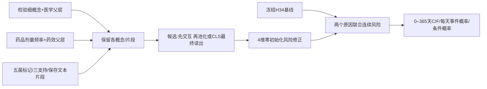

# 09_TRAINING_V6 · 1

源文件正文或经过字段白名单提取的汇总数据，来源身份见每段元数据。

## training/v6/__init__.py · lines 1–1

<!-- REVIEW_FRAGMENT {"path":"training/v6/__init__.py","part":1,"start_line":1,"end_line":1,"source_sha256":"7ef0ae260e8adf444e8447d43e011955144d3dbf70d292ba8c327703df9a4468","fragment_sha256":"7ef0ae260e8adf444e8447d43e011955144d3dbf70d292ba8c327703df9a4468","added_terminal_newline":false} -->
````python
"""V6 独立候选实现；不替换 V5 的模型或训练入口。"""
````
<!-- END REVIEW_FRAGMENT -->

## training/v6/acquire_chexbert.py · lines 1–98

<!-- REVIEW_FRAGMENT {"path":"training/v6/acquire_chexbert.py","part":1,"start_line":1,"end_line":98,"source_sha256":"73c28cb504d8e914bbe90479c665f1e7d4711387412d506fd1bec3096d350e39","fragment_sha256":"73c28cb504d8e914bbe90479c665f1e7d4711387412d506fd1bec3096d350e39","added_terminal_newline":false} -->
````python
"""固定官方代码和Stanford AIMI分发权重；不发送任何患者数据。"""
import argparse
import hashlib
import json
from pathlib import Path
import time
import requests
from concurrent.futures import ThreadPoolExecutor

REVISION = '6d22a96d73f18d0a7cf5b0dbebdac50cf8e4c1aa'
WEIGHT_REVISION = '6646433b3ad83a10f6e141db76d0ece44312b236'
WEIGHT_SHA = '6550703c92d640e1e04d8105a7a185d76ece0f25fcbf033d292785bf22c0fde1'
BERT_REVISION = '86b5e0934494bd15c9632b12f734a8a67f723594'


def digest(path):
    with path.open('rb') as handle:
        return hashlib.file_digest(handle, 'sha256').hexdigest()


def acquire(root):
    root.mkdir(parents=True, exist_ok=True)
    sources = {}
    session = requests.Session()
    def download(relative, url, expected=None):
        path = root / relative
        path.parent.mkdir(parents=True, exist_ok=True)
        if path.exists():
            if expected and digest(path) != expected:
                raise ValueError('existing asset hash mismatch: ' + relative)
        else:
            part = path.with_suffix(path.suffix + '.part')
            if expected:
                total=1314414442
                offset=part.stat().st_size if part.exists() else 0
                if not 0<=offset<=total: raise ValueError('partial asset size invalid')
                chunk=4*1024*1024
                starts=list(range(offset,total,chunk))
                # 先解析一次下载地址，避免每个小分段重复跨站重定向。
                with session.get(url,headers={'Range':'bytes=0-0'},timeout=(20,30),stream=True) as resolved:
                    resolved.raise_for_status()
                    download_url=resolved.url
                def ranged(start):
                    end=min(start+chunk,total)-1
                    for attempt in range(3):
                        try:
                            response=requests.get(download_url,headers={'Range':f'bytes={start}-{end}'},timeout=(20,60))
                            response.raise_for_status()
                            if response.status_code!=206 or response.headers.get('Content-Range')!=f'bytes {start}-{end}/{total}' or len(response.content)!=end-start+1:
                                raise ValueError('invalid download range')
                            return response.content
                        except requests.RequestException:
                            if attempt==2: raise
                started=time.perf_counter()
                # 有界并行范围请求，按顺序落盘；最后整文件SHA为身份验收。
                with part.open('ab') as handle, ThreadPoolExecutor(max_workers=16) as pool:
                    for i in range(0,len(starts),16):
                        for content in pool.map(ranged,starts[i:i+16]):
                            handle.write(content); offset+=len(content)
                        handle.flush()
                        print(json.dumps({'asset':relative,'bytes':offset,'total_bytes':total,'seconds':round(time.perf_counter()-started,1)}),flush=True)
            else:
                if part.exists(): raise FileExistsError(part)
                with session.get(url, stream=True, timeout=(20, 60)) as response:
                    response.raise_for_status()
                    with part.open('xb') as handle:
                        for block in response.iter_content(1024*1024): handle.write(block)
            if expected and digest(part) != expected:
                raise ValueError('download hash mismatch: ' + relative)
            part.rename(path)
        sources[relative] = {'url': url, 'sha256': digest(path), 'bytes': path.stat().st_size}
    for name in ('src/models/bert_labeler.py', 'src/bert_tokenizer.py', 'src/constants.py', 'src/label.py', 'README.md', 'LICENSE.pdf'):
        download('official/' + name, f'https://raw.githubusercontent.com/stanfordmlgroup/CheXbert/{REVISION}/{name}')
    for name in ('config.json', 'vocab.txt', 'tokenizer_config.json'):
        download('bert-base-uncased/' + name, f'https://huggingface.co/google-bert/bert-base-uncased/resolve/{BERT_REVISION}/{name}')
    download('chexbert.pth', f'https://huggingface.co/StanfordAIMI/RRG_scorers/resolve/{WEIGHT_REVISION}/chexbert.pth', WEIGHT_SHA)
    manifest = {'status': 'downloaded_hash_verified_not_inference_validated', 'official_revision': REVISION,
                'weight_repository': 'StanfordAIMI/RRG_scorers', 'weight_revision': WEIGHT_REVISION,
                'official_box_returned_404': True, 'official_box_hash_equivalence_not_independently_verified': True,
                'bert_revision': BERT_REVISION, 'sources': sources,
                'limits': ['Official README says released checkpoint trained on MIMIC-CXR, different from paper',
                           'Distribution card says MIT; preserve official academic license separately; no commercial permission inferred']}
    destination = root / 'asset_manifest.json'
    if destination.exists():
        if json.loads(destination.read_text()) != manifest: raise ValueError('asset manifest changed')
    else:
        destination.write_text(json.dumps(manifest, indent=2), encoding='utf-8')
    print(json.dumps({'status': manifest['status'], 'root': str(root)}), flush=True)


if __name__ == '__main__':
    parser = argparse.ArgumentParser(description=__doc__)
    parser.add_argument('--output', type=Path, default=Path('training/model_cache/CheXbert_stanford_2026-10-09'))
    try:
        acquire(parser.parse_args().output)
    except requests.RequestException as error:
        # 不把重定向的临时签名URL写入共享日志。
        raise RuntimeError('public asset download transport failure: '+type(error).__name__) from None
````
<!-- END REVIEW_FRAGMENT -->

## training/v6/acquire_radiology.py · lines 1–79

<!-- REVIEW_FRAGMENT {"path":"training/v6/acquire_radiology.py","part":1,"start_line":1,"end_line":79,"source_sha256":"1d139ee2f774611b76b3bac36346ea7db882c1d60760cc8723a4cd4c298dcf42","fragment_sha256":"1d139ee2f774611b76b3bac36346ea7db882c1d60760cc8723a4cd4c298dcf42","added_terminal_newline":false} -->
````python
"""只下载公开专科模型资产，固定Hub版本及LFS哈希；绝不读取患者数据。"""
import argparse
import hashlib
import json
from pathlib import Path
import time
import requests


def sha(path):
    with path.open('rb') as f:
        return hashlib.file_digest(f, 'sha256').hexdigest()


def acquire(repo, root, names):
    response = requests.get(f'https://huggingface.co/api/models/{repo}', timeout=30)
    response.raise_for_status()
    revision = response.json()['sha']
    response = requests.get(f'https://huggingface.co/api/models/{repo}/tree/{revision}',
                            params={'blobs': 'true'}, timeout=30)
    response.raise_for_status()
    listing = {r['path']: r for r in response.json()}
    root.mkdir(parents=True, exist_ok=True)
    entries = {}
    for name in names:
        metadata = listing[name]
        expected = metadata.get('lfs', {}).get('oid')
        path = root / name
        url = f'https://huggingface.co/{repo}/resolve/{revision}/{name}'
        if not path.exists():
            part = path.with_suffix(path.suffix + '.part')
            offset = part.stat().st_size if part.exists() else 0
            total = metadata['size']
            if offset > total:
                raise ValueError('partial asset exceeds expected size')
            headers = {'Range': f'bytes={offset}-'} if offset else {}
            started = time.perf_counter()
            with requests.get(url, headers=headers, stream=True, timeout=(30, 120)) as r:
                r.raise_for_status()
                if offset and (r.status_code != 206 or not r.headers.get('Content-Range', '').startswith(f'bytes {offset}-')):
                    raise ValueError('resume range not honored')
                with part.open('ab' if offset else 'xb') as f:
                    last = time.perf_counter()
                    for block in r.iter_content(1024 * 1024):
                        f.write(block)
                        offset += len(block)
                        if time.perf_counter() - last > 15:
                            print(json.dumps({'asset': name, 'bytes': offset, 'total': total}), flush=True)
                            last = time.perf_counter()
            if part.stat().st_size != total or (expected and sha(part) != expected):
                raise ValueError('download size or SHA mismatch: ' + name)
            part.rename(path)
            print(json.dumps({'asset': name, 'seconds': time.perf_counter() - started}), flush=True)
        if path.stat().st_size != metadata['size'] or (expected and sha(path) != expected):
            raise ValueError('existing asset mismatch: ' + name)
        entries[name] = {'url': url, 'sha256': sha(path), 'lfs_sha256': expected, 'bytes': path.stat().st_size}
    manifest = {'status': 'public_assets_verified_not_inference_validated', 'repo': repo,
                'revision': revision, 'files': entries, 'patient_data_accessed': False}
    target = root / 'asset_manifest.json'
    if target.exists() and json.loads(target.read_text()) != manifest:
        raise ValueError('asset manifest differs; use a new directory')
    target.write_text(json.dumps(manifest, indent=2), encoding='utf-8')
    print(json.dumps({'status': manifest['status'], 'repo': repo, 'revision': revision}), flush=True)


if __name__ == '__main__':
    p = argparse.ArgumentParser(description=__doc__)
    p.add_argument('--kind', choices=('radbert', 'radgraph', 'modernbert'), required=True)
    a = p.parse_args()
    if a.kind == 'radbert':
        acquire('zzxslp/RadBERT-RoBERTa-4m', Path('training/model_cache/RadBERT_2026-10-10'),
                ('README.md', 'config.json', 'merges.txt', 'vocab.json', 'special_tokens_map.json',
                 'tokenizer_config.json', 'pytorch_model.bin'))
    elif a.kind == 'radgraph':
        acquire('StanfordAIMI/RRG_scorers', Path('training/model_cache/RadGraph_XL_2026-10-10'),
                ('modern-radgraph-xl.tar.gz',))
    else:
        acquire('answerdotai/ModernBERT-base', Path('training/model_cache/ModernBERT_base_2026-10-10'),
                ('config.json', 'tokenizer.json', 'tokenizer_config.json', 'special_tokens_map.json', 'model.safetensors'))
````
<!-- END REVIEW_FRAGMENT -->

## training/v6/admission_context.py · lines 1–194

<!-- REVIEW_FRAGMENT {"path":"training/v6/admission_context.py","part":1,"start_line":1,"end_line":194,"source_sha256":"0fd565d94eb48fc919050ec8a2679480ae77c8d068c70dcbf30921e3ead5e5db","fragment_sha256":"0fd565d94eb48fc919050ec8a2679480ae77c8d068c70dcbf30921e3ead5e5db","added_terminal_newline":false} -->
````python
"""低频常规住院上下文接口及单seed配对，不改变原模型。"""
import argparse
from collections import Counter
from datetime import datetime
import json
from pathlib import Path
import time
import numpy as np
import torch
from dataclasses import replace,asdict
from patient_data.export_mimiciv import rows,sha256
from training.v5.numeric_preprocessing import robust_parameters
from training.v6.admission_context_audit import interval
from training.v6.fast_multiview import Correction,Batch,fit,digest
from training.v6.regularization_audit import checked,REFERENCE
from training.v6.curve_adaptation import caches,Correction as Zero,prediction as original_prediction
from training.v6.resp_fact_set_experiment import prediction
from training.v6.module_surgery_experiment import summary
from training.v6.early_stopping import EarlyStopping
from training.v6.risk import competing_nll
from training.v6.train import write_json

ROOT=Path('training_runs/v6_admission_context_2026-10-14')
PROTOCOL=Path('docs/V6_ADMISSION_CONTEXT_PROTOCOL_2026-10-14.md')
AUDIT=Path('training_runs/v6_admission_context_audit_2026-10-14/audit.json')
ARMS=('availability','content')

def category(value):
    value=(value or '').strip()
    return None if value in ('','\\N','INFORMATION NOT AVAILABLE') else value

def raw_row(row):
    raw=np.zeros(2,np.float64);mask=np.zeros(4,bool);reasons=[]
    los,error=interval(row.get('admittime'),row.get('dischtime'))
    if error:reasons.append('los_'+error)
    else:raw[0]=los;mask[0]=True
    ed,error=interval(row.get('edregtime'),row.get('edouttime'))
    if error:reasons.append('ed_'+error)
    else:
        try:discharge=datetime.fromisoformat(row.get('dischtime'))
        except (ValueError,TypeError):discharge=None
        if discharge is None:reasons.append('ed_hospital_boundary_unknown')
        elif datetime.fromisoformat(row['edregtime'])>discharge or datetime.fromisoformat(row['edouttime'])>discharge:reasons.append('ed_after_discharge')
        else:raw[1]=ed*24;mask[1]=True
    cats=(category(row.get('admission_type')),category(row.get('admission_location')));mask[2:]=[c is not None for c in cats]
    return raw,mask,cats,reasons

def encode(raw,masks,categories,folds):
    n=len(raw);x=np.zeros((n,32),np.float32);vocab={};scales={};codes=np.zeros((n,2),np.int64)
    if raw.shape!=(n,2) or masks.shape!=(n,4) or len(categories)!=n or len(folds)!=n or not np.isfinite(raw).all() or (raw<0).any():raise ValueError('invalid input interface')
    x[:,2:6]=masks;names=['hospital_length_log_days','ed_interval_log_hours',*[f'{k}_present' for k in ('los','ed','type','location')]]
    for j,key in enumerate(names[:2]):
        use=masks[:,j];train=use&(folds=='train')
        if train.any():
            p=robust_parameters(np.log1p(raw[train,j]));x[use,j]=np.clip((np.log1p(raw[use,j])-p['median'])/p['scale'],-8,8);scales[key]=p
        else:scales[key]={'method':'no_training_observation','training_observations':0}
    offset=6
    for j,key in enumerate(('type','location')):
        counts=Counter(c[j] for i,c in enumerate(categories) if folds[i]=='train' and c[j] is not None)
        words=['UNKNOWN',*sorted(k for k,v in counts.items() if v>=100)];vocab[key]=words;lookup={k:v for v,k in enumerate(words)}
        if offset+len(words)>32:raise ValueError('category width exceeds predeclared capacity')
        for i,c in enumerate(categories):
            codes[i,j]=lookup.get(c[j],0)
            if masks[i,j+2]:x[i,offset+codes[i,j]]=1
        names.extend(key+':'+w for w in words);offset+=len(words)
    names.extend(['unused']*(32-len(names)))
    return dict(features=x,raw_values=raw,masks=masks,codes=codes,observed=masks.any(1)),dict(scales=scales,vocab=vocab,columns=names,used_columns=offset)

def derive(data):
    d=data[0];a=json.loads(AUDIT.read_text())
    for collection in ('sources_sha256','config_sha256'):
        for p,h in a[collection].items():
            if sha256(Path(p))!=h:raise ValueError('audited source changed '+p)
    path=next(Path(p) for p in a['sources_sha256'] if p.endswith('/raw/admissions.csv.gz'))
    cohortpath=next(Path(p) for p in a['sources_sha256'] if p.endswith('/cohort/admissions.csv.gz'))
    lookup={str(h):i for i,h in enumerate(d.arrays['hadm_ids'])};source={};cohort={}
    for target,sourcepath in ((source,path),(cohort,cohortpath)):
        for row in rows(sourcepath):
            h=row['hadm_id']
            if h in lookup:
                if h in target:raise ValueError('duplicate source admission')
                target[h]=row
        if set(target)!=set(lookup):raise ValueError('source admission missing')
    raw=np.zeros((len(lookup),2),np.float64);masks=np.zeros((len(lookup),4),bool);cats=[];rejected=Counter()
    for h,i in lookup.items():
        r=source[h];c=cohort[h]
        if int(r['subject_id'])!=int(d.arrays['subject_ids'][i]) or r['subject_id']!=c['subject_id']:raise ValueError('patient alignment differs')
        if any(r[k]!=c[k] for k in ('admittime','dischtime')):raise ValueError('hospital boundaries differ')
        for k in ('admission_type','admission_location'):
            if k in c and r[k]!=c[k]:raise ValueError('cohort source differs')
        raw[i],masks[i],category_values,reason=raw_row(r);cats.append(category_values)
        if d.arrays['patient_splits'][i]=='train':rejected.update(reason)
    arrays,metadata=encode(raw,masks,cats,d.arrays['patient_splits'])
    arrays.update({k:d.arrays[k] for k in ('hadm_ids','subject_ids','patient_splits')})
    training=d.arrays['patient_splits']=='train'
    metadata.update(training_mask_counts=masks[training].sum(0).tolist(),training_rejections=dict(rejected),
        all_admissions=len(lookup),audit_sha256=sha256(AUDIT),sources_sha256=a['sources_sha256'])
    if metadata['training_mask_counts'][:2]!=[13592,10326] or rejected['ed_after_discharge']!=54:raise ValueError('audited aggregate differs')
    return arrays,metadata

def feature_view(x,arm):
    if arm not in ARMS:raise ValueError('unknown condition')
    result=x.copy()
    if arm=='availability':result[:,:2]=0;result[:,6:]=0
    return result

def batches(frozen,arrays,indices,arm):
    features=feature_view(arrays['features'],arm);cache=[];right=0
    for f in frozen:
        use=indices[right:right+len(f.hidden)];right+=len(use)
        masks=np.stack((arrays['observed'][use],np.ones(len(use),bool)),1)
        cache.append(Batch(f,torch.as_tensor(features[use],device='cuda'),torch.as_tensor(masks,device='cuda',dtype=torch.float32)))
    if right!=len(indices):raise ValueError('cache alignment')
    return cache

def setup():
    data=checked();train=np.flatnonzero(data[0].arrays['patient_splits']=='train');tune=data[6];arrays,metadata=derive(data)
    src={**data[8]['source_sha256'],**data[9]['source_sha256'],**metadata['sources_sha256']}
    for p in (Path(__file__),PROTOCOL,AUDIT,Path('training/tests/test_v6_admission_context.py'),
        Path('training/v6/admission_context_audit.py'),Path('training/v6/fast_multiview.py'),Path('training/v6/curve_adaptation.py'),Path('training/v6/early_stopping.py')):src[str(p)]=sha256(p)
    contract=dict(source_sha256=src,data_provenance=data[0].provenance,compact_provenance=data[1].provenance,interface_sha256=digest(arrays),
        metadata=metadata,protocol_sha256=sha256(PROTOCOL),seed=42,arms=list(ARMS),new_parameters=1140,
        teacher_sha256=sha256(REFERENCE/'seed42/control/best.pt'),no_high_frequency=True,confirmation_test_used=False)
    return data,train,tune,arrays,contract

def lock(r):
    scores={a:r['fits'][a]['metrics']['readmission']['integrated_brier_7_365'] for a in ARMS}
    scores['original']=r['reference']['readmission']['integrated_brier_7_365'];chosen=min(scores,key=scores.get)
    return dict(scores=scores,selected=chosen,nominated=['content'] if chosen=='content' and scores['content']<min(scores['original'],scores['availability']) else [],goal_achieved=False)

def run():
    if ROOT.exists():raise FileExistsError('existing batch; inspect')
    start=time.perf_counter();data,train,tune,arrays,contract=setup();d=data[0]
    ROOT.mkdir();write_json(ROOT/'contract.json',contract);np.savez_compressed(ROOT/'interface.npz',**arrays);write_json(ROOT/'interface_manifest.json',dict(sha256=sha256(ROOT/'interface.npz'),**contract['metadata']))
    tc,tp=caches(data,train,42);vc,vp=caches(data,tune,42);_,_,ref,nll=original_prediction(Zero('clinical_nll').cuda(),vc)
    probe=batches(tc,arrays,train,'content')[0];model=Correction().cuda();out=model(probe);old=probe.frozen.raw.reshape(-1,2,2)
    torch.testing.assert_close(out.log_amplitude,(probe.frozen.prior+old[:,:,0]).clamp(-10,6),atol=0,rtol=0)
    torch.testing.assert_close(out.shape,torch.nn.functional.softplus(probe.frozen.shape_raw+old[:,:,1])+.1,atol=0,rtol=0)
    opt=torch.optim.AdamW(model.parameters(),lr=.001);loss=competing_nll(out,probe.frozen.times,probe.frozen.events);loss.backward();opt.step()
    if not model.head[-1].weight.ne(0).any():raise ValueError('no real update')
    missing=replace(probe,masks=torch.zeros_like(probe.masks));missing_out=model(missing)
    torch.testing.assert_close(missing_out.log_amplitude,out.log_amplitude,atol=0,rtol=0);torch.testing.assert_close(missing_out.shape,out.shape,atol=0,rtol=0)
    control=batches(tc,arrays,train,'availability')[0]
    mutated=arrays['features'].copy();mutated[:,:2]+=10;mutated[:,6:]=1-mutated[:,6:]
    altered=batches(tc,dict(arrays,features=mutated),train,'availability')[0]
    torch.testing.assert_close(model(control).log_amplitude,model(altered).log_amplitude,atol=0,rtol=0)
    write_json(ROOT/'preflight.json',dict(status='passed',initial_risk_error=0.,actual_update=True,missing_gate=True,content_hidden=True,gpu=torch.cuda.get_device_name()))
    r=dict(fits={},teacher_caches={'train':tp,'tune':vp},reference=summary(ref,d,tune,nll),single_seed_only=True)
    for arm in ARMS:
        tb=batches(tc,arrays,train,arm);vb=batches(vc,arrays,tune,arm)
        np.testing.assert_array_equal(prediction(Correction().cuda(),vb)[2],ref)
        write_json(ROOT/'state.json',dict(status='risk_training',arm=arm,goal_achieved=False));r['fits'][arm]=fit(tb,vb,d,tune,ROOT/arm)
    r['lock']=lock(r);r['seconds']=time.perf_counter()-start;write_json(ROOT/'screening.json',r);write_json(ROOT/'nomination_lock.json',r['lock'])
    write_json(ROOT/'state.json',dict(status='complete_pending_independent_replay',goal_achieved=False));print(json.dumps(r['lock']),flush=True)

def verify():
    data,train,tune,arrays,contract=setup();d=data[0]
    if contract!=json.loads((ROOT/'contract.json').read_text()):raise ValueError('contract changed')
    manifest=json.loads((ROOT/'interface_manifest.json').read_text())
    if manifest['sha256']!=sha256(ROOT/'interface.npz'):raise ValueError('archive changed')
    with np.load(ROOT/'interface.npz') as saved:
        for key,value in arrays.items():np.testing.assert_array_equal(saved[key],value)
    tc,tp=caches(data,train,42);vc,vp=caches(data,tune,42);r=json.loads((ROOT/'screening.json').read_text());errors={}
    if r['teacher_caches']!={'train':tp,'tune':vp}:raise ValueError('teacher source changed')
    _,_,ref,nll=original_prediction(Zero('clinical_nll').cuda(),vc)
    if summary(ref,d,tune,nll)!=r['reference']:raise ValueError('reference differs')
    for arm in ARMS:
        folder=ROOT/arm;info=r['fits'][arm];hist=json.loads((folder/'history.json').read_text());early=EarlyStopping(7,10,1e-5);first_stop=None
        for row in hist:
            _,stop=early.observe(row['epoch'],row['tuning_ibs'])
            if stop and first_stop is None:first_stop=row['epoch']
        if asdict(early)!=info['early'] or info['completed_epochs']!=len(hist)-1:raise ValueError('early state differs')
        if info['stop_reason']=='patience_exhausted' and first_stop!=info['completed_epochs']:raise ValueError('delayed stop')
        saved=torch.load(folder/'best.pt',map_location='cuda',weights_only=True)
        if saved['epoch']!=early.best_epoch or sha256(folder/'best.pt')!=info['checkpoint_sha256']:raise ValueError('checkpoint selection changed')
        model=Correction().cuda();model.load_state_dict(saved['state_dict']);a,k,curve,nll=prediction(model,batches(vc,arrays,tune,arm))
        with np.load(folder/'tuning_predictions.npz') as old:
            np.testing.assert_array_equal(old['times'],d.times[tune]);np.testing.assert_array_equal(old['events'],d.events[tune])
            error=max(float(np.abs(a-old['log_amplitude']).max()),float(np.abs(k-old['shape']).max()),float(np.abs(curve-old['curve']).max()))
        if error!=0 or summary(curve,d,tune,nll)!=info['metrics']:raise ValueError('risk/metrics differs')
        missing=~arrays['observed'][tune]
        if missing.any():np.testing.assert_array_equal(curve[missing],ref[missing])
        errors[arm]=error
    if lock(r)!=r['lock'] or r['lock']!=json.loads((ROOT/'nomination_lock.json').read_text()):raise ValueError('lock changed')
    write_json(ROOT/'verification.json',dict(status='independent_full_interface_and_prediction_replay',maximum_error=max(errors.values()),errors=errors,
        screening_sha256=sha256(ROOT/'screening.json'),interface_rebuilt=True,early_and_lock_replayed=True))
    write_json(ROOT/'state.json',dict(status='single_seed_independently_verified',goal_achieved=False));print(json.dumps(errors),flush=True)

if __name__=='__main__':
    p=argparse.ArgumentParser();p.add_argument('--mode',choices=('run','verify'),required=True);mode=p.parse_args().mode
    try:run() if mode=='run' else verify()
    except Exception as e:
        if ROOT.exists():write_json(ROOT/f'failure_{mode}.json',{'error':repr(e)})
        raise
````
<!-- END REVIEW_FRAGMENT -->

## training/v6/admission_context_audit.py · lines 1–65

<!-- REVIEW_FRAGMENT {"path":"training/v6/admission_context_audit.py","part":1,"start_line":1,"end_line":65,"source_sha256":"89614ff609343b33233d53087bca912fb143699cdf208c8d339ade1adf4e9ef1","fragment_sha256":"89614ff609343b33233d53087bca912fb143699cdf208c8d339ade1adf4e9ef1","added_terminal_newline":false} -->
````python
"""训练折常规入院上下文可用性，不读结局/文本/高频记录，不拟合模型。"""
from collections import Counter
from datetime import datetime
import json
from pathlib import Path
import numpy as np
from patient_data.export_mimiciv import rows,sha256
from training.v6.train import write_json

ROOT=Path('training_runs/v6_admission_context_audit_2026-10-14')

def interval(start,end):
    try:a,b=datetime.fromisoformat(start),datetime.fromisoformat(end)
    except (ValueError,TypeError):return None,'missing_or_invalid_time'
    if b<a:return None,'reverse_time'
    return (b-a).total_seconds()/86400,None

def run():
    if ROOT.exists():raise FileExistsError('existing audit; do not repeat')
    cfg_path=Path('training_runs/v6_original_interaction_2026-10-12_r3/config.json');cfg=json.loads(cfg_path.read_text())
    ref_path=Path(cfg['reference'])/'config.json';ref=json.loads(ref_path.read_text());snapshot=Path(ref['snapshot']);state=Path(ref['state_dir'])
    sm=json.loads((snapshot/'metadata/manifest.json').read_text());st=json.loads((state/'manifest.json').read_text())
    files={snapshot/'metadata/manifest.json':st['source_manifest_sha256'],state/'clinical_state.npz':st['output_sha256']['clinical_state.npz']}
    for name in ('cohort/admissions','raw/admissions'):
        files[snapshot/(name+'.csv.gz')]=sm['sources'][name]['sha256']
    for path,d in files.items():
        if sha256(path)!=d:raise ValueError('source changed: '+str(path))
    with np.load(state/'clinical_state.npz') as z:
        hadms=z['hadm_ids'];subjects=z['subject_ids'];folds=z['patient_splits']
    if len(hadms)!=19401 or (folds=='train').sum()!=13592:raise ValueError('cohort drift')
    lookup={str(h):i for i,h in enumerate(hadms)};cohort={r['hadm_id']:r for r in rows(snapshot/'cohort/admissions.csv.gz') if r['hadm_id'] in lookup}
    admissions={};columns=None
    for r in rows(snapshot/'raw/admissions.csv.gz'):
        columns=tuple(r)
        if r['hadm_id'] in lookup:
            if r['hadm_id'] in admissions:raise ValueError('duplicate admission')
            admissions[r['hadm_id']]=r
    if set(admissions)!=set(lookup) or set(cohort)!=set(lookup):raise ValueError('missing source admission')
    los=[];ed=[];types=Counter();locations=Counter();issues=Counter();n=0
    for h,p in lookup.items():
        c=cohort[h];r=admissions[h]
        if int(c['subject_id'])!=int(subjects[p]) or r['subject_id']!=c['subject_id']:raise ValueError('patient identity mismatch')
        if r['admittime']!=c['admittime'] or r['dischtime']!=c['dischtime']:raise ValueError('cohort hospital boundary differs')
        if folds[p]!='train':continue
        n+=1;value,reason=interval(r['admittime'],r['dischtime'])
        if reason:issues['hospital_'+reason]+=1
        else:los.append(value)
        for key,d in (('admission_type',types),('admission_location',locations)):
            value=r.get(key,'');d[value if value not in ('','\\N') else '<UNKNOWN>']+=1
        value,reason=interval(r.get('edregtime'),r.get('edouttime'))
        if reason:issues['ed_'+reason]+=1
        elif datetime.fromisoformat(r['edregtime'])>datetime.fromisoformat(r['dischtime']) or datetime.fromisoformat(r['edouttime'])>datetime.fromisoformat(r['dischtime']):
            issues['ed_after_discharge']+=1
        else:ed.append(value*24)
    quant=lambda x:dict(observed=len(x),quantile_levels=[.1,.5,.9,.99],quantiles=np.quantile(x,[.1,.5,.9,.99]).tolist()) if x else dict(observed=0)
    report=dict(status='training_only_source_validated_not_model_input',training_admissions=n,source_columns=list(columns),
        hospital_length_days=quant(los),ed_recorded_interval_hours=quant(ed),admission_type=dict(types),admission_location=dict(locations),issues=dict(issues),
        sources_sha256={str(p):d for p,d in files.items()},config_sha256={str(p):sha256(p) for p in (cfg_path,ref_path)},audit_code_sha256=sha256(Path(__file__)),
        no_model_fit=True,no_outcome_read=True,no_high_frequency_read=True,
        cautions=['Recorded ED interval is not necessarily waiting time or acuity; may overlap hospital admission.',
                  'Administrative source categories may encode care pathway and era; no causal inference.',
                  'Insurance/language/race/marital status/expiration flags were not proposed or analyzed.'])
    ROOT.mkdir();write_json(ROOT/'audit.json',report);print(json.dumps({k:v for k,v in report.items() if k not in ('sources_sha256','config_sha256','source_columns')}),flush=True)

if __name__=='__main__':run()
````
<!-- END REVIEW_FRAGMENT -->

## training/v6/admission_cox_diagnostic.py · lines 1–225

<!-- REVIEW_FRAGMENT {"path":"training/v6/admission_cox_diagnostic.py","part":1,"start_line":1,"end_line":225,"source_sha256":"042db1540ba7507223e26f74c99e6497aa036407af94f1eeb672b66275b3f56d","fragment_sha256":"042db1540ba7507223e26f74c99e6497aa036407af94f1eeb672b66275b3f56d","added_terminal_newline":false} -->
````python
"""已核验常规接口的固定原因别Cox诊断；不修改正式V6。"""
from __future__ import annotations

import argparse
import json
from pathlib import Path
import time
import numpy as np

from patient_data.export_mimiciv import sha256
from training.baselines.continuous_competing_cox import (
    CauseSpecificCox, CompetingCoxModel, fit_competing_cox,
    predict_cumulative_incidence,
)
from training.v6.data import HISTORY_NAMES, CURRENT_NAMES
from training.v6.evaluation import metrics, public_metrics, GRID, paired_interval
from training.v6.train import write_json

ROOT = Path('training_runs/v6_admission_cox_2026-10-14')
PARENT = Path('training_runs/v6_admission_context_2026-10-14')
PROTOCOL = Path('docs/V6_ADMISSION_COX_PROTOCOL_2026-10-14.md')
ARMS = ('h34', 'availability', 'content')
SETTINGS = dict(horizon_days=365., l2=10., max_iter=40, tolerance=1e-6)


def digest(value):
    import hashlib
    a = np.ascontiguousarray(value)
    h = hashlib.sha256()
    h.update(str(a.dtype).encode()); h.update(str(a.shape).encode()); h.update(a.tobytes())
    return h.hexdigest()


def input_view(h34, context, masks, arm):
    h34, context, masks = map(np.asarray, (h34, context, masks))
    n = len(h34)
    if (h34.shape != (n, 34) or context.shape != (n, 32) or masks.shape != (n, 4)
            or masks.dtype != bool or not np.isfinite(h34).all()
            or not np.isfinite(context).all() or np.any(context[:, 25:] != 0)
            or not np.array_equal(context[:, 2:6], masks)):
        raise ValueError('invalid audited feature interface')
    if arm == 'h34': result = h34
    elif arm == 'availability': result = np.concatenate((h34, masks), axis=1)
    elif arm == 'content': result = np.concatenate((h34, context[:, :25]), axis=1)
    else: raise ValueError('unknown condition')
    return result.astype(np.float64)


def save_model(path, model):
    arrays = dict(horizon=np.asarray(model.horizon_days), l2=np.asarray(model.l2))
    for name, cause in (('readmission', model.readmission), ('death', model.death)):
        for key in ('coefficients', 'event_times', 'baseline_hazard_increments', 'converged'):
            arrays[name+'_'+key] = np.asarray(getattr(cause, key))
    np.savez_compressed(path, **arrays)


def load_model(path):
    with np.load(path, allow_pickle=False) as z:
        a = {k: z[k] for k in z.files}
    def cause(name):
        return CauseSpecificCox(*(a[name+'_'+k] for k in
            ('coefficients', 'event_times', 'baseline_hazard_increments')),
            bool(a[name+'_converged']))
    return CompetingCoxModel(cause('readmission'), cause('death'), float(a['horizon']), float(a['l2']))


def validate_curve(curve):
    if (curve.ndim != 3 or curve.shape[1:] != (366, 3) or not np.isfinite(curve).all()
            or np.any((curve < 0) | (curve > 1)) or np.any(np.diff(curve[:, :, 1:], axis=1) < -1e-12)):
        raise ValueError('invalid daily competing probabilities')
    if not np.allclose(curve.sum(2), 1., atol=1e-12, rtol=0):
        raise ValueError('probabilities do not conserve mass')
    if not np.array_equal(curve[:, 0], np.tile([1., 0., 0.], (len(curve), 1))):
        raise ValueError('invalid zero-time probabilities')


def scores(times, events, curve):
    validate_curve(curve)
    return dict(readmission=public_metrics(metrics(times, events, curve[:, :, 1])),
                death=public_metrics(metrics(times, events, curve[:, :, 2], cause=2)))


def decision(results):
    r = results['content']['metrics']; ibis = r['readmission']['integrated_brier_7_365']
    others = [results[k]['metrics'] for k in ARMS[:2]]
    signal = all(ibis < x['readmission']['integrated_brier_7_365'] for x in others)
    material = signal and all(
        ibis <= .99*x['readmission']['integrated_brier_7_365']
        and r['readmission']['points']['90']['auc'] >= x['readmission']['points']['90']['auc']+.005
        and r['death']['integrated_brier_7_365'] <= x['death']['integrated_brier_7_365']
        for x in others)
    return dict(conditional_signal='content' if signal else None, material_signal=material,
        rule='content IBS strictly beats both; material >=1% IBS and >=.005 AUC90, death IBS not worse',
        replace_v6=False, goal_achieved=False)


def setup():
    # 复用既定核心队列/标签检查，不重新抽取新源或编码文本。
    from training.v6.regularization_audit import checked
    from training.v6.exploration_model import expanded_inputs
    import torch
    data = checked(); d, c = data[:2]
    manifest = json.loads((PARENT/'interface_manifest.json').read_text())
    proof = json.loads((PARENT/'verification.json').read_text())
    if (proof['maximum_error'] != 0 or not proof['interface_rebuilt']
            or proof['screening_sha256'] != sha256(PARENT/'screening.json')):
        raise ValueError('parent proof stale')
    if manifest['sha256'] != sha256(PARENT/'interface.npz'):
        raise ValueError('parent archive changed')
    parent = json.loads((PARENT/'contract.json').read_text())
    for p, h in parent['source_sha256'].items():
        if sha256(Path(p)) != h: raise ValueError('protected source changed: '+p)
    with np.load(PARENT/'interface.npz', allow_pickle=False) as z:
        arrays = {k: z[k] for k in z.files}
    for key in ('hadm_ids', 'subject_ids', 'patient_splits'):
        np.testing.assert_array_equal(arrays[key], d.arrays[key])
    h34 = np.concatenate((d.history, np.where(d.current_masks, d.current, 0),
                          d.current_masks.astype(d.history.dtype)), axis=1)
    ix = np.unique(np.linspace(0, len(h34)-1, 64, dtype=int))
    common_error = {}
    for device in ('cpu', 'cuda'):
        with torch.no_grad():
            h, batch, _, _ = c.collate(ix, device=device)
            actual = expanded_inputs(h, batch).cpu().numpy()
        np.testing.assert_array_equal(actual, h34[ix]); common_error[device] = 0.
    train = np.flatnonzero(d.arrays['patient_splits'] == 'train'); tune = data[6]
    if (len(train), len(tune), len(h34)) != (13592, 1531, 19401): raise ValueError('cohort differs')
    views = {arm: input_view(h34, arrays['features'], arrays['masks'], arm) for arm in ARMS}
    names = [*HISTORY_NAMES, *CURRENT_NAMES, *(k+'_valid' for k in CURRENT_NAMES)]
    columns = dict(h34=names, availability=names+manifest['columns'][2:6],
                   content=names+manifest['columns'][:25])
    sources = dict(parent['source_sha256'])
    for p in (Path(__file__), PROTOCOL, Path('training/tests/test_v6_admission_cox.py'),
              Path('training/baselines/continuous_competing_cox.py'), Path('training/v6/exploration_model.py'),
              PARENT/'interface.npz', PARENT/'interface_manifest.json', PARENT/'contract.json',
              PARENT/'verification.json', PARENT/'screening.json'):
        sources[str(p)] = sha256(p)
    contract = dict(source_sha256=sources, inherited_data_provenance=d.provenance,
        parent_teacher_sha256=parent['teacher_sha256'],
        parent_base_sha256=data[8]['frozen_baseline_sha256'], solver=SETTINGS,
        features=columns, inherited_train_preprocessing=True, new_scaling_fitted=False,
        array_sha256={**{k:digest(v) for k,v in views.items()},
            'train':digest(train), 'tune':digest(tune), 'times':digest(d.times), 'events':digest(d.events)},
        common_expanded_inputs_errors=common_error, no_high_frequency=True,
        confirmation_test_used=False, deterministic_from_zero=True)
    return d, train, tune, views, contract


def run():
    if ROOT.exists(): raise FileExistsError('diagnostic already exists; inspect, do not repeat fit')
    d, train, tune, views, contract = setup()
    ROOT.mkdir(); write_json(ROOT/'contract.json', contract)
    write_json(ROOT/'preflight.json', dict(related_tests=9,
        common_expanded_inputs_errors=contract['common_expanded_inputs_errors'],
        toy_solver_convergence_and_serialization_checked=True,
        parent_source_proof_reused=True, cpu_solver_not_gpu_neural_training=True))
    write_json(ROOT/'state.json', dict(status='fixed_cox_fitting', goal_achieved=False))
    results = {}
    for arm in ARMS:
        start = time.perf_counter(); folder = ROOT/arm; folder.mkdir()
        model = fit_competing_cox(views[arm][train], d.times[train], d.events[train], **SETTINGS)
        save_model(folder/'model.npz', model)
        if not (model.readmission.converged and model.death.converged):
            raise RuntimeError('Cox did not converge in fixed budget: '+arm)
        curve = predict_cumulative_incidence(model, views[arm][tune], GRID)
        result = dict(feature_width=views[arm].shape[1], metrics=scores(d.times[tune], d.events[tune], curve),
            fitting_and_prediction_seconds=time.perf_counter()-start,
            readmission_converged=model.readmission.converged, death_converged=model.death.converged,
            max_iterations_per_cause=40, actual_iteration_count_available=False,
            stop_reason='accepted_Newton_step_below_tolerance', model_sha256=sha256(folder/'model.npz'))
        np.savez_compressed(folder/'tuning_predictions.npz', curve=curve, indices=tune,
                            times=d.times[tune], events=d.events[tune])
        write_json(folder/'result.json', result); results[arm] = result
        print(json.dumps(dict(arm=arm, seconds=result['fitting_and_prediction_seconds'],
            auc90=result['metrics']['readmission']['points']['90']['auc'],
            ibs=result['metrics']['readmission']['integrated_brier_7_365'])), flush=True)
    lock = decision(results); write_json(ROOT/'nomination_lock.json', lock)
    report = dict(results=results, lock=lock, train_admissions=len(train), tuning_admissions=len(tune),
        limits=['minimal H34 comparator, not full clinical/BERT inputs',
                'exposed tuning, not blind', 'fixed CPU solver, no random seed grid'])
    if lock['material_signal']:
        with np.load(ROOT/'content/tuning_predictions.npz') as z: full = z['curve']
        report['paired'] = {}
        for arm in ARMS[:2]:
            with np.load(ROOT/arm/'tuning_predictions.npz') as z: other = z['curve']
            report['paired'][arm] = paired_interval(d.arrays['subject_ids'][tune], d.times[tune],
                d.events[tune], full[:, :, 1], other[:, :, 1], replicates=200, seed=42)
    write_json(ROOT/'report.json', report)
    write_json(ROOT/'state.json', dict(status='fixed_cox_fitted_awaiting_independent_reload', goal_achieved=False))


def verify():
    d, train, tune, views, contract = setup()
    if contract != json.loads((ROOT/'contract.json').read_text()): raise ValueError('contract changed')
    report = json.loads((ROOT/'report.json').read_text()); errors = {}
    for arm in ARMS:
        folder = ROOT/arm; info = report['results'][arm]
        if sha256(folder/'model.npz') != info['model_sha256']: raise ValueError('model changed')
        model = load_model(folder/'model.npz')
        if not (model.readmission.converged and model.death.converged): raise ValueError('not converged')
        if model.horizon_days != SETTINGS['horizon_days'] or model.l2 != SETTINGS['l2']: raise ValueError('solver differs')
        curve = predict_cumulative_incidence(model, views[arm][tune], GRID)
        with np.load(folder/'tuning_predictions.npz') as z:
            for k, value in (('indices',tune), ('times',d.times[tune]), ('events',d.events[tune])):
                np.testing.assert_array_equal(z[k], value)
            errors[arm] = float(np.abs(curve-z['curve']).max())
        if errors[arm] != 0 or scores(d.times[tune], d.events[tune], curve) != info['metrics']:
            raise ValueError('prediction/metric replay differs')
    lock = decision(report['results'])
    if lock != report['lock'] or lock != json.loads((ROOT/'nomination_lock.json').read_text()):
        raise ValueError('selection changed')
    write_json(ROOT/'verification.json', dict(status='independent_view_model_daily_prediction_metric_replay',
        maximum_error=max(errors.values()), errors=errors, report_sha256=sha256(ROOT/'report.json'),
        no_refitting=True, parent_source_proof_reused_with_unchanged_hash=True))
    write_json(ROOT/'state.json', dict(status='fixed_cox_independently_verified', goal_achieved=False))
    print(json.dumps(dict(errors=errors, lock=lock)), flush=True)


if __name__ == '__main__':
    p = argparse.ArgumentParser(); p.add_argument('--mode', choices=('run','verify'), required=True)
    mode = p.parse_args().mode
    try: run() if mode == 'run' else verify()
    except Exception as error:
        if ROOT.exists(): write_json(ROOT/f'failure_{mode}.json', {'error':repr(error)})
        raise
````
<!-- END REVIEW_FRAGMENT -->

## training/v6/admission_cox_report.py · lines 1–62

<!-- REVIEW_FRAGMENT {"path":"training/v6/admission_cox_report.py","part":1,"start_line":1,"end_line":62,"source_sha256":"e384331f9816f0a86f50dca0166a391fc60b8c0139d6daa4975ac8ab888b53d5","fragment_sha256":"e384331f9816f0a86f50dca0166a391fc60b8c0139d6daa4975ac8ab888b53d5","added_terminal_newline":false} -->
````python
"""固定Cox诊断聚合图及后续常规去向组织可行性，不拟合模型。"""
from collections import Counter, defaultdict
import json
from pathlib import Path
import numpy as np
from patient_data.export_mimiciv import rows, sha256
from training.v6.admission_cox_diagnostic import ROOT, PARENT, ARMS
from training.v6.data import disposition
from training.v6.train import write_json


def run():
    import matplotlib
    matplotlib.use('Agg')
    import matplotlib.pyplot as plt
    proof = json.loads((ROOT/'verification.json').read_text())
    if proof['report_sha256'] != sha256(ROOT/'report.json') or proof['maximum_error'] != 0:
        raise ValueError('prediction proof stale')
    report = json.loads((ROOT/'report.json').read_text())
    values = [report['results'][k]['metrics'] for k in ARMS]
    fig, axes = plt.subplots(1,2,figsize=(11,4.5))
    labels = ['H34','H34 + availability','H34 + content']
    colors = ['#777777','#3274a1','#e1812c']
    for ax, measure, title, limits in (
        (axes[0], [m['readmission']['points']['90']['auc'] for m in values],
         'Readmission AUC90 (higher better)',(.75,.82)),
        (axes[1], [m['readmission']['integrated_brier_7_365'] for m in values],
         'Readmission IBS7-365 (lower better)',(.095,.105))):
        ax.scatter(measure,range(3),s=75,c=colors)
        ax.set_yticks(range(3),labels); ax.set_ylim(2.25,-.45); ax.set_xlim(limits)
        ax.set_title(title); ax.grid(axis='x',alpha=.2)
        for i,v in enumerate(measure): ax.annotate(f'{v:.6f}',(v,i),xytext=(6,8),textcoords='offset points')
    fig.suptitle('Fixed cause-specific Cox; same training/tuning split\nMinimal H34 inputs, not full V6; no confidence intervals')
    fig.tight_layout(); fig.savefig(ROOT/'conditional_information.png',dpi=180); plt.close(fig)

    # 下一条仅核验训练折原去向被粗映射折叠的真实类别，不按结局细分。
    with np.load(PARENT/'interface.npz',allow_pickle=False) as z:
        hadms=z['hadm_ids']; subjects=z['subject_ids']; folds=z['patient_splits']
    training = {str(h):int(s) for h,s,f in zip(hadms,subjects,folds) if f=='train'}
    manifest=json.loads((PARENT/'interface_manifest.json').read_text())
    p=next(Path(k) for k in manifest['sources_sha256'] if k.endswith('/cohort/admissions.csv.gz'))
    if sha256(p)!=manifest['sources_sha256'][str(p)]: raise ValueError('cohort changed')
    counts=Counter(); people=defaultdict(set); groups=defaultdict(Counter); seen=set()
    for row in rows(p):
        h=row['hadm_id']
        if h not in training: continue
        if h in seen or int(row['subject_id'])!=training[h]: raise ValueError('training alignment differs')
        seen.add(h); name=row['discharge_location']; counts[name]+=1; people[name].add(training[h])
        values,masks=disposition(name)
        group=('home','facility','other')[int(values.argmax())] if masks.any() else 'unknown'
        groups[group][name]+=1
    if seen!=set(training): raise ValueError('missing training rows')
    write_json(ROOT/'disposition_feasibility.json',dict(
        status='train_only_raw_category_collapse_audit_not_model_input',
        source_sha256={str(p):sha256(p)}, interface_sha256=sha256(PARENT/'interface.npz'),
        training_admissions=len(seen), raw_categories=dict(counts),
        patients_by_category={k:len(v) for k,v in people.items()},
        inherited_three_class_collapse={k:dict(v) for k,v in groups.items()},
        no_outcomes_used=True, new_fits=0, new_vectors=0))


if __name__=='__main__': run()
````
<!-- END REVIEW_FRAGMENT -->

## training/v6/anchored_clock.py · lines 1–77

<!-- REVIEW_FRAGMENT {"path":"training/v6/anchored_clock.py","part":1,"start_line":1,"end_line":77,"source_sha256":"525f85efc09309bd59fe6ffb8253d444f168c88352ae2d88930bcf954e0b68bb","fragment_sha256":"525f85efc09309bd59fe6ffb8253d444f168c88352ae2d88930bcf954e0b68bb","added_terminal_newline":false} -->
````python
"""数学原型：独立原因时钟，保留教师365天累计概率；尚非队列实验。"""
import math
import numpy as np
import torch
from training.v6.risk import RiskOutput


def anchor_dense_to_daily(raw,grid,daily):
    """按每天端点重标定区间分位，不交错拼接两种积分误差。"""
    raw,grid,daily=(np.asarray(x,dtype=np.float64) for x in (raw,grid,daily))
    n=len(raw)
    if raw.shape!=(n,len(grid),3) or daily.shape!=(n,366,3) or grid[0]!=0 or grid[-1]!=365:
        raise ValueError('invalid dense/daily anchoring shape')
    slots=np.searchsorted(grid,np.arange(366))
    if not np.array_equal(grid[slots],np.arange(366)):raise ValueError('integer anchors missing')
    if (not np.isfinite(raw).all() or not np.isfinite(daily).all() or
        np.any(np.diff(raw[:,:,1:],axis=1)<-1e-10) or np.any(np.diff(daily[:,:,1:],axis=1)<-1e-10)):
        raise ValueError('nonmonotonic source CIF')
    lo=np.minimum(np.floor(grid).astype(int),364);hi=lo+1
    base=raw[:,slots,1:]
    denominator=base[:,hi]-base[:,lo]
    fallback=np.broadcast_to((grid-lo)[None,:,None],(n,len(grid),2)).copy()
    fraction=np.divide(raw[:,:,1:]-base[:,lo],denominator,out=fallback,where=denominator>1e-18)
    fraction=np.clip(fraction,0,1)
    result=np.empty_like(raw)
    result[:,:,1:]=daily[:,lo,1:]+fraction*(daily[:,hi,1:]-daily[:,lo,1:])
    result[:,:,0]=1-result[:,:,1:].sum(2)
    result=np.clip(result,0,1);result[:,slots]=daily
    if np.any(np.diff(result[:,:,1:],axis=1)<-1e-10):raise ValueError('anchoring did not preserve monotonicity')
    np.testing.assert_allclose(result.sum(2),1,atol=1e-9,rtol=0)
    return result


def clock_nll(prior:RiskOutput,log_clock:torch.Tensor,times:torch.Tensor,events:torch.Tensor):
    n=len(times)
    if (prior.log_amplitude.shape!=(n,2) or prior.shape.shape!=(n,2) or log_clock.shape!=(n,2) or
        events.shape!=(n,) or events.dtype!=torch.long or not n or
        not torch.isfinite(times).all() or (times<0).any() or (times>365).any() or
        ((events<0)|(events>2)).any() or ((events==0)&(times!=365)).any() or
        not torch.isfinite(log_clock).all() or not torch.isfinite(prior.log_amplitude).all() or
        not torch.isfinite(prior.shape).all() or (prior.shape<=0).any()):
        raise ValueError('clock prototype requires WorldA365 parameters/labels; early censoring unsupported')
    g=torch.exp(log_clock)
    s=times.clamp_min(1e-3)/365.;logs=torch.log(s)
    # 每个原因e的时钟q_e(t)=365*(t/365)^g_e：旧两危险率均在q_e求值。
    cumulative=(torch.exp(prior.log_amplitude[:,None,:])*s[:,None,None].pow(g[:,:,None]*prior.shape[:,None,:])).sum(2)
    log_density=prior.log_amplitude+torch.log(prior.shape)+log_clock-math.log(365.)+(g*prior.shape-1)*logs[:,None]-cumulative
    chosen=log_density.gather(1,(events-1).clamp_min(0)[:,None]).squeeze(1)
    # 所有无事件记录在365行政边界；该点S完全保留教师，不改结局。
    return torch.where(events>0,-chosen,torch.exp(prior.log_amplitude).sum(1)).mean()


def clock_curve(teacher_curve,teacher_grid,log_clock,days):
    """冻结教师密集CIF插值；正式使用仍需验证网格收敛与原模型精确重放。"""
    teacher_curve,grid,log_clock,days=(np.asarray(x,dtype=np.float64) for x in (teacher_curve,teacher_grid,log_clock,days))
    n=len(teacher_curve)
    if (teacher_curve.shape!=(n,len(grid),3) or log_clock.shape!=(n,2) or not n or
        grid.ndim!=1 or not len(grid) or grid[0]!=0 or grid[-1]!=365 or np.any(np.diff(grid)<=0) or
        days.ndim!=1 or not len(days) or days[0]!=0 or np.any(np.diff(days)<=0) or days[-1]>365 or
        not all(np.isfinite(x).all() for x in (teacher_curve,grid,log_clock,days)) or
        np.any((teacher_curve<0)|(teacher_curve>1)) or np.any(np.diff(teacher_curve[:,:,1:],axis=1)<-1e-10)):
        raise ValueError('invalid frozen CIF/grid/clock')
    np.testing.assert_allclose(teacher_curve.sum(2),1,atol=1e-9,rtol=0)
    result=np.empty((n,len(days),3))
    for i in range(n):
        for e in (0,1):
            query=365.*(days/365.)**np.exp(log_clock[i,e])
            # 零初始化精确取原查询，不用浮点幂引入极小坐标偏移。
            if log_clock[i,e]==0:query=days
            query=np.clip(query,0,365)
            result[i,:,e+1]=np.interp(query,grid,teacher_curve[i,:,e+1])
    result[:,:,0]=1-result[:,:,1:].sum(2)
    result[:,0]=teacher_curve[:,0]
    if days[-1]==365:result[:,-1]=teacher_curve[:,-1]
    if result.min()<-1e-9:raise ValueError('clock violated competing probability budget')
    result=np.clip(result,0,1)
    return result
````
<!-- END REVIEW_FRAGMENT -->

## training/v6/architecture_experiment.py · lines 1–306

<!-- REVIEW_FRAGMENT {"path":"training/v6/architecture_experiment.py","part":1,"start_line":1,"end_line":306,"source_sha256":"b50b423143ef75b13bccdc2fcc42147ba109c62b40a14bfb21338a68c02df274","fragment_sha256":"b50b423143ef75b13bccdc2fcc42147ba109c62b40a14bfb21338a68c02df274","added_terminal_newline":false} -->
````python
"""先验证扩展冻结基线，再同一基线下探索架构/组合/候选原文。"""
import argparse
import copy
from dataclasses import replace
import gzip
import json
from pathlib import Path
import time
import numpy as np
import torch
from patient_data.export_mimiciv import sha256
from training.v6.compact_ablation import inputs
from training.v6.compact_model import CompactAnchoredModel
from training.v6.exploration_model import ExpandedBaseline, expanded_inputs, ExplorationBatch, ExplorationModel
from training.v6.model import ConstantCorrection
from training.v6.train import fit, predict, write_json
from training.v6.group_ablation import evaluate
from training.v6.risk import predict_cif
from training.v6.evaluation import GRID, paired_interval, calibration_bins, metrics


def omit_current(batch):
    b = batch.clinical
    return replace(batch, clinical=replace(b, current_values=torch.zeros_like(b.current_values),
                                          current_masks=torch.zeros_like(b.current_masks)))


def load_extra(data, combinations, candidate=None):
    m = json.loads((combinations/'manifest.json').read_text())
    if m['status'] != 'combinations_source_checked' or sha256(combinations/'combinations.npz') != m['output_sha256']:
        raise ValueError('combination lineage changed')
    with np.load(combinations/'combinations.npz') as z: a = {k:z[k] for k in z.files}
    for k in ('hadm_ids','subject_ids','patient_splits'):
        if not np.array_equal(a[k], data.arrays[k]): raise ValueError('combination member/split mismatch')
    if a['values'].shape != (19401,5,9) or not np.isfinite(a['values']).all(): raise ValueError('invalid combination shape')
    refs = [[] for _ in data.history]; vectors = None
    provenance = dict(combinations_manifest_sha256=sha256(combinations/'manifest.json'))
    if candidate:
        cm = json.loads((candidate/'manifest.json').read_text())
        if cm['status'] != 'candidate_bert_complete' or cm['model'] != 'Bio_ClinicalBERT': raise ValueError('candidate not complete')
        for k,v in cm['output_sha256'].items():
            if sha256(candidate/k) != v: raise ValueError('candidate encoding changed')
        vectors = np.load(candidate/'vectors.float16.npy', mmap_mode='r')
        if vectors.shape != (cm['rows'],768) or not np.isfinite(vectors).all(): raise ValueError('candidate vectors invalid')
        by_h = {str(h):i for i,h in enumerate(data.arrays['hadm_ids'])}
        count=0
        with gzip.open(candidate/'chunks.jsonl.gz','rt',encoding='utf-8') as f:
            for count,line in enumerate(f, start=1):
                r=json.loads(line); position=by_h[r['hadm_id']]
                if (int(r['subject_id']) != data.arrays['subject_ids'][position] or r['patient_split'] != data.arrays['patient_splits'][position]
                        or r['embedding_row'] != count-1 or not 0 <= r['field'] < 4): raise ValueError('candidate index mismatch')
                refs[position].append((r['field'], count-1))
        if count != len(vectors): raise ValueError('candidate row mismatch')
        provenance['candidate_manifest_sha256']=sha256(candidate/'manifest.json')
    return a, vectors, refs, provenance


def knots(data):
    labs=data.arrays['lab_axis_inputs']; train=data.arrays['patient_splits']=='train'
    result=np.zeros((22,6,7), np.float32)
    for a in range(22):
        for j in range(6):
            valid=train&(labs[:,a,6]>0)
            if j in (3,5): valid &= labs[:,a,7]>0
            if valid.any(): result[a,j]=np.quantile(labs[valid,a,j],np.linspace(0,1,7))
    return torch.tensor(result)


def batches(data, compact, indices, size, *, expanded=False, text='bert', combination='none', extra=None):
    result=[]
    for start in range(0,len(indices),size):
        pos=indices[start:start+size]; h,b,t,e=compact.collate(pos,device='cuda')
        if expanded: h=expanded_inputs(h,b); b=omit_current(b)
        if text not in ('bert','fused'):
            c=b.clinical; b=replace(b,clinical=replace(c,snippet_vectors=c.snippet_vectors[:0],snippet_index=c.snippet_index[:0]))
        if extra is not None:
            a,vectors,refs,_=extra
            values=a['values'][pos].copy()
            if combination=='none': values[:]=0
            elif combination=='components': values[:,3:]=0
            elif combination=='availability': values[:,:,:6]=0; values[:,:,7:]=0
            elif combination!='ratios': raise ValueError('unknown combination arm')
            cv,ci=[],[]
            if text in ('screen','fused'):
                if vectors is None: raise ValueError('candidate missing')
                for slot, p in enumerate(pos):
                    for field,row in refs[p]: cv.append(vectors[row]); ci.append((slot,field))
            b=ExplorationBatch(b,torch.as_tensor(values,device='cuda'),
                               torch.as_tensor(np.asarray(cv,np.float32).reshape(-1,768),device='cuda'),
                               torch.as_tensor(np.asarray(ci,np.int64).reshape(-1,2),device='cuda'))
        result.append((pos,h,b,t,e))
    return result


def configurations(phase):
    if phase=='baseline':
        return {'legacy_full':dict(expanded=False), 'expanded_only':dict(expanded=True,kind='baseline'),
                'expanded_constant':dict(expanded=True,kind='constant'), 'expanded_full':dict(expanded=True)}
    configs={'pool128':{}, 'pool64':dict(width=64), 'pool256':dict(width=256), 'hidden64':dict(hidden=64),
             'retained':dict(mode='retained'), 'set4':dict(mode='set'), 'piecewise':dict(mode='piecewise'),
             'availability':dict(combination='availability'), 'components':dict(combination='components'),
             'nlr_sii':dict(combination='ratios'), 'no_text':dict(text='none'),
             'screen_only':dict(text='screen'), 'bert_screen':dict(text='fused')}
    # 对不同骨干给共同两种学习率，验证折选，测试不参与选优。
    for name in ('pool128','retained','set4','piecewise'):
        configs[name+'_lr1e4']={**configs[name], 'lr':1e-4}
    return configs


def model_for(config, base, text_width, seed, quantiles=None, phase='baseline'):
    torch.manual_seed(seed)
    if config.get('kind')=='baseline': return copy.deepcopy(base).cuda()
    if config.get('kind')=='constant': return ConstantCorrection(copy.deepcopy(base)).cuda()
    if phase=='baseline': return CompactAnchoredModel(copy.deepcopy(base),text_width).cuda()
    return ExplorationModel(copy.deepcopy(base),text_width,width=config.get('width',128),hidden=config.get('hidden',32),
                            mode=config.get('mode','pooled'),knots=quantiles if config.get('mode')=='piecewise' else None).cuda()


def run(args):
    if args.output.exists(): raise FileExistsError(args.output)
    if not torch.cuda.is_available(): raise RuntimeError('GPU required')
    torch.set_num_threads(2); started=time.perf_counter()
    data,compact,hist,checkpoint=inputs(args.reference,args.compact_dir)
    ix={f:np.flatnonzero(data.arrays['patient_splits']==f) for f in ('train','validation','test')}
    args.output.mkdir(parents=True)
    write_json(args.output/'config.json',{k:str(v) if isinstance(v,Path) else v for k,v in vars(args).items()})
    expanded=ExpandedBaseline(hist).cuda(); baseline_fit=None; extra=None; quantiles=None
    if args.phase=='baseline':
        baseline_fit=fit(expanded,data,batches(data,compact,ix['train'],args.batch_size,expanded=True,text='none'),
                         batches(data,compact,ix['validation'],args.batch_size,expanded=True,text='none'),ix['validation'],
                         args.output/'expanded_baseline_fit',epochs=120,lr=.005,seed=args.seed,patience=20)
    else:
        br=json.loads((args.baseline_run/'report.json').read_text())
        if br['contract']['data_provenance']!=data.provenance or br['contract']['compact_provenance']!=compact.provenance:
            raise ValueError('baseline round lineage differs')
        path=args.baseline_run/'expanded_baseline_fit/best.pt'
        if sha256(path)!=br['expanded_baseline_fit']['checkpoint_sha256']: raise ValueError('expanded baseline changed')
        expanded.load_state_dict(torch.load(path,map_location='cuda',weights_only=True)['state_dict'])
        extra=load_extra(data,args.combinations,args.candidate); quantiles=knots(data)
    configs=configurations(args.phase)
    contract=dict(phase=args.phase,seed=args.seed,epochs=args.epochs,batch_size=args.batch_size,bootstrap=args.bootstrap,
                  data_provenance=data.provenance,compact_provenance=compact.provenance,
                  baseline_input='H6 + D/P14 values + D/P14 masks; residual masks D/P',
                  selection='validation readmission IBS 7-365 only; repeated test not blind',
                  expanded_baseline_source=str(args.baseline_run) if args.phase=='explore' else 'trained this round from old H',
                  extra_provenance=extra[3] if extra else {},arms=configs,
                  code_sha256={str(p):sha256(p) for p in [Path('training/v6')/f for f in
                               ('architecture_experiment.py','exploration_model.py','train.py','compact_model.py','risk.py','evaluation.py','data.py')]},
                  limits=['Single-seed exploratory; many candidates, no multiplicity adjustment',
                          'World A observed-record risk, not full external follow-up',
                          'Different architectures/capacities change initialization; same recipe is not exhaustive tuning',
                          'Candidate source audit not semantic gold; matching diagnosis proxies may remain in text'])
    write_json(args.output/'contract.json',contract); fitted={}; initial={}
    for arm,cfg in configs.items():
        is_expanded=cfg.get('expanded',True)
        base=expanded if is_expanded else hist
        model=model_for(cfg,base,768,args.seed,quantiles,args.phase)
        key=(cfg.get('width',128),cfg.get('hidden',32),cfg.get('mode','pooled'),is_expanded,cfg.get('kind'))
        state={k:v.detach().cpu().clone() for k,v in model.state_dict().items()}
        if key in initial:
            if state.keys()!=initial[key].keys() or not all(torch.equal(v,initial[key][k]) for k,v in state.items()):
                raise ValueError('same-architecture initial state mismatch')
        else: initial[key]=state
        write_json(args.output/'status.json',dict(status='training',arm=arm))
        def prep(fold): return batches(data,compact,ix[fold],args.batch_size,expanded=is_expanded,
                                      text=cfg.get('text','bert'),combination=cfg.get('combination','none'),extra=extra)
        train,val=prep('train'),prep('validation')
        if cfg.get('kind')=='baseline':
            # 已选择的B再落盘，不重复训练。
            directory=args.output/arm; directory.mkdir()
            state={k:v.detach().cpu().clone() for k,v in model.state_dict().items()}
            torch.save(dict(state_dict=state,best_epoch=baseline_fit['best_epoch'],seed=args.seed),directory/'best.pt')
            fitted[arm]={k:v for k,v in baseline_fit.items() if k!='history'}
            fitted[arm]['checkpoint_sha256']=sha256(directory/'best.pt')
        else:
            fitted[arm]=fit(model,data,train,val,ix['validation'],args.output/arm,epochs=args.epochs,
                            lr=.005 if cfg.get('kind')=='constant' else cfg.get('lr',3e-4),seed=args.seed,
                            patience=10,warmup=0 if cfg.get('kind')=='constant' else 5)
        fitted[arm]['parameters_total']=sum(p.numel() for p in model.parameters())
        fitted[arm]['parameters_trainable']=sum(p.numel() for p in model.parameters() if p.requires_grad)
        del train,val,model; torch.cuda.empty_cache()
    # 此处只根据验证IBS记录赢家；下方才统一看历史测试。
    chosen=min(fitted,key=lambda a:fitted[a]['best_validation_IBS'])
    write_json(args.output/'validation_selection.json',dict(selected_arm=chosen,criterion=contract['selection']))
    write_json(args.output/'status.json',dict(status='all_models_selected_before_test',validation_selected=chosen))
    results={}; predictions={}
    for arm,cfg in configs.items():
        is_expanded=cfg.get('expanded',True); base=expanded if is_expanded else hist
        model=model_for(cfg,base,768,args.seed,quantiles,args.phase)
        model.load_state_dict(torch.load(args.output/arm/'best.pt',map_location='cuda',weights_only=True)['state_dict'])
        if hasattr(model,'baseline') and not all(torch.equal(v,base.state_dict()[k]) for k,v in model.baseline.state_dict().items()):
            raise ValueError('frozen baseline changed')
        results[arm]={k:v for k,v in fitted[arm].items() if k!='history'}; results[arm]['folds']={}
        for fold in ('validation','test'):
            bs=batches(data,compact,ix[fold],args.batch_size,expanded=is_expanded,text=cfg.get('text','bert'),
                       combination=cfg.get('combination','none'),extra=extra)
            curve,detail=evaluate(data,ix[fold],model,bs,args.output/arm,fold)
            detail['calibration90']=calibration_bins(data.times[ix[fold]],data.events[ix[fold]],curve[:,:,1])
            if extra:
                keep=extra[0]['values'][ix[fold],3,6]>0
                detail['nlr_observed_subgroup']= {k:v for k,v in metrics(data.times[ix[fold]][keep],data.events[ix[fold]][keep],curve[keep,:,1],ordering=True).items() if not k.endswith('_curve')}
            results[arm]['folds'][fold]=detail; predictions[arm,fold]=curve
            del bs
    pairs= [('expanded_full','legacy_full'),('expanded_full','expanded_constant'),('expanded_constant','expanded_only')] if args.phase=='baseline' else [(a,'pool128') for a in configs if a!='pool128']+[('nlr_sii','components'),('components','availability'),('bert_screen','screen_only')]
    comparisons={}
    for fold in ('validation','test'):
        comparisons[fold]={}; idx=ix[fold]
        for left,right in pairs:
            comparisons[fold][left+'_minus_'+right]=paired_interval(data.arrays['subject_ids'][idx],data.times[idx],data.events[idx],
                predictions[left,fold][:,:,1],predictions[right,fold][:,:,1],replicates=args.bootstrap,seed=args.seed)
    report=dict(status='completed_'+args.phase+'_exploration_single_seed',contract=contract,models=results,comparisons=comparisons,
                validation_selected=chosen,expanded_baseline_fit={k:v for k,v in baseline_fit.items() if k!='history'} if baseline_fit else None,
                elapsed_seconds=time.perf_counter()-started)
    write_json(args.output/'report.json',report); render(args.output,report)
    write_json(args.output/'status.json',dict(status=report['status'],seconds=report['elapsed_seconds']))
    print(json.dumps(dict(status=report['status'],seconds=report['elapsed_seconds'],validation_selected=chosen)),flush=True)


def verify(args):
    report=json.loads((args.output/'report.json').read_text()); config=json.loads((args.output/'config.json').read_text())
    for path,digest in report['contract']['code_sha256'].items():
        if sha256(Path(path))!=digest: raise ValueError('code changed: '+path)
    data,compact,hist,_=inputs(Path(config['reference']),Path(config['compact_dir']))
    if data.provenance!=report['contract']['data_provenance'] or compact.provenance!=report['contract']['compact_provenance']: raise ValueError('inputs changed')
    base=ExpandedBaseline(hist).cuda(); directory=args.output if config['phase']=='baseline' else Path(config['baseline_run'])
    base.load_state_dict(torch.load(directory/'expanded_baseline_fit/best.pt',map_location='cuda',weights_only=True)['state_dict'])
    extra=load_extra(data,Path(config['combinations']),Path(config['candidate'])) if config['phase']=='explore' else None
    if extra and extra[3]!=report['contract']['extra_provenance']: raise ValueError('extra input changed')
    q=knots(data); errors={}
    for arm,cfg in report['contract']['arms'].items():
        b=base if cfg.get('expanded',True) else hist
        model=model_for(cfg,b,768,config['seed'],q,config['phase'])
        path=args.output/arm/'best.pt'
        if sha256(path)!=report['models'][arm]['checkpoint_sha256']: raise ValueError('checkpoint changed')
        model.load_state_dict(torch.load(path,map_location='cuda',weights_only=True)['state_dict'])
        if hasattr(model,'baseline') and not all(torch.equal(v,b.state_dict()[k]) for k,v in model.baseline.state_dict().items()): raise ValueError('baseline changed')
        for fold in ('validation','test'):
            ix=np.flatnonzero(data.arrays['patient_splits']==fold)
            a,k,_,delta=predict(model,batches(data,compact,ix,config['batch_size'],expanded=cfg.get('expanded',True),
                       text=cfg.get('text','bert'),combination=cfg.get('combination','none'),extra=extra))
            curve=predict_cif(a,k,GRID,step_days=.25)
            with np.load(args.output/arm/(fold+'_predictions.npz')) as z:
                for key,v in (('hadm_ids',data.arrays['hadm_ids'][ix]),('subject_ids',data.arrays['subject_ids'][ix]),('events',data.events[ix]),('times',data.times[ix])):
                    if not np.array_equal(z[key],v): raise ValueError('saved identity/labels differ')
                for key,v in (('log_amplitude',a),('shape',k),('curve',curve),('delta',delta)):
                    if not np.allclose(z[key],v,atol=2e-6,rtol=1e-5): raise ValueError('reload failure: '+arm+'/'+key)
                errors[arm+'/'+fold]=float(np.abs(z['curve']-curve).max())
            actual=metrics(data.times[ix],data.events[ix],curve[:,:,1])
            for key in ('integrated_brier_7_365','mean_auc_7_365'):
                if abs(actual[key]-report['models'][arm]['folds'][fold]['readmission'][key])>1e-7: raise ValueError('metric mismatch')
    write_json(args.output/'independent_verification.json',dict(status='all_arms_gpu_reloaded',errors=errors,baseline_unchanged=True,report_sha256=sha256(args.output/'report.json')))
    print('all_arms_gpu_reloaded',flush=True)


def render(root,report):
    import matplotlib
    matplotlib.use('Agg')
    import matplotlib.pyplot as plt
    folder=root/'figures'; folder.mkdir()
    arms=list(report['models'])
    for fold in ('validation','test'):
        fig,axes=plt.subplots(1,2,figsize=(15, max(4,len(arms)*.3)),sharey=True)
        for i,arm in enumerate(arms):
            m=report['models'][arm]['folds'][fold]['readmission']
            axes[0].scatter(m['integrated_brier_7_365'],i)
            axes[1].scatter(m['points']['90']['auc'],i)
        for ax in axes: ax.set_yticks(range(len(arms)),arms,fontsize=8); ax.grid(axis='x',alpha=.2)
        axes[0].invert_yaxis(); axes[0].set_xlabel('Integrated Brier (lower better)'); axes[1].set_xlabel('90-day AUC (higher better)')
        fig.suptitle(f'{fold}: fixed strict AECOPD endpoint; single seed; reused test'); fig.tight_layout()
        fig.savefig(folder/(fold+'_overview.png'),dpi=160); plt.close(fig)
        fig,axes=plt.subplots(1,2,figsize=(14,4))
        comparator='expanded_full' if 'expanded_full' in arms else 'pool128'
        show=list(dict.fromkeys([comparator,report['validation_selected']]+(['nlr_sii','components','screen_only','bert_screen'] if 'pool128' in arms else ['legacy_full','expanded_only'])))
        for arm in show:
            with np.load(root/arm/(fold+'_predictions.npz')) as z:
                curve=z['curve'][:,:,1]; detail=metrics(z['times'],z['events'],curve)
                axes[0].plot(GRID[7:],detail['auc_curve'][7:],label=arm)
                bins=calibration_bins(z['times'],z['events'],curve)
                axes[1].plot([r['predicted'] for r in bins],[r['observed'] for r in bins],marker='o',label=arm)
        axes[0].set(xlabel='Days after discharge',ylabel='AUC(t)'); axes[1].plot([0,1],[0,1],'k--')
        axes[1].set(xlabel='Predicted 90-day risk',ylabel='Observed record fraction',xlim=(0,.6),ylim=(0,.6))
        for ax in axes: ax.legend(fontsize=7); ax.grid(alpha=.2)
        fig.tight_layout(); fig.savefig(folder/(fold+'_auc_calibration.png'),dpi=160); plt.close(fig)
    fig,ax=plt.subplots(figsize=(9,5))
    for arm in arms:
        path=root/arm/'history.json'
        if path.exists():
            h=json.loads(path.read_text()); ax.plot([r['epoch'] for r in h],[r['validation_integrated_brier'] for r in h],label=arm)
    ax.set(xlabel='Epoch',ylabel='Validation integrated Brier'); ax.legend(fontsize=6,ncol=3); ax.grid(alpha=.2)
    fig.tight_layout(); fig.savefig(folder/'training_validation.png',dpi=160); plt.close(fig)


if __name__=='__main__':
    p=argparse.ArgumentParser(description=__doc__)
    p.add_argument('--phase',choices=('baseline','explore'),default='baseline')
    p.add_argument('--reference',type=Path,default=Path('training_runs/v6_history_anchored_bert_seed42_2026-10-09'))
    p.add_argument('--compact-dir',type=Path,default=Path('patient_data/processed/v6_compact_multisource_2026-10-09'))
    p.add_argument('--baseline-run',type=Path,default=Path('training_runs/v6_expanded_baseline_seed42_2026-10-10'))
    p.add_argument('--combinations',type=Path,default=Path('patient_data/processed/v6_cbc_combinations_2026-10-10'))
    p.add_argument('--candidate',type=Path,default=Path('patient_data/processed/v6_screen_candidate_bert_2026-10-10'))
    p.add_argument('--output',type=Path,required=True); p.add_argument('--seed',type=int,default=42)
    p.add_argument('--epochs',type=int,default=60); p.add_argument('--batch-size',type=int,default=512)
    p.add_argument('--bootstrap',type=int,default=200); p.add_argument('--verify',action='store_true')
    a=p.parse_args()
    if a.seed!=42 or a.epochs<1 or a.batch_size<1 or a.bootstrap<20: p.error('pilot uses explicit seed42 H and positive budget')
    verify(a) if a.verify else run(a)
````
<!-- END REVIEW_FRAGMENT -->

## training/v6/audited_experiment.py · lines 1–179

<!-- REVIEW_FRAGMENT {"path":"training/v6/audited_experiment.py","part":1,"start_line":1,"end_line":179,"source_sha256":"7644a09d5a955e0adc195c8780695ae342089f648e181dcee04a8f4149df9536","fragment_sha256":"7644a09d5a955e0adc195c8780695ae342089f648e181dcee04a8f4149df9536","added_terminal_newline":false} -->
````python
"""审计后固定配方实验；完成后才运行简单对照，不修改旧实验源。"""
import argparse
import copy
from dataclasses import replace
import json
from pathlib import Path
import time
import numpy as np
import torch
from patient_data.export_mimiciv import sha256
from training.v6.expanded_original_experiment import checked, parser as original_parser
from training.v6.horizon_objective import restore
from training.v6.exploration_model import expanded_inputs
from training.v6.audited_model import AuditedBatch, AuditedModel, flat_features
from training.v6.token_experiment import fit, parameters
from training.v6.token_model import fast_cif, daily_probabilities
from training.v6.evaluation import metrics, public_metrics, paired_interval, calibration_bins
from training.v6.train import write_json

ARMS=('full_pool','compact_pool','compact_interaction_pool','compact_interaction_cls')
INPUT=Path('patient_data/processed/v6_audited_coarse_fine_2026-10-12_r2')
OUTPUT=Path('training_runs/v6_audited_coarse_fine_2026-10-12')


def load():
    cfg=original_parser().parse_args([]);cfg.expanded=Path('patient_data/processed/v6_expanded_candidates_2026-10-12_r3')
    d,c,h,ext,lab,med,provenance,active,errors=checked(cfg)
    audit=json.loads((INPUT/'audit.json').read_text())
    if audit['interface_sha256']!=sha256(INPUT/'interface.npz'):raise ValueError('audit interface changed')
    with np.load(INPUT/'interface.npz') as z:a={k:z[k] for k in z.files}
    for key in ('hadm_ids','subject_ids','patient_splits'):
        if not np.array_equal(a[key],d.arrays[key]):raise ValueError('member mismatch')
    return cfg,d,c,h,a,audit


def prepare(d,c,a,idx,size=256):
    cache=[]
    for start in range(0,len(idx),size):
        pos=idx[start:start+size];h,compact,t,e=c.collate(pos,'cuda');h=expanded_inputs(h,compact)
        length=max(1,max(len(d.text_refs[p]) for p in pos));text=np.zeros((len(pos),length,768),np.float32)
        fields=np.zeros((len(pos),length),np.int64);present=np.zeros((len(pos),length),bool)
        for slot,p in enumerate(pos):
            for j,(f,r) in enumerate(d.text_refs[p]):text[slot,j]=d.text_vectors[r];fields[slot,j]=f;present[slot,j]=True
        tensor=lambda x:torch.as_tensor(x,device='cuda')
        b=AuditedBatch(*(tensor(a[key][pos]) for key in ('labs','lab_present','medications','med_present','coarse','micro','micro_present','support','support_present')),
                       tensor(text),tensor(fields),tensor(present))
        cache.append((pos,h,b,t,e))
    return cache


def restrict(cache,a,compact):
    if not compact:return cache
    lk=torch.as_tensor(a['lab_keep'],device='cuda');mk=torch.as_tensor(a['med_keep'],device='cuda')
    return [(p,h,replace(b,labs=b.labs*lk[None,:,None],lab_present=b.lab_present&lk[None],
                         medications=b.medications*mk[None,:,None],med_present=b.med_present&mk[None]),t,e) for p,h,b,t,e in cache]


def new_model(base,seed,arm,a):
    torch.manual_seed(seed)
    mode={'full_pool':'pool','compact_pool':'pool','compact_interaction_pool':'interaction_pool','compact_interaction_cls':'interaction_cls','flat':'flat'}[arm]
    model=AuditedModel(copy.deepcopy(base),a['lab_family'],a['drug_parent'],mode=mode).cuda()
    torch.manual_seed(seed);return model


def summary(curve,d,idx):
    return dict(readmission=public_metrics(metrics(d.times[idx],d.events[idx],curve[:,:,1],ordering=True)),
      death=public_metrics(metrics(d.times[idx],d.events[idx],curve[:,:,2],cause=2,ordering=True)),
      calibration={str(day):calibration_bins(d.times[idx],d.events[idx],curve[:,:,1],day=day) for day in (30,90,180,365)})


def save_curve(path,curve,d,idx,**extra):
    daily,conditional=daily_probabilities(curve)
    np.savez_compressed(path,hadm_ids=d.arrays['hadm_ids'][idx],subject_ids=d.arrays['subject_ids'][idx],times=d.times[idx],events=d.events[idx],
      curve=curve,daily_event_probability=daily,conditional_daily_event_probability=conditional,**extra)


def run(root,epochs=100):
    if root.exists():raise FileExistsError(root)
    if not torch.cuda.is_available():raise RuntimeError('GPU required')
    torch.set_num_threads(2);torch.backends.cuda.matmul.allow_tf32=True;begin=time.perf_counter()
    cfg,d,c,h,a,audit=load();idx={f:np.flatnonzero(d.arrays['patient_splits']==f) for f in ('train','validation','test')}
    root.mkdir(parents=True)
    sources=('training/v6/audited_experiment.py','training/v6/audited_model.py','patient_data/v6_input_audit_compact.py','training/v6/token_experiment.py')
    contract=dict(arms=ARMS,seeds=[42,7],epochs=epochs,lr=1e-4,selection='validation IBS7-365',
      input_audit_sha256=sha256(INPUT/'audit.json'),protocol_sha256=sha256(Path('docs/V6_AUDITED_COARSE_FINE_PROTOCOL_2026-10-12.md')),
      source_sha256={file:sha256(Path(file)) for file in sources},data=d.provenance,
      frozen_baseline_sha256={str(s):sha256(cfg.parent/f'seed{s}/survival_base/best.pt') for s in (42,7)},
      counts={f:len(idx[f]) for f in idx},gpu=torch.cuda.get_device_name(0),reused_test=True,
      limits=['No multiplicity adjustment; hierarchy/representation/capacity differ from old V6.',
              'Simple comparators run after neural selection; XGB/Cox are refitted end-to-end, not frozen history.'])
    write_json(root/'contract.json',contract)
    cache={f:prepare(d,c,a,idx[f]) for f in ('train','validation')};fitted={};initial={}
    for seed in (42,7):
        base=restore(cfg.parent,seed,'survival_base',h,.1)
        states=None
        for arm in ARMS:
            model=new_model(base,seed,arm,a)
            initial_state={k:v.detach().cpu().clone() for k,v in model.state_dict().items()}
            if states is None:states=initial_state
            elif not all(torch.equal(states[k],v) for k,v in initial_state.items()):raise ValueError('paired initialization differs')
            batches=restrict(cache['validation'],a,arm!='full_pool');aa,kk,_=parameters(model,batches[:1])
            with torch.no_grad():expected=base(batches[0][1])
            err=float(max(np.abs(aa-expected.log_amplitude.cpu().numpy()).max(),np.abs(kk-expected.shape.cpu().numpy()).max()))
            if err>1e-7:raise ValueError('nonzero initial correction')
            initial[f'{seed}/{arm}']=err
            fitted[seed,arm]=fit(model,restrict(cache['train'],a,arm!='full_pool'),batches,d.times[idx['validation']],d.events[idx['validation']],
              root/f'seed{seed}'/arm,seed=seed,lr=1e-4,epochs=epochs);del model
    scores={arm:sum(fitted[s,arm]['validation_ibs'] for s in (42,7))/2 for arm in ARMS};selected=min(scores,key=scores.get)
    write_json(root/'status.json',dict(status='neural_trainings_complete_before_simple_controls',selected=selected,validation_scores=scores))
    # 简单MLP在相同神经选择的输入配方上从头训练；不用测试决定配方。
    compact=selected!='full_pool'
    for seed in (42,7):
        base=restore(cfg.parent,seed,'survival_base',h,.1);model=new_model(base,seed,'flat',a)
        fitted[seed,'flat']=fit(model,restrict(cache['train'],a,compact),restrict(cache['validation'],a,compact),
            d.times[idx['validation']],d.events[idx['validation']],root/f'seed{seed}'/'flat',seed=seed,lr=1e-4,epochs=epochs);del model
    del cache['train'];torch.cuda.empty_cache();cache['test']=prepare(d,c,a,idx['test'])
    torch.use_deterministic_algorithms(True);models={};curves={};replay={}
    for seed in (42,7):
        base=restore(cfg.parent,seed,'survival_base',h,.1);models[str(seed)]={}
        for arm in (*ARMS,'flat'):
            path=root/f'seed{seed}'/arm;model=new_model(base,seed,arm,a)
            state=torch.load(path/'best.pt',map_location='cuda',weights_only=True);model.load_state_dict(state['state_dict'])
            history=json.loads((path/'history.json').read_text())
            if len(history)!=epochs+1 or min(history,key=lambda r:r['validation_ibs'])['epoch']!=state['epoch']:raise ValueError('selection mismatch')
            if not all(torch.equal(v,model.baseline.state_dict()[k]) for k,v in base.state_dict().items()):raise ValueError('frozen reference changed')
            models[str(seed)][arm]=dict(**fitted[seed,arm],folds={});curves[seed,arm]={}
            for f in ('validation','test'):
                batches=restrict(cache[f],a,compact if arm=='flat' else arm!='full_pool')
                aa,kk,nll=parameters(model,batches);curve=fast_cif(aa,kk,device='cuda')
                models[str(seed)][arm]['folds'][f]=dict(nll=nll,**summary(curve,d,idx[f]));curves[seed,arm][f]=curve
                save_curve(path/(f+'_predictions.npz'),curve,d,idx[f],log_amplitude=aa,shape=kk)
                fresh=new_model(base,seed,arm,a);fresh.load_state_dict(torch.load(path/'best.pt',map_location='cuda',weights_only=True)['state_dict'])
                aaa,kkk,_=parameters(fresh,batches);err=float(np.abs(fast_cif(aaa,kkk,device='cuda')-curve).max());del fresh
                if err>1e-9:raise ValueError('fresh replay differs')
                replay[f'{seed}/{arm}/{f}']=err
            del model
    comparisons={};pairs=[('compact_pool','full_pool'),('compact_interaction_pool','compact_pool'),('compact_interaction_cls','compact_interaction_pool'),('flat',selected)]
    for s in (42,7):
        comparisons[str(s)]={f:{f'{arm} minus {ref}':paired_interval(d.arrays['subject_ids'][idx[f]],d.times[idx[f]],d.events[idx[f]],
          curves[s,arm][f][:,:,1],curves[s,ref][f][:,:,1],seed=s) for arm,ref in pairs} for f in ('validation','test')}
    report=dict(status='neural_completed',contract=contract,models=models,comparisons=comparisons,selected_arm=selected,
      validation_scores=scores,initial_errors=initial,reload_errors=replay,elapsed_seconds=time.perf_counter()-begin,
      peak_gpu_memory_gib=torch.cuda.max_memory_allocated()/1024**3)
    write_json(root/'report.json',report)
    from training.v6.audited_simple_controls import run as simple_run
    simple_run(root,cfg,d,c,h,a,idx,compact,selected)
    report['status']='completed_neural_and_simple_controls';report['elapsed_seconds']=time.perf_counter()-begin
    write_json(root/'report.json',report);write_json(root/'independent_verification.json',dict(status='neural_exact_replay_and_frozen_verified',
      completed_models=10,report_sha256=sha256(root/'report.json'),reload_errors=replay,all_curves_probability_checked=True))
    render(root,report);print(json.dumps(dict(status=report['status'],selected=selected,seconds=report['elapsed_seconds'])),flush=True)


def render(root,r):
    import matplotlib;matplotlib.use('Agg')
    import matplotlib.pyplot as plt
    fig,axes=plt.subplots(1,2,figsize=(13,5),sharey=True)
    names=list(r['comparisons']['42']['test'])
    for j,name in enumerate(names):
        for s,col,dy in ((42,'C0',-.1),(7,'C1',.1)):
            row=r['comparisons'][str(s)]['test'][name]
            for ax,key,ci in ((axes[0],'integrated_brier_difference','integrated_brier_95ci'),(axes[1],'auc90_difference','auc90_95ci')):
                ax.plot(row[ci],[j+dy]*2,color=col,alpha=.65);ax.scatter(row[key],j+dy,color=col,label=f'Seed {s}' if j==0 else None)
    for ax in axes:ax.axvline(0,color='black',lw=1);ax.set_yticks(range(len(names)),names);ax.grid(axis='x',alpha=.2);ax.legend()
    axes[0].invert_yaxis();axes[0].set_xlabel('IBS7-365 difference (lower better)');axes[1].set_xlabel('AUC90 difference (higher better)')
    fig.suptitle('Strict AECOPD; paired retraining; patient bootstrap200; reused test');fig.tight_layout();fig.savefig(root/'paired_comparison.png',dpi=170);plt.close(fig)
    fig,axes=plt.subplots(2,2,figsize=(12,8))
    for i,s in enumerate((42,7)):
        for arm in (*ARMS,'flat'):
            rows=json.loads((root/f'seed{s}'/arm/'history.json').read_text());x=[v['epoch'] for v in rows]
            axes[i,0].plot(x,[v['train_fixed2048_nll'] for v in rows],label=arm)
            axes[i,1].plot(x,[v['validation_ibs'] for v in rows],label=arm)
        for ax in axes[i]:ax.legend(fontsize=7);ax.grid(alpha=.2);ax.set_xlabel('Epoch')
        axes[i,0].set_title(f'Seed{s}: training survival NLL');axes[i,1].set_title(f'Seed{s}: validation IBS7-365')
    fig.tight_layout();fig.savefig(root/'training.png',dpi=160);plt.close(fig)


if __name__=='__main__':
    p=argparse.ArgumentParser();p.add_argument('--output',type=Path,default=OUTPUT);p.add_argument('--epochs',type=int,default=100)
    args=p.parse_args();run(args.output,args.epochs)
````
<!-- END REVIEW_FRAGMENT -->

## training/v6/audited_model.py · lines 1–111

<!-- REVIEW_FRAGMENT {"path":"training/v6/audited_model.py","part":1,"start_line":1,"end_line":111,"source_sha256":"6b301a331677cced15b66796155879e147e6b8e9f8ff23080904273ca433b4f5","fragment_sha256":"6b301a331677cced15b66796155879e147e6b8e9f8ff23080904273ca433b4f5","added_terminal_newline":false} -->
````python
"""独立粗细层级候选：细粒度保留至最后，统一治疗记录，不把来源作预测捷径。"""
from dataclasses import dataclass, replace
import torch
from torch import nn
from training.v6.model import AnchoredModel, masked_pool


@dataclass(frozen=True)
class AuditedBatch:
    labs: torch.Tensor
    lab_present: torch.Tensor
    medications: torch.Tensor
    med_present: torch.Tensor
    coarse: torch.Tensor
    micro: torch.Tensor
    micro_present: torch.Tensor
    support: torch.Tensor
    support_present: torch.Tensor
    text: torch.Tensor
    fields: torch.Tensor
    text_present: torch.Tensor


def field_means(b):
    outputs=[];flags=[]
    for field in range(4):
        mask=b.text_present&(b.fields==field)
        outputs.append((b.text*mask[:,:,None]).sum(1)/mask.sum(1).clamp_min(1)[:,None]);flags.append(mask.any(1))
    return torch.stack(outputs,1),torch.stack(flags,1)


def flat_features(b):
    text,flags=field_means(b)
    return torch.cat((b.labs.flatten(1),b.lab_present.float(),b.medications.flatten(1),b.med_present.float(),
      b.coarse.flatten(1),b.micro,b.support,text.flatten(1),flags.float()),1)


class AuditedEncoder(nn.Module):
    def __init__(self,lab_family,drug_parent,*,mode='pool',width=128):
        super().__init__();self.mode=mode;self.width=width
        lf=torch.as_tensor(lab_family,dtype=torch.long);dp=torch.as_tensor(drug_parent,dtype=torch.float32)
        self.register_buffer('lab_family',lf);self.register_buffer('drug_parent',dp)
        self.lab=nn.Sequential(nn.Linear(24,32),nn.GELU(),nn.Linear(32,width))
        self.drug=nn.Sequential(nn.Linear(11,32),nn.GELU(),nn.Linear(32,width))
        self.coarse=nn.Linear(2,width);self.micro=nn.Linear(8,width);self.support=nn.Linear(6,width)
        self.lab_ids=nn.Embedding(len(lf),width);self.drug_ids=nn.Embedding(len(dp),width)
        self.lab_parent_ids=nn.Embedding(7,width);self.med_parent_ids=nn.Embedding(10,width)
        self.types=nn.Embedding(5,width);self.fields=nn.Embedding(4,width)
        self.local=nn.Sequential(nn.LayerNorm(width),nn.Linear(width,256),nn.GELU(),nn.Dropout(.1),nn.Linear(256,width))
        layer=nn.TransformerEncoderLayer(width,4,256,.1,batch_first=True,norm_first=True)
        self.cross=nn.TransformerEncoder(layer,1,enable_nested_tensor=False)
        self.cross.requires_grad_(mode in ('interaction_pool','interaction_cls'))
        self.cls=nn.Parameter(torch.zeros(1,1,width));self.cls.requires_grad_(mode=='interaction_cls')
        self.score=nn.Linear(width,1);self.norm=nn.LayerNorm(width)
        self.text_projection=nn.Sequential(nn.LayerNorm(768),nn.Linear(768,width),nn.GELU())

    def tokens(self,b):
        n=len(b.labs);dev=b.labs.device
        if b.labs.shape[1:]!=(len(self.lab_family),24) or b.medications.shape[1:]!=(len(self.drug_parent),11):raise ValueError('audit interface mismatch')
        lab=self.lab(b.labs)+self.lab_ids(torch.arange(len(self.lab_family),device=dev))+self.lab_parent_ids(self.lab_family)+self.types.weight[0]
        # 复方继承多个药效父概念，平均而非把同一剂量重复加到不同药效。
        parent=self.drug_parent@self.med_parent_ids.weight/self.drug_parent.sum(1).clamp_min(1)[:,None]
        drug=self.drug(b.medications)+self.drug_ids(torch.arange(len(parent),device=dev))+parent+self.types.weight[1]
        coarse=self.coarse(b.coarse)+self.med_parent_ids.weight+self.types.weight[1]
        # 检验父概念汇聚仅作新增上下文；子概念仍原样保留，故不是先丢细节。
        parents=[];parent_present=[]
        for g in range(7):
            mask=b.lab_present&(self.lab_family[None]==g)
            parents.append((lab*mask[:,:,None]).sum(1)/mask.sum(1).clamp_min(1)[:,None]+self.lab_parent_ids.weight[g])
            parent_present.append(mask.any(1))
        text=self.text_projection(b.text)+self.fields(b.fields)+self.types.weight[4]
        parts=(lab,drug,coarse,torch.stack(parents,1),
          (self.micro(b.micro)+self.types.weight[2])[:,None],(self.support(b.support)+self.types.weight[3])[:,None],text)
        present=torch.cat((b.lab_present,b.med_present,b.coarse[:,:,1]>0,torch.stack(parent_present,1),
                           b.micro_present[:,None],b.support_present[:,None],b.text_present),1)
        tokens=torch.cat(parts,1);tokens=torch.where(present[:,:,None],tokens,0.)
        tokens=tokens+self.local(tokens)
        return tokens,present

    def forward(self,b,*,mask_pmh=False):
        if mask_pmh:b=replace(b,text_present=b.text_present&(b.fields!=1))
        x,present=self.tokens(b)
        if self.mode=='interaction_cls':
            # 一个最终读出token：不对检验/药物/文本分别提前池化。
            x=torch.cat((self.cls.expand(len(x),-1,-1),x),1)
            padding=torch.cat((torch.zeros(len(x),1,dtype=torch.bool,device=x.device),~present),1)
            h=self.cross(x,src_key_padding_mask=padding)[:,0]
        else:
            safe=present.clone();safe[~safe.any(1),0]=True
            if self.mode=='interaction_pool':x=self.cross(x,src_key_padding_mask=~safe)
            h=masked_pool(x,present,self.score)
        return self.norm(h),dict(tokens=x,present=present)


class FlatEncoder(nn.Module):
    def __init__(self,width):
        super().__init__();self.net=nn.Sequential(nn.Linear(width,64),nn.GELU(),nn.Dropout(.1),nn.Linear(64,128),nn.GELU(),nn.LayerNorm(128))
    def forward(self,b,*,mask_pmh=False):
        if mask_pmh:b=replace(b,text_present=b.text_present&(b.fields!=1))
        return self.net(flat_features(b)),{}


class AuditedModel(AnchoredModel):
    def __init__(self,baseline,lab_family,drug_parent,*,mode='pool'):
        nn.Module.__init__(self);self.baseline=baseline.requires_grad_(False).eval();self.patient_shape=True
        self.delta_head=nn.Sequential(nn.Linear(128,32),nn.GELU(),nn.Linear(32,4))
        nn.init.zeros_(self.delta_head[-1].weight);nn.init.zeros_(self.delta_head[-1].bias)
        if mode=='flat':
            size=len(lab_family)*25+len(drug_parent)*12+20+8+6+4*768+4
            self.encoder=FlatEncoder(size)
        else:self.encoder=AuditedEncoder(lab_family,drug_parent,mode=mode)
````
<!-- END REVIEW_FRAGMENT -->

## training/v6/audited_report.py · lines 1–149

<!-- REVIEW_FRAGMENT {"path":"training/v6/audited_report.py","part":1,"start_line":1,"end_line":149,"source_sha256":"e27211b7c3540ef19ed664d2888fefc7043a4eba82926437e29b587e0e2f7046","fragment_sha256":"e27211b7c3540ef19ed664d2888fefc7043a4eba82926437e29b587e0e2f7046","added_terminal_newline":false} -->
````python
"""正式报告与直观图；旧强参照必须核对相同成员/标签后才纳入。"""
import json
from pathlib import Path
import numpy as np
from patient_data.export_mimiciv import sha256
from training.v6.audited_experiment import OUTPUT,INPUT
from training.v6.evaluation import metrics,paired_interval
from training.v6.train import write_json


def run():
    root=OUTPUT;report=json.loads((root/'report.json').read_text());simple=json.loads((root/'simple_controls/report.json').read_text())
    proof=json.loads((root/'independent_verification.json').read_text())
    if proof['report_sha256']!=sha256(root/'report.json') or proof['maximum_probability_error']!=0:raise ValueError('proof missing')
    oldroot=Path('training_runs/v6_original_interaction_2026-10-12_r3');old=json.loads((oldroot/'report.json').read_text())
    oldproof=json.loads((oldroot/'independent_verification.json').read_text())
    if oldproof['report_sha256']!=sha256(oldroot/'report.json'):raise ValueError('old comparator stale')
    scores=[];oldcurves={};curves={};paired={}
    for seed in (42,7):
        with np.load(oldroot/f'seed{seed}/control/test_predictions.npz') as z:previous={k:z[k] for k in z.files}
        oldcurves[seed]=previous['curve'];score=old['models'][str(seed)]['control']['folds']['test']['readmission']
        scores.append(dict(model='original_V6',seed=seed,auc90=score['points']['90']['auc'],ibs=score['integrated_brier_7_365']))
        for arm,m in report['models'][str(seed)].items():
            with np.load(root/f'seed{seed}'/arm/'test_predictions.npz') as z:new={k:z[k] for k in z.files}
            for key in ('hadm_ids','subject_ids','times','events'):
                if not np.array_equal(new[key],previous[key]):raise ValueError('old comparison contract mismatch')
            score=m['folds']['test']['readmission'];scores.append(dict(model=arm,seed=seed,auc90=score['points']['90']['auc'],ibs=score['integrated_brier_7_365']))
            curves[seed,arm]=new['curve'];paired[f'{seed}/{arm}']=paired_interval(new['subject_ids'],new['times'],new['events'],new['curve'][:,:,1],previous['curve'][:,:,1],seed=seed)
        for name in (f'xgb{seed}',):
            with np.load(root/'simple_controls'/f'{name}_test_predictions.npz') as z:new={k:z[k] for k in z.files}
            for key in ('hadm_ids','subject_ids','times','events'):
                if not np.array_equal(new[key],previous[key]):raise ValueError('simple members wrong')
            score=simple['folds'][name]['test']['readmission'];scores.append(dict(model='XGBoost_Cox',seed=seed,auc90=score['points']['90']['auc'],ibs=score['integrated_brier_7_365']))
            curves[seed,'XGBoost_Cox']=new['curve'];paired[f'{seed}/XGBoost_Cox']=paired_interval(new['subject_ids'],new['times'],new['events'],new['curve'][:,:,1],previous['curve'][:,:,1],seed=seed)
    score=simple['folds']['cox']['test']['readmission'];scores.append(dict(model='regularized_Cox',seed=None,auc90=score['points']['90']['auc'],ibs=score['integrated_brier_7_365']))
    write_json(root/'comparison_to_strong_reference.json',dict(old_report_sha256=sha256(oldroot/'report.json'),matched_members_and_labels=True,comparisons=paired,scores=scores))
    import matplotlib;matplotlib.use('Agg')
    import matplotlib.pyplot as plt
    order=['original_V6','full_pool','compact_pool','compact_interaction_pool','compact_interaction_cls','flat','regularized_Cox','XGBoost_Cox']
    labels=['Original V6 (strong reference)','All candidate leaves + pooling','Compact coarse/fine + pooling','Compact + interaction + pooling',
      'Compact + interaction + CLS','Shallow MLP (same chosen recipe)','Regularized cause-specific Cox','Cause-specific XGBoost-Cox']
    fig,axes=plt.subplots(1,2,figsize=(13,6),sharey=True)
    for j,name in enumerate(order):
        values=[r for r in scores if r['model']==name]
        for r in values:
            color='C0' if r['seed']==42 else 'C1' if r['seed']==7 else 'gray';offset=-.08 if r['seed']==42 else .08 if r['seed']==7 else 0.
            for ax,key in ((axes[0],'ibs'),(axes[1],'auc90')):ax.scatter(r[key],j+offset,c=color,s=35,label=f"Seed {r['seed']}" if j==0 else None)
    for ax in axes:ax.set_yticks(range(len(order)),labels);ax.grid(axis='x',alpha=.2);ax.legend()
    axes[0].invert_yaxis();axes[0].set_xlabel('Integrated Brier 7-365 (lower better)');axes[1].set_xlabel('AUC90 (higher better)')
    fig.suptitle('Strict AECOPD; same patients and labels; selected by validation; reused test');fig.tight_layout();fig.savefig(root/'performance_overview.png',dpi=180);plt.close(fig)
    fig,axes=plt.subplots(1,2,figsize=(12,4))
    for name,color in (('original_V6','black'),('compact_interaction_cls','C0'),('XGBoost_Cox','C2')):
        for seed,style in ((42,'-'),(7,'--')):
            curve=oldcurves[seed] if name=='original_V6' else curves[seed,name]
            detail=metrics(previous['times'],previous['events'],curve[:,:,1]);x=np.arange(366)
            axes[0].plot(x[7:],detail['auc_curve'][7:],color=color,ls=style,label=f'{name}, seed{seed}')
            axes[1].plot(x[7:],detail['brier_curve'][7:],color=color,ls=style,label=f'{name}, seed{seed}')
    for ax in axes:ax.grid(alpha=.2);ax.legend(fontsize=7);ax.set_xlabel('Days after discharge')
    axes[0].set_ylabel('Cumulative/dynamic AUC(t)');axes[1].set_ylabel('Brier(t) (lower better)')
    fig.suptitle('Daily risk evaluation; World A; competing death included in controls');fig.tight_layout();fig.savefig(root/'daily_metrics.png',dpi=175);plt.close(fig)
    table=['|模型|AUC90：42|AUC90：7|IBS：42|IBS：7|','|---|---:|---:|---:|---:|']
    for name,label in zip(order,labels):
        values={r['seed']:r for r in scores if r['model']==name}
        if None in values:
            r=values[None];table.append(f"|{label}|{r['auc90']:.6f}（一次拟合）|—|{r['ibs']:.6f}|—|")
        else:table.append(f"|{label}|{values[42]['auc90']:.6f}|{values[7]['auc90']:.6f}|{values[42]['ibs']:.6f}|{values[7]['ibs']:.6f}|")
    text='''# 全输入审计、粗细层级及减少早期池化：完整结果

## 结论与当前决定

完成全部输入审计、新接口、四个神经候选×两种子、浅层MLP×两种子、正则双原因Cox及XGBoost-Cox对照。**没有稳定超过原V6强参照；不替换默认模型、不删除原始数据或既有编码。**粗细表示与来源互补已实现并保存，但表示正确不等于性能保证。

可以直接整理的冗余是同一分析物的高/低概念重复、同一培养mask重复，以及药物来源/计数/跨度对模型输入的膨胀。合并保留临床内容；不是把异常、罕见但重要的信号删除。简化包目前只是候选，不凭“CI包含0”证明完全无害，更不能永久删除高红细胞压积等有生物价值的指标。

## 同一任务与训练

19,401次合格出院/5,351患者，train13,592、validation2,949、test2,860，同患者不跨折。严格491.21/J44.1任意诊断位首次非转院再入院、先发生死亡为竞争事件，World A365天；不是完整院外随访。冻结同一H34（历史+当前诊断/去向），不在修正分支重复加入。保存B四字段Bio_ClinicalBERT全体片段，不新编码/替换Qwen。

每个神经臂完整100epoch，种子42/7、LR1e-4、batch256、AdamW1e-4、warmup5+cosine下限0.1、梯度clip1、风险头零初始化。所有权重按验证IBS7–365选择，不以测试挑字段/选epoch。验证可选出CLS为本轮新候选最佳，但原强参照两种子平均验证IBS0.094382仍优于它的0.094788，不能只在新的弱候选中比较后宣布突破。

## 检验、药物与其他信息

完整中文全字段表、人数/缺失/异常/阳性、来源和取舍：[审计数据README](../patient_data/processed/v6_audited_coarse_fine_2026-10-12_r2/README.md)、[CSV](../patient_data/processed/v6_audited_coarse_fine_2026-10-12_r2/all_inputs.csv)。本表是已采用+近期候选并集，不声称默认使用了全部39轴/38药物。

39轴/来源→34概念（5对高低轴合并），保留两个异常方向，不平均。候选简化包暂屏蔽红细胞压积、MCV、单核百分比、总蛋白→30概念。红细胞压积/MCV/单核并不稀疏，理由是部分重叠/非特异的复杂度测试；高红细胞压积慢性缺氧背景不能由低Hb轴完全替代，因此本轮不永久删除。CRP851次、纤维蛋白原886次、NT-proBNP1,305次、EOS绝对2,743次虽少但医学理由明确，保留。

药效父层10类+38药品身份；不足20训练患者的10细叶不生成独立细表示，父药效保留，简化候选28细叶。初始38候选并非原强参照的默认38药物。单次剂量/频率两数值+2mask+7单位类别为11维，去掉原23维中的来源、记录数/日数、跨度及累计量。实际/医嘱互补但不证明所有计划执行；单位仅可核验换算，复方不重复累计。万古霉素旧途径混合，新接口只采纳有效IV医嘱。pharmacy与prescriptions已识别药物不一致的全量关联核对为0组；新Rx剂量不是凭药名推猜浓度。

微生物5内容标记保留，培养mask只传一次。呼吸细菌培养可用1,222次住院；常见菌71、铜绿114、其他菌252阳性；病毒可用618/阳性38，耐药有可评价结果334/阳性236。没有检查不算阴性，阳性不证明定植vs感染；本轮不继续拆菌种。三类呼吸支持仍保留，不把未有ICU记录当无氧疗。

**确实还有未采用信息**：已保存低频RR3,473、SpO₂3,477、FiO₂1,792、普通氧流3,147次住院，以及通气时长/拔管；胸片12,346份/4,888次住院、胸部CT2,118份/1,872次住院及RadBERT/RadGraph输出；肺功能/家庭氧疗/吸入技术/照护等候选原句。已有源不等于已入网或已证明增量。OMR BMI/体重、ED/程序/转科是官方可用候选，但本轮实时PG查询缺进程凭据，仅核了已有导出/历史证据，不伪造当前队列覆盖；不复用旧队列OMR数字。最后ICU数值不能当出院值，混合标本pO₂不能当PaO₂，也不能不核同时FiO₂就计算P/F。

## 交互/读出的准确结构

每个检验概念24槽共享MLP24→32→128；每个药品11→32→128，加医学父类别/身份嵌入。24槽是兼容异构摘要的固定填槽，不等于每槽都有独立网络。药效父层2→128；微生物8→128、支持6→128；每个保存文本片段768→128，片段/字段身份保留。检验父层额外汇总只作上下文，细叶不丢弃。

池化臂195,397可训练参数；1层4头Transformer/FFN256交互后池化327,877；同层CLS最终读出328,005。没有人为顺序位置编码。CLS仅取消模态早期压缩，不取消最后风险读出，也未取消旧BERT片段内部编码聚合。四维修正头128→32→4，修正两种事件各自幅度与形状，冻结基线不被训练。浅MLP为完整表格+四字段向量均值→64→128→四修正，295,524参数；浅不一定总参数少，因为首层输入多。



文献与外推限制见[临床/层级/池化依据](V6_AUDIT_LITERATURE_2026-10-12.md)。注意力学习条件关联，不证明药物疗效，亦不消除测量选择与适应症混杂。

## 相同测试集的实际成绩

'''+ '\n'.join(table)+'''

IBS是7–365天整个风险曲线的均方概率误差汇总，不是“第90天误差”。AUC90只作易懂的明确节点报告，模型仍每日输出。完整文件包含30/90/180/365天AUC/Brier、竞争风险C-index、死亡与校准分组。

简化包相对完整包：种子42 ΔAUC90=−0.000290、ΔIBS=+0.00000359；种子7 +0.000219、−0.00001234。200次患者聚类配对区间均跨0，支持“未看到明显损失/提升”，不支持“证明四指标无价值”。这是预定包的整组重训，不是四指标逐个效应归因，也不是单因素P值/LASSO/SHAP筛选。

交互后池化相对简化池化：两种子AUC方向不一致且全年IBS更差；CLS相对交互池化AUC两种子改善，但仍未超过原V6强参照。不能由局部比较说“不池化一定更好”。验证选择CLS和测试差异都完整公开，没有事后用测试选回其他臂。

## 简单算法对照及故障修复

神经臂选好后才执行浅MLP、双原因L2 Cox及XGBoost-Cox。Cox使用H34+训练PCA临床16+文本16（66特征），L2 10/100按验证选100；一次确定性拟合，不伪装成两种子。XGB使用原表格+H34+训练PCA文本16（1,390特征），深度2/3、最多300树、LR0.03、min_child_weight10、lambda10、subsample/colsample0.8，验证原因Cox似然early-stop30，再按验证联合CIF的IBS选配置。两原因危险率/Breslow一起计算CIF，死亡不是普通“阴性”输入，仍有每天概率。

Cox/XGB重新拟合所有H34与临床特征，不是冻结历史；PCA/最终汇总策略也不同，因此是成熟算法整体对照，不是只替换一个层或精确论文复现。XGB原sklearn接口load_model因当前sklearn1.6 tags不兼容而失败；保留已完成10神经模型，复用已拟合Cox/PCA，仅简单树候选重拟合并原生Booster UBJ保存/重载。没有降级全局依赖，也没有覆盖旧哈希源文件。

## 核验与采用边界

新进程20折神经预测/指标逐项复现，最大概率误差0；10个H34冻结权重不变；原始快照17文件哈希一致；单次/计划剂量单位与训练尺度检查、排列/缺失/零初始化/两原因质量守恒等7个新定向测试和27个相关回归测试通过。Cox/原生树save/load重放一致。Bootstrap200为条件于已拟合模型的患者聚类探索区间，无多重比较校正；测试已反复使用，不能做临床部署承诺。

目前决定：**继续保留原V6强参照，不采用新的整套层级/CLS替换。**新接口和审计成果保留，明确合并/互补规则可以复用；不因新网络未胜就永久删医学核心变量。后续优先核可用低频氧合/支持及真正独立的出院管理语义，避免继续同时改数据、架构、损失、队列后无法归因。

## 文件入口

- [性能直观图](../training_runs/v6_audited_coarse_fine_2026-10-12/performance_overview.png)
- [每日AUC/Brier曲线](../training_runs/v6_audited_coarse_fine_2026-10-12/daily_metrics.png)
- [配对差异及区间图](../training_runs/v6_audited_coarse_fine_2026-10-12/paired_comparison.png)
- [完整100轮曲线](../training_runs/v6_audited_coarse_fine_2026-10-12/training.png)
- 正式结果：training_runs/v6_audited_coarse_fine_2026-10-12/report.json、simple_controls/report.json、independent_verification.json。
- 数据：patient_data/processed/v6_audited_coarse_fine_2026-10-12_r2；无r2为初始审计，不使用其万古霉素接口。
'''
    Path('docs/V6_AUDITED_COARSE_FINE_RESULTS_2026-10-12.md').write_text(text,encoding='utf-8')
    (root/'README.md').write_text('# 正式全输入审计/粗细/交互及简单对照\n\n全部已完成，10神经模型×100轮，两原因Cox和XGB对照。没有超过原V6强参照，不覆盖默认。\n\n方法、全部表格与限制见docs/V6_AUDITED_COARSE_FINE_RESULTS_2026-10-12.md；当前数据仅用patient_data/processed/v6_audited_coarse_fine_2026-10-12_r2。\n\n新进程20折重放误差0，哈希/选轮/冻结检查通过。XGB包装接口修复记录在simple_controls/report.json。所有预测含0–365天风险，不仅90天。\n',encoding='utf-8')
    print(json.dumps(dict(status='formal_report_and_figures_completed',matched_strong_reference=True)),flush=True)


if __name__=='__main__':run()
````
<!-- END REVIEW_FRAGMENT -->

## training/v6/audited_simple_controls.py · lines 1–123

<!-- REVIEW_FRAGMENT {"path":"training/v6/audited_simple_controls.py","part":1,"start_line":1,"end_line":123,"source_sha256":"d35dfc55a873b616ebdbc4e04c2d452b7beb3a95360edfe0012dd8212e0b8d03","fragment_sha256":"d35dfc55a873b616ebdbc4e04c2d452b7beb3a95360edfe0012dd8212e0b8d03","added_terminal_newline":false} -->
````python
"""固定同结局的成熟Cox/XGBoost-Cox；数值PCA不是重新编码患者原文。"""
import json
from pathlib import Path
import time
import joblib
import numpy as np
import torch
import xgboost as xgb
from sklearn.decomposition import PCA
from patient_data.export_mimiciv import sha256
from training.baselines.continuous_competing_cox import fit_competing_cox, predict_cumulative_incidence
from training.v6.evaluation import metrics,public_metrics,paired_interval
from training.v6.train import write_json


def breslow(times,events,risk,cause):
    t=np.maximum(times,1e-6);event_times=np.unique(t[events==cause]);increments=[]
    for day in event_times:increments.append(float(((events==cause)&(t==day)).sum()/risk[t>=day].sum()))
    return event_times,np.asarray(increments)


def tree_curve(models,hazards,features):
    """共同两原因生存量；按Breslow跳跃的危险增量分配事件概率质量。"""
    predictions=[np.exp(np.clip(model.predict(features,output_margin=True),-20,20)) for model in models]
    grid=np.unique(np.r_[0.,hazards[0][0],hazards[1][0],np.arange(366)])
    inc=np.zeros((len(grid),2))
    for e,(times,delta) in enumerate(hazards):inc[np.searchsorted(grid,times),e]=delta
    output=[];day_index=np.searchsorted(grid,np.arange(366))
    for start in range(0,len(features),512):
        risk=np.stack([p[start:start+512] for p in predictions],1)
        increments=risk[:,None,:]*inc[None];total=increments.sum(2);cumulative=np.cumsum(total,1)
        previous=np.concatenate((np.zeros_like(total[:,:1]),cumulative[:,:-1]),1)
        mass=np.exp(-previous[:,:,None])*(-np.expm1(-total))[:,:,None]*increments/np.maximum(total[:,:,None],1e-300)
        output.append(np.concatenate((np.exp(-cumulative)[:,:,None],np.cumsum(mass,1)),2)[:,day_index])
    return np.concatenate(output)


def run(root,cfg,d,c,h,a,idx,compact,selected):
    from training.v6.audited_experiment import prepare,restrict,summary,save_curve
    from training.v6.audited_model import flat_features
    begin=time.perf_counter();output=root/'simple_controls';output.mkdir()
    raw={};history={}
    for fold in ('train','validation'):
        batches=restrict(prepare(d,c,a,idx[fold]),a,compact)
        raw[fold]=np.concatenate([flat_features(b).cpu().numpy() for _,_,b,_,_ in batches])
        history[fold]=np.concatenate([hi.cpu().numpy() for _,hi,_,_,_ in batches]);del batches
    boundary=a['labs'].shape[1]*25+a['medications'].shape[1]*12+20+8+6
    # 四字段的均值仍只是简单对照的文本表示，不冒充无早期池化。
    pca_lab=PCA(16,svd_solver='randomized',random_state=42).fit(raw['train'][:,:boundary])
    pca_text=PCA(16,svd_solver='randomized',random_state=42).fit(raw['train'][:,boundary:])
    def features(f,kind):
        clinical=pca_lab.transform(raw[f][:,:boundary]) if kind=='cox' else raw[f][:,:boundary]
        return np.concatenate((history[f],clinical,pca_text.transform(raw[f][:,boundary:])),1)
    x={f:features(f,'cox') for f in ('train','validation')}
    center=x['train'].mean(0);scale=x['train'].std(0);scale[scale<1e-7]=1
    x={f:np.clip((value-center)/scale,-10,10) for f,value in x.items()}
    candidates={};models={}
    for l2 in (10.,100.):
        model=fit_competing_cox(x['train'],d.times[idx['train']],d.events[idx['train']],horizon_days=365.,l2=l2,max_iter=80)
        curve=predict_cumulative_incidence(model,x['validation'],np.arange(366))
        score=public_metrics(metrics(d.times[idx['validation']],d.events[idx['validation']],curve[:,:,1]))['integrated_brier_7_365']
        models[l2]=model;candidates[str(l2)]=dict(validation_ibs=score,converged=[model.readmission.converged,model.death.converged])
        print(json.dumps(dict(simple='Cox',l2=l2,validation_ibs=score)),flush=True)
    choice=min(models,key=lambda k:candidates[str(k)]['validation_ibs']);cox=models[choice]
    tree_models={};tree_hazards={};tree_candidates={}
    tx={f:features(f,'xgb').astype(np.float32) for f in ('train','validation')}
    for seed in (42,7):
        tree_candidates[str(seed)]={}
        for depth in (2,3):
            fitted=[];hazards=[]
            for cause in (1,2):
                yt=np.maximum(d.times[idx['train']],1e-6)*np.where(d.events[idx['train']]==cause,1.,-1.)
                yv=np.maximum(d.times[idx['validation']],1e-6)*np.where(d.events[idx['validation']]==cause,1.,-1.)
                model=xgb.XGBRegressor(objective='survival:cox',n_estimators=300,max_depth=depth,learning_rate=.03,
                  min_child_weight=10,reg_lambda=10,subsample=.8,colsample_bytree=.8,tree_method='hist',device='cuda',
                  random_state=seed,n_jobs=2,early_stopping_rounds=30)
                model.fit(tx['train'],yt,eval_set=[(tx['validation'],yv)],verbose=False)
                risk=np.exp(np.clip(model.predict(tx['train'],output_margin=True),-20,20))
                fitted.append(model);hazards.append(breslow(d.times[idx['train']],d.events[idx['train']],risk,cause))
            curve=tree_curve(fitted,hazards,tx['validation'])
            score=public_metrics(metrics(d.times[idx['validation']],d.events[idx['validation']],curve[:,:,1]))['integrated_brier_7_365']
            tree_models[seed,depth]=fitted;tree_hazards[seed,depth]=hazards
            tree_candidates[str(seed)][str(depth)]=dict(validation_ibs=score,best_iterations=[int(m.best_iteration) for m in fitted])
            print(json.dumps(dict(simple='XGBoost-Cox',seed=seed,depth=depth,validation_ibs=score)),flush=True)
    choices={seed:min((2,3),key=lambda dep:tree_candidates[str(seed)][str(dep)]['validation_ibs']) for seed in (42,7)}
    # 所有超参数选定后才读取测试输入。
    batches=restrict(prepare(d,c,a,idx['test']),a,compact)
    raw['test']=np.concatenate([flat_features(b).cpu().numpy() for _,_,b,_,_ in batches])
    history['test']=np.concatenate([hi.cpu().numpy() for _,hi,_,_,_ in batches]);del batches
    x['test']=np.clip((features('test','cox')-center)/scale,-10,10);tx['test']=features('test','xgb').astype(np.float32)
    joblib.dump(dict(cox=cox,center=center,scale=scale,clinical_pca=pca_lab,text_pca=pca_text),output/'cox.joblib')
    reload=joblib.load(output/'cox.joblib');results={};comparisons={};errors={}
    for name in ('cox','xgb42','xgb7'):
        results[name]={};comparisons[name]={}
        if name!='cox':
            seed=int(name[3:]);depth=choices[seed];fitted=tree_models[seed,depth];hazards=tree_hazards[seed,depth]
            reloaded=[]
            for j,m in enumerate(fitted):
                m.save_model(output/f'{name}_cause{j+1}.json');fresh=xgb.XGBRegressor();fresh.load_model(output/f'{name}_cause{j+1}.json');reloaded.append(fresh)
            np.savez_compressed(output/f'{name}_baseline.npz',**{f'{j}_{kind}':v for j,pair in enumerate(hazards) for kind,v in zip(('time','increment'),pair)})
        for fold in ('validation','test'):
            if name=='cox':
                curve=predict_cumulative_incidence(cox,x[fold],np.arange(366));again=predict_cumulative_incidence(reload['cox'],x[fold],np.arange(366))
            else:
                curve=tree_curve(fitted,hazards,tx[fold]);again=tree_curve(reloaded,hazards,tx[fold])
            error=float(np.max(np.abs(curve-again)))
            if error>1e-9:raise ValueError('simple model reload differs')
            errors[f'{name}/{fold}']=error;results[name][fold]=summary(curve,d,idx[fold]);save_curve(output/f'{name}_{fold}_predictions.npz',curve,d,idx[fold])
            comparisons[name][fold]={}
            for seed in (42,7):
                with np.load(root/f'seed{seed}'/selected/(fold+'_predictions.npz')) as z:reference=z['curve']
                comparisons[name][fold][str(seed)]=paired_interval(d.arrays['subject_ids'][idx[fold]],d.times[idx[fold]],d.events[idx[fold]],
                     curve[:,:,1],reference[:,:,1],seed=seed)
    joblib.dump(dict(clinical_pca=pca_lab,text_pca=pca_text,center=center,scale=scale,boundary=boundary,compact=compact),output/'preprocessing.joblib')
    report=dict(status='completed_simple_controls',neural_selected_recipe=selected,compact_recipe=compact,
      cox_selected_l2=choice,cox_candidates=candidates,xgb_selected_depth=choices,xgb_candidates=tree_candidates,folds=results,
      comparisons_to_neural_selected=comparisons,reload_errors=errors,cox_features=x['train'].shape[1],xgb_features=tx['train'].shape[1],
      clinical_pca=16,text_pca=16,train_only_pca=True,xgboost_version=xgb.__version__,elapsed_seconds=time.perf_counter()-begin,
      source_sha256=sha256(Path(__file__)),limits=['Refitted H34; mature algorithm adaptation not exact external reproduction.',
       'Breslow risks integrated jointly for competing events; outside followup unknown.',
       'Repeated discharges remain in same patient fold; reused test and no multiplicity adjustment.'])
    write_json(output/'report.json',report)
    print(json.dumps(dict(status=report['status'],seconds=report['elapsed_seconds'])),flush=True)
````
<!-- END REVIEW_FRAGMENT -->

## training/v6/baseline_content_diagnostic.py · lines 1–75

<!-- REVIEW_FRAGMENT {"path":"training/v6/baseline_content_diagnostic.py","part":1,"start_line":1,"end_line":75,"source_sha256":"aa29f7d7dabdf69242ebec62d7629aee519ba514da2a88e507820fe22d1e780d","fragment_sha256":"aa29f7d7dabdf69242ebec62d7629aee519ba514da2a88e507820fe22d1e780d","added_terminal_newline":false} -->
````python
"""固定调参折上的H34内容核算与原V6临床增量；不训练/改队列或选新模型。"""
import json
from pathlib import Path
import numpy as np
import torch
from torch import nn
from patient_data.export_mimiciv import sha256
from training.v6.regularization_audit import checked,REFERENCE
from training.v6.module_surgery_experiment import batches,parameters,summary,save
from training.v6.module_surgery import probability_curve
from training.v6.horizon_objective import restore
from training.v6.warm_residual_audit import teacher
from training.v6.data import CURRENT_NAMES
from training.v6.evaluation import paired_interval
from training.v6.task_optimization_audit import check_curve,check_saved
from training.v6.train import write_json

ROOT=Path('training_runs/v6_baseline_content_diagnostic_2026-10-13')


class BaselineView(nn.Module):
    def __init__(self,baseline):super().__init__();self.baseline=baseline
    def forward(self,history,batch):return self.baseline(history)


def run():
    d,c,h,ext,_,bins,ix,_,search,_=checked();cache=batches(d,c,ext,ix)
    inputs=torch.cat([batch[1] for batch in cache]).cpu().numpy()
    np.testing.assert_array_equal(inputs[:,:6],d.history[ix])
    np.testing.assert_array_equal(inputs[:,6:20],np.where(d.current_masks[ix],d.current[ix],0))
    np.testing.assert_array_equal(inputs[:,20:],d.current_masks[ix])
    groups=dict(demographics=[0,1],past_frequency_and_gap=[2,3,4,5],
        current_diagnoses=[6+i for i,k in enumerate(CURRENT_NAMES) if not k.startswith('disposition_')],
        current_disposition=[6+i for i,k in enumerate(CURRENT_NAMES) if k.startswith('disposition_')],
        current_availability=list(range(20,34)))
    if sorted(sum(groups.values(),[]))!=list(range(34)):raise ValueError('H34 decomposition omitted/duplicated a field')
    ROOT.mkdir(exist_ok=True);results={};errors={}
    for seed in (42,7):
        base=restore(Path(search['input_config']['parent']),seed,'survival_base',h,.1)
        model=teacher(base,seed,bins).eval();views=dict(H34=BaselineView(model.baseline),original_V6=model);curves={};metrics={}
        for name,view in views.items():
            a,k,nll=parameters(view,cache);curve=probability_curve(a,k);check_curve(curve)
            path=ROOT/f'seed{seed}'/name/'tuning_predictions.npz';path.parent.mkdir(parents=True,exist_ok=True)
            if path.exists():errors[f'{seed}/{name}']=check_saved(path,d,ix,a,k,curve)
            else:save(path,d,ix,a,k,curve);errors[f'{seed}/{name}']=None
            curves[name]=curve;metrics[name]=summary(curve,d,ix,nll)
        weight=model.baseline.amplitude.weight.detach().cpu().numpy().astype(float)
        bias=model.baseline.amplitude.bias.detach().cpu().numpy().astype(float)
        components={name:inputs[:,columns].astype(float)@weight[:,columns].T for name,columns in groups.items()}
        reconstructed=bias+sum(components.values())
        with np.load(ROOT/f'seed{seed}/H34/tuning_predictions.npz') as z:
            np.testing.assert_allclose(np.clip(reconstructed,-10,6),z['log_amplitude'],atol=2e-5,rtol=1e-6)
        contribution={name:dict(log_amplitude_std=value.std(0).tolist(),
            log_amplitude_quantiles=np.quantile(value,[.1,.5,.9],axis=0).tolist()) for name,value in components.items()}
        results[str(seed)]=dict(metrics=metrics,linear_components=contribution,
            clinical_paired_increment=paired_interval(d.arrays['subject_ids'][ix],d.times[ix],d.events[ix],
                curves['original_V6'][:,:,1],curves['H34'][:,:,1],replicates=200,seed=seed),
            teacher_checkpoint_sha256=sha256(REFERENCE/f'seed{seed}/control/best.pt'))
        del model
    report=dict(status='existing_baseline_content_measured',models=results,fields_by_group=groups,admissions=len(ix),
        fold='fixed previously exposed tuning validation only',goal_achieved=False,
        limits=['H34 is history plus current diagnoses/disposition, not pure history.',
            'Correlated group contribution variances do not sum and are not causal attribution.',
            'Only two actual teacher sources, not three independent cohorts.',
            'No new model selection or confirmation/test evaluation.'])
    write_json(ROOT/'report.json',report)
    complete=all(x is not None for x in errors.values())
    write_json(ROOT/'verification.json',dict(status='baseline_content_independently_replayed' if complete else 'baseline_content_saved_pending_replay',
        errors=errors,maximum_error=max(errors.values()) if complete else None,report_sha256=sha256(ROOT/'report.json')))
    print(json.dumps(dict(status=report['status'],summary={s:dict(auc90={name:x['readmission']['points']['90']['auc'] for name,x in r['metrics'].items()},
        ibs={name:x['readmission']['integrated_brier_7_365'] for name,x in r['metrics'].items()},
        increment=r['clinical_paired_increment']) for s,r in results.items()})),flush=True)


if __name__=='__main__':run()
````
<!-- END REVIEW_FRAGMENT -->

## training/v6/chexbert_inference.py · lines 1–151

<!-- REVIEW_FRAGMENT {"path":"training/v6/chexbert_inference.py","part":1,"start_line":1,"end_line":151,"source_sha256":"4e404824059aa48a24a287fc12c1cdad12ca5f0dc0da1a982022704d93eeb95c","fragment_sha256":"4e404824059aa48a24a287fc12c1cdad12ca5f0dc0da1a982022704d93eeb95c","added_terminal_newline":false} -->
````python
"""官方CheXbert模型的离线GPU推理桥；保留14项类码，向V6交付7项四状态。"""
import argparse
from collections import Counter
import importlib.util
import json
from pathlib import Path
import time
from unittest.mock import patch
import numpy as np
import torch
from transformers import BertConfig, BertModel, BertTokenizer
from patient_data.export_mimiciv import sha256
from training.v6.acquire_chexbert import WEIGHT_SHA

CONDITIONS = ('Enlarged Cardiomediastinum','Cardiomegaly','Lung Opacity','Lung Lesion','Edema','Consolidation',
              'Pneumonia','Atelectasis','Pneumothorax','Pleural Effusion','Pleural Other','Fracture','Support Devices','No Finding')
SELECTED = ('Pneumonia','Consolidation','Edema','Cardiomegaly','Pleural Effusion','Pneumothorax','Atelectasis')
STATES = ('Blank','Positive','Negative','Uncertain')


def load_model(assets):
    manifest = json.loads((assets/'asset_manifest.json').read_text())
    for name, info in manifest['sources'].items():
        if sha256(assets/name) != info['sha256']: raise ValueError('CheXbert asset changed: '+name)
    if sha256(assets/'chexbert.pth') != WEIGHT_SHA: raise ValueError('weight identity mismatch')
    if not torch.cuda.is_available(): raise RuntimeError('GPU required, no CPU encoding fallback')
    spec=importlib.util.spec_from_file_location('official_chexbert_labeler', assets/'official/src/models/bert_labeler.py')
    module=importlib.util.module_from_spec(spec); spec.loader.exec_module(module)
    config=BertConfig.from_json_file(str(assets/'bert-base-uncased/config.json'))
    config._attn_implementation='eager'
    # 完整CheXbert权重包含BERT骨干；初始化架构不另下载普通BERT权重。
    with patch.object(module.BertModel, 'from_pretrained', side_effect=lambda *a,**kw:BertModel(config)):
        model=module.bert_labeler()
    checkpoint=torch.load(assets/'chexbert.pth',map_location='cpu',weights_only=True)
    if 'model_state_dict' not in checkpoint: raise ValueError('unexpected official checkpoint structure')
    state={k.removeprefix('module.'):v for k,v in checkpoint['model_state_dict'].items()}
    model.load_state_dict(state,strict=True)
    del checkpoint, state
    model=model.cuda().eval().requires_grad_(False)
    tokenizer=BertTokenizer.from_pretrained(str(assets/'bert-base-uncased'),local_files_only=True)
    if (tokenizer.vocab_size,tokenizer.cls_token_id,tokenizer.sep_token_id,tokenizer.pad_token_id)!=(30522,101,102,0):
        raise ValueError('tokenizer contract differs')
    return model,tokenizer,manifest


def encode_ids(text, tokenizer):
    normalized=' '.join(text.split())
    tokens=tokenizer.tokenize(normalized)
    ids=[tokenizer.cls_token_id]+tokenizer.convert_tokens_to_ids(tokens)+[tokenizer.sep_token_id]
    length=len(ids)
    if length>512: ids=ids[:511]+[tokenizer.sep_token_id]
    return ids,length


@torch.inference_mode()
def label_texts(texts,model,tokenizer,batch_size=32):
    labels,token_counts=[],[]
    for start in range(0,len(texts),batch_size):
        encoded=[encode_ids(t,tokenizer) for t in texts[start:start+batch_size]]
        ids=[torch.tensor(v[0],dtype=torch.long,device='cuda') for v in encoded]
        padded=torch.nn.utils.rnn.pad_sequence(ids,batch_first=True,padding_value=0)
        masks=(padded!=0).to(torch.float32)
        logits=model(padded,masks)
        labels.append(torch.stack([x.argmax(1) for x in logits],1).cpu().numpy().astype(np.int8))
        token_counts.extend([v[1] for v in encoded])
    return np.concatenate(labels),np.asarray(token_counts)


def one_hot_states(labels,present):
    labels=np.asarray(labels); present=np.asarray(present)
    if labels.ndim!=2 or labels.shape[1]!=7 or present.shape!=(len(labels),) or present.dtype!=bool:
        raise ValueError('invalid CXR shape')
    if not np.isin(labels,(0,1,2,3)).all(): raise ValueError('invalid CheXbert state')
    return (np.eye(4,dtype=np.float32)[labels]*present[:,None,None]).reshape(len(labels),28)


def build(args):
    if args.output.exists(): raise FileExistsError(args.output)
    selection=json.loads((args.selected/'manifest.json').read_text())
    if selection['status']!='selected_temporally_checked_not_labeled': raise ValueError('selection unfinished')
    for name,digest in selection['output_sha256'].items():
        if sha256(args.selected/name)!=digest: raise ValueError('selection source changed')
    records=[json.loads(line) for line in (args.selected/'selected_reports.jsonl').read_text(encoding='utf-8').splitlines()]
    if not records or len(records)!=selection['reports_selected']: raise ValueError('selection count invalid')
    with np.load(args.selected/'members.npz',allow_pickle=False) as f: identities={k:f[k] for k in f.files}
    model,tokenizer,assets_manifest=load_model(args.assets)
    # 合成已知真值检查。合成检查不代表真实报告总体准确率。
    synthetic=[]
    for name in SELECTED:
        readable=name.lower()
        synthetic += [{'text':'IMPRESSION: '+readable+' is present.', 'condition':name,'expected':1},
                      {'text':'IMPRESSION: No evidence of '+readable+'.','condition':name,'expected':2},
                      {'text':'IMPRESSION: Possible '+readable+'.','condition':name,'expected':3}]
    syn_labels,_=label_texts([s['text'] for s in synthetic],model,tokenizer,args.batch_size)
    checks=[dict(s,predicted=int(l[CONDITIONS.index(s['condition'])])) for s,l in zip(synthetic,syn_labels,strict=True)]
    # 独立适配器复核官方模型forward，均用同权重和token，不重复调用同一函数冒充校验。
    text=records[0]['text']; ids,_=encode_ids(text,tokenizer)
    encoded=torch.tensor([ids],device='cuda'); mask=(encoded!=0).float()
    with torch.inference_mode():
        reference=model(encoded,mask)
        cls=model.dropout(model.bert(encoded,attention_mask=mask).last_hidden_state[:,0,:])
        adapted=[head(cls) for head in model.linear_heads]
        max_error=max(float((x-y).abs().max()) for x,y in zip(reference,adapted,strict=True))
    if max_error>1e-6: raise ValueError('official forward contract mismatch')
    started=time.perf_counter(); torch.cuda.reset_peak_memory_stats()
    all_labels,counts=label_texts([r['text'] for r in records],model,tokenizer,args.batch_size)
    elapsed=time.perf_counter()-started
    n=len(identities['hadm_ids']); position={str(h):i for i,h in enumerate(identities['hadm_ids'])}
    codes=np.zeros((n,7),np.int8); present=np.zeros(n,bool); seen=set()
    for record,label in zip(records,all_labels,strict=True):
        pos=position[record['hadm_id']]
        if pos in seen or str(identities['subject_ids'][pos])!=record['subject_id'] or str(identities['patient_splits'][pos])!=record['patient_split']:
            raise ValueError('CXR identity or split mismatch')
        seen.add(pos); present[pos]=True
        codes[pos]=label[[CONDITIONS.index(s) for s in SELECTED]]
    inputs=one_hot_states(codes,present)
    args.output.mkdir(parents=True)
    np.savez_compressed(args.output/'cxr_context.npz',**identities,cxr_states=codes,cxr_onehot=inputs,cxr_present=present,
                        condition_names=np.array(SELECTED),state_names=np.array(STATES))
    with (args.output/'labeled_reports.jsonl').open('x',encoding='utf-8') as f:
        for i,(r,label,count) in enumerate(zip(records,all_labels,counts,strict=True)):
            f.write(json.dumps(dict(r,labels14={name:int(v) for name,v in zip(CONDITIONS,label,strict=True)},
                                    input_tokens=int(count),truncated=bool(count>512)),ensure_ascii=False)+'\n')
    audit={'synthetic_correct':sum(c['expected']==c['predicted'] for c in checks), 'synthetic_total':len(checks),
           'synthetic_checks':checks,'official_forward_max_error':max_error,'strict_checkpoint_loading':True,
           'note':'synthetic expected labels are not a real-note clinical gold standard'}
    (args.output/'engineering_checks.json').write_text(json.dumps(audit,indent=2),encoding='utf-8')
    result={'status':'chexbert_labeled_temporally_checked_not_prediction_validated','admissions':n,'reports':len(records),
            'coverage_patients':selection['patients_with_report'],'parent_state_manifest_sha256':selection['parent_state_manifest_sha256'],
            'selection_manifest_sha256':sha256(args.selected/'manifest.json'),'asset_manifest_sha256':sha256(args.assets/'asset_manifest.json'),
            'weight_sha256':WEIGHT_SHA,'condition_names':SELECTED,'state_names':STATES,'batch_size':args.batch_size,
            'device':torch.cuda.get_device_name(0),'precision':'float32','labeling_seconds':elapsed,'reports_per_second':len(records)/elapsed,
            'peak_gpu_allocated_bytes':torch.cuda.max_memory_allocated(),'truncated_reports':int((counts>512).sum()),
            'code_sha256':sha256(Path(__file__)),'output_sha256':{name:sha256(args.output/name) for name in ('cxr_context.npz','labeled_reports.jsonl','engineering_checks.json')},
            'label_distribution':{name:dict(Counter(map(int,codes[present,j]))) for j,name in enumerate(SELECTED)},
            'limits':['No real-report expert gold standard yet','Possible MIMIC-CXR pretrained data overlap; not independent external representation',
                      'No Findings-or-Impression reports conservatively absent; no CT or image pixels',
                      'Last chest report as a whole; four states preserved, missing report masked separately']}
    (args.output/'manifest.json').write_text(json.dumps(result,indent=2),encoding='utf-8')
    print(json.dumps({k:v for k,v in result.items() if k not in ('output_sha256','label_distribution')}) ,flush=True)


if __name__=='__main__':
    p=argparse.ArgumentParser(description=__doc__)
    p.add_argument('--assets',type=Path,default=Path('training/model_cache/CheXbert_stanford_2026-10-09'))
    p.add_argument('--selected',type=Path,default=Path('patient_data/processed/v6_cxr_reports_validated_2026-10-09'))
    p.add_argument('--output',type=Path,required=True)
    p.add_argument('--batch-size',type=int,default=32)
    args=p.parse_args()
    if args.batch_size<1: p.error('positive batch size required')
    build(args)
````
<!-- END REVIEW_FRAGMENT -->

## training/v6/clinical_facts_context.py · lines 1–117

<!-- REVIEW_FRAGMENT {"path":"training/v6/clinical_facts_context.py","part":1,"start_line":1,"end_line":117,"source_sha256":"b95bf9f9ea4984ded4a34fb34bb7213cae03ca2ce47851de6ee6a445a1e512e6","fragment_sha256":"b95bf9f9ea4984ded4a34fb34bb7213cae03ca2ce47851de6ee6a445a1e512e6","added_terminal_newline":false} -->
````python
"""V6显式接收胸片变化、CT事实和小结事实；保留旧BERT和冻结H。"""
from dataclasses import dataclass,replace
import json
from pathlib import Path
import numpy as np
import torch
from torch import nn
from training.v6.compact_model import CompactClinicalEncoder
from training.v6.model import AnchoredModel
from patient_data.export_mimiciv import sha256
from patient_data.clinical_facts.features import CT_NAMES,DISCHARGE_NAMES
from patient_data.clinical_facts.cxr_trajectory import FEATURES,SELECTED

CHANNELS=('cxr','ct','discharge')
WIDTHS=(98,len(CT_NAMES),len(DISCHARGE_NAMES))

@dataclass(frozen=True)
class FactsBatch:
    compact: object
    values: tuple
    present: torch.Tensor  # [N,3]，来源可用性而非疾病阳性

@dataclass(frozen=True)
class FactsData:
    compact: object
    arrays: dict
    provenance: dict
    available_channels: tuple

    def collate(self,positions,device='cpu'):
        h,b,t,e=self.compact.collate(positions,device=device)
        values=tuple(torch.as_tensor(self.arrays[k+'_values'][positions],device=device) for k in CHANNELS)
        p=torch.as_tensor(np.stack([self.arrays[k+'_present'][positions] for k in CHANNELS],1),device=device)
        return h,FactsBatch(b,values,p),t,e

def checked(directory,filename,status,compact):
    m=json.loads((directory/'manifest.json').read_text())
    if m['status']!=status or m['parent_state_manifest_sha256']!=compact.base.provenance['state_manifest_sha256']:
        raise ValueError('input status or parent mismatch')
    for name,value in m['output_sha256'].items():
        if sha256(directory/name)!=value: raise ValueError('input source changed')
    with np.load(directory/filename) as f: a={k:f[k] for k in f.files}
    for key in ('hadm_ids','subject_ids','patient_splits'):
        if not np.array_equal(a[key],compact.base.arrays[key]): raise ValueError('member/split differs')
    return a,sha256(directory/'manifest.json')

def attach(compact,cxr_dir,facts_dir=None):
    a,digest=checked(cxr_dir,'cxr_trajectory.npz','all_cxr_labeled_and_aggregated',compact)
    if tuple(a['feature_names'])!=FEATURES or tuple(a['condition_names'])!=SELECTED: raise ValueError('CXR dictionary differs')
    n=len(a['hadm_ids']); provenance={'cxr_trajectory_manifest_sha256':digest}
    if facts_dir is not None:
        f,digest=checked(facts_dir,'facts.npz','full_facts_source_checked_not_prediction_validated',compact)
        if tuple(f['ct_names'])!=CT_NAMES or tuple(f['discharge_names'])!=DISCHARGE_NAMES: raise ValueError('fact dictionary differs')
        for key in ('ct_values','ct_present','discharge_values','discharge_present'): a[key]=f[key]
        provenance['facts_manifest_sha256']=digest; channels=CHANNELS
    else:
        # 第一条通道独立验证，不将部分LLM抽取当作阴性；另外两支整支关闭。
        for key,width in zip(CHANNELS[1:],WIDTHS[1:],strict=True):
            a[key+'_values']=np.zeros((n,width),np.float32); a[key+'_present']=np.zeros(n,bool)
        channels=('cxr',)
    for key,width in zip(CHANNELS,WIDTHS,strict=True):
        x,p=a[key+'_values'],a[key+'_present']
        if x.shape!=(n,width) or p.shape!=(n,) or p.dtype!=bool or not np.isin(x,(0,1)).all() or (x[~p]!=0).any():
            raise ValueError('invalid clinical fact array')
    if not np.array_equal(a['cxr_present'],a['cxr_values'].reshape(n,7,14)[:,:,:4].sum((1,2))==7):
        raise ValueError('CXR observation mask mismatch')
    return FactsData(compact,a,provenance,channels)

def mask(batch,arm):
    arms={'without_new':(), 'availability_only':CHANNELS, 'cxr_only':('cxr',), 'ct_only':('ct',),
          'discharge_only':('discharge',),'full':CHANNELS}
    if arm not in arms: raise ValueError('unknown arm')
    present=batch.present.clone(); values=list(batch.values)
    for j,key in enumerate(CHANNELS):
        if key not in arms[arm]: present[:,j]=False; values[j]=torch.zeros_like(values[j])
        elif arm=='availability_only': values[j]=torch.zeros_like(values[j])
    return replace(batch,values=tuple(values),present=present)

class FactsEncoder(nn.Module):
    def __init__(self,text_width,width=128):
        super().__init__()
        self.fact_branches=nn.ModuleList([nn.Sequential(nn.Linear(v,32),nn.GELU(),nn.Linear(32,64),nn.LayerNorm(64)) for v in WIDTHS])
        self.fusion=nn.Sequential(nn.Linear(width+3*64+3,width),nn.GELU(),nn.Dropout(.1),nn.Linear(width,width),nn.GELU(),nn.LayerNorm(width))
        self.core=CompactClinicalEncoder(text_width,width=width)
    @property
    def current(self): return self.core.current
    @property
    def lab(self): return self.core.lab
    @property
    def med(self): return self.core.med
    @property
    def microbiology(self): return self.core.microbiology
    @property
    def support(self): return self.core.support
    @property
    def text_projection(self): return self.core.text_projection

    def forward(self,batch,*,mask_pmh=False):
        if not isinstance(batch,FactsBatch): raise TypeError('explicit FactsBatch required')
        n=len(batch.compact.clinical.current_values)
        if batch.present.shape!=(n,3) or batch.present.dtype!=torch.bool: raise ValueError('invalid source mask')
        representations=[]
        for j,(value,width,branch) in enumerate(zip(batch.values,WIDTHS,self.fact_branches,strict=True)):
            if value.shape!=(n,width) or not torch.isfinite(value).all() or not ((value==0)|(value==1)).all():
                raise ValueError('invalid clinical fact tensor')
            representations.append(branch(value)*batch.present[:,j,None])
        current,branches=self.core(batch.compact,mask_pmh=mask_pmh)
        hidden=self.fusion(torch.cat([current,*representations,batch.present.to(current.dtype)],1))
        return hidden,dict(branches,**{k:v for k,v in zip(CHANNELS,representations,strict=True)})

class FactsAnchoredModel(AnchoredModel):
    def __init__(self,baseline,text_width,width=128):
        nn.Module.__init__(self)
        self.baseline=baseline.requires_grad_(False).eval()
        self.delta_head=nn.Sequential(nn.Linear(width,32),nn.GELU(),nn.Linear(32,4))
        nn.init.zeros_(self.delta_head[-1].weight); nn.init.zeros_(self.delta_head[-1].bias)
        self.encoder=FactsEncoder(text_width,width); self.patient_shape=True
````
<!-- END REVIEW_FRAGMENT -->

## training/v6/clinical_history_audit.py · lines 1–69

<!-- REVIEW_FRAGMENT {"path":"training/v6/clinical_history_audit.py","part":1,"start_line":1,"end_line":69,"source_sha256":"f6be1d00c6760548d2655cceaba3c4646ab39fa11378927de856b9001d6e82f3","fragment_sha256":"f6be1d00c6760548d2655cceaba3c4646ab39fa11378927de856b9001d6e82f3","added_terminal_newline":false} -->
````python
"""检查既往住院临床表示的可用性；不用未来标签，不训练或重划队列。"""
from collections import defaultdict
from datetime import datetime
import json
from pathlib import Path
import numpy as np
from patient_data.export_mimiciv import rows,sha256
from training.v6.regularization_audit import checked
from training.v6.regularization_diagnostics import history_counts
from training.v6.train import write_json

ROOT=Path('training_runs/v6_longitudinal_feasibility_2026-10-13')


def previous_positions(records, hadms, subjects, splits):
    """只用当前入院前结束的既往合格住院；同时入院/重叠住院不作先验。"""
    if len(set(map(str,hadms)))!=len(hadms):raise ValueError('duplicate modeled admission')
    by_id={str(r['hadm_id']):r for r in records}
    if len(by_id)!=len(records):raise ValueError('duplicate raw admission')
    by_patient=defaultdict(list)
    for i,h in enumerate(hadms):
        r=by_id[str(h)]
        if str(r['subject_id'])!=str(subjects[i]):raise ValueError('patient join mismatch')
        start,end=(datetime.fromisoformat(r[k]) for k in ('admittime','dischtime'))
        if end<=start:raise ValueError('modeled admission has invalid dates')
        by_patient[str(subjects[i])].append((i,start,end))
    neighbors=[];offsets=[0];gaps=[]
    for i,h in enumerate(hadms):
        current=datetime.fromisoformat(by_id[str(h)]['admittime'])
        past=sorted((x for x in by_patient[str(subjects[i])] if x[1]<current and x[2]<=current),key=lambda x:(x[2],x[1],x[0]))
        for p,start,end in past:
            if splits[p]!=splits[i] or p==i:raise ValueError('cross-fold/self history')
            neighbors.append(p);gaps.append((current-end).total_seconds()/86400)
        offsets.append(len(neighbors))
    return np.asarray(neighbors,np.int64),np.asarray(offsets,np.int64),np.asarray(gaps,np.float64)


def run():
    d,_,_,_,_,_,_,_,search,_=checked()
    cfg=json.loads((Path(search['input_config']['reference'])/'config.json').read_text())
    source=Path(cfg['snapshot'])/'cohort/admissions.csv.gz'
    if sha256(source)!=d.provenance['raw_context_hashes']['cohort/admissions']:
        raise ValueError('raw dates source changed')
    indices,offsets,gaps=previous_positions(list(rows(source)),d.arrays['hadm_ids'],d.arrays['subject_ids'],d.arrays['patient_splits'])
    counts=np.diff(offsets);original=history_counts(d.history_raw)
    if (counts>original).any():raise ValueError('past clinical indices exceed original historical counts')
    ROOT.mkdir(exist_ok=True)
    path=ROOT/'past_clinical_indices.npz'
    payload=dict(hadm_ids=d.arrays['hadm_ids'],subject_ids=d.arrays['subject_ids'],patient_splits=d.arrays['patient_splits'],
        previous_positions=indices,offsets=offsets,days_from_previous_discharge_to_current_admission=gaps)
    if path.exists():
        with np.load(path) as z:
            for key,value in payload.items():np.testing.assert_array_equal(z[key],value)
    else:np.savez_compressed(path,**payload)
    folds={}
    for fold in ('train','validation','test'):
        mask=d.arrays['patient_splits']==fold
        if not mask.any():raise ValueError('expected patient fold is absent: '+fold)
        folds[fold]=dict(admissions=int(mask.sum()),with_past_clinical=int((counts[mask]>0).sum()),
            with_two_or_more=int((counts[mask]>=2).sum()),past_count_quantiles=np.quantile(counts[mask],[0,.5,.9,.99,1]).tolist(),
            historical_counts_without_modeled_clinical_state=int((original[mask]-counts[mask]).sum()))
    write_json(ROOT/'feasibility.json',dict(status='date_join_and_patient_split_verified_not_trained',folds=folds,
        input_sha256=sha256(path),source_sha256=sha256(source),strict_labels_sha256=d.provenance['label_sha256'],
        no_labels_in_history_interface=True,clinical_history_tokens_consumed_by_current_V6=False,
        gap_quantiles=np.quantile(gaps,[0,.5,.9,.99,1]).tolist() if len(gaps) else [],goal_achieved=False))
    print(json.dumps(dict(status='history_feasibility_audited',folds=folds)),flush=True)


if __name__=='__main__':run()
````
<!-- END REVIEW_FRAGMENT -->

## training/v6/clinical_history_experiment.py · lines 1–184

<!-- REVIEW_FRAGMENT {"path":"training/v6/clinical_history_experiment.py","part":1,"start_line":1,"end_line":184,"source_sha256":"58129698466b0cd6e44ea5dfd203055bf6e70e0cda32eda74848bc8ad70e0b42","fragment_sha256":"58129698466b0cd6e44ea5dfd203055bf6e70e0cda32eda74848bc8ad70e0b42","added_terminal_newline":false} -->
````python
"""冻结原V6、读取过去临床状态的五条件三种子完整训练。"""
import argparse
import json
import math
import os
from pathlib import Path
import time
import numpy as np
import torch
from patient_data.export_mimiciv import sha256
from training.v6.regularization_audit import checked,REFERENCE
from training.v6.warm_residual import BASE_SEEDS
from training.v6.warm_residual_audit import teacher
from training.v6.clock_experiment import extract
from training.v6.clinical_history_model import HistoryReader,ARMS
from training.v6.clinical_history_audit import ROOT as INDEX_ROOT
from training.v6.module_surgery_experiment import batches
from training.v6.module_surgery import probability_curve
from training.v6.horizon_objective import restore
from training.v6.risk import competing_nll
from training.v6.train import write_json

ROOT=Path('training_runs/v6_clinical_history_2026-10-13')
SEEDS=(42,7,101)


def layout(d,positions):
    proof=json.loads((INDEX_ROOT/'feasibility.json').read_text())
    file=INDEX_ROOT/'past_clinical_indices.npz'
    if sha256(file)!=proof['input_sha256'] or proof['strict_labels_sha256']!=d.provenance['label_sha256']:
        raise ValueError('historical index/label source changed')
    with np.load(file) as z:
        for key in ('hadm_ids','subject_ids','patient_splits'):np.testing.assert_array_equal(z[key],d.arrays[key])
        neighbors,offsets,gaps=z['previous_positions'],z['offsets'],z['days_from_previous_discharge_to_current_admission']
    mapping=np.full(len(d.history),-1,np.int64);mapping[positions]=np.arange(len(positions))
    count=np.diff(offsets)[positions];width=max(1,int(count.max()))
    index=np.zeros((len(positions),width),np.int64);valid=np.zeros_like(index,bool);distance=np.zeros_like(index,np.float32)
    for slot,p in enumerate(positions):
        selected=neighbors[offsets[p]:offsets[p+1]]
        local=mapping[selected]
        if (local<0).any() or np.any(d.arrays['patient_splits'][selected]!=d.arrays['patient_splits'][p]):
            raise ValueError('historical clinical row not available within patient fold')
        if np.any(d.arrays['subject_ids'][selected]!=d.arrays['subject_ids'][p]):raise ValueError('cross-patient clinical history')
        size=len(local);index[slot,:size]=local;valid[slot,:size]=True;distance[slot,:size]=gaps[offsets[p]:offsets[p+1]]
    return {key:torch.as_tensor(value,device='cuda') for key,value in dict(index=index,present=valid,gaps=distance).items()}


def call(model,data,history,ix):
    return model(data['clinical'][ix],data['clinical'][history['index'][ix]],history['gaps'][ix],history['present'][ix],
        data['amplitude'][ix],data['shape'][ix])


@torch.no_grad()
def score(model,data,history,indices):
    model.eval();amps=[];shapes=[];loss=0.
    for start in range(0,len(indices),512):
        ix=indices[start:start+512];out=call(model,data,history,ix)
        amps.append(out.log_amplitude.cpu().numpy());shapes.append(out.shape.cpu().numpy())
        loss+=float(competing_nll(out,data['times'][ix],data['events'][ix]))*len(ix)
    a,k=np.concatenate(amps),np.concatenate(shapes);curve=probability_curve(a,k)
    t,e=data['times'][indices].cpu().numpy(),data['events'][indices].cpu().numpy()
    y=((e[:,None]==1)&(t[:,None]<=np.arange(366))).astype(float)
    brier=((curve[:,:,1]-y)**2).mean(0)
    from training.baselines.rank_metrics import auc_rank
    return dict(ibs=float(np.trapezoid(brier[7:],np.arange(7,366))/358),brier90=float(brier[90]),
        auc90=float(auc_rank(curve[:,90,1],y[:,90].astype(np.int8))),nll=loss/len(indices)),a,k,curve


def fit(seed,arm,data,history,train,tune,path):
    torch.manual_seed(seed);model=HistoryReader(arm).cuda();torch.manual_seed(seed)
    rng=np.random.default_rng(seed);opt=torch.optim.AdamW(model.parameters(),lr=1e-3,weight_decay=.01)
    path.mkdir(parents=True,exist_ok=True);rows=[];best=math.inf;chosen=0;started=time.perf_counter()
    # 实际GPU核验Epoch0恢复完整教师；不是H34-only初始化。
    with torch.no_grad():
        out=call(model.eval(),data,history,tune[:512])
        torch.testing.assert_close(out.log_amplitude,data['amplitude'][tune[:512]],atol=0,rtol=0)
        torch.testing.assert_close(out.shape,data['shape'][tune[:512]],atol=0,rtol=0)
    def record(epoch,nll=None,rate=0.):
        nonlocal best,chosen
        detail,_,_,_=score(model,data,history,tune)
        rows.append(dict(epoch=epoch,train_nll=nll,lr=rate,**{'tuning_'+key:value for key,value in detail.items()}))
        if detail['ibs']<best:
            best,chosen=detail['ibs'],epoch
            torch.save(dict(state_dict=model.state_dict(),epoch=epoch,arm=arm,tuning_ibs=best),path/'best.pt')
        if epoch%20==0:
            write_json(path/'history.json',rows)
            print(json.dumps(dict(seed=seed,arm=arm,epoch=epoch,best_epoch=chosen,tuning_ibs=detail['ibs'],
                seconds=round(time.perf_counter()-started,1))),flush=True)
    record(0)
    for epoch in range(1,101):
        rate=1e-3*min(1.,epoch/5)*(.1+.45*(1+math.cos(math.pi*max(0,epoch-5)/95)))
        for group in opt.param_groups:group['lr']=rate
        model.train();order=rng.permutation(train.cpu().numpy());total=0.
        for start in range(0,len(order),512):
            ix=torch.as_tensor(order[start:start+512],device='cuda');opt.zero_grad(set_to_none=True)
            out=call(model,data,history,ix);nll=competing_nll(out,data['times'][ix],data['events'][ix])
            objective=nll+.01*out.delta.square().mean()
            if not torch.isfinite(objective):raise ValueError('nonfinite longitudinal objective')
            objective.backward();norm=torch.nn.utils.clip_grad_norm_(model.parameters(),1.)
            if not torch.isfinite(norm):raise ValueError('nonfinite longitudinal gradient')
            opt.step();total+=float(nll.detach())*len(ix)
        record(epoch,total/len(train),rate)
    write_json(path/'history.json',rows)
    return dict(seed=seed,arm=arm,completed_epochs=100,best_epoch=chosen,tuning_ibs=best,
        checkpoint_sha256=sha256(path/'best.pt'),elapsed_seconds=time.perf_counter()-started,
        trainable_parameters=sum(p.numel() for p in model.parameters()),teacher_frozen=True)


def cache_data(seed,d,c,h,ext,bins,search,positions,train_positions,tune_positions):
    base=restore(Path(search['input_config']['parent']),BASE_SEEDS[seed],'survival_base',h,.1)
    model=teacher(base,seed,bins)
    # 分别按原train/tune分批，以免拼接改变教师矩阵形状/舍入路径。
    first=extract(model,batches(d,c,ext,train_positions));second=extract(model,batches(d,c,ext,tune_positions))
    data={key:torch.cat((first[key],second[key]),0).detach() for key in first}
    if any(x.requires_grad for x in data.values()):raise ValueError('teacher feature cache is not detached')
    del model,first,second
    path=ROOT/f'teacher_seed{BASE_SEEDS[seed]}_train_tune_cache.npz'
    payload={key:data[key].cpu().numpy() for key in ('clinical','amplitude','shape')}
    payload['positions']=positions
    if path.exists():
        with np.load(path) as z:
            for key,value in payload.items():np.testing.assert_array_equal(z[key],value)
    else:np.savez_compressed(path,**payload)
    return data,sha256(path)


def run():
    previous=Path('training_runs/v6_anchored_clock_2026-10-13_r2')
    proof=json.loads((previous/'confirmation_verification.json').read_text())
    if proof['report_sha256']!=sha256(previous/'confirmation_report.json'):raise ValueError('previous batch not verified')
    d,c,h,ext,_,bins,tune_positions,_,search,_=checked()
    train_positions=np.flatnonzero(d.arrays['patient_splits']=='train');positions=np.r_[train_positions,tune_positions]
    history=layout(d,positions)
    train=torch.arange(len(train_positions),device='cuda');tune=torch.arange(len(train_positions),len(positions),device='cuda')
    protected=('training/v6/clinical_history_model.py','training/v6/clinical_history_experiment.py',
        'training/v6/clinical_history_audit.py','training/tests/test_v6_clinical_history_model.py',
        'training/tests/test_v6_clinical_history_audit.py','docs/V6_CLINICAL_HISTORY_PROTOCOL_2026-10-13.md',
        'training/v6/clock_experiment.py','training/v6/warm_residual_audit.py','training/v6/warm_residual.py',
        'training/v6/regularization_audit.py')
    contract=dict(source_sha256={p:sha256(Path(p)) for p in protected},seeds=list(SEEDS),arms=list(ARMS),epochs=100,
        history_index_sha256=sha256(INDEX_ROOT/'past_clinical_indices.npz'),search_contract_sha256=sha256(Path('training_runs/v6_regularization_search_2026-10-12/contract.json')),
        teachers={str(s):sha256(REFERENCE/f'seed{BASE_SEEDS[s]}/control/best.pt') for s in SEEDS},
        frozen_base_sources={str(s):sha256(Path(search['input_config']['parent'])/f'seed{BASE_SEEDS[s]}/survival_base/best.pt') for s in SEEDS},
        selection='three-seed tuning IBS with original_teacher included',confirmation_not_evaluated=True,test_not_evaluated=True)
    if (ROOT/'contract.json').exists():
        if json.loads((ROOT/'contract.json').read_text())!=contract:raise ValueError('history resume contract differs')
    else:write_json(ROOT/'contract.json',contract)
    results={};references={};cache_hashes={}
    for seed in SEEDS:
        data,digest=cache_data(seed,d,c,h,ext,bins,search,positions,train_positions,tune_positions)
        cache_hashes[str(seed)]=digest
        torch.manual_seed(seed);identity=HistoryReader('current_only').cuda()
        references[str(seed)]=dict(tuning=score(identity,data,history,tune)[0],newly_trained=False);del identity
        results[str(seed)]={}
        for arm in ARMS:
            path=ROOT/f'seed{seed}'/arm
            if (path/'training_result.json').exists():
                info=json.loads((path/'training_result.json').read_text())
                if info['completed_epochs']!=100 or info['checkpoint_sha256']!=sha256(path/'best.pt'):
                    raise ValueError('completed history result changed')
            else:
                if path.exists() and any((path/p).exists() for p in ('best.pt','history.json')):
                    raise RuntimeError('partial history fit exists; preserve and inspect, no automatic restart')
                write_json(ROOT/'state.json',dict(status='running',seed=seed,arm=arm,completed=results,goal_achieved=False))
                info=fit(seed,arm,data,history,train,tune,path);write_json(path/'training_result.json',info)
            results[str(seed)][arm]=info
        del data
    scores={'original_teacher':float(np.mean([references[str(s)]['tuning']['ibs'] for s in SEEDS]))}
    scores.update({arm:float(np.mean([results[str(s)][arm]['tuning_ibs'] for s in SEEDS])) for arm in ARMS})
    selected=min(scores,key=scores.get)
    write_json(ROOT/'selected_before_confirmation.json',dict(results=results,references=references,tuning_scores=scores,
        selected=selected,cache_sha256=cache_hashes,all_100_epochs_complete=True,confirmation_not_evaluated=True,test_not_evaluated=True))
    write_json(ROOT/'state.json',dict(status='training_complete_pending_independent_audit',selected=selected,goal_achieved=False))
    print(json.dumps(dict(status='history_training_complete_pending_audit',selected=selected)),flush=True)


if __name__=='__main__':
    argparse.ArgumentParser(description=__doc__).parse_args();ROOT.mkdir(exist_ok=True)
    lock=ROOT/'.running.lock'
    with lock.open('x',encoding='utf-8') as owner:owner.write(json.dumps(dict(pid=os.getpid(),started=time.time())))
    try:run()
    except Exception as error:
        write_json(ROOT/'state.json',dict(status='failed',error_type=type(error).__name__,error=str(error),goal_achieved=False));raise
    finally:lock.unlink()
````
<!-- END REVIEW_FRAGMENT -->

## training/v6/clinical_history_finish.py · lines 1–35

<!-- REVIEW_FRAGMENT {"path":"training/v6/clinical_history_finish.py","part":1,"start_line":1,"end_line":35,"source_sha256":"10dcada29982c051411781f0fc546461c7a9322b0e0c56210d442e4ab1ea2f45","fragment_sha256":"10dcada29982c051411781f0fc546461c7a9322b0e0c56210d442e4ab1ea2f45","added_terminal_newline":false} -->
````python
"""第六批两个独立重放进程；原教师胜出时不另挑候选确认。"""
import json
import subprocess
import sys
from patient_data.export_mimiciv import sha256
from training.v6.clinical_history_experiment import ROOT
from training.v6.train import write_json


def run():
    if (ROOT/'.running.lock').exists():raise RuntimeError('history training still running')
    for number in (1,2):
        write_json(ROOT/'postprocess_state.json',dict(status='running',independent_process=number))
        subprocess.run([sys.executable,'-u','-m','training.v6.clinical_history_verify'],check=True)
    proof=json.loads((ROOT/'tuning_verification.json').read_text())
    if proof['status']!='history_tuning_independently_verified' or proof['models']!=18:
        raise ValueError('complete history replay proof required')
    chosen=json.loads((ROOT/'selected_before_confirmation.json').read_text())['selected']
    target=ROOT/'nomination_lock.json'
    lock=dict(selected=chosen,selection_sha256=sha256(ROOT/'selected_before_confirmation.json'),
        nominated=[] if chosen in ('original_teacher','current_only','times_only') else [chosen])
    if target.exists():
        if json.loads(target.read_text())!=lock:raise ValueError('existing history lock differs')
    else:write_json(target,lock)
    write_json(ROOT/'postprocess_state.json',dict(status='complete',nominated=lock['nominated'],goal_achieved=False))
    print(json.dumps(dict(status='history_replay_and_nomination_complete',selected=chosen,nominated=lock['nominated'])),flush=True)


if __name__=='__main__':
    lock=ROOT/'.postprocess.lock'
    with lock.open('x',encoding='utf-8') as owner:owner.write('clinical_history_finish')
    try:run()
    except Exception as error:
        write_json(ROOT/'postprocess_state.json',dict(status='failed',error_type=type(error).__name__,error=str(error)));raise
    finally:lock.unlink()
````
<!-- END REVIEW_FRAGMENT -->

## training/v6/clinical_history_model.py · lines 1–49

<!-- REVIEW_FRAGMENT {"path":"training/v6/clinical_history_model.py","part":1,"start_line":1,"end_line":49,"source_sha256":"2369fec48f393fe7b359154894b5044b224b8673e5d0abb56424f1069a56571c","fragment_sha256":"2369fec48f393fe7b359154894b5044b224b8673e5d0abb56424f1069a56571c","added_terminal_newline":false} -->
````python
"""原V6教师冻结，仅读取过去住院临床内容；零初始化有界修正。"""
import torch
from torch import nn
from training.v6.risk import RiskOutput

ARMS=('current_only','times_only','past_last','past_mean','past_attention')


class HistoryReader(nn.Module):
    def __init__(self,arm):
        super().__init__()
        if arm not in ARMS:raise ValueError('unknown history reader')
        self.arm=arm
        self.projection=nn.Sequential(nn.LayerNorm(128),nn.Linear(128,64),nn.GELU())
        self.time=nn.Linear(1,64)
        self.attention=nn.MultiheadAttention(64,4,dropout=.2,batch_first=True)
        self.head=nn.Sequential(nn.Linear(131,32),nn.GELU(),nn.Dropout(.2),nn.Linear(32,4))
        nn.init.zeros_(self.head[-1].weight);nn.init.zeros_(self.head[-1].bias)

    def forward(self,current,past,gaps,present,amplitude,shape):
        if (current.ndim!=2 or current.shape[1]!=128 or past.shape!=(len(current),present.shape[1],128) or
                gaps.shape!=present.shape or present.dtype!=torch.bool or amplitude.shape!=(len(current),2) or
                shape.shape!=amplitude.shape or not present.shape[1]):
            raise ValueError('invalid historical clinical interface')
        has=present.any(1);count=present.sum(1).clamp_min(1)
        time_value=torch.log1p(gaps.clamp_min(0))/6.
        clean=torch.where(present[:,:,None],past,0.)
        if self.arm=='times_only':clean=torch.zeros_like(clean)
        tokens=self.projection(clean)+self.time(time_value[:,:,None])
        tokens=torch.where(present[:,:,None],tokens,0.)
        query=self.projection(current)
        if self.arm=='current_only':pooled=torch.zeros_like(query)
        elif self.arm=='past_last':
            minimum=torch.where(present,gaps,torch.inf).min(1).values
            latest=present&(gaps==minimum[:,None])
            pooled=(tokens*latest[:,:,None]).sum(1)/latest.sum(1).clamp_min(1)[:,None]
        elif self.arm=='past_mean':pooled=tokens.sum(1)/count[:,None]
        else:
            safe=present.clone();safe[~has,0]=True
            pooled=self.attention(query[:,None],tokens,tokens,key_padding_mask=~safe,need_weights=False)[0][:,0]
            pooled=torch.where(has[:,None],pooled,0.)
        minimum=torch.where(present,time_value,torch.inf).min(1).values
        timing=torch.stack((torch.log1p(present.sum(1).float())/5.,torch.where(has,minimum,0.),
            (time_value*present).sum(1)/count),1)
        if self.arm=='current_only':timing=torch.zeros_like(timing)
        raw=self.head(torch.cat((query,pooled,timing),1)).reshape(-1,2,2)
        delta=torch.stack((.25*torch.tanh(raw[:,:,0]),.1*torch.tanh(raw[:,:,1])),2)
        delta=delta*has[:,None,None]
        return RiskOutput(amplitude+delta[:,:,0],shape*torch.exp(delta[:,:,1]),delta)
````
<!-- END REVIEW_FRAGMENT -->

## training/v6/clinical_history_report.py · lines 1–37

<!-- REVIEW_FRAGMENT {"path":"training/v6/clinical_history_report.py","part":1,"start_line":1,"end_line":37,"source_sha256":"79190807310234bad31875e90c44df6ab0174516e1a4ec0dc7caf558e814cd6e","fragment_sha256":"79190807310234bad31875e90c44df6ab0174516e1a4ec0dc7caf558e814cd6e","added_terminal_newline":false} -->
````python
"""核验后的纵向读取器学习曲线；不重新选择候选。"""
import json
import numpy as np
from patient_data.export_mimiciv import sha256
from training.v6.clinical_history_experiment import ROOT,SEEDS
from training.v6.clinical_history_model import ARMS
from training.v6.task_optimization_report import prepare_plot,averages
from training.v6.train import write_json


def run():
    proof=json.loads((ROOT/'tuning_verification.json').read_text())
    if proof['status']!='history_tuning_independently_verified' or proof['report_sha256']!=sha256(ROOT/'tuning_report.json'):
        raise ValueError('history independent proof required')
    r=json.loads((ROOT/'tuning_report.json').read_text());plt=prepare_plot()
    fig,axes=plt.subplots(3,2,figsize=(12,10))
    for row,seed in enumerate(SEEDS):
        baseline=r['models'][str(seed)]['original_teacher']['metrics']['readmission']['integrated_brier_7_365']
        for arm in ARMS:
            records=json.loads((ROOT/f'seed{seed}'/arm/'history.json').read_text())
            axes[row,0].plot([x['epoch'] for x in records[1:]],[x['train_nll'] for x in records[1:]],label=arm,lw=1.1)
            axes[row,1].plot([x['epoch'] for x in records],[x['tuning_ibs']-baseline for x in records],label=arm,lw=1.1)
        axes[row,1].axhline(0,color='black',ls='--',label='Original V6')
        axes[row,0].set_title(f'Seed {seed}: online training joint NLL (lower better)',fontsize=10)
        axes[row,1].set_title(f'Seed {seed}: tuning IBS minus original V6 (negative better)',fontsize=10)
        for ax in axes[row]:ax.set_xlabel('Epoch');ax.grid(alpha=.2)
    fig.legend(*axes[0,1].get_legend_handles_labels(),loc='upper center',bbox_to_anchor=(.5,.935),ncol=3)
    fig.suptitle('Historical clinical-state reading; 15 complete 100-epoch fits\nFrozen original V6 teacher; checkpoints selected on tuning IBS')
    fig.tight_layout(rect=(0,0,1,.87));fig.savefig(ROOT/'training_curves.png',dpi=160);plt.close(fig)
    summary=averages(r['models'],('original_teacher',*ARMS))
    write_json(ROOT/'readout.json',dict(selected=r['selected'],means=summary,all_best_epochs_zero=all(
        r['models'][str(s)][a]['training']['best_epoch']==0 for s in SEEDS for a in ARMS),
        independent_replay_maximum_error=proof['maximum_error'],goal_achieved=False))
    print(json.dumps(dict(status='verified_history_report_written',selected=r['selected'])),flush=True)


if __name__=='__main__':run()
````
<!-- END REVIEW_FRAGMENT -->

## training/v6/clinical_history_verify.py · lines 1–98

<!-- REVIEW_FRAGMENT {"path":"training/v6/clinical_history_verify.py","part":1,"start_line":1,"end_line":98,"source_sha256":"eccebce393f29b6f41cf897ae87031eed4377255a1a42434198242fa62768e29","fragment_sha256":"eccebce393f29b6f41cf897ae87031eed4377255a1a42434198242fa62768e29","added_terminal_newline":false} -->
````python
"""第六批独立重建教师缓存、历史索引和全部调参预测；不读取确认/测试。"""
import argparse
import json
from pathlib import Path
import numpy as np
import torch
from patient_data.export_mimiciv import sha256
from training.v6.regularization_audit import checked,REFERENCE
from training.v6.clinical_history_experiment import ROOT,SEEDS,layout,cache_data,score
from training.v6.clinical_history_model import ARMS,HistoryReader
from training.v6.clinical_history_audit import ROOT as INDEX_ROOT
from training.v6.warm_residual import BASE_SEEDS
from training.v6.module_surgery_experiment import summary,save
from training.v6.task_optimization_audit import check_curve,check_saved
from training.v6.train import write_json


def load(seed,arm):
    path=ROOT/f'seed{seed}'/arm
    info=json.loads((path/'training_result.json').read_text())
    rows=json.loads((path/'history.json').read_text())
    state=torch.load(path/'best.pt',map_location='cuda',weights_only=True)
    if (info['seed']!=seed or info['arm']!=arm or info['completed_epochs']!=100 or
            [x['epoch'] for x in rows]!=list(range(101)) or sha256(path/'best.pt')!=info['checkpoint_sha256']):
        raise ValueError('history training/checkpoint differs')
    best=min(rows,key=lambda x:x['tuning_ibs'])
    if state['arm']!=arm or state['epoch']!=best['epoch'] or info['best_epoch']!=best['epoch'] or state['tuning_ibs']!=best['tuning_ibs']:
        raise ValueError('history checkpoint selection differs')
    model=HistoryReader(arm).cuda();model.load_state_dict(state['state_dict'])
    return model,info,best


def verify():
    if (ROOT/'.running.lock').exists():raise RuntimeError('clinical history training is running')
    d,c,h,ext,_,bins,tune_positions,_,search,_=checked()
    contract=json.loads((ROOT/'contract.json').read_text())
    for file,digest in contract['source_sha256'].items():
        if sha256(Path(file))!=digest:raise ValueError('history source changed: '+file)
    if contract['seeds']!=list(SEEDS) or contract['arms']!=list(ARMS):raise ValueError('history experiment specification differs')
    if contract['history_index_sha256']!=sha256(INDEX_ROOT/'past_clinical_indices.npz'):
        raise ValueError('historical index changed')
    if contract['search_contract_sha256']!=sha256(Path('training_runs/v6_regularization_search_2026-10-12/contract.json')):
        raise ValueError('history upstream contract changed')
    train_positions=np.flatnonzero(d.arrays['patient_splits']=='train');positions=np.r_[train_positions,tune_positions]
    history=layout(d,positions);tune=torch.arange(len(train_positions),len(positions),device='cuda')
    selected=json.loads((ROOT/'selected_before_confirmation.json').read_text())
    results={};errors={}
    for seed in SEEDS:
        if contract['teachers'][str(seed)]!=sha256(REFERENCE/f'seed{BASE_SEEDS[seed]}/control/best.pt'):
            raise ValueError('history teacher changed')
        if contract['frozen_base_sources'][str(seed)]!=sha256(Path(search['input_config']['parent'])/f'seed{BASE_SEEDS[seed]}/survival_base/best.pt'):
            raise ValueError('history frozen H34 changed')
        path=ROOT/f'teacher_seed{BASE_SEEDS[seed]}_train_tune_cache.npz'
        if not path.exists() or sha256(path)!=selected['cache_sha256'][str(seed)]:
            raise ValueError('history teacher cache changed')
        # 新进程重新执行完整教师编码，逐张量核对磁盘缓存；非仅文件hash。
        data,_=cache_data(seed,d,c,h,ext,bins,search,positions,train_positions,tune_positions)
        results[str(seed)]={}
        for name in ('original_teacher',*ARMS):
            if name=='original_teacher':m=HistoryReader('current_only').cuda();info=best=None
            else:m,info,best=load(seed,name)
            detail,a,k,curve=score(m,data,history,tune);check_curve(curve)
            if best is not None:
                if any(detail[key]!=best['tuning_'+key] for key in detail):raise ValueError('history training metric replay differs')
            else:
                if detail!=selected['references'][str(seed)]['tuning']:raise ValueError('teacher reference replay differs')
            # 所有无过去住院者必须保留原预测，不靠空历史产生新输出。
            empty=~history['present'][tune].any(1)
            np.testing.assert_array_equal(a[empty.cpu().numpy()],data['amplitude'][tune][empty].cpu().numpy())
            np.testing.assert_array_equal(k[empty.cpu().numpy()],data['shape'][tune][empty].cpu().numpy())
            target=ROOT/f'seed{seed}'/name/'tuning_predictions.npz';target.parent.mkdir(parents=True,exist_ok=True)
            if target.exists():error=check_saved(target,d,tune_positions,a,k,curve)
            else:save(target,d,tune_positions,a,k,curve);error=None
            errors[f'{seed}/{name}']=error
            results[str(seed)][name]=dict(metrics=summary(curve,d,tune_positions,detail['nll']),training=info)
            del m
        del data
    scores={name:float(np.mean([results[str(s)][name]['metrics']['readmission']['integrated_brier_7_365'] for s in SEEDS]))
        for name in ('original_teacher',*ARMS)}
    if scores!=selected['tuning_scores'] or min(scores,key=scores.get)!=selected['selected']:
        raise ValueError('history selection changed')
    write_json(ROOT/'tuning_report.json',dict(models=results,tuning_scores=scores,selected=selected['selected'],
        confirmation_not_evaluated=True,test_not_evaluated=True,goal_achieved=False))
    replayed=all(x is not None for x in errors.values())
    proof=dict(status='history_tuning_independently_verified' if replayed else 'history_predictions_saved_pending_second_process',
        models=len(errors),errors=errors,maximum_error=max(errors.values()) if replayed else None,
        verifier_sha256=sha256(Path(__file__)),report_sha256=sha256(ROOT/'tuning_report.json'),
        selection_sha256=sha256(ROOT/'selected_before_confirmation.json'),teacher_cache_recomputed=True,
        empty_history_predictions_preserved=True,test_not_evaluated=True,goal_achieved=False)
    write_json(ROOT/'tuning_verification.json',proof)
    if replayed:
        status='no_historical_content_candidate' if selected['selected'] in ('original_teacher','current_only','times_only') else 'verified_history_candidate_pending_lock'
        write_json(ROOT/'state.json',dict(status=status,selected=selected['selected'],goal_achieved=False))
    print(json.dumps(dict(status=proof['status'],models=len(errors),maximum_error=proof['maximum_error'])),flush=True)


if __name__=='__main__':
    argparse.ArgumentParser(description=__doc__).parse_args();verify()
````
<!-- END REVIEW_FRAGMENT -->

## training/v6/clinical_increment_evidence.py · lines 1–104

<!-- REVIEW_FRAGMENT {"path":"training/v6/clinical_increment_evidence.py","part":1,"start_line":1,"end_line":104,"source_sha256":"874ae306b19fc4e020c16fb19dcb9c33fc2900235e7971e3a28c43747c3853d2","fragment_sha256":"874ae306b19fc4e020c16fb19dcb9c33fc2900235e7971e3a28c43747c3853d2","added_terminal_newline":false} -->
````python
"""从已独立验收的预测重算历史分层增量，不训练或挑选新模型。"""
import argparse
import json
from pathlib import Path
import numpy as np
from patient_data.export_mimiciv import sha256
from training.v6.horizon_objective import binary_metrics,paired90,labels90
from training.v6.train import write_json


def read(root,seed,arm,fold):
    with np.load(root/f'seed{seed}'/arm/(fold+'_predictions.npz')) as z: return {k:z[k] for k in z.files}


def run(args):
    if args.output.exists(): raise FileExistsError(args.output)
    report=json.loads((args.parent/'report.json').read_text())
    proof=json.loads((args.parent/'independent_verification.json').read_text())
    if proof['report_sha256']!=sha256(args.parent/'report.json'): raise ValueError('parent unverified')
    for p,digest in report['contract']['code_sha256'].items():
        if sha256(Path(p))!=digest: raise ValueError('parent source changed')
    results={}; hashes={}
    for seed in (42,7):
        results[str(seed)]={}
        for fold in ('validation','test'):
            a,b=(read(args.parent,seed,arm,fold) for arm in ('survival_base','survival_full'))
            for key in ('hadm_ids','subject_ids','times','events','y90','history_counts'):
                if not np.array_equal(a[key],b[key]): raise ValueError('paired identity/label mismatch')
            if not np.array_equal(a['y90'],labels90(a['times'],a['events'])): raise ValueError('90-day label mismatch')
            for arm in ('survival_base','survival_full'):
                hashes[f'{seed}/{arm}/{fold}']=sha256(args.parent/f'seed{seed}'/arm/(fold+'_predictions.npz'))
                checkpoint=args.parent/f'seed{seed}'/arm/'best.pt'
                if sha256(checkpoint)!=report['models'][str(seed)][arm]['checkpoint_sha256']: raise ValueError('checkpoint changed')
            count=a['history_counts']
            groups={'all':np.ones(len(count),bool),'prior_0':count==0,'prior_1_2':(count>=1)&(count<=2),'prior_3_plus':count>=3}
            results[str(seed)][fold]={}
            for name,keep in groups.items():
                base=binary_metrics(a['y90'][keep],a['risk90'][keep]); full=binary_metrics(b['y90'][keep],b['risk90'][keep])
                comparison=paired90(a['subject_ids'][keep],a['y90'][keep],b['risk90'][keep],a['risk90'][keep],seed=seed)
                results[str(seed)][fold][name]=dict(baseline=base,full=full,comparison=comparison,
                    absolute_risk_change_mean=float((b['risk90'][keep]-a['risk90'][keep]).mean()),
                    absolute_risk_change_median=float(np.median(np.abs(b['risk90'][keep]-a['risk90'][keep]))))
                expected_base=report['models'][str(seed)]['survival_base']['folds'][fold]
                expected_full=report['models'][str(seed)]['survival_full']['folds'][fold]
                if name!='all': expected_base=expected_base['history_strata'][name]; expected_full=expected_full['history_strata'][name]
                for actual,expected in ((base,expected_base),(full,expected_full)):
                    for key in ('auc90','brier90','average_precision','logloss90'):
                        if abs(actual[key]-expected[key])>1e-10: raise ValueError('stored summary metric mismatch')
    args.output.mkdir(parents=True)
    summary=dict(status='recomputed_verified_same_model_history_strata_not_new_training',
        parent_report_sha256=sha256(args.parent/'report.json'),prediction_sha256=hashes,results=results,
        code_sha256=sha256(Path(__file__)),
        limits=['Reused test, not blind; post-hoc subgroup analysis; no multiplicity correction.',
            'Only40 test positives in recorded-prior0; intervals conditional on fitted models, not retraining variance.',
            'Recorded-prior0 is not lifetime first disease or no admissions outside this database.',
            'Clinical+BERT combination, not proof that any one lab/med/text field causes the gain.',
            'Text may contain additional historical utilization; no claim of causal disentanglement.'])
    write_json(args.output/'report.json',summary); plot(args.output,summary)
    print(json.dumps({s:{name:dict(delta_auc=x['comparison']['metrics']['auc90'],delta_brier=x['comparison']['metrics']['brier90'])
                         for name,x in result['test'].items()} for s,result in results.items()}),flush=True)


def plot(root,report):
    import matplotlib
    matplotlib.use('Agg')
    import matplotlib.pyplot as plt
    groups=('all','prior_0','prior_1_2','prior_3_plus')
    labels=('All eligible discharges','No recorded prior COPD stays','1-2 recorded prior COPD stays','3+ recorded prior COPD stays')
    folder=root/'figures'; folder.mkdir()
    fig,axes=plt.subplots(1,2,figsize=(15,6),sharey=True)
    for j,name in enumerate(groups):
        for i,seed in enumerate((42,7)):
            d=report['results'][str(seed)]['test'][name]['comparison']['metrics']
            for ax,key in zip(axes,('brier90','auc90')):
                r=d[key]; yy=j+(i-.5)*.17; color=('#2674ae','#cf7722')[i]
                ax.plot(r['ci95'],[yy,yy],color=color,lw=2)
                ax.scatter(r['difference'],yy,color=color,label=f'seed{seed}' if j==0 else None)
    for ax in axes:
        ax.axvline(0,color='k',lw=1); ax.set_yticks(range(4),labels); ax.grid(axis='x',alpha=.2); ax.legend()
    axes[0].invert_yaxis(); axes[0].set(title='Probability error',xlabel='Brier90: clinical+BERT minus frozen baseline (lower better)')
    axes[1].set(title='Risk ordering',xlabel='AUC90: clinical+BERT minus frozen baseline (higher better)')
    fig.suptitle('Within-history clinical increment; same patients and endpoint; reused test, not blind')
    fig.text(.5,.01,'200 patient-clustered 95% intervals; no multiplicity adjustment; prior0 has only40 positive events',ha='center',fontsize=10)
    fig.tight_layout(rect=(0,.045,1,.95)); fig.savefig(folder/'history_stratified_increment.png',dpi=180); plt.close(fig)
    fig,axes=plt.subplots(1,2,figsize=(15,5),sharey=True)
    for ax,seed in zip(axes,(42,7)):
        base=[report['results'][str(seed)]['test'][g]['baseline']['auc90'] for g in groups]
        full=[report['results'][str(seed)]['test'][g]['full']['auc90'] for g in groups]
        x=np.arange(4)
        ax.bar(x-.18,base,.36,label='Frozen history + diagnosis + disposition',color='#99bad5')
        ax.bar(x+.18,full,.36,label='Plus clinical state and BERT',color='#2674ae')
        for xx,v in zip(x-.18,base): ax.text(xx,v+.005,f'{v:.3f}',ha='center',fontsize=10)
        for xx,v in zip(x+.18,full): ax.text(xx,v+.005,f'{v:.3f}',ha='center',fontsize=10)
        ax.set(xticks=x,xticklabels=('All','Prior0','Prior1-2','Prior3+'),ylim=(0,.9),title=f'Seed{seed}',ylabel='90-day AUC')
        ax.grid(axis='y',alpha=.2); ax.legend(fontsize=8,loc='upper left')
    fig.suptitle('Existing validated V6: absolute performance, not a new tuned model; reused test')
    fig.tight_layout(); fig.savefig(folder/'absolute_auc_by_history.png',dpi=170); plt.close(fig)


if __name__=='__main__':
    p=argparse.ArgumentParser(description=__doc__)
    p.add_argument('--parent',type=Path,default=Path('training_runs/v6_90day_objective_2026-10-11'))
    p.add_argument('--output',type=Path,default=Path('training_runs/v6_clinical_increment_evidence_2026-10-11'))
    run(p.parse_args())
````
<!-- END REVIEW_FRAGMENT -->

## training/v6/clock_audit.py · lines 1–240

<!-- REVIEW_FRAGMENT {"path":"training/v6/clock_audit.py","part":1,"start_line":1,"end_line":240,"source_sha256":"dbcf86aecb84d78fb36350b5fd9c6233312f7f39f3d52d54c6c1849449fa0398","fragment_sha256":"dbcf86aecb84d78fb36350b5fd9c6233312f7f39f3d52d54c6c1849449fa0398","added_terminal_newline":false} -->
````python
"""固定全年概率时钟的独立重放、网格收敛和一次锁定确认。"""
import argparse
import json
from pathlib import Path
import numpy as np
import torch
from patient_data.export_mimiciv import sha256
from training.v6.regularization_audit import checked, REFERENCE
from training.v6.clock_experiment import ROOT, SEEDS, ARMS, ClockHead, features, extract, dense_teacher, validate
from training.v6.warm_residual import BASE_SEEDS
from training.v6.warm_residual_audit import teacher
from training.v6.module_surgery_experiment import batches, summary
from training.v6.horizon_objective import restore
from training.v6.anchored_clock import clock_curve, clock_nll, anchor_dense_to_daily
from training.v6.risk import RiskOutput, predict_cif
from training.v6.task_optimization_audit import check_curve, check_saved
from training.v6.task_optimization_diagnostics import analyze
from training.v6.regularization_diagnostics import history_counts
from training.v6.task_optimization_finish import material_signal
from training.v6.evaluation import paired_interval
from training.v6.train import write_json


def inputs():
    data = checked()
    contract = json.loads((ROOT/'contract.json').read_text())
    for p, digest in contract['source_sha256'].items():
        if sha256(Path(p)) != digest:
            raise ValueError('clock protected source changed: '+p)
    if contract['search_contract_sha256'] != sha256(Path('training_runs/v6_regularization_search_2026-10-12/contract.json')):
        raise ValueError('clock upstream contract changed')
    if contract['seeds'] != list(SEEDS) or contract['arms'] != list(ARMS) or contract['epochs'] != 100:
        raise ValueError('clock training specification differs')
    for seed in SEEDS:
        if contract['teachers'][str(seed)] != sha256(REFERENCE/f'seed{BASE_SEEDS[seed]}/control/best.pt'):
            raise ValueError('teacher weights changed')
    return data, contract


def load_head(seed, arm):
    path = ROOT/f'seed{seed}'/arm
    info = json.loads((path/'training_result.json').read_text())
    rows = json.loads((path/'history.json').read_text())
    state = torch.load(path/'best.pt', map_location='cuda', weights_only=True)
    if info['seed'] != seed or info['arm'] != arm or info['completed_epochs'] != 100:
        raise ValueError('clock identity/training count differs')
    if [r['epoch'] for r in rows] != list(range(101)):
        raise ValueError('clock epoch record incomplete')
    best = min(rows, key=lambda r:r['tuning_ibs'])
    if (best['epoch'] != info['best_epoch'] or state['epoch'] != best['epoch'] or
            state['arm'] != arm or state['width'] != info['width'] or best['tuning_ibs'] != info['tuning_ibs']):
        raise ValueError('clock selected checkpoint differs')
    if info['checkpoint_sha256'] != sha256(path/'best.pt'):
        raise ValueError('clock checkpoint hash differs')
    model = ClockHead(info['width']).cuda()
    model.load_state_dict(state['state_dict'])
    return model, info, best


def refined_teacher(cache, daily, *, fine=False):
    """只在核验读出细化，训练源码/权重/选点保持原样；首周增加曲率采样。"""
    step = .0625 if fine else .125
    early = 1/128 if fine else 1/64
    grid = np.unique(np.r_[np.arange(0,365.001,step),np.arange(0,7.001,early),np.geomspace(1e-10,.5,80)])
    raw = predict_cif(cache['amplitude'].cpu().numpy(),cache['shape'].cpu().numpy(),grid,step_days=step)
    return grid, anchor_dense_to_daily(raw,grid,daily)


def save_or_check(path, d, ix, cache, log_clock, curve):
    """旧a/k为冻结教师参数，不冒充时钟模型的完整参数；另存log_clock。"""
    a, k = cache['amplitude'].cpu().numpy(), cache['shape'].cpu().numpy()
    if path.exists():
        error = check_saved(path, d, ix, a, k, curve)
        with np.load(path) as z:
            np.testing.assert_array_equal(z['log_clock'], log_clock)
        return error
    path.parent.mkdir(parents=True, exist_ok=True)
    from training.v6.token_model import daily_probabilities
    daily, conditional = daily_probabilities(curve)
    np.savez_compressed(path, hadm_ids=d.arrays['hadm_ids'][ix], subject_ids=d.arrays['subject_ids'][ix],
        times=d.times[ix], events=d.events[ix], log_amplitude=a, shape=k, log_clock=log_clock, curve=curve,
        daily_event_probability=daily, conditional_daily_event_probability=conditional,
        conditional_daily_valid=curve[:,:-1,0]>1e-12)
    return None


def infer(cache, grid, dense, daily, seed, name):
    if name == 'original_teacher':
        log_clock = np.zeros((len(daily),2), dtype=np.float32)
        curve, info, best = daily, None, None
    else:
        model, info, best = load_head(seed, name)
        score, log_clock, curve = validate(model, features(cache, name), cache, grid, dense)
        del model
    check_curve(curve)
    np.testing.assert_array_equal(curve[:,-1], daily[:,-1])
    prior = RiskOutput(cache['amplitude'], cache['shape'])
    with torch.no_grad():
        nll = float(clock_nll(prior, torch.as_tensor(log_clock, device='cuda'), cache['times'], cache['events']))
    return log_clock, curve, info, best, nll


def verify():
    (d,c,h,ext,_,bins,ix,_,search,_), contract = inputs()
    cache = batches(d,c,ext,ix)
    selected = json.loads((ROOT/'selected_before_confirmation.json').read_text())
    models, errors, convergence, training_scores = {}, {}, {}, {}
    for seed in SEEDS:
        base = restore(Path(search['input_config']['parent']), BASE_SEEDS[seed], 'survival_base', h, .1)
        model = teacher(base,seed,bins)
        data = extract(model,cache)
        del model
        grid,dense,daily,_ = dense_teacher(data)
        eval_grid, evaluation = refined_teacher(data,daily)
        fine_grid, fine = refined_teacher(data,daily,fine=True)
        models[str(seed)] = {}
        training_scores[str(seed)] = {}
        for name in ('original_teacher',*ARMS):
            log_clock,curve,info,best,nll = infer(data,grid,dense,daily,seed,name)
            detail = summary(curve,d,ix,nll)
            if best is not None:
                actual = dict(ibs=detail['readmission']['integrated_brier_7_365'],
                    auc90=detail['readmission']['points']['90']['auc'],brier90=detail['readmission']['points']['90']['brier'])
                if any(actual[k] != best['tuning_'+k] for k in actual):
                    raise ValueError('clock training metric replay differs')
            training_scores[str(seed)][name] = detail['readmission']['integrated_brier_7_365']
            original_curve = curve
            curve = clock_curve(evaluation,eval_grid,log_clock,np.arange(366))
            check_curve(curve)
            np.testing.assert_array_equal(curve[:,-1],daily[:,-1])
            detail = summary(curve,d,ix,nll)
            fine_curve = clock_curve(fine,fine_grid,log_clock,np.arange(366))
            fine_score = summary(fine_curve,d,ix,nll)
            error = float(np.abs(fine_curve-curve).max())
            ibs_delta = float(fine_score['readmission']['integrated_brier_7_365']-detail['readmission']['integrated_brier_7_365'])
            auc_delta = float(fine_score['readmission']['points']['90']['auc']-detail['readmission']['points']['90']['auc'])
            # 数值误差预算事前固定，不因改善大小放宽。
            convergence[f'{seed}/{name}'] = dict(maximum_probability_error=error,ibs_difference=ibs_delta,auc90_difference=auc_delta,
                original_training_grid_probability_difference=float(np.abs(original_curve-curve).max()))
            if error > 1e-4 or abs(ibs_delta) > 1e-6 or abs(auc_delta) > 1e-4:
                write_json(ROOT/'grid_convergence_failure.json',dict(seed=seed,name=name,comparisons=convergence,
                    thresholds=dict(probability=1e-4,ibs=1e-6,auc90=1e-4),goal_achieved=False))
                raise ValueError('clock grid convergence failed: '+json.dumps(convergence[f'{seed}/{name}']))
            errors[f'{seed}/{name}'] = save_or_check(ROOT/f'seed{seed}'/name/'tuning_predictions.npz',d,ix,data,log_clock,curve)
            models[str(seed)][name] = dict(metrics=detail,training=info)
        del data,dense,fine,evaluation
    scores = {name:float(np.mean([training_scores[str(s)][name] for s in SEEDS]))
        for name in ('original_teacher',*ARMS)}
    if scores != selected['tuning_scores'] or min(scores,key=scores.get) != selected['selected']:
        raise ValueError('clock nomination differs')
    refined_scores = {name:float(np.mean([models[str(s)][name]['metrics']['readmission']['integrated_brier_7_365'] for s in SEEDS]))
        for name in ('original_teacher',*ARMS)}
    if min(refined_scores,key=refined_scores.get)!=selected['selected']:
        raise ValueError('accurate grid reverses nomination; no reselection permitted')
    write_json(ROOT/'tuning_report.json',dict(models=models,selected=selected['selected'],tuning_scores=scores,
        refined_tuning_scores=refined_scores,selection_unchanged=True,goal_achieved=False))
    write_json(ROOT/'grid_convergence.json',dict(comparisons=convergence,grids_days=[.125,.0625],
        first_week_grid_days=[1/64,1/128],daily_endpoints_anchored=True,training_grid_unchanged=True))
    complete = all(e is not None for e in errors.values())
    proof = dict(status='tuning_independently_verified' if complete else 'tuning_saved_pending_second_process',
        models=len(errors),errors=errors,maximum_error=max(errors.values()) if complete else None,
        auditor_sha256=sha256(Path(__file__)),selection_sha256=sha256(ROOT/'selected_before_confirmation.json'),
        contract_sha256=sha256(ROOT/'contract.json'),report_sha256=sha256(ROOT/'tuning_report.json'),
        grid_proof_sha256=sha256(ROOT/'grid_convergence.json'),test_not_evaluated=True)
    write_json(ROOT/'tuning_verification.json',proof)
    print(json.dumps(dict(status=proof['status'],models=proof['models'],maximum_error=proof['maximum_error'])),flush=True)


def confirm():
    proof = json.loads((ROOT/'tuning_verification.json').read_text())
    if (proof['status'] != 'tuning_independently_verified' or proof['models'] != 15 or
            proof['auditor_sha256'] != sha256(Path(__file__))):
        raise ValueError('complete independent clock proof required')
    for key,file in (('selection_sha256','selected_before_confirmation.json'),('contract_sha256','contract.json'),
            ('report_sha256','tuning_report.json'),('grid_proof_sha256','grid_convergence.json')):
        if proof[key] != sha256(ROOT/file):raise ValueError('clock proof stale: '+file)
    chosen = json.loads((ROOT/'selected_before_confirmation.json').read_text())['selected']
    if (ROOT/'nomination_lock.json').exists():raise FileExistsError('clock confirmation already locked')
    write_json(ROOT/'nomination_lock.json',dict(selected=chosen,selection_sha256=proof['selection_sha256'],
        auditor_sha256=proof['auditor_sha256'],nominated=[] if chosen=='original_teacher' else [chosen]))
    if chosen=='original_teacher':
        write_json(ROOT/'state.json',dict(status='verified_teacher_selected',goal_achieved=False));return
    evaluate_confirmation(chosen, replay=False)


def evaluate_confirmation(chosen, *, replay):
    lock = json.loads((ROOT/'nomination_lock.json').read_text())
    if lock['selected']!=chosen or lock['auditor_sha256']!=sha256(Path(__file__)):
        raise ValueError('clock confirmation lock differs')
    if lock['selection_sha256']!=sha256(ROOT/'selected_before_confirmation.json'):
        raise ValueError('clock selection changed after lock')
    (d,c,h,ext,_,bins,_,ix,search,_),_ = inputs()
    cache=batches(d,c,ext,ix);models={};pairs={};diagnostics={};errors={}
    for seed in SEEDS:
        base=restore(Path(search['input_config']['parent']),BASE_SEEDS[seed],'survival_base',h,.1)
        model=teacher(base,seed,bins);data=extract(model,cache);del model
        _,_,daily,_=dense_teacher(data)
        grid,dense=refined_teacher(data,daily);models[str(seed)]={};curves={}
        for name in ('original_teacher',chosen):
            log_clock,curve,info,_,nll=infer(data,grid,dense,daily,seed,name)
            digest=sha256(REFERENCE/f'seed{BASE_SEEDS[seed]}/control/best.pt') if info is None else info['checkpoint_sha256']
            path=ROOT/f'seed{seed}'/name/'confirmation_predictions.npz'
            if replay and not path.exists():raise FileNotFoundError('confirmation predictions absent')
            if not replay and path.exists():raise FileExistsError('confirmation exists without report; inspect first')
            errors[f'{seed}/{name}']=save_or_check(path,d,ix,data,log_clock,curve)
            models[str(seed)][name]=dict(metrics=summary(curve,d,ix,nll),checkpoint_sha256=digest);curves[name]=curve
        if not replay:
            pairs[str(seed)]=paired_interval(d.arrays['subject_ids'][ix],d.times[ix],d.events[ix],curves[chosen][:,:,1],
                curves['original_teacher'][:,:,1],replicates=200,seed=seed)
            diagnostics[str(seed)],strata=analyze(d.times[ix],d.events[ix],d.arrays['subject_ids'][ix],
                history_counts(d.history_raw[ix]),curves,seed=seed,comparators=('original_teacher',))
        del data,dense
    if replay:
        report=json.loads((ROOT/'confirmation_report.json').read_text())
        if models!=report['models'] or report['lock_sha256']!=sha256(ROOT/'nomination_lock.json'):
            raise ValueError('clock confirmation report replay differs')
        write_json(ROOT/'confirmation_verification.json',dict(status='clock_confirmation_independently_verified',
            models=len(errors),errors=errors,maximum_error=max(errors.values()),report_sha256=sha256(ROOT/'confirmation_report.json'),
            test_not_evaluated=True,goal_achieved=False))
        signal=material_signal(models,chosen,comparators=('original_teacher',))
        write_json(ROOT/'continuation_decision.json',signal)
        write_json(ROOT/'state.json',dict(status='verified_confirmation_complete',selected=chosen,decision=signal,goal_achieved=False))
    else:
        write_json(ROOT/'confirmation_report.json',dict(models=models,comparisons=pairs,selected=chosen,
            lock_sha256=sha256(ROOT/'nomination_lock.json'),test_not_evaluated=True,goal_achieved=False))
        write_json(ROOT/'calibration_and_history_strata.json',dict(models=diagnostics,strata_admissions=strata,
            confirmation_report_sha256=sha256(ROOT/'confirmation_report.json'),goal_achieved=False))
        write_json(ROOT/'state.json',dict(status='confirmation_complete_pending_replay',selected=chosen,goal_achieved=False))
    print(json.dumps(dict(status='confirmation_replayed' if replay else 'confirmation_written',models=len(errors))),flush=True)


if __name__=='__main__':
    p=argparse.ArgumentParser(description=__doc__)
    p.add_argument('--mode',choices=('verify','confirm','verify-confirmation'),required=True)
    mode=p.parse_args().mode
    if mode=='verify':verify()
    elif mode=='confirm':confirm()
    else:
        r=json.loads((ROOT/'confirmation_report.json').read_text())
        evaluate_confirmation(r['selected'],replay=True)
````
<!-- END REVIEW_FRAGMENT -->

## training/v6/clock_experiment.py · lines 1–173

<!-- REVIEW_FRAGMENT {"path":"training/v6/clock_experiment.py","part":1,"start_line":1,"end_line":173,"source_sha256":"01750b5aac7b0d1e3d342f076f6bf0984129fedadb72a0126465a4caaf30eb51","fragment_sha256":"01750b5aac7b0d1e3d342f076f6bf0984129fedadb72a0126465a4caaf30eb51","added_terminal_newline":false} -->
````python
"""冻结全年风险的时钟训练：H/C/HC/乘积四输入对照。"""
import argparse
import json
import math
import os
from pathlib import Path
import time
import numpy as np
import torch
from torch import nn
from patient_data.export_mimiciv import sha256
from training.v6.regularization_audit import checked,REFERENCE
from training.v6.warm_residual_experiment import ROOT as PRIOR
from training.v6.warm_residual import BASE_SEEDS
from training.v6.module_surgery import SurgeryModel,probability_curve
from training.v6.module_surgery_experiment import batches,summary
from training.v6.horizon_objective import restore
from training.v6.risk import RiskOutput,predict_cif
from training.v6.anchored_clock import clock_nll,clock_curve,anchor_dense_to_daily
from training.v6.train import write_json

ROOT=Path('training_runs/v6_anchored_clock_2026-10-13_r2')
SEEDS=(42,7,101)
ARMS=('H_clock','C_clock','HC_clock','product_clock')


class ClockHead(nn.Module):
    def __init__(self,width):
        super().__init__();self.net=nn.Sequential(nn.Linear(width,32),nn.GELU(),nn.Dropout(.1),nn.Linear(32,2))
        nn.init.zeros_(self.net[-1].weight);nn.init.zeros_(self.net[-1].bias)
    def forward(self,x):return .25*torch.tanh(self.net(x))


def features(cache,arm):
    h,c=cache['history'],cache['clinical']
    if arm=='H_clock':return h
    if arm=='C_clock':return c
    if arm=='HC_clock':return torch.cat((h,c),1)
    if arm=='product_clock':
        context=torch.tanh(cache['base_amplitude']/4.)
        return torch.cat((c,c*context[:,0:1],c*context[:,1:2]),1)
    raise ValueError('unknown clock arm')


@torch.no_grad()
def extract(model,cache):
    model.eval();out={k:[] for k in ('history','clinical','base_amplitude','amplitude','shape','times','events')}
    for _,h,b,t,e in cache:
        prior=model(h,b);c,_=model.encoder(b.base);a=model.baseline(h).log_amplitude
        for key,value in zip(out,(h,c,a,prior.log_amplitude,prior.shape,t,e)):out[key].append(value.detach())
    return {k:torch.cat(v,0) for k,v in out.items()}


def dense_teacher(cache):
    a,k=cache['amplitude'].cpu().numpy(),cache['shape'].cpu().numpy()
    daily=probability_curve(a,k)
    grid=np.unique(np.r_[np.arange(0,365.001,.25),np.geomspace(1e-10,.5,80)])
    dense=predict_cif(a,k,grid,step_days=.25)
    positions=np.searchsorted(grid,np.arange(366))
    difference=float(np.abs(dense[:,positions]-daily).max())
    if difference>1e-4:raise ValueError('teacher dense quadrature disagrees with official daily curve')
    # 不直接覆盖整数节点，否则两种积分步长的微差会产生锯齿下降。
    dense=anchor_dense_to_daily(dense,grid,daily)
    return grid,dense,daily,difference


def validate(model,x,cache,grid,dense):
    model.eval()
    with torch.no_grad():log_clock=model(x).cpu().numpy()
    curve=clock_curve(dense,grid,log_clock,np.arange(366))
    t,e=cache['times'].cpu().numpy(),cache['events'].cpu().numpy()
    y=((e[:,None]==1)&(t[:,None]<=np.arange(366))).astype(float)
    brier=np.mean((curve[:,:,1]-y)**2,0)
    from training.baselines.rank_metrics import auc_rank
    return dict(ibs=float(np.trapezoid(brier[7:],np.arange(7,366))/358),brier90=float(brier[90]),
                auc90=float(auc_rank(curve[:,90,1],y[:,90].astype(np.int8)))),log_clock,curve


def fit(seed,arm,train,tune,grid,dense,path):
    x,tx=features(train,arm),features(tune,arm);torch.manual_seed(seed)
    model=ClockHead(x.shape[1]).cuda();torch.manual_seed(seed);rng=np.random.default_rng(seed)
    optimizer=torch.optim.AdamW(model.parameters(),lr=1e-3,weight_decay=.01)
    rows=[];best=math.inf;chosen=0;start=time.perf_counter()
    def record(epoch,nll=None):
        nonlocal best,chosen
        score,_,_=validate(model,tx,tune,grid,dense)
        rows.append(dict(epoch=epoch,train_nll=nll,**{'tuning_'+key:value for key,value in score.items()}))
        if score['ibs']<best:
            best,chosen=score['ibs'],epoch
            torch.save(dict(state_dict=model.state_dict(),epoch=epoch,arm=arm,width=x.shape[1]),path/'best.pt')
        if epoch%20==0:
            write_json(path/'history.json',rows)
            print(json.dumps(dict(seed=seed,arm=arm,epoch=epoch,best_epoch=chosen,tuning_ibs=score['ibs'],seconds=round(time.perf_counter()-start,1))),flush=True)
    path.mkdir(parents=True,exist_ok=True);record(0)
    for epoch in range(1,101):
        model.train();rate=1e-3*min(1.,epoch/5)*(.1+.45*(1+math.cos(math.pi*max(0,epoch-5)/95)))
        for g in optimizer.param_groups:g['lr']=rate
        total=0.
        for start_index in range(0,len(x),256):
            # 每轮一次随机排列，不引入患者标签作为特征。
            if start_index==0:order=rng.permutation(len(x))
            ix=torch.as_tensor(order[start_index:start_index+256],device='cuda')
            optimizer.zero_grad(set_to_none=True);log_clock=model(x[ix])
            loss=clock_nll(RiskOutput(train['amplitude'][ix],train['shape'][ix]),log_clock,train['times'][ix],train['events'][ix])
            objective=loss+.01*log_clock.square().mean()
            if not torch.isfinite(objective):raise ValueError('nonfinite clock objective')
            objective.backward();norm=torch.nn.utils.clip_grad_norm_(model.parameters(),1.)
            if not torch.isfinite(norm):raise ValueError('nonfinite clock gradient')
            optimizer.step();total+=float(loss.detach())*len(ix)
        record(epoch,total/len(x))
    write_json(path/'history.json',rows)
    return dict(seed=seed,arm=arm,width=x.shape[1],completed_epochs=100,best_epoch=chosen,tuning_ibs=best,
                checkpoint_sha256=sha256(path/'best.pt'),elapsed_seconds=time.perf_counter()-start)


def run():
    proof=json.loads((PRIOR/'tuning_verification.json').read_text())
    if proof['status']!='tuning_independently_verified' or proof['models']!=15:raise ValueError('warm batch not verified')
    d,c,h,ext,_,bins,tune,_,search,_=checked()
    protected=('training/v6/clock_experiment.py','training/v6/anchored_clock.py','training/v6/warm_residual.py',
               'training/tests/test_v6_anchored_clock.py','docs/V6_CLOCK_TRAINING_PROTOCOL_2026-10-13.md')
    contract=dict(source_sha256={p:sha256(Path(p)) for p in protected},search_contract_sha256=sha256(Path('training_runs/v6_regularization_search_2026-10-12/contract.json')),
        seeds=list(SEEDS),arms=list(ARMS),epochs=100,selection='three-seed tuning IBS; original teacher included',
        teachers={str(s):sha256(REFERENCE/f'seed{BASE_SEEDS[s]}/control/best.pt') for s in SEEDS},
        frozen_annual_probabilities=True,confirmation_not_evaluated=True,test_not_evaluated=True)
    if (ROOT/'contract.json').exists():
        if json.loads((ROOT/'contract.json').read_text())!=contract:raise ValueError('clock resume contract changed')
    else:write_json(ROOT/'contract.json',contract)
    cached={name:batches(d,c,ext,ix) for name,ix in dict(train=np.flatnonzero(d.arrays['patient_splits']=='train'),tune=tune).items()}
    results={};references={}
    for seed in SEEDS:
        base=restore(Path(search['input_config']['parent']),BASE_SEEDS[seed],'survival_base',h,.1)
        teacher=SurgeryModel(base,BASE_SEEDS[seed],'control',bins).cuda()
        teacher.load_state_dict(torch.load(REFERENCE/f'seed{BASE_SEEDS[seed]}/control/best.pt',map_location='cuda',weights_only=True)['state_dict'])
        data={f:extract(teacher,cache) for f,cache in cached.items()};grid,dense,daily,error=dense_teacher(data['tune']);del teacher
        prior=RiskOutput(data['tune']['amplitude'],data['tune']['shape'])
        from training.v6.risk import competing_nll
        torch.testing.assert_close(clock_nll(prior,torch.zeros_like(prior.shape),data['tune']['times'],data['tune']['events']),
                                   competing_nll(prior,data['tune']['times'],data['tune']['events']),atol=1e-6,rtol=1e-6)
        score,_,identity=validate(ClockHead(34).cuda(),features(data['tune'],'H_clock'),data['tune'],grid,dense)
        np.testing.assert_allclose(identity,daily,atol=1e-12,rtol=0)
        references[str(seed)]=dict(tuning=score,dense_teacher_maximum_difference=error,newly_trained=False)
        results[str(seed)]={}
        for arm in ARMS:
            path=ROOT/f'seed{seed}'/arm
            if (path/'training_result.json').exists():
                info=json.loads((path/'training_result.json').read_text())
                if sha256(path/'best.pt')!=info['checkpoint_sha256'] or info['completed_epochs']!=100:raise ValueError('completed clock model changed')
            else:
                if path.exists() and any((path/p).exists() for p in ('best.pt','history.json')):
                    import shutil
                    backup=path/'recovery_snapshots'/str(time.time_ns());backup.mkdir(parents=True)
                    for p in ('best.pt','history.json'):
                        if (path/p).exists():shutil.copy2(path/p,backup/p)
                write_json(ROOT/'state.json',dict(status='running',seed=seed,arm=arm,completed=results,goal_achieved=False))
                info=fit(seed,arm,data['train'],data['tune'],grid,dense,path);write_json(path/'training_result.json',info)
            results[str(seed)][arm]=info
        del data,dense
    scores={'original_teacher':float(np.mean([references[str(s)]['tuning']['ibs'] for s in SEEDS]))}
    scores.update({arm:float(np.mean([results[str(s)][arm]['tuning_ibs'] for s in SEEDS])) for arm in ARMS})
    selected=min(scores,key=scores.get)
    write_json(ROOT/'selected_before_confirmation.json',dict(results=results,references=references,tuning_scores=scores,selected=selected,
        all_100_candidate_epochs_complete=True,confirmation_not_evaluated=True,test_not_evaluated=True))
    write_json(ROOT/'state.json',dict(status='training_complete_pending_grid_and_replay_audit',selected=selected,goal_achieved=False))
    print(json.dumps(dict(status='training_complete_pending_grid_and_replay_audit',selected=selected)),flush=True)


if __name__=='__main__':
    argparse.ArgumentParser(description=__doc__).parse_args();ROOT.mkdir(exist_ok=True);lock=ROOT/'.running.lock'
    with lock.open('x',encoding='utf-8') as owner:owner.write(json.dumps(dict(pid=os.getpid(),started=time.time())))
    try:run()
    except Exception as e:write_json(ROOT/'state.json',dict(status='failed',error_type=type(e).__name__,error=str(e),goal_achieved=False));raise
    finally:lock.unlink()
````
<!-- END REVIEW_FRAGMENT -->

## training/v6/clock_finish.py · lines 1–29

<!-- REVIEW_FRAGMENT {"path":"training/v6/clock_finish.py","part":1,"start_line":1,"end_line":29,"source_sha256":"d273ff2f6432ab97061470e0eb05b06792fbd080915ce6b5437aaec1d05ba305","fragment_sha256":"d273ff2f6432ab97061470e0eb05b06792fbd080915ce6b5437aaec1d05ba305","added_terminal_newline":false} -->
````python
"""第五批单次后处理，每一步在独立Python进程运行，不重训。"""
import json
import subprocess
import sys
from training.v6.clock_experiment import ROOT
from training.v6.train import write_json


def run():
    if (ROOT/'.running.lock').exists():raise RuntimeError('clock training is running')
    for mode in ('verify','confirm','verify-confirmation'):
        if mode=='confirm' and (ROOT/'nomination_lock.json').exists():
            if not (ROOT/'confirmation_report.json').exists():
                raise RuntimeError('locked incomplete confirmation; inspect scene')
            continue
        command=[sys.executable,'-u','-m','training.v6.clock_audit','--mode',mode]
        write_json(ROOT/'postprocess_state.json',dict(status='running',command=command))
        subprocess.run(command,check=True)
    write_json(ROOT/'postprocess_state.json',dict(status='complete',goal_achieved=False))


if __name__=='__main__':
    lock=ROOT/'.postprocess.lock'
    with lock.open('x',encoding='utf-8') as owner:owner.write('clock_finish')
    try:run()
    except Exception as error:
        write_json(ROOT/'postprocess_state.json',dict(status='failed',error_type=type(error).__name__,error=str(error)))
        raise
    finally:lock.unlink()
````
<!-- END REVIEW_FRAGMENT -->

## training/v6/clock_grid_diagnostic.py · lines 1–43

<!-- REVIEW_FRAGMENT {"path":"training/v6/clock_grid_diagnostic.py","part":1,"start_line":1,"end_line":43,"source_sha256":"826f3aa3e07b24510b0f79c83e40309a51eed0dc77554c7ceb53b455bd53452b","fragment_sha256":"826f3aa3e07b24510b0f79c83e40309a51eed0dc77554c7ceb53b455bd53452b","added_terminal_newline":false} -->
````python
"""只读定位时钟插值误差，不重新训练、不重选候选或放宽容差。"""
import json
import numpy as np
from pathlib import Path
from training.v6.clock_audit import inputs,load_head
from training.v6.clock_experiment import ROOT,features,extract,dense_teacher,validate
from training.v6.warm_residual_audit import teacher
from training.v6.module_surgery_experiment import batches
from training.v6.horizon_objective import restore
from training.v6.anchored_clock import clock_curve,anchor_dense_to_daily
from training.v6.risk import predict_cif
from training.v6.train import write_json


def run():
    (d,c,h,ext,_,bins,ix,_,search,_),_=inputs()
    base=restore(Path(search['input_config']['parent']),42,'survival_base',h,.1)
    model=teacher(base,42,bins);data=extract(model,batches(d,c,ext,ix));del model
    grid,dense,daily,_=dense_teacher(data)
    head,_,_=load_head(42,'product_clock')
    _,clocks,coarse=validate(head,features(data,'product_clock'),data,grid,dense)
    a,k=data['amplitude'].cpu().numpy(),data['shape'].cpu().numpy()
    def curve(step,indices):
        g=np.unique(np.r_[np.arange(0,365.001,step),np.geomspace(1e-10,.5,80)])
        raw=predict_cif(a[indices],k[indices],g,step_days=step)
        aligned=anchor_dense_to_daily(raw,g,daily[indices])
        return clock_curve(aligned,g,clocks[indices],np.arange(366))
    fine=curve(.125,np.arange(len(ix)))
    error=np.abs(coarse-fine);point=np.unravel_index(np.argmax(error),error.shape)
    row,day,cause=map(int,point)
    subset=np.unique(np.r_[row,np.argmax(clocks,axis=0),np.argmin(clocks,axis=0)])
    comparisons=[];previous=fine[subset]
    for step in (.0625,.03125,.015625):
        current=curve(step,subset)
        comparisons.append(dict(step=step,maximum_probability_difference=float(np.abs(current-previous).max())))
        previous=current
    report=dict(status='diagnostic_only',largest_error_point=dict(tuning_row=row,day=day,cause=cause,
        error=float(error[point]),teacher_shape=k[row].tolist(),teacher_amplitude=a[row].tolist(),log_clock=clocks[row].tolist()),
        refined_subset_rows=subset.tolist(),successive_refinement=comparisons,selection_unchanged=True,goal_achieved=False)
    write_json(ROOT/'grid_diagnostic.json',report);print(json.dumps(report),flush=True)


if __name__=='__main__':run()
````
<!-- END REVIEW_FRAGMENT -->

## training/v6/clock_report.py · lines 1–59

<!-- REVIEW_FRAGMENT {"path":"training/v6/clock_report.py","part":1,"start_line":1,"end_line":59,"source_sha256":"47f14189b76624fcb57409a522326f488bc76cc9a4a4814c741953e0ce8bc98d","fragment_sha256":"47f14189b76624fcb57409a522326f488bc76cc9a4a4814c741953e0ce8bc98d","added_terminal_newline":false} -->
````python
"""第五批真实核验结果的英文图与中文报告；不重选模型。"""
import json
import numpy as np
from patient_data.export_mimiciv import sha256
from training.v6.clock_experiment import ROOT,SEEDS,ARMS
from training.v6.task_optimization_report import averages,prepare_plot
from training.v6.evaluation import metrics
from training.v6.train import write_json


def run():
    r=json.loads((ROOT/'confirmation_report.json').read_text())
    proof=json.loads((ROOT/'confirmation_verification.json').read_text())
    if proof['report_sha256']!=sha256(ROOT/'confirmation_report.json'):
        raise ValueError('clock confirmation proof stale')
    chosen=r['selected'];names=('original_teacher',chosen);stats=averages(r['models'],names)
    plt=prepare_plot();fig,axes=plt.subplots(1,2,figsize=(12,4.4))
    for i,seed in enumerate(SEEDS):
        p=r['comparisons'][str(seed)]
        for ax,value,ci in zip(axes,(p['integrated_brier_difference'],p['auc90_difference']),
                (p['integrated_brier_95ci'],p['auc90_95ci'])):
            ax.plot(ci,[i,i],color=f'C{i}',lw=2);ax.scatter(value,i,color=f'C{i}',marker='D',s=45)
    for ax in axes:
        ax.axvline(0,color='gray');ax.set_yticks(range(3),[f'Seed {s}' for s in SEEDS]);ax.grid(axis='x',alpha=.25)
    axes[0].set_xlabel('IBS7-365: candidate minus original V6 (negative better)')
    axes[1].set_xlabel('AUC90: candidate minus original V6 (positive better)')
    fig.suptitle('Locked clock correction; previously exposed confirmation validation\n'
        '200 patient-cluster paired resamples per seed; no multiplicity adjustment')
    fig.tight_layout();fig.savefig(ROOT/'confirmation_increment.png',dpi=180);plt.close(fig)
    fig,axes=plt.subplots(2,2,figsize=(12,8))
    for j,name in enumerate(names):
        details=[]
        for seed in SEEDS:
            with np.load(ROOT/f'seed{seed}'/name/'confirmation_predictions.npz') as z:
                details.append([metrics(z['times'],z['events'],z['curve'][:,:,c],cause=c) for c in (1,2)])
        for cause in (1,2):
            auc=np.array([x[cause-1]['auc_curve'] for x in details]);brier=np.array([x[cause-1]['brier_curve'] for x in details])
            valid=np.isfinite(auc[:,7:]).sum(0)
            mean_auc=np.divide(np.nansum(auc[:,7:],axis=0),valid,out=np.full(359,np.nan),where=valid>0)
            axes[cause-1,0].plot(np.arange(7,366),mean_auc,label=name,lw=1.5)
            axes[cause-1,1].plot(np.arange(7,366),brier[:,7:].mean(0),label=name,lw=1.5)
    for row,label in enumerate(('Strict AECOPD readmission','Competing death')):
        for ax in axes[row]:ax.set_xlabel('Days after discharge');ax.grid(alpha=.25);ax.legend()
        axes[row,0].set_title(label+': time-dependent AUC (higher better)')
        axes[row,1].set_title(label+': Brier score (lower better)')
    fig.suptitle('Three clinical-seed means; frozen annual probabilities; confirmation validation only')
    fig.tight_layout();fig.savefig(ROOT/'daily_evaluation.png',dpi=160);plt.close(fig)
    tuning=json.loads((ROOT/'tuning_report.json').read_text());ts=averages(tuning['models'],('original_teacher',*ARMS))
    decision=json.loads((ROOT/'continuation_decision.json').read_text())
    grid=json.loads((ROOT/'grid_convergence.json').read_text())
    result=dict(confirmation_means=stats,tuning_means=ts,decision=decision,
        maximum_grid_probability_error=max(x['maximum_probability_error'] for x in grid['comparisons'].values()),
        maximum_grid_ibs_difference=max(abs(x['ibs_difference']) for x in grid['comparisons'].values()),
        confirmation_report_sha256=sha256(ROOT/'confirmation_report.json'),goal_achieved=False)
    write_json(ROOT/'readout.json',result)
    print(json.dumps(result),flush=True)


if __name__=='__main__':run()
````
<!-- END REVIEW_FRAGMENT -->

## training/v6/compact_ablation.py · lines 1–246

<!-- REVIEW_FRAGMENT {"path":"training/v6/compact_ablation.py","part":1,"start_line":1,"end_line":246,"source_sha256":"684339f024ce43a7e0fad5ad3859e49b3dfc7c7dec1ffce3cc1f0bba405371cc","fragment_sha256":"684339f024ce43a7e0fad5ad3859e49b3dfc7c7dec1ffce3cc1f0bba405371cc","added_terminal_newline":false} -->
````python
"""新接口五臂配对重训；冻结同一个历史H，既有BERT在各臂保持不变。"""
import argparse
import copy
import json
from pathlib import Path
import time
import numpy as np
import torch
from patient_data.export_mimiciv import sha256
from training.v6.data import load
from training.v6.compact_context_data import attach
from training.v6.compact_model import ARMS, CompactAnchoredModel, mask_group
from training.v6.model import HistoryBaseline
from training.v6.train import fit, predict, write_json
from training.v6.group_ablation import evaluate
from training.v6.risk import predict_cif
from training.v6.evaluation import GRID, metrics, paired_interval, calibration_bins

LABELS = {'full': 'Full compact clinical + existing BERT', 'without_medications': 'Without multi-source medications',
          'without_microbiology': 'Without microbiology', 'without_support': 'Without respiratory support',
          'without_labs': 'Without all 22 lab axes'}


def prepared(data, indices, size, arm, *, include_text):
    from dataclasses import replace
    result = []
    for start in range(0, len(indices), size):
        pos = indices[start:start + size]
        h, batch, t, e = data.collate(pos, device='cuda')
        if not include_text:
            b = batch.clinical
            batch = replace(batch, clinical=replace(b, snippet_vectors=b.snippet_vectors[:0], snippet_index=b.snippet_index[:0]))
        result.append((pos, h, mask_group(batch, arm), t, e))
    return result


def build(base, width, seed):
    torch.manual_seed(seed)
    return CompactAnchoredModel(copy.deepcopy(base), width).cuda()


def inputs(reference, compact_dir):
    config = json.loads((reference / 'config.json').read_text(encoding='utf-8'))
    report = json.loads((reference / 'report.json').read_text(encoding='utf-8'))
    data = load(Path(config['snapshot']), Path(config['state_dir']), Path(config['labels']),
                field_dir=Path(config['field_dir']), vectors_path=Path(config['vectors_path']))
    if data.provenance != report['contract']['data_provenance']:
        raise ValueError('reference data provenance mismatch')
    checkpoint = reference / 'history/best.pt'
    if sha256(checkpoint) != report['models']['history']['checkpoint_sha256']:
        raise ValueError('history checkpoint hash mismatch')
    base = HistoryBaseline().cuda()
    base.load_state_dict(torch.load(checkpoint, map_location='cuda', weights_only=True)['state_dict'])
    return data, attach(data, compact_dir), base, checkpoint


def run(args):
    if args.output.exists():
        raise FileExistsError(args.output)
    if args.seed != 42:
        raise ValueError('this matched pilot reuses the seed42 H; other seeds need an explicit baseline contract')
    if not torch.cuda.is_available():
        raise RuntimeError('GPU required')
    torch.set_num_threads(2)
    started = time.perf_counter()
    data, compact, base, checkpoint = inputs(args.reference, args.compact_dir)
    indices = {f: np.flatnonzero(data.arrays['patient_splits'] == f) for f in ('train', 'validation', 'test')}
    args.output.mkdir(parents=True)
    write_json(args.output / 'config.json', {k: str(v) if isinstance(v, Path) else v for k, v in vars(args).items()})
    contract = {'seed': args.seed, 'max_epochs': args.epochs, 'batch_size': args.batch_size, 'patience': 10,
                'lr': 3e-4, 'warmup': 5, 'bootstrap': args.bootstrap, 'arms': list(ARMS),
                'data_provenance': data.provenance, 'compact_provenance': compact.provenance,
                'baseline_checkpoint_sha256': sha256(checkpoint), 'baseline_frozen_for_every_arm': True,
                'text': 'existing B four-field Bio_ClinicalBERT, unchanged in every arm' if args.text == 'bert' else 'none for every arm',
                'whole_group_omission': 'content, masks and presence zeroed; all modules/slots retained',
                'selection': 'validation readmission integrated Brier 7-365; no test-based model selection',
                'endpoint': 'strict 491.21/J44.1; joint readmission/death; World A 365-day observation contract',
                'device': torch.cuda.get_device_name(0), 'fold_admissions': {f: len(ix) for f, ix in indices.items()},
                'code_sha256': {f: sha256(Path(__file__).parent / f) for f in
                                ('compact_ablation.py', 'compact_model.py', 'compact_context_data.py', 'train.py', 'model.py', 'data.py', 'risk.py', 'evaluation.py')},
                'limits': ['One training seed; reused historical test is not a blind test',
                           'Patient-bootstrap CI does not include retraining variance; no multiplicity adjustment',
                           'Omission includes measurement availability; no causal treatment effect',
                           'Comparisons with old V6 change input and architecture and are descriptive only']}
    write_json(args.output / 'contract.json', contract)
    initial, fitted = None, {}
    for arm in ARMS:
        write_json(args.output / 'status.json', {'status': 'training', 'arm': arm})
        model = build(base, data.text_vectors.shape[1], args.seed)
        state = {k: v.detach().cpu().clone() for k, v in model.state_dict().items()}
        if initial is None:
            initial = state
        elif state.keys() != initial.keys() or not all(torch.equal(v, initial[k]) for k, v in state.items()):
            raise ValueError('unmatched initial parameters')
        train = prepared(compact, indices['train'], args.batch_size, arm, include_text=args.text == 'bert')
        val = prepared(compact, indices['validation'], args.batch_size, arm, include_text=args.text == 'bert')
        fitted[arm] = fit(model, data, train, val, indices['validation'], args.output / arm,
                          epochs=args.epochs, lr=3e-4, seed=args.seed, patience=10, warmup=5)
        del train, val, model
        torch.cuda.empty_cache()
    write_json(args.output / 'status.json', {'status': 'all_models_selected_before_test'})
    results, predictions = {}, {}
    for arm in ARMS:
        model = build(base, data.text_vectors.shape[1], args.seed)
        model.load_state_dict(torch.load(args.output / arm / 'best.pt', map_location='cuda', weights_only=True)['state_dict'])
        if not all(torch.equal(v, base.state_dict()[k]) for k, v in model.baseline.state_dict().items()):
            raise ValueError('frozen baseline changed')
        results[arm] = {k: v for k, v in fitted[arm].items() if k != 'history'}
        results[arm]['folds'] = {}
        for fold in ('validation', 'test'):
            batches = prepared(compact, indices[fold], args.batch_size, arm, include_text=args.text == 'bert')
            curve, detail = evaluate(data, indices[fold], model, batches, args.output / arm, fold)
            results[arm]['folds'][fold] = detail
            predictions[arm, fold] = curve
            del batches
    comparisons = {}
    for fold in ('validation', 'test'):
        ix = indices[fold]
        comparisons[fold] = {}
        for arm in ARMS[1:]:
            detail = paired_interval(data.arrays['subject_ids'][ix], data.times[ix], data.events[ix],
                                     predictions[arm, fold][:, :, 1], predictions['full', fold][:, :, 1],
                                     replicates=args.bootstrap, seed=args.seed)
            detail['mean_auc_difference'] = (results[arm]['folds'][fold]['readmission']['mean_auc_7_365']
                                             - results['full']['folds'][fold]['readmission']['mean_auc_7_365'])
            comparisons[fold][arm] = detail
    report = {'status': 'completed_compact_group_ablation_single_seed', 'contract': contract,
              'initial_state_identical_across_arms': True, 'models': results, 'comparisons': comparisons,
              'elapsed_seconds': round(time.perf_counter() - started, 2), 'limits': contract['limits']}
    write_json(args.output / 'report.json', report)
    render(args.output, report)
    write_json(args.output / 'status.json', {'status': report['status']})
    print(json.dumps({'status': report['status'], 'seconds': report['elapsed_seconds']}), flush=True)


def verify(args):
    """新进程全折磁盘重载；核对配方、成员、输入/代码/检查点哈希。"""
    report = json.loads((args.output / 'report.json').read_text(encoding='utf-8'))
    config = json.loads((args.output / 'config.json').read_text(encoding='utf-8'))
    c = report['contract']
    for f, expected in c['code_sha256'].items():
        if sha256(Path(__file__).parent / f) != expected:
            raise ValueError('run code changed: ' + f)
    data, compact, base, checkpoint = inputs(Path(config['reference']), Path(config['compact_dir']))
    if (data.provenance != c['data_provenance'] or compact.provenance != c['compact_provenance']
            or sha256(checkpoint) != c['baseline_checkpoint_sha256']):
        raise ValueError('run inputs changed')
    errors = {}
    for arm in ARMS:
        path = args.output / arm / 'best.pt'
        if sha256(path) != report['models'][arm]['checkpoint_sha256']:
            raise ValueError('checkpoint changed')
        model = build(base, data.text_vectors.shape[1], c['seed'])
        model.load_state_dict(torch.load(path, map_location='cuda', weights_only=True)['state_dict'])
        if not all(torch.equal(v, base.state_dict()[k]) for k, v in model.baseline.state_dict().items()):
            raise ValueError('history changed')
        for fold in ('validation', 'test'):
            ix = np.flatnonzero(data.arrays['patient_splits'] == fold)
            batches = prepared(compact, ix, c['batch_size'], arm, include_text=config['text'] == 'bert')
            a, k, nll, delta = predict(model, batches)
            curve = predict_cif(a, k, GRID, step_days=.25)
            with np.load(args.output / arm / (fold + '_predictions.npz')) as saved:
                for key, value in (('hadm_ids', data.arrays['hadm_ids'][ix]), ('subject_ids', data.arrays['subject_ids'][ix]),
                                   ('events', data.events[ix]), ('times', data.times[ix])):
                    if not np.array_equal(saved[key], value):
                        raise ValueError('prediction members/outcomes mismatch')
                for key, value in (('log_amplitude', a), ('shape', k), ('curve', curve), ('delta', delta)):
                    if not np.allclose(saved[key], value, atol=2e-6, rtol=1e-5):
                        raise ValueError('prediction reproduction failed: ' + arm + '/' + key)
                errors[arm + '/' + fold] = float(np.abs(saved['curve'] - curve).max())
            actual = metrics(data.times[ix], data.events[ix], curve[:, :, 1])
            for metric in ('integrated_brier_7_365', 'mean_auc_7_365'):
                if abs(actual[metric] - report['models'][arm]['folds'][fold]['readmission'][metric]) > 1e-7:
                    raise ValueError('report metric mismatch')
    write_json(args.output / 'independent_verification.json', {'status': 'all_five_arms_gpu_reloaded_verified',
               'report_sha256': sha256(args.output / 'report.json'), 'max_curve_errors': errors,
               'baseline_unchanged': True, 'folds': ['validation', 'test']})
    print('all_five_arms_gpu_reloaded_verified', flush=True)


def render(root, report):
    import matplotlib
    matplotlib.use('Agg')
    import matplotlib.pyplot as plt
    folder = root / 'figures'; folder.mkdir()
    for fold in ('validation', 'test'):
        fig, axes = plt.subplots(1, 2, figsize=(14, 4), sharey=True)
        for i, arm in enumerate(ARMS[1:]):
            c = report['comparisons'][fold][arm]
            axes[0].plot(c['integrated_brier_95ci'], [i, i], color='#2474b7')
            axes[0].scatter(c['integrated_brier_difference'], i, marker='D', color='#d95f02')
            axes[1].scatter(c['mean_auc_difference'], i, marker='D', color='#d95f02')
        for ax in axes:
            ax.axvline(0, color='gray'); ax.set_yticks(range(4), [LABELS[a] for a in ARMS[1:]], fontsize=9)
            ax.invert_yaxis() if not ax.yaxis_inverted() else None
            ax.grid(axis='x', alpha=.2)
        axes[0].set_title('Integrated Brier: removed - full (lower better)')
        axes[1].set_title('Mean AUC(t): removed - full (higher better)')
        axes[0].set_xlabel('Paired difference; 200 patient-bootstrap replicates')
        axes[1].set_xlabel('Paired difference; single-seed point estimate (no CI)')
        fig.suptitle(f'Strict AECOPD {fold}; each group retrained; one seed; no multiplicity adjustment')
        fig.tight_layout(); fig.savefig(folder / (fold + '_paired_differences.png'), dpi=180); plt.close(fig)
        fig, axes = plt.subplots(1, 2, figsize=(13, 4))
        fig_cal, cal = plt.subplots(figsize=(6, 5))
        cal.plot([0, 1], [0, 1], '--', color='gray')
        for arm in ARMS:
            with np.load(root / arm / (fold + '_predictions.npz')) as saved:
                m = metrics(saved['times'], saved['events'], saved['curve'][:, :, 1])
                bins = calibration_bins(saved['times'], saved['events'], saved['curve'][:, :, 1])
            axes[0].plot(GRID[7:], m['auc_curve'][7:], label=LABELS[arm])
            axes[1].plot(GRID[7:], m['brier_curve'][7:])
            cal.plot([b['predicted'] for b in bins], [b['observed'] for b in bins], 'o-', label=LABELS[arm])
        axes[0].set_title('Strict readmission AUC(t)'); axes[1].set_title('Strict readmission Brier(t)')
        axes[0].legend(fontsize=7)
        for ax in axes: ax.set_xlabel('Days after discharge'); ax.grid(alpha=.2)
        fig.suptitle(f'{fold}: fixed patient split; World A; existing BERT held constant')
        fig.tight_layout(); fig.savefig(folder / (fold + '_auc_brier.png'), dpi=180); plt.close(fig)
        cal.set(xlabel='Predicted 90-day cumulative incidence', ylabel='Observed World A fraction', title=f'{fold}: 90-day calibration')
        cal.legend(fontsize=7); cal.grid(alpha=.2)
        fig_cal.tight_layout(); fig_cal.savefig(folder / (fold + '_calibration.png'), dpi=180); plt.close(fig_cal)
    fig, axes = plt.subplots(1, 2, figsize=(13, 4))
    for arm in ARMS:
        history = json.loads((root / arm / 'history.json').read_text())
        axes[0].plot([h['epoch'] for h in history], [h['validation_integrated_brier'] for h in history], label=LABELS[arm])
        axes[1].plot([h['epoch'] for h in history[1:]], [h['train_nll'] for h in history[1:]])
    axes[0].set_title('Validation integrated Brier (checkpoint selection)'); axes[1].set_title('Training joint NLL')
    axes[0].legend(fontsize=7)
    for ax in axes: ax.set_xlabel('Epoch'); ax.grid(alpha=.2)
    fig.tight_layout(); fig.savefig(folder / 'learning_curves.png', dpi=180); plt.close(fig)


if __name__ == '__main__':
    parser = argparse.ArgumentParser(description=__doc__)
    parser.add_argument('--reference', type=Path, default=Path('training_runs/v6_history_anchored_bert_seed42_2026-10-09'))
    parser.add_argument('--compact-dir', type=Path, default=Path('patient_data/processed/v6_compact_multisource_2026-10-09'))
    parser.add_argument('--output', type=Path, required=True)
    parser.add_argument('--seed', type=int, default=42)
    parser.add_argument('--epochs', type=int, default=60)
    parser.add_argument('--batch-size', type=int, default=512)
    parser.add_argument('--bootstrap', type=int, default=200)
    parser.add_argument('--text', choices=('bert', 'none'), default='bert')
    parser.add_argument('--verify', action='store_true')
    args = parser.parse_args()
    if args.epochs < 1 or args.batch_size < 1 or args.bootstrap < 20:
        parser.error('invalid budget')
    verify(args) if args.verify else run(args)
````
<!-- END REVIEW_FRAGMENT -->

## training/v6/compact_context_data.py · lines 1–60

<!-- REVIEW_FRAGMENT {"path":"training/v6/compact_context_data.py","part":1,"start_line":1,"end_line":60,"source_sha256":"06938687b20ded9b66a229caff7080eec0d57805c72b5fdd38d3d82609d0fe7b","fragment_sha256":"06938687b20ded9b66a229caff7080eec0d57805c72b5fdd38d3d82609d0fe7b","added_terminal_newline":false} -->
````python
"""显式紧凑多来源输入桥；不改变旧ClinicalBatch、配方或训练入口。"""
from dataclasses import dataclass, replace
from pathlib import Path
import numpy as np
from patient_data.compact_multisource import MED_CHANNELS, MICRO_NAMES, SUPPORT_NAMES
from patient_data.v6_lab_state import MED_GROUPS, AXES
from patient_data.export_mimiciv import sha256
from training.v6.source_context_data import checked_arrays


@dataclass(frozen=True)
class CompactContextBatch:
    clinical: object          # 原本次诊断/22轴/文本；旧med字段仍仅执行证据
    med_features: object      # [N,7,4] 执行、仅医嘱、两种来源mask
    micro_values: object      # [N,5]
    micro_masks: object
    support_values: object    # [N,3]
    support_masks: object


@dataclass(frozen=True)
class CompactContextData:
    base: object
    arrays: dict
    provenance: dict

    def collate(self, positions, device='cpu'):
        import torch
        h, clinical, t, e = self.base.collate(positions, device=device)
        positions = np.asarray(positions, dtype=np.int64)
        tensor = lambda key: torch.as_tensor(self.arrays[key][positions], device=device)
        med = tensor('med_features')
        clinical = replace(clinical, med_source_mask=med[:, :, 2].bool())
        batch = CompactContextBatch(clinical, med, tensor('micro_values'), tensor('micro_masks'),
                                    tensor('support_values'), tensor('support_masks'))
        return h, batch, t, e


def attach(base, directory: Path):
    arrays, manifest = checked_arrays(directory, 'compact_multisource_validated_not_trained', 'compact_context.npz', base)
    names = {'med_group_names': tuple(MED_GROUPS), 'med_channel_names': MED_CHANNELS,
             'micro_names': MICRO_NAMES, 'support_names': SUPPORT_NAMES, 'axis_names': AXES}
    for key, expected in names.items():
        if tuple(arrays[key]) != expected: raise ValueError('compact vocabulary mismatch')
    n = len(base.arrays['hadm_ids'])
    for key, shape in {'med_features': (n, 7, 4), 'micro_values': (n, 5), 'micro_masks': (n, 5),
                       'support_values': (n, 3), 'support_masks': (n, 3)}.items():
        value = arrays[key]
        if value.shape != shape or not np.isfinite(value).all() or not np.isin(value, (0, 1)).all():
            raise ValueError('invalid compact tensor')
        if 'mask' in key and value.dtype != bool: raise ValueError('nonboolean compact mask')
    med = arrays['med_features']
    if not np.array_equal(med[:, :, 0], base.arrays['med_exposure']): raise ValueError('execution exposure changed')
    if ((med[:, :, 0] > 0) & (med[:, :, 2] == 0)).any() or ((med[:, :, 1] > 0) & (med[:, :, 3] == 0)).any():
        raise ValueError('positive medication without source')
    if (med[:, :, 0] * med[:, :, 1]).any(): raise ValueError('overlapping order-only evidence')
    for prefix in ('micro', 'support'):
        if ((arrays[prefix+'_values'] > 0) & ~arrays[prefix+'_masks']).any(): raise ValueError('positive without observed source')
    return CompactContextData(base, arrays, {'compact_manifest_sha256': sha256(directory/'manifest.json'),
                                             'training_performed': False})
````
<!-- END REVIEW_FRAGMENT -->

## training/v6/compact_context_smoke.py · lines 1–50

<!-- REVIEW_FRAGMENT {"path":"training/v6/compact_context_smoke.py","part":1,"start_line":1,"end_line":50,"source_sha256":"ddcf86e071be86fcbfafd95d2f90b32d195bb6a313f45d5731b9ea61d80c37ee","fragment_sha256":"ddcf86e071be86fcbfafd95d2f90b32d195bb6a313f45d5731b9ea61d80c37ee","added_terminal_newline":false} -->
````python
"""全队列输入合同和各折GPU验收；不训练、不运行新风险分支。"""
import argparse
from dataclasses import fields
import json
from pathlib import Path
import numpy as np
import torch
from training.v6.data import load
from training.v6.compact_context_data import attach
from patient_data.export_mimiciv import sha256


def main():
    parser = argparse.ArgumentParser(description=__doc__)
    for name in ('snapshot', 'state_dir', 'labels', 'compact_dir', 'output'):
        parser.add_argument('--'+name.replace('_', '-'), type=Path, required=True)
    args = parser.parse_args()
    if args.output.exists(): raise FileExistsError(args.output)
    if not torch.cuda.is_available(): raise RuntimeError('GPU required; no CPU fallback')
    base = load(args.snapshot, args.state_dir, args.labels)
    data = attach(base, args.compact_dir); results = {}
    for fold in ('train', 'validation', 'test'):
        candidates = np.flatnonzero(base.arrays['patient_splits'] == fold)
        # 全折逐批传GPU，覆盖稀有阳性和完全缺失；没有抽样漏掉边缘行。
        checked = 0; shapes = {}
        for start in range(0, len(candidates), 256):
            ix = candidates[start:start+256]
            h, batch, t, e = data.collate(ix, 'cuda')
            for f in fields(batch):
                if f.name == 'clinical': continue
                value = getattr(batch, f.name)
                if value.device.type != 'cuda' or not torch.isfinite(value).all(): raise ValueError('invalid GPU input')
                shapes[f.name] = list(value.shape[1:])
            torch.testing.assert_close(batch.clinical.lab_axis_inputs,
                torch.as_tensor(base.arrays['lab_axis_inputs'][ix], device='cuda'))
            checked += len(ix)
        results[fold] = {'admissions_checked': checked, 'feature_shapes_per_admission': shapes}
    report = {'status': 'compact_full_cohort_gpu_interface_verified_not_trained',
              'admissions_aligned': len(base.history), 'patients_aligned': len(set(base.arrays['subject_ids'].tolist())),
              'optimizer_steps': 0, 'checkpoint_saved': False, 'text_loaded': False,
              'device': torch.cuda.get_device_name(), 'folds': results, 'provenance': data.provenance,
              'code_sha256': {name: sha256(Path(__file__).parent/name) for name in ('compact_context_data.py', 'compact_context_smoke.py')},
              'limits': ['Input representation and device contract only; current default network and old checkpoints unchanged',
                         'No predictive performance, clinical indication or causal treatment-effect validation']}
    args.output.parent.mkdir(parents=True, exist_ok=True)
    args.output.write_text(json.dumps(report, indent=2), encoding='utf-8')
    print(json.dumps({k: report[k] for k in ('status', 'admissions_aligned', 'patients_aligned', 'optimizer_steps', 'device')}))


if __name__ == '__main__': main()
````
<!-- END REVIEW_FRAGMENT -->

## training/v6/compact_model.py · lines 1–107

<!-- REVIEW_FRAGMENT {"path":"training/v6/compact_model.py","part":1,"start_line":1,"end_line":107,"source_sha256":"be10cbbdf2791df353a14b56fa674852fdfb29154e5d8eb76cfa948ea7b4bf92","fragment_sha256":"be10cbbdf2791df353a14b56fa674852fdfb29154e5d8eb76cfa948ea7b4bf92","added_terminal_newline":false} -->
````python
"""V6 紧凑多来源编码器；显式消费新接口，旧模型及检查点不改。"""
from dataclasses import replace
import torch
from torch import nn
from training.v6.compact_context_data import CompactContextBatch
from training.v6.model import AnchoredModel, ClinicalEncoder, masked_pool

ARMS = ('full', 'without_medications', 'without_microbiology', 'without_support', 'without_labs')


def mask_group(batch: CompactContextBatch, arm: str) -> CompactContextBatch:
    """屏蔽整个组及其来源/有效性；保留全部网络槽位和参数。"""
    if arm not in ARMS:
        raise ValueError('unknown compact ablation')
    if arm == 'without_labs':
        return replace(batch, clinical=replace(batch.clinical, lab_axis_inputs=torch.zeros_like(batch.clinical.lab_axis_inputs)))
    if arm == 'without_medications':
        return replace(batch, med_features=torch.zeros_like(batch.med_features), clinical=replace(batch.clinical,
                       med_exposure=torch.zeros_like(batch.clinical.med_exposure),
                       med_source_mask=torch.zeros_like(batch.clinical.med_source_mask)))
    if arm == 'without_microbiology':
        return replace(batch, micro_values=torch.zeros_like(batch.micro_values), micro_masks=torch.zeros_like(batch.micro_masks))
    if arm == 'without_support':
        return replace(batch, support_values=torch.zeros_like(batch.support_values), support_masks=torch.zeros_like(batch.support_masks))
    return batch


class CompactClinicalEncoder(nn.Module):
    # 复用已验证的字段内池化；文本投影依赖维度，必须最后初始化。
    _text = ClinicalEncoder._text

    def __init__(self, text_width: int, *, width: int = 128):
        super().__init__()
        if text_width < 1 or width < 1:
            raise ValueError('invalid encoder width')
        self.width, self.text_width = width, text_width
        self.current = nn.Sequential(nn.Linear(2, 32), nn.GELU(), nn.Linear(32, width))
        self.current_ids = nn.Embedding(14, width)
        self.current_score = nn.Linear(width, 1)
        self.lab = nn.Sequential(nn.Linear(9, 32), nn.GELU(), nn.Linear(32, width))
        self.lab_ids = nn.Embedding(22, width)
        self.lab_score = nn.Linear(width, 1)
        self.med = nn.Sequential(nn.Linear(28, 32), nn.GELU(), nn.Linear(32, width))
        self.microbiology = nn.Sequential(nn.Linear(10, 32), nn.GELU(), nn.Linear(32, width))
        self.support = nn.Sequential(nn.Linear(6, 32), nn.GELU(), nn.Linear(32, width))
        self.branch_norms = nn.ModuleList(nn.LayerNorm(width) for _ in range(5))
        self.field_ids = nn.Embedding(4, width)
        self.text_score = nn.Linear(width, 1)
        self.fusion = nn.Sequential(nn.Linear(6 * width + 6, width), nn.GELU(), nn.Dropout(.1),
                                    nn.Linear(width, width), nn.GELU(), nn.LayerNorm(width))
        self.text_projection = nn.Sequential(nn.LayerNorm(text_width), nn.Linear(text_width, width),
                                              nn.GELU(), nn.LayerNorm(width))

    def forward(self, batch: CompactContextBatch, *, mask_pmh=False):
        if not isinstance(batch, CompactContextBatch):
            raise TypeError('explicit CompactContextBatch required; legacy input is not accepted')
        b = batch.clinical
        n = len(b.current_values)
        if (not n or b.current_values.shape != (n, 14) or b.current_masks.shape != (n, 14)
                or b.current_masks.dtype != torch.bool or b.lab_axis_inputs.shape != (n, 22, 9)
                or batch.med_features.shape != (n, 7, 4)):
            raise ValueError('invalid compact clinical contract')
        med = batch.med_features
        if not torch.isfinite(med).all() or not ((med == 0) | (med == 1)).all():
            raise ValueError('medication channels must be finite binary')
        if ((med[:, :, 0] > med[:, :, 2]) | (med[:, :, 1] > med[:, :, 3])
                | ((med[:, :, 0] * med[:, :, 1]) > 0)).any():
            raise ValueError('invalid medication source / order-only contract')
        current = torch.where(b.current_masks, b.current_values, 0.)
        observed = b.lab_axis_inputs[:, :, 6] > 0
        labs = torch.where(observed[:, :, None], b.lab_axis_inputs, 0.)
        if not torch.isfinite(current).all() or not torch.isfinite(labs).all():
            raise ValueError('nonfinite active clinical input')
        s = masked_pool(self.current(torch.stack((current, b.current_masks.to(current.dtype)), -1))
                        + self.current_ids(torch.arange(14, device=current.device)), b.current_masks, self.current_score)
        l = masked_pool(self.lab(labs) + self.lab_ids(torch.arange(22, device=labs.device)), observed, self.lab_score)
        med_present = med[:, :, 2:].bool().any(dim=(1, 2))
        m = self.med(med.flatten(1))
        extra, extra_present = [], []
        for values, masks, count, module in ((batch.micro_values, batch.micro_masks, 5, self.microbiology),
                                            (batch.support_values, batch.support_masks, 3, self.support)):
            if (values.shape != (n, count) or masks.shape != values.shape or masks.dtype != torch.bool
                    or not torch.isfinite(values).all() or not ((values == 0) | (values == 1)).all()
                    or ((values > 0) & ~masks).any()):
                raise ValueError('invalid compact observed binary input')
            extra.append(module(torch.cat((values, masks.to(values.dtype)), 1)))
            extra_present.append(masks.any(1))
        present = [b.current_masks.any(1), observed.any(1), med_present, *extra_present]
        branches = [norm(x) * p[:, None] for norm, x, p in
                    zip(self.branch_norms, (s, l, m, *extra), present, strict=True)]
        text, text_present = self._text(b, n, mask_pmh=mask_pmh)
        presence = torch.stack((*present, text_present), 1).to(s.dtype)
        hidden = self.fusion(torch.cat((*branches, text, presence), 1))
        return hidden, dict(zip(('structured', 'lab', 'medication', 'microbiology', 'support'), branches, strict=True),
                            text=text, presence=presence)


class CompactAnchoredModel(AnchoredModel):
    def __init__(self, baseline, text_width, *, width=128, patient_shape=True):
        # 不先建立再抛弃旧encoder，避免无关参数和隐蔽RNG消耗。
        nn.Module.__init__(self)
        self.baseline = baseline.requires_grad_(False).eval()
        self.delta_head = nn.Sequential(nn.Linear(width, 32), nn.GELU(), nn.Linear(32, 4))
        nn.init.zeros_(self.delta_head[-1].weight)
        nn.init.zeros_(self.delta_head[-1].bias)
        self.encoder = CompactClinicalEncoder(text_width, width=width)
        self.patient_shape = patient_shape
````
<!-- END REVIEW_FRAGMENT -->

## training/v6/contextual_control_replay.py · lines 1–36

<!-- REVIEW_FRAGMENT {"path":"training/v6/contextual_control_replay.py","part":1,"start_line":1,"end_line":36,"source_sha256":"9b4551e34d66cf58cb5644e10431bce4a9162b0f5f1abb75c1a7b9ae7219cd44","fragment_sha256":"9b4551e34d66cf58cb5644e10431bce4a9162b0f5f1abb75c1a7b9ae7219cd44","added_terminal_newline":false} -->
````python
"""第三批已完成control精确复现第二批；不评估未完成候选。"""
import json
from pathlib import Path
import numpy as np
import torch
from patient_data.export_mimiciv import sha256
from training.v6.contextual_residual_experiment import ROOT,PRIOR,SEEDS,BASE_SEEDS,TRIALS,inputs,model
from training.v6.module_surgery_experiment import batches,parameters
from training.v6.module_surgery import probability_curve
from training.v6.horizon_objective import restore
from training.v6.train import write_json


def run():
    (d,c,h,ext,_,bins,ix,_,search,_),_=inputs();cache=batches(d,c,ext,ix);checks={}
    for seed in SEEDS:
        path=ROOT/f'seed{seed}/control'
        if not (path/'training_result.json').exists():continue
        m,_,_=model(restore(Path(search['input_config']['parent']),BASE_SEEDS[seed],'survival_base',h,.1),seed,TRIALS[0],bins)
        before=torch.load(PRIOR/f'seed{seed}/control/best.pt',map_location='cuda',weights_only=True)
        for k,v in m.state_dict().items():torch.testing.assert_close(v,before['state_dict'][k],atol=0,rtol=0)
        if json.loads((path/'history.json').read_text())!=json.loads((PRIOR/f'seed{seed}/control/history.json').read_text()):
            raise ValueError('matched control training history changed')
        a,k,_=parameters(m,cache);curve=probability_curve(a,k)
        with np.load(PRIOR/f'seed{seed}/control/tuning_predictions.npz') as z:
            np.testing.assert_array_equal(z['hadm_ids'],d.arrays['hadm_ids'][ix])
            np.testing.assert_array_equal(z['times'],d.times[ix]);np.testing.assert_array_equal(z['events'],d.events[ix])
            error=float(np.abs(z['curve']-curve).max())
        if error>3e-7:raise ValueError('matched control risk changed')
        checks[str(seed)]=dict(maximum_error=error,full_100_epoch_history_identical=True,all_weight_tensors_identical=True);del m
    write_json(ROOT/'control_replay.json',dict(completed_controls=checks,code_sha256=sha256(Path(__file__)),
        comparison='third batch control vs second batch control, same tuning subset',goal_achieved=False))
    print(json.dumps(dict(status='completed_controls_replayed',controls=checks)),flush=True)


if __name__=='__main__':run()
````
<!-- END REVIEW_FRAGMENT -->

## training/v6/contextual_residual.py · lines 1–60

<!-- REVIEW_FRAGMENT {"path":"training/v6/contextual_residual.py","part":1,"start_line":1,"end_line":60,"source_sha256":"f2ebeadc71c01698b128542681035a540b6c5055fedbaf484f0475b8cbcf02b5","fragment_sha256":"f2ebeadc71c01698b128542681035a540b6c5055fedbaf484f0475b8cbcf02b5","added_terminal_newline":false} -->
````python
"""V6原位条件化风险修正；历史基础冻结，不宣称因果解耦。"""
from dataclasses import dataclass
import torch
from torch import nn
from torch.nn import functional as F
from training.v6.module_surgery import SurgeryModel
from training.v6.regularization_model import Trial
from training.v6.risk import RiskOutput


@dataclass(frozen=True)
class ContextTrial(Trial):
    mode: str = 'control'


TRIALS=(ContextTrial('control'),ContextTrial('baseline_only',mode='baseline'),
        ContextTrial('context_concat',mode='concat'),ContextTrial('context_film',mode='film'),
        ContextTrial('context_product',mode='product'),
        ContextTrial('context_product_reg',mode='product',dropout=.3,weight_decay=.01))


class ContextualModel(nn.Module):
    def __init__(self,original,mode,dropout):
        super().__init__()
        if mode not in ('baseline','concat','film','product'):raise ValueError('unknown contextual mode')
        self.baseline,self.encoder=original.baseline,original.encoder
        self.mode=mode
        if mode=='film':
            self.modulation=nn.Sequential(nn.Linear(2,32),nn.GELU(),nn.Linear(32,256))
            # 初始为恒等调制，不额外扭曲原临床表示。
            nn.init.zeros_(self.modulation[-1].weight);nn.init.zeros_(self.modulation[-1].bias)
        width={'baseline':2,'concat':130,'film':128,'product':384}[mode]
        self.delta_head=nn.Sequential(nn.Linear(width,32),nn.GELU(),nn.Dropout(dropout if dropout>.1 else 0.),nn.Linear(32,4))
        nn.init.zeros_(self.delta_head[-1].weight);nn.init.zeros_(self.delta_head[-1].bias)

    def train(self,mode=True):
        super().train(mode);self.baseline.eval();return self

    def forward(self,history,batch):
        with torch.no_grad():base=self.baseline(history)
        # 固定、平滑、有界变换，不在验证或确认集拟合尺度。
        context=torch.tanh(base.log_amplitude.detach()/4.)
        if self.mode=='baseline':x=context
        else:
            clinical,_=self.encoder(batch.base)
            if self.mode=='concat':x=torch.cat((clinical,context),1)
            elif self.mode=='film':
                gamma,beta=self.modulation(context).chunk(2,1)
                x=(1+torch.tanh(gamma))*clinical+torch.tanh(beta)
            else:x=torch.cat((clinical,clinical*context[:,0:1],clinical*context[:,1:2]),1)
        delta=self.delta_head(x).reshape(-1,2,2)
        return RiskOutput((base.log_amplitude+delta[:,:,0]).clamp(-10,6),
                          F.softplus(self.baseline.raw_shape.detach()+delta[:,:,1])+.1,delta)


def build(base,seed,trial,bins,*,text_width=768,device='cuda'):
    original=SurgeryModel(base,seed,'control',bins,text_width=text_width)
    model=original if trial.mode=='control' else ContextualModel(original,trial.mode,trial.dropout)
    model.arm=trial.name;model=model.to(device);torch.manual_seed(seed)
    return model
````
<!-- END REVIEW_FRAGMENT -->

## training/v6/contextual_residual_experiment.py · lines 1–214

<!-- REVIEW_FRAGMENT {"path":"training/v6/contextual_residual_experiment.py","part":1,"start_line":1,"end_line":214,"source_sha256":"bffdff5bac4791d3acb461c328730a9f9722bf1beacc6856a9720b2c4ee0637b","fragment_sha256":"bffdff5bac4791d3acb461c328730a9f9722bf1beacc6856a9720b2c4ee0637b","added_terminal_newline":false} -->
````python
"""第三候选：条件化临床修正固定配对训练/核验；当前批次结束后才启动。"""
from __future__ import annotations
import argparse
from dataclasses import asdict
import json
import os
from pathlib import Path
import time
import numpy as np
import torch
from patient_data.export_mimiciv import sha256
from training.v6.regularization_audit import checked,REFERENCE
from training.v6.regularization_multiseed import fit
from training.v6.contextual_residual import TRIALS,build
from training.v6.task_optimization_audit import load,check_curve,check_saved
from training.v6.module_surgery_experiment import batches,parameters,validation,summary,save
from training.v6.module_surgery import SurgeryModel,probability_curve
from training.v6.horizon_objective import restore
from training.v6.evaluation import paired_interval
from training.v6.train import write_json

ROOT=Path('training_runs/v6_contextual_residual_2026-10-13')
PRIOR=Path('training_runs/v6_task_optimization_2026-10-13')
SEEDS=(42,7,101)
BASE_SEEDS={42:42,7:7,101:42}
SOURCES=('training/v6/contextual_residual.py','training/v6/contextual_residual_experiment.py',
         'training/v6/regularization_multiseed.py','training/v6/task_optimization_audit.py',
         'training/v6/task_optimization_diagnostics.py','training/v6/contextual_residual_report.py',
         'training/tests/test_v6_contextual_residual.py','training/tests/test_v6_contextual_pipeline.py',
         'docs/V6_CONTEXTUAL_RESIDUAL_HYPOTHESIS_2026-10-13.md')


def clinical_nomination(scores):
    """先固定IBS均值优胜者；基础再校准胜出不冒称临床增量。"""
    selected=min(scores,key=scores.get)
    return selected,[] if selected in ('control','baseline_only') else [selected]


def inputs():
    result=checked();d,c,h,ext,_,bins,tune,confirm,search,prior=result
    contract=json.loads((ROOT/'contract.json').read_text())
    for p,digest in contract['source_sha256'].items():
        if sha256(Path(p))!=digest:raise ValueError('context source changed: '+p)
    if contract['search_contract_sha256']!=sha256(Path('training_runs/v6_regularization_search_2026-10-12/contract.json')):
        raise ValueError('source data contract changed')
    if contract['trials']!=[asdict(t) for t in TRIALS] or contract['seeds']!=list(SEEDS):raise ValueError('context trial list differs')
    if contract['baseline_seed_mapping']!={str(k):v for k,v in BASE_SEEDS.items()}:raise ValueError('baseline seed map differs')
    for s in set(BASE_SEEDS.values()):
        p=Path(search['input_config']['parent'])/f'seed{s}/survival_base/best.pt'
        if sha256(p)!=prior['frozen_baselines'][str(s)]:raise ValueError('frozen source moved')
    official=json.loads((REFERENCE/'report.json').read_text())
    for s in set(BASE_SEEDS.values()):
        if sha256(REFERENCE/f'seed{s}/control/best.pt')!=official['models'][str(s)]['control']['checkpoint_sha256']:
            raise ValueError('official source moved')
    return result,contract


def model(base,seed,trial,bins):
    return load(base,seed,trial,bins,root=ROOT,model_factory=build,baseline_seeds=BASE_SEEDS)


def train():
    # 当前批次未核验/确认时绝不自动抢跑下一批；文件存在不是确认完成证据。
    previous=json.loads((PRIOR/'tuning_verification.json').read_text())
    if previous['status']!='tuning_independently_verified' or previous['models']!=24:
        raise ValueError('previous tuning verification incomplete')
    if previous['selected_before_confirmation_sha256']!=sha256(PRIOR/'selected_before_confirmation.json'):
        raise ValueError('previous selection proof stale')
    lock=json.loads((PRIOR/'nomination_lock.json').read_text())
    if lock['selected_sha256']!=sha256(PRIOR/'selected_before_confirmation.json'):raise ValueError('previous lock stale')
    if lock['nominated']:
        proof=json.loads((PRIOR/'confirmation_verification.json').read_text())
        if proof['report_sha256']!=sha256(PRIOR/'confirmation_report.json'):raise ValueError('previous confirmation proof stale')
    d,c,h,ext,_,bins,tune,_,search,prior=checked()
    contract=dict(source_sha256={p:sha256(Path(p)) for p in SOURCES},
        search_contract_sha256=sha256(Path('training_runs/v6_regularization_search_2026-10-12/contract.json')),
        previous_tuning_proof_sha256=sha256(PRIOR/'tuning_verification.json'),
        previous_nomination_sha256=sha256(PRIOR/'nomination_lock.json'),trials=[asdict(t) for t in TRIALS],
        seeds=list(SEEDS),baseline_seed_mapping=BASE_SEEDS,epochs=100,
        selection='three-seed tuning IBS mean; clinical candidate must beat control and baseline-only',test_not_evaluated=True)
    if (ROOT/'contract.json').exists():
        if json.loads((ROOT/'contract.json').read_text())!=json.loads(json.dumps(contract)):raise ValueError('resume contract changed')
    else:write_json(ROOT/'contract.json',contract)
    for s in set(BASE_SEEDS.values()):
        if sha256(Path(search['input_config']['parent'])/f'seed{s}/survival_base/best.pt')!=prior['frozen_baselines'][str(s)]:
            raise ValueError('frozen baseline source differs')
    cache=dict(train=batches(d,c,ext,np.flatnonzero(d.arrays['patient_splits']=='train')),tune=batches(d,c,ext,tune));results={}
    for seed in SEEDS:
        base=restore(Path(search['input_config']['parent']),BASE_SEEDS[seed],'survival_base',h,.1)
        results[str(seed)]={};control=build(base,seed,TRIALS[0],bins)
        for trial in TRIALS:
            path=ROOT/f'seed{seed}'/trial.name
            if (path/'training_result.json').exists():
                m,info,_=model(base,seed,trial,bins);results[str(seed)][trial.name]=info;del m;continue
            if path.exists() and any((path/p).exists() for p in ('best.pt','history.json')):
                import shutil
                backup=path/'recovery_snapshots'/str(time.time_ns());backup.mkdir(parents=True)
                for p in ('best.pt','history.json'):
                    if (path/p).exists():shutil.copy2(path/p,backup/p)
            probe=build(base,seed,trial,bins).eval()
            for k,v in control.encoder.state_dict().items():
                if not torch.equal(v,probe.encoder.state_dict()[k]):raise ValueError('encoder initialization differs')
            with torch.no_grad():
                _,hist,b,_,_=cache['tune'][0];actual,expected=probe(hist,b),base(hist)
                if not torch.equal(actual.log_amplitude,expected.log_amplitude) or not torch.equal(actual.shape,expected.shape):
                    raise ValueError('epoch0 risk differs')
            del probe
            write_json(ROOT/'state.json',dict(status='running',seed=seed,trial=trial.name,completed=results,goal_achieved=False))
            results[str(seed)][trial.name]=fit(base,seed,trial,bins,cache,d.times[tune],d.events[tune],path,model_factory=build)
        del control
    scores={t.name:float(np.mean([results[str(s)][t.name]['tuning_ibs'] for s in SEEDS])) for t in TRIALS}
    selected,nominated=clinical_nomination(scores)
    write_json(ROOT/'selected_before_confirmation.json',dict(results=results,tuning_scores=scores,selected=selected,
               nominated=nominated,all_100_epochs_complete=True,confirmation_not_evaluated=True,test_not_evaluated=True))
    write_json(ROOT/'state.json',dict(status='training_complete_pending_replay',selected=selected,goal_achieved=False))
    print(json.dumps(dict(status='training_complete_pending_replay',selected=selected)),flush=True)


def verify():
    (d,c,h,ext,_,bins,tune,_,search,_),contract=inputs();cache=batches(d,c,ext,tune);results={};errors={}
    for seed in SEEDS:
        base=restore(Path(search['input_config']['parent']),BASE_SEEDS[seed],'survival_base',h,.1);results[str(seed)]={}
        for trial in TRIALS:
            m,info,best=model(base,seed,trial,bins);score=validation(m,cache,d.times[tune],d.events[tune])
            for key,value in score.items():
                if best['tuning_'+key]!=value:raise ValueError('tuning metric differs')
            a,k,nll=parameters(m,cache);curve=probability_curve(a,k);check_curve(curve)
            target=ROOT/f'seed{seed}'/trial.name/'tuning_predictions.npz'
            if target.exists():error=check_saved(target,d,tune,a,k,curve)
            else:save(target,d,tune,a,k,curve);error=None
            errors[f'{seed}/{trial.name}']=error
            results[str(seed)][trial.name]=dict(training=info,metrics=summary(curve,d,tune,nll));del m
    selected=json.loads((ROOT/'selected_before_confirmation.json').read_text())
    scores={t.name:float(np.mean([results[str(s)][t.name]['training']['tuning_ibs'] for s in SEEDS])) for t in TRIALS}
    chosen,nominated=clinical_nomination(scores)
    if chosen!=selected['selected'] or scores!=selected['tuning_scores'] or nominated!=selected['nominated']:raise ValueError('nomination differs')
    replay=all(x is not None for x in errors.values())
    write_json(ROOT/'tuning_report.json',dict(models=results,tuning_scores=scores,selected=chosen,nominated=nominated,goal_achieved=False))
    write_json(ROOT/'tuning_verification.json',dict(status='tuning_independently_verified' if replay else 'tuning_predictions_saved_pending_second_process',
        models=len(errors),replay_errors=errors,maximum_error=max(errors.values()) if replay else None,
        verifier_sha256=sha256(Path(__file__)),contract_sha256=sha256(ROOT/'contract.json'),
        selected_sha256=sha256(ROOT/'selected_before_confirmation.json'),tuning_report_sha256=sha256(ROOT/'tuning_report.json'),
        test_not_evaluated=True,goal_achieved=False))
    print(json.dumps(dict(status='tuning_independently_verified' if replay else 'tuning_predictions_saved_pending_second_process',models=len(errors))),flush=True)


def confirm():
    proof=json.loads((ROOT/'tuning_verification.json').read_text())
    if proof['status']!='tuning_independently_verified' or proof['verifier_sha256']!=sha256(Path(__file__)):
        raise ValueError('complete fresh-process proof needed')
    r=json.loads((ROOT/'selected_before_confirmation.json').read_text())
    if proof['selected_sha256']!=sha256(ROOT/'selected_before_confirmation.json'):raise ValueError('selection changed')
    target=ROOT/'nomination_lock.json'
    if target.exists():raise FileExistsError('confirmation already locked')
    write_json(target,dict(selected=r['selected'],nominated=r['nominated'],selected_sha256=proof['selected_sha256'],test_not_evaluated=True))
    if not r['nominated']:
        write_json(ROOT/'state.json',dict(status='no_clinical_candidate_selected',selected=r['selected'],
            next_phase='next bounded hypothesis; baseline-only winner is not evidence of clinical increment',goal_achieved=False))
        return
    (d,c,h,ext,_,bins,_,ix,search,_),_=inputs();cache=batches(d,c,ext,ix);models={};pairs={};trials={t.name:t for t in TRIALS}
    chosen=r['nominated'][0]
    for seed in SEEDS:
        base=restore(Path(search['input_config']['parent']),BASE_SEEDS[seed],'survival_base',h,.1);models[str(seed)]={};curves={}
        for name in ['control','baseline_only',chosen,'official_V6']:
            if name=='official_V6':
                m=SurgeryModel(base,BASE_SEEDS[seed],'control',bins).cuda();p=REFERENCE/f'seed{BASE_SEEDS[seed]}/control/best.pt'
                m.load_state_dict(torch.load(p,map_location='cuda',weights_only=True)['state_dict']);digest=sha256(p)
            else:m,info,_=model(base,seed,trials[name],bins);digest=info['checkpoint_sha256']
            a,k,nll=parameters(m,cache);curve=probability_curve(a,k);check_curve(curve)
            folder=ROOT/f'seed{seed}'/name;folder.mkdir(exist_ok=True);save(folder/'confirmation_predictions.npz',d,ix,a,k,curve)
            models[str(seed)][name]=dict(metrics=summary(curve,d,ix,nll),checkpoint_sha256=digest);curves[name]=curve;del m
        pairs[str(seed)]={ref:paired_interval(d.arrays['subject_ids'][ix],d.times[ix],d.events[ix],curves[chosen][:,:,1],
            curves[ref][:,:,1],replicates=200,seed=seed) for ref in ('control','baseline_only','official_V6')}
    write_json(ROOT/'confirmation_report.json',dict(models=models,comparisons=pairs,selected=chosen,
        nomination_lock_sha256=sha256(target),test_not_evaluated=True,goal_achieved=False))
    write_json(ROOT/'state.json',dict(status='confirmation_complete_pending_replay',goal_achieved=False))


def verify_confirmation():
    r=json.loads((ROOT/'confirmation_report.json').read_text())
    if r['nomination_lock_sha256']!=sha256(ROOT/'nomination_lock.json'):raise ValueError('confirmation lock differs')
    (d,c,h,ext,_,bins,_,ix,search,prior),_=inputs();cache=batches(d,c,ext,ix);errors={};trials={t.name:t for t in TRIALS}
    official=json.loads((REFERENCE/'report.json').read_text())
    for seed in SEEDS:
        base=restore(Path(search['input_config']['parent']),BASE_SEEDS[seed],'survival_base',h,.1)
        for name in ['control','baseline_only',r['selected'],'official_V6']:
            if name=='official_V6':
                m=SurgeryModel(base,BASE_SEEDS[seed],'control',bins).cuda();p=REFERENCE/f'seed{BASE_SEEDS[seed]}/control/best.pt'
                digest=sha256(p)
                if digest!=official['models'][str(BASE_SEEDS[seed])]['control']['checkpoint_sha256']:raise ValueError('official source changed')
                m.load_state_dict(torch.load(p,map_location='cuda',weights_only=True)['state_dict'])
            else:m,info,_=model(base,seed,trials[name],bins);digest=info['checkpoint_sha256']
            if digest!=r['models'][str(seed)][name]['checkpoint_sha256']:raise ValueError('confirmation model changed')
            a,k,nll=parameters(m,cache);curve=probability_curve(a,k)
            errors[f'{seed}/{name}']=check_saved(ROOT/f'seed{seed}'/name/'confirmation_predictions.npz',d,ix,a,k,curve)
            if summary(curve,d,ix,nll)!=r['models'][str(seed)][name]['metrics']:raise ValueError('confirmation metrics differ')
            del m
    write_json(ROOT/'confirmation_verification.json',dict(status='three_seed_confirmation_independently_verified',
        models=len(errors),maximum_error=max(errors.values()),errors=errors,report_sha256=sha256(ROOT/'confirmation_report.json'),
        test_not_evaluated=True,goal_achieved=False))


if __name__=='__main__':
    parser=argparse.ArgumentParser(description=__doc__);parser.add_argument('--mode',choices=('train','verify','confirm','verify-confirmation'),required=True)
    mode=parser.parse_args().mode
    if mode=='train':
        ROOT.mkdir(exist_ok=True);lock=ROOT/'.running.lock'
        with lock.open('x',encoding='utf-8') as owner:owner.write(json.dumps(dict(pid=os.getpid(),started=time.time())))
        try:train()
        except Exception as e:write_json(ROOT/'state.json',dict(status='failed',error_type=type(e).__name__,error=str(e),goal_achieved=False));raise
        finally:lock.unlink()
    elif mode=='verify':verify()
    elif mode=='confirm':confirm()
    else:verify_confirmation()
````
<!-- END REVIEW_FRAGMENT -->

## training/v6/contextual_residual_finish.py · lines 1–50

<!-- REVIEW_FRAGMENT {"path":"training/v6/contextual_residual_finish.py","part":1,"start_line":1,"end_line":50,"source_sha256":"3c8e7529476da97141460a27fdefa7d9d21493505e2b67d39a3e01dac1f69523","fragment_sha256":"3c8e7529476da97141460a27fdefa7d9d21493505e2b67d39a3e01dac1f69523","added_terminal_newline":false} -->
````python
"""第三批单次后处理；保持既定临床名单，不重挑确认候选。"""
import json
import os
import subprocess
import sys
import time
from patient_data.export_mimiciv import sha256
from training.v6.contextual_residual_experiment import ROOT
from training.v6.task_optimization_finish import material_signal
from training.v6.train import write_json


def run():
    state=json.loads((ROOT/'state.json').read_text())
    if state['status']=='running' or (ROOT/'.running.lock').exists():raise RuntimeError('context training still running')
    if not (ROOT/'selected_before_confirmation.json').exists():raise RuntimeError('context selection missing')
    def step(module,mode=None):
        command=[sys.executable,'-u','-m',module]+([] if mode is None else ['--mode',mode])
        write_json(ROOT/'postprocess_state.json',dict(status='running',command=command,goal_achieved=False))
        subprocess.run(command,check=True)
    step('training.v6.contextual_control_replay')
    step('training.v6.contextual_residual_experiment','verify')
    step('training.v6.contextual_residual_experiment','verify')
    step('training.v6.contextual_residual_report','tuning')
    if not (ROOT/'nomination_lock.json').exists():step('training.v6.contextual_residual_experiment','confirm')
    lock=json.loads((ROOT/'nomination_lock.json').read_text())
    if lock['selected_sha256']!=sha256(ROOT/'selected_before_confirmation.json'):raise RuntimeError('context lock stale')
    if lock['nominated']:
        if not (ROOT/'confirmation_report.json').exists():raise RuntimeError('locked but incomplete context confirmation; inspect, do not reselect')
        step('training.v6.contextual_residual_experiment','verify-confirmation')
        step('training.v6.contextual_residual_report','confirmation')
        step('training.v6.contextual_residual_report','diagnostics')
        r=json.loads((ROOT/'confirmation_report.json').read_text())
        decision=material_signal(r['models'],lock['selected'],comparators=('control','baseline_only','official_V6'))
    else:
        decision=dict(worth_five_seed_confirmation=False,selected=lock['selected'],goal_achieved=False,
            reason='no clinical candidate selected; do not substitute from confirmation',
            next_phase='if baseline_only wins, separately assess model-performance signal without claiming clinical increment; otherwise another bounded hypothesis')
    write_json(ROOT/'continuation_decision.json',decision)
    write_json(ROOT/'postprocess_state.json',dict(status='complete',selected=lock['selected'],goal_achieved=False))
    print(json.dumps(dict(status='third_batch_verified_review_ready',selected=lock['selected'],decision=decision)),flush=True)


if __name__=='__main__':
    lock=ROOT/'.postprocess.lock'
    with lock.open('x',encoding='utf-8') as owner:owner.write(json.dumps(dict(pid=os.getpid(),started=time.time())))
    try:run()
    except Exception as e:
        write_json(ROOT/'postprocess_state.json',dict(status='failed',error_type=type(e).__name__,error=str(e),goal_achieved=False));raise
    finally:lock.unlink()
````
<!-- END REVIEW_FRAGMENT -->

## training/v6/contextual_residual_report.py · lines 1–106

<!-- REVIEW_FRAGMENT {"path":"training/v6/contextual_residual_report.py","part":1,"start_line":1,"end_line":106,"source_sha256":"26874b546e58f566484c06179248bd050033f721cee33649ef7decaea665c908","fragment_sha256":"26874b546e58f566484c06179248bd050033f721cee33649ef7decaea665c908","added_terminal_newline":false} -->
````python
"""条件化候选的核验结果/校准/分层；不根据图表重新选择候选。"""
import argparse
import json
from pathlib import Path
import numpy as np
from patient_data.export_mimiciv import sha256
from training.v6.contextual_residual_experiment import ROOT,SEEDS,TRIALS,inputs
from training.v6.task_optimization_report import averages,prepare_plot
from training.v6.task_optimization_diagnostics import analyze
from training.v6.regularization_diagnostics import history_counts
from training.v6.train import write_json


def fmt(x):return '不可计算' if x is None else f'{x:.6f}'


def report(mode):
    proofname='tuning_verification.json' if mode=='tuning' else 'confirmation_verification.json'
    proof=json.loads((ROOT/proofname).read_text())
    if mode=='tuning':
        if proof['status']!='tuning_independently_verified' or proof['models']!=18:
            raise ValueError('independent tuning replay needed')
        if proof['selected_sha256']!=sha256(ROOT/'selected_before_confirmation.json'):
            raise ValueError('selection proof changed')
        if proof['tuning_report_sha256']!=sha256(ROOT/'tuning_report.json'):raise ValueError('tuning report proof changed')
        r=json.loads((ROOT/'tuning_report.json').read_text());names=[t.name for t in TRIALS]
        selected=json.loads((ROOT/'selected_before_confirmation.json').read_text())
        if r['selected']!=selected['selected']:raise ValueError('report choice differs')
        for seed in SEEDS:
            for name in names:
                p=ROOT/f'seed{seed}'/name/'best.pt';info=r['models'][str(seed)][name]['training']
                if info!=selected['results'][str(seed)][name] or sha256(p)!=info['checkpoint_sha256']:raise ValueError('weight changed')
    else:
        if proof['report_sha256']!=sha256(ROOT/'confirmation_report.json'):raise ValueError('confirmation proof changed')
        r=json.loads((ROOT/'confirmation_report.json').read_text())
        names=['control','baseline_only',r['selected'],'official_V6']
    stats=averages(r['models'],names)
    lines=[f'# 条件化临床修正：{"调参" if mode=="tuning" else "锁定确认"}结果','',
        f'三临床种子42、7、101；两个固定基础来源42、7、42。当前选择`{r["selected"]}`。没有完成五种子最终门槛，不更换默认V6。',
        '', '| 模型 | AUC30↑ | AUC90↑ | AUC180↑ | AUC365↑ | Brier90↓ | 再入院IBS↓ | 死亡IBS↓ |',
        '|---|---:|---:|---:|---:|---:|---:|---:|']
    for name in names:
        s=stats[name];p=s['readmission']['points']
        lines.append('| '+name+' | '+' | '.join([fmt(p[str(day)]['auc']) for day in (30,90,180,365)]+
            [fmt(p['90']['brier']),fmt(s['readmission']['ibs']),fmt(s['death']['ibs'])])+' |')
    lines+=['','基础再校准baseline_only没有读取临床数据；其收益不能称为检验/药物/文本增量。',
            '同队列/患者划分/严格结局/每日竞争概率，原始数据和向量不变。原验证曾曝光，不是新盲测，历史测试未用于搜索。']
    if mode=='tuning':
        plt=prepare_plot();fig,axes=plt.subplots(1,2,figsize=(13,6),sharey=True)
        for j,name in enumerate(names):
            deltas=[[],[]]
            for index,seed in enumerate(SEEDS):
                x=r['models'][str(seed)][name]['metrics']['readmission'];base=r['models'][str(seed)]['control']['metrics']['readmission']
                values=(x['integrated_brier_7_365']-base['integrated_brier_7_365'],x['points']['90']['auc']-base['points']['90']['auc'])
                for ax,collection,value in zip(axes,deltas,values):
                    collection.append(value);ax.scatter(value,j+(index-1)*.1,color=f'C{index}',s=23,label=f'Seed {seed}' if j==0 else None)
            for ax,values in zip(axes,deltas):ax.scatter(np.mean(values),j,marker='D',color='black',label='Three-seed mean' if j==0 else None)
        for ax in axes:ax.axvline(0,color='gray',lw=1);ax.grid(axis='x',alpha=.25);ax.set_yticks(range(len(names)),names)
        axes[0].invert_yaxis();axes[0].set_xlabel('IBS7-365: candidate minus matched V6 (negative better)')
        axes[1].set_xlabel('AUC90: candidate minus matched V6 (positive better)')
        fig.suptitle('Frozen-risk-conditioned clinical correction; tuning validation only\n'
                     'Baseline-only comparator excludes clinical inputs; no confidence intervals')
        fig.legend(*axes[0].get_legend_handles_labels(),loc='upper center',bbox_to_anchor=(.5,.88),ncol=4)
        fig.tight_layout(rect=(0,0,1,.80));fig.savefig(ROOT/'tuning_increment.png',dpi=180);plt.close(fig)
        lines+=['','','',
                '每个点是一个种子，黑色菱形为均值，不是患者95%区间；仅调参筛选，不是稳定增益证据。',
                'control或baseline_only胜出不挑选另一临床候选确认。只有候选同时优于两个参照，才按事前规则确认。']
    else:
        lines+=['','## 配对区间','',
            '| 种子 | 参照 | AUC90差值↑ | IBS差值↓ | AUC90患者95%区间 | IBS患者95%区间 |',
            '|---|---|---:|---:|---|---|']
        for seed in SEEDS:
            for reference in ('control','baseline_only','official_V6'):
                p=r['comparisons'][str(seed)][reference]
                lines.append(f'| {seed} | {reference} | {p["auc90_difference"]:.6f} | {p["integrated_brier_difference"]:.6f} | {p["auc90_95ci"]} | {p["integrated_brier_95ci"]} |')
        lines+=['','200次患者聚类配对抽样为条件于已拟合模型的探索区间；不包含重训方差、不消除选择偏倚或观察偏倚。']
    (ROOT/('TUNING_RESULTS.md' if mode=='tuning' else 'CONFIRMATION_RESULTS.md')).write_text('\n'.join(lines)+'\n',encoding='utf-8')
    print(json.dumps(dict(status='verified_context_report_written',stage=mode,goal_achieved=False)),flush=True)


def diagnostics():
    r=json.loads((ROOT/'confirmation_report.json').read_text())
    proof=json.loads((ROOT/'confirmation_verification.json').read_text())
    if proof['report_sha256']!=sha256(ROOT/'confirmation_report.json'):raise ValueError('confirmation proof changed')
    (d,_,_,_,_,_,_,ix,_,_),_=inputs();counts=history_counts(d.history_raw[ix]);result={}
    for seed in SEEDS:
        curves={}
        for name in ['control','baseline_only',r['selected'],'official_V6']:
            with np.load(ROOT/f'seed{seed}'/name/'confirmation_predictions.npz') as z:
                for key,expected in (('hadm_ids',d.arrays['hadm_ids'][ix]),('subject_ids',d.arrays['subject_ids'][ix]),
                                     ('times',d.times[ix]),('events',d.events[ix])):
                    np.testing.assert_array_equal(z[key],expected)
                curves[name]=z['curve'].copy()
        result[str(seed)],counts_by_group=analyze(d.times[ix],d.events[ix],d.arrays['subject_ids'][ix],counts,curves,
                seed=seed,comparators=('control','baseline_only','official_V6'))
    write_json(ROOT/'calibration_and_history_strata.json',dict(models=result,strata_admissions=counts_by_group,
        report_sha256=sha256(ROOT/'confirmation_report.json'),test_not_evaluated=True,goal_achieved=False,
        definition='raw completed COPD-coded admission counts; not normalized values and not lifetime disease onset',
        limits=['No reselection from calibration or strata.','Already exposed validation; not blind.','Sparse stratum AUC may be unavailable.']))
    print(json.dumps(dict(status='context_calibration_and_strata_written',goal_achieved=False)),flush=True)


if __name__=='__main__':
    p=argparse.ArgumentParser(description=__doc__);p.add_argument('--mode',choices=('tuning','confirmation','diagnostics'),required=True)
    mode=p.parse_args().mode
    diagnostics() if mode=='diagnostics' else report(mode)
````
<!-- END REVIEW_FRAGMENT -->

## training/v6/core_lab_continuous.py · lines 1–181

<!-- REVIEW_FRAGMENT {"path":"training/v6/core_lab_continuous.py","part":1,"start_line":1,"end_line":181,"source_sha256":"3f0dcbb1c3789c9259d0db928b2fcc46e7549e379ad9a32b3ae6a3d525ca18cf","fragment_sha256":"3f0dcbb1c3789c9259d0db928b2fcc46e7549e379ad9a32b3ae6a3d525ca18cf","added_terminal_newline":false} -->
````python
"""五核心连续原值与同源旧摘要的最小配对，原V6不变。"""
import argparse
from collections import defaultdict
from dataclasses import asdict,replace
from datetime import datetime
import json
from pathlib import Path
import time
import numpy as np
import torch
from patient_data.export_mimiciv import rows,sha256
from patient_data.core_lab_value_audit import ROOT as AUDIT,STATE,EVENTS,SNAP,AXES,accepted,readout
from patient_data.lab_recovery_features import AXIS_CONCEPT,abnormal_severity
from patient_data.preprocess_events import LABS
from training.v5.numeric_preprocessing import robust_parameters
from training.v6.regularization_audit import checked,REFERENCE
from training.v6.fast_multiview import Batch,Correction,fit,digest
from training.v6.curve_adaptation import caches,Correction as Zero,prediction as original_prediction
from training.v6.resp_fact_set_experiment import prediction
from training.v6.module_surgery_experiment import summary
from training.v6.early_stopping import EarlyStopping
from training.v6.risk import competing_nll
from training.v6.train import write_json

ROOT=Path('training_runs/v6_core_lab_continuous_2026-10-14')
PROTOCOL=Path('docs/V6_CORE_LAB_CONTINUOUS_PROTOCOL_2026-10-14.md')
ARMS=('summary','continuous')

def scaled_values(raw,observed,training):
    x=np.zeros_like(raw);scales={}
    for j,axis in enumerate(AXES):
        use=observed[:,j];train=use&training
        for k in range(2):
            if not train.any():raise ValueError('no training value')
            p=robust_parameters(raw[train,j,k]);scales[f'{axis}/{k}']=p
            x[use,j,k]=np.clip((raw[use,j,k]-p['median'])/p['scale'],-8,8)
    return x.astype(np.float32),scales

def feature_view(x,arm):
    if arm not in ARMS:raise ValueError('unknown arm')
    v=x.copy()
    if arm=='summary':v[:,:10]=0
    return v

def derive(d):
    audit=json.loads((AUDIT/'audit.json').read_text());proof=json.loads((AUDIT/'verification.json').read_text())
    if proof['maximum_error'] or proof['audit_sha256']!=sha256(AUDIT/'audit.json'):raise ValueError('audit proof stale')
    for p,h in audit['source_sha256'].items():
        if sha256(Path(p))!=h:raise ValueError('audit source changed')
    order={str(h):i for i,h in enumerate(d.arrays['hadm_ids'])};bounds={}
    for row in rows(SNAP/'cohort/admissions.csv.gz'):
        if row['hadm_id'] not in order:continue
        i=order[row['hadm_id']]
        if int(row['subject_id'])!=d.arrays['subject_ids'][i] or row['discharge_landmark_eligible']!='t':raise ValueError('alignment differs')
        bounds[row['hadm_id']]=tuple(datetime.fromisoformat(row[k]) for k in ('admittime','dischtime'))
    if len(bounds)!=19401:raise ValueError('cohort differs')
    arterial={row['source_id'] for row in rows(EVENTS/'events.csv.gz') if row['hadm_id'] in order
              and row['kind']=='lab' and row['concept'] in ('ph:arterial','pco2:arterial')}
    items={}
    for j,axis in enumerate(AXES):
        item,unit=next((i,u) for i,(c,u) in LABS.items() if c==AXIS_CONCEPT[axis].split(':')[0]);items[item]=(j,axis,unit)
    observations=defaultdict(list);count=0
    for row in rows(SNAP/'raw/labevents.csv.gz'):
        count+=1;h=row['hadm_id']
        if h not in order or row['itemid'] not in items:continue
        j,axis,unit=items[row['itemid']];value,reason=accepted(row,bounds[h],unit,arterial if axis.startswith('arterial_') else None)
        if reason:continue
        t,v,lo,hi=value;day=(t-bounds[h][0]).total_seconds()/86400
        observations[h,j].append((day,v,lo,hi,abnormal_severity(axis,v,lo,hi,severity_cap=None)))
    if count!=audit['assigned_lab_source_rows_scanned']:raise ValueError('source count differs')
    n=len(order);raw=np.zeros((n,5,2));obs=np.zeros((n,5),bool);nine=np.zeros((n,5,9));x=np.zeros((n,32),np.float32)
    for i,h in enumerate(d.arrays['hadm_ids']):
        h=str(h);length=(bounds[h][1]-bounds[h][0]).total_seconds()/86400
        for j in range(5):
            nine[i,j],raw[i,j],_,info=readout(observations.get((h,j),[]),length);obs[i,j]=info['observed']
    indices=[list(d.arrays['axis_names']).index(a) for a in AXES]
    error=float(np.abs(nine-d.arrays['lab_axis_raw'][:,indices]).max())
    if error>1e-12:raise ValueError('original allfold axis replay differs')
    training=d.arrays['patient_splits']=='train'
    with np.load(AUDIT/'training_audit.npz') as z:
        np.testing.assert_array_equal(d.arrays['hadm_ids'][training],z['hadm_ids'])
        np.testing.assert_array_equal(raw[training],z['physical_first_latest']);np.testing.assert_array_equal(obs[training],z['observed'])
    scaled,scales=scaled_values(raw,obs,training);x[:,:10]=scaled.reshape(n,10)
    old=d.arrays['lab_axis_inputs'][:,indices]
    x[:,10:20]=old[:,:,[0,2]].reshape(n,10);x[:,20:25]=obs;x[:,25:30]=old[:,:,4]
    arrays=dict(features=x,physical_raw=raw,concept_observed=obs,observed=obs.any(1),
        **{k:d.arrays[k] for k in ('hadm_ids','subject_ids','patient_splits')})
    return arrays,dict(scales=scales,axes=list(AXES),original_replay_error=error,
        train_concept_counts=obs[training].sum(0).tolist(),raw_source_rows=count,
        fixed_columns='physical10/old_severity10/observed5/old_age5/padding2')

def batches(frozen,a,ix,arm):
    x=feature_view(a['features'],arm);output=[];right=0
    for f in frozen:
        use=ix[right:right+len(f.hidden)];right+=len(use)
        mask=np.stack((a['observed'][use],np.ones(len(use),bool)),1)
        output.append(Batch(f,torch.as_tensor(x[use],device='cuda'),torch.as_tensor(mask,device='cuda',dtype=torch.float32)))
    if right!=len(ix):raise ValueError('cache alignment differs')
    return output

def setup():
    data=checked();d=data[0];train=np.flatnonzero(d.arrays['patient_splits']=='train');a,meta=derive(d)
    sources={**data[8]['source_sha256'],**data[9]['source_sha256'],**json.loads((AUDIT/'audit.json').read_text())['source_sha256']}
    for p in (Path(__file__),PROTOCOL,AUDIT/'audit.json',AUDIT/'verification.json',AUDIT/'training_audit.npz',
              Path('training/tests/test_v6_core_lab_continuous.py'),Path('training/v6/fast_multiview.py'),
              Path('training/v6/curve_adaptation.py'),Path('training/v6/early_stopping.py'),Path('training/v6/resp_fact_set_experiment.py')):sources[str(p)]=sha256(p)
    contract=dict(source_sha256=sources,data_provenance=d.provenance,compact_provenance=data[1].provenance,
        interface_sha256=digest(a),metadata=meta,seed=42,arms=list(ARMS),new_parameters=1140,
        teacher_sha256=sha256(REFERENCE/'seed42/control/best.pt'),base_sha256=data[8]['frozen_baseline_sha256'],
        no_high_frequency=True,confirmation_test_used=False)
    return data,train,a,contract

def lock(r):
    scores={k:r['fits'][k]['metrics']['readmission']['integrated_brier_7_365'] for k in ARMS}
    scores['original']=r['reference']['readmission']['integrated_brier_7_365'];chosen=min(scores,key=scores.get)
    return dict(scores=scores,selected=chosen,nominated=['continuous'] if chosen=='continuous'
        and scores['continuous']<min(scores['summary'],scores['original']) else [],goal_achieved=False)

def run():
    if ROOT.exists():raise FileExistsError('batch exists')
    start=time.perf_counter();data,train,a,contract=setup();d=data[0];tune=data[6]
    ROOT.mkdir();write_json(ROOT/'contract.json',contract);np.savez_compressed(ROOT/'interface.npz',**a)
    write_json(ROOT/'interface_manifest.json',dict(sha256=sha256(ROOT/'interface.npz'),**contract['metadata']))
    tc,tp=caches(data,train,42);vc,vp=caches(data,tune,42);_,_,ref,nll=original_prediction(Zero('clinical_nll').cuda(),vc)
    for arm in ARMS:
        probe=batches(tc,a,train,arm)[0];m=Correction().cuda();out=m(probe);old=probe.frozen.raw.reshape(-1,2,2)
        torch.testing.assert_close(out.log_amplitude,(probe.frozen.prior+old[:,:,0]).clamp(-10,6),atol=0,rtol=0)
        torch.testing.assert_close(out.shape,torch.nn.functional.softplus(probe.frozen.shape_raw+old[:,:,1])+.1,atol=0,rtol=0)
        opt=torch.optim.AdamW(m.parameters(),lr=.001);weight=m.head[-1].weight.detach().clone()
        competing_nll(out,probe.frozen.times,probe.frozen.events).backward();opt.step()
        if torch.equal(weight,m.head[-1].weight):raise ValueError('no update')
        missing=m(replace(probe,masks=torch.zeros_like(probe.masks)))
        torch.testing.assert_close(missing.log_amplitude,(probe.frozen.prior+old[:,:,0]).clamp(-10,6),atol=0,rtol=0)
        np.testing.assert_array_equal(prediction(Correction().cuda(),batches(vc,a,tune,arm))[2],ref)
    write_json(ROOT/'preflight.json',dict(initial_parameters_and_daily_risk_error=0.,actual_update=True,
        missing_gate=True,related_tests=6))
    r=dict(fits={},reference=summary(ref,d,tune,nll),teacher_caches={'train':tp,'tune':vp})
    for arm in ARMS:
        write_json(ROOT/'state.json',dict(status='risk_training',arm=arm,goal_achieved=False))
        r['fits'][arm]=fit(batches(tc,a,train,arm),batches(vc,a,tune,arm),d,tune,ROOT/arm)
    r['lock']=lock(r);r['seconds']=time.perf_counter()-start
    write_json(ROOT/'screening.json',r);write_json(ROOT/'nomination_lock.json',r['lock'])
    write_json(ROOT/'state.json',dict(status='pending_independent_replay',goal_achieved=False));print(json.dumps(r['lock']),flush=True)

def verify():
    data,train,a,contract=setup();d=data[0];tune=data[6]
    if contract!=json.loads((ROOT/'contract.json').read_text()):raise ValueError('contract differs')
    manifest=json.loads((ROOT/'interface_manifest.json').read_text())
    if manifest['sha256']!=sha256(ROOT/'interface.npz'):raise ValueError('archive changed')
    with np.load(ROOT/'interface.npz') as z:
        for k,v in a.items():np.testing.assert_array_equal(z[k],v)
    tc,tp=caches(data,train,42);vc,vp=caches(data,tune,42);r=json.loads((ROOT/'screening.json').read_text());errors={}
    if r['teacher_caches']!={'train':tp,'tune':vp}:raise ValueError('teacher cache changed')
    _,_,ref,nll=original_prediction(Zero('clinical_nll').cuda(),vc)
    if summary(ref,d,tune,nll)!=r['reference']:raise ValueError('reference differs')
    for arm in ARMS:
        folder=ROOT/arm;info=r['fits'][arm];hist=json.loads((folder/'history.json').read_text());early=EarlyStopping(7,10,1e-5);first=None
        for row in hist:
            _,stop=early.observe(row['epoch'],row['tuning_ibs'])
            if stop and first is None:first=row['epoch']
        if asdict(early)!=info['early'] or len(hist)-1!=info['completed_epochs']:raise ValueError('early differs')
        if info['stop_reason']=='patience_exhausted' and first!=info['completed_epochs']:raise ValueError('stop delayed')
        saved=torch.load(folder/'best.pt',map_location='cuda',weights_only=True)
        if saved['epoch']!=early.best_epoch or sha256(folder/'best.pt')!=info['checkpoint_sha256']:raise ValueError('weight differs')
        m=Correction().cuda();m.load_state_dict(saved['state_dict']);aa,k,curve,nll=prediction(m,batches(vc,a,tune,arm))
        with np.load(folder/'tuning_predictions.npz') as z:
            np.testing.assert_array_equal(z['times'],d.times[tune]);np.testing.assert_array_equal(z['events'],d.events[tune])
            error=max(float(np.abs(aa-z['log_amplitude']).max()),float(np.abs(k-z['shape']).max()),float(np.abs(curve-z['curve']).max()))
        if error or summary(curve,d,tune,nll)!=info['metrics']:raise ValueError('prediction differs')
        np.testing.assert_array_equal(curve[~a['observed'][tune]],ref[~a['observed'][tune]]);errors[arm]=error
    if lock(r)!=r['lock'] or r['lock']!=json.loads((ROOT/'nomination_lock.json').read_text()):raise ValueError('lock differs')
    write_json(ROOT/'verification.json',dict(status='one_independent_full_interface_scale_cache_prediction_replay',
        maximum_error=max(errors.values()),errors=errors,screening_sha256=sha256(ROOT/'screening.json'),no_refitting=True))
    write_json(ROOT/'state.json',dict(status='single_seed_independently_verified',goal_achieved=False));print(json.dumps(errors),flush=True)

if __name__=='__main__':
    p=argparse.ArgumentParser();p.add_argument('--mode',choices=('run','verify'),required=True);mode=p.parse_args().mode
    try:run() if mode=='run' else verify()
    except Exception as e:
        if ROOT.exists():write_json(ROOT/f'failure_{mode}.json',dict(error=repr(e)))
        raise
````
<!-- END REVIEW_FRAGMENT -->

## training/v6/core_lab_continuous_report.py · lines 1–37

<!-- REVIEW_FRAGMENT {"path":"training/v6/core_lab_continuous_report.py","part":1,"start_line":1,"end_line":37,"source_sha256":"947eff247e7d64a20aef9595567fd72c604087a66d417962eefcf11cd93a2fd5","fragment_sha256":"947eff247e7d64a20aef9595567fd72c604087a66d417962eefcf11cd93a2fd5","added_terminal_newline":false} -->
````python
"""阶段性原值覆盖与已核验训练图，不重建来源或训练。"""
import json
import numpy as np
from patient_data.export_mimiciv import sha256
from training.v6.core_lab_continuous import ROOT,AUDIT,AXES,ARMS

def run():
    import matplotlib
    matplotlib.use('Agg')
    import matplotlib.pyplot as plt
    proof=json.loads((ROOT/'verification.json').read_text())
    if proof['maximum_error'] or proof['screening_sha256']!=sha256(ROOT/'screening.json'):
        raise ValueError('risk proof changed')
    audit=json.loads((AUDIT/'audit.json').read_text());stats=audit['axis_statistics']
    fig,ax=plt.subplots(figsize=(10,4.6));x=np.arange(5)
    for j,(key,label,color) in enumerate((('coverage','Valid observations','#3274a1'),
        ('all_zero_direction_admissions','Entire stay: zero directional severity','#999999'),
        ('all_zero_with_original_value_variation','Zero severity but physical values vary','#e1812c'))):
        ax.bar(x+(j-1)*.25,[stats[a][key] for a in AXES],width=.25,label=label,color=color)
    ax.set_xticks(x,['Arterial pH','Arterial pCO2','Hemoglobin','Albumin','Creatinine'])
    ax.set_ylabel('Training discharges');ax.set_ylim(0,15000)
    ax.set_title('Core lab representation audit: 13,592 training discharges\nZero directional severity is not globally normal clinical status')
    ax.legend(loc='upper left',fontsize=9);ax.grid(axis='y',alpha=.2);fig.tight_layout()
    fig.savefig(ROOT/'value_coverage.png',dpi=180);plt.close(fig)
    r=json.loads((ROOT/'screening.json').read_text());fig,axes=plt.subplots(1,2,figsize=(11,4.2))
    for arm in ARMS:
        history=json.loads((ROOT/arm/'history.json').read_text());tr=[z for z in history if z['train_nll'] is not None]
        axes[0].plot([z['epoch'] for z in tr],[z['train_nll'] for z in tr],label=arm)
        axes[1].plot([z['epoch'] for z in history],[z['tuning_ibs'] for z in history],label=arm)
    axes[0].set_title('Training joint NLL (lower better)')
    axes[1].set_title('Tuning readmission IBS7-365 (lower better)')
    axes[1].axhline(r['reference']['readmission']['integrated_brier_7_365'],ls='--',color='gray',label='Original V6')
    for ax in axes:ax.set_xlabel('Epoch');ax.legend();ax.grid(alpha=.2)
    fig.suptitle('Core physical values added to frozen V6; seed42\nBoth selected epoch0: no selected daily-risk gain')
    fig.tight_layout();fig.savefig(ROOT/'training.png',dpi=180);plt.close(fig)

if __name__=='__main__':run()
````
<!-- END REVIEW_FRAGMENT -->

## training/v6/core_lab_cox_diagnostic.py · lines 1–179

<!-- REVIEW_FRAGMENT {"path":"training/v6/core_lab_cox_diagnostic.py","part":1,"start_line":1,"end_line":179,"source_sha256":"9e89a5598c6680dacdc532687097d08cdc14f278c2c00517a3ef8ff0f0a7ed8a","fragment_sha256":"9e89a5598c6680dacdc532687097d08cdc14f278c2c00517a3ef8ff0f0a7ed8a","added_terminal_newline":false} -->
````python
"""复用核验接口的54/64列Cox诊断；不重扫检验、不改变正式V6。"""
import argparse
import json
from pathlib import Path
import time
import numpy as np
from patient_data.export_mimiciv import sha256
from training.baselines.continuous_competing_cox import fit_competing_cox, predict_cumulative_incidence
from training.v6.admission_cox_diagnostic import (
    SETTINGS, digest, save_model, load_model, scores,
)
from training.v6.evaluation import GRID, paired_interval
from training.v6.train import write_json

ROOT = Path('training_runs/v6_core_lab_cox_2026-10-14')
PARENT = Path('training_runs/v6_core_lab_continuous_2026-10-14')
OLD = Path('training_runs/v6_admission_cox_2026-10-14')
PROTOCOL = Path('docs/V6_CORE_LAB_COX_PROTOCOL_2026-10-14.md')
ARMS = ('summary', 'continuous')


def views(h34, features, observed):
    n = len(h34)
    if (h34.shape != (n,34) or features.shape != (n,32) or observed.shape != (n,5)
            or observed.dtype != bool or not np.isfinite(h34).all()
            or not np.isfinite(features).all() or np.any(features[:,30:] != 0)
            or not np.array_equal(features[:,20:25], observed)):
        raise ValueError('invalid verified core interface')
    if np.any(features[:,:10].reshape(n,5,2)[~observed] != 0):
        raise ValueError('missing raw value is not masked')
    return {k:np.concatenate((h34,features[:,10:30] if k=='summary' else features[:,:30]),1).astype(np.float64)
            for k in ARMS}


def lock(results):
    a = results['summary']['metrics']; b = results['continuous']['metrics']
    ra, rb = a['readmission'], b['readmission']
    signal = rb['integrated_brier_7_365'] < ra['integrated_brier_7_365']
    material = (signal and rb['integrated_brier_7_365'] <= .99*ra['integrated_brier_7_365']
                and rb['points']['90']['auc'] >= ra['points']['90']['auc']+.005
                and b['death']['integrated_brier_7_365'] <= a['death']['integrated_brier_7_365'])
    return dict(conditional_signal='continuous' if signal else None, material_signal=material,
                rule='vs matched summary: IBS -1%, AUC90 +.005, death IBS not worse',
                replace_v6=False, goal_achieved=False)


def setup():
    from training.v6.regularization_audit import checked
    from training.v6.exploration_model import expanded_inputs
    from training.v6.fast_multiview import digest as array_digest
    import torch
    data=checked(); d,c=data[:2]
    parent=json.loads((PARENT/'contract.json').read_text())
    manifest=json.loads((PARENT/'interface_manifest.json').read_text())
    proof=json.loads((PARENT/'verification.json').read_text())
    if (proof['maximum_error'] != 0 or not proof['no_refitting']
            or proof['screening_sha256'] != sha256(PARENT/'screening.json')
            or manifest['sha256'] != sha256(PARENT/'interface.npz')):
        raise ValueError('parent proof stale')
    old=json.loads((OLD/'contract.json').read_text()); oldproof=json.loads((OLD/'verification.json').read_text())
    if (oldproof['maximum_error'] != 0 or not oldproof['no_refitting']
            or oldproof['report_sha256'] != sha256(OLD/'report.json') or old['solver'] != SETTINGS
            or old['inherited_data_provenance'] != d.provenance):
        raise ValueError('old H34 reuse proof/settings differ')
    sources={**parent['source_sha256'],**old['source_sha256']}
    for p,h in sources.items():
        if sha256(Path(p)) != h: raise ValueError('protected source changed: '+p)
    with np.load(PARENT/'interface.npz',allow_pickle=False) as z:a={k:z[k] for k in z.files}
    if array_digest(a) != parent['interface_sha256']:raise ValueError('parent arrays differ')
    for key in ('hadm_ids','subject_ids','patient_splits'):np.testing.assert_array_equal(a[key],d.arrays[key])
    h34=np.concatenate((d.history,np.where(d.current_masks,d.current,0),d.current_masks.astype(d.history.dtype)),1)
    ix=np.unique(np.linspace(0,len(h34)-1,64,dtype=int))
    for device in ('cpu','cuda'):
        with torch.no_grad():
            h,b,_,_=c.collate(ix,device=device);actual=expanded_inputs(h,b).cpu().numpy()
        np.testing.assert_array_equal(actual,h34[ix])
    train=np.flatnonzero(d.arrays['patient_splits']=='train'); tune=data[6]
    if (len(h34),len(train),len(tune)) != (19401,13592,1531):raise ValueError('cohort differs')
    v=views(h34,a['features'],a['concept_observed'])
    np.testing.assert_array_equal(v['summary'][:,34:],v['continuous'][:,44:])
    inherited=dict(h34=digest(h34.astype(np.float64)),train=digest(train),tune=digest(tune),
                   times=digest(d.times),events=digest(d.events))
    if any(old['array_sha256'][k] != x for k,x in inherited.items()):raise ValueError('H34 reuse inputs differ')
    oldresult=json.loads((OLD/'report.json').read_text())['results']['h34']
    if sha256(OLD/'h34/model.npz') != oldresult['model_sha256']:raise ValueError('old H34 model changed')
    base=load_model(OLD/'h34/model.npz')
    if not(base.readmission.converged and base.death.converged):raise ValueError('old not converged')
    curve=predict_cumulative_incidence(base,h34[tune].astype(np.float64),GRID)
    with np.load(OLD/'h34/tuning_predictions.npz') as z:
        for k,x in (('curve',curve),('indices',tune),('times',d.times[tune]),('events',d.events[tune])):
            np.testing.assert_array_equal(z[k],x)
    if scores(d.times[tune],d.events[tune],curve) != oldresult['metrics']:raise ValueError('old metrics differ')
    for p in (Path(__file__),PROTOCOL,Path('training/tests/test_v6_core_lab_cox.py'),
              Path('training/v6/admission_cox_diagnostic.py'),PARENT/'interface.npz',PARENT/'interface_manifest.json',
              PARENT/'contract.json',PARENT/'verification.json',PARENT/'screening.json',
              OLD/'contract.json',OLD/'verification.json',OLD/'report.json',OLD/'h34/model.npz',OLD/'h34/tuning_predictions.npz'):
        sources[str(p)]=sha256(p)
    contract=dict(source_sha256=sources,data_provenance=d.provenance,solver=SETTINGS,
        parent_teacher_sha256=parent['teacher_sha256'],parent_base_sha256=parent['base_sha256'],
        array_sha256={**inherited,**{k:digest(x) for k,x in v.items()}},
        axes=manifest['axes'],inherited_scales=manifest['scales'],new_scaling_fitted=False,
        features=dict(summary='H34 + old first/latest severity10 + observed5 + old age5',
                      continuous='H34 + physical first/latest10 + same old20'),
        widths={k:x.shape[1] for k,x in v.items()},h34_reference_reused=True,h34_prediction_replay_error=0.,
        common_expanded_inputs_errors=dict(cpu=0.,cuda=0.),no_high_frequency=True,confirmation_test_used=False)
    reference=json.loads((PARENT/'screening.json').read_text())['reference']
    return d,train,tune,v,contract,oldresult,reference


def run():
    if ROOT.exists():raise FileExistsError('batch exists; do not repeat fitting')
    d,train,tune,v,contract,oldresult,reference=setup()
    ROOT.mkdir();write_json(ROOT/'contract.json',contract)
    write_json(ROOT/'preflight.json',dict(common_expanded_inputs_errors=contract['common_expanded_inputs_errors'],
        parent_source_proof_reused=True,h34_reused_prediction_error=0.,related_tests=7,
        cpu64_fixed_solver=True,not_gpu_neural_training=True))
    results={}
    for arm in ARMS:
        write_json(ROOT/'state.json',dict(status='fixed_cox_fitting',arm=arm,goal_achieved=False))
        start=time.perf_counter();folder=ROOT/arm;folder.mkdir()
        model=fit_competing_cox(v[arm][train],d.times[train],d.events[train],**SETTINGS)
        save_model(folder/'model.npz',model)
        if not(model.readmission.converged and model.death.converged):raise RuntimeError('fixed solver did not converge: '+arm)
        curve=predict_cumulative_incidence(model,v[arm][tune],GRID)
        result=dict(feature_width=v[arm].shape[1],metrics=scores(d.times[tune],d.events[tune],curve),
            fitting_and_prediction_seconds=time.perf_counter()-start,
            readmission_converged=True,death_converged=True,actual_iteration_count_available=False,
            max_iterations_per_cause=40,stop_reason='accepted_Newton_step_below_tolerance',
            model_sha256=sha256(folder/'model.npz'))
        np.savez_compressed(folder/'tuning_predictions.npz',curve=curve,indices=tune,times=d.times[tune],events=d.events[tune])
        write_json(folder/'result.json',result);results[arm]=result
        print(json.dumps(dict(arm=arm,seconds=result['fitting_and_prediction_seconds'],metrics=result['metrics'])),flush=True)
    chosen=lock(results)
    report=dict(results=results,h34_reference=oldresult,full_v6_reference=reference,lock=chosen,
        train_admissions=len(train),tuning_admissions=len(tune),
        limits=['minimal conditional Cox diagnostic, not complete V6 inputs','exposed tuning, not blind',
                'deterministic CPU convergence; no seed or epoch grid'])
    if chosen['material_signal']:
        with np.load(ROOT/'continuous/tuning_predictions.npz') as z:full=z['curve']
        with np.load(ROOT/'summary/tuning_predictions.npz') as z:other=z['curve']
        report['paired']=paired_interval(d.arrays['subject_ids'][tune],d.times[tune],d.events[tune],
            full[:,:,1],other[:,:,1],replicates=200,seed=42)
    write_json(ROOT/'report.json',report);write_json(ROOT/'nomination_lock.json',chosen)
    write_json(ROOT/'state.json',dict(status='pending_independent_replay',goal_achieved=False))
    print(json.dumps(chosen),flush=True)


def verify():
    d,train,tune,v,contract,oldresult,reference=setup()
    if contract != json.loads((ROOT/'contract.json').read_text()):raise ValueError('contract differs')
    report=json.loads((ROOT/'report.json').read_text());errors={}
    if report['h34_reference'] != oldresult or report['full_v6_reference'] != reference:raise ValueError('references changed')
    for arm in ARMS:
        folder=ROOT/arm;result=report['results'][arm]
        if sha256(folder/'model.npz') != result['model_sha256']:raise ValueError('new model changed')
        model=load_model(folder/'model.npz')
        if (model.horizon_days != SETTINGS['horizon_days'] or model.l2 != SETTINGS['l2']
                or not(model.readmission.converged and model.death.converged)):raise ValueError('solver differs')
        curve=predict_cumulative_incidence(model,v[arm][tune],GRID)
        with np.load(folder/'tuning_predictions.npz') as z:
            for k,x in (('indices',tune),('times',d.times[tune]),('events',d.events[tune])):np.testing.assert_array_equal(z[k],x)
            errors[arm]=float(np.abs(z['curve']-curve).max())
        if errors[arm] != 0 or scores(d.times[tune],d.events[tune],curve) != result['metrics']:raise ValueError('replay differs')
    decision=lock(report['results'])
    if decision != report['lock'] or decision != json.loads((ROOT/'nomination_lock.json').read_text()):raise ValueError('lock differs')
    write_json(ROOT/'verification.json',dict(status='independent_verified_interface_view_model_daily_metric_replay',
        maximum_error=max(errors.values()),errors=errors,no_refitting=True,no_raw_csv_reparse=True,
        h34_reused_prediction_error=0.,report_sha256=sha256(ROOT/'report.json')))
    write_json(ROOT/'state.json',dict(status='fixed_cox_independently_verified',goal_achieved=False))
    print(json.dumps(dict(errors=errors,lock=decision)),flush=True)


if __name__=='__main__':
    p=argparse.ArgumentParser();p.add_argument('--mode',required=True,choices=('run','verify'))
    mode=p.parse_args().mode
    try:run() if mode=='run' else verify()
    except Exception as error:
        if ROOT.exists():write_json(ROOT/f'failure_{mode}.json',dict(error=repr(error)))
        raise
````
<!-- END REVIEW_FRAGMENT -->

## training/v6/curve_adaptation.py · lines 1–231

<!-- REVIEW_FRAGMENT {"path":"training/v6/curve_adaptation.py","part":1,"start_line":1,"end_line":231,"source_sha256":"82e1203331b36a6165b3a941ccfc4ebdf88002bfb7b86239f53a1d07ddfd42b4","fragment_sha256":"82e1203331b36a6165b3a941ccfc4ebdf88002bfb7b86239f53a1d07ddfd42b4","added_terminal_newline":false} -->
````python
"""冻结原表示的小容量全年评分对照；原V6文件/权重不变。"""
import argparse
from dataclasses import dataclass
import hashlib
import json
import math
from pathlib import Path
import time
import numpy as np
import torch
from torch import nn
from torch.nn import functional as F
from patient_data.export_mimiciv import sha256
from training.v6.regularization_audit import checked,REFERENCE
from training.v6.module_surgery_experiment import batches
from training.v6.warm_residual_audit import teacher
from training.v6.warm_residual import BASE_SEEDS
from training.v6.horizon_objective import restore
from training.v6.risk import RiskOutput,competing_nll
from training.v6.curve_score import daily_cif,curve_scores
from training.v6.module_surgery import probability_curve
from training.v6.evaluation import metrics
from training.v6.train import write_json

ROOT=Path('training_runs/v6_curve_adaptation_2026-10-13')
PROTOCOL=Path('docs/V6_CURVE_ADAPTATION_PROTOCOL_2026-10-13.md')
SEEDS=(42,7,101)
ARMS=('clinical_nll','clinical_curve','global_curve')
EPOCHS=100
SOURCES=('training/v6/curve_adaptation.py','training/v6/curve_adaptation_audit.py',
         'training/v6/curve_score.py','training/tests/test_v6_curve_adaptation.py',
         'training/tests/test_v6_curve_score.py',str(PROTOCOL))


@dataclass
class FrozenBatch:
    hidden:torch.Tensor
    raw:torch.Tensor
    prior:torch.Tensor
    shape_raw:torch.Tensor
    times:torch.Tensor
    events:torch.Tensor


class Correction(nn.Module):
    def __init__(self,arm):
        super().__init__()
        if arm not in ARMS:raise ValueError('unknown arm')
        self.arm=arm
        if arm=='global_curve':self.global_raw=nn.Parameter(torch.zeros(4))
        else:
            self.linear=nn.Linear(32,4)
            nn.init.zeros_(self.linear.weight);nn.init.zeros_(self.linear.bias)

    def forward(self,b):
        new=self.global_raw.expand(len(b.raw),4) if self.arm=='global_curve' else self.linear(b.hidden)
        raw=(b.raw+new).reshape(-1,2,2)
        return RiskOutput((b.prior+raw[:,:,0]).clamp(-10,6),F.softplus(b.shape_raw+raw[:,:,1])+.1,new.reshape(-1,2,2))


def new_model(arm,seed):
    model=Correction(arm).cuda();torch.manual_seed(seed)
    return model


@torch.no_grad()
def extract(d,c,ext,ix,model):
    result=[];digest=hashlib.sha256(ix.tobytes());model.eval();error=0.
    for _,h,b,t,e in batches(d,c,ext,ix):
        state,_=model.encoder(b.base);hidden=model.delta_head[:-1](state);raw=model.delta_head[-1](hidden)
        prior=model.baseline(h)
        row=FrozenBatch(hidden.detach(),raw.detach(),prior.log_amplitude.detach(),model.baseline.raw_shape.detach(),t,e)
        expected=model(h,b)
        zero=raw.reshape(-1,2,2)
        a=(row.prior+zero[:,:,0]).clamp(-10,6);k=F.softplus(row.shape_raw+zero[:,:,1])+.1
        error=max(error,float((a-expected.log_amplitude).abs().max()),float((k-expected.shape).abs().max()))
        for value in (row.hidden,row.raw,row.prior,row.shape_raw,row.times,row.events):
            digest.update(value.cpu().numpy().tobytes())
        result.append(row)
    if error!=0:raise ValueError('teacher extraction differs')
    return result,dict(records=len(ix),cache_sha256=digest.hexdigest(),initial_parameter_max_error=error,
                       index_sha256=hashlib.sha256(ix.tobytes()).hexdigest())


def setup_inputs():
    data=checked();d,c,h,ext,_,bins,tune,confirm,search,_=data
    train=np.flatnonzero(d.arrays['patient_splits']=='train')
    if not len(train) or set(d.arrays['subject_ids'][train])&set(d.arrays['subject_ids'][tune]):
        raise ValueError('patient fold conflict')
    return data,train


def source_contract(data):
    d,c,h,ext,_,bins,tune,confirm,search,_=data
    return dict(source_sha256={p:sha256(Path(p)) for p in SOURCES},
        data_provenance=d.provenance,compact_provenance=c.provenance,input_config=search['input_config'],
        search_contract_sha256=sha256(Path('training_runs/v6_regularization_search_2026-10-12/contract.json')),
        teacher_sha256={str(s):sha256(REFERENCE/f'seed{s}/control/best.pt') for s in (42,7)},
        baseline_sha256={str(s):sha256(Path(search['input_config']['parent'])/f'seed{s}/survival_base/best.pt') for s in (42,7)},
        seeds=list(SEEDS),arms=list(ARMS),epochs=EPOCHS,protocol_sha256=sha256(PROTOCOL),
        optimizer=dict(kind='AdamW',lr=1e-4,betas=[.9,.999],eps=1e-8,weight_decay=1e-4,
                       clipping=1.,correction_square_penalty=1e-4,warmup_epochs=5),
        tuning_records=len(tune),confirmation_records=len(confirm),goal_achieved=False)


def assert_contract(data):
    saved=json.loads((ROOT/'contract.json').read_text())
    current=source_contract(data)
    for key,value in current.items():
        if saved[key]!=value:raise ValueError('curve adaptation contract changed: '+key)
    return saved


def caches(data,ix,seed):
    d,c,h,ext,_,bins,tune,confirm,search,_=data
    # 每次重新抽取均恢复原教师前向精度，不能继承小头的FP32设置。
    torch.backends.cuda.matmul.allow_tf32=True
    src=BASE_SEEDS[seed]
    base=restore(Path(search['input_config']['parent']),src,'survival_base',h,.1)
    original=teacher(base,seed,bins).eval().requires_grad_(False)
    frozen={k:v.detach().clone() for k,v in original.state_dict().items()}
    cached,proof=extract(d,c,ext,ix,original)
    if any(not torch.equal(v,original.state_dict()[k]) for k,v in frozen.items()):raise ValueError('teacher changed')
    del original
    torch.backends.cuda.matmul.allow_tf32=False
    return cached,proof


@torch.no_grad()
def prediction(model,cache):
    a=[];k=[];nll=0.;count=0
    for b in cache:
        out=model(b);a.append(out.log_amplitude.cpu().numpy());k.append(out.shape.cpu().numpy())
        nll+=float(competing_nll(out,b.times,b.events))*len(b.times);count+=len(b.times)
    aa,kk=np.concatenate(a),np.concatenate(k)
    return aa,kk,probability_curve(aa,kk),nll/count


def score(model,cache):
    a,k,curve,nll=prediction(model,cache)
    t=np.concatenate([b.times.cpu().numpy() for b in cache]);e=np.concatenate([b.events.cpu().numpy() for b in cache])
    detail=metrics(t,e,curve[:,:,1]);death=metrics(t,e,curve[:,:,2],cause=2)
    return dict(nll=nll,ibs=detail['integrated_brier_7_365'],death_ibs=death['integrated_brier_7_365'],
                auc90=detail['points']['90']['auc']),a,k,curve


def objective(model,b):
    out=model(b)
    primary=competing_nll(out,b.times,b.events) if model.arm=='clinical_nll' else curve_scores(daily_cif(out),b.times,b.events)['joint'].mean()
    return primary+1e-4*out.delta.square().mean()


def preflight():
    if (ROOT/'contract.json').exists():raise RuntimeError('preflight already exists; inspect instead of overwrite')
    data,ix=setup_inputs();ROOT.mkdir(exist_ok=True)
    contract=source_contract(data);proof={}
    for seed in SEEDS:
        cache,cp=caches(data,ix[:256],seed);row=cache[0];reference=None;rows={}
        for arm in ARMS:
            m=new_model(arm,seed);out=m(row);curve=daily_cif(out).detach()
            if reference is None:reference=curve
            torch.testing.assert_close(curve,reference,atol=0,rtol=0)
            if any(torch.count_nonzero(p) for p in m.parameters()):raise ValueError('initial correction nonzero')
            opt=torch.optim.AdamW(m.parameters(),lr=2e-5,weight_decay=1e-4)
            loss=objective(m,row);loss.backward()
            if not all(p.grad is not None and torch.isfinite(p.grad).all() for p in m.parameters()):raise ValueError('invalid first gradients')
            torch.nn.utils.clip_grad_norm_(m.parameters(),1.);opt.step()
            if not any(torch.count_nonzero(p) for p in m.parameters()):raise ValueError('first step did not update')
            rows[arm]=dict(parameters=sum(p.numel() for p in m.parameters()),initial_curve_error=0.,
                           first_loss=float(loss.detach()),first_step_finite=True)
        proof[str(seed)]=dict(cache=cp,arms=rows)
    contract['preflight']=proof;write_json(ROOT/'contract.json',contract)
    write_json(ROOT/'state.json',dict(status='preflight_passed',goal_achieved=False))
    print(json.dumps(dict(status='preflight_passed',proof=proof)),flush=True)


def fit(arm,seed,train,tune,path):
    if path.exists():raise RuntimeError('training output exists; do not silently retrain')
    path.mkdir(parents=True);m=new_model(arm,seed)
    opt=torch.optim.AdamW(m.parameters(),lr=1e-4,betas=(.9,.999),eps=1e-8,weight_decay=1e-4)
    rng=np.random.default_rng(seed);history=[];best=math.inf;chosen=0;start=time.perf_counter()
    def record(epoch,online=None):
        nonlocal best,chosen
        info,_,_,_=score(m,tune)
        history.append(dict(epoch=epoch,train_online_objective=online,**{'tuning_'+k:v for k,v in info.items()}))
        if info['ibs']<best:
            best,chosen=info['ibs'],epoch
            torch.save(dict(state_dict=m.state_dict(),epoch=epoch,arm=arm,seed=seed,
                            contract_sha256=sha256(ROOT/'contract.json')),path/'best.pt')
        if epoch%10==0:
            write_json(path/'history.json',history)
            print(json.dumps(dict(seed=seed,arm=arm,epoch=epoch,best_epoch=chosen,ibs=info['ibs'],
                                  auc90=info['auc90'],seconds=round(time.perf_counter()-start,1))),flush=True)
    record(0)
    for epoch in range(1,EPOCHS+1):
        lr=1e-4*min(1.,epoch/5)*(.1+.45*(1+math.cos(math.pi*max(0,epoch-5)/(EPOCHS-5))))
        for group in opt.param_groups:group['lr']=lr
        total=0.;n=0
        for j in rng.permutation(len(train)):
            b=train[j];opt.zero_grad(set_to_none=True);loss=objective(m,b)
            if not torch.isfinite(loss):raise ValueError('nonfinite objective')
            loss.backward();norm=torch.nn.utils.clip_grad_norm_(m.parameters(),1.)
            if not torch.isfinite(norm):raise ValueError('nonfinite gradient')
            opt.step();total+=float(loss.detach())*len(b.times);n+=len(b.times)
        record(epoch,total/n)
    write_json(path/'history.json',history)
    result=dict(arm=arm,seed=seed,completed_epochs=EPOCHS,best_epoch=chosen,
                checkpoint_sha256=sha256(path/'best.pt'),elapsed_seconds=time.perf_counter()-start)
    write_json(path/'training_result.json',result)


def train():
    data,ix=setup_inputs();contract=assert_contract(data)
    if json.loads((ROOT/'state.json').read_text())['status']!='preflight_passed':raise RuntimeError('not a fresh passed run')
    for seed in SEEDS:
        train_cache,tp=caches(data,ix,seed);tune_cache,vp=caches(data,data[6],seed)
        write_json(ROOT/f'cache_seed{seed}.json',dict(train=tp,tuning=vp))
        for arm in ARMS:
            assert_contract(data)
            write_json(ROOT/'state.json',dict(status='running',seed=seed,arm=arm,goal_achieved=False))
            fit(arm,seed,train_cache,tune_cache,ROOT/f'seed{seed}'/arm)
        del train_cache,tune_cache
    write_json(ROOT/'state.json',dict(status='training_complete',new_fits=9,epochs_per_fit=100,goal_achieved=False))


if __name__=='__main__':
    p=argparse.ArgumentParser();p.add_argument('--mode',choices=('preflight','train'),required=True);args=p.parse_args()
    try:preflight() if args.mode=='preflight' else train()
    except Exception as error:
        if ROOT.exists():write_json(ROOT/'failure.json',dict(mode=args.mode,type=type(error).__name__,error=str(error),goal_achieved=False))
        raise
````
<!-- END REVIEW_FRAGMENT -->

## training/v6/curve_adaptation_audit.py · lines 1–155

<!-- REVIEW_FRAGMENT {"path":"training/v6/curve_adaptation_audit.py","part":1,"start_line":1,"end_line":155,"source_sha256":"7bf2ed4dec457be28275a006e4c41da8c15210017b680f5af77f3f05dd251630","fragment_sha256":"7bf2ed4dec457be28275a006e4c41da8c15210017b680f5af77f3f05dd251630","added_terminal_newline":false} -->
````python
"""独立重建固定表示/重放小头，锁定一次确认；不读取历史测试。"""
import argparse
import json
from pathlib import Path
import subprocess
import sys
import numpy as np
import torch
from patient_data.export_mimiciv import sha256
from training.v6.curve_adaptation import (ROOT,SEEDS,ARMS,EPOCHS,setup_inputs,assert_contract,caches,
                                        new_model,score,prediction)
from training.v6.module_surgery_experiment import summary,save
from training.v6.task_optimization_audit import check_curve,check_saved
from training.v6.task_optimization_finish import material_signal
from training.v6.task_optimization_diagnostics import analyze
from training.v6.regularization_diagnostics import history_counts
from training.v6.evaluation import paired_interval
from training.v6.train import write_json

NAMES=('original_teacher',*ARMS)


def choose(scores):
    if set(scores)!=set(NAMES) or not all(np.isfinite(v) for v in scores.values()):
        raise ValueError('all finite comparator scores required')
    # 固定次序处理相等值：共同epoch0不得因字典顺序而提名。
    selected=min(NAMES,key=lambda n:scores[n])
    return selected,[selected] if selected in ('clinical_nll','clinical_curve') else []


def load(arm,seed):
    path=ROOT/f'seed{seed}'/arm
    info=json.loads((path/'training_result.json').read_text())
    hist=json.loads((path/'history.json').read_text())
    state=torch.load(path/'best.pt',map_location='cuda',weights_only=True)
    if ([r['epoch'] for r in hist]!=list(range(EPOCHS+1)) or info['completed_epochs']!=EPOCHS
            or min(hist,key=lambda r:r['tuning_ibs'])['epoch']!=state['epoch'] or info['best_epoch']!=state['epoch']
            or info['checkpoint_sha256']!=sha256(path/'best.pt') or state['contract_sha256']!=sha256(ROOT/'contract.json')
            or state['arm']!=arm or state['seed']!=seed):raise ValueError('training/selection/checkpoint proof differs')
    m=new_model(arm,seed);m.load_state_dict(state['state_dict'])
    return m,info,hist[state['epoch']]


def evaluate(data,ix,names,stage):
    d=data[0];results={};errors={}
    for seed in SEEDS:
        cache,cp=caches(data,ix,seed)
        if stage=='tuning':
            expected=json.loads((ROOT/f'cache_seed{seed}.json').read_text())['tuning']
            if expected!=cp:raise ValueError('tuning cache differs')
            train_ix=np.flatnonzero(d.arrays['patient_splits']=='train')
            train,trainproof=caches(data,train_ix,seed)
            if trainproof!=json.loads((ROOT/f'cache_seed{seed}.json').read_text())['train']:raise ValueError('training cache differs')
            del train
        results[str(seed)]={}
        for name in names:
            info=None
            if name=='original_teacher':m=new_model('clinical_nll',seed)
            else:m,info,best=load(name,seed)
            values,a,k,curve=score(m,cache);check_curve(curve)
            if stage=='tuning' and name!='original_teacher':
                for key,value in values.items():
                    if best['tuning_'+key]!=value:raise ValueError('tuning metric replay differs: '+key)
            path=ROOT/f'seed{seed}'/name;path.mkdir(exist_ok=True)
            target=path/f'{stage}_predictions.npz'
            if target.exists():error=check_saved(target,d,ix,a,k,curve)
            else:save(target,d,ix,a,k,curve);error=None
            errors[f'{seed}/{name}']=error
            results[str(seed)][name]=dict(training=info,metrics=summary(curve,d,ix,values['nll']))
        del cache
    return results,errors


def verify():
    data,_=setup_inputs();assert_contract(data)
    if json.loads((ROOT/'state.json').read_text())['status']!='training_complete':raise RuntimeError('training incomplete')
    models,errors=evaluate(data,data[6],NAMES,'tuning')
    scores={n:float(np.mean([models[str(s)][n]['metrics']['readmission']['integrated_brier_7_365'] for s in SEEDS])) for n in NAMES}
    report=dict(models=models,tuning_scores=scores,selected=choose(scores)[0],goal_achieved=False)
    path=ROOT/'tuning_report.json'
    if path.exists() and json.loads(path.read_text())!=report:raise ValueError('independent tuning report differs')
    write_json(path,report)
    complete=all(v is not None for v in errors.values())
    write_json(ROOT/'tuning_verification.json',dict(status='independently_replayed' if complete else 'saved_pending_replay',
        errors=errors,models=len(errors),maximum_error=max(errors.values()) if complete else None,report_sha256=sha256(path)))
    print(json.dumps(dict(status='tuning_checked',complete=complete,scores=scores,selected=report['selected'])),flush=True)


def lock_selection():
    proof=json.loads((ROOT/'tuning_verification.json').read_text())
    if proof['status']!='independently_replayed' or proof['report_sha256']!=sha256(ROOT/'tuning_report.json'):
        raise RuntimeError('two independent tuning passes required')
    report=json.loads((ROOT/'tuning_report.json').read_text());selected,nominated=choose(report['tuning_scores'])
    if report['selected']!=selected:raise ValueError('saved nomination winner differs')
    lock=dict(selected=selected,nominated=nominated,
        tuning_report_sha256=sha256(ROOT/'tuning_report.json'),contract_sha256=sha256(ROOT/'contract.json'),
        rule='lowest mean three-seed tuning IBS; original/global winners are not clinical nominees',goal_achieved=False)
    path=ROOT/'nomination_lock.json'
    if path.exists():
        if json.loads(path.read_text())!=lock:raise RuntimeError('existing lock differs; cannot reselect')
    else:write_json(path,lock)
    return lock


def confirm(verify_only=False):
    data,_=setup_inputs();assert_contract(data)
    lock=lock_selection()
    if lock['tuning_report_sha256']!=sha256(ROOT/'tuning_report.json') or lock['contract_sha256']!=sha256(ROOT/'contract.json'):
        raise RuntimeError('locked selection stale')
    if not lock['nominated']:return
    target=ROOT/'confirmation_report.json'
    if not verify_only and target.exists():raise RuntimeError('confirmation already run; use verify-confirmation')
    if verify_only and not target.exists():raise RuntimeError('confirmation not yet run')
    names=list(dict.fromkeys(['original_teacher','clinical_nll','global_curve',lock['selected']]))
    models,errors=evaluate(data,data[7],names,'confirmation')
    d=data[0];ix=data[7];comparators=('original_teacher','global_curve')
    paired={};strata={}
    for seed in SEEDS:
        curves={}
        for name in names:
            with np.load(ROOT/f'seed{seed}'/name/'confirmation_predictions.npz') as z:curves[name]=z['curve'].copy()
        paired[str(seed)]={ref:paired_interval(d.arrays['subject_ids'][ix],d.times[ix],d.events[ix],
            curves[lock['selected']][:,:,1],curves[ref][:,:,1],seed=seed) for ref in dict.fromkeys([*comparators,'clinical_nll']) if ref!=lock['selected']}
        strata[str(seed)],counts=analyze(d.times[ix],d.events[ix],d.arrays['subject_ids'][ix],history_counts(d.history_raw[ix]),
            curves,seed=seed,comparators=comparators)
    report=dict(lock=lock,models=models,paired=paired,calibration_and_strata=strata,strata_admissions=counts,
                signal=material_signal(models,lock['selected'],comparators=comparators),goal_achieved=False)
    if verify_only:
        if json.loads(target.read_text())!=report:raise ValueError('confirmation report replay differs')
        if not all(v is not None for v in errors.values()):raise ValueError('confirmation predictions absent')
        write_json(ROOT/'confirmation_verification.json',dict(errors=errors,maximum_error=max(errors.values()),report_sha256=sha256(target)))
    else:write_json(target,report)
    print(json.dumps(dict(status='confirmation_replayed' if verify_only else 'confirmation_saved',signal=report['signal'])),flush=True)


def finish():
    if (ROOT/'postprocess_state.json').exists():raise RuntimeError('postprocessing exists; inspect instead of automatic repeat')
    def step(mode):subprocess.run([sys.executable,'-u','-m','training.v6.curve_adaptation_audit','--mode',mode],check=True)
    write_json(ROOT/'postprocess_state.json',dict(status='running',goal_achieved=False))
    try:
        step('verify');step('verify');lock=lock_selection()
        if lock['nominated']:step('confirm');step('verify-confirmation')
        write_json(ROOT/'postprocess_state.json',dict(status='complete',selected=lock['selected'],nominated=lock['nominated'],goal_achieved=False))
        print(json.dumps(dict(status='eighth_batch_complete',selected=lock['selected'],nominated=lock['nominated'])),flush=True)
    except Exception as error:
        write_json(ROOT/'postprocess_state.json',dict(status='failed',error=str(error),goal_achieved=False));raise


if __name__=='__main__':
    p=argparse.ArgumentParser();p.add_argument('--mode',choices=('verify','confirm','verify-confirmation','finish'),required=True)
    args=p.parse_args()
    if args.mode=='verify':verify()
    elif args.mode=='confirm':confirm()
    elif args.mode=='verify-confirmation':confirm(True)
    else:finish()
````
<!-- END REVIEW_FRAGMENT -->

## training/v6/curve_adaptation_report.py · lines 1–69

<!-- REVIEW_FRAGMENT {"path":"training/v6/curve_adaptation_report.py","part":1,"start_line":1,"end_line":69,"source_sha256":"c24d6ddfc1148b1fb6dce7e805f12378903bae27827fa911012abaf1e1662a27","fragment_sha256":"c24d6ddfc1148b1fb6dce7e805f12378903bae27827fa911012abaf1e1662a27","added_terminal_newline":false} -->
````python
"""只展示已经独立核验的第八批结果；不据图重新选模。"""
import json
from pathlib import Path
import matplotlib
matplotlib.use('Agg')
import matplotlib.pyplot as plt
from matplotlib.ticker import MaxNLocator
import numpy as np
from patient_data.export_mimiciv import sha256
from training.v6.curve_adaptation import ROOT,SEEDS,ARMS
from training.v6.train import write_json


def run():
    status=json.loads((ROOT/'postprocess_state.json').read_text())
    if status['status']!='complete':raise ValueError('postprocessing not complete')
    report=json.loads((ROOT/'tuning_report.json').read_text())
    proof=json.loads((ROOT/'tuning_verification.json').read_text())
    if proof['status']!='independently_replayed' or proof['report_sha256']!=sha256(ROOT/'tuning_report.json'):
        raise ValueError('tuning proof stale')
    fig,axes=plt.subplots(3,2,figsize=(13,11),layout='constrained')
    for row,seed in enumerate(SEEDS):
        original=report['models'][str(seed)]['original_teacher']['metrics']['readmission']
        for arm in ARMS:
            history=json.loads((ROOT/f'seed{seed}'/arm/'history.json').read_text())
            x=[r['epoch'] for r in history]
            axes[row,0].plot(x,[r['tuning_ibs'] for r in history],label=arm)
            axes[row,1].plot(x,[r['tuning_auc90'] for r in history],label=arm)
        axes[row,0].axhline(original['integrated_brier_7_365'],color='black',ls='--',label='Original V6')
        axes[row,1].axhline(original['points']['90']['auc'],color='black',ls='--',label='Original V6')
        for col,title in enumerate(('Tuning readmission IBS (lower better)','Tuning AUC90 (higher better)')):
            axes[row,col].set_title(f'Seed {seed}: {title}');axes[row,col].set_xlabel('Epoch')
            axes[row,col].grid(alpha=.2);axes[row,col].legend(fontsize=8)
    fig.suptitle('Fixed original V6 representations; three objectives; 100 epochs; checkpoints selected by tuning IBS')
    fig.savefig(ROOT/'tuning_training_curves.png',dpi=160);plt.close(fig)
    stage='confirmation' if (ROOT/'confirmation_report.json').exists() else 'tuning'
    if stage=='confirmation':
        report=json.loads((ROOT/'confirmation_report.json').read_text())
        if json.loads((ROOT/'confirmation_verification.json').read_text())['report_sha256']!=sha256(ROOT/'confirmation_report.json'):
            raise ValueError('confirmation proof stale')
    names=[n for n in ARMS if n in report['models']['42']]
    fig,axes=plt.subplots(1,2,figsize=(12,4),layout='constrained')
    for j,name in enumerate(names):
        changes=[]
        for seed in SEEDS:
            m=report['models'][str(seed)]
            a=m[name]['metrics']['readmission'];b=m['original_teacher']['metrics']['readmission']
            changes.append([a['integrated_brier_7_365']-b['integrated_brier_7_365'],a['points']['90']['auc']-b['points']['90']['auc']])
        changes=np.array(changes)
        for col in range(2):
            axes[col].scatter(changes[:,col],np.full(3,j),alpha=.6)
            axes[col].scatter(changes[:,col].mean(),j,marker='D',s=65)
    for col,title in enumerate(('IBS: adapted - original (lower better)','AUC90: adapted - original (higher better)')):
        axes[col].set_title(title);axes[col].set_yticks(range(len(names)),names if col==0 else ['']*len(names))
        axes[col].axvline(0,color='black',lw=1);axes[col].grid(axis='x',alpha=.2)
        axes[col].set_xlabel('Dots: three seeds; diamond: mean; no multiplicity adjustment')
        # 固定实用量级，避免将1e-7的IBS波动拉满画布造成明显改善错觉。
        axes[col].set_xlim((-.001,.001) if col==0 else (-.005,.005))
        axes[col].ticklabel_format(axis='x',style='plain',useOffset=False)
        axes[col].xaxis.set_major_locator(MaxNLocator(5))
    fig.suptitle(f'{stage.capitalize()}: frozen original V6; tiny global recalibration is not clinical increment')
    fig.savefig(ROOT/f'{stage}_differences.png',dpi=160);plt.close(fig)
    write_json(ROOT/'figure_verification.json',dict(status='figures_generated_from_verified_reports',
        source_sha256=sha256(Path(__file__)),report_sha256=sha256(ROOT/f'{stage}_report.json'),
        stage=stage,goal_achieved=False))
    print(json.dumps(dict(status='verified_figures_saved',stage=stage,goal_achieved=False)),flush=True)


if __name__=='__main__':run()
````
<!-- END REVIEW_FRAGMENT -->

## training/v6/curve_score.py · lines 1–41

<!-- REVIEW_FRAGMENT {"path":"training/v6/curve_score.py","part":1,"start_line":1,"end_line":41,"source_sha256":"0eb290a9de6b60644b84407b205ca7088d74323f3ad0ec739db252bb42b5f4c3","fragment_sha256":"0eb290a9de6b60644b84407b205ca7088d74323f3ad0ec739db252bb42b5f4c3","added_terminal_newline":false} -->
````python
"""与原V6每日CIF同网格的可微全年评分；不修改正式预测实现。"""
import numpy as np
import torch
from training.v6.risk import RiskOutput


def daily_cif(out: RiskOutput):
    a,k=out.log_amplitude.double(),out.shape.double()
    if (a.ndim!=2 or a.shape[1]!=2 or k.shape!=a.shape or not len(a)
            or not torch.isfinite(a).all() or not torch.isfinite(k).all() or (k<=0).any()):
        raise ValueError('finite N by 2 amplitudes and positive shapes required')
    grid=np.unique(np.r_[np.arange(0,365.0001,.25),np.geomspace(1e-10,.25,80)])
    g=torch.as_tensor(grid[1:],dtype=torch.float64,device=a.device)
    # 不在t=0计算参数导数；正时间部分与原fast_cif逐操作一致。
    positive=a[:,None,:].exp()*(g[None,:,None]/365).pow(k[:,None,:])
    cumulative=torch.cat((torch.zeros_like(positive[:,:1]),positive),1)
    increments=torch.diff(cumulative,dim=1).clamp_min(0)
    total=increments.sum(2)
    survival=(-cumulative.sum(2)).exp()
    mass=survival[:,:-1,None]*(-torch.expm1(-total))[:,:,None]*increments/total[:,:,None].clamp_min(1e-300)
    cif=torch.cat((torch.zeros_like(mass[:,:1]),mass.cumsum(1)),1)
    indices=torch.as_tensor(np.searchsorted(grid,np.arange(366)),device=a.device)
    return torch.cat((survival[:,:,None],cif),2)[:,indices]


def curve_scores(curve,times,events):
    """每记录7–365日三状态/原因评分；仅适用WorldA行政观察合同。"""
    n=len(times)
    if (curve.shape!=(n,366,3) or not n or times.shape!=(n,) or events.shape!=(n,)
            or events.dtype!=torch.long or not torch.isfinite(times).all()
            or ((times<0)|(times>365)).any() or ((events<0)|(events>2)).any()
            or ((events==0)&(times!=365)).any() or not torch.isfinite(curve).all()):
        raise ValueError('WorldA labels/daily three-state curve required; no early censoring')
    days=torch.arange(7,366,device=times.device)
    occurred=(events[:,None]>0)&(times[:,None]<=days[None,:])
    state=torch.where(occurred,events[:,None],0)
    target=torch.nn.functional.one_hot(state,num_classes=3).to(curve.dtype)
    squared=(curve[:,7:]-target).square()
    integrated=torch.trapezoid(squared,dx=1.,dim=1)/358.
    return dict(readmission=integrated[:,1],death=integrated[:,2],
                joint=integrated.sum(1))
````
<!-- END REVIEW_FRAGMENT -->

## training/v6/cxr_context.py · lines 1–105

<!-- REVIEW_FRAGMENT {"path":"training/v6/cxr_context.py","part":1,"start_line":1,"end_line":105,"source_sha256":"fe918cd3ce2a337a7a82145a2b4149fc6fa206da2913a2086ef9412e0930a8e2","fragment_sha256":"fe918cd3ce2a337a7a82145a2b4149fc6fa206da2913a2086ef9412e0930a8e2","added_terminal_newline":false} -->
````python
"""CheXbert四状态的显式V6接收接口；影像时间仅审计，不作时间输入。"""
from dataclasses import dataclass, replace
from pathlib import Path
import json
import numpy as np
import torch
from torch import nn
from training.v6.compact_context_data import CompactContextBatch
from training.v6.compact_model import CompactClinicalEncoder
from training.v6.model import AnchoredModel
from patient_data.export_mimiciv import sha256

SELECTED = ('Pneumonia','Consolidation','Edema','Cardiomegaly','Pleural Effusion','Pneumothorax','Atelectasis')
STATES = ('Blank','Positive','Negative','Uncertain')


@dataclass(frozen=True)
class CXRBatch:
    compact: CompactContextBatch
    cxr_onehot: torch.Tensor  # [N,28]，类别不能当有序数值
    cxr_present: torch.Tensor # [N] bool，缺报告和报告内未提及分开


@dataclass(frozen=True)
class CXRData:
    compact: object
    arrays: dict
    provenance: dict

    def collate(self, positions, device='cpu'):
        h,b,t,e=self.compact.collate(positions,device=device)
        positions=np.asarray(positions,dtype=np.int64)
        return h,CXRBatch(b,torch.as_tensor(self.arrays['cxr_onehot'][positions],device=device),
                          torch.as_tensor(self.arrays['cxr_present'][positions],device=device)),t,e


def attach(compact, directory:Path):
    manifest=json.loads((directory/'manifest.json').read_text(encoding='utf-8'))
    if manifest['status']!='chexbert_labeled_temporally_checked_not_prediction_validated': raise ValueError('unfinished CXR input')
    if manifest['parent_state_manifest_sha256']!=compact.base.provenance['state_manifest_sha256']: raise ValueError('CXR parent differs')
    for name,digest in manifest['output_sha256'].items():
        if sha256(directory/name)!=digest: raise ValueError('CXR source changed')
    with np.load(directory/'cxr_context.npz',allow_pickle=False) as archive: arrays={k:archive[k] for k in archive.files}
    for key in ('hadm_ids','subject_ids','patient_splits'):
        if not np.array_equal(arrays[key],compact.base.arrays[key]): raise ValueError('CXR member/split differs')
    n=len(arrays['hadm_ids']); present=arrays['cxr_present']; codes=arrays['cxr_states']; onehot=arrays['cxr_onehot']
    if tuple(arrays['condition_names'])!=SELECTED or tuple(arrays['state_names'])!=STATES: raise ValueError('CXR dictionary differs')
    if present.shape!=(n,) or present.dtype!=bool or codes.shape!=(n,7) or not np.isin(codes,(0,1,2,3)).all():
        raise ValueError('invalid CXR codes')
    expected=(np.eye(4,dtype=np.float32)[codes]*present[:,None,None]).reshape(n,28)
    if onehot.shape!=(n,28) or not np.array_equal(onehot,expected): raise ValueError('CXR onehot differs')
    if int(present.sum())!=manifest['reports']: raise ValueError('CXR coverage differs')
    return CXRData(compact,arrays,{'cxr_manifest_sha256':sha256(directory/'manifest.json')})


def mask_cxr(batch, arm):
    if arm not in ('with_cxr','without_cxr'): raise ValueError('unknown CXR arm')
    return batch if arm=='with_cxr' else replace(batch,cxr_onehot=torch.zeros_like(batch.cxr_onehot),
                                                cxr_present=torch.zeros_like(batch.cxr_present))


class CXREncoder(nn.Module):
    def __init__(self,text_width,width=128):
        super().__init__()
        self.xray=nn.Sequential(nn.Linear(28,32),nn.GELU(),nn.Linear(32,64),nn.LayerNorm(64))
        self.fusion=nn.Sequential(nn.Linear(width+64+1,width),nn.GELU(),nn.Dropout(.1),
                                  nn.Linear(width,width),nn.GELU(),nn.LayerNorm(width))
        # 原紧凑编码器最后建立，其中维度依赖的文本投影仍最后初始化。
        self.core=CompactClinicalEncoder(text_width,width=width)

    # 兼容既有训练诊断接口；没有注册重复模块或修改旧encoder。
    @property
    def current(self): return self.core.current
    @property
    def lab(self): return self.core.lab
    @property
    def med(self): return self.core.med
    @property
    def microbiology(self): return self.core.microbiology
    @property
    def support(self): return self.core.support
    @property
    def text_projection(self): return self.core.text_projection

    def forward(self,batch,*,mask_pmh=False):
        if not isinstance(batch,CXRBatch): raise TypeError('explicit CXRBatch required')
        x,p=batch.cxr_onehot,batch.cxr_present; n=len(batch.compact.clinical.current_values)
        if (x.shape!=(n,28) or p.shape!=(n,) or p.dtype!=torch.bool or not torch.isfinite(x).all()
                or not ((x==0)|(x==1)).all()): raise ValueError('invalid CXR tensor')
        sums=x.reshape(n,7,4).sum(2)
        if not torch.equal(sums,p[:,None].expand(-1,7).to(sums.dtype)): raise ValueError('CXR states/missingness invalid')
        current,branches=self.core(batch.compact,mask_pmh=mask_pmh)
        image=self.xray(x)*p[:,None]
        hidden=self.fusion(torch.cat((current,image,p[:,None].to(current.dtype)),1))
        return hidden,dict(branches,xray=image,cxr_present=p)


class CXRAnchoredModel(AnchoredModel):
    def __init__(self,baseline,text_width,*,width=128):
        nn.Module.__init__(self)
        self.baseline=baseline.requires_grad_(False).eval()
        self.delta_head=nn.Sequential(nn.Linear(width,32),nn.GELU(),nn.Linear(32,4))
        nn.init.zeros_(self.delta_head[-1].weight); nn.init.zeros_(self.delta_head[-1].bias)
        self.encoder=CXREncoder(text_width,width=width)
        self.patient_shape=True
````
<!-- END REVIEW_FRAGMENT -->

## training/v6/cxr_experiment.py · lines 1–180

<!-- REVIEW_FRAGMENT {"path":"training/v6/cxr_experiment.py","part":1,"start_line":1,"end_line":180,"source_sha256":"7cc33fd206a4fa7b6155dc20384c3a6258ca8a29ced855b9e1064e341e2f1789","fragment_sha256":"7cc33fd206a4fa7b6155dc20384c3a6258ca8a29ced855b9e1064e341e2f1789","added_terminal_newline":false} -->
````python
"""同H/同临床/同BERT，CheXbert内容与仅报告可用性三臂配对重训。"""
import argparse
import copy
import json
from pathlib import Path
import time
import numpy as np
import torch
from patient_data.export_mimiciv import sha256
from training.v6.compact_ablation import inputs
from training.v6.cxr_context import attach, mask_cxr, CXRAnchoredModel
from training.v6.train import fit, predict, write_json
from training.v6.group_ablation import evaluate
from training.v6.evaluation import GRID, metrics, public_metrics, paired_interval, calibration_bins
from training.v6.risk import predict_cif

ARMS=('without_cxr','availability_only','with_cxr')
LABELS={'without_cxr':'No CXR information','availability_only':'Report availability only','with_cxr':'CheXbert seven four-state findings'}


def prepared(data,ix,size,arm):
    from dataclasses import replace
    if arm not in ARMS: raise ValueError('unknown CXR arm')
    result=[]
    for start in range(0,len(ix),size):
        positions=ix[start:start+size]
        h,b,t,e=data.collate(positions,device='cuda')
        if arm=='without_cxr': b=mask_cxr(b,arm)
        if arm=='availability_only':
            # 固定类别仅用于容量匹配；无任何报告内容，仍只保留同一个报告可用标记。
            constant=torch.zeros_like(b.cxr_onehot).reshape(-1,7,4)
            constant[:,:,0]=b.cxr_present[:,None].to(constant.dtype)
            b=replace(b,cxr_onehot=constant.reshape(-1,28))
        result.append((positions,h,b,t,e))
    return result


def model_for(base,text_width,seed):
    torch.manual_seed(seed)
    return CXRAnchoredModel(copy.deepcopy(base),text_width).cuda()


def run(args):
    if args.output.exists(): raise FileExistsError(args.output)
    if args.seed!=42: raise ValueError('matched pilot uses seed42 H')
    if not torch.cuda.is_available(): raise RuntimeError('GPU required')
    torch.set_num_threads(2); started=time.perf_counter()
    data,compact,base,checkpoint=inputs(args.reference,args.compact_dir)
    cxr=attach(compact,args.cxr_dir)
    ix={f:np.flatnonzero(data.arrays['patient_splits']==f) for f in ('train','validation','test')}
    args.output.mkdir(parents=True)
    write_json(args.output/'config.json',{k:str(v) if isinstance(v,Path) else v for k,v in vars(args).items()})
    contract={'seed':args.seed,'epochs':args.epochs,'batch_size':args.batch_size,'lr':3e-4,'warmup':5,'patience':10,
              'bootstrap':args.bootstrap,'arms':ARMS,'text':'same precomputed B four-field Bio_ClinicalBERT in every arm',
              'endpoint':'strict 491.21/J44.1, joint readmission/death, World A 365 days',
              'selection':'validation readmission integrated Brier 7-365','data_provenance':data.provenance,
              'compact_provenance':compact.provenance,'cxr_provenance':cxr.provenance,'baseline_checkpoint_sha256':sha256(checkpoint),
              'baseline_frozen':True,'CXR':'7 x four categorical states; 28 onehot, report mask; no report age or count inputs',
              'device':torch.cuda.get_device_name(0),'folds':{f:len(v) for f,v in ix.items()},
              'code_sha256':{name:sha256(Path(__file__).parent/name) for name in ('cxr_experiment.py','cxr_context.py','compact_model.py','compact_context_data.py','train.py','risk.py','data.py','evaluation.py')},
              'limits':['Single seed; historical test reused','Bootstrap omits retraining variance; no multiplicity adjustment',
                        'CheXbert training may overlap MIMIC-CXR; not independent external imaging representation',
                        'Matched no-image arm has new fusion architecture; old compact full is descriptive only',
                        'Labels are automatic observations, not clinician-confirmed diagnoses or causal explanations']}
    write_json(args.output/'contract.json',contract)
    fitted={}; initial=None
    for arm in ARMS:
        write_json(args.output/'status.json',{'status':'training','arm':arm})
        model=model_for(base,data.text_vectors.shape[1],args.seed)
        state={k:v.detach().cpu().clone() for k,v in model.state_dict().items()}
        if initial is None: initial=state
        elif state.keys()!=initial.keys() or not all(torch.equal(v,initial[k]) for k,v in state.items()): raise ValueError('initial weights differ')
        train=prepared(cxr,ix['train'],args.batch_size,arm); val=prepared(cxr,ix['validation'],args.batch_size,arm)
        fitted[arm]=fit(model,data,train,val,ix['validation'],args.output/arm,epochs=args.epochs,lr=3e-4,
                        seed=args.seed,patience=10,warmup=5)
        gradients=[p.grad for p in model.encoder.xray.parameters() if p.grad is not None]
        fitted[arm]['xray_gradient_rms_last_batch']=float(torch.sqrt(sum(g.square().sum() for g in gradients)/sum(p.numel() for p in model.encoder.xray.parameters())))
        fitted[arm]['xray_max_weight_change']=max(float((v.detach().cpu()-initial[k]).abs().max()) for k,v in model.state_dict().items() if k.startswith('encoder.xray.'))
        del model,train,val
        torch.cuda.empty_cache()
    write_json(args.output/'status.json',{'status':'all_models_selected_before_test'})
    predictions={}; results={}
    for arm in ARMS:
        model=model_for(base,data.text_vectors.shape[1],args.seed)
        model.load_state_dict(torch.load(args.output/arm/'best.pt',map_location='cuda',weights_only=True)['state_dict'])
        if not all(torch.equal(v,base.state_dict()[k]) for k,v in model.baseline.state_dict().items()): raise ValueError('H changed')
        results[arm]={k:v for k,v in fitted[arm].items() if k!='history'}; results[arm]['folds']={}
        for fold in ('validation','test'):
            batches=prepared(cxr,ix[fold],args.batch_size,arm)
            curve,detail=evaluate(data,ix[fold],model,batches,args.output/arm,fold)
            covered=cxr.arrays['cxr_present'][ix[fold]]
            detail['cxr_coverage_admissions']=int(covered.sum())
            detail['cxr_covered_readmission']=public_metrics(metrics(data.times[ix[fold]][covered],data.events[ix[fold]][covered],curve[covered,:,1],ordering=True))
            results[arm]['folds'][fold]=detail; predictions[arm,fold]=curve
    comparisons={}
    for fold in ('validation','test'):
        comparisons[fold]={}; selected=ix[fold]
        for candidate,reference in (('with_cxr','without_cxr'),('availability_only','without_cxr'),('with_cxr','availability_only')):
            label=candidate+'_minus_'+reference
            detail=paired_interval(data.arrays['subject_ids'][selected],data.times[selected],data.events[selected],
                                   predictions[candidate,fold][:,:,1],predictions[reference,fold][:,:,1],replicates=args.bootstrap,seed=args.seed)
            detail['mean_auc_difference']=results[candidate]['folds'][fold]['readmission']['mean_auc_7_365']-results[reference]['folds'][fold]['readmission']['mean_auc_7_365']
            comparisons[fold][label]=detail
    report={'status':'completed_chexbert_cxr_single_seed_paired','contract':contract,'initial_state_identical':True,
            'models':results,'comparisons':comparisons,'elapsed_seconds':time.perf_counter()-started,'limits':contract['limits']}
    write_json(args.output/'report.json',report); render(args.output,report)
    write_json(args.output/'status.json',{'status':report['status']})
    print(json.dumps({'status':report['status'],'elapsed_seconds':report['elapsed_seconds']}),flush=True)


def verify(args):
    report=json.loads((args.output/'report.json').read_text(encoding='utf-8'))
    config=json.loads((args.output/'config.json').read_text(encoding='utf-8')); c=report['contract']
    for name,digest in c['code_sha256'].items():
        if sha256(Path(__file__).parent/name)!=digest: raise ValueError('run code changed')
    data,compact,base,checkpoint=inputs(Path(config['reference']),Path(config['compact_dir']))
    cxr=attach(compact,Path(config['cxr_dir']))
    if data.provenance!=c['data_provenance'] or compact.provenance!=c['compact_provenance'] or cxr.provenance!=c['cxr_provenance'] or sha256(checkpoint)!=c['baseline_checkpoint_sha256']:
        raise ValueError('input provenance mismatch')
    errors={}
    for arm in ARMS:
        path=args.output/arm/'best.pt'
        if sha256(path)!=report['models'][arm]['checkpoint_sha256']: raise ValueError('checkpoint hash changed')
        model=model_for(base,data.text_vectors.shape[1],c['seed'])
        model.load_state_dict(torch.load(path,map_location='cuda',weights_only=True)['state_dict'])
        if not all(torch.equal(v,base.state_dict()[k]) for k,v in model.baseline.state_dict().items()): raise ValueError('history changed')
        for fold in ('validation','test'):
            ix=np.flatnonzero(data.arrays['patient_splits']==fold)
            a,k,_,delta=predict(model,prepared(cxr,ix,c['batch_size'],arm)); curve=predict_cif(a,k,GRID)
            with np.load(args.output/arm/(fold+'_predictions.npz')) as saved:
                for key,val in (('hadm_ids',data.arrays['hadm_ids'][ix]),('subject_ids',data.arrays['subject_ids'][ix]),('events',data.events[ix]),('times',data.times[ix])):
                    if not np.array_equal(saved[key],val): raise ValueError('members/outcomes mismatch')
                for key,val in (('log_amplitude',a),('shape',k),('delta',delta),('curve',curve)):
                    if not np.allclose(saved[key],val,atol=2e-6,rtol=1e-5): raise ValueError('prediction mismatch')
                errors[arm+'/'+fold]=float(np.abs(saved['curve']-curve).max())
            actual=metrics(data.times[ix],data.events[ix],curve[:,:,1])
            for key in ('integrated_brier_7_365','mean_auc_7_365'):
                if abs(actual[key]-report['models'][arm]['folds'][fold]['readmission'][key])>1e-7: raise ValueError('metric mismatch')
    write_json(args.output/'independent_verification.json',{'status':'three_arms_independently_gpu_reloaded','max_curve_errors':errors,'history_unchanged':True,'report_sha256':sha256(args.output/'report.json')})
    print('three_arms_independently_gpu_reloaded',flush=True)


def render(root,report):
    import matplotlib
    matplotlib.use('Agg')
    import matplotlib.pyplot as plt
    folder=root/'figures'; folder.mkdir()
    for fold in ('validation','test'):
        fig,axes=plt.subplots(1,2,figsize=(13,4))
        calfig,cal=plt.subplots(figsize=(6,5)); cal.plot([0,1],[0,1],'--',color='gray')
        for arm in ARMS:
            with np.load(root/arm/(fold+'_predictions.npz')) as saved:
                m=metrics(saved['times'],saved['events'],saved['curve'][:,:,1]); bins=calibration_bins(saved['times'],saved['events'],saved['curve'][:,:,1])
            axes[0].plot(GRID[7:],m['auc_curve'][7:],label=LABELS[arm]); axes[1].plot(GRID[7:],m['brier_curve'][7:])
            cal.plot([b['predicted'] for b in bins],[b['observed'] for b in bins],'o-',label=LABELS[arm])
        axes[0].set_title('Strict readmission AUC(t)'); axes[1].set_title('Readmission Brier(t)')
        for ax in axes: ax.set_xlabel('Days after discharge'); ax.grid(alpha=.2)
        axes[0].legend(fontsize=8); fig.suptitle(f'{fold}: true CheXbert, matched retraining, one seed, World A')
        fig.tight_layout(); fig.savefig(folder/(fold+'_auc_brier.png'),dpi=180); plt.close(fig)
        cal.set(xlabel='Predicted 90-day cumulative incidence',ylabel='Observed World A fraction',title=f'{fold}: 90-day calibration')
        cal.legend(fontsize=7); cal.grid(alpha=.2); calfig.tight_layout(); calfig.savefig(folder/(fold+'_calibration.png'),dpi=180); plt.close(calfig)
    fig,ax=plt.subplots(figsize=(9,4))
    for arm in ARMS:
        history=json.loads((root/arm/'history.json').read_text())
        ax.plot([h['epoch'] for h in history],[h['validation_integrated_brier'] for h in history],label=LABELS[arm])
    ax.set(xlabel='Epoch',ylabel='Validation integrated Brier',title='Validation-only checkpoint selection')
    ax.legend(fontsize=8); ax.grid(alpha=.2); fig.tight_layout(); fig.savefig(folder/'learning_curves.png',dpi=180); plt.close(fig)


if __name__=='__main__':
    p=argparse.ArgumentParser(description=__doc__)
    p.add_argument('--reference',type=Path,default=Path('training_runs/v6_history_anchored_bert_seed42_2026-10-09'))
    p.add_argument('--compact-dir',type=Path,default=Path('patient_data/processed/v6_compact_multisource_2026-10-09'))
    p.add_argument('--cxr-dir',type=Path,default=Path('patient_data/processed/v6_chexbert_cxr_2026-10-09'))
    p.add_argument('--output',type=Path,required=True)
    p.add_argument('--seed',type=int,default=42); p.add_argument('--epochs',type=int,default=60)
    p.add_argument('--batch-size',type=int,default=512); p.add_argument('--bootstrap',type=int,default=200)
    p.add_argument('--verify',action='store_true'); args=p.parse_args()
    if args.epochs<1 or args.batch_size<1 or args.bootstrap<20: p.error('invalid budget')
    verify(args) if args.verify else run(args)
````
<!-- END REVIEW_FRAGMENT -->

## training/v6/data.py · lines 1–239

<!-- REVIEW_FRAGMENT {"path":"training/v6/data.py","part":1,"start_line":1,"end_line":239,"source_sha256":"724cc0b2d554a8a93edee0483a1c182d26cd93f3843db239fa6554eda15f53de","fragment_sha256":"724cc0b2d554a8a93edee0483a1c182d26cd93f3843db239fa6554eda15f53de","added_terminal_newline":false} -->
````python
"""V6 数据桥接：原始历史、本次编码、独立严格标签、B 四字段冻结向量。"""
from __future__ import annotations
import argparse
from collections import defaultdict, Counter
from dataclasses import dataclass
from datetime import datetime
import json
from pathlib import Path
import numpy as np

from patient_data.export_mimiciv import rows, sha256
from patient_data.preprocess_events import CHRONIC, ACUTE
from patient_data.v6_lab_state import AXES, MED_GROUPS
from training.v5.clinical_concepts import diagnosis_groups
from training.v5.field_text_baseline import FIELD_LABELS
from training.v5.numeric_preprocessing import robust_parameters
from training.v5.strict_endpoint_labels import checked_strict_labels, STRICT_PRIMARY_EVENT

HISTORY_NAMES = ("age", "female", "log_prior_completed_copd", "log_prior_completed_strict",
                 "log_previous_discharge_gap_days", "no_completed_history")
CURRENT_NAMES = ("current_strict_code", *("current_code:" + c for c in CHRONIC + ACUTE),
                 "disposition_home", "disposition_facility", "disposition_other")


def disposition(value: str) -> tuple[np.ndarray, np.ndarray]:
    if value in ("", "\\N"):
        return np.zeros(3), np.zeros(3, dtype=bool)
    name = value.strip().upper()
    category = 0 if "HOME" in name else 1 if any(t in name for t in ("REHAB", "SKILLED", "NURSING", "LONG TERM")) else 2
    vector = np.zeros(3); vector[category] = 1
    return vector, np.ones(3, dtype=bool)


def history_for(row: dict, previous: list[dict], patient: dict) -> np.ndarray:
    start = datetime.fromisoformat(row["admittime"])
    past = [p for p in previous if datetime.fromisoformat(p["admittime"]) < start
            and datetime.fromisoformat(p["admittime"]) < datetime.fromisoformat(p["dischtime"]) <= start]
    gender = patient["gender"]
    if gender not in ("M", "F"):
        raise ValueError("baseline gender unavailable; do not silently impute a sex")
    age = float(patient["anchor_age"]) + start.year - int(patient["anchor_year"])
    if not np.isfinite(age) or age <= 0:
        raise ValueError("invalid age")
    gap = (start - max(datetime.fromisoformat(p["dischtime"]) for p in past)).total_seconds() / 86400 if past else 0.
    return np.array([age, float(gender == "F"), np.log1p(len(past)),
                     np.log1p(sum(p["is_strict_aecopd"] == "t" for p in past)),
                     np.log1p(gap), float(not past)])


@dataclass(frozen=True)
class V6Data:
    arrays: dict[str, np.ndarray]
    history: np.ndarray
    history_raw: np.ndarray
    current: np.ndarray
    current_masks: np.ndarray
    times: np.ndarray
    events: np.ndarray
    text_vectors: np.ndarray | None
    text_refs: tuple[tuple[tuple[int, int], ...], ...]
    normalization: dict
    provenance: dict

    def collate(self, positions: np.ndarray, device='cpu'):
        import torch
        from training.v6.model import ClinicalBatch
        positions = np.asarray(positions, dtype=np.int64)
        if (positions.ndim != 1 or not len(positions) or len(set(positions.tolist())) != len(positions)
                or (positions < 0).any() or (positions >= len(self.history)).any()):
            raise ValueError("invalid admission batch positions")
        vectors, index = [], []
        for slot, position in enumerate(positions):
            for field, vector_row in self.text_refs[position]:
                vectors.append(self.text_vectors[vector_row])
                index.append((slot, field))
        width = 768 if self.text_vectors is None else self.text_vectors.shape[1]
        tensor = lambda x: torch.as_tensor(np.asarray(x), device=device)
        text = np.asarray(vectors, dtype=np.float32).reshape(-1, width)
        batch = ClinicalBatch(tensor(self.current[positions]), tensor(self.current_masks[positions]),
                              tensor(self.arrays["lab_axis_inputs"][positions]),
                              tensor(self.arrays["med_exposure"][positions]),
                              tensor(np.ones((len(positions), 7), dtype=bool)),
                              tensor(text), tensor(np.asarray(index, dtype=np.int64).reshape(-1, 2)))
        # 标签只返回给损失调用，不成为 ClinicalBatch 或 encoder 的字段。
        return tensor(self.history[positions]), batch, tensor(self.times[positions]), tensor(self.events[positions])


def load(snapshot: Path, state_dir: Path, labels_path: Path, *, field_dir: Path | None = None,
         vectors_path: Path | None = None) -> V6Data:
    if (field_dir is None) != (vectors_path is None):
        raise ValueError("text manifest and vectors must be supplied together")
    state_path = state_dir / "manifest.json"
    state = json.loads(state_path.read_text(encoding="utf-8"))
    if state["status"] != "derived_and_roundtrip_checked_not_prediction_validated":
        raise ValueError("unfinished clinical state")
    for name, digest in state["output_sha256"].items():
        if sha256(state_dir / name) != digest:
            raise ValueError("state output changed")
    with np.load(state_dir / "clinical_state.npz", allow_pickle=False) as archive:
        arrays = {k: archive[k] for k in archive.files}
    if tuple(arrays["axis_names"]) != AXES or tuple(arrays["med_group_names"]) != tuple(MED_GROUPS):
        raise ValueError("state vocabulary changed")
    sm_path = snapshot / "metadata/manifest.json"
    sm = json.loads(sm_path.read_text(encoding="utf-8"))
    if sm["status"] != "validated" or sha256(sm_path) != state["source_manifest_sha256"]:
        raise ValueError("state/raw manifest mismatch")
    reconstructed, raw_hashes = checked_strict_labels(snapshot)
    for name in ("cohort/admissions", "cohort/patient_splits", "raw/patients", "raw/diagnoses_icd"):
        digest = sha256(snapshot / (name + ".csv.gz"))
        if digest != sm["sources"][name]["sha256"]:
            raise ValueError("raw context source changed")
        if name in state["source_hashes"] and digest != state["source_hashes"][name]:
            raise ValueError("context/state lineage mismatch")
        raw_hashes[name] = digest
    hadms = [str(h) for h in arrays["hadm_ids"]]
    if len(hadms) != 19401 or len(set(hadms)) != len(hadms) or set(hadms) != set(reconstructed):
        raise ValueError("admission membership mismatch")
    qa = json.loads((labels_path.parent / "summary.json").read_text(encoding="utf-8"))
    label_hash = sha256(labels_path)
    if (qa["status"] != "strict_labels_reconstructed_and_checked" or qa["label_sha256"] != label_hash
            or qa["primary_event"] != STRICT_PRIMARY_EVENT):
        raise ValueError("wrong or changed endpoint")
    label_rows = list(rows(labels_path))
    labels = {r["hadm_id"]: r for r in label_rows}
    if len(labels) != len(label_rows) or set(labels) != set(hadms):
        raise ValueError("label membership mismatch")
    for h, label in labels.items():
        expected = reconstructed[h]
        if (label["subject_id"] != expected["subject_id"] or int(label["event_type"]) != expected["event_type"]
                or not np.isclose(float(label["time_days"]), expected["time_days"], atol=1e-8, rtol=0)):
            raise ValueError("strict label reconstruction mismatch")
    cohort_rows = list(rows(snapshot / "cohort/admissions.csv.gz"))
    cohort = {r["hadm_id"]: r for r in cohort_rows}
    patients = {r["subject_id"]: r for r in rows(snapshot / "raw/patients.csv.gz")}
    split_rows = list(rows(snapshot / "cohort/patient_splits.csv.gz"))
    splits = {r["subject_id"]: r["patient_split"] for r in split_rows}
    if len(splits) != len(split_rows):
        raise ValueError("duplicate patient split")
    diagnoses = defaultdict(set)
    for r in rows(snapshot / "raw/diagnoses_icd.csv.gz"):
        diagnoses[r["hadm_id"]].update(diagnosis_groups(r["icd_code"], int(r["icd_version"])))
    histories, previous = {}, defaultdict(list)
    for r in sorted(cohort_rows, key=lambda r: (int(r["subject_id"]), r["admittime"], int(r["hadm_id"]))):
        if r["hadm_id"] in reconstructed:
            histories[r["hadm_id"]] = history_for(r, previous[r["subject_id"]], patients[r["subject_id"]])
        previous[r["subject_id"]].append(r)
    history_raw = np.stack([histories[h] for h in hadms])
    history = history_raw.copy()
    normalization = {}
    for c in (0, 2, 3, 4):
        # 无历史者 gap 不可估计；不把占位0用于拟合真实间隔。
        valid = np.ones(len(hadms), dtype=bool) if c != 4 else history_raw[:, 5] == 0
        train = (arrays["patient_splits"] == "train") & valid
        p = robust_parameters(history_raw[train, c])
        history[:, c] = np.where(valid, np.clip((history[:, c] - p["median"]) / p["scale"], -8, 8), 0)
        normalization[HISTORY_NAMES[c]] = p
    current, masks = np.zeros((len(hadms), 14), dtype=np.float32), np.ones((len(hadms), 14), dtype=bool)
    for i, h in enumerate(hadms):
        r = cohort[h]
        if (int(r["subject_id"]) != arrays["subject_ids"][i]
                or splits[r["subject_id"]] != arrays["patient_splits"][i]):
            raise ValueError("patient identity/split mismatch")
        current[i, :11] = [r["is_strict_aecopd"] == "t", *(c in diagnoses[h] for c in CHRONIC + ACUTE)]
        current[i, 11:], masks[i, 11:] = disposition(r["discharge_location"])
    refs = [[] for _ in hadms]
    vectors, text_provenance = None, {"encoder": "none", "text_admissions": 0}
    if field_dir is not None:
        shared = field_dir / "shared_text.csv.gz"
        shared_hash = sha256(shared)
        summary = json.loads((field_dir / "summary.json").read_text(encoding="utf-8"))
        validation = json.loads((field_dir / "validation.json").read_text(encoding="utf-8"))
        encoding = json.loads((vectors_path.parent / "state.json").read_text(encoding="utf-8"))
        if (tuple(summary["fields"]) != tuple(FIELD_LABELS) or summary["manifest_sha256"] != shared_hash
                or validation["status"] != "field_text_manifest_validated" or validation["manifest_sha256"] != shared_hash
                or encoding["status"] != "complete" or encoding["manifest_sha256"] != shared_hash):
            raise ValueError("text source/encoding contract mismatch")
        vectors = np.load(vectors_path, mmap_mode="r", allow_pickle=False)
        if vectors.ndim != 2 or vectors.shape[1] not in (768, 2560):
            raise ValueError("unknown encoder dimension")
        if ((vectors.shape[1] == 768 and encoding.get("model") != "Bio_ClinicalBERT")
                or (vectors.shape[1] == 2560 and encoding.get("encoder") != "Qwen3-Embedding-4B")):
            raise ValueError("encoder identity mismatch")
        by_hadm = {h: i for i, h in enumerate(hadms)}
        fields = {f: i for i, f in enumerate(FIELD_LABELS)}
        count = 0
        for count, row in enumerate(rows(shared), start=1):
            h = row["hadm_id"]
            if (h not in by_hadm or row["subject_id"] != cohort[h]["subject_id"]
                    or int(row["embedding_row"]) != count - 1 or row["field"] not in fields):
                raise ValueError("text index mismatch")
            refs[by_hadm[h]].append((fields[row["field"]], count - 1))
        if count != len(vectors):
            raise ValueError("text row count mismatch")
        for start in range(0, len(vectors), 8192):
            if not np.isfinite(vectors[start:start + 8192]).all():
                raise ValueError("nonfinite frozen text vectors")
        text_provenance = {"encoder": encoding.get("model", encoding.get("encoder")),
                           "manifest_sha256": shared_hash, "vectors_sha256": sha256(vectors_path),
                           "vectors_path": str(vectors_path), "rows": count, "width": vectors.shape[1],
                           "text_admissions": sum(bool(r) for r in refs)}
    return V6Data(arrays, history.astype(np.float32), history_raw, current, masks,
                  np.asarray([float(labels[h]["time_days"]) for h in hadms], dtype=np.float32),
                  np.asarray([int(labels[h]["event_type"]) for h in hadms], dtype=np.int64), vectors,
                  tuple(tuple(r) for r in refs), normalization,
                  {"state_manifest_sha256": sha256(state_path), "label_sha256": label_hash,
                   "raw_context_hashes": raw_hashes, "text": text_provenance})


def main():
    parser = argparse.ArgumentParser(description=__doc__)
    for name in ('snapshot', 'state_dir', 'labels', 'output'):
        parser.add_argument('--' + name.replace('_', '-'), type=Path, required=True)
    parser.add_argument('--field-dir', type=Path)
    parser.add_argument('--vectors-path', type=Path)
    args = parser.parse_args()
    if args.output.exists():
        raise FileExistsError(args.output)
    data = load(args.snapshot, args.state_dir, args.labels, field_dir=args.field_dir, vectors_path=args.vectors_path)
    args.output.mkdir(parents=True)
    np.savez_compressed(args.output / 'context.npz', hadm_ids=data.arrays['hadm_ids'],
                        history_inputs=data.history, history_raw=data.history_raw, current_values=data.current,
                        current_masks=data.current_masks, history_names=np.asarray(HISTORY_NAMES),
                        current_names=np.asarray(CURRENT_NAMES))
    report = {"status": "data_contract_checked_not_trained", "admissions": len(data.history),
              "patients": len(set(data.arrays['subject_ids'].tolist())),
              "unknown_disposition_admissions": int((~data.current_masks[:, 11]).sum()),
              "no_completed_history": int(data.history_raw[:, 5].sum()),
              "labels": dict(Counter(int(e) for e in data.events)),
              "normalization": data.normalization, "provenance": data.provenance,
              "context_sha256": sha256(args.output / 'context.npz'),
              "labels_in_context_file": False,
              "med_source_mask_meaning": "mapping extraction available; binary zero means no retained eMAR evidence, not untreated",
              "history_scope": "all prior completed positive-duration retained COPD admissions; no future admissions"}
    (args.output / 'input_contract.json').write_text(json.dumps(report, indent=2), encoding='utf-8')
    print(json.dumps({k: report[k] for k in ('status', 'admissions', 'patients', 'unknown_disposition_admissions', 'no_completed_history')}))


if __name__ == '__main__':
    main()
````
<!-- END REVIEW_FRAGMENT -->

## training/v6/data_geometry_audit.py · lines 1–83

<!-- REVIEW_FRAGMENT {"path":"training/v6/data_geometry_audit.py","part":1,"start_line":1,"end_line":83,"source_sha256":"025d3453469662000916f5926e1c7e8e61ea51f181af7fc4a29170986d35881c","fragment_sha256":"025d3453469662000916f5926e1c7e8e61ea51f181af7fc4a29170986d35881c","added_terminal_newline":false} -->
````python
"""训练输入差异及冻结BERT后处理派生审计；不输出原始文书。"""
import json
from pathlib import Path
from collections import Counter
import numpy as np
import torch
from patient_data.export_mimiciv import sha256
from training.v6.regularization_audit import checked
from training.v6.text_geometry import fit_geometry,transform_rows
from training.v6.train import write_json

ROOT=Path('patient_data/processed/v6_text_geometry_2026-10-13')
RESP=Path('patient_data/processed/v6_resp_micro_context_2026-10-09_r2')


def random_pair_cos(x,people):
    rng=np.random.default_rng(42);a=rng.integers(len(x),size=20000);b=rng.integers(len(x),size=20000)
    keep=people[a]!=people[b];a,b=a[keep][:10000],b[keep][:10000]
    values=(x[a]*x[b]).sum(1)
    return dict(pairs=len(a),mean=float(values.mean()),quantiles=np.quantile(values,[.1,.5,.9]).tolist())


def main():
    d,c,_,_,_,_,tune,_,source,_=checked()
    if ROOT.exists():raise FileExistsError('inspect existing derivation, do not overwrite')
    ROOT.mkdir(parents=True)
    n=len(d.text_vectors);fields=np.empty(n,np.int64);people=np.empty(n,np.int64);train=np.zeros(n,bool);weight=np.ones(n,np.float32)
    for i,refs in enumerate(d.text_refs):
        counts=Counter(f for f,_ in refs)
        for f,row in refs:
            fields[row]=f;people[row]=d.arrays['subject_ids'][i]
            train[row]=d.arrays['patient_splits'][i]=='train';weight[row]=1/counts[f]
    x=torch.as_tensor(np.asarray(d.text_vectors,dtype=np.float32),device='cuda')
    f=torch.as_tensor(fields,device='cuda');tr=torch.as_tensor(train,device='cuda');w=torch.as_tensor(weight,device='cuda')
    means,whitening,geometry=fit_geometry(x[tr],f[tr],w[tr])
    np.savez_compressed(ROOT/'transform.npz',means=means.cpu().numpy(),whitening=whitening.cpu().numpy(),field_ids=fields)
    derived={}
    for name,mat in [('centered',None),('whitened',whitening)]:
        out=transform_rows(x,f,means,mat).cpu().numpy().astype(np.float16)
        np.save(ROOT/f'{name}.float16.npy',out,allow_pickle=False)
        derived[name]=dict(path=str(ROOT/f'{name}.float16.npy'),sha256=sha256(ROOT/f'{name}.float16.npy'),shape=list(out.shape))
    pair={}
    arrays={'raw':np.asarray(d.text_vectors,np.float32),**{k:np.asarray(np.load(v['path'],mmap_mode='r'),np.float32) for k,v in derived.items()}}
    for field in range(4):
        use=train&(fields==field)
        pair[str(field)]={name:random_pair_cos(value[use],people[use]) for name,value in arrays.items()}
    ix=np.flatnonzero(d.arrays['patient_splits']=='train')
    clinical=np.concatenate([d.arrays['lab_axis_inputs'][ix].reshape(len(ix),-1),c.arrays['med_features'][ix].reshape(len(ix),-1),
        c.arrays['micro_values'][ix],c.arrays['micro_masks'][ix],c.arrays['support_values'][ix],c.arrays['support_masks'][ix]],1)
    signatures=np.round(clinical,3).astype(np.float32)
    unique,inv,counts=np.unique(signatures,axis=0,return_inverse=True,return_counts=True)
    repeated=counts[inv]>1
    cross=0
    for group in np.flatnonzero(counts>1):
        mask=inv==group
        if len(np.unique(d.arrays['subject_ids'][ix][mask]))>1:cross+=int(mask.sum())
    resp=json.loads((RESP/'manifest.json').read_text())
    with np.load(RESP/'resp_micro_context.npz') as z:
        hadms=z['hadm_ids'];raw=z['resp_numeric_raw'];masks=z['resp_numeric_masks']
    np.testing.assert_array_equal(hadms,d.arrays['hadm_ids'])
    low={name:dict(train_observed=int(masks[ix,j,0].sum()),train_missing=int((~masks[ix,j,0]).sum()),
        train_first_last_different=int(((raw[ix,j,0]!=raw[ix,j,3])&masks[ix,j,0]).sum()),
        input_current_best=False,warning='selected ICU anchors; not dense time series or discharge measurement')
        for j,name in enumerate(resp['resp_numeric_names'])}
    proof=dict(status='training_geometry_audited_derivatives_not_predictively_validated',data_provenance=d.provenance,
        source_sha256={p:sha256(Path(p)) for p in ('training/v6/data_geometry_audit.py','training/v6/text_geometry.py',
            'training/v6/early_stopping.py','training/tests/test_v6_data_geometry.py','docs/V6_DATA_ORGANIZATION_PLAN_2026-10-13.md')},
        transform_sha256=sha256(ROOT/'transform.npz'),derivatives=derived,geometry=geometry,pair_cosine=pair,
        training_vectors=int(train.sum()),training_admissions=len(ix),training_only_fit=True,
        weighting='equal total weight per observed admission-field; no outcome labels used',
        clinical_signature=dict(rounding_decimals=3,dimensions=clinical.shape[1],unique_signatures=len(unique),
            records_in_repeated_signatures=int(repeated.sum()),records_sharing_signature_across_patients=cross,
            excludes='H34, extra labs and text: this is not complete model input identity'),
        existing_low_frequency=low,resp_npz_sha256=sha256(RESP/'resp_micro_context.npz'),
        database_inventory=dict(status='not_verified_no_process_credentials',error='fe_sendauth: no password supplied'),
        confirmation_test_labels_not_analyzed=True)
    write_json(ROOT/'manifest.json',proof)
    write_json(ROOT/'README.md.json',dict(summary='Original B preserved; derived vectors same76974x768; train-only field transforms; not clinical validity proof'))
    print(json.dumps(dict(status=proof['status'],training_vectors=proof['training_vectors'],geometry=geometry,
        raw_pair_cosine={f:v['raw']['mean'] for f,v in pair.items()},clinical_signature=proof['clinical_signature'])),flush=True)


if __name__=='__main__':main()
````
<!-- END REVIEW_FRAGMENT -->

## training/v6/data_geometry_experiment.py · lines 1–234

<!-- REVIEW_FRAGMENT {"path":"training/v6/data_geometry_experiment.py","part":1,"start_line":1,"end_line":234,"source_sha256":"5bdb38d5dcf93c899fca0bd18a44460170d2c6cd78518638bcc26d8bec6a406b","fragment_sha256":"5bdb38d5dcf93c899fca0bd18a44460170d2c6cd78518638bcc26d8bec6a406b","added_terminal_newline":false} -->
````python
"""原V6仅更换冻结向量数据表示；共同早停，指定调参，独立重放。"""
import argparse
from dataclasses import replace,asdict
import json
import math
from pathlib import Path
import time
import numpy as np
import torch
from patient_data.export_mimiciv import sha256
from training.v6.data_geometry_audit import ROOT as DATA
from training.v6.text_geometry import fit_geometry,transform_rows
from training.v6.early_stopping import EarlyStopping
from training.v6.regularization_audit import checked,REFERENCE
from training.v6.warm_residual import BASE_SEEDS
from training.v6.horizon_objective import restore
from training.v6.module_surgery import SurgeryModel,probability_curve,member_nll
from training.v6.module_surgery_experiment import batches,parameters,validation,summary,save
from training.v6.train import write_json

ROOT=Path('training_runs/v6_text_geometry_2026-10-13')
ARMS=('raw','centered','whitened');SEEDS=(42,7,101)
PLAN=Path('docs/V6_DATA_ORGANIZATION_PLAN_2026-10-13.md')
CAP=60


def inputs():
    d,c,h,ext,_,bins,tune,_,search,prior=checked()
    manifest=json.loads((DATA/'manifest.json').read_text())
    if manifest['data_provenance']!=d.provenance:raise ValueError('geometry data mismatch')
    for p,digest in manifest['source_sha256'].items():
        if sha256(Path(p))!=digest:raise ValueError('geometry source changed: '+p)
    if sha256(DATA/'transform.npz')!=manifest['transform_sha256']:raise ValueError('transform differs')
    representations={'raw':d.text_vectors}
    for name,item in manifest['derivatives'].items():
        if sha256(Path(item['path']))!=item['sha256']:raise ValueError('derivative changed')
        representations[name]=np.load(item['path'],mmap_mode='r',allow_pickle=False)
    train=np.flatnonzero(d.arrays['patient_splits']=='train')
    cache={}
    for name,vector in representations.items():
        nd=replace(d,text_vectors=vector);nc=replace(c,base=nd)
        cache[name]={fold:batches(nd,nc,ext,ix) for fold,ix in [('train',train),('tune',tune)]}
    protected={str(REFERENCE/f'seed{s}/control/best.pt'):sha256(REFERENCE/f'seed{s}/control/best.pt') for s in (42,7)}
    parent=Path(search['input_config']['parent'])
    protected.update({str(parent/f'seed{s}/survival_base/best.pt'):sha256(parent/f'seed{s}/survival_base/best.pt') for s in (42,7)})
    sources={**search['source_sha256'],**prior['source_sha256'],**manifest['source_sha256']}
    for p in ('training/v6/data_geometry_experiment.py','training/v6/early_stopping.py'):
        sources[p]=sha256(Path(p))
    contract=dict(source_sha256=sources,plan_sha256=sha256(PLAN),data_manifest_sha256=sha256(DATA/'manifest.json'),
        protected_weights=protected,source_mapping={str(s):BASE_SEEDS[s] for s in SEEDS},seeds=list(SEEDS),arms=list(ARMS),
        early_stop=dict(patience=10,min_epochs=15,min_delta=1e-5,max_epochs=CAP,monitor='specified1531 tuning IBS7-365'),
        optimizer=dict(name='AdamW',lr=1e-4,weight_decay=1e-4,delta_penalty=1e-4,clip=1.,warmup=5,
            scheduler='fixed100-reference cosine; same across arms; cap60 and early stopping active'),
        training_only_geometry=True,train_admissions=len(train),tuning_admissions=len(tune),
        confirmation_test_evaluated=False,selection='mean tuning IBS across3 clinical seeds; compare matched raw and old V6',
        limits=['old V6 already selected on exposed validation','3 clinical seeds reuse2 H34 sources',
            'geometric separation is not clinical prognostic increment','no clinical facts created or old vectors overwritten'])
    return d,h,bins,search,cache,tune,contract


def new_model(h,bins,search,seed):
    base=restore(Path(search['input_config']['parent']),BASE_SEEDS[seed],'survival_base',h,.1)
    m=SurgeryModel(base,seed,'control',bins).cuda();torch.manual_seed(seed)
    return m


def verify_geometry(d):
    rows,fields,weights=[],[],[]
    from collections import Counter
    for i,refs in enumerate(d.text_refs):
        if d.arrays['patient_splits'][i]!='train':continue
        count=Counter(f for f,_ in refs)
        for f,row in refs:rows.append(row);fields.append(f);weights.append(1/count[f])
    order=np.argsort(rows);ix=np.array(rows)[order];fs=np.array(fields)[order];w=np.array(weights,np.float32)[order]
    mean,mat,_=fit_geometry(torch.as_tensor(np.asarray(d.text_vectors[ix],np.float32),device='cuda'),
        torch.as_tensor(fs,device='cuda'),torch.as_tensor(w,device='cuda'))
    with np.load(DATA/'transform.npz') as z:
        np.testing.assert_allclose(mean.cpu().numpy(),z['means'],atol=1e-7,rtol=0)
        np.testing.assert_allclose(mat.cpu().numpy(),z['whitening'],atol=1e-4,rtol=0)
        all_fields=z['field_ids']
    raw=torch.as_tensor(np.asarray(d.text_vectors,np.float32),device='cuda');f=torch.as_tensor(all_fields,device='cuda')
    errors={}
    for name,k in [('centered',None),('whitened',mat)]:
        rebuilt=transform_rows(raw,f,mean,k).cpu().numpy().astype(np.float16)
        saved=np.load(DATA/f'{name}.float16.npy',mmap_mode='r')
        error=float(np.abs(rebuilt.astype(np.float32)-saved.astype(np.float32)).max())
        if error>1e-3:raise ValueError('geometry rebuild differs')
        errors[name]=error
    return errors


def preflight():
    d,h,bins,search,cache,tune,contract=inputs()
    if ROOT.exists():raise FileExistsError('preflight already exists; inspect')
    ROOT.mkdir()
    write_json(ROOT/'contract.json',contract)
    geometry_errors=verify_geometry(d)
    reference=None;reference_out=None
    for arm in ARMS:
        m=new_model(h,bins,search,42).eval();state={k:v.detach().clone() for k,v in m.state_dict().items()}
        pos,hist,b,t,e=cache[arm]['train'][0]
        with torch.no_grad():out=m(hist,b)
        if reference is None:reference,reference_out=state,out
        else:
            if any(not torch.equal(v,reference[k]) for k,v in state.items()):raise ValueError('initial weights differ')
            if not torch.equal(out.log_amplitude,reference_out.log_amplitude) or not torch.equal(out.shape,reference_out.shape):
                raise ValueError('epoch0 risks differ')
        opt=torch.optim.AdamW([p for p in m.parameters() if p.requires_grad],lr=1e-4)
        m.train();opt.zero_grad();loss=member_nll(m(hist,b),t,e);loss.backward()
        torch.nn.utils.clip_grad_norm_(m.parameters(),1.);opt.step()
        if torch.equal(m.delta_head[-1].weight,state['delta_head.2.weight']):raise ValueError('no clinical update')
        del m
    write_json(ROOT/'preflight.json',dict(status='passed',geometry_rebuild_errors=geometry_errors,
        three_arm_identical_initial_weights_and_risks=True,real_gpu_single_update=True,gpu=torch.cuda.get_device_name(0)))
    write_json(ROOT/'state.json',dict(status='preflight_passed',completed_fits=0,goal_achieved=False))
    print(json.dumps(dict(status='preflight_passed',geometry_errors=geometry_errors)),flush=True)


def fit(m,cache,d,tune,folder,seed,arm):
    folder.mkdir(parents=True);torch.manual_seed(seed);rng=np.random.default_rng(seed)
    opt=torch.optim.AdamW([p for p in m.parameters() if p.requires_grad],lr=1e-4,weight_decay=1e-4)
    frozen={k:v.detach().clone() for k,v in m.baseline.state_dict().items()};early=EarlyStopping()
    rows=[];start=time.perf_counter();reason='max_epochs'
    for epoch in range(CAP+1):
        train_loss=None
        if epoch:
            m.train();rate=1e-4*min(1.,epoch/5)*(.1+.45*(1+math.cos(math.pi*max(0,epoch-5)/95)))
            for g in opt.param_groups:g['lr']=rate
            total,n=0.,0
            for j in rng.permutation(len(cache['train'])):
                _,history,b,t,e=cache['train'][j];opt.zero_grad(set_to_none=True)
                out=m(history,b);nll=member_nll(out,t,e);loss=nll+1e-4*out.delta.square().mean()
                if not torch.isfinite(loss):raise ValueError('nonfinite training loss')
                loss.backward();norm=torch.nn.utils.clip_grad_norm_(m.parameters(),1.)
                if not torch.isfinite(norm):raise ValueError('nonfinite gradient')
                opt.step();total+=float(nll.detach())*len(t);n+=len(t)
            train_loss=total/n
        score=validation(m,cache['tune'],d.times[tune],d.events[tune]);store,stop=early.observe(epoch,score['ibs'])
        rows.append(dict(epoch=epoch,train_nll=train_loss,**{'tuning_'+k:v for k,v in score.items()},
            early_stale=early.stale,early_anchor=early.anchor))
        if store:torch.save(dict(state_dict=m.state_dict(),epoch=epoch,arm=arm,seed=seed,tuning_ibs=score['ibs']),folder/'best.pt')
        write_json(folder/'history.json',rows)
        if epoch%5==0 or stop:print(json.dumps(dict(seed=seed,arm=arm,epoch=epoch,best_epoch=early.best_epoch,ibs=score['ibs'],early_stop=stop)),flush=True)
        if stop:reason='patience_exhausted';break
    if any(not torch.equal(v,m.baseline.state_dict()[k]) for k,v in frozen.items()):raise ValueError('H34 changed')
    m.load_state_dict(torch.load(folder/'best.pt',map_location='cuda',weights_only=True)['state_dict'])
    a,k,nll=parameters(m,cache['tune']);curve=probability_curve(a,k)
    save(folder/'tuning_predictions.npz',d,tune,a,k,curve)
    info=dict(seed=seed,arm=arm,completed_epochs=rows[-1]['epoch'],best_epoch=early.best_epoch,stop_reason=reason,
        early_state=asdict(early),elapsed_seconds=time.perf_counter()-start,checkpoint_sha256=sha256(folder/'best.pt'),
        metrics=summary(curve,d,tune,nll),frozen_baseline_verified=True)
    write_json(folder/'training_result.json',info)
    return info


def lock(report):
    scores={arm:float(np.mean([report['fits'][str(s)][arm]['metrics']['readmission']['integrated_brier_7_365'] for s in SEEDS])) for arm in ARMS}
    scores['official_V6']=float(np.mean([report['references'][str(s)]['readmission']['integrated_brier_7_365'] for s in SEEDS]))
    selected=min(scores,key=scores.get)
    nominated=[]
    if selected in ('centered','whitened') and scores[selected]<min(scores['raw'],scores['official_V6']):nominated=[selected]
    return dict(selected=selected,nominated=nominated,scores=scores,criterion='predeclared three-seed mean tuning IBS',
                no_confirmation_test_evaluation=True,goal_achieved=False)


def run():
    d,h,bins,search,cache,tune,contract=inputs()
    if contract!=json.loads((ROOT/'contract.json').read_text()):raise ValueError('contract changed')
    if json.loads((ROOT/'state.json').read_text())['status']!='preflight_passed':raise ValueError('already started; inspect instead of repeated fits')
    results,references={},{}
    for seed in SEEDS:
        original=new_model(h,bins,search,seed)
        original.load_state_dict(torch.load(REFERENCE/f'seed{BASE_SEEDS[seed]}/control/best.pt',map_location='cuda',weights_only=True)['state_dict'])
        a,k,nll=parameters(original,cache['raw']['tune']);curve=probability_curve(a,k)
        references[str(seed)]=summary(curve,d,tune,nll);del original
        results[str(seed)]={}
        for arm in ARMS:
            write_json(ROOT/'state.json',dict(status='training_with_early_stop',seed=seed,arm=arm,goal_achieved=False))
            m=new_model(h,bins,search,seed)
            results[str(seed)][arm]=fit(m,cache[arm],d,tune,ROOT/f'seed{seed}'/arm,seed,arm)
            del m;torch.cuda.empty_cache()
    report=dict(fits=results,references=references,goal_achieved=False,confirmation_test_not_evaluated=True)
    write_json(ROOT/'screening.json',report)
    write_json(ROOT/'nomination_lock.json',lock(report))
    write_json(ROOT/'state.json',dict(status='training_complete_pending_independent_replay',fits=9,goal_achieved=False))
    print(json.dumps(lock(report)),flush=True)


def verify(tag):
    d,h,bins,search,cache,tune,contract=inputs()
    if contract!=json.loads((ROOT/'contract.json').read_text()):raise ValueError('contract changed')
    geometry=verify_geometry(d);errors={}
    report=json.loads((ROOT/'screening.json').read_text())
    for seed in SEEDS:
        for arm in ARMS:
            folder=ROOT/f'seed{seed}'/arm;info=json.loads((folder/'training_result.json').read_text())
            if info!=report['fits'][str(seed)][arm] or sha256(folder/'best.pt')!=info['checkpoint_sha256']:raise ValueError('checkpoint differs')
            history=json.loads((folder/'history.json').read_text());early=EarlyStopping();first_stop=None
            for row in history:
                _,stop=early.observe(row['epoch'],row['tuning_ibs'])
                if stop and first_stop is None:first_stop=row['epoch']
            if asdict(early)!=info['early_state'] or early.best_epoch!=info['best_epoch'] or info['completed_epochs']!=len(history)-1:
                raise ValueError('early stop replay differs')
            if info['stop_reason']=='patience_exhausted' and first_stop!=info['completed_epochs']:raise ValueError('stop condition bypassed')
            m=new_model(h,bins,search,seed);state=torch.load(folder/'best.pt',map_location='cuda',weights_only=True)
            m.load_state_dict(state['state_dict']);a,k,nll=parameters(m,cache[arm]['tune']);curve=probability_curve(a,k)
            with np.load(folder/'tuning_predictions.npz') as z:
                np.testing.assert_array_equal(z['times'],d.times[tune]);np.testing.assert_array_equal(z['events'],d.events[tune])
                error=float(np.abs(curve-z['curve']).max())
            if error>3e-7 or summary(curve,d,tune,nll)!=info['metrics']:raise ValueError('prediction/metric differs')
            errors[f'{seed}/{arm}']=error;del m
    if lock(report)!=json.loads((ROOT/'nomination_lock.json').read_text()):raise ValueError('lock differs')
    proof=dict(status='independently_verified',maximum_error=max(errors.values()),models=9,geometry_rebuild_errors=geometry,
        early_stopping_replayed=True,report_sha256=sha256(ROOT/'screening.json'),contract_sha256=sha256(ROOT/'contract.json'))
    write_json(ROOT/f'verification_{tag}.json',proof)
    if all((ROOT/f'verification_{t}.json').exists() for t in ('a','b')):
        write_json(ROOT/'state.json',dict(status='screening_complete_independently_verified',fits=9,
            nominated=lock(report)['nominated'],goal_achieved=False))
    print(json.dumps(proof),flush=True)


def main():
    p=argparse.ArgumentParser();p.add_argument('--mode',choices=('preflight','run','verify'),required=True)
    p.add_argument('--tag',choices=('a','b'),default='a');args=p.parse_args()
    try:
        if args.mode=='preflight':preflight()
        elif args.mode=='run':run()
        else:verify(args.tag)
    except Exception as error:
        if ROOT.exists():write_json(ROOT/f'failure_{args.mode}_{args.tag}.json',dict(error=repr(error),goal_achieved=False))
        raise


if __name__=='__main__':main()
````
<!-- END REVIEW_FRAGMENT -->

## training/v6/data_geometry_metrics.py · lines 1–49

<!-- REVIEW_FRAGMENT {"path":"training/v6/data_geometry_metrics.py","part":1,"start_line":1,"end_line":49,"source_sha256":"2e8414e12192de74461262135ec535373d39b4810fe23959b0c628e9814bf8ea","fragment_sha256":"2e8414e12192de74461262135ec535373d39b4810fe23959b0c628e9814bf8ea","added_terminal_newline":false} -->
````python
"""补充精确角度和重复向量审计；不改正在训练的受保护源码/派生向量。"""
import json
from pathlib import Path
import numpy as np
from patient_data.export_mimiciv import sha256
from training.v6.regularization_audit import checked
from training.v6.data_geometry_audit import ROOT
from training.v6.train import write_json


def cosine_pairs(x,people):
    rng=np.random.default_rng(42);a=rng.integers(len(x),size=20000);b=rng.integers(len(x),size=20000)
    keep=people[a]!=people[b];a,b=a[keep][:10000],b[keep][:10000]
    left,right=x[a].astype(np.float64),x[b].astype(np.float64)
    denominator=np.linalg.norm(left,axis=1)*np.linalg.norm(right,axis=1)
    valid=denominator>1e-12
    values=np.sum(left[valid]*right[valid],axis=1)/denominator[valid]
    if np.any(np.abs(values)>1+1e-10):raise ValueError('invalid cosine')
    values=np.clip(values,-1,1)
    return dict(valid_pairs=len(values),zero_norm_pairs=int((~valid).sum()),mean=float(values.mean()),
        quantiles=np.quantile(values,[.1,.5,.9]).tolist())


def main():
    d,_,_,_,_,_,_,_,_,_=checked()
    with np.load(ROOT/'transform.npz') as z:fields=z['field_ids']
    train=np.zeros(len(fields),bool);subjects=np.zeros(len(fields),np.int64)
    for i,refs in enumerate(d.text_refs):
        for _,row in refs:train[row]=d.arrays['patient_splits'][i]=='train';subjects[row]=d.arrays['subject_ids'][i]
    arrays={'raw':d.text_vectors,**{k:np.load(ROOT/f'{k}.float16.npy',mmap_mode='r') for k in ('centered','whitened')}}
    results={}
    for field in range(4):
        mask=train&(fields==field);raw=np.asarray(d.text_vectors[mask],dtype=np.float16)
        u,inverse,counts=np.unique(raw,axis=0,return_inverse=True,return_counts=True)
        cross=0
        for j in np.flatnonzero(counts>1):
            rows=inverse==j
            if len(np.unique(subjects[mask][rows]))>1:cross+=int(rows.sum())
        results[str(field)]=dict(train_vectors=len(raw),unique_exact_vectors=len(u),
            vectors_sharing_exact_embedding_across_patients=cross,
            exact_cosine={name:cosine_pairs(np.asarray(value[mask],np.float32),subjects[mask]) for name,value in arrays.items()})
    r=dict(status='exact_angle_and_duplicate_audit',fields=results,
        code_sha256=sha256(Path(__file__)),parent_manifest_sha256=sha256(ROOT/'manifest.json'),
        limitation='parent pair_cosine used dot products of near-unit float16 vectors; this supplement divides by exact norms, not an input/fit change')
    write_json(ROOT/'exact_angle_audit.json',r)
    print(json.dumps(r),flush=True)


if __name__=='__main__':main()
````
<!-- END REVIEW_FRAGMENT -->

## training/v6/data_geometry_report.py · lines 1–52

<!-- REVIEW_FRAGMENT {"path":"training/v6/data_geometry_report.py","part":1,"start_line":1,"end_line":52,"source_sha256":"a8aac4960d79729105160dc34c93216eac36338bdde1976fc7de40a03c42d3e9","fragment_sha256":"a8aac4960d79729105160dc34c93216eac36338bdde1976fc7de40a03c42d3e9","added_terminal_newline":false} -->
````python
"""已独立核验的早停/文本表示结果图与患者配对；不改候选锁。"""
import json
from pathlib import Path
import numpy as np
import matplotlib
matplotlib.use('Agg')
import matplotlib.pyplot as plt
from patient_data.export_mimiciv import sha256
from training.v6.data_geometry_experiment import ROOT,SEEDS,ARMS
from training.v6.evaluation import paired_interval
from training.v6.train import write_json


def main():
    report=json.loads((ROOT/'screening.json').read_text())
    for tag in ('a','b'):
        proof=json.loads((ROOT/f'verification_{tag}.json').read_text())
        if proof['report_sha256']!=sha256(ROOT/'screening.json') or proof['maximum_error']!=0:
            raise ValueError('unverified report')
    fig,axs=plt.subplots(1,3,figsize=(15,4.4));colors={'raw':'#1f77b4','centered':'#ff7f0e','whitened':'#2ca02c'}
    pairs={};values={arm:[] for arm in ('centered','whitened')}
    for j,seed in enumerate(SEEDS):
        for arm in ARMS:
            history=json.loads((ROOT/f'seed{seed}'/arm/'history.json').read_text())
            axs[j].plot([r['epoch'] for r in history],[r['tuning_ibs'] for r in history],label=arm,color=colors[arm])
            info=report['fits'][str(seed)][arm];best=info['best_epoch']
            axs[j].scatter(best,history[best]['tuning_ibs'],marker='D',s=35,color=colors[arm])
        axs[j].set(title=f'Seed {seed}: early stopping active',xlabel='Actual epoch',ylabel='Tuning IBS7-365 (lower better)')
        axs[j].grid(alpha=.2);axs[j].legend()
        with np.load(ROOT/f'seed{seed}/raw/tuning_predictions.npz') as z:raw={k:z[k] for k in ('subject_ids','times','events','curve')}
        for arm in ('centered','whitened'):
            with np.load(ROOT/f'seed{seed}'/arm/'tuning_predictions.npz') as z:curve=z['curve']
            p=paired_interval(raw['subject_ids'],raw['times'],raw['events'],curve[:,:,1],raw['curve'][:,:,1],replicates=200,seed=seed)
            pairs[f'{seed}/{arm} minus raw']=p
            values[arm].append((p['integrated_brier_difference'],p['auc90_difference']))
    fig.suptitle('Only frozen text representation changed; matched V6; checkpoints selected by tuning IBS',fontsize=12)
    fig.tight_layout(rect=(0,0,1,.92));fig.savefig(ROOT/'early_stopping.png',dpi=150);plt.close(fig)
    fig,axs=plt.subplots(1,2,figsize=(11,3.8))
    for j,arm in enumerate(('centered','whitened')):
        v=np.asarray(values[arm])
        for k,ax in enumerate(axs):
            ax.scatter(v[:,k],j+np.array([-.12,0,.12]),s=35,color=colors[arm],alpha=.6)
            ax.scatter(v[:,k].mean(),j,marker='D',s=75,color=colors[arm])
    for ax,title in zip(axs,('IBS: candidate minus raw (lower better)','AUC90: candidate minus raw (higher better)'),strict=True):
        ax.axvline(0,color='black',linewidth=1);ax.set_yticks([0,1],['centered','whitened']);ax.set_title(title);ax.set_xlabel('Paired difference across three seeds');ax.grid(alpha=.2)
    fig.suptitle('Specified tuning set; retrained from matched initialization; no multiplicity adjustment',fontsize=11)
    fig.tight_layout(rect=(0,0,1,.9));fig.savefig(ROOT/'paired_differences.png',dpi=150);plt.close(fig)
    write_json(ROOT/'paired_diagnostic.json',dict(pairs=pairs,replicates=200,limits='conditional on fitted models; tuning exposed; no multiplicity adjustment',
        screening_sha256=sha256(ROOT/'screening.json'),no_confirmation_or_test=True))


if __name__=='__main__':main()
````
<!-- END REVIEW_FRAGMENT -->

## training/v6/deep_interaction.py · lines 1–169

<!-- REVIEW_FRAGMENT {"path":"training/v6/deep_interaction.py","part":1,"start_line":1,"end_line":169,"source_sha256":"cff99497c7c72df2c257b4f892dabeee56cbc549dc01ab3caf4367a6e5c9592f","fragment_sha256":"cff99497c7c72df2c257b4f892dabeee56cbc549dc01ab3caf4367a6e5c9592f","added_terminal_newline":false} -->
````python
"""V6住院编码器替换：晚池化、深层/共享层/多潜在槽位交互。"""
from __future__ import annotations

import copy
import torch
from torch import nn
from training.v6.compact_model import CompactAnchoredModel
from training.v6.model import AnchoredModel, masked_pool
from training.v6.original_interaction import ExpandedBatch

ARMS = ('control', 'late_gated', 'late_single', 'A_deep', 'B_shared', 'C_latent')
CANDIDATES = ARMS[1:]
WIDTH = 256


def block(width):
    return nn.TransformerEncoderLayer(width, 4, 2 * width, dropout=.1,
                                     activation='gelu', batch_first=True, norm_first=True)


class ClinicalTokens(nn.Module):
    """与原V6相同信息；不在交互前聚合检验、药效或文本块。"""
    def __init__(self, text_width=768, width=WIDTH):
        super().__init__()
        self.width = width
        self.lab = nn.Sequential(nn.Linear(9, 32), nn.GELU(), nn.Linear(32, width))
        self.extra_regular = nn.Sequential(nn.Linear(10, 32), nn.GELU(), nn.Linear(32, width))
        self.extra_eos = nn.Sequential(nn.Linear(20, 32), nn.GELU(), nn.Linear(32, width))
        self.med = nn.Linear(4, width)
        self.micro = nn.Linear(2, width)
        self.support = nn.Linear(2, width)
        self.ids = nn.Embedding(44, width)  # 22+7+7+5+3，概念身份不是事件行号。
        self.types = nn.Embedding(6, width)
        self.fields = nn.Embedding(4, width)
        self.text = nn.Sequential(nn.LayerNorm(text_width), nn.Linear(text_width, width))
        self.norm = nn.LayerNorm(width)

    def forward(self, batch: ExpandedBatch, *, mask_pmh=False):
        d = batch.base
        c = d.base
        b = c.clinical
        n = len(b.current_values)
        # 诊断/去向留在H34；禁止未来扩展静默重新流入临床修正。
        if b.current_masks.any() or d.medications.ne(0).any():
            raise ValueError('requires frozen-H34 original V6 recipe; fine drugs inactive')
        obs = b.lab_axis_inputs[..., 6] > 0
        lab = self.lab(torch.where(obs[..., None], b.lab_axis_inputs, 0.))
        regular = d.labs[:, :50].reshape(n, 5, 10)
        eos = d.labs[:, 50:].reshape(n, 2, 20)
        extra_mask = torch.cat((regular[..., 5:].bool().any(2), eos[..., 6:12].bool().any(2)), 1)
        extra = torch.cat((self.extra_regular(torch.where(extra_mask[:, :5, None], regular, 0.)),
                           self.extra_eos(torch.where(extra_mask[:, 5:, None], eos, 0.))), 1)
        med_mask = c.med_features[..., 2:].bool().any(2)
        med = self.med(torch.where(med_mask[..., None], c.med_features, 0.))
        micro = self.micro(torch.stack((torch.where(c.micro_masks, c.micro_values, 0.), c.micro_masks.float()), -1))
        support = self.support(torch.stack((torch.where(c.support_masks, c.support_values, 0.), c.support_masks.float()), -1))
        pieces = (lab, extra, med, micro, support)
        masks = (obs, extra_mask, med_mask, c.micro_masks, c.support_masks)
        fixed = torch.cat(pieces, 1)
        fixed_types = torch.cat([torch.full((x.shape[1],), i, device=lab.device, dtype=torch.long)
                                 for i, x in enumerate(pieces)])
        fixed = fixed + self.ids(torch.arange(44, device=lab.device)) + self.types(fixed_types)
        present = torch.cat(masks, 1)
        index, vectors = b.snippet_index, b.snippet_vectors
        if mask_pmh:
            keep = index[:, 1] != 1
            index, vectors = index[keep], vectors[keep]
        length = max(1, int(torch.bincount(index[:, 0], minlength=n).max()) if len(index) else 1)
        dense = lab.new_zeros(n, length, self.width)
        text_mask = torch.zeros(n, length, device=lab.device, dtype=torch.bool)
        if len(index):
            if batch.text_slots is not None and not mask_pmh:
                slots = batch.text_slots
            else:
                slots = torch.zeros(len(index), device=lab.device, dtype=torch.long)
                for row in range(n):
                    where = torch.where(index[:, 0] == row)[0]
                    slots[where] = torch.arange(len(where), device=lab.device)
            dense[index[:, 0], slots] = self.text(vectors) + self.fields(index[:, 1]) + self.types.weight[5]
            text_mask[index[:, 0], slots] = True
        states = self.norm(torch.cat((fixed, dense), 1))
        present = torch.cat((present, text_mask), 1)
        return torch.where(present[..., None], states, 0.), present


class LatentRead(nn.Module):
    """潜在槽位向输入读取；不是完整Perceiver IO论文复现。"""
    def __init__(self, width):
        super().__init__()
        self.query_norm = nn.LayerNorm(width)
        self.input_norm = nn.LayerNorm(width)
        self.attention = nn.MultiheadAttention(width, 4, dropout=.1, batch_first=True)
        self.norm = nn.LayerNorm(width)
        self.ffn = nn.Sequential(nn.Linear(width, 2 * width), nn.GELU(), nn.Dropout(.1), nn.Linear(2 * width, width))

    def forward(self, slots, inputs, safe):
        q, kv = self.query_norm(slots), self.input_norm(inputs)
        slots = slots + self.attention(q, kv, kv, key_padding_mask=~safe, need_weights=False)[0]
        return slots + self.ffn(self.norm(slots))


class DeepClinicalEncoder(nn.Module):
    def __init__(self, arm, *, text_width=768, width=WIDTH):
        super().__init__()
        if arm not in CANDIDATES:
            raise ValueError(arm)
        self.arm = arm
        # 通用模块均在各臂特有模块之前初始化，确保共同权重一致。
        self.tokens = ClinicalTokens(text_width, width)
        self.score = nn.Linear(width, 1)
        self.output = nn.Sequential(nn.LayerNorm(width), nn.Linear(width, 128), nn.GELU(), nn.LayerNorm(128))
        first = block(width)
        if arm == 'A_deep':
            self.blocks = nn.ModuleList([first] + [block(width) for _ in range(5)])
        elif arm == 'C_latent':
            self.blocks = nn.ModuleList([first] + [block(width) for _ in range(3)])
            self.latents = nn.Parameter(torch.randn(16, width) * .02)
            self.cross = LatentRead(width)
        else:
            self.blocks = nn.ModuleList([first])
        if arm == 'late_gated':
            self.gate = nn.Parameter(torch.zeros(()))

    def forward(self, batch, *, mask_pmh=False):
        states, present = self.tokens(batch, mask_pmh=mask_pmh)
        safe = present.clone()
        safe[~safe.any(1), 0] = True  # 空集合仅供数值计算；不冒充真实观测。
        input_norm = states.detach().square().sum(2).mean().sqrt()
        if self.arm == 'C_latent':
            x = self.latents[None].expand(len(states), -1, -1)
            x = self.cross(x, states, safe)
            for i, layer in enumerate(self.blocks):
                x = layer(x)
                if i == 1:
                    x = self.cross(x, states, safe)
            active = present.any(1)[:, None].expand(-1, x.shape[1])
        else:
            x, active = states, present
            rounds = 6 if self.arm == 'B_shared' else len(self.blocks)
            for i in range(rounds):
                layer = self.blocks[0] if self.arm == 'B_shared' else self.blocks[i]
                proposal = layer(x, src_key_padding_mask=~safe)
                x = x + torch.tanh(self.gate) * (proposal-x) if self.arm == 'late_gated' else proposal
                x = torch.where(present[..., None], x, 0.)
        pooled = masked_pool(x, active, self.score)
        hidden = self.output(pooled) * present.any(1)[:, None]
        return hidden, dict(token_count=present.sum(1), input_rms=input_norm,
            output_rms=x.detach().square().sum(2).mean().sqrt(),
            gate=torch.tanh(self.gate).detach() if hasattr(self, 'gate') else None)


class DeepModel(AnchoredModel):
    def __init__(self, baseline, seed, arm, *, text_width=768, width=WIDTH):
        nn.Module.__init__(self)
        torch.manual_seed(seed)
        original = CompactAnchoredModel(copy.deepcopy(baseline), text_width)
        self.baseline, self.delta_head = original.baseline, original.delta_head
        self.encoder = DeepClinicalEncoder(arm, text_width=text_width, width=width)
        self.patient_shape, self.arm = True, arm
        torch.manual_seed(seed)


def gradient_groups(model):
    result = {}
    for name, module in (('text', model.encoder.tokens.text), ('lab', model.encoder.tokens.lab),
                         ('medication', model.encoder.tokens.med), ('interaction', model.encoder.blocks),
                         ('readout', model.encoder.output), ('risk_head', model.delta_head)):
        result[name] = sum(float(p.grad.detach().square().sum()) for p in module.parameters() if p.grad is not None)**.5
    return result
````
<!-- END REVIEW_FRAGMENT -->

## training/v6/deep_interaction_experiment.py · lines 1–251

<!-- REVIEW_FRAGMENT {"path":"training/v6/deep_interaction_experiment.py","part":1,"start_line":1,"end_line":251,"source_sha256":"daf17306661d96d7efb2e6d75c9c11c30b5b063c9f57c56df22495ae700890b7","fragment_sha256":"daf17306661d96d7efb2e6d75c9c11c30b5b063c9f57c56df22495ae700890b7","added_terminal_newline":false} -->
````python
"""A/B/C原位住院编码替换；正式训练、配对评价及独立重放分开。"""
from __future__ import annotations
import argparse
import json
import math
from pathlib import Path
import time
import numpy as np
import torch
from patient_data.export_mimiciv import sha256
from training.v6.deep_interaction import ARMS, CANDIDATES, DeepModel, gradient_groups
from training.v6.module_surgery import SurgeryModel, member_nll, probability_curve
from training.v6.module_surgery_experiment import inputs, batches, parameters, validation, summary, save, setup
from training.v6.horizon_objective import restore
from training.v6.evaluation import paired_interval
from training.v6.train import write_json

ROOT = Path('training_runs/v6_deep_interaction_2026-10-12')
REFERENCE = Path('training_runs/v6_module_surgery_2026-10-12_r3')
PROTOCOL = Path('docs/V6_DEEP_INTERACTION_PROTOCOL_2026-10-12.md')
SEEDS = (42, 7)
EPOCHS = 100


def model_for(base, seed, arm):
    if arm == 'control':
        prep = json.loads((REFERENCE/'preprocessing.json').read_text())
        m = SurgeryModel(base, seed, 'control', prep['bins'])
    else:
        m = DeepModel(base, seed, arm)
    m = m.cuda(); torch.manual_seed(seed)
    return m


def runtime_setup():
    setup()
    torch.backends.mha.set_fastpath_enabled(False)


def fit(model, train, val, times, events, path, seed):
    path.mkdir(parents=True)
    torch.manual_seed(seed); rng = np.random.default_rng(seed)
    opt = torch.optim.AdamW([p for p in model.parameters() if p.requires_grad], lr=1e-4, weight_decay=1e-4)
    frozen = {k: v.detach().clone() for k, v in model.baseline.state_dict().items()}
    history, best, chosen = [], math.inf, 0
    torch.cuda.reset_peak_memory_stats(); start = time.perf_counter()
    def record(epoch, online=None, norms=None, branch_grad=None, lr=0.):
        nonlocal best, chosen
        info = validation(model, val, times, events)
        _, _, fixed = parameters(model, train[:8])
        row = dict(epoch=epoch, train_online_nll=online, train_fixed2048_nll=fixed,
            gradient_norm_before_clip=norms, branch_gradient_norms=branch_grad, lr=lr,
            gate=float(torch.tanh(model.encoder.gate).detach()) if hasattr(model.encoder, 'gate') else None,
            **{'validation_'+k: v for k, v in info.items()})
        history.append(row)
        if info['ibs'] < best:
            best, chosen = info['ibs'], epoch
            torch.save(dict(state_dict=model.state_dict(), epoch=epoch, validation_ibs=best), path/'best.pt')
        if epoch % 5 == 0:
            write_json(path/'history.json', history)
            print(json.dumps(dict(seed=seed, arm=model.arm, epoch=epoch, best_epoch=chosen,
                ibs=info['ibs'], auc90=info['auc90'], elapsed_seconds=round(time.perf_counter()-start, 1),
                peak_gpu_gib=round(torch.cuda.max_memory_allocated()/1024**3, 2))), flush=True)
    record(0)
    for epoch in range(1, EPOCHS+1):
        model.train()
        lr = 1e-4 * min(1., epoch/5) * (.1 + .45*(1+math.cos(math.pi*max(0, epoch-5)/(EPOCHS-5))))
        for g in opt.param_groups:
            g['lr'] = lr
        total, count, norms, branch_grad = 0., 0, [], None
        for step, j in enumerate(rng.permutation(len(train))):
            _, h, b, t, e = train[j]
            opt.zero_grad(set_to_none=True)
            out = model(h, b); nll = member_nll(out, t, e)
            loss = nll + 1e-4*out.delta.square().mean()
            if not torch.isfinite(loss):
                raise ValueError('nonfinite objective')
            loss.backward()
            if step == 0:
                branch_grad = gradient_groups(model)
            norm = torch.nn.utils.clip_grad_norm_(model.parameters(), 1.)
            if not torch.isfinite(norm):
                raise ValueError('nonfinite gradients')
            opt.step(); total += float(nll.detach())*len(t); count += len(t); norms.append(float(norm))
        record(epoch, total/count, float(np.mean(norms)), branch_grad, lr)
    if any(not torch.equal(v, model.baseline.state_dict()[k]) for k, v in frozen.items()):
        raise ValueError('frozen baseline changed')
    result = dict(best_epoch=chosen, completed_epochs=EPOCHS, validation_ibs=best, lr=1e-4,
        trainable_parameters=sum(p.numel() for p in model.parameters() if p.requires_grad),
        checkpoint_sha256=sha256(path/'best.pt'), elapsed_seconds=time.perf_counter()-start,
        peak_training_gpu_allocated_gib=torch.cuda.max_memory_allocated()/1024**3,
        peak_training_gpu_reserved_gib=torch.cuda.max_memory_reserved()/1024**3, frozen_baseline_verified=True)
    write_json(path/'history.json', history); write_json(path/'training_result.json', result)
    return result


def run():
    runtime_setup()
    if ROOT.exists():
        raise FileExistsError(ROOT)
    d, c, h, ext, config, _, prov = inputs()
    previous = json.loads((REFERENCE/'report.json').read_text())
    proof = json.loads((REFERENCE/'independent_verification.json').read_text())
    if previous['status'] != 'completed_and_independently_verified' or proof['report_sha256'] != sha256(REFERENCE/'report.json'):
        raise ValueError('verified reference required')
    protected = dict(previous['contract']['source_sha256'])
    for p, digest in protected.items():
        if sha256(Path(p)) != digest:
            raise ValueError('protected source changed: '+p)
    for p in ('training/v6/deep_interaction.py', 'training/v6/deep_interaction_experiment.py',
              'training/tests/test_v6_deep_interaction.py', str(PROTOCOL), str(REFERENCE/'report.json')):
        protected[p] = sha256(Path(p))
    ix = {f: np.flatnonzero(d.arrays['patient_splits'] == f) for f in ('train', 'validation', 'test')}
    ROOT.mkdir()
    contract = dict(source_sha256=protected, data_provenance=d.provenance, compact_provenance=c.provenance,
        extensions=prov, input_config=config, seeds=list(SEEDS), arms=list(ARMS), epochs=EPOCHS, lr=1e-4,
        batch_size=256, width=256, selection='validation readmission IBS7-365',
        frozen_baselines=previous['contract']['frozen_baselines'], fold_admissions={f:len(v) for f,v in ix.items()},
        patients=len(np.unique(d.arrays['subject_ids'])), endpoint=previous['contract']['endpoint'],
        device=torch.cuda.get_device_name(0), control='exact replay of prior r3, not retrained',
        text=previous['contract']['text'], bootstrap_repeats=200,
        limitations=['Reused test, not blind; no multiplicity adjustment.', 'Two seeds; fixed hyperparameters.',
                    'A/B/C inspired adapters, not full paper replications.', 'WorldA is observed in-system outcome; not complete outside followup.'])
    write_json(ROOT/'contract.json', contract)
    cache = {f:batches(d,c,ext,ix[f]) for f in ('train','validation')}
    fits, checks = {}, {}
    for seed in SEEDS:
        base = restore(Path(config['parent']), seed, 'survival_base', h, .1)
        fits[str(seed)], checks[str(seed)] = {}, {}
        for arm in CANDIDATES:
            m = model_for(base, seed, arm)
            # 所有候选公用tokenizer、输出和风险头初值；外层门控0不再是共同风险0的必要条件。
            other = model_for(base, seed, 'late_single')
            for name in ('tokens', 'score', 'output'):
                if any(not torch.equal(v, getattr(other.encoder,name).state_dict()[k]) for k,v in getattr(m.encoder,name).state_dict().items()):
                    raise ValueError('common initialization differs')
            for k,v in m.delta_head.state_dict().items():
                if not torch.equal(v,other.delta_head.state_dict()[k]):
                    raise ValueError('risk head initialization differs')
            del other
            with torch.no_grad():
                _, history, b, _, _ = cache['validation'][0]
                a, expected = m(history,b), base(history)
                error = float(max((a.log_amplitude-expected.log_amplitude).abs().max(),(a.shape-expected.shape).abs().max()))
            if error != 0:
                raise ValueError('initial risk differs from frozen baseline')
            checks[str(seed)][arm] = error
            fits[str(seed)][arm] = fit(m,cache['train'],cache['validation'],d.times[ix['validation']],d.events[ix['validation']],ROOT/f'seed{seed}'/arm,seed)
            del m; torch.cuda.empty_cache()
        fits[str(seed)]['control'] = dict(previous['models'][str(seed)]['control'], reused=True,
            checkpoint_path=str(REFERENCE/f'seed{seed}/control/best.pt'))
    scores = {a:float(np.mean([fits[str(s)][a]['validation_ibs'] for s in SEEDS])) for a in ARMS}
    choice = min(scores,key=scores.get)
    write_json(ROOT/'selected_before_test.json',dict(fits=fits,validation_scores=scores,selected_arm=choice,
        epoch0_errors=checks, all_training_complete=True))
    del cache['train']; torch.cuda.empty_cache()
    finalize(d,c,h,ext,config,contract,fits,scores,choice,checks)


def finalize(d,c,h,ext,config,contract,fits,scores,choice,checks):
    ix = {f:np.flatnonzero(d.arrays['patient_splits']==f) for f in ('validation','test')}
    cache = {f:batches(d,c,ext,ix[f]) for f in ix}
    models, curves, replay = {}, {}, {}
    for seed in SEEDS:
        base = restore(Path(config['parent']),seed,'survival_base',h,.1)
        models[str(seed)], curves[seed] = {}, {}
        for arm in ARMS:
            source = REFERENCE if arm=='control' else ROOT
            path = source/f'seed{seed}'/arm
            m = model_for(base,seed,arm)
            m.load_state_dict(torch.load(path/'best.pt',map_location='cuda',weights_only=True)['state_dict'])
            dest = ROOT/f'seed{seed}'/arm; dest.mkdir(parents=True,exist_ok=True)
            models[str(seed)][arm] = dict(**{k:v for k,v in fits[str(seed)][arm].items() if k!='folds'},folds={})
            curves[seed][arm] = {}
            for fold in ix:
                a,k,nll = parameters(m,cache[fold]); curve=probability_curve(a,k)
                if arm=='control':
                    with np.load(path/(fold+'_predictions.npz')) as z:
                        error = float(np.abs(curve-z['curve']).max())
                    if error>3e-7:
                        raise ValueError('reused control prediction differs')
                    replay[f'{seed}/{fold}'] = error
                models[str(seed)][arm]['folds'][fold] = summary(curve,d,ix[fold],nll)
                save(dest/(fold+'_predictions.npz'),d,ix[fold],a,k,curve)
                curves[seed][arm][fold] = curve
            del m
    pairs = [(a,'control') for a in CANDIDATES]+[('late_single','late_gated'),('A_deep','late_single'),('B_shared','late_single'),('C_latent','late_single')]
    comparisons = {str(s):{f:{f'{a} minus {b}':paired_interval(d.arrays['subject_ids'][ix[f]],d.times[ix[f]],d.events[ix[f]],
        curves[s][a][f][:,:,1],curves[s][b][f][:,:,1],seed=s,replicates=200) for a,b in pairs} for f in ix} for s in SEEDS}
    report = dict(status='completed_pending_independent_verification',contract=contract,models=models,
        comparisons=comparisons,validation_scores=scores,validation_selected_arm=choice,epoch0_errors=checks,
        reused_control_replay_errors=replay)
    write_json(ROOT/'report.json',report)
    print(json.dumps(dict(status=report['status'],selected=choice)),flush=True)


def verify():
    runtime_setup()
    r=json.loads((ROOT/'report.json').read_text()); contract=r['contract']
    for p,digest in contract['source_sha256'].items():
        if sha256(Path(p))!=digest:
            raise ValueError('source changed: '+p)
    d,c,h,ext,config,_,_=inputs()
    if d.provenance!=contract['data_provenance'] or c.provenance!=contract['compact_provenance']:
        raise ValueError('data provenance changed')
    errors={}
    for fold in ('validation','test'):
        ix=np.flatnonzero(d.arrays['patient_splits']==fold); cache=batches(d,c,ext,ix)
        for seed in SEEDS:
            base=restore(Path(config['parent']),seed,'survival_base',h,.1)
            if sha256(Path(config['parent'])/f'seed{seed}/survival_base/best.pt')!=contract['frozen_baselines'][str(seed)]:
                raise ValueError('baseline changed')
            for arm in ARMS:
                source=REFERENCE if arm=='control' else ROOT
                path=source/f'seed{seed}'/arm
                state=torch.load(path/'best.pt',map_location='cuda',weights_only=True)
                info=r['models'][str(seed)][arm]
                if sha256(path/'best.pt')!=info['checkpoint_sha256']:
                    raise ValueError('checkpoint changed')
                if arm!='control':
                    history=json.loads((path/'history.json').read_text())
                    if len(history)!=101 or min(history,key=lambda x:x['validation_ibs'])['epoch']!=state['epoch']:
                        raise ValueError('epochs or validation checkpoint choice differs')
                m=model_for(base,seed,arm);m.load_state_dict(state['state_dict'])
                if any(not torch.equal(v,m.baseline.state_dict()[k]) for k,v in base.state_dict().items()):
                    raise ValueError('baseline not frozen')
                a,k,nll=parameters(m,cache);curve=probability_curve(a,k)
                from training.v6.token_model import daily_probabilities
                with np.load(ROOT/f'seed{seed}'/arm/(fold+'_predictions.npz')) as z:
                    for key,expected in (('hadm_ids',d.arrays['hadm_ids'][ix]),('subject_ids',d.arrays['subject_ids'][ix]),('times',d.times[ix]),('events',d.events[ix])):
                        np.testing.assert_array_equal(z[key],expected)
                    error=float(np.abs(curve-z['curve']).max())
                    daily,cond=daily_probabilities(curve)
                    np.testing.assert_allclose(daily,z['daily_event_probability'],atol=3e-7,rtol=0)
                    np.testing.assert_allclose(cond,z['conditional_daily_event_probability'],atol=3e-7,rtol=0)
                if error>3e-7 or not np.isfinite(curve).all():raise ValueError('replay failed')
                np.testing.assert_allclose(curve.sum(2),1,atol=1e-9)
                if np.any(np.diff(curve[:,:,1:],axis=1)<-1e-10):raise ValueError('nonmonotonic CIF')
                if summary(curve,d,ix,nll)!=info['folds'][fold]:raise ValueError('metric replay differs')
                errors[f'{seed}/{arm}/{fold}']=error
                del m
        del cache
    r['status']='completed_and_independently_verified';write_json(ROOT/'report.json',r)
    write_json(ROOT/'independent_verification.json',dict(status=r['status'],folds=len(errors),maximum_error=max(errors.values()),
        replay_errors=errors,report_sha256=sha256(ROOT/'report.json'),source_hashes_verified=len(contract['source_sha256'])))
    print(json.dumps(dict(status=r['status'],folds=len(errors),maximum_error=max(errors.values()))),flush=True)


if __name__=='__main__':
    parser=argparse.ArgumentParser();parser.add_argument('--mode',choices=('train','verify'),required=True)
    args=parser.parse_args();run() if args.mode=='train' else verify()
````
<!-- END REVIEW_FRAGMENT -->

## training/v6/deep_interaction_report.py · lines 1–188

<!-- REVIEW_FRAGMENT {"path":"training/v6/deep_interaction_report.py","part":1,"start_line":1,"end_line":188,"source_sha256":"d40400becd7875afa1352f0f6342ff2cdd106781079fa736d32f8040c1dc343e","fragment_sha256":"d40400becd7875afa1352f0f6342ff2cdd106781079fa736d32f8040c1dc343e","added_terminal_newline":false} -->
````python
"""只汇总已独立重放的A/B/C；英文图和中文结果页，不自动替换默认。"""
import json
from pathlib import Path
import numpy as np
from patient_data.export_mimiciv import sha256
from training.v6.deep_interaction import ARMS, CANDIDATES
from training.v6.deep_interaction_experiment import ROOT, REFERENCE, SEEDS
from training.v6.evaluation import metrics

LABELS = dict(control='Original V6 (replayed)', late_gated='Late pooling + gated 1 block',
    late_single='Late pooling + ungated 1 block', A_deep='A: 6 independent blocks',
    B_shared='B: 1 shared block, 6 rounds', C_latent='C: 16 latent slots, 4 blocks')


def value(r,seed,arm,key,fold='test'):
    x=r['models'][str(seed)][arm]['folds'][fold]['readmission']
    if key.startswith('auc'):
        return x['points'][key[3:]]['auc']
    if key.startswith('brier'):
        return x['points'][key[5:]]['brier']
    return x[key]


def mean(r,arm,key,fold='test'):
    return float(np.mean([value(r,s,arm,key,fold) for s in SEEDS]))


def finish():
    r=json.loads((ROOT/'report.json').read_text())
    proof=json.loads((ROOT/'independent_verification.json').read_text())
    if r['status']!='completed_and_independently_verified' or proof['report_sha256']!=sha256(ROOT/'report.json'):
        raise ValueError('independent verification required')
    import matplotlib
    matplotlib.use('Agg')
    import matplotlib.pyplot as plt
    colors={a:f'C{i}' for i,a in enumerate(ARMS)}
    fig,axes=plt.subplots(1,2,figsize=(15,6),sharey=True)
    for j,a in enumerate(ARMS):
        for s,offset in ((42,-.08),(7,.08)):
            axes[0].scatter(value(r,s,a,'auc90'),j+offset,color=colors[a],alpha=.65)
            axes[1].scatter(value(r,s,a,'integrated_brier_7_365'),j+offset,color=colors[a],alpha=.65)
        axes[0].scatter(mean(r,a,'auc90'),j,color=colors[a],marker='D')
        axes[1].scatter(mean(r,a,'integrated_brier_7_365'),j,color=colors[a],marker='D')
    for ax in axes:
        ax.set_yticks(range(len(ARMS)),[LABELS[a] for a in ARMS]);ax.grid(axis='x',alpha=.25)
    axes[0].invert_yaxis();axes[0].set_xlabel('Readmission AUC90 (higher better)')
    axes[1].set_xlabel('Readmission IBS7-365 (lower better)')
    fig.suptitle('Same input information and frozen H34; dots: seeds; diamonds: mean; reused test')
    fig.tight_layout();fig.savefig(ROOT/'performance_overview.png',dpi=180);plt.close(fig)

    fig,axes=plt.subplots(1,2,figsize=(15,7),sharey=True)
    pairs=list(r['comparisons']['42']['test'])
    for j,pair in enumerate(pairs):
        for seed,offset in ((42,-.09),(7,.09)):
            x=r['comparisons'][str(seed)]['test'][pair]
            for ax,k,ci in ((axes[0],'integrated_brier_difference','integrated_brier_95ci'),(axes[1],'auc90_difference','auc90_95ci')):
                ax.plot(x[ci],[j+offset]*2,color='C0' if seed==42 else 'C1',alpha=.7)
                ax.scatter(x[k],j+offset,color='C0' if seed==42 else 'C1',marker='D',label=f'Seed {seed}' if j==0 else None)
    for ax in axes:
        ax.axvline(0,color='black',lw=1);ax.set_yticks(range(len(pairs)),pairs);ax.grid(axis='x',alpha=.25);ax.legend()
    axes[0].invert_yaxis();axes[0].set_xlabel('IBS: candidate minus comparator (negative better)')
    axes[1].set_xlabel('AUC90: candidate minus comparator (positive better)')
    fig.suptitle('Paired patient-cluster bootstrap, 200 resamples; no multiplicity adjustment')
    fig.tight_layout();fig.savefig(ROOT/'paired_increment.png',dpi=180);plt.close(fig)

    fig,axes=plt.subplots(2,2,figsize=(14,9))
    histories={}
    for row,seed in enumerate(SEEDS):
        histories[seed]={}
        for a in ARMS:
            source=REFERENCE if a=='control' else ROOT
            history=json.loads((source/f'seed{seed}'/a/'history.json').read_text())
            histories[seed][a]=history
            ep=[x['epoch'] for x in history]
            axes[row,0].plot(ep,[x['train_fixed2048_nll'] for x in history],label=LABELS[a],color=colors[a])
            axes[row,1].plot(ep,[x['validation_ibs'] for x in history],label=LABELS[a],color=colors[a])
        for col in range(2):
            axes[row,col].set_xlabel('Epoch');axes[row,col].grid(alpha=.25);axes[row,col].legend(fontsize=7)
        axes[row,0].set_title(f'Seed {seed}: fixed training-sample NLL')
        axes[row,1].set_title(f'Seed {seed}: validation IBS7-365')
    fig.suptitle('100 epochs per new model; original V6 histories reused; checkpoints selected by validation IBS')
    fig.tight_layout();fig.savefig(ROOT/'training.png',dpi=180);plt.close(fig)

    fig,axes=plt.subplots(1,2,figsize=(14,5))
    for a in ARMS:
        auc,brier=[],[]
        for s in SEEDS:
            with np.load(ROOT/f'seed{s}'/a/'test_predictions.npz') as z:
                detail=metrics(z['times'],z['events'],z['curve'][:,:,1])
                auc.append(detail['auc_curve']);brier.append(detail['brier_curve'])
        axes[0].plot(np.arange(7,366),np.mean(auc,axis=0)[7:],label=LABELS[a],color=colors[a])
        axes[1].plot(np.arange(366),np.mean(brier,axis=0),label=LABELS[a],color=colors[a])
    for ax in axes:
        ax.set_xlabel('Days after discharge');ax.legend(fontsize=7);ax.grid(alpha=.25)
    axes[0].set_ylabel('Readmission AUC(t)');axes[1].set_ylabel('Readmission Brier(t)')
    fig.suptitle('Two-seed metric means; continuous-time daily predictions retained')
    fig.tight_layout();fig.savefig(ROOT/'time_dependent_metrics.png',dpi=180);plt.close(fig)

    fig,axes=plt.subplots(2,2,figsize=(14,8))
    for row,seed in enumerate(SEEDS):
        for a in CANDIDATES:
            history=histories[seed][a]
            ep=[x['epoch'] for x in history[1:]]
            axes[row,0].plot(ep,[x['branch_gradient_norms']['interaction'] for x in history[1:]],label=LABELS[a],color=colors[a])
        gate=[x['gate'] for x in histories[seed]['late_gated']]
        axes[row,1].plot(range(len(gate)),gate,color=colors['late_gated'],label='tanh(gate)')
        axes[row,0].set_yscale('symlog',linthresh=1e-6)
        axes[row,0].set_title(f'Seed {seed}: first-batch interaction gradient norm')
        axes[row,1].set_title(f'Seed {seed}: learned outer gate')
        for ax in axes[row]:ax.set_xlabel('Epoch');ax.grid(alpha=.25);ax.legend(fontsize=7)
    fig.suptitle('Optimization diagnostics, not causal importance or proof of medical reasoning')
    fig.tight_layout();fig.savefig(ROOT/'interaction_diagnostics.png',dpi=180);plt.close(fig)

    selected=r['validation_selected_arm']
    with np.load(ROOT/f'seed42'/selected/'test_predictions.npz') as z:
        curve=z['curve'][:3];daily=z['daily_event_probability'][:3];cond=z['conditional_daily_event_probability'][:3]
    fig,axes=plt.subplots(3,3,figsize=(14,9))
    for i in range(3):
        axes[i,0].plot(np.arange(366),curve[i,:,1],label='Readmission CIF')
        axes[i,0].plot(np.arange(366),curve[i,:,2],label='Death CIF')
        axes[i,1].plot(np.arange(1,366),daily[i,:,0],label='Unconditional daily readmission')
        axes[i,2].plot(np.arange(1,366),cond[i,:,0],label='Daily readmission given event-free yesterday')
        for ax in axes[i]:ax.set_xlabel('Days after discharge');ax.grid(alpha=.25);ax.legend(fontsize=7)
    fig.suptitle(f'Validation-selected {LABELS[selected]}; fixed first 3 test rows; no identities')
    fig.tight_layout();fig.savefig(ROOT/'daily_probability_examples.png',dpi=180);plt.close(fig)

    lines=['# V6深层交互A/B/C：完整结果','',
        '五个新增条件×两个种子，均训练完整100epoch；原V6对照精确重载此前r3检查点，不冒称本轮重训。队列、标签、输入信息、冻结H34和风险头不改，只替换住院编码器。',
        '',f'验证IBS两种子均值选择：`{selected}`。本轮未自动覆盖默认模型。',
        '', '| 条件 | 验证IBS↓ | 测试AUC30 | AUC90 | AUC180 | AUC365 | Brier90↓ | 测试IBS↓ | 最佳epoch42/7 |',
        '|---|---:|---:|---:|---:|---:|---:|---:|---|']
    for a in ARMS:
        vals=[mean(r,a,'integrated_brier_7_365','validation')]+[mean(r,a,k) for k in ('auc30','auc90','auc180','auc365','brier90','integrated_brier_7_365')]
        ep='/'.join(str(r['models'][str(s)][a]['best_epoch']) for s in SEEDS)
        lines.append('| '+LABELS[a]+' | '+' | '.join(f'{v:.6f}' for v in vals)+' | '+ep+' |')
    lines+=['','## 本轮结论与采用决定','',
        '- 按事先固定的验证全年IBS，两种子均值选择原V6，A/B/C不替换默认。三个方案已实际训练，不再把它们作为未验证计划。',
        '- A六块共344万可训练参数（约原V6的12.8倍），训练损失明显降低，但验证后期误差上升；最佳点也未超过原V6。不能继续把缺少增益简单归因于网络太浅或没训练够。',
        '- 去外层门控相对有门控单块，两个种子的AUC90点估计均略降，IBS均变差；不支持门控是主要性能瓶颈。此为新晚池化共同架构内的机制对照，不能声称排除了旧架构中所有门控配置。',
        '- B相对同参数单块，两个种子的AUC90分别提高约0.00357/0.00668，但配对区间跨0，IBS方向不一致，仍低于原V6；只保留局部信号，不称稳定改进。',
        '- C在两个种子下的AUC90与IBS点估计均不如原V6。本次16槽位/四块固定配方不采用，不能外推为Perceiver方法普遍无效。',
        '- 有门控晚池化单块的测试IBS均值稍好约0.000084，但两个种子方向相反、区间均跨0、验证均值较差且AUC90均降低，不把这一项改善称整体提升。',
        '- 交互层和文本/检验/药物分支确实获得梯度；这是可训练的工程证据，不是已学到医学关系的证据。',
        '', '## 配对增量','',
        '候选−对照：AUC正较好、IBS负较好。每个种子单列患者聚类200次重抽样；非盲测、未校正多重比较，不代表完整临床随访。',
        '', '| 比较 | seed | ΔAUC90 [95%CI] | ΔIBS [95%CI] |','|---|---:|---|---|']
    for pair in pairs:
        for s in SEEDS:
            x=r['comparisons'][str(s)]['test'][pair]
            def interval(k,ci):
                lo,hi=x[ci];return f'{x[k]:+.6f} [{lo:+.6f}, {hi:+.6f}]'
            lines.append(f'| {pair} | {s} | '+interval('auc90_difference','auc90_95ci')+' | '+interval('integrated_brier_difference','integrated_brier_95ci')+' |')
    lines+=['','## 容量、速度与优化诊断','',
        '| 条件 | 可训练参数 | 两种子训练合计分钟 | 训练张量显存峰值GiB |','|---|---:|---:|---:|']
    for a in CANDIDATES:
        data=[r['models'][str(s)][a] for s in SEEDS]
        lines.append(f'| {LABELS[a]} | {data[0]["trainable_parameters"]:,} | {sum(x["elapsed_seconds"] for x in data)/60:.2f} | {max(x["peak_training_gpu_allocated_gib"] for x in data):.2f} |')
    lines+=['','显存为PyTorch已分配张量峰值，包括缓存输入；不是nvidia-smi总显存。梯度范数记录每轮首个训练批次、裁剪前；非分支贡献百分比。风险头零初始化使第一次反传的编码器梯度为零，这是设计预期，后续轮次应检查是否恢复。',
        '', '## 实现与归因边界','',
        '- 交互层使检验、药效、微生物、呼吸支持及文本块相互读取；有梯度不等于已学到医学机制。',
        '- A六个独立块；B一块六轮且参数量与单块相同；C16潜在槽位、四个潜在块、两次读取输入。宽度256，输出适配回128，旧128→32→4头保留。',
        '- 五个新条件共同tokenizer、输出层和修正头初值一致；Epoch0风险与冻结基础参照完全相同。当前诊断/去向不重复输入，历史次数没有重新放进可训练分支。',
        '- 控制相同输入信息但改变表示组织；新条件vs旧V6不能单归因于深度。A与late_single同宽度/读出，B与late_single同参数；门控比较单独列出。',
        '- 44个结构化token＋全部B四字段BERT分块；未新增用药剂量、Qwen、影像或高频时序数据，不在处理槽位中人为加入行号顺序。',
        '- 100轮完整训练＋warmup/cosine；最佳轮由验证全年IBS选，最佳轮早不是训练提前结束。',
        f'- 新进程{proof["folds"]}折重放、最大概率误差{proof["maximum_error"]:.3g}；冻结权重、患者索引/标签、每日概率、CIF单调和指标一致性核验通过。',
        '- 再入院与死亡分别记录IBS、项目CIF排序和30/90/180/365天校准；完整表在report.json。',
        '- 新增9项测试＋模块替换/旧编码/评价共34项测试通过，GPU前向反向真实运行，无跳过。',
        '- 同一个学习率和两种子不是穷尽调参。测试重复使用；不把点估计小幅改善称临床突破。',
        '', '## 可视化与文件','',
        '- performance_overview.png：两种子散点及均值，不是置信区间。',
        '- paired_increment.png：患者聚类配对区间。',
        '- training.png：100轮训练NLL与验证IBS。',
        '- time_dependent_metrics.png：逐天AUC(t)/Brier(t)。',
        '- interaction_diagnostics.png：交互梯度与门控。',
        '- daily_probability_examples.png：固定前三条的每日风险示例，无身份。',
        '- contract.json、selected_before_test.json、report.json、independent_verification.json。',
        '- seed*/条件：检查点、history.json、training_result.json及验证/测试概率。control的检查点仍在此前r3，新的预测已独立保存。',
        '', '理论来源：[Universal Transformers](https://arxiv.org/abs/1807.03819)、[Perceiver IO](https://arxiv.org/abs/2107.14795)；本地是受启发的V6编码适配器，不冒称完整论文复现。']
    content='\n'.join(lines)+'\n'
    (ROOT/'README.md').write_text(content,encoding='utf-8')
    Path('docs/V6_DEEP_INTERACTION_RESULTS_2026-10-12.md').write_text(content,encoding='utf-8')
    print(json.dumps(dict(status='six_figures_and_report_written',selected=selected,
        results={a:dict(auc90=mean(r,a,'auc90'),ibs=mean(r,a,'integrated_brier_7_365')) for a in ARMS})),flush=True)


if __name__=='__main__':
    finish()
````
<!-- END REVIEW_FRAGMENT -->

## training/v6/detail_extension_experiment.py · lines 1–183

<!-- REVIEW_FRAGMENT {"path":"training/v6/detail_extension_experiment.py","part":1,"start_line":1,"end_line":183,"source_sha256":"37bcfa2b8d9030e38175c37b1f716e0f078b76b42df67818f86a7269a8e4e7bb","fragment_sha256":"37bcfa2b8d9030e38175c37b1f716e0f078b76b42df67818f86a7269a8e4e7bb","added_terminal_newline":false} -->
````python
"""未利用数据的独立增量试验，不改已有模型/检查点/默认输入。"""
import argparse
from dataclasses import dataclass
import json
from pathlib import Path
import time
import numpy as np
import torch
from torch import nn
from patient_data.export_mimiciv import sha256
from training.v6.text_encoder_comparison import checked_inputs, new_model, read_prediction
from training.v6.architecture_experiment import batches
from training.v6.horizon_objective import labels90, fit90, predict90, binary_metrics, paired90
from training.v6.evaluation import GRID, metrics, public_metrics
from training.v6.risk import predict_cif
from training.v6.train import write_json

ARMS=('control','new_labs','med_details','both','availability')


@dataclass(frozen=True)
class DetailBatch:
    base: object
    labs: torch.Tensor
    medications: torch.Tensor


class DetailEncoder(nn.Module):
    def __init__(self, base):
        super().__init__()
        self.base=base
        self.extra_labs=nn.Sequential(nn.Linear(90,32),nn.GELU(),nn.Linear(32,128),nn.LayerNorm(128))
        self.extra_meds=nn.Sequential(nn.Linear(192,32),nn.GELU(),nn.Linear(32,128),nn.LayerNorm(128))

    def forward(self,batch,*,mask_pmh=False):
        h,branches=self.base(batch.base,mask_pmh=mask_pmh)
        additions=[]
        for x,width,model in ((batch.labs,90,self.extra_labs),(batch.medications,192,self.extra_meds)):
            if x.shape!=(len(h),width) or not torch.isfinite(x).all(): raise ValueError('invalid extension')
            active=x.ne(0).any(1)
            additions.append(model(x)*active[:,None])
        return h+additions[0]+additions[1],dict(branches,extra_labs=additions[0],extra_meds=additions[1])


def model_for(args,seed,hist):
    m=new_model(args,seed,'bert',hist,.1)
    m.encoder=DetailEncoder(m.encoder).cuda()
    return m


def prepared(data,compact,a,idx,arm):
    cache=batches(data,compact,idx,512,expanded=True,text='bert')
    result=[]
    for pos,h,b,t,e in cache:
        lab=a['new_labs'][pos].copy(); eos=a['eos'][pos].copy(); med=a['med_details'][pos].copy()
        if arm not in ('new_labs','both','availability'): lab[:]=0; eos[:]=0
        if arm not in ('med_details','both','availability'): med[:]=0
        if arm=='availability': lab[:,:,:5]=0; eos[:,:,:6]=0; eos[:,:,12:]=0; med[:,:,:7]=0
        labs=np.concatenate((lab.reshape(len(pos),-1),eos.reshape(len(pos),-1)),1)
        detail=DetailBatch(b,torch.as_tensor(labs,device='cuda'),torch.as_tensor(med.reshape(len(pos),-1),device='cuda'))
        result.append((pos,h,detail,t,e))
    return result


def load_inputs(args):
    data,compact,hist,parent,_=checked_inputs(args)
    data,compact=data['bert'],compact['bert']
    m=json.loads((args.extension/'manifest.json').read_text())
    if (m['status']!='source_checked_extension_not_trained' or
        m['parent_state_manifest_sha256']!=data.provenance['state_manifest_sha256'] or
        sha256(args.extension/'extension.npz')!=m['output_sha256']): raise ValueError('extension lineage differs')
    with np.load(args.extension/'extension.npz') as z: a={k:z[k] for k in z.files}
    for k in ('hadm_ids','subject_ids','patient_splits'):
        if not np.array_equal(a[k],data.arrays[k]): raise ValueError('extension member/split differs')
    for k,shape in (('new_labs',(19401,5,10)),('eos',(19401,2,20)),('med_details',(19401,12,16))):
        if a[k].shape!=shape or not np.isfinite(a[k]).all(): raise ValueError('invalid extension shape')
    return data,compact,hist,parent,a,m


def run(args):
    if args.output.exists(): raise FileExistsError(args.output)
    if not torch.cuda.is_available(): raise RuntimeError('GPU required')
    torch.set_num_threads(2); start=time.perf_counter()
    d,c,hist,parent,a,manifest=load_inputs(args)
    ix={f:np.flatnonzero(d.arrays['patient_splits']==f) for f in ('train','validation','test')}
    y=labels90(d.times,d.events); args.output.mkdir(parents=True)
    write_json(args.output/'config.json',{k:str(v) if isinstance(v,Path) else v for k,v in vars(args).items()})
    code={**parent['contract']['code_sha256'],__file__.replace('/workspace/',''):sha256(Path(__file__)),
          'patient_data/v6_detail_extension.py':sha256(Path('patient_data/v6_detail_extension.py'))}
    contract=dict(code_sha256=code,data_provenance=d.provenance,compact_provenance=c.provenance,
        extension_manifest_sha256=sha256(args.extension/'manifest.json'),
        protocol_sha256=sha256(Path('docs/V6_DETAIL_EXTENSION_PROTOCOL_2026-10-11.md')),
        seeds=[42,7],arms=list(ARMS),selection='validation Brier90',epochs=60,lr=3e-4,
        baseline='same expanded frozen 34 as text comparison',bootstrap=200,device=torch.cuda.get_device_name(0))
    write_json(args.output/'contract.json',contract)
    cached={arm:{f:prepared(d,c,a,ix[f],arm) for f in ('train','validation')} for arm in ARMS}
    fit={}; initial_errors={}
    for seed in (42,7):
        (args.output/f'seed{seed}').mkdir(); common=None
        for arm in ARMS:
            m=model_for(args,seed,hist)
            state={k:v.detach().cpu().clone() for k,v in m.state_dict().items()}
            if common is None: common=state
            elif not all(torch.equal(v,common[k]) for k,v in state.items()): raise ValueError('initial state differs')
            fit[seed,arm]=fit90(m,cached[arm]['train'],cached[arm]['validation'],y[ix['validation']],
                args.output/f'seed{seed}'/arm,epochs=60,lr=3e-4,seed=seed,patience=10,warmup=5)
            del m
    write_json(args.output/'status.json',dict(status='all_checkpoints_selected_before_test'))
    results={}; comparisons={}; verification={}
    for seed in (42,7):
        results[str(seed)]={}; comparisons[str(seed)]={}
        for arm in ARMS:
            m=model_for(args,seed,hist)
            m.load_state_dict(torch.load(args.output/f'seed{seed}'/arm/'best.pt',map_location='cuda',weights_only=True)['state_dict'])
            results[str(seed)][arm]=dict(**fit[seed,arm],folds={})
            for f in ('validation','test'):
                idx=ix[f]; batch=prepared(d,c,a,idx,arm); pred=predict90(m,batch)
                pred['curve']=predict_cif(pred['parameters'],pred['shape'],GRID)
                if not np.allclose(pred['curve'].sum(2),1,atol=1e-9): raise ValueError('mass failed')
                detail=binary_metrics(y[idx],pred['risk90'])
                detail['survival_readmission']=public_metrics(metrics(d.times[idx],d.events[idx],pred['curve'][:,:,1],ordering=True))
                detail['survival_death']=public_metrics(metrics(d.times[idx],d.events[idx],pred['curve'][:,:,2],cause=2,ordering=True))
                results[str(seed)][arm]['folds'][f]=detail
                np.savez_compressed(args.output/f'seed{seed}'/arm/(f+'_predictions.npz'),
                    hadm_ids=d.arrays['hadm_ids'][idx],subject_ids=d.arrays['subject_ids'][idx],
                    times=d.times[idx],events=d.events[idx],y90=y[idx],**{k:v for k,v in pred.items() if k!='loss'})
                # 磁盘checkpoint重建网络，独立重新加载后推理，而非复用训练实例。
                again=model_for(args,seed,hist)
                again.load_state_dict(torch.load(args.output/f'seed{seed}'/arm/'best.pt',map_location='cuda',weights_only=True)['state_dict'])
                replay=predict90(again,batch)
                err=float(np.abs(replay['risk90']-pred['risk90']).max())
                if err>1e-7: raise ValueError('reload differs')
                verification[f'{seed}/{arm}/{f}']=err
                del again
                if arm=='control':
                    previous=read_prediction(args.text_parent,seed,'bert',f)
                    err=float(np.abs(previous['risk90']-pred['risk90']).max())
                    if err>2e-6: raise ValueError('control does not reproduce prior BERT')
                    initial_errors[f'{seed}/{f}']=err
            del m
        for f in ('validation','test'):
            comparisons[str(seed)][f]={}
            control=read_prediction(args.output,seed,'control',f)
            for arm in ARMS[1:]:
                p=read_prediction(args.output,seed,arm,f)
                comparisons[str(seed)][f][arm]=paired90(p['subject_ids'],p['y90'],p['risk90'],control['risk90'],seed=seed)
    report=dict(status='completed_extension_two_seeds',contract=contract,coverage=manifest['coverage'],models=results,
        comparisons=comparisons,reload_max_errors=verification,control_parent_errors=initial_errors,
        elapsed_seconds=time.perf_counter()-start,limits=['Reused test, not blind; no multiplicity correction.',
            'Availability/control contrasts do not establish causality or individual variable contributions.'])
    write_json(args.output/'report.json',report); plot(args.output,report)
    print(json.dumps(dict(status=report['status'],seconds=report['elapsed_seconds'])),flush=True)


def plot(root,report):
    import matplotlib.pyplot as plt
    folder=root/'figures'; folder.mkdir()
    fig,axes=plt.subplots(1,2,figsize=(12,5),sharey=True)
    for j,arm in enumerate(ARMS[1:]):
        for i,seed in enumerate((42,7)):
            for ax,key in zip(axes,('brier90','auc90')):
                r=report['comparisons'][str(seed)]['test'][arm]['metrics'][key]
                yy=j+(i-.5)*.15; color=('#3465a4','#e6550d')[i]
                ax.plot(r['ci95'],[yy,yy],color=color,alpha=.6)
                ax.scatter(r['difference'],yy,color=color,label=f'seed {seed}' if j==0 else None)
    for ax in axes:
        ax.axvline(0,color='black',linewidth=1); ax.grid(axis='x',alpha=.2); ax.legend()
        ax.set_yticks(range(4),['Additional labs','Molecule dose / frequency','Both groups','Availability only'])
    axes[0].invert_yaxis(); axes[0].set_xlabel('Candidate minus control: Brier90 (lower better)')
    axes[1].set_xlabel('Candidate minus control: AUC90 (higher better)')
    fig.suptitle('Reused test; 200 patient-clustered 95% intervals; two seeds; no multiplicity adjustment')
    fig.tight_layout(); fig.savefig(folder/'extension_paired.png',dpi=170); plt.close(fig)


if __name__=='__main__':
    p=argparse.ArgumentParser()
    p.add_argument('--reference',type=Path,default=Path('training_runs/v6_history_anchored_bert_seed42_2026-10-09'))
    p.add_argument('--compact-dir',type=Path,default=Path('patient_data/processed/v6_compact_multisource_2026-10-09'))
    p.add_argument('--parent',type=Path,default=Path('training_runs/v6_90day_objective_2026-10-11'))
    p.add_argument('--text-parent',type=Path,default=Path('training_runs/v6_bert_qwen_same_fields_2026-10-11'))
    p.add_argument('--extension',type=Path,default=Path('patient_data/processed/v6_detail_extension_2026-10-11_r2'))
    p.add_argument('--output',type=Path,default=Path('training_runs/v6_detail_extension_2026-10-11'))
    run(p.parse_args())
````
<!-- END REVIEW_FRAGMENT -->

## training/v6/detail_extension_learning_plot.py · lines 1–25

<!-- REVIEW_FRAGMENT {"path":"training/v6/detail_extension_learning_plot.py","part":1,"start_line":1,"end_line":25,"source_sha256":"b409f631759db2c7aed0ffc21ad6d0dcff50a0f62208534a0fd369e716d84708","fragment_sha256":"b409f631759db2c7aed0ffc21ad6d0dcff50a0f62208534a0fd369e716d84708","added_terminal_newline":false} -->
````python
"""读取既有训练日志绘图，不重训/不修改检查点。"""
import argparse
import json
from pathlib import Path
import matplotlib.pyplot as plt


def plot(root):
    fig,axes=plt.subplots(2,2,figsize=(13,8))
    for row,seed in enumerate((42,7)):
        for arm in ('control','new_labs','med_details','both','availability'):
            h=json.loads((root/f'seed{seed}'/arm/'history.json').read_text())
            train=[r for r in h if r['train_objective'] is not None]
            axes[row,0].plot([r['epoch'] for r in train],[r['train_objective'] for r in train],label=arm)
            axes[row,1].plot([r['epoch'] for r in h],[r['validation_brier90'] for r in h],label=arm)
        for col,title in enumerate(('Training joint survival NLL','Validation Brier90')):
            axes[row,col].set_title(f'Seed {seed}: {title} (lower better)')
            axes[row,col].set_xlabel('Epoch'); axes[row,col].grid(alpha=.2); axes[row,col].legend(fontsize=8)
    fig.suptitle('Fixed split; frozen baseline; checkpoints selected by validation Brier90')
    fig.tight_layout(); fig.savefig(root/'figures/learning_curves.png',dpi=160); plt.close(fig)


if __name__=='__main__':
    p=argparse.ArgumentParser(); p.add_argument('--output',type=Path,required=True)
    plot(p.parse_args().output)
````
<!-- END REVIEW_FRAGMENT -->

## training/v6/discharge_regimen_cox.py · lines 1–166

<!-- REVIEW_FRAGMENT {"path":"training/v6/discharge_regimen_cox.py","part":1,"start_line":1,"end_line":166,"source_sha256":"4eb0617eb7efcf533fdac928d53e0a07edbdb7ba71202159897bd99f6981645b","fragment_sha256":"4eb0617eb7efcf533fdac928d53e0a07edbdb7ba71202159897bd99f6981645b","added_terminal_newline":false} -->
````python
"""固定出院方案Cox条件诊断；绝对风险/校准与AUC分开，原V6不改。"""
import argparse
import json
from pathlib import Path
import time
import numpy as np
from patient_data.export_mimiciv import sha256
from training.baselines.continuous_competing_cox import fit_competing_cox,predict_cumulative_incidence
from training.v6.admission_cox_diagnostic import SETTINGS,digest,save_model,load_model,scores
from training.v6.evaluation import GRID,calibration_bins,paired_interval
from training.v6.train import write_json

ROOT=Path('training_runs/v6_discharge_regimen_cox_2026-10-14')
OLD=Path('training_runs/v6_admission_cox_2026-10-14')
PARENT=Path('training_runs/v6_discharge_regimen_screen_2026-10-14')
PROTOCOL=Path('docs/V6_DISCHARGE_REGIMEN_COX_PROTOCOL_2026-10-14.md')
ARMS=('availability','content')


def views(h34,features,source):
    n=len(h34)
    if (h34.shape!=(n,34) or features.shape!=(n,34) or source.shape!=(n,) or source.dtype!=bool
            or not np.isfinite(h34).all() or not np.isfinite(features).all()
            or not np.isin(features,(0,1)).all() or np.any(features[~source]!=0)):
        raise ValueError('invalid frozen regimen/H34 view')
    common=np.column_stack((h34,source)).astype(np.float64)
    return dict(availability=common,content=np.concatenate((common,features),1).astype(np.float64))


def probability_readout(times,events,curve):
    # scores先验证每日CIF边界/守恒；校准只作描述，不回拟概率。
    metrics=scores(times,events,curve);result={}
    for name,cause in (('readmission',1),('death',2)):
        result[name]={}
        for day in (30,90,365):
            groups=calibration_bins(times,events,curve[:,:,cause],day=day,cause=cause)
            result[name][str(day)]=dict(brier=metrics[name]['points'][str(day)]['brier'],
                mean_predicted=float(curve[:,day,cause].mean()),
                observed_fraction=float(((events==cause)&(times<=day)).mean()),bins=groups,
                binned_weighted_absolute_gap=sum(g['n']*abs(g['predicted']-g['observed']) for g in groups)/len(times))
    return result


def lock(results,h34):
    c=results['content']['metrics'];others=(results['availability']['metrics'],h34['metrics'])
    signal=all(c['readmission']['integrated_brier_7_365']<r['readmission']['integrated_brier_7_365'] for r in others)
    material=signal and all(c['readmission']['integrated_brier_7_365']<=.99*r['readmission']['integrated_brier_7_365']
        and c['readmission']['points']['90']['auc']>=r['readmission']['points']['90']['auc']+.005
        and c['death']['integrated_brier_7_365']<=r['death']['integrated_brier_7_365'] for r in others)
    return dict(conditional_signal='content' if signal else None,material_signal=material,
        rule='vs availability and H34: IBS -1%, AUC90 +.005, death IBS not worse; calibration still required',
        default_changed=False,goal_achieved=False)


def setup():
    from training.v6.discharge_regimen_screen import setup as interface_setup
    from training.v6.exploration_model import expanded_inputs
    import torch
    data,train,tune,a,parent=interface_setup();d,c=data[:2]
    if parent!=json.loads((PARENT/'contract.json').read_text()):raise ValueError('verified parent contract differs')
    pp=json.loads((PARENT/'verification.json').read_text())
    if pp['maximum_error']!=0 or not pp['no_refitting'] or pp['screening_sha256']!=sha256(PARENT/'screening.json'):
        raise ValueError('parent screen proof differs')
    old=json.loads((OLD/'contract.json').read_text());proof=json.loads((OLD/'verification.json').read_text())
    if proof['maximum_error']!=0 or not proof['no_refitting'] or proof['report_sha256']!=sha256(OLD/'report.json'):
        raise ValueError('old H34 proof differs')
    if old['solver']!=SETTINGS or old['inherited_data_provenance']!=d.provenance:raise ValueError('old settings/data differ')
    sources={**parent['source_sha256'],**old['source_sha256']}
    for path,h in sources.items():
        if sha256(Path(path))!=h:raise ValueError('protected source changed: '+path)
    h34=np.concatenate((d.history,np.where(d.current_masks,d.current,0),d.current_masks.astype(d.history.dtype)),1)
    ix=np.unique(np.linspace(0,len(h34)-1,64,dtype=int))
    for device in ('cpu','cuda'):
        with torch.no_grad():h,b,_,_=c.collate(ix,device=device);actual=expanded_inputs(h,b).cpu().numpy()
        np.testing.assert_array_equal(actual,h34[ix])
    v=views(h34,a['features'],a['section_available'])
    np.testing.assert_array_equal(v['availability'],v['content'][:,:35])
    inherited=dict(h34=digest(h34.astype(np.float64)),train=digest(train),tune=digest(tune),times=digest(d.times),events=digest(d.events))
    if any(old['array_sha256'][k]!=h for k,h in inherited.items()):raise ValueError('H34/indices/labels differ')
    oldresult=json.loads((OLD/'report.json').read_text())['results']['h34']
    if sha256(OLD/'h34/model.npz')!=oldresult['model_sha256']:raise ValueError('old H34 model changed')
    model=load_model(OLD/'h34/model.npz')
    if not(model.readmission.converged and model.death.converged):raise ValueError('old model not converged')
    curve=predict_cumulative_incidence(model,h34[tune].astype(np.float64),GRID)
    with np.load(OLD/'h34/tuning_predictions.npz') as z:
        for k,value in (('curve',curve),('indices',tune),('times',d.times[tune]),('events',d.events[tune])):np.testing.assert_array_equal(z[k],value)
    if scores(d.times[tune],d.events[tune],curve)!=oldresult['metrics']:raise ValueError('H34 scores differ')
    oldresult={**oldresult,'probability_readout':probability_readout(d.times[tune],d.events[tune],curve)}
    reference=json.loads((PARENT/'screening.json').read_text())['reference']
    for path in (Path(__file__),PROTOCOL,Path('training/tests/test_v6_discharge_regimen_cox.py'),
        Path('training/v6/admission_cox_diagnostic.py'),Path('training/baselines/continuous_competing_cox.py'),
        Path('training/v6/evaluation.py'),PARENT/'contract.json',PARENT/'verification.json',PARENT/'screening.json',
        OLD/'contract.json',OLD/'report.json',OLD/'verification.json',OLD/'h34/model.npz',OLD/'h34/tuning_predictions.npz'):
        sources[str(path)]=sha256(path)
    contract=dict(source_sha256=sources,data_provenance=d.provenance,solver=SETTINGS,
        parent_teacher_sha256=parent['teacher_sha256'],parent_base_sha256=parent['base_sha256'],
        array_sha256={**inherited,**{k:digest(x) for k,x in v.items()}},widths={k:x.shape[1] for k,x in v.items()},
        fixed_interface_sha256=parent['data_sha256'],new_scaling_fitted=False,h34_reused=True,h34_replay_error=0.,
        common_expanded_inputs_errors=dict(cpu=0.,cuda=0.),no_high_frequency=True,confirmation_test_used=False,
        probability_readout='WorldA descriptive 30/90/365; no calibration refitting or clinical accuracy claim')
    return d,train,tune,v,contract,oldresult,reference


def run():
    if ROOT.exists():raise FileExistsError('batch exists; no repeated fitting')
    d,train,tune,v,contract,h34,reference=setup();ROOT.mkdir();write_json(ROOT/'contract.json',contract)
    write_json(ROOT/'preflight.json',dict(status='passed',related_tests=11,common_input_errors={'cpu':0.,'cuda':0.},
        reused_h34_risk_error=0.,new_scaling=False,deterministic_cpu64_fitting=True))
    results={}
    for arm in ARMS:
        write_json(ROOT/'state.json',dict(status='fixed_cox_fitting',arm=arm,goal_achieved=False))
        started=time.perf_counter();folder=ROOT/arm;folder.mkdir()
        model=fit_competing_cox(v[arm][train],d.times[train],d.events[train],**SETTINGS);save_model(folder/'model.npz',model)
        if not(model.readmission.converged and model.death.converged):raise RuntimeError('fixed solver not converged: '+arm)
        curve=predict_cumulative_incidence(model,v[arm][tune],GRID)
        result=dict(feature_width=v[arm].shape[1],metrics=scores(d.times[tune],d.events[tune],curve),
            probability_readout=probability_readout(d.times[tune],d.events[tune],curve),
            fitting_and_prediction_seconds=time.perf_counter()-started,readmission_converged=True,death_converged=True,
            actual_iteration_count_available=False,max_iterations_per_cause=40,
            stop_reason='accepted_Newton_step_below_tolerance',model_sha256=sha256(folder/'model.npz'))
        np.savez_compressed(folder/'tuning_predictions.npz',curve=curve,indices=tune,times=d.times[tune],events=d.events[tune])
        results[arm]=result;write_json(folder/'result.json',result)
        print(json.dumps(dict(arm=arm,seconds=result['fitting_and_prediction_seconds'],
            ibs=result['metrics']['readmission']['integrated_brier_7_365'],auc90=result['metrics']['readmission']['points']['90']['auc'],
            death_ibs=result['metrics']['death']['integrated_brier_7_365'])),flush=True)
    chosen=lock(results,h34);report=dict(results=results,h34_reference=h34,full_v6_reference=reference,lock=chosen,
        train_admissions=len(train),tuning_admissions=len(tune),new_fits=2,
        limits=['partial input Cox, not complete V6 ranking','exposed tuning, WorldA incomplete out-of-hospital followup',
                'death is first-event death before strict readmission, not all later mortality'])
    if chosen['material_signal']:
        with np.load(ROOT/'content/tuning_predictions.npz') as z:full=z['curve']
        with np.load(ROOT/'availability/tuning_predictions.npz') as z:other=z['curve']
        report['paired']=paired_interval(d.arrays['subject_ids'][tune],d.times[tune],d.events[tune],full[:,:,1],other[:,:,1],replicates=200,seed=42)
    write_json(ROOT/'report.json',report);write_json(ROOT/'nomination_lock.json',chosen)
    write_json(ROOT/'state.json',dict(status='pending_independent_replay',goal_achieved=False));print(json.dumps(chosen),flush=True)


def verify():
    d,train,tune,v,contract,h34,reference=setup()
    if contract!=json.loads((ROOT/'contract.json').read_text()):raise ValueError('contract changed')
    report=json.loads((ROOT/'report.json').read_text());errors={}
    if report['h34_reference']!=h34 or report['full_v6_reference']!=reference:raise ValueError('reference changed')
    for arm in ARMS:
        folder=ROOT/arm;result=report['results'][arm]
        if sha256(folder/'model.npz')!=result['model_sha256']:raise ValueError('new model changed')
        model=load_model(folder/'model.npz')
        if model.l2!=SETTINGS['l2'] or model.horizon_days!=365 or not(model.readmission.converged and model.death.converged):raise ValueError('model settings/convergence differ')
        curve=predict_cumulative_incidence(model,v[arm][tune],GRID)
        with np.load(folder/'tuning_predictions.npz') as z:
            for k,value in (('indices',tune),('times',d.times[tune]),('events',d.events[tune])):np.testing.assert_array_equal(z[k],value)
            errors[arm]=float(np.abs(z['curve']-curve).max())
        if errors[arm]!=0 or scores(d.times[tune],d.events[tune],curve)!=result['metrics'] or probability_readout(d.times[tune],d.events[tune],curve)!=result['probability_readout']:
            raise ValueError('daily risk/metrics/calibration differ')
    if lock(report['results'],h34)!=report['lock'] or report['lock']!=json.loads((ROOT/'nomination_lock.json').read_text()):raise ValueError('lock differs')
    write_json(ROOT/'verification.json',dict(status='independent_fixed_interface_view_model_daily_probability_calibration_lock_replay',
        maximum_error=max(errors.values()),errors=errors,no_refitting=True,no_raw_or_saved_text_reparse=True,
        h34_reused_prediction_error=0.,report_sha256=sha256(ROOT/'report.json')))
    write_json(ROOT/'state.json',dict(status='fixed_cox_independently_verified',goal_achieved=False));print(json.dumps(errors),flush=True)


if __name__=='__main__':
    parser=argparse.ArgumentParser();parser.add_argument('--mode',required=True,choices=('run','verify'));mode=parser.parse_args().mode
    try:run() if mode=='run' else verify()
    except Exception as error:
        if ROOT.exists():write_json(ROOT/f'failure_{mode}.json',dict(error=repr(error)))
        raise
````
<!-- END REVIEW_FRAGMENT -->

## training/v6/discharge_regimen_cox_report.py · lines 1–28

<!-- REVIEW_FRAGMENT {"path":"training/v6/discharge_regimen_cox_report.py","part":1,"start_line":1,"end_line":28,"source_sha256":"06fd38d08cc6c423899836b48ca322780ac57f4579482f413b5d8c43596c2054","fragment_sha256":"06fd38d08cc6c423899836b48ca322780ac57f4579482f413b5d8c43596c2054","added_terminal_newline":false} -->
````python
"""只读已完成Cox概率校准描述；无拟合/新选点。"""
import json
from pathlib import Path
import matplotlib
matplotlib.use('Agg')
import matplotlib.pyplot as plt

ROOT=Path('training_runs/v6_discharge_regimen_cox_2026-10-14')


def main():
    report=json.loads((ROOT/'report.json').read_text())
    items=[('H34 Cox',report['h34_reference']),('H34 + source',report['results']['availability']),
           ('H34 + source + regimen',report['results']['content'])]
    fig,axes=plt.subplots(1,2,figsize=(10,4.1),layout='constrained')
    for ax,cause,label in zip(axes,('readmission','death'),('Strict readmission','Death before readmission')):
        maximum=.5 if cause=='readmission' else .35
        ax.plot([0,maximum],[0,maximum],'k--',linewidth=1,label='Ideal calibration')
        for name,result in items:
            groups=result['probability_readout'][cause]['90']['bins']
            ax.plot([g['predicted'] for g in groups],[g['observed'] for g in groups],marker='o',markersize=4,label=name)
        ax.set(xlim=(0,maximum),ylim=(0,maximum),title=label,xlabel='Mean predicted 90-day cumulative risk',ylabel='Observed World-A fraction')
        ax.grid(alpha=.2);ax.legend(fontsize=7)
    fig.suptitle('Exposed tuning set; partial-input Cox; descriptive bins, not clinical validation',fontsize=10)
    fig.savefig(ROOT/'calibration90.png',dpi=150);plt.close(fig)


if __name__=='__main__':main()
````
<!-- END REVIEW_FRAGMENT -->

## training/v6/discharge_regimen_report.py · lines 1–25

<!-- REVIEW_FRAGMENT {"path":"training/v6/discharge_regimen_report.py","part":1,"start_line":1,"end_line":25,"source_sha256":"0a6d8f64f380934976b6436a68a28badedff3032002b4df3afd5afe15a2edeb2","fragment_sha256":"0a6d8f64f380934976b6436a68a28badedff3032002b4df3afd5afe15a2edeb2","added_terminal_newline":false} -->
````python
"""仅绘制已完成配对训练记录，不读取病历或重新拟合。"""
import json
from pathlib import Path
import matplotlib
matplotlib.use('Agg')
import matplotlib.pyplot as plt

ROOT=Path('training_runs/v6_discharge_regimen_screen_2026-10-14')


def main():
    r=json.loads((ROOT/'screening.json').read_text());base=r['reference']['readmission']['integrated_brier_7_365']
    fig,axes=plt.subplots(1,2,figsize=(10,3.8),layout='constrained')
    for arm,label in (('availability','Source availability'),('content','Regimen content')):
        rows=json.loads((ROOT/arm/'history.json').read_text())
        axes[0].plot([x['epoch'] for x in rows[1:]],[x['train_nll'] for x in rows[1:]],label=label)
        axes[1].plot([x['epoch'] for x in rows],[x['tuning_ibs']-base for x in rows],label=label)
    axes[0].set(title='Training joint NLL (lower better)',ylabel='NLL')
    axes[1].axhline(0,color='black',linewidth=.8);axes[1].set(title='Tuning readmission IBS minus original',ylabel='IBS difference (lower better)')
    for ax in axes:ax.set_xlabel('Epoch');ax.grid(alpha=.2);ax.legend(fontsize=8)
    fig.suptitle('Seed 42; original V6 frozen; both selected epoch 0; no risk improvement',fontsize=11)
    fig.savefig(ROOT/'training.png',dpi=150);plt.close(fig)


if __name__=='__main__':main()
````
<!-- END REVIEW_FRAGMENT -->

## training/v6/discharge_regimen_screen.py · lines 1–193

<!-- REVIEW_FRAGMENT {"path":"training/v6/discharge_regimen_screen.py","part":1,"start_line":1,"end_line":193,"source_sha256":"7f3c38cdabb316cf969aee1db74385cae88577c93bb72e60db7b7681a4437d64","fragment_sha256":"7f3c38cdabb316cf969aee1db74385cae88577c93bb72e60db7b7681a4437d64","added_terminal_newline":false} -->
````python
"""冻结原V6，固定出院方案接口单seed最小配对；不重新读取病历。"""
import argparse
from dataclasses import asdict,replace
import json
from pathlib import Path
import time
import numpy as np
import torch
from torch import nn
from torch.nn import functional as F
from patient_data.export_mimiciv import sha256
from training.v6.regularization_audit import checked,REFERENCE
from training.v6.fast_multiview import Batch,digest
from training.v6.curve_adaptation import caches,Correction as Zero,prediction as original_prediction
from training.v6.resp_fact_set_experiment import prediction
from training.v6.module_surgery_experiment import summary,save
from training.v6.early_stopping import EarlyStopping
from training.v6.risk import RiskOutput,competing_nll
from training.v6.train import write_json

ROOT=Path('training_runs/v6_discharge_regimen_screen_2026-10-14')
DATA=Path('patient_data/processed/v6_discharge_regimen_interface_2026-10-14')
PROTOCOL=Path('docs/V6_DISCHARGE_REGIMEN_SCREEN_PROTOCOL_2026-10-14.md')
ARMS=('availability','content')


class Correction(nn.Module):
    def __init__(self):
        super().__init__()
        with torch.random.fork_rng(devices=[]):
            torch.manual_seed(42);self.head=nn.Sequential(nn.Linear(68,16),nn.GELU(),nn.Linear(16,4))
        nn.init.zeros_(self.head[-1].weight);nn.init.zeros_(self.head[-1].bias)

    def forward(self,b):
        f=b.frozen;gate=b.masks.bool().all(1)
        raw=self.head(torch.cat((f.hidden,b.features,b.masks),1)).reshape(-1,2,2)*gate[:,None,None]
        delta=torch.stack((raw[:,:,0],.25*torch.tanh(raw[:,:,1])),2);old=f.raw.reshape(-1,2,2)
        return RiskOutput((f.prior+old[:,:,0]+delta[:,:,0]).clamp(-10,6),
            F.softplus(f.shape_raw+old[:,:,1]+delta[:,:,1])+.1,delta)


def feature_view(x,arm):
    if arm not in ARMS:raise ValueError('unknown arm')
    if x.ndim!=2 or x.shape[1]!=34 or not np.isfinite(x).all():raise ValueError('frozen 34 features required')
    return x.copy() if arm=='content' else np.zeros_like(x)


def batches(frozen,arrays,indices,arm):
    x=feature_view(arrays['features'],arm);output=[];right=0
    for f in frozen:
        ix=indices[right:right+len(f.hidden)];right+=len(ix)
        mask=np.stack((arrays['section_available'][ix],np.ones(len(ix),bool)),1)
        output.append(Batch(f,torch.as_tensor(x[ix],device='cuda'),torch.as_tensor(mask,device='cuda',dtype=torch.float32)))
    if right!=len(indices):raise ValueError('cache member alignment')
    return output


def setup():
    data=checked();d=data[0];m=json.loads((DATA/'manifest.json').read_text());p=json.loads((DATA/'verification.json').read_text())
    if p['maximum_error']!=0 or p['manifest_sha256']!=sha256(DATA/'manifest.json'):raise ValueError('interface proof stale')
    for file,h in m['source_sha256'].items():
        if sha256(Path(file))!=h:raise ValueError('protected interface source changed')
    for file,h in m['output_sha256'].items():
        if sha256(DATA/file)!=h:raise ValueError('interface output changed')
    with np.load(DATA/'interface.npz') as z:
        arrays={k:z[k] for k in ('hadm_ids','subject_ids','patient_splits','features','section_available')}
    for k in ('hadm_ids','subject_ids','patient_splits'):np.testing.assert_array_equal(arrays[k],d.arrays[k])
    if arrays['features'].shape!=(19401,34):raise ValueError('feature contract changed')
    train=np.flatnonzero(d.arrays['patient_splits']=='train');tune=data[6]
    if len(train)!=13592 or len(tune)!=1531:raise ValueError('split changed')
    sources={**data[8]['source_sha256'],**data[9]['source_sha256'],**m['source_sha256']}
    for path in (Path(__file__),PROTOCOL,DATA/'manifest.json',DATA/'verification.json',
        Path('training/tests/test_v6_discharge_regimen_screen.py'),Path('training/v6/curve_adaptation.py'),
        Path('training/v6/early_stopping.py'),Path('training/v6/resp_fact_set_experiment.py'),Path('training/v6/fast_multiview.py')):
        sources[str(path)]=sha256(path)
    contract=dict(source_sha256=sources,data_provenance=d.provenance,compact_provenance=data[1].provenance,
        interface_sha256=digest(arrays),interface_metadata=m['metadata'],data_sha256=m['output_sha256']['interface.npz'],
        teacher_sha256=sha256(REFERENCE/'seed42/control/best.pt'),base_sha256=data[8]['frozen_baseline_sha256'],
        label_sha256=m['inherited_frozen_reference']['label_array_sha256'],seed=42,arms=list(ARMS),new_parameters=1172,
        optimizer=dict(name='AdamW',lr=.001,weight_decay=1e-4,delta_penalty=1e-4,clip=1.),
        early=dict(min_epochs=10,patience=7,min_delta=1e-5,max_epochs=45),
        execution_image='aecopd-embedding:v1',isolated_dependencies='training/runtime/public_tabular_2026-10-12',
        no_high_frequency=True,confirmation_test_used=False,original_inputs_and_model_unchanged=True)
    if contract['teacher_sha256']!=m['inherited_frozen_reference']['teacher_sha256']:raise ValueError('teacher mismatch')
    return data,train,tune,arrays,contract


def preflight(tc,vc,arrays,train,tune,ref):
    for arm in ARMS:
        rows=batches(tc,arrays,train,arm);probe=next(b for b in rows if b.masks[:,0].any())
        model=Correction().cuda();out=model(probe);old=probe.frozen.raw.reshape(-1,2,2)
        torch.testing.assert_close(out.log_amplitude,(probe.frozen.prior+old[:,:,0]).clamp(-10,6),rtol=0,atol=0)
        torch.testing.assert_close(out.shape,F.softplus(probe.frozen.shape_raw+old[:,:,1])+.1,rtol=0,atol=0)
        opt=torch.optim.AdamW(model.parameters(),lr=.001);loss=competing_nll(out,probe.frozen.times,probe.frozen.events)
        loss.backward();opt.step()
        if not model.head[-1].weight.ne(0).any():raise ValueError('no actual update')
        missing=replace(probe,masks=torch.zeros_like(probe.masks));missing_out=model(missing)
        torch.testing.assert_close(missing_out.log_amplitude,out.log_amplitude,rtol=0,atol=0)
        torch.testing.assert_close(missing_out.shape,out.shape,rtol=0,atol=0)
        np.testing.assert_array_equal(prediction(Correction().cuda(),batches(vc,arrays,tune,arm))[2],ref)
    # 非零修正头下屏蔽核验，不能仅以零初始天然相同蒙混通过。
    model=Correction().cuda()
    with torch.no_grad():model.head[-1].weight.fill_(.03)
    a=batches(tc,arrays,train,'availability')[0];mutated=dict(arrays,features=1-arrays['features'])
    b=batches(tc,mutated,train,'availability')[0]
    torch.testing.assert_close(model(a).log_amplitude,model(b).log_amplitude,rtol=0,atol=0)
    return dict(status='passed',initial_risk_error=0.,actual_update=True,missing_gate=True,content_hidden_nonzero_head=True,
        gpu=torch.cuda.get_device_name(),parameters=sum(p.numel() for p in model.parameters()))


def fit(tc,vc,d,tune,folder):
    folder.mkdir();model=Correction().cuda();opt=torch.optim.AdamW(model.parameters(),lr=.001,weight_decay=1e-4)
    rng=np.random.default_rng(42);early=EarlyStopping(7,10,1e-5);history=[];reason='max_epochs'
    for epoch in range(46):
        online=None
        if epoch:
            total=0.;n=0
            for j in rng.permutation(len(tc)):
                b=tc[j];opt.zero_grad(set_to_none=True);out=model(b);nll=competing_nll(out,b.frozen.times,b.frozen.events)
                loss=nll+1e-4*out.delta.square().mean()
                if not torch.isfinite(loss):raise ValueError('nonfinite training loss')
                loss.backward();torch.nn.utils.clip_grad_norm_(model.parameters(),1.);opt.step()
                total+=float(nll.detach())*len(b.frozen.times);n+=len(b.frozen.times)
            online=total/n
        a,k,curve,nll=prediction(model,vc);metrics=summary(curve,d,tune,nll);ibs=metrics['readmission']['integrated_brier_7_365']
        best,stop=early.observe(epoch,ibs);history.append(dict(epoch=epoch,tuning_ibs=ibs,train_nll=online))
        if best:torch.save(dict(state_dict=model.state_dict(),epoch=epoch),folder/'best.pt')
        if epoch%5==0:print(json.dumps(dict(arm=folder.name,epoch=epoch,ibs=ibs,best=early.best_epoch)),flush=True)
        if stop:reason='patience_exhausted';break
    model.load_state_dict(torch.load(folder/'best.pt',map_location='cuda',weights_only=True)['state_dict'])
    a,k,curve,nll=prediction(model,vc);save(folder/'tuning_predictions.npz',d,tune,a,k,curve)
    info=dict(completed_epochs=history[-1]['epoch'],best_epoch=early.best_epoch,early=asdict(early),stop_reason=reason,
        metrics=summary(curve,d,tune,nll),checkpoint_sha256=sha256(folder/'best.pt'))
    write_json(folder/'history.json',history);write_json(folder/'training_result.json',info);return info


def lock(r):
    scores={a:r['fits'][a]['metrics']['readmission']['integrated_brier_7_365'] for a in ARMS}
    scores['original']=r['reference']['readmission']['integrated_brier_7_365'];selected=min(scores,key=scores.get)
    return dict(scores=scores,selected=selected,nominated=['content'] if selected=='content' and scores['content']<min(scores['original'],scores['availability']) else [],goal_achieved=False)


def run():
    if ROOT.exists():raise FileExistsError('batch exists')
    started=time.perf_counter();data,train,tune,arrays,contract=setup();d=data[0]
    ROOT.mkdir();write_json(ROOT/'contract.json',contract)
    tc,tp=caches(data,train,42);vc,vp=caches(data,tune,42);_,_,ref,nll=original_prediction(Zero('clinical_nll').cuda(),vc)
    write_json(ROOT/'preflight.json',preflight(tc,vc,arrays,train,tune,ref))
    r=dict(reference=summary(ref,d,tune,nll),fits={},teacher_caches={'train':tp,'tune':vp},
        source_tuning_admissions=int(arrays['section_available'][tune].sum()),single_seed_only=True)
    for arm in ARMS:
        write_json(ROOT/'state.json',dict(status='risk_training',arm=arm,goal_achieved=False))
        r['fits'][arm]=fit(batches(tc,arrays,train,arm),batches(vc,arrays,tune,arm),d,tune,ROOT/arm)
    r['lock']=lock(r);r['actual_seconds']=time.perf_counter()-started
    write_json(ROOT/'screening.json',r);write_json(ROOT/'nomination_lock.json',r['lock'])
    write_json(ROOT/'state.json',dict(status='complete_pending_independent_replay',goal_achieved=False));print(json.dumps(r['lock']),flush=True)


def verify():
    data,train,tune,arrays,contract=setup();d=data[0]
    if contract!=json.loads((ROOT/'contract.json').read_text()):raise ValueError('contract changed')
    tc,tp=caches(data,train,42);vc,vp=caches(data,tune,42);r=json.loads((ROOT/'screening.json').read_text());errors={}
    if r['teacher_caches']!={'train':tp,'tune':vp}:raise ValueError('teacher cache changed')
    _,_,ref,nll=original_prediction(Zero('clinical_nll').cuda(),vc)
    if summary(ref,d,tune,nll)!=r['reference']:raise ValueError('reference changed')
    for arm in ARMS:
        folder=ROOT/arm;info=r['fits'][arm];history=json.loads((folder/'history.json').read_text());early=EarlyStopping(7,10,1e-5);first_stop=None
        for row in history:
            _,stop=early.observe(row['epoch'],row['tuning_ibs'])
            if stop and first_stop is None:first_stop=row['epoch']
        if asdict(early)!=info['early'] or len(history)-1!=info['completed_epochs']:raise ValueError('early state differs')
        if info['stop_reason']=='patience_exhausted' and first_stop!=info['completed_epochs']:raise ValueError('delayed stop')
        saved=torch.load(folder/'best.pt',map_location='cuda',weights_only=True)
        if saved['epoch']!=early.best_epoch or sha256(folder/'best.pt')!=info['checkpoint_sha256']:raise ValueError('selected weights changed')
        model=Correction().cuda();model.load_state_dict(saved['state_dict']);a,k,curve,nll=prediction(model,batches(vc,arrays,tune,arm))
        with np.load(folder/'tuning_predictions.npz') as z:
            np.testing.assert_array_equal(z['times'],d.times[tune]);np.testing.assert_array_equal(z['events'],d.events[tune])
            error=max(float(np.abs(a-z['log_amplitude']).max()),float(np.abs(k-z['shape']).max()),float(np.abs(curve-z['curve']).max()))
        if error!=0 or summary(curve,d,tune,nll)!=info['metrics']:raise ValueError('predictions/metrics differ')
        np.testing.assert_array_equal(curve[~arrays['section_available'][tune]],ref[~arrays['section_available'][tune]])
        errors[arm]=error
    if lock(r)!=r['lock'] or r['lock']!=json.loads((ROOT/'nomination_lock.json').read_text()):raise ValueError('lock changed')
    write_json(ROOT/'verification.json',dict(status='independent_new_interface_cache_weights_daily_risk_early_lock_replay',
        maximum_error=max(errors.values()),errors=errors,screening_sha256=sha256(ROOT/'screening.json'),no_refitting=True))
    write_json(ROOT/'state.json',dict(status='single_seed_independently_verified',goal_achieved=False));print(json.dumps(errors),flush=True)


if __name__=='__main__':
    parser=argparse.ArgumentParser();parser.add_argument('--mode',required=True,choices=('run','verify'));mode=parser.parse_args().mode
    try:run() if mode=='run' else verify()
    except Exception as error:
        if ROOT.exists():write_json(ROOT/f'failure_{mode}.json',dict(error=repr(error)))
        raise
````
<!-- END REVIEW_FRAGMENT -->

## training/v6/discharge_template_audit.py · lines 1–47

<!-- REVIEW_FRAGMENT {"path":"training/v6/discharge_template_audit.py","part":1,"start_line":1,"end_line":47,"source_sha256":"3d99861863f90f7f3ebe2f1dba3a48545cfc2385373dda84e4c20c5a70478d9d","fragment_sha256":"3d99861863f90f7f3ebe2f1dba3a48545cfc2385373dda84e4c20c5a70478d9d","added_terminal_newline":false} -->
````python
"""训练折出院状态重复向量与原文核对；只保存聚合哈希/规则类别，不导出病历。"""
from collections import Counter,defaultdict
import hashlib
import json
from pathlib import Path
import re
import numpy as np
from patient_data.export_mimiciv import rows,sha256
from training.v6.regularization_audit import checked
from training.v6.data_geometry_audit import ROOT
from training.v6.train import write_json

PATTERNS={'mental_status_normal':r'clear and coherent|alert and interactive|alert and oriented',
    'function_independent':r'ambulatory\s*[-:]?\s*independent',
    'respiratory_detail':r'dyspnea|shortness of breath|\bSOB\b|wheez|sputum|hypox|respiratory distress',
    'oxygen_or_device':r'oxygen|\bO2\b|nasal cannula|BiPAP|CPAP|\bNIV\b',
    # dependent不可作为independent的子串；这里只计词证据，仍不解释否定/临床真值。
    'dependence_or_limitation':r'\bassist\w*\b|\bdependent\b|\bwheelchair\b|\bwalker\b|\blimited\b|\bunable\b|\bbedbound\b'}


def main():
    d,_,_,_,_,_,_,_,_,_=checked()
    cfg=json.loads(Path('training_runs/v6_history_anchored_bert_seed42_2026-10-09/config.json').read_text())
    path=Path(cfg['field_dir'])/'shared_text.csv.gz'
    training_rows={row for i,refs in enumerate(d.text_refs) if d.arrays['patient_splits'][i]=='train' for field,row in refs if field==3}
    texts=Counter();people=defaultdict(set);vector_to_text=defaultdict(set);flags=Counter();lengths={}
    for row in rows(path):
        ix=int(row['embedding_row'])
        if ix not in training_rows:continue
        text=row['chunk_text'];key=hashlib.sha256(text.encode()).hexdigest()
        if key!=row['text_sha256']:raise ValueError('text hash mismatch')
        texts[key]+=1;people[key].add(row['subject_id']);lengths[key]=len(text)
        vector_hash=hashlib.sha256(np.asarray(d.text_vectors[ix]).tobytes()).hexdigest();vector_to_text[vector_hash].add(key)
        for name,pattern in PATTERNS.items():
            if re.search(pattern,text,re.I):flags[name]+=1
    result=dict(status='training_source_hashes_matched',training_fragments=sum(texts.values()),unique_source_texts=len(texts),
        fragments_from_repeated_text_across_patients=sum(n for key,n in texts.items() if len(people[key])>1),
        vector_groups_with_multiple_source_texts=sum(len(v)>1 for v in vector_to_text.values()),
        lexical_flags=dict(flags),lexical_flags_not_clinical_truth=True,
        top_repeated_texts=[dict(text_sha256=key,fragments=n,patients=len(people[key]),characters=lengths[key]) for key,n in texts.most_common(5)],
        source_sha256=sha256(path),code_sha256=sha256(Path(__file__)),no_raw_text_or_patient_ids_in_report=True,
        limits=['repetition is not proof of irrelevance','normal function may be prognostically useful',
            'respiratory omission is not evidence of clinical absence','no deletion or predictive experiment from these lexical counts'])
    write_json(ROOT/'discharge_template_audit.json',result);print(json.dumps(result),flush=True)


if __name__=='__main__':main()
````
<!-- END REVIEW_FRAGMENT -->

## training/v6/disposition_context.py · lines 1–175

<!-- REVIEW_FRAGMENT {"path":"training/v6/disposition_context.py","part":1,"start_line":1,"end_line":175,"source_sha256":"ab030e4454bd64f99d0b991c7bae92c25e65613da3c619b8c9a5a5352e31fa5d","fragment_sha256":"ab030e4454bd64f99d0b991c7bae92c25e65613da3c619b8c9a5a5352e31fa5d","added_terminal_newline":false} -->
````python
"""固定原V6，常规去向类别细化单seed配对；不读死亡标志作输入。"""
import argparse
from collections import Counter
from dataclasses import asdict,replace
import json
from pathlib import Path
import time
import numpy as np
import torch
from patient_data.export_mimiciv import rows,sha256
from training.v6.regularization_audit import checked,REFERENCE
from training.v6.fast_multiview import Correction,Batch,fit,digest
from training.v6.curve_adaptation import caches,Correction as Zero,prediction as original_prediction
from training.v6.resp_fact_set_experiment import prediction
from training.v6.module_surgery_experiment import summary
from training.v6.early_stopping import EarlyStopping
from training.v6.risk import competing_nll
from training.v6.train import write_json

ROOT=Path('training_runs/v6_disposition_context_2026-10-14')
PROTOCOL=Path('docs/V6_DISPOSITION_PROTOCOL_2026-10-14.md')
QC=Path('training_runs/v6_disposition_audit_2026-10-14/audit.json')
ARMS=('availability','content')
CATEGORIES=('HOME','HOME HEALTH CARE','SKILLED NURSING FACILITY','REHAB',
            'CHRONIC/LONG TERM ACUTE CARE','HOSPICE','AGAINST ADVICE','OTHER_KNOWN')
OTHER=('PSYCH FACILITY','OTHER FACILITY','ACUTE HOSPITAL','ASSISTED LIVING')

def classify(value):
    name=(value or '').strip().upper()
    if name in CATEGORIES[:-1]:return CATEGORIES.index(name)
    if name in OTHER:return 7
    return None  # 未知、未核验新类别和DIED不补正常、不建死亡类别。

def encode(names):
    x=np.zeros((len(names),32),np.float32);present=np.zeros(len(names),bool)
    for i,name in enumerate(names):
        code=classify(name)
        if code is not None:x[i,code]=1;present[i]=True
    return dict(features=x,observed=present)

def feature_view(x,arm):
    if arm not in ARMS:raise ValueError('unknown arm')
    return x.copy() if arm=='content' else np.zeros_like(x)

def derive(d):
    qc=json.loads(QC.read_text())
    if not qc['safe_to_research_non_death_categories'] or qc['source_conflicts']:
        raise ValueError('hospital QC unresolved')
    for p,h in qc['source_sha256'].items():
        if sha256(Path(p))!=h:raise ValueError('QC source changed')
    path=next(Path(p) for p in qc['source_sha256'] if p.endswith('/cohort/admissions.csv.gz'))
    order={str(h):i for i,h in enumerate(d.arrays['hadm_ids'])};found={}
    for row in rows(path):
        h=row['hadm_id']
        if h not in order:continue
        if h in found or int(row['subject_id'])!=int(d.arrays['subject_ids'][order[h]]):raise ValueError('member alignment changed')
        if row['discharge_landmark_eligible']!='t':raise ValueError('eligibility changed')
        found[h]=row['discharge_location']
    if set(found)!=set(order):raise ValueError('source missing')
    names=[found[str(h)] for h in d.arrays['hadm_ids']];arrays=encode(names)
    arrays.update({k:d.arrays[k] for k in ('hadm_ids','subject_ids','patient_splits')})
    train=d.arrays['patient_splits']=='train';counts=Counter(n for n,t in zip(names,train) if t)
    if counts!=Counter(qc['raw_categories']):raise ValueError('training QC changed')
    meta=dict(categories=list(CATEGORIES),known_other=list(OTHER),padding=24,
        training_content_counts=arrays['features'][train,:8].sum(0).astype(int).tolist(),
        training_present=int(arrays['observed'][train].sum()),training_unknown=int((~arrays['observed'][train]).sum()),
        training_died_unusable=counts['DIED'],no_numeric_or_outcome_scaling=True,
        role='routine discharge destination, not physiological state or causal care effect')
    return arrays,meta

def batches(frozen,arrays,indices,arm):
    x=feature_view(arrays['features'],arm);cache=[];right=0
    for f in frozen:
        ix=indices[right:right+len(f.hidden)];right+=len(ix)
        masks=np.stack((arrays['observed'][ix],np.ones(len(ix),bool)),1)
        cache.append(Batch(f,torch.as_tensor(x[ix],device='cuda'),torch.as_tensor(masks,device='cuda',dtype=torch.float32)))
    if right!=len(indices):raise ValueError('cache index mismatch')
    return cache

def setup():
    data=checked();d=data[0];train=np.flatnonzero(d.arrays['patient_splits']=='train');arrays,meta=derive(d)
    sources={**data[8]['source_sha256'],**data[9]['source_sha256']}
    for p in (Path(__file__),PROTOCOL,QC,Path('patient_data/disposition_audit.py'),
        Path('training/tests/test_v6_disposition_context.py'),Path('training/v6/fast_multiview.py'),
        Path('training/v6/curve_adaptation.py'),Path('training/v6/early_stopping.py'),Path('training/v6/resp_fact_set_experiment.py')):
        sources[str(p)]=sha256(p)
    sources.update(json.loads(QC.read_text())['source_sha256'])
    contract=dict(source_sha256=sources,data_provenance=d.provenance,compact_provenance=data[1].provenance,
        interface_sha256=digest(arrays),metadata=meta,seed=42,arms=list(ARMS),new_parameters=1140,
        teacher_sha256=sha256(REFERENCE/'seed42/control/best.pt'),base_sha256=data[8]['frozen_baseline_sha256'],
        optimizer={'name':'AdamW','lr':.001,'weight_decay':1e-4,'delta_penalty':1e-4,'clip':1.},
        early={'min_epochs':10,'patience':7,'min_delta':1e-5,'max_epochs':45},
        no_high_frequency=True,confirmation_test_used=False,cohort_labels_unchanged=True)
    return data,train,arrays,contract

def lock(r):
    values={k:r['fits'][k]['metrics']['readmission']['integrated_brier_7_365'] for k in ARMS}
    values['original']=r['reference']['readmission']['integrated_brier_7_365'];chosen=min(values,key=values.get)
    return dict(scores=values,selected=chosen,
        nominated=['content'] if chosen=='content' and values['content']<min(values['availability'],values['original']) else [],
        goal_achieved=False)

def preflight(tc,vc,arrays,train,tune,ref):
    errors={}
    for arm in ARMS:
        probe=batches(tc,arrays,train,arm)[0];m=Correction().cuda();out=m(probe);old=probe.frozen.raw.reshape(-1,2,2)
        torch.testing.assert_close(out.log_amplitude,(probe.frozen.prior+old[:,:,0]).clamp(-10,6),rtol=0,atol=0)
        torch.testing.assert_close(out.shape,torch.nn.functional.softplus(probe.frozen.shape_raw+old[:,:,1])+.1,rtol=0,atol=0)
        old_weight=m.head[-1].weight.detach().clone();opt=torch.optim.AdamW(m.parameters(),lr=.001)
        loss=competing_nll(out,probe.frozen.times,probe.frozen.events);loss.backward();opt.step()
        if torch.equal(old_weight,m.head[-1].weight):raise ValueError('no actual update')
        missing=replace(probe,masks=torch.zeros_like(probe.masks));output=m(missing)
        torch.testing.assert_close(output.log_amplitude,(probe.frozen.prior+old[:,:,0]).clamp(-10,6),rtol=0,atol=0)
        torch.testing.assert_close(output.shape,torch.nn.functional.softplus(probe.frozen.shape_raw+old[:,:,1])+.1,rtol=0,atol=0)
        np.testing.assert_array_equal(prediction(Correction().cuda(),batches(vc,arrays,tune,arm))[2],ref)
        errors[arm]=0.
    return dict(initial_parameter_and_daily_risk_errors=errors,actual_update=True,
        synthetic_missing_gate=True,related_tests=8,original_weight_updates=False)

def run():
    if ROOT.exists():raise FileExistsError('batch exists; do not repeat')
    start=time.perf_counter();data,train,arrays,contract=setup();d=data[0];tune=data[6]
    ROOT.mkdir();write_json(ROOT/'contract.json',contract)
    np.savez_compressed(ROOT/'interface.npz',**arrays)
    write_json(ROOT/'interface_manifest.json',dict(sha256=sha256(ROOT/'interface.npz'),**contract['metadata']))
    tc,tp=caches(data,train,42);vc,vp=caches(data,tune,42);_,_,ref,nll=original_prediction(Zero('clinical_nll').cuda(),vc)
    write_json(ROOT/'preflight.json',preflight(tc,vc,arrays,train,tune,ref))
    r=dict(fits={},reference=summary(ref,d,tune,nll),teacher_caches={'train':tp,'tune':vp},
        source_tuning_admissions=int(arrays['observed'][tune].sum()))
    for arm in ARMS:
        write_json(ROOT/'state.json',dict(status='risk_training',arm=arm,goal_achieved=False))
        r['fits'][arm]=fit(batches(tc,arrays,train,arm),batches(vc,arrays,tune,arm),d,tune,ROOT/arm)
    r['lock']=lock(r);r['seconds']=time.perf_counter()-start
    write_json(ROOT/'screening.json',r);write_json(ROOT/'nomination_lock.json',r['lock'])
    write_json(ROOT/'state.json',dict(status='complete_pending_independent_replay',goal_achieved=False))
    print(json.dumps(r['lock']),flush=True)

def verify():
    data,train,arrays,contract=setup();d=data[0];tune=data[6]
    if contract!=json.loads((ROOT/'contract.json').read_text()):raise ValueError('contract changed')
    manifest=json.loads((ROOT/'interface_manifest.json').read_text())
    if manifest['sha256']!=sha256(ROOT/'interface.npz'):raise ValueError('archive changed')
    with np.load(ROOT/'interface.npz') as z:
        for key,v in arrays.items():np.testing.assert_array_equal(z[key],v)
    tc,tp=caches(data,train,42);vc,vp=caches(data,tune,42);r=json.loads((ROOT/'screening.json').read_text());errors={}
    if r['teacher_caches']!={'train':tp,'tune':vp}:raise ValueError('teacher cache changed')
    _,_,ref,nll=original_prediction(Zero('clinical_nll').cuda(),vc)
    if summary(ref,d,tune,nll)!=r['reference']:raise ValueError('reference changed')
    for arm in ARMS:
        info=r['fits'][arm];folder=ROOT/arm;hist=json.loads((folder/'history.json').read_text());early=EarlyStopping(7,10,1e-5);first_stop=None
        for row in hist:
            _,stop=early.observe(row['epoch'],row['tuning_ibs'])
            if stop and first_stop is None:first_stop=row['epoch']
        if asdict(early)!=info['early'] or len(hist)-1!=info['completed_epochs']:raise ValueError('early state differs')
        if info['stop_reason']=='patience_exhausted' and first_stop!=info['completed_epochs']:raise ValueError('delayed stop')
        saved=torch.load(folder/'best.pt',map_location='cuda',weights_only=True)
        if saved['epoch']!=early.best_epoch or sha256(folder/'best.pt')!=info['checkpoint_sha256']:raise ValueError('checkpoint changed')
        m=Correction().cuda();m.load_state_dict(saved['state_dict']);a,k,curve,nll=prediction(m,batches(vc,arrays,tune,arm))
        with np.load(folder/'tuning_predictions.npz') as z:
            np.testing.assert_array_equal(z['times'],d.times[tune]);np.testing.assert_array_equal(z['events'],d.events[tune])
            error=max(float(np.abs(a-z['log_amplitude']).max()),float(np.abs(k-z['shape']).max()),float(np.abs(curve-z['curve']).max()))
        if error!=0 or summary(curve,d,tune,nll)!=info['metrics']:raise ValueError('risk replay differs')
        np.testing.assert_array_equal(curve[~arrays['observed'][tune]],ref[~arrays['observed'][tune]])
        errors[arm]=error
    if lock(r)!=r['lock'] or r['lock']!=json.loads((ROOT/'nomination_lock.json').read_text()):raise ValueError('lock changed')
    write_json(ROOT/'verification.json',dict(status='independent_new_interface_cache_risk_early_lock_replay',errors=errors,
        maximum_error=max(errors.values()),screening_sha256=sha256(ROOT/'screening.json'),no_refitting=True))
    write_json(ROOT/'state.json',dict(status='single_seed_independently_verified',goal_achieved=False));print(json.dumps(errors),flush=True)

if __name__=='__main__':
    p=argparse.ArgumentParser();p.add_argument('--mode',choices=('run','verify'),required=True);mode=p.parse_args().mode
    try:run() if mode=='run' else verify()
    except Exception as error:
        if ROOT.exists():write_json(ROOT/f'failure_{mode}.json',dict(error=repr(error)))
        raise
````
<!-- END REVIEW_FRAGMENT -->

## training/v6/disposition_report.py · lines 1–27

<!-- REVIEW_FRAGMENT {"path":"training/v6/disposition_report.py","part":1,"start_line":1,"end_line":27,"source_sha256":"320cb075f6cf573aff216d1f83bcec28dc3b3f41f7cbd5a992d0dc333018f282","fragment_sha256":"320cb075f6cf573aff216d1f83bcec28dc3b3f41f7cbd5a992d0dc333018f282","added_terminal_newline":false} -->
````python
"""仅已核验历史的训练图；不重建数据或拟合。"""
import json
from pathlib import Path
from patient_data.export_mimiciv import sha256
from training.v6.disposition_context import ROOT,ARMS

def run():
    import matplotlib
    matplotlib.use('Agg')
    import matplotlib.pyplot as plt
    proof=json.loads((ROOT/'verification.json').read_text())
    if proof['maximum_error'] or proof['screening_sha256']!=sha256(ROOT/'screening.json'):
        raise ValueError('proof changed')
    r=json.loads((ROOT/'screening.json').read_text());fig,axes=plt.subplots(1,2,figsize=(11,4))
    for arm in ARMS:
        history=json.loads((ROOT/arm/'history.json').read_text())
        train=[p for p in history if p['train_nll'] is not None]
        axes[0].plot([p['epoch'] for p in train],[p['train_nll'] for p in train],label=arm)
        axes[1].plot([p['epoch'] for p in history],[p['tuning_ibs'] for p in history],label=arm)
    axes[0].set_title('Training joint NLL (lower better)')
    axes[1].set_title('Tuning readmission IBS7-365 (lower better)')
    axes[1].axhline(r['reference']['readmission']['integrated_brier_7_365'],color='gray',linestyle='--',label='Original V6')
    for ax in axes:ax.set_xlabel('Epoch');ax.grid(alpha=.2);ax.legend()
    fig.suptitle('Fine discharge disposition; frozen original V6; seed42\nBoth selected epoch0; daily selected predictions unchanged')
    fig.tight_layout();fig.savefig(ROOT/'training.png',dpi=180);plt.close(fig)

if __name__=='__main__':run()
````
<!-- END REVIEW_FRAGMENT -->

## training/v6/early_stopping.py · lines 1–27

<!-- REVIEW_FRAGMENT {"path":"training/v6/early_stopping.py","part":1,"start_line":1,"end_line":27,"source_sha256":"2d3b63247a6e07098c0cc07a287277e4aa6f1678f6be3c4d20f74af83e70be55","fragment_sha256":"2d3b63247a6e07098c0cc07a287277e4aa6f1678f6be3c4d20f74af83e70be55","added_terminal_newline":false} -->
````python
"""独立早停状态；不改历史固定轮数训练和已锁定源码。"""
from dataclasses import dataclass
import math


@dataclass
class EarlyStopping:
    patience: int = 10
    min_epochs: int = 15
    min_delta: float = 1e-5
    best: float = math.inf
    best_epoch: int = -1
    anchor: float = math.inf
    stale: int = 0
    last_epoch: int = -1

    def observe(self, epoch: int, value: float) -> tuple[bool, bool]:
        if self.patience<1 or self.min_epochs<0 or self.min_delta<0 or not math.isfinite(value) or epoch!=self.last_epoch+1:
            raise ValueError('invalid/nonsequential early stopping observation')
        self.last_epoch=epoch
        # 保存严格最小值；早停计数按有实际幅度的改善，二者分别核验。
        save=value<self.best
        if save:self.best,self.best_epoch=value,epoch
        if value<self.anchor-self.min_delta:
            self.anchor,self.stale=value,0
        else:self.stale+=1
        return save,epoch>=self.min_epochs and self.stale>=self.patience
````
<!-- END REVIEW_FRAGMENT -->

## training/v6/encode_screen_candidates.py · lines 1–123

<!-- REVIEW_FRAGMENT {"path":"training/v6/encode_screen_candidates.py","part":1,"start_line":1,"end_line":123,"source_sha256":"abb38bcdab88032376b201c4e4ffc6236e350cd33e5674be05cbb7363c069140","fragment_sha256":"abb38bcdab88032376b201c4e4ffc6236e350cd33e5674be05cbb7363c069140","added_terminal_newline":false} -->
````python
"""r4已审计候选原句→四路由组分块→同一本地冻结ClinicalBERT GPU编码。"""
import argparse
from collections import Counter, defaultdict
import gzip
import json
from pathlib import Path
import re
import time
import numpy as np
from patient_data.export_mimiciv import sha256

ROUTES = ('acute_context', 'background_support', 'inpatient_findings_course', 'discharge_plan_state')
FUTURE = re.compile(r'\b(?:readmitted|re-admitted|returned\s+(?:back\s+)?to\s+(?:the\s+)?(?:ED|emergency)|after\s+discharge.{0,60}(?:died|expired|readmitted))\b', re.I|re.S)


def route(section):
    if section in ('chief_complaint', 'history_of_present_illness', 'review_of_systems', 'admission_physical_exam'): return 0
    if section in ('past_medical_history', 'social_history', 'admission_medications'): return 1
    if section in ('discharge_condition', 'discharge_physical_exam', 'discharge_medications', 'discharge_instructions',
                   'followup_instructions', 'transitional_issues', 'discharge_disposition', 'discharge_diagnosis'): return 3
    return 2


def selected_groups(directory):
    m = json.loads((directory/'manifest.json').read_text())
    audit = json.loads((directory/'source_audit.json').read_text())
    if (m['version'] != 'clinical-sentence-screen-v4-source-reviewed'
            or audit['status'] != 'all_original_quotes_contexts_and_section_coverage_checked'
            or audit['manifest_sha256'] != sha256(directory/'manifest.json')):
        raise ValueError('only independently source-audited r4 is accepted')
    for name in ('all_units.jsonl.gz', 'selected_sentences.jsonl.gz', 'documents.jsonl'):
        if sha256(directory/name) != m['output_sha256'][name]: raise ValueError('candidate source changed')
    banned = set(); counts = Counter()
    # 显式未来结局或回院叙述涉及的整个章节保守隔离；不编码相邻context。
    with gzip.open(directory/'all_units.jsonl.gz', 'rt', encoding='utf-8') as f:
        for line in f:
            r = json.loads(line)
            if r['kind'] == 'discharge' and (r['reason'] == 'observed_future_outcome' or FUTURE.search(r['quote'])):
                banned.add((r['note_id'], r['section_ordinal']))
    groups = defaultdict(list); seen = set()
    with gzip.open(directory/'selected_sentences.jsonl.gz', 'rt', encoding='utf-8') as f:
        for line in f:
            r = json.loads(line)
            if r['kind'] != 'discharge': continue  # 此轮只检验小结；影像已有独立对照
            if (r['note_id'], r['section_ordinal']) in banned: counts['quarantined_selected_units'] += 1; continue
            key = (r['note_id'], r['start_char'], r['end_char'])
            if key in seen: raise ValueError('duplicate candidate source unit')
            seen.add(key)
            groups[(r['hadm_id'], r['subject_id'], r['patient_split'], route(r['section']), r['note_id'])].append(r)
    counts['quarantined_sections'] = len(banned)
    counts['selected_units_used'] = len(seen)
    return groups, counts, sha256(directory/'manifest.json')


def build(args):
    import torch
    from transformers import AutoModel, AutoTokenizer
    if not torch.cuda.is_available(): raise RuntimeError('GPU required; no CPU fallback')
    if args.output.exists(): raise FileExistsError(args.output)
    started = time.perf_counter()
    groups, counts, source_hash = selected_groups(args.screen)
    tokenizer = AutoTokenizer.from_pretrained(args.model, local_files_only=True)
    if tokenizer.cls_token_id is None or tokenizer.sep_token_id is None:
        raise ValueError('ClinicalBERT special tokens unavailable')
    tasks = []
    for (h,s,fold,field,note), units in sorted(groups.items()):
        units.sort(key=lambda x: x['start_char'])
        # 每条原句都保留于source_units；块间不重叠，长句按token切开而非静默截断。
        content = '\n'.join(r['quote'] for r in units)
        ids = tokenizer(content, add_special_tokens=False)['input_ids']
        prefix = tokenizer('Clinical topic: '+ROUTES[field]+'\n', add_special_tokens=False)['input_ids']
        budget = 384-len(prefix)-2
        for offset in range(0, len(ids), budget):
            input_ids = [tokenizer.cls_token_id, *prefix, *ids[offset:offset+budget], tokenizer.sep_token_id]
            tasks.append(dict(hadm_id=h, subject_id=s, patient_split=fold, field=field, note_id=note,
                              token_start=offset, token_end=min(offset+budget, len(ids)), input_ids=input_ids,
                              source_units=[(r['start_char'],r['end_char']) for r in units]))
    if not tasks: raise ValueError('no candidate input')
    args.output.mkdir(parents=True)
    with gzip.open(args.output/'chunks.jsonl.gz', 'xt', encoding='utf-8') as f:
        for j,r in enumerate(tasks): f.write(json.dumps(dict(embedding_row=j, **r))+'\n')
    model = AutoModel.from_pretrained(args.model, local_files_only=True).cuda().eval().requires_grad_(False)
    if model.config.hidden_size != 768: raise ValueError('encoder identity/width mismatch')
    vectors = np.lib.format.open_memmap(args.output/'vectors.float16.npy', mode='w+', dtype=np.float16, shape=(len(tasks),768))
    torch.set_num_threads(2)
    for start in range(0, len(tasks), args.batch_size):
        current = tasks[start:start+args.batch_size]
        encoded = tokenizer.pad([{'input_ids':r['input_ids']} for r in current], padding=True, return_tensors='pt')
        encoded = {k:v.cuda() for k,v in encoded.items()}
        with torch.inference_mode():
            hidden = model(**encoded).last_hidden_state.float()
            mask = encoded['attention_mask'].bool().clone()
            lengths = mask.sum(1); mask[:,0] = False; mask.scatter_(1, (lengths-1)[:,None], False)
            pooled = (hidden*mask[:,:,None]).sum(1)/mask.sum(1).clamp_min(1)[:,None]
            pooled = torch.nn.functional.normalize(pooled, dim=1)
        array = pooled.cpu().numpy().astype(np.float16)
        if not np.isfinite(array).all(): raise ValueError('nonfinite candidate encoding')
        vectors[start:start+len(current)] = array
        if start % (args.batch_size*50) == 0:
            vectors.flush(); print(json.dumps(dict(completed_rows=start+len(current), rows=len(tasks), seconds=time.perf_counter()-started)), flush=True)
    vectors.flush()
    weights = {p.name:sha256(p) for p in args.model.iterdir() if p.is_file() and p.suffix in ('.json','.txt','.bin','.safetensors')}
    manifest = dict(status='candidate_bert_complete', model='Bio_ClinicalBERT', encoder_frozen=True,
                    source_manifest_sha256=source_hash, routes=ROUTES, rows=len(tasks), width=768,
                    counts=dict(counts), admissions=len(set(r['hadm_id'] for r in tasks)), model_files=weights,
                    output_sha256={n:sha256(args.output/n) for n in ('chunks.jsonl.gz','vectors.float16.npy')},
                    seconds=time.perf_counter()-started, device=torch.cuda.get_device_name(0), max_tokens=384,
                    pooling='content token mean excluding CLS/SEP/PAD; L2; FP32 forward, FP16 storage',
                    limits=['Rule candidates not expert semantic gold; conservative section quarantine not exhaustive future-leak proof',
                            'Retrospective summary policy; only exact selected quotes encoded, adjacent audit context not encoded',
                            'Four routes differ from original B four chapters; no BERT fine-tuning'])
    (args.output/'manifest.json').write_text(json.dumps(manifest, indent=2), encoding='utf-8')
    print(json.dumps(dict(status=manifest['status'], rows=len(tasks), seconds=manifest['seconds'])), flush=True)


if __name__ == '__main__':
    p = argparse.ArgumentParser(description=__doc__)
    p.add_argument('--screen', type=Path, required=True); p.add_argument('--output', type=Path, required=True)
    p.add_argument('--model', type=Path, default=Path('/workspace/training/model_cache/Bio_ClinicalBERT'))
    p.add_argument('--batch-size', type=int, default=64)
    a = p.parse_args()
    if a.batch_size < 1: p.error('invalid batch size')
    build(a)
````
<!-- END REVIEW_FRAGMENT -->

## training/v6/evaluation.py · lines 1–89

<!-- REVIEW_FRAGMENT {"path":"training/v6/evaluation.py","part":1,"start_line":1,"end_line":89,"source_sha256":"e51d7ef9504ea601a12000fa0bca6645b2ad131ca508bdf048e71d619c01406f","fragment_sha256":"e51d7ef9504ea601a12000fa0bca6645b2ad131ca508bdf048e71d619c01406f","added_terminal_newline":false} -->
````python
"""World A本库记录终点评价：无提前删失权重，不冒充完整院外随访。"""
from __future__ import annotations
import numpy as np
from training.baselines.rank_metrics import auc_rank
from training.v5.competing_concordance import cif_concordance

GRID = np.arange(366, dtype=np.float64)
REPORT_DAYS = (7, 14, 30, 60, 90, 180, 365)


def validate(times, events, risk):
    if (times.ndim != 1 or events.shape != times.shape or risk.shape != (len(times), 366)
            or not len(times) or not np.isfinite(times).all() or np.any((times < 0) | (times > 365))
            or not np.isin(events, (0, 1, 2)).all() or np.any((events == 0) & (times != 365))
            or not np.isfinite(risk).all() or np.any((risk < 0) | (risk > 1))):
        raise ValueError("invalid World A outcomes/risk; early censoring needs another evaluation contract")


def outcome_matrix(times, events, cause=1):
    return ((events[:, None] == cause) & (times[:, None] <= GRID)).astype(np.float64)


def metrics(times, events, risk, *, cause=1, ordering=False):
    times, events, risk = (np.asarray(x) for x in (times, events, risk))
    validate(times, events, risk)
    y = outcome_matrix(times, events, cause)
    brier = np.mean((risk - y) ** 2, axis=0)
    cases = y.sum(0).astype(int)
    auc = np.full(366, np.nan)
    for day in range(7, 366):
        if min(cases[day], len(times) - cases[day]) >= 20:
            auc[day] = auc_rank(risk[:, day], y[:, day].astype(np.int8))
    valid_auc = np.isfinite(auc[7:])
    result = {"admissions": len(times), "target_events": int((events == cause).sum()),
              "integrated_brier_7_365": float(np.trapezoid(brier[7:], GRID[7:]) / 358),
              "mean_auc_7_365": float(np.mean(auc[7:][valid_auc])) if valid_auc.any() else None,
              "valid_auc_days": int(valid_auc.sum()), "cause": cause,
              "points": {str(d): {"auc": float(auc[d]) if np.isfinite(auc[d]) else None,
                                    "brier": float(brier[d]), "cases": int(cases[d]),
                                    "controls_including_competing_events": int(len(times) - cases[d]),
                                    "mean_predicted": float(risk[:, d].mean()),
                                    "observed_world_a_fraction": float(y[:, d].mean())} for d in REPORT_DAYS},
              "brier_curve": brier, "auc_curve": auc, "case_curve": cases}
    if ordering:
        result["project_cif_concordance"] = {}
        for horizon in (90, 365):
            try:
                result["project_cif_concordance"][str(horizon)] = cif_concordance(times, events, risk[:, horizon], cause=cause, horizon=horizon)
            except ValueError as error:
                result["project_cif_concordance"][str(horizon)] = {"c_index": None, "reason": str(error)}
    return result


def public_metrics(detail):
    return {k: v for k, v in detail.items() if not k.endswith('_curve')}


def paired_interval(subjects, times, events, full, comparator, *, replicates=200, seed=42):
    """同一次患者抽样用于两模型；保留重复住院权重；CI是条件于已拟合模型的探索区间。"""
    validate(times, events, full); validate(times, events, comparator)
    if len(subjects) != len(times) or replicates < 20:
        raise ValueError("invalid cluster/bootstrap contract")
    y = outcome_matrix(times, events)
    delta = np.trapezoid(((full - y)**2 - (comparator - y)**2)[:, 7:], GRID[7:], axis=1) / 358
    people, inverse = np.unique(subjects, return_inverse=True)
    groups = [np.flatnonzero(inverse == i) for i in range(len(people))]
    rng = np.random.default_rng(seed)
    samples = np.empty((replicates, 2))
    for r in range(replicates):
        ix = np.concatenate([groups[i] for i in rng.integers(len(groups), size=len(groups))])
        samples[r, 0] = delta[ix].mean()
        samples[r, 1] = auc_rank(full[ix, 90], y[ix, 90].astype(np.int8)) - auc_rank(comparator[ix, 90], y[ix, 90].astype(np.int8))
    def interval(x):
        values = x[np.isfinite(x)]
        return np.quantile(values, [.025, .975]).tolist() if len(values) else [None, None]
    return {"definition": "candidate minus comparator", "replicates": replicates, "patients": len(people),
            "integrated_brier_difference": float(delta.mean()), "integrated_brier_95ci": interval(samples[:, 0]),
            "auc90_difference": float(auc_rank(full[:, 90], y[:, 90].astype(np.int8)) - auc_rank(comparator[:, 90], y[:, 90].astype(np.int8))),
            "auc90_95ci": interval(samples[:, 1]), "valid_auc90_replicates": int(np.isfinite(samples[:, 1]).sum()),
            "limits": "single training seed; no multiplicity adjustment; patient clustering does not remove observation bias"}


def calibration_bins(times, events, risk, *, day=90, cause=1, bins=10):
    y = ((events == cause) & (times <= day)).astype(float)
    # 同分分数不强行拆到不同组；基于实际预测分位点。
    edges = np.unique(np.quantile(risk[:, day], np.linspace(0, 1, bins + 1)))
    group = np.searchsorted(edges[1:-1], risk[:, day], side='right')
    return [{"n": int((group == g).sum()), "predicted": float(risk[group == g, day].mean()),
             "observed": float(y[group == g].mean())} for g in range(max(1, len(edges) - 1)) if (group == g).any()]
````
<!-- END REVIEW_FRAGMENT -->

## training/v6/expanded_original_experiment.py · lines 1–211

<!-- REVIEW_FRAGMENT {"path":"training/v6/expanded_original_experiment.py","part":1,"start_line":1,"end_line":211,"source_sha256":"e6621f914d9cceaf5921f88db66d5ebc9e653ecc38c96ea072f2743a73413a65","fragment_sha256":"e6621f914d9cceaf5921f88db66d5ebc9e653ecc38c96ea072f2743a73413a65","added_terminal_newline":false} -->
````python
"""在原V6结构内独立测试新数据和池化前交互，旧实验源文件不改。"""
import argparse
from dataclasses import replace
import json
from pathlib import Path
import time
import numpy as np
import torch
from patient_data.export_mimiciv import sha256
from training.v6.token_data import load_inputs
from training.v6.token_experiment import legacy_batches,make_model as old_model,fit,parameters
from training.v6.horizon_objective import restore
from training.v6.original_interaction import ExpandedBatch,OriginalInteractionEncoder
from training.v6.token_model import fast_cif,daily_probabilities
from training.v6.evaluation import metrics,public_metrics,paired_interval,calibration_bins
from training.v6.train import write_json

ARMS=('control','more_labs','more_meds','both','interaction_only','both_interaction')
PROTOCOL=Path('docs/V6_ORIGINAL_INTERACTION_PROTOCOL_2026-10-12.md')


def new_model(base,seed,arm):
    m=old_model(base,seed,'legacy')
    m.encoder=OriginalInteractionEncoder(m.encoder,labs=arm in ('more_labs','both','both_interaction'),
         medications=arm in ('more_meds','both','both_interaction'),interaction=arm in ('interaction_only','both_interaction')).cuda()
    # 固定同槽位初始化；原unused extra_meds旧保留，其他不修改。
    torch.manual_seed(seed)
    return m


def checked(args):
    d,c,h,ext,med,prov=load_inputs(args.reference,args.compact_dir,args.extension,args.medication)
    additions=[];active={};norm_checks={}
    from training.v5.numeric_preprocessing import robust_parameters
    train=d.arrays['patient_splits']=='train'
    for folder,file,key in ((args.expanded/'labs','expanded_labs.npz','lab'),(args.expanded/'medications','medication_identity.npz','drug')):
        manifest=json.loads((folder/'manifest.json').read_text());norm=json.loads((folder/'normalization.json').read_text())
        if manifest['parent_state_manifest_sha256']!=d.provenance['state_manifest_sha256'] or sha256(folder/file)!=manifest['output_sha256']:raise ValueError('new data lineage')
        for name,digest in manifest['sources_sha256'].items():
            if sha256(args.snapshot/(name+'.csv.gz'))!=digest:raise ValueError('source changed')
        with np.load(folder/file) as z:a={k:z[k] for k in z.files}
        for name in ('hadm_ids','subject_ids','patient_splits'):
            if not np.array_equal(a[name],d.arrays[name]):raise ValueError('new data members differ')
        if not np.isfinite(a['features']).all() or not np.isfinite(a['values_raw']).all():raise ValueError('nonfinite new features')
        names=manifest['names'] if key=='drug' else list(manifest['catalog'])
        available=a['present'] if key=='drug' else a['value_masks'][:,:,0]
        keep=np.array([len(np.unique(a['subject_ids'][train&available[:,j]]))>=20 or (key=='drug' and j<21) for j in range(len(names))])
        active[key]={name:dict(in_model=bool(keep[j]),train_patients=int(len(np.unique(a['subject_ids'][train&available[:,j]]))),
                        admissions=int(available[:,j].sum())) for j,name in enumerate(names)}
        # 独立重算训练尺度，药物剂量按单位分层；缺失数值不进入拟合。
        error=0.;raw=a['values_raw'];mask=a['value_masks']
        from patient_data.medication_identity import UNITS,CHANNELS
        for j,name in enumerate(names):
            for k in range(raw.shape[2]):
                buckets=range(len(UNITS)) if key=='drug' and k in (4,5) else (-1,)
                for unit in buckets:
                    valid=mask[:,j,k]&(a['dose_unit_id'][:,j]==unit if unit>=0 else True)
                    if not valid.any():continue
                    x=np.log1p(raw[:,j,k]) if key=='drug' or k<4 else raw[:,j,k]
                    p=robust_parameters(x[valid&train]);n=f'{name}/{CHANNELS[k]}/{UNITS[unit] if unit>=0 else "count"}' if key=='drug' else f'{name}/{k}'
                    if any(abs(p[v]-norm[n][v])>1e-7 for v in ('median','scale')):raise ValueError('train-only scale differs')
                    target=np.clip((x[valid]-p['median'])/p['scale'],-8,8)
                    if key=='drug':target*=available[valid,j]
                    error=max(error,float(np.abs(target-a['features'][valid,j,k]).max()))
        if error>2e-6:raise ValueError('normalization mismatch')
        norm_checks[key]=error
        if key=='drug':
            executed=raw[:,:,0]>0
            np.testing.assert_allclose(raw[:,:,3][executed],raw[:,:,0][executed]/raw[:,:,1][executed],rtol=1e-6)
            if np.any(a['features'][~available]!=0):raise ValueError('empty drug token')
            complete=mask[:,:,4]
            if np.any(a['dose_unit_id'][complete]==0) or np.any(a['dose_unit_id'][complete]==UNITS.index('mixed')):raise ValueError('mixed dose')
            a['present']=available&keep[None];a['features']*=a['present'][:,:,None]
        else:
            if np.any(raw[:,:,1][available]>raw[:,:,2][available]):raise ValueError('lab min/max')
            a['features']*=keep[None,:,None]
        additions.append(a)
        prov[file]=sha256(folder/'manifest.json')
    return d,c,h,ext,additions[0],additions[1],prov,active,norm_checks


def prepare(d,c,ext,labs,med,idx):
    cache=legacy_batches(d,c,ext,idx)
    result=[]
    for pos,h,b,t,e in cache:
        index=b.base.clinical.snippet_index.cpu().numpy();counts={};slots=[]
        for admission,_ in index:slots.append(counts.get(admission,0));counts[admission]=counts.get(admission,0)+1
        tensor=lambda x:torch.as_tensor(x,device='cuda')
        result.append((pos,h,ExpandedBatch(b,tensor(labs['features'][pos]),tensor(med['features'][pos]),
                 tensor(med['present'][pos]),tensor(np.asarray(slots,np.int64))),t,e))
    return result


def evaluate(m,cache,d,idx,path):
    a,k,nll=parameters(m,cache);curve=fast_cif(a,k,device='cuda');daily,conditional=daily_probabilities(curve)
    detail=dict(nll=nll,readmission=public_metrics(metrics(d.times[idx],d.events[idx],curve[:,:,1],ordering=True)),
      death=public_metrics(metrics(d.times[idx],d.events[idx],curve[:,:,2],cause=2,ordering=True)),
      calibration={str(day):calibration_bins(d.times[idx],d.events[idx],curve[:,:,1],day=day) for day in (30,90,180,365)})
    np.savez_compressed(path,hadm_ids=d.arrays['hadm_ids'][idx],subject_ids=d.arrays['subject_ids'][idx],times=d.times[idx],events=d.events[idx],
       log_amplitude=a,shape=k,curve=curve,daily_event_probability=daily,conditional_daily_event_probability=conditional,conditional_daily_valid=curve[:,:-1,0]>1e-12)
    return detail,curve,a,k


def run(args):
    if args.output.exists():raise FileExistsError(args.output)
    if not torch.cuda.is_available():raise RuntimeError('GPU required')
    torch.set_num_threads(2);torch.backends.cuda.matmul.allow_tf32=True;start=time.perf_counter()
    oldproof=json.loads((args.comparator/'independent_verification.json').read_text())
    if oldproof['report_sha256']!=sha256(args.comparator/'report.json'):raise ValueError('comparator stale')
    d,c,h,ext,lab,med,prov,active,norm_checks=checked(args);ix={f:np.flatnonzero(d.arrays['patient_splits']==f) for f in ('train','validation','test')}
    args.output.mkdir(parents=True)
    write_json(args.output/'config.json',{k:str(v) if isinstance(v,Path) else v for k,v in vars(args).items()})
    files=('training/v6/expanded_original_experiment.py','training/v6/original_interaction.py','patient_data/v6_expanded_candidates.py',
      'training/v6/token_experiment.py','training/v6/compact_model.py','training/v6/detail_extension_experiment.py')
    contract=dict(protocol_sha256=sha256(PROTOCOL),code_sha256={p:sha256(Path(p)) for p in files},
      data_provenance=d.provenance,compact_provenance=c.provenance,new_sources=prov,active=active,normalization_errors=norm_checks,
      arms=ARMS,seeds=[42,7],epochs=100,lr=1e-4,selection='validation IBS7-365',batch_size=256,
      endpoint='strict491.21/J44.1; competing death; WorldA365',device=torch.cuda.get_device_name(0),
      frozen_baseline_sha256={str(s):sha256(args.parent/f'seed{s}/survival_base/best.pt') for s in (42,7)},
      comparator_report_sha256=sha256(args.comparator/'report.json'),limits=['Reused test; not blind; no multiplicity correction.',
      'Interaction capacity differs; dose associations not causal; no complete outside followup.'])
    write_json(args.output/'contract.json',contract)
    cache={f:prepare(d,c,ext,lab,med,ix[f]) for f in ('train','validation')};fitted={};initial={}
    for seed in (42,7):
        base=restore(args.parent,seed,'survival_base',h,.1)
        for arm in ARMS:
            m=new_model(base,seed,arm)
            if arm=='interaction_only':
                ref=old_model(base,seed,'legacy');aa,kk,_=parameters(ref,[(p,hi,b.base,t,e) for p,hi,b,t,e in cache['validation'][:2]])
                a,k,_=parameters(m,cache['validation'][:2]);err=float(max(np.abs(a-aa).max(),np.abs(k-kk).max()))
                if err>1e-7:raise ValueError('epoch0 changed frozen reference')
                initial[str(seed)]=err;del ref
            fitted[seed,arm]=fit(m,cache['train'],cache['validation'],d.times[ix['validation']],d.events[ix['validation']],
                args.output/f'seed{seed}'/arm,seed=seed,lr=1e-4,epochs=100)
            del m
    write_json(args.output/'status.json',dict(status='all_checkpoints_selected_before_test'))
    del cache['train'];torch.cuda.empty_cache();cache['test']=prepare(d,c,ext,lab,med,ix['test'])
    models={};curves={};replay={};control_error={}
    for seed in (42,7):
        base=restore(args.parent,seed,'survival_base',h,.1);models[str(seed)]={};curves[seed]={}
        for arm in ARMS:
            path=args.output/f'seed{seed}'/arm;m=new_model(base,seed,arm)
            state=torch.load(path/'best.pt',map_location='cuda',weights_only=True)
            m.load_state_dict(state['state_dict']);models[str(seed)][arm]=dict(**fitted[seed,arm],folds={},interaction_gate=float(torch.tanh(m.encoder.interaction_gate).detach()))
            log=json.loads((path/'history.json').read_text());chosen=min(log,key=lambda r:r['validation_ibs'])
            if len(log)!=101 or chosen['epoch']!=state['epoch']:raise ValueError('incomplete or wrong selection')
            if not all(torch.equal(v,m.baseline.state_dict()[k]) for k,v in base.state_dict().items()):raise ValueError('frozen base changed')
            curves[seed][arm]={}
            for f in ('validation','test'):
                detail,curve,a,k=evaluate(m,cache[f],d,ix[f],path/(f+'_predictions.npz'))
                fresh=new_model(base,seed,arm);fresh.load_state_dict(torch.load(path/'best.pt',map_location='cuda',weights_only=True)['state_dict'])
                aa,kk,_=parameters(fresh,cache[f]);err=float(np.abs(fast_cif(aa,kk,device='cuda')-curve).max());del fresh
                if err>3e-7:raise ValueError('fresh GPU replay differs')
                replay[f'{seed}/{arm}/{f}']=err;models[str(seed)][arm]['folds'][f]=detail;curves[seed][arm][f]=curve
                if arm=='control':
                    with np.load(args.comparator/f'seed{seed}/legacy_lr0.0001'/(f+'_predictions.npz')) as z:previous=z['curve']
                    control_error[f'{seed}/{f}']=float(np.abs(previous-curve).max())
                    if control_error[f'{seed}/{f}']>3e-6:raise ValueError('control failed previous exact protocol reproduction')
            del m
    comparisons={}
    pairs=[(a,'control') for a in ARMS[1:]]+[('both_interaction','both'),('both_interaction','interaction_only')]
    for seed in (42,7):
        comparisons[str(seed)]={f:{f'{a} minus {b}':paired_interval(d.arrays['subject_ids'][ix[f]],d.times[ix[f]],d.events[ix[f]],
             curves[seed][a][f][:,:,1],curves[seed][b][f][:,:,1],seed=seed) for a,b in pairs} for f in ('validation','test')}
    scores={arm:sum(models[str(s)][arm]['validation_ibs'] for s in (42,7))/2 for arm in ARMS}
    report=dict(status='completed_original_v6_expansion',contract=contract,models=models,comparisons=comparisons,
       initial_errors=initial,reload_errors=replay,control_previous_errors=control_error,validation_selected_arm=min(scores,key=scores.get),
       validation_scores=scores,elapsed_seconds=time.perf_counter()-start,peak_gpu_memory_gib=torch.cuda.max_memory_allocated()/1024**3)
    write_json(args.output/'report.json',report);write_json(args.output/'independent_verification.json',dict(status='fresh_gpu_reloads_verified',
        report_sha256=sha256(args.output/'report.json'),reload_errors=replay,control_previous_errors=control_error,
        normalization_errors=norm_checks,completed_models=12,frozen_checked=True))
    render(args.output,report);print(json.dumps(dict(status=report['status'],seconds=report['elapsed_seconds'],selected=report['validation_selected_arm'])),flush=True)


def render(root,report):
    import matplotlib;matplotlib.use('Agg')
    import matplotlib.pyplot as plt
    fig,axes=plt.subplots(1,2,figsize=(13,6),sharey=True)
    names=list(ARMS[1:])+['interaction increment on expanded data']
    for j,name in enumerate(names):
        pair=f'{name} minus control' if j<5 else 'both_interaction minus both'
        for seed,color,offset in ((42,'C0',-.08),(7,'C1',.08)):
            r=report['comparisons'][str(seed)]['test'][pair]
            for ax,key,ci in ((axes[0],'integrated_brier_difference','integrated_brier_95ci'),(axes[1],'auc90_difference','auc90_95ci')):
                ax.plot(r[ci],[j+offset]*2,color=color,alpha=.6);ax.scatter(r[key],j+offset,color=color,label=f'Seed {seed}' if j==0 else None)
    for ax in axes:ax.axvline(0,color='black',lw=1);ax.set_yticks(range(len(names)),names);ax.grid(axis='x',alpha=.2);ax.legend()
    axes[0].invert_yaxis();axes[0].set_xlabel('IBS7-365: candidate minus comparator (lower better)');axes[1].set_xlabel('AUC90 difference (higher better)')
    fig.suptitle('Original V6; reused test; patient-clustered bootstrap 200; no multiplicity adjustment');fig.tight_layout();fig.savefig(root/'paired_increment.png',dpi=180);plt.close(fig)
    fig,axes=plt.subplots(2,2,figsize=(13,9))
    for i,seed in enumerate((42,7)):
        for arm in ARMS:
            history=json.loads((root/f'seed{seed}'/arm/'history.json').read_text());x=[r['epoch'] for r in history]
            axes[i,0].plot(x,[r['train_fixed2048_nll'] for r in history],label=arm)
            axes[i,1].plot(x,[r['validation_ibs'] for r in history],label=arm)
        axes[i,0].set_title(f'Seed {seed}: training survival NLL');axes[i,1].set_title(f'Seed {seed}: validation IBS7-365')
        for ax in axes[i]:ax.legend(fontsize=8);ax.grid(alpha=.2);ax.set_xlabel('Epoch')
    fig.tight_layout();fig.savefig(root/'training.png',dpi=170);plt.close(fig)


def parser():
    p=argparse.ArgumentParser()
    defaults=dict(reference='training_runs/v6_history_anchored_bert_seed42_2026-10-09',parent='training_runs/v6_90day_objective_2026-10-11',
      compact_dir='patient_data/processed/v6_compact_multisource_2026-10-09',extension='patient_data/processed/v6_detail_extension_2026-10-11_r2',
      medication='patient_data/processed/v6_medication_identity_2026-10-12',expanded='patient_data/processed/v6_expanded_candidates_2026-10-12_r2',
      comparator='training_runs/v6_coarse_fine_token_2026-10-12_r2',snapshot='patient_data/mimiciv_copd/snapshot_2026-09-27',
      output='training_runs/v6_original_interaction_2026-10-12')
    for k,v in defaults.items():p.add_argument('--'+k.replace('_','-'),type=Path,default=Path(v))
    return p


if __name__=='__main__':run(parser().parse_args())
````
<!-- END REVIEW_FRAGMENT -->

## training/v6/exploration_model.py · lines 1–149

<!-- REVIEW_FRAGMENT {"path":"training/v6/exploration_model.py","part":1,"start_line":1,"end_line":149,"source_sha256":"a93a60bb8356f9d2f05bbf701b13f3845f154d1648bbee6cc5eff8087d7e0b39","fragment_sha256":"a93a60bb8356f9d2f05bbf701b13f3845f154d1648bbee6cc5eff8087d7e0b39","added_terminal_newline":false} -->
````python
"""独立探索配方：扩展基础参照、保留状态、集合交互、数值编码。旧V6不改。"""
from dataclasses import dataclass, replace
import torch
from torch import nn
from torch.nn import functional as F
from training.v6.model import HistoryBaseline, AnchoredModel, masked_pool
from training.v6.compact_model import CompactClinicalEncoder
from training.v6.compact_context_data import CompactContextBatch
from training.v6.risk import RiskOutput


class ExpandedBaseline(HistoryBaseline):
    """34维=原历史6+当前编码/去向14+有效性14；不是纯历史模型。"""
    def __init__(self, history):
        nn.Module.__init__(self)
        self.amplitude = nn.Linear(34, 2)
        self.raw_shape = nn.Parameter(history.raw_shape.detach().clone())
        with torch.no_grad():
            self.amplitude.weight.zero_()
            self.amplitude.weight[:, :6].copy_(history.amplitude.weight)
            self.amplitude.bias.copy_(history.amplitude.bias)

    def forward(self, x):
        if x.ndim != 2 or x.shape[1] != 34 or not torch.isfinite(x).all():
            raise ValueError('expanded baseline requires 34 finite inputs')
        return RiskOutput(self.amplitude(x).clamp(-10, 6), (F.softplus(self.raw_shape)+.1).expand(len(x), 2))


def expanded_inputs(history, batch):
    b = batch.clinical
    return torch.cat((history, torch.where(b.current_masks, b.current_values, 0),
                      b.current_masks.to(history.dtype)), 1)


@dataclass(frozen=True)
class ExplorationBatch:
    compact: CompactContextBatch
    composite: torch.Tensor  # [N,5,9] 三原成分和NLR/SII；无效槽位及标记同时屏蔽
    candidate_vectors: torch.Tensor
    candidate_index: torch.Tensor  # 四个明确路由组，不等同旧B四原章节


class Piecewise(nn.Module):
    """每轴每数值六个训练分位区间；缺失遮罩仍在调用方保留。"""
    def __init__(self, knots):
        super().__init__()
        if knots.shape != (22, 6, 7) or not torch.isfinite(knots).all():
            raise ValueError('invalid train-only knots')
        self.register_buffer('knots', knots.clone())

    def forward(self, labs):
        left, right = self.knots[..., :-1], self.knots[..., 1:]
        values = ((labs[:, :, :6, None] - left) / (right-left).clamp_min(1e-6)).clamp(0, 1)
        return torch.cat((values.flatten(2), labs[:, :, 6:]), -1)


def field_states(encoder, b, n, *, mask_pmh=False):
    vectors, index = b.snippet_vectors, b.snippet_index
    if (vectors.ndim != 2 or vectors.shape[1] != encoder.text_width or index.shape != (len(vectors), 2)
            or index.dtype != torch.long or (index < 0).any() or (index[:, 0] >= n).any()
            or (index[:, 1] >= 4).any()):
        raise ValueError('invalid field index')
    if mask_pmh:
        keep = index[:, 1] != 1
        vectors, index = vectors[keep], index[keep]
    if not torch.isfinite(vectors).all(): raise ValueError('nonfinite text')
    if not len(vectors):
        return b.current_values.new_zeros(n, 4, encoder.width), torch.zeros(n, 4, device=vectors.device, dtype=torch.bool)
    content = encoder.text_projection(vectors) + encoder.field_ids(index[:, 1])
    group = 4*index[:, 0]+index[:, 1]
    score = encoder.text_score(content).squeeze(-1)
    maximum = score.new_full((4*n,), -torch.inf).scatter_reduce_(0, group, score, reduce='amax', include_self=True)
    weights = torch.exp(score-maximum[group])
    total = score.new_zeros(4*n).scatter_add_(0, group, weights)
    weights = weights/total[group]
    states = content.new_zeros(4*n, encoder.width).index_add_(0, group, weights[:, None]*content)
    return states.reshape(n, 4, encoder.width), (total > 0).reshape(n, 4)


class ExplorationEncoder(CompactClinicalEncoder):
    def __init__(self, text_width, *, width=128, hidden=32, mode='pooled', knots=None):
        super().__init__(text_width, width=width)
        self.mode = mode
        if mode not in ('pooled', 'retained', 'set', 'piecewise'): raise ValueError('invalid architecture')
        self.piecewise = Piecewise(knots) if mode == 'piecewise' else None
        self.lab = nn.Sequential(nn.Linear(39 if mode == 'piecewise' else 9, hidden), nn.GELU(), nn.Linear(hidden, width))
        self.med = nn.Sequential(nn.Linear(28, hidden), nn.GELU(), nn.Linear(hidden, width))
        self.microbiology = nn.Sequential(nn.Linear(10, hidden), nn.GELU(), nn.Linear(hidden, width))
        self.support = nn.Sequential(nn.Linear(6, hidden), nn.GELU(), nn.Linear(hidden, width))
        self.combination = nn.Sequential(nn.Linear(45, hidden), nn.GELU(), nn.Linear(hidden, width))
        if mode == 'set':
            layer = nn.TransformerEncoderLayer(width, 4, 2*width, .1, batch_first=True, norm_first=True)
            self.interaction = nn.TransformerEncoder(layer, 2, enable_nested_tensor=False)
            self.queries = nn.Parameter(torch.randn(1, 4, width)*.02)
            self.multi_pool = nn.MultiheadAttention(width, 4, .1, batch_first=True)
        lab_width = 198 if mode == 'retained' else 4*width if mode == 'set' else width
        # 四字段状态保留；候选四路由组另列，不与B的原章节混合池化。
        text_width_total = 4*width if mode in ('retained', 'set') else width
        self.fusion = nn.Sequential(nn.Linear(lab_width+3*width+text_width_total+4*width+width+6, width),
                                   nn.GELU(), nn.Dropout(.1), nn.Linear(width, width), nn.GELU(), nn.LayerNorm(width))

    def forward(self, batch, *, mask_pmh=False):
        if not isinstance(batch, ExplorationBatch): raise TypeError('explicit exploration batch required')
        c, b = batch.compact, batch.compact.clinical
        n = len(b.current_values)
        if batch.composite.shape != (n, 5, 9) or not torch.isfinite(batch.composite).all():
            raise ValueError('invalid combination features')
        observed = b.lab_axis_inputs[:, :, 6] > 0
        labs = torch.where(observed[:, :, None], b.lab_axis_inputs, 0)
        if labs.shape != (n, 22, 9) or not torch.isfinite(labs).all(): raise ValueError('invalid labs')
        if self.mode == 'retained':
            l = labs.flatten(1)
        else:
            tokens = self.lab(self.piecewise(labs) if self.piecewise else labs) + self.lab_ids(torch.arange(22, device=labs.device))
            if self.mode == 'set':
                safe = observed.clone(); safe[~safe.any(1), 0] = True
                tokens = self.interaction(tokens, src_key_padding_mask=~safe)
                queries = self.queries.expand(n, -1, -1)
                l = self.multi_pool(queries, tokens, tokens, key_padding_mask=~safe, need_weights=False)[0].flatten(1)
                l = l*observed.any(1)[:, None]
            else:
                l = masked_pool(tokens, observed, self.lab_score)
        m_present = c.med_features[:, :, 2:].bool().any(dim=(1, 2))
        m = self.med(c.med_features.flatten(1))*m_present[:, None]
        micro = self.microbiology(torch.cat((c.micro_values, c.micro_masks.float()), 1))*c.micro_masks.any(1)[:, None]
        support = self.support(torch.cat((c.support_values, c.support_masks.float()), 1))*c.support_masks.any(1)[:, None]
        if self.mode in ('pooled', 'piecewise'):
            l = self.branch_norms[1](l)*observed.any(1)[:, None]
        m = self.branch_norms[2](m)*m_present[:, None]
        micro = self.branch_norms[3](micro)*c.micro_masks.any(1)[:, None]
        support = self.branch_norms[4](support)*c.support_masks.any(1)[:, None]
        text, present = field_states(self, b, n, mask_pmh=mask_pmh)
        txt = text.flatten(1) if self.mode in ('retained', 'set') else text.sum(1)/present.sum(1).clamp_min(1)[:, None]
        candidate_b = replace(b, snippet_vectors=batch.candidate_vectors, snippet_index=batch.candidate_index)
        candidate, cp = field_states(self, candidate_b, n)  # 路由组1不是PMH，不能复用mask_pmh含义
        comb = self.combination(batch.composite.flatten(1))*(batch.composite[:, :, 6] > 0).any(1)[:, None]
        availability = torch.stack((observed.any(1), m_present, c.micro_masks.any(1), c.support_masks.any(1), present.any(1), cp.any(1)), 1).float()
        h = self.fusion(torch.cat((l, m, micro, support, txt, candidate.flatten(1), comb, availability), 1))
        return h, dict(lab=l, medication=m, microbiology=micro, support=support, text=txt, combination=comb)


class ExplorationModel(AnchoredModel):
    def __init__(self, baseline, text_width, *, width=128, hidden=32, mode='pooled', knots=None):
        nn.Module.__init__(self)
        self.baseline = baseline.requires_grad_(False).eval()
        self.delta_head = nn.Sequential(nn.Linear(width, hidden), nn.GELU(), nn.Linear(hidden, 4))
        nn.init.zeros_(self.delta_head[-1].weight); nn.init.zeros_(self.delta_head[-1].bias)
        self.encoder = ExplorationEncoder(text_width, width=width, hidden=hidden, mode=mode, knots=knots)
        self.patient_shape = True
````
<!-- END REVIEW_FRAGMENT -->

## training/v6/export_daily_token_risk.py · lines 1–33

<!-- REVIEW_FRAGMENT {"path":"training/v6/export_daily_token_risk.py","part":1,"start_line":1,"end_line":33,"source_sha256":"e9afc10963be0d933ec4e73749a8cfb226346ba3e5773ba131fc36b4fa2e41e7","fragment_sha256":"e9afc10963be0d933ec4e73749a8cfb226346ba3e5773ba131fc36b4fa2e41e7","added_terminal_newline":false} -->
````python
"""按住院记录输出已核验的逐日概率，不误称每天独立二分类或新病人部署。"""
import argparse
import csv
import json
from pathlib import Path
import numpy as np
from patient_data.export_mimiciv import sha256


def export(root,seed,arm,fold,record,output):
    proof=json.loads((root/'independent_verification.json').read_text())
    if proof['report_sha256']!=sha256(root/'report.json'):raise ValueError('report not independently verified')
    with np.load(root/f'seed{seed}'/arm/(fold+'_predictions.npz')) as z:
        if not 0<=record<len(z['curve']):raise ValueError('invalid record position')
        curve=z['curve'][record];daily=z['daily_event_probability'][record];conditional=z['conditional_daily_event_probability'][record]
        valid=z['conditional_daily_valid'][record] if 'conditional_daily_valid' in z.files else curve[:-1,0]>1e-12
    if output.exists():raise FileExistsError(output)
    output.parent.mkdir(parents=True,exist_ok=True)
    with output.open('w',encoding='utf-8-sig',newline='') as f:
        w=csv.writer(f);w.writerow(('day','event_free_probability','readmission_cumulative_probability','death_cumulative_probability',
            'readmission_daily_probability','death_daily_probability','readmission_daily_given_event_free','death_daily_given_event_free','conditional_valid'))
        for day in range(366):
            if day==0:w.writerow((0,*curve[0],0,0,'','',False))
            else:w.writerow((day,*curve[day],*daily[day-1],*(conditional[day-1] if valid[day-1] else ('','')),bool(valid[day-1])))
    print(json.dumps(dict(status='exported_verified_daily_curve',days=366,output=str(output),seed=seed,arm=arm,
        scope='existing cohort saved prediction; not private-data deployment or prospectively validated risk')))


if __name__=='__main__':
    p=argparse.ArgumentParser();p.add_argument('--root',type=Path,default=Path('training_runs/v6_coarse_fine_token_2026-10-12_r2'))
    p.add_argument('--seed',type=int,default=42);p.add_argument('--arm',default='interaction_fine');p.add_argument('--fold',default='test')
    p.add_argument('--record',type=int,default=0);p.add_argument('--output',type=Path,required=True);a=p.parse_args()
    export(a.root,a.seed,a.arm,a.fold,a.record,a.output)
````
<!-- END REVIEW_FRAGMENT -->

## training/v6/facts_coverage.py · lines 1–34

<!-- REVIEW_FRAGMENT {"path":"training/v6/facts_coverage.py","part":1,"start_line":1,"end_line":34,"source_sha256":"c18eacaf14896e7bfd4985f0eb01a53678604bcb8db9d36e96fa5856c3bedd52","fragment_sha256":"c18eacaf14896e7bfd4985f0eb01a53678604bcb8db9d36e96fa5856c3bedd52","added_terminal_newline":false} -->
````python
"""对相同覆盖子集补充评价；不重选模型、不改变已保存预测。"""
import argparse
import json
from pathlib import Path
import numpy as np
from patient_data.export_mimiciv import sha256
from training.v6.evaluation import metrics,public_metrics

def run(args):
    report=json.loads((args.run/'report.json').read_text()); config=json.loads((args.run/'config.json').read_text())
    with np.load(Path(config['cxr_dir'])/'cxr_trajectory.npz') as f: ids=f['hadm_ids']; masks={'cxr':f['cxr_present']}
    if config['facts_dir']:
        with np.load(Path(config['facts_dir'])/'facts.npz') as f:
            if not np.array_equal(ids,f['hadm_ids']): raise ValueError('members differ')
            masks.update(ct=f['ct_present'],discharge=f['discharge_present'])
    position={int(h):i for i,h in enumerate(ids)}; results={}
    for fold in ('validation','test'):
        results[fold]={}
        for arm in report['contract']['arms']:
            with np.load(args.run/arm/(fold+'_predictions.npz')) as f:
                index=np.array([position[int(h)] for h in f['hadm_ids']]); detail={}
                for channel,mask in masks.items():
                    selected=mask[index]
                    detail[channel]={'admissions':int(selected.sum()),'patients':len(set(f['subject_ids'][selected].tolist())),
                        'readmission':public_metrics(metrics(f['times'][selected],f['events'][selected],f['curve'][selected,:,1],ordering=True)),
                        'death':public_metrics(metrics(f['times'][selected],f['events'][selected],f['curve'][selected,:,2],cause=2,ordering=True))}
                results[fold][arm]=detail
    output={'status':'common_coverage_posthoc_no_reselection','report_sha256':sha256(args.run/'report.json'),'folds':results,
            'limits':'Coverage subsets exploratory; no clinician gold standard and no new independent test'}
    (args.run/'common_coverage.json').write_text(json.dumps(output,indent=2,allow_nan=False),encoding='utf-8')
    print(json.dumps({'status':output['status'],'channels':list(masks)}),flush=True)

if __name__=='__main__':
    p=argparse.ArgumentParser(description=__doc__); p.add_argument('--run',type=Path,required=True); run(p.parse_args())
````
<!-- END REVIEW_FRAGMENT -->

## training/v6/facts_experiment.py · lines 1–155

<!-- REVIEW_FRAGMENT {"path":"training/v6/facts_experiment.py","part":1,"start_line":1,"end_line":155,"source_sha256":"fc27d27a29930475d8ad87f4614e3f53054b99fb2d91f564de7f5224ea5e4e89","fragment_sha256":"fc27d27a29930475d8ad87f4614e3f53054b99fb2d91f564de7f5224ea5e4e89","added_terminal_newline":false} -->
````python
"""三条临床事实通道同容量配对重训；全量未完成不得训练完整臂。"""
import argparse
import copy
import json
from pathlib import Path
import time
import numpy as np
import torch
from patient_data.export_mimiciv import sha256
from training.v6.compact_ablation import inputs
from training.v6.clinical_facts_context import attach,mask,FactsAnchoredModel,CHANNELS
from training.v6.train import fit,predict,write_json
from training.v6.group_ablation import evaluate
from training.v6.evaluation import GRID,metrics,paired_interval,calibration_bins
from training.v6.risk import predict_cif

ALL_ARMS=('without_new','availability_only','cxr_only','ct_only','discharge_only','full')
LABELS={'without_new':'No new clinical facts','availability_only':'Source availability only','cxr_only':'All CXR trajectories',
        'ct_only':'Chest CT morphology facts','discharge_only':'Discharge clinical facts','full':'All three fact channels'}

def prepared(data,ix,size,arm):
    result=[]
    for start in range(0,len(ix),size):
        pos=ix[start:start+size]; h,b,t,e=data.collate(pos,device='cuda')
        result.append((pos,h,mask(b,arm),t,e))
    return result

def model_for(base,width):
    torch.manual_seed(42); return FactsAnchoredModel(copy.deepcopy(base),width).cuda()

def run(args):
    if args.output.exists(): raise FileExistsError(args.output)
    if not torch.cuda.is_available(): raise RuntimeError('GPU required')
    torch.set_num_threads(2); started=time.perf_counter()
    data,compact,base,checkpoint=inputs(args.reference,args.compact_dir)
    facts=attach(compact,args.cxr_dir,args.facts_dir)
    arms=ALL_ARMS if args.facts_dir else ALL_ARMS[:3]
    ix={f:np.flatnonzero(data.arrays['patient_splits']==f) for f in ('train','validation','test')}
    args.output.mkdir(parents=True)
    write_json(args.output/'config.json',{k:str(v) if isinstance(v,Path) else v for k,v in vars(args).items()})
    contract={'seed':42,'epochs':args.epochs,'batch_size':512,'lr':3e-4,'warmup':5,'patience':10,'bootstrap':args.bootstrap,
              'arms':arms,'available_channels':facts.available_channels,'baseline_frozen':True,'zero_initialized_delta':True,
              'baseline_checkpoint_sha256':sha256(checkpoint),'data_provenance':data.provenance,
              'compact_provenance':compact.provenance,'facts_provenance':facts.provenance,
              'text':'same existing four-field BERT in all arms; no new text encoding',
              'endpoint':'strict 491.21/J44.1, joint first readmission or death, World A, 365 days',
              'selection':'validation readmission integrated Brier 7-365',
              'code_sha256':{n:sha256(Path(__file__).parent/n) for n in ('facts_experiment.py','clinical_facts_context.py','compact_model.py','train.py','data.py','risk.py','evaluation.py')},
              'limits':['Single seed, reused historical test, no multiplicity correction',
                        'Patient bootstrap omits training variance','Source masks are not normality',
                        'Automated facts not causal treatment effects or expert diagnostic gold standard',
                        'Full final-summary features retrospective, not proven available in real time']}
    write_json(args.output/'contract.json',contract); fitted={}; initial=None
    for arm in arms:
        write_json(args.output/'status.json',{'status':'training','arm':arm})
        model=model_for(base,data.text_vectors.shape[1])
        state={k:v.detach().cpu().clone() for k,v in model.state_dict().items()}
        if initial is None: initial=state
        elif not all(torch.equal(v,initial[k]) for k,v in state.items()): raise ValueError('initial weights differ')
        train=prepared(facts,ix['train'],512,arm); val=prepared(facts,ix['validation'],512,arm)
        fitted[arm]=fit(model,data,train,val,ix['validation'],args.output/arm,epochs=args.epochs,lr=3e-4,seed=42,patience=10,warmup=5)
        fitted[arm]['fact_branch_max_weight_changes']={name:max(float((v.detach().cpu()-initial[k]).abs().max()) for k,v in model.state_dict().items()
                                                               if k.startswith('encoder.fact_branches.'+str(j)+'.')) for j,name in enumerate(CHANNELS)}
        del model,train,val; torch.cuda.empty_cache()
    write_json(args.output/'status.json',{'status':'all_models_selected_before_test'})
    results={}; predictions={}
    for arm in arms:
        model=model_for(base,data.text_vectors.shape[1]); model.load_state_dict(torch.load(args.output/arm/'best.pt',map_location='cuda',weights_only=True)['state_dict'])
        if not all(torch.equal(v,base.state_dict()[k]) for k,v in model.baseline.state_dict().items()): raise ValueError('H changed')
        results[arm]={k:v for k,v in fitted[arm].items() if k!='history'}; results[arm]['folds']={}
        for fold in ('validation','test'):
            curve,detail=evaluate(data,ix[fold],model,prepared(facts,ix[fold],512,arm),args.output/arm,fold)
            results[arm]['folds'][fold]=detail; predictions[arm,fold]=curve
    comparisons={}
    for fold in ('validation','test'):
        selected=ix[fold]; comparisons[fold]={}
        for candidate in arms[1:]:
            detail=paired_interval(data.arrays['subject_ids'][selected],data.times[selected],data.events[selected],
                                   predictions[candidate,fold][:,:,1],predictions['without_new',fold][:,:,1],replicates=args.bootstrap,seed=42)
            detail['mean_auc_difference']=results[candidate]['folds'][fold]['readmission']['mean_auc_7_365']-results['without_new']['folds'][fold]['readmission']['mean_auc_7_365']
            comparisons[fold][candidate+'_minus_without_new']=detail
        if 'full' in arms:
            comparisons[fold]['full_minus_availability_only']=paired_interval(data.arrays['subject_ids'][selected],data.times[selected],data.events[selected],
                predictions['full',fold][:,:,1],predictions['availability_only',fold][:,:,1],replicates=args.bootstrap,seed=42)
    report={'status':'completed_three_channel_paired' if args.facts_dir else 'completed_cxr_trajectory_only_paired',
            'initial_weights_identical':True,'contract':contract,'models':results,'comparisons':comparisons,
            'elapsed_seconds':time.perf_counter()-started}
    write_json(args.output/'report.json',report); render(args.output,report)
    write_json(args.output/'status.json',{'status':report['status']}); print(json.dumps({'status':report['status'],'seconds':report['elapsed_seconds']}),flush=True)

def verify(args):
    config=json.loads((args.output/'config.json').read_text()); report=json.loads((args.output/'report.json').read_text()); c=report['contract']
    data,compact,base,checkpoint=inputs(Path(config['reference']),Path(config['compact_dir']))
    facts=attach(compact,Path(config['cxr_dir']),Path(config['facts_dir']) if config['facts_dir'] else None)
    if facts.provenance!=c['facts_provenance'] or sha256(checkpoint)!=c['baseline_checkpoint_sha256']: raise ValueError('input changed')
    errors={}
    for arm in c['arms']:
        path=args.output/arm/'best.pt'
        if sha256(path)!=report['models'][arm]['checkpoint_sha256']: raise ValueError('checkpoint changed')
        model=model_for(base,data.text_vectors.shape[1]); model.load_state_dict(torch.load(path,map_location='cuda',weights_only=True)['state_dict'])
        if not all(torch.equal(v,base.state_dict()[k]) for k,v in model.baseline.state_dict().items()): raise ValueError('H changed')
        for fold in ('validation','test'):
            selected=np.flatnonzero(data.arrays['patient_splits']==fold)
            a,k,_,delta=predict(model,prepared(facts,selected,512,arm)); curve=predict_cif(a,k,GRID)
            with np.load(args.output/arm/(fold+'_predictions.npz')) as saved:
                if not np.array_equal(saved['hadm_ids'],data.arrays['hadm_ids'][selected]) or not np.array_equal(saved['events'],data.events[selected]): raise ValueError('members or labels differ')
                if not np.allclose(saved['curve'],curve,atol=2e-6,rtol=1e-5): raise ValueError('GPU prediction mismatch')
                errors[arm+'/'+fold]=float(np.max(np.abs(saved['curve']-curve)))
            actual=metrics(data.times[selected],data.events[selected],curve[:,:,1])
            for key in ('integrated_brier_7_365','mean_auc_7_365'):
                if abs(actual[key]-report['models'][arm]['folds'][fold]['readmission'][key])>1e-7: raise ValueError('metrics differ')
    write_json(args.output/'independent_verification.json',{'status':'all_arms_gpu_reloaded','history_unchanged':True,'max_curve_errors':errors})
    print('all_arms_gpu_reloaded',flush=True)

def render(root,report):
    import matplotlib; matplotlib.use('Agg')
    import matplotlib.pyplot as plt
    folder=root/'figures'; folder.mkdir()
    arms=report['contract']['arms']
    for fold in ('validation','test'):
        fig,axes=plt.subplots(1,2,figsize=(13,4)); calfig,cal=plt.subplots(figsize=(6,5)); cal.plot([0,1],[0,1],'--',color='gray')
        for arm in arms:
            with np.load(root/arm/(fold+'_predictions.npz')) as s:
                m=metrics(s['times'],s['events'],s['curve'][:,:,1]); bins=calibration_bins(s['times'],s['events'],s['curve'][:,:,1])
            axes[0].plot(GRID[7:],m['auc_curve'][7:],label=LABELS[arm]); axes[1].plot(GRID[7:],m['brier_curve'][7:])
            cal.plot([b['predicted'] for b in bins],[b['observed'] for b in bins],'o-',label=LABELS[arm])
        for ax in axes: ax.set_xlabel('Days after discharge'); ax.grid(alpha=.2)
        axes[0].set_title('Strict AECOPD readmission AUC(t)'); axes[1].set_title('Readmission Brier(t)'); axes[0].legend(fontsize=8)
        fig.suptitle(f'{fold}: matched retraining, one seed, World A'); fig.tight_layout(); fig.savefig(folder/(fold+'_auc_brier.png'),dpi=180); plt.close(fig)
        cal.set(xlabel='Predicted 90-day incidence',ylabel='Observed World A fraction',title=f'{fold}: calibration')
        cal.legend(fontsize=7); cal.grid(alpha=.2); calfig.tight_layout(); calfig.savefig(folder/(fold+'_calibration.png'),dpi=180); plt.close(calfig)
    fig,axes=plt.subplots(1,2,figsize=(12,4)); base=report['models']['without_new']['folds']['validation']['readmission']
    for i,arm in enumerate(arms[1:]):
        m=report['models'][arm]['folds']['validation']['readmission']
        axes[0].scatter(m['integrated_brier_7_365']-base['integrated_brier_7_365'],i,marker='D')
        axes[1].scatter(m['mean_auc_7_365']-base['mean_auc_7_365'],i,marker='D')
    for ax in axes: ax.axvline(0,color='gray'); ax.set_yticks(range(len(arms)-1),[LABELS[a] for a in arms[1:]]); ax.grid(alpha=.2)
    axes[0].set_title('Integrated Brier: added - no new (lower better)'); axes[1].set_title('Mean AUC(t): added - no new (higher better)')
    fig.suptitle('Validation paired differences; single seed; no multiplicity adjustment'); fig.tight_layout(); fig.savefig(folder/'paired_validation.png',dpi=180); plt.close(fig)
    fig,ax=plt.subplots(figsize=(9,4))
    for arm in arms:
        history=json.loads((root/arm/'history.json').read_text()); ax.plot([h['epoch'] for h in history],[h['validation_integrated_brier'] for h in history],label=LABELS[arm])
    ax.set(xlabel='Epoch',ylabel='Validation integrated Brier',title='Validation-only checkpoint selection'); ax.legend(fontsize=7); ax.grid(alpha=.2)
    fig.tight_layout(); fig.savefig(folder/'learning_curves.png',dpi=180); plt.close(fig)

if __name__=='__main__':
    p=argparse.ArgumentParser(description=__doc__)
    p.add_argument('--reference',type=Path,default=Path('training_runs/v6_history_anchored_bert_seed42_2026-10-09'))
    p.add_argument('--compact-dir',type=Path,default=Path('patient_data/processed/v6_compact_multisource_2026-10-09'))
    p.add_argument('--cxr-dir',type=Path,default=Path('patient_data/processed/v6_cxr_trajectory_2026-10-10_r2'))
    p.add_argument('--facts-dir',type=Path); p.add_argument('--output',type=Path,required=True)
    p.add_argument('--epochs',type=int,default=60); p.add_argument('--bootstrap',type=int,default=200); p.add_argument('--verify',action='store_true')
    args=p.parse_args()
    if args.epochs<1 or args.bootstrap<20: p.error('invalid budget')
    verify(args) if args.verify else run(args)
````
<!-- END REVIEW_FRAGMENT -->

## training/v6/facts_smoke.py · lines 1–68

<!-- REVIEW_FRAGMENT {"path":"training/v6/facts_smoke.py","part":1,"start_line":1,"end_line":68,"source_sha256":"a95d5f207e890d4ef41186909e965b28b3d1151eada72c7c5f35646f9ab9bf36","fragment_sha256":"a95d5f207e890d4ef41186909e965b28b3d1151eada72c7c5f35646f9ab9bf36","added_terminal_newline":false} -->
````python
"""真实小样本事实GPU接口验收，非训练/选模/临床性能报告。"""
import argparse
import copy
import json
from pathlib import Path
import numpy as np
import torch
from patient_data.clinical_facts.features import ct_vector,discharge_vector
from patient_data.clinical_facts.guards import guard
from patient_data.clinical_facts.llm import digest
from patient_data.export_mimiciv import rows
from training.v6.compact_ablation import inputs
from training.v6.clinical_facts_context import attach,FactsBatch,FactsAnchoredModel
from training.v6.risk import competing_nll

def run(args):
    if args.output.exists(): raise FileExistsError(args.output)
    if not torch.cuda.is_available(): raise RuntimeError('GPU required')
    data,compact,base,checkpoint=inputs(Path('training_runs/v6_history_anchored_bert_seed42_2026-10-09'),
                                       Path('patient_data/processed/v6_compact_multisource_2026-10-09'))
    facts_data=attach(compact,Path('patient_data/processed/v6_cxr_trajectory_2026-10-10_r2'))
    bundles=[('v6_bonsai_tasks_2026-10-10','v6_bonsai_ct_pilot_2026-10-10_r2'),
             ('v6_bonsai_tasks_2026-10-10_r2','v6_bonsai_discharge_pilot_2026-10-10_r3')]
    root=Path('patient_data/processed'); facts={}; sources={}; rejections=0; accepted=0
    raw_radiology={r['note_id']:r for r in rows(Path('patient_data/mimiciv_copd/snapshot_2026-09-27/raw/radiology.csv.gz'))}
    for task_dir,result_dir in bundles:
        with (root/task_dir/'tasks.jsonl').open(encoding='utf-8') as f: tasks={r['task_key']:r for r in map(json.loads,f)}
        with (root/task_dir/'sources.jsonl').open(encoding='utf-8') as f: refs={r['note_id']:r for r in map(json.loads,f)}
        with (root/result_dir/'results.jsonl').open(encoding='utf-8') as f:
            for result in map(json.loads,f):
                task=tasks[result['task_key']]; source=refs[task['note_id']]
                if source['channel']=='ct': source=dict(source,text=raw_radiology[task['note_id']]['text'])
                if digest(source['text'])!=task['original_sha256']: raise ValueError('source hash differs')
                sources.setdefault(task['hadm_id'],set()).add(source['channel'])
                fs=facts.setdefault(task['hadm_id'],[])
                for original in result['facts']:
                    fact,error=guard(original,task)
                    if error: rejections+=1; continue
                    if source['text'][fact['original_start']:fact['original_end']]!=fact['quote']: raise ValueError('original quote failed')
                    fs.append(dict(fact,channel=source['channel'],charttime=task['charttime'])); accepted+=1
    indices=np.array([i for i,h in enumerate(data.arrays['hadm_ids']) if str(h) in sources])
    h,b,t,e=facts_data.collate(indices,device='cuda'); ct=[]; ds=[]; p=b.present.clone()
    for i,position in enumerate(indices):
        hadm=str(data.arrays['hadm_ids'][position]); fs=facts.get(hadm,[])
        ct.append(ct_vector([f for f in fs if f['channel']=='ct'])); ds.append(discharge_vector([f for f in fs if f['channel']=='discharge']))
        p[i,1]='ct' in sources[hadm]; p[i,2]='discharge' in sources[hadm]
    b=FactsBatch(b.compact,(b.values[0],torch.tensor(np.stack(ct),device='cuda'),torch.tensor(np.stack(ds),device='cuda')),p)
    torch.manual_seed(42); model=FactsAnchoredModel(copy.deepcopy(base),768).cuda().eval()
    output=model(h,b); reference=model.baseline(h)
    torch.testing.assert_close(output.log_amplitude,reference.log_amplitude,rtol=0,atol=0)
    _,branches=model.encoder(b)
    # 仅验收梯度可达性；随机非零头，无optimizer、不保存预测checkpoint。
    torch.nn.init.normal_(model.delta_head[-1].weight,std=.01)
    loss=competing_nll(model(h,b),t,e); loss.backward()
    gradients={channel:float(sum(v.grad.square().sum() for v in branch.parameters() if v.grad is not None).sqrt())
               for channel,branch in zip(('cxr','ct','discharge'),model.encoder.fact_branches,strict=True)}
    if not torch.isfinite(loss) or not all(v>0 for v in gradients.values()) or any(v.grad is not None for v in model.baseline.parameters()):
        raise ValueError('GPU fact branch gradient or baseline boundary failed')
    result={'status':'real_pilot_facts_GPU_forward_backward_checked_not_trained','admissions':len(indices),
            'accepted_revalidated_facts':accepted,'additional_rejected_by_final_rules':rejections,
            'source_coverage':dict(zip(('cxr','ct','discharge'),map(int,p.sum(0).cpu().numpy()))),
            'input_widths':[v.shape[1] for v in b.values],'gradient_norms':gradients,'history_frozen':True,'zero_initial_equal_H':True,
            'limits':['Pilot outputs revalidated under final guards only for engineering smoke','No optimizer, no performance evaluation, no expert gold standard',
                      'Old pilot outputs cannot become full extraction artifacts or formal six-arm training data']}
    args.output.write_text(json.dumps(result,indent=2),encoding='utf-8'); print(json.dumps(result),flush=True)

if __name__=='__main__':
    p=argparse.ArgumentParser(description=__doc__); p.add_argument('--output',type=Path,required=True); run(p.parse_args())
````
<!-- END REVIEW_FRAGMENT -->

## training/v6/fast_multiview.py · lines 1–236

<!-- REVIEW_FRAGMENT {"path":"training/v6/fast_multiview.py","part":1,"start_line":1,"end_line":236,"source_sha256":"0aed3b99587e2f0d9113698836c6fd08df1bc46bc9e322771d94e96bff37ff3c","fragment_sha256":"0aed3b99587e2f0d9113698836c6fd08df1bc46bc9e322771d94e96bff37ff3c","added_terminal_newline":false} -->
````python
"""训练患者内跨模态无负样本表示；单种子快速配对，不改原V6。"""
import argparse
from dataclasses import dataclass, asdict
import hashlib
import json
from pathlib import Path
import time
import numpy as np
import torch
from torch import nn
from torch.nn import functional as F
from training.v6.regularization_audit import checked, REFERENCE
from training.v6.curve_adaptation import caches
from training.v6.resp_fact_set_experiment import prediction
from training.v6.module_surgery_experiment import summary, save
from training.v6.early_stopping import EarlyStopping
from training.v6.risk import RiskOutput, competing_nll
from training.v6.train import write_json
from patient_data.export_mimiciv import sha256

ROOT=Path('training_runs/v6_fast_multiview_2026-10-14')
PROTOCOL=Path('docs/V6_FAST_MULTIVIEW_PROTOCOL_2026-10-14.md')
ARMS=('random','aligned')

def digest(arrays):
    h=hashlib.sha256()
    for key,v in sorted(arrays.items()):
        h.update(key.encode());h.update(str(v.dtype).encode());h.update(str(v.shape).encode());h.update(np.ascontiguousarray(v).tobytes())
    return h.hexdigest()

def views(data):
    d,c,_,ext,*_=data;n=len(d.history)
    table=np.concatenate((d.arrays['lab_axis_inputs'].reshape(n,-1),c.arrays['med_features'].reshape(n,-1),
        c.arrays['micro_values'],c.arrays['micro_masks'],c.arrays['support_values'],c.arrays['support_masks'],
        ext['new_labs'].reshape(n,-1),ext['eos'].reshape(n,-1)),1).astype(np.float32)
    text=np.zeros((n,768),np.float32);tp=np.zeros(n,bool)
    for p,refs in enumerate(d.text_refs):
        rows=[r for f,r in refs if f==2]
        if rows:text[p]=np.asarray(d.text_vectors[rows],np.float32).mean(0);tp[p]=True
    tab=(d.arrays['lab_axis_inputs'][:,:,6].astype(bool).any(1)|c.arrays['med_features'][:,:,2:].astype(bool).any((1,2))|
         c.arrays['micro_masks'].any(1)|c.arrays['support_masks'].any(1)|ext['new_labs'][:,:,5:].astype(bool).any((1,2))|
         ext['eos'][:,:,6:12].astype(bool).any((1,2)))
    if table.shape!=(n,332) or not np.isfinite(table).all() or not np.isfinite(text).all():raise ValueError('view shape/nonfinite')
    return dict(table=table,text=text,table_present=tab,text_present=tp,paired=tab&tp)

class Reader(nn.Module):
    def __init__(self):
        super().__init__()
        with torch.random.fork_rng(devices=[]):
            torch.manual_seed(42)
            self.tab=nn.Sequential(nn.Linear(332,64),nn.GELU(),nn.Linear(64,16))
            self.text=nn.Sequential(nn.LayerNorm(768),nn.Linear(768,64),nn.GELU(),nn.Linear(64,16))
    def forward(self,t,x):return self.tab(t),self.text(x)

def vicreg(x,y):
    if x.shape!=y.shape or x.ndim!=2 or len(x)<2:raise ValueError('paired batch must have at least two rows')
    rep=F.mse_loss(x,y);a=x-x.mean(0);b=y-y.mean(0)
    std=(F.relu(1-torch.sqrt(a.var(0)+1e-4)).mean()+F.relu(1-torch.sqrt(b.var(0)+1e-4)).mean())/2
    width=x.shape[1];mask=~torch.eye(width,dtype=torch.bool,device=x.device)
    cov=sum(((v.T@v)/(len(v)-1))[mask].square().sum()/width for v in (a,b))
    return 25*rep+25*std+cov

def eligible_split(subjects,train,paired):
    use=train[paired[train]];hold=use[(subjects[use]%5)==0];fit=use[(subjects[use]%5)!=0]
    if set(subjects[hold])&set(subjects[fit]) or len(hold)<256 or len(fit)<512:raise ValueError('internal view split insufficient/conflicted')
    return fit,hold

def pretrain(v,d,train):
    fit,hold=eligible_split(d.arrays['subject_ids'],train,v['paired']);m=Reader().cuda();rng=np.random.default_rng(42)
    tensor=lambda x:torch.as_tensor(x,device='cuda');t=tensor(v['table']);x=tensor(v['text'])
    groups=[fit[d.arrays['subject_ids'][fit]==s] for s in np.unique(d.arrays['subject_ids'][fit])]
    opt=torch.optim.AdamW(m.parameters(),lr=.001,weight_decay=1e-4);early=EarlyStopping(3,3,.001);hist=[]
    def score():
        with torch.no_grad():
            a,b=m(t[hold],x[hold]);return float(vicreg(a,b))
    for epoch in range(13):
        online=None
        if epoch:
            rows=np.asarray([rng.choice(g) for g in groups]);rng.shuffle(rows);total=0.;n=0
            for start in range(0,len(rows),256):
                ix=rows[start:start+256]
                if len(ix)<2:continue
                opt.zero_grad(set_to_none=True);a,b=m(t[ix],x[ix]);loss=vicreg(a,b)
                if not torch.isfinite(loss):raise ValueError('nonfinite self supervision')
                loss.backward();torch.nn.utils.clip_grad_norm_(m.parameters(),1.);opt.step();total+=float(loss.detach())*len(ix);n+=len(ix)
            online=total/n
        value=score();best,stop=early.observe(epoch,value);hist.append(dict(epoch=epoch,internal_holdout_loss=value,train_loss=online))
        if best:torch.save(m.state_dict(),ROOT/'reader_best.pt')
        if stop:break
    m.load_state_dict(torch.load(ROOT/'reader_best.pt',map_location='cuda',weights_only=True));m.requires_grad_(False)
    with torch.no_grad():
        a,b=m(t[hold],x[hold]);stats=dict(table_std_mean=float(a.std(0).mean()),text_std_mean=float(b.std(0).mean()),
            table_effective_rank=int(torch.linalg.matrix_rank(a-a.mean(0))),text_effective_rank=int(torch.linalg.matrix_rank(b-b.mean(0))))
    write_json(ROOT/'self_supervision.json',dict(history=hist,early=asdict(early),actual_epochs=hist[-1]['epoch'],
        fit_admissions=len(fit),holdout_admissions=len(hold),fit_patients=len(groups),no_outer_validation=True,no_outcome_targets=True,
        one_admission_per_patient_per_training_epoch=True,diagnostics=stats,weights_sha256=sha256(ROOT/'reader_best.pt')))

@dataclass
class Batch:
    frozen:object
    features:torch.Tensor
    masks:torch.Tensor

class Correction(nn.Module):
    def __init__(self):
        super().__init__()
        with torch.random.fork_rng(devices=[]):
            torch.manual_seed(42);self.head=nn.Sequential(nn.Linear(66,16),nn.GELU(),nn.Linear(16,4))
        nn.init.zeros_(self.head[-1].weight);nn.init.zeros_(self.head[-1].bias)
    def forward(self,b):
        f=b.frozen;gate=b.masks.bool().all(1)
        raw=self.head(torch.cat((f.hidden,b.features,b.masks),1)).reshape(-1,2,2)*gate[:,None,None]
        delta=torch.stack((raw[:,:,0],.25*torch.tanh(raw[:,:,1])),2);old=f.raw.reshape(-1,2,2)
        return RiskOutput((f.prior+old[:,:,0]+delta[:,:,0]).clamp(-10,6),F.softplus(f.shape_raw+old[:,:,1]+delta[:,:,1])+.1,delta)

def features(v,train,arm):
    m=Reader().cuda()
    if arm=='aligned':m.load_state_dict(torch.load(ROOT/'reader_best.pt',map_location='cuda',weights_only=True))
    m.eval().requires_grad_(False);zs=[]
    with torch.no_grad():
        for start in range(0,len(v['table']),512):
            a,b=m(torch.as_tensor(v['table'][start:start+512],device='cuda'),torch.as_tensor(v['text'][start:start+512],device='cuda'))
            zs.append(torch.cat((a,b),1).cpu().numpy())
    z=np.concatenate(zs);use=train[v['paired'][train]];mean=z[use].mean(0);scale=np.maximum(z[use].std(0),.001)
    z=np.clip((z-mean)/scale,-8,8);z[~v['paired']]=0
    return z.astype(np.float32),dict(mean=mean.tolist(),scale=scale.tolist(),training_records=len(use))

def batches(frozen,z,v,ix):
    out=[];right=0
    for f in frozen:
        use=ix[right:right+len(f.hidden)];right+=len(use)
        out.append(Batch(f,torch.as_tensor(z[use],device='cuda'),torch.as_tensor(np.stack((v['table_present'][use],v['text_present'][use]),1),device='cuda',dtype=torch.float32)))
    if right!=len(ix):raise ValueError('cache index mismatch')
    return out

def fit(tc,vc,d,tune,folder):
    folder.mkdir();m=Correction().cuda();opt=torch.optim.AdamW(m.parameters(),lr=.001,weight_decay=1e-4)
    rng=np.random.default_rng(42);early=EarlyStopping(7,10,1e-5);hist=[];reason='max_epochs'
    for epoch in range(46):
        online=None
        if epoch:
            total=0.;n=0
            for j in rng.permutation(len(tc)):
                b=tc[j];opt.zero_grad(set_to_none=True);out=m(b);nll=competing_nll(out,b.frozen.times,b.frozen.events)
                loss=nll+1e-4*out.delta.square().mean()
                if not torch.isfinite(loss):raise ValueError('nonfinite risk fit')
                loss.backward();torch.nn.utils.clip_grad_norm_(m.parameters(),1.);opt.step();total+=float(nll.detach())*len(b.frozen.times);n+=len(b.frozen.times)
            online=total/n
        a,k,curve,nll=prediction(m,vc);metrics=summary(curve,d,tune,nll);ibs=metrics['readmission']['integrated_brier_7_365']
        best,stop=early.observe(epoch,ibs);hist.append(dict(epoch=epoch,tuning_ibs=ibs,train_nll=online))
        if best:torch.save(dict(state_dict=m.state_dict(),epoch=epoch),folder/'best.pt')
        if epoch%5==0:print(json.dumps(dict(arm=folder.name,epoch=epoch,ibs=ibs,best=early.best_epoch)),flush=True)
        if stop:reason='patience_exhausted';break
    m.load_state_dict(torch.load(folder/'best.pt',map_location='cuda',weights_only=True)['state_dict']);a,k,curve,nll=prediction(m,vc)
    save(folder/'tuning_predictions.npz',d,tune,a,k,curve)
    info=dict(completed_epochs=hist[-1]['epoch'],best_epoch=early.best_epoch,early=asdict(early),stop_reason=reason,
        metrics=summary(curve,d,tune,nll),checkpoint_sha256=sha256(folder/'best.pt'))
    write_json(folder/'history.json',hist);write_json(folder/'training_result.json',info);return info

def setup():
    data=checked();d=data[0];train=np.flatnonzero(d.arrays['patient_splits']=='train');tune=data[6]
    v=views(data)
    src={**data[8]['source_sha256'],**data[9]['source_sha256']}
    for p in (Path(__file__),PROTOCOL,Path('training/tests/test_v6_fast_multiview.py'),Path('training/v6/resp_fact_set_experiment.py'),
              Path('training/v6/curve_adaptation.py'),Path('training/v6/early_stopping.py')):src[str(p)]=sha256(p)
    contract=dict(source_sha256=src,data_provenance=d.provenance,compact_provenance=data[1].provenance,
        teacher_sha256=sha256(REFERENCE/'seed42/control/best.pt'),view_sha256=digest(v),seed=42,arms=list(ARMS),
        protocol_sha256=sha256(PROTOCOL),single_seed_screening_only=True,confirmation_test_evaluated=False,high_frequency_used=False)
    return data,train,tune,v,contract

def verify():
    data,train,tune,v,contract=setup();d=data[0]
    if contract!=json.loads((ROOT/'contract.json').read_text()):raise ValueError('source or contract differs')
    tc,tp=caches(data,train,42);vc,vp=caches(data,tune,42);r=json.loads((ROOT/'screening.json').read_text());errors={}
    if r['teacher_caches']!={'train':tp,'tune':vp}:raise ValueError('teacher cache differs')
    for arm in ARMS:
        z,scale=features(v,train,arm)
        if digest({'z':z})!=r['features'][arm]['sha256'] or scale!=r['features'][arm]['scale']:raise ValueError('representation/scales differ')
        folder=ROOT/arm;info=r['fits'][arm];hist=json.loads((folder/'history.json').read_text());early=EarlyStopping(7,10,1e-5)
        for row in hist:early.observe(row['epoch'],row['tuning_ibs'])
        if asdict(early)!=info['early'] or len(hist)-1!=info['completed_epochs']:raise ValueError('early stop differs')
        if info['stop_reason']=='patience_exhausted' and not (early.last_epoch>=10 and early.stale>=7):raise ValueError('invalid early stop')
        if sha256(folder/'best.pt')!=info['checkpoint_sha256']:raise ValueError('weight hash differs')
        state=torch.load(folder/'best.pt',map_location='cuda',weights_only=True)
        if state['epoch']!=early.best_epoch:raise ValueError('checkpoint selection differs')
        m=Correction().cuda();m.load_state_dict(state['state_dict']);cache=batches(vc,z,v,tune);a,k,curve,nll=prediction(m,cache)
        with np.load(folder/'tuning_predictions.npz') as old:
            np.testing.assert_array_equal(old['times'],d.times[tune]);np.testing.assert_array_equal(old['events'],d.events[tune])
            error=max(float(np.abs(a-old['log_amplitude']).max()),float(np.abs(k-old['shape']).max()),float(np.abs(curve-old['curve']).max()))
        if error!=0 or summary(curve,d,tune,nll)!=info['metrics']:raise ValueError('risk/metric replay differs')
        if np.any(curve[~v['paired'][tune]]!=r_curve(data,vc)[~v['paired'][tune]]):raise ValueError('missing views changed original')
        errors[arm]=error
    write_json(ROOT/'verification.json',dict(status='independent_full_source_representation_risk_replay_passed',errors=errors,
        maximum_error=max(errors.values()),screening_sha256=sha256(ROOT/'screening.json'),single_seed_only=True))
    write_json(ROOT/'state.json',dict(status='single_seed_screening_independently_verified',goal_achieved=False))
    print(json.dumps(errors),flush=True)

def r_curve(data,vc):
    from training.v6.curve_adaptation import Correction as Zero
    from training.v6.curve_adaptation import prediction as old_prediction
    return old_prediction(Zero('clinical_nll').cuda(),vc)[2]

def run():
    if ROOT.exists():raise FileExistsError('batch already exists; inspect, do not overwrite')
    started=time.perf_counter();data,train,tune,v,contract=setup();d=data[0];eligible_split(d.arrays['subject_ids'],train,v['paired'])
    ROOT.mkdir();write_json(ROOT/'contract.json',contract)
    coverage={fold:dict(admissions=int((d.arrays['patient_splits']==fold).sum()),paired=int(v['paired'][d.arrays['patient_splits']==fold].sum())) for fold in ('train','validation','test')}
    write_json(ROOT/'coverage.json',dict(coverage=coverage,table_dim=332,text_dim=768,source_values_not_labels=True))
    tc,tp=caches(data,train,42);vc,vp=caches(data,tune,42)
    from training.v6.curve_adaptation import Correction as Zero, prediction as original_prediction
    _,_,ref,ref_nll=original_prediction(Zero('clinical_nll').cuda(),vc)
    z,_=features(v,train,'random');probe=batches(tc,z,v,train);m=Correction().cuda();out=m(probe[0]);original=probe[0].frozen.raw.reshape(-1,2,2)
    torch.testing.assert_close(out.log_amplitude,(probe[0].frozen.prior+original[:,:,0]).clamp(-10,6),atol=0,rtol=0)
    loss=competing_nll(out,probe[0].frozen.times,probe[0].frozen.events);loss.backward();opt=torch.optim.AdamW(m.parameters(),lr=.001);opt.step()
    if not m.head[-1].weight.ne(0).any():raise ValueError('no real GPU update')
    write_json(ROOT/'preflight.json',dict(status='passed',initial_risk_error=0.,gpu=torch.cuda.get_device_name(),actual_update=True))
    write_json(ROOT/'state.json',dict(status='training_internal_view_pretraining',goal_achieved=False));pretrain(v,d,train)
    result=dict(fits={},features={},teacher_caches={'train':tp,'tune':vp},reference=summary(ref,d,tune,ref_nll),single_seed_only=True)
    for arm in ARMS:
        z,scale=features(v,train,arm);result['features'][arm]={'sha256':digest({'z':z}),'scale':scale}
        train_cache=batches(tc,z,v,train);tune_cache=batches(vc,z,v,tune)
        np.testing.assert_array_equal(prediction(Correction().cuda(),tune_cache)[2],ref)
        write_json(ROOT/'state.json',dict(status='single_seed_risk_training',arm=arm,goal_achieved=False))
        result['fits'][arm]=fit(train_cache,tune_cache,d,tune,ROOT/arm)
    scores={a:result['fits'][a]['metrics']['readmission']['integrated_brier_7_365'] for a in ARMS}
    scores['original']=result['reference']['readmission']['integrated_brier_7_365'];chosen=min(scores,key=scores.get)
    result['lock']=dict(scores=scores,selected=chosen,nominated=['aligned'] if chosen=='aligned' and scores['aligned']<min(scores['random'],scores['original']) else [],goal_achieved=False)
    result['seconds']=time.perf_counter()-started;write_json(ROOT/'screening.json',result);write_json(ROOT/'nomination_lock.json',result['lock'])
    write_json(ROOT/'state.json',dict(status='single_seed_complete_pending_independent_replay',goal_achieved=False));print(json.dumps(result['lock']),flush=True)

if __name__=='__main__':
    p=argparse.ArgumentParser();p.add_argument('--mode',choices=('run','verify'),required=True);mode=p.parse_args().mode
    try:run() if mode=='run' else verify()
    except Exception as e:
        if ROOT.exists():write_json(ROOT/f'failure_{mode}.json',{'error':repr(e)})
        raise
````
<!-- END REVIEW_FRAGMENT -->

## training/v6/finalize_audited_controls.py · lines 1–106

<!-- REVIEW_FRAGMENT {"path":"training/v6/finalize_audited_controls.py","part":1,"start_line":1,"end_line":106,"source_sha256":"31043f2644c2f0247782eadbb3aa85c64d587ae3678c6557fe9d90cb0bb26af8","fragment_sha256":"31043f2644c2f0247782eadbb3aa85c64d587ae3678c6557fe9d90cb0bb26af8","added_terminal_newline":false} -->
````python
"""神经已完成后的简单对照恢复；原生Booster避开sklearn tags版本不兼容。"""
import argparse
import json
from pathlib import Path
import time
import joblib
import numpy as np
import torch
import xgboost as xgb
from patient_data.export_mimiciv import sha256
from training.v6.audited_experiment import OUTPUT,load,prepare,restrict,summary,save_curve,render
from training.v6.audited_model import flat_features
from training.v6.audited_simple_controls import breslow,tree_curve
from training.baselines.continuous_competing_cox import predict_cumulative_incidence
from training.v6.evaluation import metrics,public_metrics,paired_interval
from training.v6.train import write_json


class NativeTree:
    def __init__(self,booster):
        self.booster=booster;self.booster.set_param({'device':'cpu'})
        self.end=int(booster.attr('best_iteration'))+1
    def predict(self,x,output_margin=False):
        return self.booster.predict(xgb.DMatrix(x),output_margin=output_margin,iteration_range=(0,self.end))


def run(root):
    begin=time.perf_counter();report=json.loads((root/'report.json').read_text())
    if report['status']!='neural_completed':raise ValueError('not a pending neural-completed run')
    if (root/'simple_controls/report.json').exists():raise FileExistsError('complete controls already exist')
    torch.set_num_threads(2);torch.backends.cuda.matmul.allow_tf32=True;torch.use_deterministic_algorithms(True)
    cfg,d,c,h,a,audit=load();idx={f:np.flatnonzero(d.arrays['patient_splits']==f) for f in ('train','validation','test')}
    selected=report['selected_arm'];compact=selected!='full_pool';output=root/'simple_controls'
    previous=joblib.load(output/'cox.joblib')
    if previous['cox'].l2!=100.:raise ValueError('previous completed Cox selection differs')
    raw={};history={}
    for fold in ('train','validation'):
        batches=restrict(prepare(d,c,a,idx[fold]),a,compact)
        raw[fold]=np.concatenate([flat_features(b).cpu().numpy() for _,_,b,_,_ in batches]);history[fold]=np.concatenate([hi.cpu().numpy() for _,hi,_,_,_ in batches]);del batches
    boundary=a['labs'].shape[1]*25+a['medications'].shape[1]*12+20+8+6
    def features(f,kind):
        clinical=previous['clinical_pca'].transform(raw[f][:,:boundary]) if kind=='cox' else raw[f][:,:boundary]
        return np.concatenate((history[f],clinical,previous['text_pca'].transform(raw[f][:,boundary:])),1)
    tx={f:features(f,'tree').astype(np.float32) for f in raw};candidates={};trees={};hazards={}
    for seed in (42,7):
        candidates[str(seed)]={}
        for depth in (2,3):
            fitted=[];hz=[]
            for cause in (1,2):
                yt=np.maximum(d.times[idx['train']],1e-6)*np.where(d.events[idx['train']]==cause,1.,-1.)
                yv=np.maximum(d.times[idx['validation']],1e-6)*np.where(d.events[idx['validation']]==cause,1.,-1.)
                model=xgb.XGBRegressor(objective='survival:cox',n_estimators=300,max_depth=depth,learning_rate=.03,
                  min_child_weight=10,reg_lambda=10,subsample=.8,colsample_bytree=.8,tree_method='hist',device='cuda',
                  random_state=seed,n_jobs=2,early_stopping_rounds=30)
                model.fit(tx['train'],yt,eval_set=[(tx['validation'],yv)],verbose=False)
                file=output/f'native_seed{seed}_depth{depth}_cause{cause}.ubj';model.get_booster().save_model(file)
                native=xgb.Booster();native.load_model(file);wrapper=NativeTree(native)
                risk=np.exp(np.clip(wrapper.predict(tx['train'],output_margin=True),-20,20))
                fitted.append(wrapper);hz.append(breslow(d.times[idx['train']],d.events[idx['train']],risk,cause))
            curve=tree_curve(fitted,hz,tx['validation'])
            score=public_metrics(metrics(d.times[idx['validation']],d.events[idx['validation']],curve[:,:,1]))['integrated_brier_7_365']
            candidates[str(seed)][str(depth)]=dict(validation_ibs=score,best_iterations=[m.end-1 for m in fitted])
            trees[seed,depth]=fitted;hazards[seed,depth]=hz
            print(json.dumps(dict(recovered_tree_seed=seed,depth=depth,validation_ibs=score)),flush=True)
    choices={s:min((2,3),key=lambda k:candidates[str(s)][str(k)]['validation_ibs']) for s in (42,7)}
    write_json(output/'selected_before_test.json',dict(selected_depth=choices,candidates=candidates))
    batches=restrict(prepare(d,c,a,idx['test']),a,compact)
    raw['test']=np.concatenate([flat_features(b).cpu().numpy() for _,_,b,_,_ in batches]);history['test']=np.concatenate([hi.cpu().numpy() for _,hi,_,_,_ in batches]);del batches
    tx['test']=features('test','tree').astype(np.float32);results={};comparisons={};errors={}
    for name in ('cox','xgb42','xgb7'):
        results[name]={};comparisons[name]={}
        if name!='cox':
            s=int(name[3:]);depth=choices[s];fitted=trees[s,depth];hz=hazards[s,depth];reload=[]
            for cause in (1,2):
                booster=xgb.Booster();booster.load_model(output/f'native_seed{s}_depth{depth}_cause{cause}.ubj');reload.append(NativeTree(booster))
            np.savez_compressed(output/f'{name}_baseline.npz',**{f'{j}_{key}':v for j,pair in enumerate(hz) for key,v in zip(('time','increment'),pair)})
        for fold in ('validation','test'):
            if name=='cox':
                x=np.clip((features(fold,'cox')-previous['center'])/previous['scale'],-10,10)
                curve=predict_cumulative_incidence(previous['cox'],x,np.arange(366))
                again=predict_cumulative_incidence(joblib.load(output/'cox.joblib')['cox'],x,np.arange(366))
            else:curve=tree_curve(fitted,hz,tx[fold]);again=tree_curve(reload,hz,tx[fold])
            err=float(np.max(np.abs(curve-again)))
            if err>1e-12:raise ValueError('native replay differs')
            errors[f'{name}/{fold}']=err;results[name][fold]=summary(curve,d,idx[fold]);save_curve(output/f'{name}_{fold}_predictions.npz',curve,d,idx[fold])
            comparisons[name][fold]={}
            for s in (42,7):
                with np.load(root/f'seed{s}'/selected/(fold+'_predictions.npz')) as z:reference=z['curve']
                comparisons[name][fold][str(s)]=paired_interval(d.arrays['subject_ids'][idx[fold]],d.times[idx[fold]],d.events[idx[fold]],curve[:,:,1],reference[:,:,1],seed=s)
    joblib.dump(dict(clinical_pca=previous['clinical_pca'],text_pca=previous['text_pca'],center=previous['center'],scale=previous['scale'],boundary=boundary,compact=compact),output/'preprocessing.joblib')
    controls=dict(status='completed_simple_controls',neural_selected_recipe=selected,compact_recipe=compact,
      cox_selected_l2=100.,cox_candidates_from_original_training_log={'10':.09549750101355556,'100':.09548488470392937},
      xgb_selected_depth=choices,xgb_candidates=candidates,folds=results,comparisons_to_neural_selected=comparisons,reload_errors=errors,
      cox_features=66,xgb_features=tx['train'].shape[1],clinical_pca=16,text_pca=16,train_only_pca=True,xgboost_version=xgb.__version__,
      source_sha256=sha256(Path('training/v6/audited_simple_controls.py')),completion_code_sha256=sha256(Path(__file__)),
      elapsed_seconds=time.perf_counter()-begin,repair='sklearn wrapper reload incompatible tags; native Booster UBJ save/reload verified; reused fitted Cox and PCAs; only trees refitted',
      limits=['Refitted H34; not frozen baseline for Cox/XGB.','Reused test and no multiplicity adjustment; not external paper replication.'])
    write_json(output/'report.json',controls)
    report.update(status='completed_neural_and_simple_controls',simple_recovery_seconds=controls['elapsed_seconds'],completion_code_sha256=sha256(Path(__file__)),
      numerical_notes=['All10 neural trainings and saved predictions preserved; no neural retraining/reselection.','Native XGBoost serialization avoids sklearn1.6 estimator tags incompatibility; simple tree candidates refitted, validation selection unchanged policy.'])
    write_json(root/'report.json',report);render(root,report)
    print(json.dumps(dict(status=report['status'],seconds=controls['elapsed_seconds'],selected=selected)),flush=True)


if __name__=='__main__':
    p=argparse.ArgumentParser();p.add_argument('--root',type=Path,default=OUTPUT);run(p.parse_args().root)
````
<!-- END REVIEW_FRAGMENT -->

## training/v6/finalize_original_expansion.py · lines 1–82

<!-- REVIEW_FRAGMENT {"path":"training/v6/finalize_original_expansion.py","part":1,"start_line":1,"end_line":82,"source_sha256":"ecb493b4ed0c999fa829f194f6bc6ea6b60c3ee9eadd0aa32aaa241d53d5b176","fragment_sha256":"ecb493b4ed0c999fa829f194f6bc6ea6b60c3ee9eadd0aa32aaa241d53d5b176","added_terminal_newline":false} -->
````python
"""只汇总已完成100轮；确定性GPU重放，不改训练源/权重或用测试选模。"""
import argparse
import json
from pathlib import Path
import time
import numpy as np
import torch
from patient_data.export_mimiciv import sha256
from training.v6.expanded_original_experiment import checked,prepare,new_model,evaluate,render,ARMS
from training.v6.horizon_objective import restore
from training.v6.token_experiment import parameters
from training.v6.token_model import fast_cif
from training.v6.evaluation import metrics,public_metrics,paired_interval
from training.v6.train import write_json


def finalize(root):
    if (root/'report.json').exists():raise FileExistsError(root/'report.json')
    begin=time.perf_counter();cfg=json.loads((root/'config.json').read_text());contract=json.loads((root/'contract.json').read_text())
    for file,digest in contract['code_sha256'].items():
        if sha256(Path(file))!=digest:raise ValueError('hashed training source changed')
    summaries={}
    for seed in (42,7):
        for arm in ARMS:
            path=root/f'seed{seed}/{arm}';history=json.loads((path/'history.json').read_text());cp=torch.load(path/'best.pt',map_location='cpu',weights_only=True)
            best=min(history,key=lambda r:r['validation_ibs'])
            if len(history)!=101 or history[-1]['epoch']!=100 or best['epoch']!=cp['epoch'] or abs(best['validation_ibs']-cp['validation_ibs'])>1e-12:raise ValueError('unfinished or wrong checkpoint selection')
            summaries[seed,arm]=dict(best_epoch=cp['epoch'],completed_epochs=100,lr=1e-4,validation_ibs=best['validation_ibs'],
                 checkpoint_sha256=sha256(path/'best.pt'),fit_summary_source='completed100 epoch histories; no retraining')
    args=argparse.Namespace(**{k:Path(v) for k,v in cfg.items()});d,c,h,ext,lab,med,prov,active,norm=checked(args)
    if prov!=contract['new_sources'] or d.provenance!=contract['data_provenance']:raise ValueError('source changed')
    ix={f:np.flatnonzero(d.arrays['patient_splits']==f) for f in ('validation','test')};cache={f:prepare(d,c,ext,lab,med,ix[f]) for f in ix}
    models={};curves={};replay={};prior_errors={};init={}
    for seed in (42,7):
        base=restore(args.parent,seed,'survival_base',h,.1);models[str(seed)]={};curves[seed]={}
        for arm in ARMS:
            m=new_model(base,seed,arm);path=root/f'seed{seed}/{arm}'
            if arm=='interaction_only':
                a,k,_=parameters(m,cache['validation'][:2]);expect=base(cache['validation'][0][1])
                init[str(seed)]=float(np.abs(a[:len(expect.log_amplitude)]-expect.log_amplitude.detach().cpu().numpy()).max())
                if init[str(seed)]>0:raise ValueError('zero head not base')
            m.load_state_dict(torch.load(path/'best.pt',map_location='cuda',weights_only=True)['state_dict'])
            if not all(torch.equal(v,m.baseline.state_dict()[key]) for key,v in base.state_dict().items()):raise ValueError('frozen baseline changed')
            models[str(seed)][arm]=dict(**summaries[seed,arm],trainable_parameters=sum(p.numel() for p in m.parameters() if p.requires_grad),
                 frozen_baseline_verified=True,interaction_gate=float(torch.tanh(m.encoder.interaction_gate).detach()),folds={});curves[seed][arm]={}
            for fold in ix:
                detail,curve,a,k=evaluate(m,cache[fold],d,ix[fold],path/(fold+'_predictions.npz'))
                fresh=new_model(base,seed,arm);fresh.load_state_dict(torch.load(path/'best.pt',map_location='cuda',weights_only=True)['state_dict'])
                if not all(torch.equal(v,fresh.state_dict()[key]) for key,v in m.state_dict().items()):raise ValueError('loaded states unequal')
                aa,kk,_=parameters(fresh,cache[fold]);err=float(np.abs(fast_cif(aa,kk,device='cuda')-curve).max());del fresh
                if err>2e-7:raise ValueError('deterministic fresh replay differs')
                replay[f'{seed}/{arm}/{fold}']=err;models[str(seed)][arm]['folds'][fold]=detail;curves[seed][arm][fold]=curve
                if arm=='control':
                    with np.load(args.comparator/f'seed{seed}/legacy_lr0.0001'/(fold+'_predictions.npz')) as z:old=z['curve']
                    previous=public_metrics(metrics(d.times[ix[fold]],d.events[ix[fold]],old[:,:,1]))
                    current=detail['readmission'];prior_errors[f'{seed}/{fold}']=dict(max_probability_error=float(np.abs(old-curve).max()),
                        mean_probability_error=float(np.abs(old-curve).mean()),ibs_difference=current['integrated_brier_7_365']-previous['integrated_brier_7_365'],
                        auc90_difference=current['points']['90']['auc']-previous['points']['90']['auc'])
                    # 本次对照是重新训练、并非同一个旧checkpoint。明确记录轨迹差异，不冒充逐位重放。
                    if abs(prior_errors[f'{seed}/{fold}']['ibs_difference'])>1e-6 or abs(prior_errors[f'{seed}/{fold}']['auc90_difference'])>1e-4:
                        raise ValueError('new control metrics materially differ; stop comparison')
            del m
    pairs=[(a,'control') for a in ARMS[1:]]+[('both_interaction','both'),('both_interaction','interaction_only')]
    comparisons={str(seed):{f:{f'{a} minus {b}':paired_interval(d.arrays['subject_ids'][ix[f]],d.times[ix[f]],d.events[ix[f]],
              curves[seed][a][f][:,:,1],curves[seed][b][f][:,:,1],seed=seed) for a,b in pairs} for f in ix} for seed in (42,7)}
    scores={arm:sum(models[str(s)][arm]['validation_ibs'] for s in (42,7))/2 for arm in ARMS}
    report=dict(status='completed_original_v6_expansion',contract=contract,models=models,comparisons=comparisons,
        initial_errors=init,reload_errors=replay,control_previous_errors=prior_errors,validation_selected_arm=min(scores,key=scores.get),validation_scores=scores,
        finalizer_sha256=sha256(Path(__file__)),finalization_seconds=time.perf_counter()-begin,
        numerical_notes=['All12 trainings completed100 epochs before original nondeterministic GPU replay threshold failure.',
         'Same state GPU text index_add atomic reduction reproduced a7.4e-7 curve drift; deterministic GPU inference gives exact replay.',
         'Prior comparison is independently retrained control, not same-checkpoint replay; its measured trajectory differences are disclosed.',
         'No retraining/reselection, no modified hashed sources.'],peak_gpu_memory_gib=torch.cuda.max_memory_allocated()/1024**3)
    write_json(root/'report.json',report);write_json(root/'independent_verification.json',dict(status='deterministic_fresh_gpu_reloads_verified',
        report_sha256=sha256(root/'report.json'),reload_errors=replay,normalization_errors=norm,control_previous_errors=prior_errors,
        completed_models=12,frozen_checked=True,deterministic_gpu=True))
    render(root,report);print(json.dumps(dict(status=report['status'],selected=report['validation_selected_arm'],replay_max=max(replay.values()),prior_control=prior_errors)),flush=True)


if __name__=='__main__':
    p=argparse.ArgumentParser();p.add_argument('--root',type=Path,default=Path('training_runs/v6_original_interaction_2026-10-12'))
    a=p.parse_args();torch.set_num_threads(2);torch.backends.cuda.matmul.allow_tf32=True;torch.use_deterministic_algorithms(True);finalize(a.root)
````
<!-- END REVIEW_FRAGMENT -->

## training/v6/fixed_threshold_readout.py · lines 1–240

<!-- REVIEW_FRAGMENT {"path":"training/v6/fixed_threshold_readout.py","part":1,"start_line":1,"end_line":240,"source_sha256":"4c2c047b2a97a3cc803d1494b2d678fe0da2a924191c3da8fba6d0cb1179ee13","fragment_sha256":"4c2c047b2a97a3cc803d1494b2d678fe0da2a924191c3da8fba6d0cb1179ee13","added_terminal_newline":false} -->
````python
"""既有共同调参预测的固定阈值描述；不加载模型、不训练或选择阈值。"""
import argparse
import hashlib
import json
from pathlib import Path

import numpy as np

ROOT = Path('training_runs/v6_fixed_threshold_readout_2026-10-14')
JOINT = Path('training_runs/v6_regimen_joint_fusion_2026-10-14')
BASE = Path('training_runs/v6_baseline_content_diagnostic_2026-10-13')
CONTEXT = Path('patient_data/processed/v6_model_inputs_bert_2026-10-09/context.npz')
PROTOCOL = Path('docs/V6_FIXED_THRESHOLD_READOUT_PROTOCOL_2026-10-14.md')
DAYS = (30, 90, 365)
THRESHOLDS = (.1, .2, .3)
EDGES = (0., .1, .2, .3, .5, 1.)


def sha(path):
    h = hashlib.sha256()
    with Path(path).open('rb') as f:
        for block in iter(lambda: f.read(1024 * 1024), b''):
            h.update(block)
    return h.hexdigest()


def read(path):
    return json.loads(Path(path).read_text(encoding='utf-8'))


def write(path, value):
    Path(path).write_text(json.dumps(value, ensure_ascii=False, indent=2, allow_nan=False)+'\n', encoding='utf-8')


def validate(a):
    n = len(a['times'])
    if (n == 0 or a['times'].shape != (n,) or a['events'].shape != (n,)
            or not np.isfinite(a['times']).all() or np.any((a['times'] < 0) | (a['times'] > 365))
            or not np.isin(a['events'], (0, 1, 2)).all()
            or np.any((a['events'] == 0) & (a['times'] != 365))
            or a['hadm_ids'].shape != (n,) or a['subject_ids'].shape != (n,)
            or len(np.unique(a['hadm_ids'])) != n):
        raise ValueError('invalid WorldA labels/alignment')
    c = a['curve']
    if (c.shape != (n, 366, 3) or not np.isfinite(c).all()
            or np.any((c < -1e-12) | (c > 1+1e-12))
            or np.max(np.abs(c.sum(2)-1)) > 1e-9
            or np.any(np.diff(c[:, :, 0], axis=1) > 1e-10)
            or np.any(np.diff(c[:, :, 1:], axis=1) < -1e-10)
            or np.max(np.abs(c[:, 0]-np.array([1., 0., 0.]))) > 1e-9):
        raise ValueError('invalid full daily joint probability')


def load(path):
    with np.load(path, allow_pickle=False) as z:
        a = {k: z[k] for k in ('hadm_ids', 'subject_ids', 'times', 'events', 'curve')}
    validate(a)
    return a


def aligned(a, b, *, same_curve=False):
    for key in ('hadm_ids', 'subject_ids', 'times', 'events'):
        np.testing.assert_array_equal(a[key], b[key], err_msg='prediction alignment: '+key)
    if same_curve:
        np.testing.assert_array_equal(a['curve'], b['curve'])


def fraction(n, d):
    return float(n / d) if d else None


def threshold_stats(y, score, threshold, competing):
    y, score, competing = np.asarray(y), np.asarray(score), np.asarray(competing)
    if (y.dtype != bool or competing.dtype != bool or score.shape != y.shape or competing.shape != y.shape
            or y.ndim != 1 or not len(y) or not np.isfinite(score).all()
            or np.any((score < 0) | (score > 1)) or not 0 < threshold < 1 or np.any(y & competing)):
        raise ValueError('invalid threshold input')
    flagged = score >= threshold
    n = len(y)
    tp, fp = int((flagged & y).sum()), int((flagged & ~y).sum())
    fn, tn = int((~flagged & y).sum()), int((~flagged & ~y).sum())
    sensitivity, specificity = fraction(tp, tp+fn), fraction(tn, tn+fp)
    return dict(threshold=threshold, n=n, events=int(y.sum()), alerts=tp+fp,
                tp=tp, fp=fp, fn=fn, tn=tn, sensitivity=sensitivity, specificity=specificity,
                ppv=fraction(tp, tp+fp), npv=fraction(tn, tn+fn), accuracy=(tp+tn)/n,
                balanced_accuracy=(sensitivity+specificity)/2 if sensitivity is not None and specificity is not None else None,
                alerts_per_100=100*(tp+fp)/n, true_alerts_per_100=100*tp/n,
                false_alerts_per_100=100*fp/n, missed_events_per_100=100*fn/n,
                competing_event_false_alerts=int((flagged & competing).sum()),
                net_benefit=tp/n-fp/n*threshold/(1-threshold),
                alert_all_net_benefit=float(y.mean()-(1-y.mean())*threshold/(1-threshold)),
                alert_none_net_benefit=0.)


def point(y, score, competing):
    groups = np.searchsorted(np.asarray(EDGES)[1:-1], score, side='right')
    bins = []
    for k in range(len(EDGES)-1):
        mask = groups == k
        if mask.any():
            bins.append(dict(lower=EDGES[k], upper=EDGES[k+1], n=int(mask.sum()),
                             events=int(y[mask].sum()), predicted=float(score[mask].mean()),
                             observed=float(y[mask].mean())))
    return dict(n=len(y), events=int(y.sum()), mean_predicted=float(score.mean()), observed=float(y.mean()),
                brier=float(np.mean((score-y)**2)), no_event_constant_brier=float(y.mean()),
                no_event_constant_accuracy=float(1-y.mean()), fixed_bins=bins,
                fixed_bin_weighted_absolute_gap=sum(b['n']*abs(b['predicted']-b['observed']) for b in bins)/len(y),
                thresholds=[threshold_stats(y, score, t, competing) for t in THRESHOLDS])


def summarize(a, counts):
    masks = dict(all=np.ones(len(counts), dtype=bool), prior_0=counts == 0,
                 prior_1_2=(counts >= 1) & (counts <= 2), prior_3_plus=counts >= 3)
    result = {}
    for group, mask in masks.items():
        entry = dict(admissions=int(mask.sum()), patients=len(np.unique(a['subject_ids'][mask])), outcomes={})
        if mask.any():
            for name, cause in (('readmission', 1), ('death_before_readmission', 2)):
                entry['outcomes'][name] = {}
                for day in DAYS:
                    y = (a['events'][mask] == cause) & (a['times'][mask] <= day)
                    competing = (a['events'][mask] == 3-cause) & (a['times'][mask] <= day)
                    entry['outcomes'][name][str(day)] = point(y, a['curve'][mask, day, cause], competing)
        result[group] = entry
    return result


def prepare():
    jp, bp = read(JOINT/'verification.json'), read(BASE/'verification.json')
    if (jp['maximum_error'] != 0 or not jp['no_refitting']
            or jp['screening_sha256'] != sha(JOINT/'screening.json')
            or bp['maximum_error'] != 0 or bp['report_sha256'] != sha(BASE/'report.json')):
        raise ValueError('parent independent proof stale')
    parent = read(JOINT/'contract.json')
    for path, expected in parent['source_sha256'].items():
        if sha(path) != expected:
            raise ValueError('protected source changed: '+path)
    source_paths = [JOINT/'original/tune_predictions.npz', BASE/'seed42/original_V6/tuning_predictions.npz',
                    BASE/'seed42/H34/tuning_predictions.npz', CONTEXT, JOINT/'contract.json',
                    JOINT/'verification.json', JOINT/'screening.json', BASE/'verification.json', BASE/'report.json',
                    PROTOCOL, Path(__file__), Path('training/tests/test_v6_fixed_threshold_readout.py')]
    teacher_path = Path('training_runs/v6_module_surgery_2026-10-12_r3/seed42/control/best.pt')
    if sha(teacher_path) != parent['teacher_sha256']:
        raise ValueError('teacher changed')
    source_paths.append(teacher_path)
    old_report = read(BASE/'report.json')
    expected_teacher = old_report['models']['42']['teacher_checkpoint_sha256']
    if expected_teacher != parent['teacher_sha256']:
        raise ValueError('different original teacher')
    v6 = load(source_paths[0]); old = load(source_paths[1]); h34 = load(source_paths[2])
    aligned(v6, old, same_curve=True); aligned(v6, h34)
    if len(v6['times']) != 1531:
        raise ValueError('not specified tuning fold')
    context_contract = CONTEXT.parent/'input_contract.json'
    cc = read(context_contract)
    if cc['context_sha256'] != sha(CONTEXT):
        raise ValueError('original context checksum differs')
    for key in ('state_manifest_sha256', 'label_sha256', 'raw_context_hashes'):
        if cc['provenance'][key] != parent['data_provenance'][key]:
            raise ValueError('original history provenance differs')
    source_paths.append(context_contract)
    with np.load(CONTEXT, allow_pickle=False) as z:
        ids, history = z['hadm_ids'], z['history_raw']
    lookup = {int(h): i for i, h in enumerate(ids)}
    if len(lookup) != len(ids) or len(ids) != 19401:
        raise ValueError('invalid original context')
    ix = np.array([lookup[int(h)] for h in v6['hadm_ids']])
    count_raw = np.expm1(history[ix, 2]); counts = np.rint(count_raw).astype(int)
    if np.any(counts < 0) or np.max(np.abs(count_raw-counts)) > 1e-6:
        raise ValueError('invalid raw history count')
    # 旧描述已独立核验同原数据；逐层病例数/概率/Brier再核，防止错用旧context。
    prior = read(JOINT/'descriptive_report.json')['layers']
    result = {'V6': summarize(v6, counts), 'H34': summarize(h34, counts)}
    for name, legacy in (('prior_0', 'first'), ('prior_1_2', 'one_two'), ('prior_3_plus', 'three_plus')):
        r = result['V6'][name]
        if r['admissions'] != prior[legacy]['admissions'] or r['patients'] != prior[legacy]['patients']:
            raise ValueError('history context differs')
        for outcome, old_name in (('readmission', 'readmission'), ('death_before_readmission', 'death')):
            for day in DAYS:
                old_point = prior[legacy]['models']['original'][old_name]['points'][str(day)]
                p = r['outcomes'][outcome][str(day)]
                if abs(p['brier']-old_point['brier']) > 1e-12 or p['events'] != old_point['cases']:
                    raise ValueError('history/context label replay differs')
    source_paths.append(JOINT/'descriptive_report.json')
    contract = dict(source_sha256={str(p): sha(p) for p in source_paths},
                    parent_code_data_sources=parent['source_sha256'], label_sha256=parent['label_sha256'],
                    teacher_sha256=parent['teacher_sha256'], base_sha256=parent['base_sha256'],
                    data_provenance=parent['data_provenance'], days=list(DAYS), thresholds=list(THRESHOLDS),
                    fixed_bin_edges=list(EDGES), training=False, calibration_refit=False,
                    confirmation_test_used=False, default_changed=False)
    report = dict(models=result, matched_admissions=1531, patients=len(np.unique(v6['subject_ids'])),
                  seed=42, trained_models=0, threshold_selection=False, goal_achieved=False,
                  limits=['Previously exposed tuning fold; not external/blind validation.',
                          'WorldA observed in-system events; unknown out-of-system events.',
                          'Retrospective FINAL availability; not real-time deployment.',
                          'Repeated discharges; no confidence intervals or significance claims.',
                          'Net benefit assumes action costs; not intervention efficacy.',
                          'Death is competing before readmission, not all-cause mortality.'])
    return contract, report


def run(mode):
    contract, report = prepare()
    if mode == 'build':
        ROOT.mkdir(exist_ok=False)
        write(ROOT/'contract.json', contract); write(ROOT/'report.json', report)
        write(ROOT/'state.json', dict(status='built_pending_independent_replay', goal_achieved=False))
    else:
        if contract != read(ROOT/'contract.json') or report != read(ROOT/'report.json'):
            raise ValueError('independent readout replay differs')
        write(ROOT/'verification.json', dict(status='independent_saved_prediction_readout_replay', maximum_error=0.,
                                             report_sha256=sha(ROOT/'report.json'), no_training=True))
        write(ROOT/'state.json', dict(status='independently_verified_readout_only', goal_achieved=False))
    print(json.dumps(dict(mode=mode, matched_admissions=report['matched_admissions'], trained_models=0)), flush=True)


def plot():
    import matplotlib
    matplotlib.use('Agg')
    import matplotlib.pyplot as plt
    r = read(ROOT/'report.json'); proof = read(ROOT/'verification.json')
    if proof['report_sha256'] != sha(ROOT/'report.json'):
        raise ValueError('stale readout')
    fig, axes = plt.subplots(1, 3, figsize=(12, 4))
    for name in ('H34', 'V6'):
        rows = r['models'][name]['all']['outcomes']['readmission']['90']['thresholds']
        for ax, key in zip(axes, ('alerts_per_100', 'sensitivity', 'ppv'), strict=True):
            values = [v[key] if key == 'alerts_per_100' else 100*v[key] if v[key] is not None else np.nan for v in rows]
            ax.plot([10, 20, 30], values, 'o-', label=name)
    for ax, title in zip(axes, ('Alerts per 100 discharges', 'Detected share of events (%)', 'Events among alerts (%)'), strict=True):
        ax.set(title=title, xlabel='Fixed 90-day risk threshold (%)', xticks=[10, 20, 30], ylim=(0, 100))
        ax.grid(alpha=.2); ax.legend()
    fig.suptitle('Same 1,531 tuning discharges; World A; descriptive, not a clinical threshold recommendation')
    fig.tight_layout(); fig.savefig(ROOT/'threshold_readout.png', dpi=140); plt.close(fig)


if __name__ == '__main__':
    p = argparse.ArgumentParser(); p.add_argument('--mode', required=True, choices=('build', 'verify', 'plot'))
    mode = p.parse_args().mode
    plot() if mode == 'plot' else run(mode)
````
<!-- END REVIEW_FRAGMENT -->

## training/v6/frozen_augmentation.py · lines 1–259

<!-- REVIEW_FRAGMENT {"path":"training/v6/frozen_augmentation.py","part":1,"start_line":1,"end_line":259,"source_sha256":"48e9a6edd560e3021cd07fe1e3464fc718244546a3d241c37bcfeb6d4a9a025d","fragment_sha256":"48e9a6edd560e3021cd07fe1e3464fc718244546a3d241c37bcfeb6d4a9a025d","added_terminal_newline":false} -->
````python
"""冻结已验收完整模型，仅学习小容量的新字段幅度修正。"""
import argparse
import copy
from dataclasses import dataclass
import json
from pathlib import Path
import time
import numpy as np
import torch
from torch import nn
from patient_data.export_mimiciv import sha256
from training.v6.detail_extension_experiment import load_inputs
from training.v6.text_encoder_comparison import new_model, read_prediction
from training.v6.architecture_experiment import batches
from training.v6.horizon_objective import labels90, fit90, predict90, binary_metrics, paired90
from training.v6.risk import RiskOutput, predict_cif
from training.v6.evaluation import GRID, metrics, public_metrics
from training.v6.train import write_json

ARMS=('constant','new_labs','all_details')
RATES=(1e-4,1e-3)
PROTOCOL=Path('docs/V6_FROZEN_AUGMENTATION_PROTOCOL_2026-10-11.md')


@dataclass(frozen=True)
class AugmentBatch:
    amplitude: torch.Tensor
    shape: torch.Tensor
    features: torch.Tensor


class FrozenAugmentation(nn.Module):
    def __init__(self,baseline):
        super().__init__()
        self.baseline=baseline.requires_grad_(False).eval()
        self.encoder=nn.Identity()  # 兼容既有invoke的双输入接口，不参与计算。
        self.correction=nn.Linear(283,2,bias=False)
        nn.init.zeros_(self.correction.weight)

    def train(self,mode=True):
        super().train(mode); self.baseline.eval(); return self

    def forward(self,history,batch):
        n=len(history)
        if (batch.amplitude.shape!=(n,2) or batch.shape.shape!=(n,2) or batch.features.shape!=(n,283)
            or not torch.isfinite(batch.features).all() or batch.amplitude.requires_grad or batch.shape.requires_grad):
            raise ValueError('invalid frozen augmentation cache')
        delta=self.correction(batch.features).clamp(-.35,.35)
        return RiskOutput((batch.amplitude+delta).clamp(-10,6),batch.shape,delta)


def baseline_for(args,seed,hist):
    r=json.loads((args.text_parent/'report.json').read_text())
    proof=json.loads((args.text_parent/'independent_verification.json').read_text())
    if proof['report_sha256']!=sha256(args.text_parent/'report.json'): raise ValueError('unverified text parent')
    path=args.text_parent/f'seed{seed}/bert/best.pt'
    if sha256(path)!=r['models'][str(seed)]['bert']['checkpoint_sha256']: raise ValueError('parent checkpoint changed')
    m=new_model(args,seed,'bert',hist,.1)
    m.load_state_dict(torch.load(path,map_location='cuda',weights_only=True)['state_dict'])
    return m.requires_grad_(False).eval()


@torch.no_grad()
def cached(data,compact,a,ix,baseline):
    result=[]
    for pos,h,b,t,e in batches(data,compact,ix,512,expanded=True,text='bert'):
        out=baseline(h,b)
        x=np.concatenate((a['new_labs'][pos].reshape(len(pos),-1),a['eos'][pos].reshape(len(pos),-1),
                          a['med_details'][pos].reshape(len(pos),-1),np.ones((len(pos),1),np.float32)),1)
        result.append((pos,h,AugmentBatch(out.log_amplitude.detach(),out.shape.detach(),torch.as_tensor(x,device='cuda')),t,e))
    return result


def mask(cache,arm):
    result=[]
    for pos,h,b,t,e in cache:
        x=b.features.clone()
        if arm=='constant': x[:,:282]=0
        elif arm=='new_labs': x[:,90:282]=0
        elif arm!='all_details': raise ValueError('unknown augmentation arm')
        result.append((pos,h,AugmentBatch(b.amplitude,b.shape,x),t,e))
    return result


def construct(args,seed,hist):
    torch.manual_seed(seed)
    return FrozenAugmentation(baseline_for(args,seed,hist)).cuda()


def checkpoint(root,seed,arm,rate):
    return root/f'seed{seed}'/arm/f'lr{rate:g}'


def run(args):
    if args.output.exists(): raise FileExistsError(args.output)
    if not torch.cuda.is_available(): raise RuntimeError('GPU required')
    torch.set_num_threads(2); started=time.perf_counter()
    d,c,hist,parent,a,_=load_inputs(args); y=labels90(d.times,d.events)
    ix={f:np.flatnonzero(d.arrays['patient_splits']==f) for f in ('train','validation','test')}
    args.output.mkdir(parents=True)
    write_json(args.output/'config.json',{k:str(v) if isinstance(v,Path) else v for k,v in vars(args).items()})
    contract=dict(data_provenance=d.provenance,compact_provenance=c.provenance,
        extension_manifest_sha256=sha256(args.extension/'manifest.json'),
        text_parent_report_sha256=sha256(args.text_parent/'report.json'),
        protocol_sha256=sha256(PROTOCOL),code_sha256={**parent['contract']['code_sha256'],
            'training/v6/frozen_augmentation.py':sha256(Path(__file__)),
            'training/v6/detail_extension_experiment.py':sha256(Path('training/v6/detail_extension_experiment.py')),
            'training/v6/text_encoder_comparison.py':sha256(Path('training/v6/text_encoder_comparison.py'))},
        seeds=[42,7],arms=list(ARMS),learning_rates=list(RATES),selection='validation Brier90',
        correction_bound=.35,trainable_parameters=566,frozen='entire same-seed clinical+BERT model',
        device=torch.cuda.get_device_name(0))
    write_json(args.output/'contract.json',contract)
    fits,selection={},{}
    for seed in (42,7):
        base=baseline_for(args,seed,hist); cache={f:cached(d,c,a,ix[f],base) for f in ('train','validation')}
        selection[str(seed)]={}; fits[str(seed)]={}
        for arm in ARMS:
            fit_results={}; tr,va=mask(cache['train'],arm),mask(cache['validation'],arm)
            for rate in RATES:
                directory=checkpoint(args.output,seed,arm,rate); directory.parent.mkdir(parents=True,exist_ok=True)
                model=construct(args,seed,hist)
                if sum(p.numel() for p in model.parameters() if p.requires_grad)!=566: raise ValueError('capacity changed')
                write_json(args.output/'status.json',dict(status='training',seed=seed,arm=arm,lr=rate))
                fit_results[str(rate)]=fit90(model,tr,va,y[ix['validation']],directory,epochs=80,lr=rate,seed=seed,patience=15,warmup=5)
                del model
            chosen=min(RATES,key=lambda r:(fit_results[str(r)]['best_validation_brier90'],r))
            selection[str(seed)][arm]=dict(lr=chosen,**fit_results[str(chosen)])
            fits[str(seed)][arm]=fit_results
            del tr,va
        del base,cache
    write_json(args.output/'selection.json',selection)
    write_json(args.output/'status.json',dict(status='all12_candidates_selected_before_test'))
    models,comparisons={},{ }
    for seed in (42,7):
        models[str(seed)]={}; comparisons[str(seed)]={}
        baseline=baseline_for(args,seed,hist)
        for f in ('validation','test'):
            cache=cached(d,c,a,ix[f],baseline); idx=ix[f]
            for arm in ('original',*ARMS):
                m=construct(args,seed,hist)
                if arm!='original':
                    m.load_state_dict(torch.load(checkpoint(args.output,seed,arm,selection[str(seed)][arm]['lr'])/'best.pt',
                        map_location='cuda',weights_only=True)['state_dict'])
                if not all(torch.equal(v,m.baseline.state_dict()[k]) for k,v in baseline.state_dict().items()):
                    raise ValueError('entire original model changed')
                p=predict90(m,mask(cache,'constant' if arm=='original' else arm))
                p['curve']=predict_cif(p['parameters'],p['shape'],GRID)
                if not np.allclose(p['curve'].sum(2),1,atol=1e-9): raise ValueError('probability mass failed')
                if arm=='original':
                    old=read_prediction(args.text_parent,seed,'bert',f)
                    if not np.array_equal(old['hadm_ids'],d.arrays['hadm_ids'][idx]) or not np.allclose(old['risk90'],p['risk90'],atol=1e-7):
                        raise ValueError('original reference differs')
                detail=binary_metrics(y[idx],p['risk90'])
                detail['survival_readmission']=public_metrics(metrics(d.times[idx],d.events[idx],p['curve'][:,:,1],ordering=True))
                detail['survival_death']=public_metrics(metrics(d.times[idx],d.events[idx],p['curve'][:,:,2],cause=2,ordering=True))
                models[str(seed)].setdefault(arm,dict(folds={}))['folds'][f]=detail
                folder=args.output/f'seed{seed}'/arm; folder.mkdir(exist_ok=True)
                np.savez_compressed(folder/(f+'_predictions.npz'),hadm_ids=d.arrays['hadm_ids'][idx],subject_ids=d.arrays['subject_ids'][idx],
                    times=d.times[idx],events=d.events[idx],y90=y[idx],**{k:v for k,v in p.items() if k!='loss'})
                del m
            comparisons[str(seed)][f]={}
            for arm in ARMS:
                p=read_prediction(args.output,seed,arm,f)
                for other in ('original','constant'):
                    if arm==other: continue
                    q=read_prediction(args.output,seed,other,f)
                    comparisons[str(seed)][f][arm+'_minus_'+other]=paired90(p['subject_ids'],p['y90'],p['risk90'],q['risk90'],seed=seed)
            del cache
        del baseline
    report=dict(status='completed_frozen_full_model_augmentation',contract=contract,fits=fits,selection=selection,
        models=models,comparisons=comparisons,elapsed_seconds=time.perf_counter()-started,
        limits=['Reused test; not blind; no multiplicity correction.',
                'Amplitude-only bounded linear incremental prediction, not causal treatment effects.',
                'No clinical validity claim for every extra dose/frequency measurement.'])
    write_json(args.output/'report.json',report); render(args.output,report)
    write_json(args.output/'status.json',dict(status=report['status'],seconds=report['elapsed_seconds']))
    print(json.dumps(dict(status=report['status'],seconds=report['elapsed_seconds'])),flush=True)


def verify(args):
    report=json.loads((args.output/'report.json').read_text()); contract=report['contract']
    for p,digest in contract['code_sha256'].items():
        if sha256(Path(p))!=digest: raise ValueError('source changed')
    if sha256(PROTOCOL)!=contract['protocol_sha256']: raise ValueError('protocol changed')
    d,c,hist,parent,a,_=load_inputs(args)
    if (d.provenance!=contract['data_provenance'] or c.provenance!=contract['compact_provenance']
        or sha256(args.extension/'manifest.json')!=contract['extension_manifest_sha256']
        or sha256(args.text_parent/'report.json')!=contract['text_parent_report_sha256']): raise ValueError('input changed')
    errors={}; y=labels90(d.times,d.events)
    for seed in (42,7):
        baseline=baseline_for(args,seed,hist)
        for f in ('validation','test'):
            idx=np.flatnonzero(d.arrays['patient_splits']==f); cache=cached(d,c,a,idx,baseline)
            for arm in ('original',*ARMS):
                m=construct(args,seed,hist)
                if arm!='original':
                    chosen=report['selection'][str(seed)][arm]
                    path=checkpoint(args.output,seed,arm,chosen['lr'])/'best.pt'
                    if sha256(path)!=chosen['checkpoint_sha256']: raise ValueError('checkpoint changed')
                    m.load_state_dict(torch.load(path,map_location='cuda',weights_only=True)['state_dict'])
                if not all(torch.equal(v,m.baseline.state_dict()[k]) for k,v in baseline.state_dict().items()):
                    raise ValueError('frozen whole model changed')
                p=predict90(m,mask(cache,'constant' if arm=='original' else arm))
                saved=read_prediction(args.output,seed,arm,f)
                for k,val in (('hadm_ids',d.arrays['hadm_ids'][idx]),('subject_ids',d.arrays['subject_ids'][idx]),
                              ('times',d.times[idx]),('events',d.events[idx]),('y90',y[idx])):
                    if not np.array_equal(saved[k],val): raise ValueError('identity/label changed')
                for k,val in p.items():
                    if k!='loss' and not np.allclose(saved[k],val,atol=1e-7): raise ValueError('replay mismatch')
                curve=predict_cif(p['parameters'],p['shape'],GRID)
                if not np.allclose(saved['curve'],curve,atol=1e-7): raise ValueError('curve mismatch')
                fine=predict_cif(p['parameters'][:64],p['shape'][:64],GRID,step_days=.125)
                if np.abs(fine-curve[:64]).max()>2e-4: raise ValueError('CIF integration not converged')
                actual=binary_metrics(y[idx],p['risk90']); expected=report['models'][str(seed)][arm]['folds'][f]
                for k in ('auc90','average_precision','brier90','logloss90'):
                    if abs(actual[k]-expected[k])>1e-7: raise ValueError('metric replay differs')
                errors[f'{seed}/{arm}/{f}']=float(np.abs(saved['risk90']-p['risk90']).max())
                del m
            del cache
        del baseline
    write_json(args.output/'independent_verification.json',dict(status='selected6_corrections_and2_references_all16_folds_reloaded',
        report_sha256=sha256(args.output/'report.json'),original_full_models_unchanged=True,errors=errors))
    print('selected6_corrections_and2_references_all16_folds_reloaded',flush=True)


def render(root,report):
    import matplotlib
    matplotlib.use('Agg')
    import matplotlib.pyplot as plt
    folder=root/'figures'; folder.mkdir()
    names=('constant_minus_original','new_labs_minus_constant','all_details_minus_constant')
    fig,axes=plt.subplots(1,2,figsize=(14,5),sharey=True)
    for j,name in enumerate(names):
        for i,seed in enumerate((42,7)):
            m=report['comparisons'][str(seed)]['test'][name]['metrics']
            for ax,k in zip(axes,('brier90','auc90')):
                r=m[k]; yy=j+(i-.5)*.15; color=('#2674ae','#cf7722')[i]
                ax.plot(r['ci95'],[yy,yy],color=color); ax.scatter(r['difference'],yy,color=color,label=f'seed{seed}' if j==0 else None)
    for ax in axes:
        ax.axvline(0,color='k',lw=1); ax.grid(axis='x',alpha=.2); ax.legend(); ax.set_yticks(range(3),names)
    axes[0].invert_yaxis(); axes[0].set_xlabel('Brier90 paired difference (lower better)')
    axes[1].set_xlabel('AUC90 paired difference (higher better)')
    fig.suptitle('Entire clinical+BERT model frozen; 566 new weights; reused test; 200 patient-clustered intervals')
    fig.tight_layout(); fig.savefig(folder/'test_paired.png',dpi=160); plt.close(fig)


def main():
    p=argparse.ArgumentParser(description=__doc__)
    p.add_argument('--reference',type=Path,default=Path('training_runs/v6_history_anchored_bert_seed42_2026-10-09'))
    p.add_argument('--compact-dir',type=Path,default=Path('patient_data/processed/v6_compact_multisource_2026-10-09'))
    p.add_argument('--parent',type=Path,default=Path('training_runs/v6_90day_objective_2026-10-11'))
    p.add_argument('--text-parent',type=Path,default=Path('training_runs/v6_bert_qwen_same_fields_2026-10-11'))
    p.add_argument('--extension',type=Path,default=Path('patient_data/processed/v6_detail_extension_2026-10-11_r2'))
    p.add_argument('--output',type=Path,default=Path('training_runs/v6_frozen_augmentation_2026-10-11'))
    p.add_argument('--verify',action='store_true')
    args=p.parse_args(); (verify if args.verify else run)(args)


if __name__=='__main__': main()
````
<!-- END REVIEW_FRAGMENT -->

## training/v6/generalization_direction.py · lines 1–192

<!-- REVIEW_FRAGMENT {"path":"training/v6/generalization_direction.py","part":1,"start_line":1,"end_line":192,"source_sha256":"925d4bbdfd75295e8c9a5c08100224b1140888456ddd2e4161835f9d48eb3214","fragment_sha256":"925d4bbdfd75295e8c9a5c08100224b1140888456ddd2e4161835f9d48eb3214","added_terminal_newline":false} -->
````python
"""固定原模型的训练/调参梯度对照；没有参数更新或确认集评价。"""
import hashlib
import json
from pathlib import Path
import time
import numpy as np
import torch
from patient_data.export_mimiciv import sha256
from training.v6.regularization_audit import checked,REFERENCE
from training.v6.module_surgery_experiment import batches
from training.v6.warm_residual_audit import teacher
from training.v6.horizon_objective import restore
from training.v6.objective_direction_diagnostic import NAMES,cosine,compare,losses
from training.v6.train import write_json

ROOT=Path('training_runs/v6_generalization_direction_2026-10-13')
PROTOCOL=Path('docs/V6_GENERALIZATION_DIRECTION_PROTOCOL_2026-10-13.md')
SOURCE=('training/v6/generalization_direction.py','training/v6/curve_score.py',
        'training/v6/objective_direction_diagnostic.py','training/tests/test_v6_generalization_direction.py',str(PROTOCOL))


def parameter_group(name):
    if name.startswith('delta_head.'):return 'risk_head'
    if name.startswith('encoder.extra_labs.'):return 'additional_labs'
    if name.startswith('encoder.extra_meds.'):return 'inactive_fine_medications'
    prefix='encoder.base.'
    if not name.startswith(prefix):raise ValueError('unmapped trainable parameter '+name)
    sub=name.removeprefix(prefix)
    for paths,group in ((('current.','current_ids.','current_score.','branch_norms.0.'),'inactive_legacy_current'),
                        (('lab.','lab_ids.','lab_score.','branch_norms.1.'),'labs'),
                        (('med.','branch_norms.2.'),'medications'),
                        (('microbiology.','branch_norms.3.'),'microbiology'),
                        (('support.','branch_norms.4.'),'support'),
                        (('field_ids.','text_score.','text_projection.'),'text'),
                        (('fusion.',),'fusion')):
        if sub.startswith(paths):return group
    raise ValueError('unmapped clinical parameter '+name)


def gradient_direction(train,tuning):
    if train.shape!=tuning.shape or not np.isfinite(train).all() or not np.isfinite(tuning).all():
        raise ValueError('matched finite gradients required')
    return dict(cosine=cosine(train,tuning),dot=float(train.flatten()@tuning.flatten()),
                train_norm=float(np.linalg.norm(train)),tuning_norm=float(np.linalg.norm(tuning)))


def mean_gradient_sum(batch_sums,fold_count):
    if fold_count<=0:raise ValueError('positive full fold count required')
    return np.sum(batch_sums,axis=0)/fold_count


def verify_old():
    folder=Path('training_runs/v6_objective_network_2026-10-13')
    report=json.loads((folder/'diagnostic.json').read_text())
    proof=json.loads((folder/'independent_verification.json').read_text())
    if proof['report_sha256']!=sha256(folder/'diagnostic.json') or proof['maximum_error']>1e-10:
        raise ValueError('prior full-network diagnostic proof invalid')
    for p,digest in report['source_sha256'].items():
        if sha256(Path(p))!=digest:raise ValueError('prior diagnostic dependency changed '+p)
    return report,sha256(folder/'diagnostic.json')


def measure(model,cache,count):
    named=[(n,p) for n,p in model.named_parameters() if p.requires_grad]
    if any(n.startswith('baseline.') for n,p in named):raise ValueError('H34 not frozen')
    groups=[parameter_group(n) for n,p in named]
    params=[p for n,p in named];totals={k:[torch.zeros_like(p,dtype=torch.float64) for p in params] for k in NAMES}
    values={k:0. for k in NAMES};audit=dict(current_active_records=0,fine_medication_nonzero_values=0,
        lab_observed_records=0,medication_source_records=0,microbiology_source_records=0,support_source_records=0,text_records=0)
    seen=0
    for _,history,batch,t,e in cache:
        detail=batch.base;compact=detail.base;clinical=compact.clinical
        audit['current_active_records']+=int(clinical.current_masks.any(1).sum())
        audit['fine_medication_nonzero_values']+=int(torch.count_nonzero(detail.medications))
        audit['lab_observed_records']+=int((clinical.lab_axis_inputs[:,:,6]>0).any(1).sum())
        audit['medication_source_records']+=int(compact.med_features[:,:,2:].bool().any(dim=(1,2)).sum())
        audit['microbiology_source_records']+=int(compact.micro_masks.any(1).sum())
        audit['support_source_records']+=int(compact.support_masks.any(1).sum())
        audit['text_records']+=int(torch.unique(clinical.snippet_index[:,0]).numel())
        out=model(history,batch);scored,_=losses(out,t,e)
        for j,name in enumerate(NAMES):
            values[name]+=float(scored[name].detach().sum())/count
            precision=torch.backends.cuda.matmul.allow_tf32
            try:
                torch.backends.cuda.matmul.allow_tf32=False
                parts=torch.autograd.grad(scored[name].sum()/count,params,allow_unused=True,retain_graph=j<len(NAMES)-1)
            finally:torch.backends.cuda.matmul.allow_tf32=precision
            for total,part in zip(totals[name],parts):
                if part is not None:total.add_(part.double())
        seen+=len(t)
    if seen!=count or audit['current_active_records'] or audit['fine_medication_nonzero_values']:
        raise ValueError('fold coverage or inactive input contract differs')
    vectors={k:torch.cat([g.flatten() for g in v]).cpu().numpy() for k,v in totals.items()}
    if not all(np.isfinite(v).all() for v in vectors.values()):raise ValueError('nonfinite aggregate gradients')
    layout=[];offset=0;last_ids={id(p) for p in model.delta_head[-1].parameters()}
    for (name,p),group in zip(named,groups):
        layout.append(dict(name=name,group=group,start=offset,end=offset+p.numel(),last_projection=id(p) in last_ids))
        offset+=p.numel()
    return dict(losses=values,input_audit=audit),vectors,layout


def scopes(layout):
    length=layout[-1]['end'];groups={}
    predicates={'all_clinical':lambda r:True,'encoder':lambda r:r['group']!='risk_head',
                'risk_head':lambda r:r['group']=='risk_head','last_projection':lambda r:r['last_projection']}
    for group in sorted(set(r['group'] for r in layout)-{'risk_head'}):
        predicates[group]=lambda r,group=group:r['group']==group
    for name,predicate in predicates.items():
        mask=np.zeros(length,bool)
        for row in layout:
            if predicate(row):mask[row['start']:row['end']]=True
        groups[name]=mask
    return groups


def fold_stats(d,ix):
    return dict(records=len(ix),patients=len(np.unique(d.arrays['subject_ids'][ix])),
        events={str(e):int((d.events[ix]==e).sum()) for e in (0,1,2)},
        index_sha256=hashlib.sha256(ix.tobytes()).hexdigest(),
        label_rows_sha256=hashlib.sha256(d.times[ix].tobytes()+d.events[ix].tobytes()).hexdigest())


def run():
    begin=time.perf_counter();data=checked();d,c,h,ext,_,bins,tune,_,search,_=data
    previous,previous_hash=verify_old();train=np.flatnonzero(d.arrays['patient_splits']=='train')
    if set(d.arrays['subject_ids'][train])&set(d.arrays['subject_ids'][tune]):raise ValueError('patient fold overlap')
    stats={fold:fold_stats(d,ix) for fold,ix in [('train',train),('tuning',tune)]}
    contract=dict(source_sha256={p:sha256(Path(p)) for p in SOURCE},prior_report_sha256=previous_hash,
        search_contract_sha256=sha256(Path('training_runs/v6_regularization_search_2026-10-12/contract.json')),
        data_provenance=d.provenance,compact_provenance=c.provenance,label_sha256=d.provenance['label_sha256'],folds=stats,
        teacher_sha256={str(s):sha256(REFERENCE/f'seed{s}/control/best.pt') for s in (42,7)},
        baseline_sha256={str(s):sha256(Path(search['input_config']['parent'])/f'seed{s}/survival_base/best.pt') for s in (42,7)})
    ROOT.mkdir(exist_ok=True)
    if (ROOT/'contract.json').exists():
        if json.loads((ROOT/'contract.json').read_text())!=contract:raise ValueError('generalization contract changed')
    else:write_json(ROOT/'contract.json',contract)
    cache={fold:batches(d,c,ext,ix) for fold,ix in [('train',train),('tuning',tune)]};results={};gradient_errors={}
    write_json(ROOT/'state.json',dict(status='running_diagnostic',model_fits=0,goal_achieved=False))
    for seed in (42,7):
        base=restore(Path(search['input_config']['parent']),seed,'survival_base',h,.1);model=teacher(base,seed,bins).eval()
        frozen={k:v.detach().clone() for k,v in model.state_dict().items()};vectors={};folds={};layout=None
        for fold in ('train','tuning'):
            folds[fold],vectors[fold],current=measure(model,cache[fold],stats[fold]['records'])
            if layout is not None and current!=layout:raise ValueError('parameter layouts differ')
            layout=current
        if any(not torch.equal(v,model.state_dict()[k]) for k,v in frozen.items()):raise ValueError('original model mutated')
        masks=scopes(layout);measures={}
        for scope,mask in masks.items():
            tr={k:v[mask] for k,v in vectors['train'].items()};tu={k:v[mask] for k,v in vectors['tuning'].items()}
            measures[scope]=dict(parameters=int(mask.sum()),same_objective={k:gradient_direction(tr[k],tu[k]) for k in NAMES},
                cross_objective_cosines={a:{b:cosine(tr[a],tu[b]) for b in NAMES} for a in NAMES})
        old=previous['models'][str(seed)];prior_error=0.
        for name in NAMES:
            prior_error=max(prior_error,abs(folds['train']['losses'][name]-old['losses'][name]))
        for scope in ('all_clinical','encoder','risk_head','last_projection'):
            mask=masks[scope]
            for name in NAMES:
                prior_error=max(prior_error,abs(np.linalg.norm(vectors['train'][name][mask])-old['scopes'][scope]['gradient_norms'][name]))
                for other in NAMES:
                    prior_error=max(prior_error,abs(cosine(vectors['train'][name][mask],vectors['train'][other][mask])-
                                                   old['scopes'][scope]['cosines'][name][other]))
        if prior_error>1e-10:raise ValueError(f'prior training gradient reproduction differs: {prior_error}')
        artifact=ROOT/f'seed{seed}_aggregate_gradients.npz'
        flattened={fold+'_'+name:value for fold,values in vectors.items() for name,value in values.items()}
        if artifact.exists():
            with np.load(artifact) as z:
                if set(z.files)!=set(flattened):raise ValueError('saved aggregate keys differ')
                error=max(float(np.max(np.abs(z[k]-v))) for k,v in flattened.items())
            if error>1e-10:raise ValueError('aggregate gradient replay differs')
        else:np.savez_compressed(artifact,**flattened);error=None
        gradient_errors[str(seed)]=error
        results[str(seed)]=dict(folds=folds,scopes=measures,prior_training_max_error=float(prior_error),
                               parameter_layout=layout,model_weights_unchanged=True)
        print(json.dumps(dict(seed=seed,all_clinical=measures['all_clinical'],seconds=round(time.perf_counter()-begin,1))),flush=True)
        del model,vectors,frozen
    report=dict(models=results,folds=stats,contract_sha256=sha256(ROOT/'contract.json'),model_fits=0,goal_achieved=False,
        scope='Fixed original states; train/tuning gradients only; no optimization, validation-gradient updates or confirmation/test analysis.')
    target=ROOT/'diagnostic.json'
    if target.exists():report_error=compare(json.loads(target.read_text()),report)
    else:write_json(target,report);report_error=None
    complete=report_error is not None and all(v is not None for v in gradient_errors.values())
    if complete:write_json(ROOT/'independent_verification.json',dict(status='independently_replayed',
        aggregate_gradient_errors=gradient_errors,maximum_gradient_error=max(gradient_errors.values()),
        maximum_report_error=report_error,report_sha256=sha256(target),seconds=time.perf_counter()-begin))
    write_json(ROOT/'state.json',dict(status='diagnostic_complete_verified' if complete else 'saved_pending_independent_replay',
        model_fits=0,goal_achieved=False))


if __name__=='__main__':
    try:run()
    except Exception as error:
        ROOT.mkdir(exist_ok=True);write_json(ROOT/'failure.json',dict(type=type(error).__name__,error=str(error),goal_achieved=False));raise
````
<!-- END REVIEW_FRAGMENT -->

## training/v6/generalization_direction_report.py · lines 1–59

<!-- REVIEW_FRAGMENT {"path":"training/v6/generalization_direction_report.py","part":1,"start_line":1,"end_line":59,"source_sha256":"71bdcfbd1b9f23275a9823d1397dc44db5d752c948b6c2a808a4cd6aaa70bcbe","fragment_sha256":"71bdcfbd1b9f23275a9823d1397dc44db5d752c948b6c2a808a4cd6aaa70bcbe","added_terminal_newline":false} -->
````python
"""已独立重放的训练/调参方向图；不是模型性能或特征重要性图。"""
import json
from pathlib import Path
import matplotlib
matplotlib.use('Agg')
import matplotlib.pyplot as plt
import numpy as np
from patient_data.export_mimiciv import sha256
from training.v6.generalization_direction import ROOT,NAMES
from training.v6.train import write_json


def heatmap(ax,values,rows,columns,title):
    data=np.array([[np.nan if v is None else v for v in r] for r in values],float)
    palette=plt.get_cmap('RdBu').copy();palette.set_bad('#dddddd')
    im=ax.imshow(np.ma.masked_invalid(data),vmin=-1,vmax=1,cmap=palette,aspect='auto')
    ax.set_xticks(range(len(columns)),columns);ax.set_yticks(range(len(rows)),rows)
    ax.set_title(title)
    for i in range(len(rows)):
        for j in range(len(columns)):
            value=data[i,j]
            ax.text(j,i,'N/A' if not np.isfinite(value) else f'{value:.3f}',ha='center',va='center',
                    color='white' if np.isfinite(value) and abs(value)>.7 else 'black',fontsize=9)
    return im


def run():
    proof=json.loads((ROOT/'independent_verification.json').read_text())
    if (proof['report_sha256']!=sha256(ROOT/'diagnostic.json') or proof['maximum_gradient_error']>1e-10
            or proof['maximum_report_error']>1e-10):raise ValueError('fresh independent proof required')
    report=json.loads((ROOT/'diagnostic.json').read_text())
    order=['all_clinical','encoder','risk_head','last_projection','labs','additional_labs','medications',
           'microbiology','support','text','fusion','inactive_legacy_current','inactive_fine_medications']
    labels=['All clinical parameters','Encoder','Risk correction head','Final projection','Original laboratory axes',
            'Additional laboratories','Medication classes','Microbiology','Respiratory support','BERT text branch',
            'Fusion','Legacy current (masked; in H34)','Fine medications (zero input)']
    columns=['NLL','Readmission\nIBS','Death\nIBS','Joint\nscore']
    fig,axes=plt.subplots(1,2,figsize=(14,9),layout='constrained')
    for j,seed in enumerate(('42','7')):
        scopes=report['models'][seed]['scopes']
        values=[[scopes[s]['same_objective'][name]['cosine'] for name in NAMES] for s in order]
        im=heatmap(axes[j],values,labels if j==0 else ['']*len(order),columns,f'Source {seed}: same-objective train vs tuning')
    fig.colorbar(im,ax=axes,shrink=.75,label='Gradient cosine: -1 opposing | 0 orthogonal | +1 aligned')
    fig.suptitle('Fixed original V6 states; fold-mean gradients; no parameter updates; not AUC or feature importance')
    fig.savefig(ROOT/'branch_directions.png',dpi=160);plt.close(fig)
    fig,axes=plt.subplots(1,2,figsize=(12,5),layout='constrained')
    for j,seed in enumerate(('42','7')):
        cross=report['models'][seed]['scopes']['all_clinical']['cross_objective_cosines']
        im=heatmap(axes[j],[[cross[a][b] for b in NAMES] for a in NAMES],columns,columns,f'Source {seed}: all clinical parameters')
        axes[j].set_xlabel('Tuning objective');axes[j].set_ylabel('Training objective')
    fig.colorbar(im,ax=axes,shrink=.8,label='Train-gradient vs tuning-gradient cosine')
    fig.suptitle('Cross-objective local generalization directions; previously exposed tuning patients; not a new performance test')
    fig.savefig(ROOT/'cross_objective_directions.png',dpi=160);plt.close(fig)
    write_json(ROOT/'figure_verification.json',dict(status='generated_from_independently_verified_gradients',
        source_sha256=sha256(Path(__file__)),report_sha256=sha256(ROOT/'diagnostic.json'),goal_achieved=False))
    print('Saved independently verified direction figures; no new model performance claim.')


if __name__=='__main__':run()
````
<!-- END REVIEW_FRAGMENT -->

## training/v6/gradient_calibration_decomposition.py · lines 1–104

<!-- REVIEW_FRAGMENT {"path":"training/v6/gradient_calibration_decomposition.py","part":1,"start_line":1,"end_line":104,"source_sha256":"330f3b36401ac517270e431a4143ef153ce49fdf1b80dffa83d816db19928f64","fragment_sha256":"330f3b36401ac517270e431a4143ef153ce49fdf1b80dffa83d816db19928f64","added_terminal_newline":false} -->
````python
"""最后风险投影的均值/关联分解；只读，不用验证梯度更新。"""
import json
from pathlib import Path
import time
import numpy as np
import torch
from patient_data.export_mimiciv import sha256
from training.v6.regularization_audit import checked,REFERENCE
from training.v6.module_surgery_experiment import batches
from training.v6.horizon_objective import restore
from training.v6.warm_residual_audit import teacher
from training.v6.objective_direction_diagnostic import NAMES,cosine,compare
from training.v6.generalization_direction import ROOT as PARENT
from training.v6.train import write_json

ROOT=Path('training_runs/v6_gradient_calibration_2026-10-13')
SOURCE=('training/v6/gradient_calibration_decomposition.py','training/tests/test_v6_gradient_calibration.py',
        'docs/V6_GRADIENT_CALIBRATION_PROTOCOL_2026-10-13.md')


def components(weight,bias,mean):
    if weight.shape!=(4,32) or bias.shape!=(4,) or mean.shape!=(32,):raise ValueError('final projection shapes required')
    global_weight=bias[:,None]*mean[None,:]
    return dict(mean=np.r_[global_weight.ravel(),bias],
                covariance=np.r_[(weight-global_weight).ravel(),np.zeros(4)],
                raw=np.r_[weight.ravel(),bias])


def common_center_gradient(weight,bias,training_mean):
    return weight-bias[:,None]*training_mean[None,:]


@torch.no_grad()
def hidden_mean(model,cache,count):
    total=np.zeros(32,np.float64);seen=0
    for _,h,b,t,e in cache:
        state,_=model.encoder(b.base);hidden=model.delta_head[:-1](state)
        total+=hidden.double().sum(0).cpu().numpy();seen+=len(t)
    if seen!=count:raise ValueError('hidden mean coverage differs')
    return total/count


def final_gradient(vector,layout):
    rows=[r for r in layout if r['last_projection']]
    weight=next(r for r in rows if r['name'].endswith('.weight'))
    bias=next(r for r in rows if r['name'].endswith('.bias'))
    if len(rows)!=2 or weight['end']-weight['start']!=128 or bias['end']-bias['start']!=4:
        raise ValueError('final projection layout differs')
    return vector[weight['start']:weight['end']].reshape(4,32),vector[bias['start']:bias['end']]


def run():
    start=time.perf_counter();d,c,h,ext,_,bins,tune,_,search,_=checked()
    parent=json.loads((PARENT/'diagnostic.json').read_text());proof=json.loads((PARENT/'independent_verification.json').read_text())
    if proof['report_sha256']!=sha256(PARENT/'diagnostic.json') or proof['maximum_gradient_error']>1e-10:
        raise ValueError('parent gradient proof stale')
    for p,digest in json.loads((PARENT/'contract.json').read_text())['source_sha256'].items():
        if sha256(Path(p))!=digest:raise ValueError('parent dependency changed')
    train=np.flatnonzero(d.arrays['patient_splits']=='train');cache={f:batches(d,c,ext,ix) for f,ix in [('train',train),('tuning',tune)]}
    contract=dict(source_sha256={p:sha256(Path(p)) for p in SOURCE},parent_report_sha256=sha256(PARENT/'diagnostic.json'),
        parent_contract_sha256=sha256(PARENT/'contract.json'),
        aggregate_gradient_sha256={str(s):sha256(PARENT/f'seed{s}_aggregate_gradients.npz') for s in (42,7)})
    ROOT.mkdir(exist_ok=True)
    if (ROOT/'contract.json').exists():
        if json.loads((ROOT/'contract.json').read_text())!=contract:raise ValueError('decomposition contract changed')
    else:write_json(ROOT/'contract.json',contract)
    results={}
    for seed in (42,7):
        base=restore(Path(search['input_config']['parent']),seed,'survival_base',h,.1);model=teacher(base,seed,bins).eval()
        frozen={k:v.detach().clone() for k,v in model.state_dict().items()}
        means={f:hidden_mean(model,cache[f],parent['folds'][f]['records']) for f in ('train','tuning')}
        if any(not torch.equal(v,model.state_dict()[k]) for k,v in frozen.items()):raise ValueError('model changed')
        with np.load(PARENT/f'seed{seed}_aggregate_gradients.npz') as z:gradients={k:z[k].copy() for k in z.files}
        layout=parent['models'][str(seed)]['parameter_layout'];parts={};common={};biases={};reconstruction=0.
        for f in ('train','tuning'):
            parts[f]={};common[f]={};biases[f]={}
            for name in NAMES:
                weight,bias=final_gradient(gradients[f+'_'+name],layout)
                part=components(weight,bias,means[f]);parts[f][name]=part
                reconstruction=max(reconstruction,float(np.abs(part['mean']+part['covariance']-part['raw']).max()))
                common[f][name]=common_center_gradient(weight,bias,means['train']).ravel();biases[f][name]=bias
        if reconstruction>1e-15:raise ValueError('mean covariance reconstruction differs')
        rows={}
        for name in NAMES:
            rows[name]=dict(raw_same_objective=cosine(parts['train'][name]['raw'],parts['tuning'][name]['raw']),
                bias_same_objective=cosine(biases['train'][name],biases['tuning'][name]),
                covariance_within_fold_same_objective=cosine(parts['train'][name]['covariance'],parts['tuning'][name]['covariance']),
                common_training_mean_centered_same_objective=cosine(common['train'][name],common['tuning'][name]))
        cross={a:{b:cosine(common['train'][a],common['tuning'][b]) for b in NAMES} for a in NAMES}
        results[str(seed)]=dict(hidden_means={f:m.tolist() for f,m in means.items()},same_objective=rows,
            common_center_cross_objective=cross,reconstruction_max_error=reconstruction,original_weights_unchanged=True)
        print(json.dumps(dict(seed=seed,same_objective=rows,center_cross=cross,seconds=round(time.perf_counter()-start,1))),flush=True)
        del model,frozen
    report=dict(models=results,contract_sha256=sha256(ROOT/'contract.json'),model_fits=0,goal_achieved=False,
        scope='Exploratory fixed-state head gradient decomposition; shared center from training only; no parameter update.')
    path=ROOT/'diagnostic.json'
    if path.exists():
        error=compare(json.loads(path.read_text()),report)
        write_json(ROOT/'independent_verification.json',dict(status='independently_replayed',maximum_error=error,
            report_sha256=sha256(path),seconds=time.perf_counter()-start))
    else:write_json(path,report)


if __name__=='__main__':run()
````
<!-- END REVIEW_FRAGMENT -->

## training/v6/group_ablation.py · lines 1–206

<!-- REVIEW_FRAGMENT {"path":"training/v6/group_ablation.py","part":1,"start_line":1,"end_line":206,"source_sha256":"14accac6f8e7a7c86499e787faf46c166fa465a03a3a579c491360ae1aff390b","fragment_sha256":"14accac6f8e7a7c86499e787faf46c166fa465a03a3a579c491360ae1aff390b","added_terminal_newline":false} -->
````python
"""单种子组级留一重训和匹配解冻历史；原四臂不覆盖。"""
from __future__ import annotations
import argparse
import copy
from dataclasses import replace
import json
from pathlib import Path
import numpy as np
import torch
from torch.nn import functional as F

from patient_data.export_mimiciv import sha256
from training.v6.data import load
from training.v6.model import HistoryBaseline, AnchoredModel, ClinicalBatch
from training.v6.risk import RiskOutput, predict_cif
from training.v6.train import make_batches, fit, predict, write_json
from training.v6.evaluation import GRID, metrics, public_metrics, paired_interval

ARMS = ('full_no_text', 'without_current', 'without_labs', 'without_medications', 'unfrozen_history')


def mask_group(batch: ClinicalBatch, arm: str) -> ClinicalBatch:
    if arm not in ARMS:
        raise ValueError('unknown ablation')
    if arm == 'without_current':
        return replace(batch, current_values=torch.zeros_like(batch.current_values), current_masks=torch.zeros_like(batch.current_masks))
    if arm == 'without_labs':
        return replace(batch, lab_axis_inputs=torch.zeros_like(batch.lab_axis_inputs))
    if arm == 'without_medications':
        return replace(batch, med_exposure=torch.zeros_like(batch.med_exposure), med_source_mask=torch.zeros_like(batch.med_source_mask))
    return batch


class UnfrozenClinicalModel(AnchoredModel):
    """与冻结参照相同架构/初值；唯一训练机制变更是历史参数允许更新。"""
    def __init__(self, baseline, text_width):
        super().__init__(baseline, text_width)
        self.baseline.requires_grad_(True)

    def train(self, mode=True):
        super().train(mode)
        self.baseline.train(mode)
        return self

    def forward(self, history, batch, *, mask_pmh=False):
        base = self.baseline(history)
        h, _ = self.encoder(batch, mask_pmh=mask_pmh)
        if len(h) != len(history):
            raise ValueError('history/current alignment mismatch')
        delta = self.delta_head(h).reshape(-1, 2, 2)
        shape_delta = delta[:, :, 1] if self.patient_shape else torch.zeros_like(delta[:, :, 1])
        shape = F.softplus(self.baseline.raw_shape + shape_delta) + .1
        return RiskOutput((base.log_amplitude + delta[:, :, 0]).clamp(-10.,6.), shape, delta)


def prepared(data, ix, size, arm):
    return [(pos, h, mask_group(b, arm), t, e) for pos, h, b, t, e in
            make_batches(data, ix, size, 'cuda', include_text=False)]


def build_model(base, width, arm, seed):
    torch.manual_seed(seed)
    cls = UnfrozenClinicalModel if arm == 'unfrozen_history' else AnchoredModel
    return cls(copy.deepcopy(base), width).cuda()


def evaluate(data, ix, model, batches, directory, fold):
    a, k, nll, delta = predict(model, batches)
    curve = predict_cif(a, k, GRID, step_days=.25)
    fine = predict_cif(a[:64], k[:64], GRID, step_days=.125)
    error = float(np.max(np.abs(fine-curve[:64])))
    if error > 2e-4 or not np.allclose(curve.sum(2), 1, atol=1e-10):
        raise ValueError('CIF numerical check failed')
    readmission = public_metrics(metrics(data.times[ix], data.events[ix], curve[:, :, 1], ordering=True))
    death = public_metrics(metrics(data.times[ix], data.events[ix], curve[:, :, 2], cause=2, ordering=True))
    counts = np.expm1(data.history_raw[ix, 2]).round().astype(int)
    strata = {}
    for name, keep in (('prior_0', counts == 0), ('prior_1_2', (counts>=1)&(counts<=2)), ('prior_3_plus', counts>=3)):
        strata[name] = public_metrics(metrics(data.times[ix][keep], data.events[ix][keep], curve[keep, :, 1], ordering=True))
    np.savez_compressed(directory / (fold+'_predictions.npz'), hadm_ids=data.arrays['hadm_ids'][ix],
                        subject_ids=data.arrays['subject_ids'][ix], times=data.times[ix], events=data.events[ix],
                        log_amplitude=a, shape=k, curve=curve, delta=delta)
    return curve, {'readmission': readmission, 'death': death, 'history_strata': strata,
                   'nll': nll, 'CIF_step_error_first64': error}


def run(args):
    if args.output.exists():
        raise FileExistsError(args.output)
    if not torch.cuda.is_available():
        raise RuntimeError('GPU required, no CPU fallback')
    torch.set_num_threads(2)
    old = json.loads((args.reference / 'report.json').read_text(encoding='utf-8'))
    old_config = json.loads((args.reference / 'config.json').read_text(encoding='utf-8'))
    if (old['status'] != 'completed_single_seed_exploratory' or old_config['seed'] != 42
            or old_config['epochs'] != 60 or old_config['batch_size'] != 512):
        raise ValueError('reference training contract changed')
    data = load(Path(old_config['snapshot']), Path(old_config['state_dir']), Path(old_config['labels']),
                field_dir=Path(old_config['field_dir']), vectors_path=Path(old_config['vectors_path']))
    if data.provenance != old['contract']['data_provenance']:
        raise ValueError('reference data provenance mismatch')
    reference_checkpoint = args.reference / 'history/best.pt'
    if sha256(reference_checkpoint) != old['models']['history']['checkpoint_sha256']:
        raise ValueError('baseline checkpoint changed')
    base = HistoryBaseline().cuda()
    base.load_state_dict(torch.load(reference_checkpoint, map_location='cuda', weights_only=True)['state_dict'])
    seed, size = 42, 512
    ix = {f: np.flatnonzero(data.arrays['patient_splits']==f) for f in ('train','validation','test')}
    args.output.mkdir(parents=True)
    contract = {'status': 'matched_group_ablation_contract', 'seed': seed, 'max_epochs': 60, 'batch_size': size,
                'patience': 10, 'learning_rate': 3e-4, 'warmup': 5, 'bootstrap': 200,
                'reference_run': str(args.reference), 'reference_report_sha256': sha256(args.reference/'report.json'),
                'baseline_checkpoint_sha256': sha256(reference_checkpoint), 'data_provenance': data.provenance,
                'arms': list(ARMS), 'text': 'none for every arm', 'only_unfrozen_history_changes_history_training': True,
                'code_sha256': {f: sha256(Path(__file__).parent/f) for f in ('group_ablation.py','train.py','model.py','risk.py','data.py','evaluation.py')},
                'limits': ['Single seed; historical test reused', 'Group omission changes its validity flags and presence as well as content',
                           'Other branches can substitute correlated information; no drug causal effect estimate']}
    write_json(args.output/'contract.json', contract)
    models, fitted, initial = {}, {}, None
    for arm in ARMS:
        model = build_model(base, data.text_vectors.shape[1], arm, seed)
        # 对照全部参数逐项完全一致；解冻只改变requires_grad，不改参数数量。
        state = {k:v.detach().cpu().clone() for k,v in model.state_dict().items()}
        if initial is None:
            initial = state
        elif not all(torch.equal(state[k], initial[k]) for k in state):
            raise ValueError('nonmatched initialization')
        train = prepared(data, ix['train'], size, arm)
        validation = prepared(data, ix['validation'], size, arm)
        write_json(args.output/'status.json', {'status':'training','arm':arm})
        fitted[arm] = fit(model, data, train, validation, ix['validation'], args.output/arm,
                          epochs=60,lr=3e-4,seed=seed,patience=10,warmup=5)
        models[arm] = model
        del train, validation
        if arm == 'full_no_text':
            saved = json.loads((args.reference/'clinical_no_text/history.json').read_text())
            now = fitted[arm]['history']
            if (len(saved)!=len(now) or fitted[arm]['best_epoch']!=old['models']['clinical_no_text']['best_epoch']
                    or max(abs(x['validation_integrated_brier']-y['validation_integrated_brier']) for x,y in zip(saved,now,strict=True))>1e-7):
                raise ValueError('matched reference full training not reproduced')
    write_json(args.output/'status.json', {'status':'all_models_selected_before_test'})
    results, predictions = {}, {}
    for arm in ARMS:
        # 真正从磁盘重建模型并重载，正确保留屏蔽/解冻配方。
        model = build_model(base, data.text_vectors.shape[1], arm, seed)
        model.load_state_dict(torch.load(args.output/arm/'best.pt',map_location='cuda',weights_only=True)['state_dict'])
        baseline_change = max(float((v-base.state_dict()[k]).abs().max().detach().cpu()) for k,v in model.baseline.state_dict().items())
        if arm!='unfrozen_history' and baseline_change!=0:
            raise ValueError('frozen baseline changed')
        results[arm] = {k:v for k,v in fitted[arm].items() if k!='history'}
        results[arm]['baseline_max_parameter_change'] = baseline_change
        results[arm]['folds'] = {}
        for f in ('validation','test'):
            batches = prepared(data,ix[f],size,arm)
            curve, detail = evaluate(data,ix[f],model,batches,args.output/arm,f)
            results[arm]['folds'][f] = detail
            predictions[arm,f] = curve
    comparisons = {}
    for f in ('validation','test'):
        comparisons[f] = {arm+'_minus_full': paired_interval(data.arrays['subject_ids'][ix[f]],data.times[ix[f]],data.events[ix[f]],
                                                              predictions[arm,f][:,:,1],predictions['full_no_text',f][:,:,1],replicates=200,seed=seed)
                          for arm in ARMS[1:]}
    report = {'status':'completed_matched_group_ablation_single_seed','contract':contract,'models':results,'comparisons':comparisons,
              'full_reference_training_reproduced':True,'initial_state_identical_across_arms':True,
              'limits':contract['limits']}
    write_json(args.output/'report.json',report)
    render(args.output,report)
    write_json(args.output/'status.json',{'status':report['status']})
    print(json.dumps({'status':report['status'],'output':str(args.output)}),flush=True)


def render(root, report):
    import matplotlib
    matplotlib.use('Agg')
    import matplotlib.pyplot as plt
    figures = root/'figures'; figures.mkdir()
    labels = {'full_no_text':'Full clinical (no text)', 'without_current':'Without current diagnoses / disposition',
              'without_labs':'Without all lab axes', 'without_medications':'Without medication exposure',
              'unfrozen_history':'Matched unfrozen history'}
    for fold in ('validation','test'):
        fig,axes=plt.subplots(1,2,figsize=(14,4))
        for i,arm in enumerate(ARMS[1:]):
            c=report['comparisons'][fold][arm+'_minus_full']
            for ax,p,b in zip(axes,('integrated_brier_difference','auc90_difference'),('integrated_brier_95ci','auc90_95ci')):
                ax.plot(c[b],[i,i],color='#2474b7',lw=2); ax.scatter(c[p],i,marker='D',color='#d95f02',zorder=3)
        for ax,title in zip(axes,('Integrated Brier: candidate - full (lower better)','AUC(90): candidate - full (higher better)')):
            ax.axvline(0,color='gray'); ax.set_yticks(range(4),[labels[a] for a in ARMS[1:]],fontsize=8)
            ax.set_title(title,fontsize=11); ax.grid(axis='x',alpha=.2)
        fig.suptitle(f'{fold}: retrained groups; one seed; patient-bootstrap 95% intervals; no multiplicity adjustment')
        fig.tight_layout(); fig.savefig(figures/(fold+'_paired_differences.png'),dpi=180,bbox_inches='tight'); plt.close(fig)
        fig,axes=plt.subplots(1,2,figsize=(12,4))
        for arm in ARMS:
            with np.load(root/arm/(fold+'_predictions.npz')) as archive:
                m=metrics(archive['times'],archive['events'],archive['curve'][:,:,1])
            axes[0].plot(GRID[7:],m['auc_curve'][7:],label=labels[arm]); axes[1].plot(GRID[7:],m['brier_curve'][7:])
        axes[0].set_title('Strict readmission AUC(t)'); axes[1].set_title('Readmission Brier(t)')
        for ax in axes: ax.set_xlabel('Days after discharge'); ax.grid(alpha=.2)
        axes[0].legend(fontsize=7); fig.suptitle(f'{fold}: matched group experiments, World A')
        fig.tight_layout(); fig.savefig(figures/(fold+'_auc_brier.png'),dpi=180,bbox_inches='tight'); plt.close(fig)


if __name__=='__main__':
    parser=argparse.ArgumentParser(description=__doc__)
    parser.add_argument('--reference',type=Path,required=True)
    parser.add_argument('--output',type=Path,required=True)
    run(parser.parse_args())
````
<!-- END REVIEW_FRAGMENT -->

## training/v6/horizon_objective.py · lines 1–537

<!-- REVIEW_FRAGMENT {"path":"training/v6/horizon_objective.py","part":1,"start_line":1,"end_line":537,"source_sha256":"4d0a96a2a9d77ac54d70db853af89a9811d682983f8080e260f27ce7b6cef7fd","fragment_sha256":"4d0a96a2a9d77ac54d70db853af89a9811d682983f8080e260f27ce7b6cef7fd","added_terminal_newline":false} -->
````python
"""固定输入/严格终点，比较90天BCE与双事件连续时间NLL；不改旧训练器。"""
from __future__ import annotations

import argparse
import copy
from dataclasses import dataclass
import json
import math
from pathlib import Path
import time

import numpy as np
import torch
from torch import nn
from torch.nn import functional as F

from patient_data.export_mimiciv import sha256
from training.v6.architecture_experiment import batches
from training.v6.compact_ablation import inputs
from training.v6.compact_model import CompactAnchoredModel
from training.v6.exploration_model import ExpandedBaseline
from training.v6.model import ConstantCorrection
from training.v6.risk import competing_nll, predict_cif
from training.v6.evaluation import GRID
from training.v6.train import write_json

ARMS = ('survival_base', 'survival_constant', 'survival_full',
        'binary_base', 'binary_constant', 'binary_full')
PAIRS = (('binary_full', 'survival_full'), ('binary_base', 'survival_base'),
         ('survival_full', 'survival_constant'), ('binary_full', 'binary_constant'),
         ('survival_constant', 'survival_base'), ('binary_constant', 'binary_base'))


def labels90(times, events):
    """先死亡属于未发生目标事件；只接受现有无提前删失World A合同。"""
    t, e = np.asarray(times), np.asarray(events)
    if (t.ndim != 1 or not len(t) or e.shape != t.shape or not np.isfinite(t).all()
            or np.any((t < 0) | (t > 365)) or not np.isin(e, (0, 1, 2)).all()
            or np.any((e == 0) & (t != 365))):
        raise ValueError('invalid World A labels; early censoring needs another contract')
    return ((e == 1) & (t <= 90)).astype(np.int8)


def ranked_curves(y, p):
    """按不同阈值整组处理同分分数，AP采用阶梯积分，不用梯形PR面积。"""
    y, p = np.asarray(y), np.asarray(p)
    if (y.ndim != 1 or p.shape != y.shape or not len(y) or not np.isin(y, (0, 1)).all()
            or not np.isfinite(p).all() or np.any((p < 0) | (p > 1))):
        raise ValueError('invalid binary outcomes/probabilities')
    order = np.argsort(-p, kind='stable')
    score, target = p[order], y[order]
    end = np.r_[np.flatnonzero(score[1:] != score[:-1]), len(y)-1]
    tp = np.cumsum(target)[end].astype(float)
    fp = end + 1 - tp
    positives, negatives = float(y.sum()), float(len(y)-y.sum())
    recall = tp/positives if positives else np.zeros_like(tp)
    precision = tp/(end+1)
    fpr = fp/negatives if negatives else np.zeros_like(fp)
    ap = float(np.sum(np.diff(np.r_[0., recall])*precision)) if positives else None
    return dict(fpr=np.r_[0., fpr], tpr=np.r_[0., recall],
                recall=np.r_[0., recall], precision=np.r_[1., precision], ap=ap,
                auc=float(np.trapezoid(np.r_[0., recall], np.r_[0., fpr])) if positives and negatives else None)


def calibration_fit(y, p):
    """评价性无惩罚Logistic截距/斜率，不将测试拟合结果用于预测再校准。"""
    if len(np.unique(y)) < 2 or np.ptp(p) < 1e-12:
        return dict(intercept=None, slope=None, reason='one class or constant scores')
    q = np.clip(p, 1e-8, 1-1e-8)
    x = np.column_stack((np.ones(len(y)), np.log(q/(1-q))))
    theta = np.array([0., 1.])
    def loss(v):
        z = x@v
        return float(np.mean(np.logaddexp(0, z)-y*z))
    for _ in range(80):
        z = x@theta
        prob = 1/(1+np.exp(-np.clip(z, -40, 40)))
        grad = x.T@(prob-y)/len(y)
        hess = (x.T*(prob*(1-prob)))@x/len(y)
        if np.linalg.cond(hess) > 1e12:
            return dict(intercept=None, slope=None, reason='singular calibration fit')
        step = np.linalg.solve(hess, grad)
        scale = 1.
        while scale > 1e-7 and loss(theta-scale*step) > loss(theta):
            scale *= .5
        theta -= scale*step
        if np.max(np.abs(scale*step)) < 1e-7:
            return dict(intercept=float(theta[0]), slope=float(theta[1]), converged=True)
    return dict(intercept=None, slope=None, reason='calibration fit did not converge')


def binary_metrics(y, p):
    curves = ranked_curves(y, p)
    y, p = np.asarray(y), np.asarray(p)
    edges = np.unique(np.quantile(p, np.linspace(0, 1, 11)))
    group = np.searchsorted(edges[1:-1], p, side='right')
    bins = [dict(n=int((group == g).sum()), predicted=float(p[group == g].mean()),
                 observed=float(y[group == g].mean()))
            for g in range(max(1, len(edges)-1)) if (group == g).any()]
    q = np.clip(p, 1e-8, 1-1e-8)
    return dict(admissions=len(y), positives=int(y.sum()), observed_fraction=float(y.mean()),
                auc90=curves['auc'],
                average_precision=curves['ap'], brier90=float(np.mean((p-y)**2)),
                logloss90=float(np.mean(-y*np.log(q)-(1-y)*np.log1p(-q))),
                mean_predicted=float(p.mean()), calibration_bins=bins,
                calibration_logistic=calibration_fit(y, p),
                ece10=float(sum(r['n']*abs(r['predicted']-r['observed']) for r in bins)/len(y)))


def paired90(subjects, y, candidate, comparator, *, replicates=200, seed=42):
    if len(subjects) != len(y) or replicates < 20:
        raise ValueError('invalid cluster/bootstrap contract')
    left, right = binary_metrics(y, candidate), binary_metrics(y, comparator)
    names = ('auc90', 'average_precision', 'brier90', 'logloss90')
    people, inverse = np.unique(subjects, return_inverse=True)
    groups = [np.flatnonzero(inverse == i) for i in range(len(people))]
    rng = np.random.default_rng(seed)
    samples = {k: [] for k in names}
    for _ in range(replicates):
        ix = np.concatenate([groups[i] for i in rng.integers(len(groups), size=len(groups))])
        a, b, target = candidate[ix], comparator[ix], y[ix]
        samples['brier90'].append(float(np.mean((a-target)**2-(b-target)**2)))
        ca, cb = np.clip(a, 1e-8, 1-1e-8), np.clip(b, 1e-8, 1-1e-8)
        samples['logloss90'].append(float(np.mean(-target*np.log(ca/cb)-(1-target)*np.log((1-ca)/(1-cb)))))
        if 0 < target.sum() < len(target):
            curve_a, curve_b = ranked_curves(target, a), ranked_curves(target, b)
            samples['auc90'].append(curve_a['auc']-curve_b['auc'])
            samples['average_precision'].append(curve_a['ap']-curve_b['ap'])
    return dict(definition='candidate minus comparator', patients=len(people), replicates=replicates,
                metrics={k:dict(difference=left[k]-right[k] if left[k] is not None and right[k] is not None else None,
                                ci95=np.quantile(samples[k], [.025, .975]).tolist() if samples[k] else [None, None],
                                valid_replicates=len(samples[k])) for k in names},
                limits='conditional on fitted models; reused test; no multiplicity correction or retraining variance')


@dataclass(frozen=True)
class BinaryOutput:
    logits: torch.Tensor
    delta: torch.Tensor | None = None


class BinaryBaseline(nn.Module):
    def __init__(self, prevalence=.1):
        super().__init__()
        if not 0 < prevalence < 1:
            raise ValueError('training prevalence must be in (0,1)')
        self.logit = nn.Linear(34, 1)
        nn.init.zeros_(self.logit.weight)
        nn.init.constant_(self.logit.bias, math.log(prevalence/(1-prevalence)))

    def forward(self, x):
        if x.ndim != 2 or x.shape[1] != 34 or not torch.isfinite(x).all():
            raise ValueError('binary baseline requires 34 finite inputs')
        return BinaryOutput(self.logit(x).squeeze(-1))


class BinaryConstant(nn.Module):
    def __init__(self, baseline):
        super().__init__()
        self.baseline = baseline.requires_grad_(False).eval()
        self.correction = nn.Parameter(torch.zeros(1))

    def forward(self, x):
        with torch.no_grad():
            base = self.baseline(x)
        delta = self.correction.expand(len(x))
        return BinaryOutput(base.logits+delta, delta)


class BinaryResidual(CompactAnchoredModel):
    """同临床编码器/初值；保留4输出槽位但分类只使用第一个Logit修正。"""
    def forward(self, history, batch):
        with torch.no_grad():
            base = self.baseline(history)
        hidden, _ = self.encoder(batch)
        delta = self.delta_head(hidden)[:, 0]
        return BinaryOutput(base.logits+delta, delta)


def make_model(arm, base, width, seed):
    torch.manual_seed(seed)
    b = copy.deepcopy(base)
    if arm.endswith('_base'):
        return b.cuda()
    if arm.endswith('_constant'):
        return (BinaryConstant(b) if arm.startswith('binary') else ConstantCorrection(b)).cuda()
    return (BinaryResidual(b, width) if arm.startswith('binary') else CompactAnchoredModel(b, width)).cuda()


def invoke(model, h, b):
    return model(h, b) if hasattr(model, 'encoder') else model(h)


def loss_for(output, t, e):
    if isinstance(output, BinaryOutput):
        target = ((e == 1) & (t <= 90)).to(output.logits.dtype)
        return F.binary_cross_entropy_with_logits(output.logits, target)
    return competing_nll(output, t, e)


@torch.no_grad()
def predict90(model, prepared):
    model.eval()
    probabilities, parameters, shapes, deltas = [], [], [], []
    total_loss, total = 0., 0
    for pos, h, b, t, e in prepared:
        out = invoke(model, h, b)
        total_loss += float(loss_for(out, t, e))*len(pos)
        total += len(pos)
        if isinstance(out, BinaryOutput):
            probabilities.append(torch.sigmoid(out.logits).cpu().numpy().astype(np.float64))
            parameters.append(out.logits.cpu().numpy())
        else:
            parameters.append(out.log_amplitude.cpu().numpy())
            shapes.append(out.shape.cpu().numpy())
        if out.delta is not None:
            deltas.append(out.delta.cpu().numpy())
    parameters = np.concatenate(parameters)
    result = dict(parameters=parameters, loss=total_loss/total)
    if shapes:
        result['shape'] = np.concatenate(shapes)
        result['risk90'] = predict_cif(parameters, result['shape'], np.array([0., 90.]))[:, 1, 1]
    else:
        result['risk90'] = np.concatenate(probabilities)
    if deltas:
        result['delta'] = np.concatenate(deltas)
    return result


def fit90(model, prepared_train, prepared_val, yval, directory, *, epochs, lr, seed, patience, warmup=0):
    directory.mkdir()
    params = [p for p in model.parameters() if p.requires_grad]
    optimizer = torch.optim.AdamW(params, lr=lr, weight_decay=1e-4)
    torch.manual_seed(seed)
    rng = np.random.default_rng(seed)
    frozen = {k:v.detach().cpu().clone() for k,v in model.baseline.state_dict().items()} if hasattr(model, 'baseline') else None
    rows, best_state, best_score, best_epoch, stale = [], None, math.inf, -1, 0
    start = time.perf_counter()
    for epoch in range(epochs+1):
        training_loss = None
        if epoch:
            rate = lr*epoch/warmup if warmup and epoch <= warmup else (
                lr*(.1+.9*.5*(1+math.cos(math.pi*(epoch-warmup)/max(1, epochs-warmup)))) if warmup else lr)
            for group in optimizer.param_groups:
                group['lr'] = rate
            model.train()
            summed, n = 0., 0
            for j in rng.permutation(len(prepared_train)):
                pos, h, b, t, e = prepared_train[j]
                optimizer.zero_grad(set_to_none=True)
                out = invoke(model, h, b)
                core = loss_for(out, t, e)
                penalty = out.delta.square().mean()*1e-4 if out.delta is not None else core.new_zeros(())
                loss = core+penalty
                if not torch.isfinite(loss):
                    raise ValueError('nonfinite training loss')
                loss.backward()
                if frozen is not None and any(p.grad is not None for p in model.baseline.parameters()):
                    raise ValueError('frozen baseline gradient leak')
                torch.nn.utils.clip_grad_norm_(params, 1.)
                optimizer.step()
                summed += float(core.detach())*len(pos)
                n += len(pos)
            training_loss = summed/n
        val = predict90(model, prepared_val)
        detail = binary_metrics(yval, val['risk90'])
        score = detail['brier90']
        rows.append(dict(epoch=epoch, train_objective=training_loss, validation_objective=val['loss'],
                         validation_brier90=score, validation_auc90=detail['auc90'],
                         validation_ap=detail['average_precision'], seconds=round(time.perf_counter()-start, 2)))
        write_json(directory/'history.json', rows)
        if score < best_score-1e-6:
            best_score, best_epoch, stale = score, epoch, 0
            best_state = {k:v.detach().cpu().clone() for k,v in model.state_dict().items()}
        elif epoch:
            stale += 1
        if epoch % 10 == 0 or stale >= patience:
            print(json.dumps(dict(arm=directory.name, epoch=epoch, brier90=score, best_epoch=best_epoch)), flush=True)
        if epoch and stale >= patience:
            break
    if best_state is None:
        raise RuntimeError('no selected checkpoint')
    model.load_state_dict(best_state)
    if frozen is not None and not all(torch.equal(v.detach().cpu(), frozen[k]) for k,v in model.baseline.state_dict().items()):
        raise ValueError('frozen baseline changed')
    checkpoint = directory/'best.pt'
    torch.save(dict(state_dict=best_state, seed=seed, best_epoch=best_epoch), checkpoint)
    return dict(best_epoch=best_epoch, epochs_trained=len(rows)-1, best_validation_brier90=best_score,
                checkpoint_sha256=sha256(checkpoint), parameters=sum(p.numel() for p in model.parameters()),
                trainable_parameters=sum(p.numel() for p in params))


def run(args):
    if args.output.exists():
        raise FileExistsError(args.output)
    if not torch.cuda.is_available():
        raise RuntimeError('GPU required; no CPU fallback')
    torch.set_num_threads(2)
    started = time.perf_counter()
    data, compact, hist, checkpoint = inputs(args.reference, args.compact_dir)
    ix = {f:np.flatnonzero(data.arrays['patient_splits'] == f) for f in ('train', 'validation', 'test')}
    y = labels90(data.times, data.events)
    args.output.mkdir(parents=True)
    config = {k:str(v) if isinstance(v, Path) else v for k,v in vars(args).items()}
    write_json(args.output/'config.json', config)
    contract = dict(data_provenance=data.provenance, compact_provenance=compact.provenance,
                    old_H_sha256=sha256(checkpoint), seeds=args.seeds, arms=list(ARMS),
                    selection='validation Brier90 only for every newly fitted arm',
                    endpoint='strict 491.21/J44.1 before competing death within90d; World A',
                    folds={f:dict(admissions=len(idx), patients=len(np.unique(data.arrays['subject_ids'][idx])),
                                  positives=int(y[idx].sum())) for f,idx in ix.items()},
                    backbone='same CompactClinicalEncoder, width128, existing B4 Bio_ClinicalBERT',
                    device=torch.cuda.get_device_name(0),
                    baseline='H6+D/P14 values+14 masks; residual D/P values and masks removed',
                    objective='Weibull joint readmission/death NLL vs one-output unweighted BCE90',
                    protocol_sha256=sha256(Path('docs/V6_90DAY_OBJECTIVE_PROTOCOL_2026-10-11.md')),
                    code_sha256={str(p):sha256(p) for p in [Path('training/v6')/f for f in
                        ('horizon_objective.py', 'architecture_experiment.py', 'compact_ablation.py',
                         'exploration_model.py', 'compact_model.py', 'compact_context_data.py', 'model.py',
                         'risk.py', 'evaluation.py', 'data.py')]},
                    limits=['reused test, not blind; no multiplicity adjustment',
                            'objective and output family/capacity/initial baseline differ; not loss-only causal attribution',
                            'no outside-hospital follow-up guarantee; text may reconstruct history',
                            'seeds share previously trained H source; not new cohort splits',
                            'not full reproduction of all-cause90d COPD literature'])
    write_json(args.output/'contract.json', contract)
    cached = {f:batches(data, compact, ix[f], args.batch_size, expanded=True, text='bert') for f in ('train', 'validation')}
    fitted = {}
    for seed in args.seeds:
        directory = args.output/f'seed{seed}'
        directory.mkdir()
        bases = {}
        for kind in ('survival', 'binary'):
            torch.manual_seed(seed)
            base = ExpandedBaseline(hist).cuda() if kind == 'survival' else BinaryBaseline(float(y[ix['train']].mean())).cuda()
            write_json(args.output/'status.json', dict(status='training', seed=seed, arm=kind+'_base'))
            fitted[seed, kind+'_base'] = fit90(base, cached['train'], cached['validation'], y[ix['validation']],
                directory/(kind+'_base'), epochs=args.baseline_epochs, lr=.005, seed=seed, patience=20)
            bases[kind] = base
        common = None
        for arm in (a for a in ARMS if not a.endswith('_base')):
            kind = arm.split('_')[0]
            model = make_model(arm, bases[kind], 768, seed)
            if hasattr(model, 'encoder'):
                state = {k:v.detach().cpu().clone() for k,v in model.encoder.state_dict().items()}
                if common is not None and not all(torch.equal(v, common[k]) for k,v in state.items()):
                    raise ValueError('survival/binary encoder initialization differs')
                common = state
                initial = predict90(model, cached['validation'])['risk90']
                expected = predict90(bases[kind], cached['validation'])['risk90']
                if not np.allclose(initial, expected, atol=1e-7, rtol=1e-6):
                    raise ValueError('clinical residual did not start at zero')
            write_json(args.output/'status.json', dict(status='training', seed=seed, arm=arm))
            full = arm.endswith('_full')
            fitted[seed, arm] = fit90(model, cached['train'], cached['validation'], y[ix['validation']], directory/arm,
                epochs=args.epochs, lr=3e-4 if full else .005, seed=seed, patience=10, warmup=5 if full else 0)
            del model
        bases.clear()
        torch.cuda.empty_cache()
    write_json(args.output/'status.json', dict(status='all_seeds_all_checkpoints_selected_before_test'))
    results, predictions, comparisons = {}, {}, {}
    for seed in args.seeds:
        results[str(seed)], comparisons[str(seed)] = {}, {}
        for arm in ARMS:
            model = restore(args.output, seed, arm, hist, y[ix['train']].mean())
            results[str(seed)][arm] = {**fitted[seed, arm], 'folds':{}}
            for fold in ('validation', 'test'):
                idx = ix[fold]
                prepared = cached[fold] if fold in cached else batches(data, compact, idx, args.batch_size, expanded=True, text='bert')
                pred = predict90(model, prepared)
                detail = binary_metrics(y[idx], pred['risk90'])
                prior = np.expm1(data.history_raw[idx, 2]).round().astype(int)
                detail['history_strata'] = {name:binary_metrics(y[idx][keep], pred['risk90'][keep]) for name,keep in
                    (('prior_0', prior == 0), ('prior_1_2', (prior >= 1)&(prior <= 2)), ('prior_3_plus', prior >= 3)) if keep.any()}
                if 'shape' in pred:
                    curve = predict_cif(pred['parameters'], pred['shape'], GRID)
                    fine = predict_cif(pred['parameters'][:64], pred['shape'][:64], GRID, step_days=.125)
                    error = float(np.max(np.abs(fine-curve[:64])))
                    if error > 2e-4 or not np.allclose(curve[:, 90, 1], pred['risk90'], atol=1e-8):
                        raise ValueError('survival CIF integration convergence failed')
                    detail['CIF_step_max_error_first64'] = error
                    detail['max_probability_sum_error'] = float(np.abs(curve.sum(2)-1).max())
                    pred['curve'] = curve
                predictions[seed, arm, fold] = pred['risk90']
                np.savez_compressed(args.output/f'seed{seed}'/arm/(fold+'_predictions.npz'),
                    hadm_ids=data.arrays['hadm_ids'][idx], subject_ids=data.arrays['subject_ids'][idx],
                    times=data.times[idx], events=data.events[idx], y90=y[idx], history_counts=prior,
                    **{k:v for k,v in pred.items() if k != 'loss'})
                results[str(seed)][arm]['folds'][fold] = detail
                del prepared
            del model
        for fold in ('validation', 'test'):
            idx = ix[fold]
            comparisons[str(seed)][fold] = {a+'_minus_'+b:paired90(data.arrays['subject_ids'][idx], y[idx],
                predictions[seed, a, fold], predictions[seed, b, fold], replicates=args.bootstrap, seed=seed) for a,b in PAIRS}
    report = dict(status='completed_two_objectives_fixed_strict_endpoint', contract=contract, models=results,
                  comparisons=comparisons, elapsed_seconds=time.perf_counter()-started)
    write_json(args.output/'report.json', report)
    render(args.output, report)
    write_json(args.output/'status.json', dict(status=report['status'], seconds=report['elapsed_seconds']))
    print(json.dumps(dict(status=report['status'], seconds=report['elapsed_seconds'])), flush=True)


def restore(root, seed, arm, hist, prevalence):
    kind = arm.split('_')[0]
    base = ExpandedBaseline(hist).cuda() if kind == 'survival' else BinaryBaseline(float(prevalence)).cuda()
    base_path = root/f'seed{seed}'/(kind+'_base')/'best.pt'
    base.load_state_dict(torch.load(base_path, map_location='cuda', weights_only=True)['state_dict'])
    model = make_model(arm, base, 768, seed)
    model.load_state_dict(torch.load(root/f'seed{seed}'/arm/'best.pt', map_location='cuda', weights_only=True)['state_dict'])
    if hasattr(model, 'baseline') and not all(torch.equal(v, base.state_dict()[k]) for k,v in model.baseline.state_dict().items()):
        raise ValueError('residual checkpoint frozen base differs')
    return model


def verify(args):
    report = json.loads((args.output/'report.json').read_text())
    c = report['contract']
    for p,digest in c['code_sha256'].items():
        if sha256(Path(p)) != digest:
            raise ValueError('code changed: '+p)
    if sha256(Path('docs/V6_90DAY_OBJECTIVE_PROTOCOL_2026-10-11.md')) != c['protocol_sha256']:
        raise ValueError('protocol changed')
    data, compact, hist, checkpoint = inputs(args.reference, args.compact_dir)
    if data.provenance != c['data_provenance'] or compact.provenance != c['compact_provenance'] or sha256(checkpoint) != c['old_H_sha256']:
        raise ValueError('source changed')
    y = labels90(data.times, data.events)
    errors = {}
    for seed in c['seeds']:
        for arm in ARMS:
            if sha256(args.output/f'seed{seed}'/arm/'best.pt') != report['models'][str(seed)][arm]['checkpoint_sha256']:
                raise ValueError('checkpoint changed')
            model = restore(args.output, seed, arm, hist, y[data.arrays['patient_splits'] == 'train'].mean())
            for fold in ('validation', 'test'):
                idx = np.flatnonzero(data.arrays['patient_splits'] == fold)
                pred = predict90(model, batches(data, compact, idx, args.batch_size, expanded=True, text='bert'))
                with np.load(args.output/f'seed{seed}'/arm/(fold+'_predictions.npz')) as z:
                    for key,value in (('hadm_ids', data.arrays['hadm_ids'][idx]), ('subject_ids', data.arrays['subject_ids'][idx]),
                                      ('times', data.times[idx]), ('events', data.events[idx]), ('y90', y[idx])):
                        if not np.array_equal(z[key], value):
                            raise ValueError('saved labels or identity differ')
                    for key,value in pred.items():
                        if key != 'loss' and not np.allclose(z[key], value, atol=2e-6, rtol=1e-5):
                            raise ValueError('prediction reload mismatch: '+arm+'/'+key)
                    if 'shape' in pred and not np.allclose(z['curve'], predict_cif(pred['parameters'], pred['shape'], GRID), atol=2e-6, rtol=1e-5):
                        raise ValueError('full curve reload mismatch')
                    errors[f'{seed}/{arm}/{fold}'] = float(np.abs(z['risk90']-pred['risk90']).max())
                actual = binary_metrics(y[idx], pred['risk90'])
                recorded = report['models'][str(seed)][arm]['folds'][fold]
                for key in ('auc90', 'average_precision', 'brier90', 'logloss90'):
                    if abs(actual[key]-recorded[key]) > 1e-7:
                        raise ValueError('recomputed metric mismatch')
            del model
    write_json(args.output/'independent_verification.json', dict(status='all12_models_all24_folds_gpu_reloaded',
        errors=errors, baseline_unchanged=True, report_sha256=sha256(args.output/'report.json')))
    print('all12_models_all24_folds_gpu_reloaded', flush=True)


def render(root, report):
    import matplotlib
    matplotlib.use('Agg')
    import matplotlib.pyplot as plt
    folder = root/'figures'
    folder.mkdir()
    colors = dict(survival_base='#729fcf', survival_constant='#3465a4', survival_full='#08306b',
                  binary_base='#fdae6b', binary_constant='#e6550d', binary_full='#a63603')
    for seed in report['contract']['seeds']:
        for fold in ('validation', 'test'):
            fig, axes = plt.subplots(1, 3, figsize=(17, 5))
            for arm in ARMS:
                with np.load(root/f'seed{seed}'/arm/(fold+'_predictions.npz')) as z:
                    curves = ranked_curves(z['y90'], z['risk90'])
                m = report['models'][str(seed)][arm]['folds'][fold]
                label = f'{arm}: AUC={m["auc90"]:.3f}'
                axes[0].plot(curves['fpr'], curves['tpr'], color=colors[arm], label=label, alpha=.9)
                axes[1].step(curves['recall'], curves['precision'], where='pre', color=colors[arm], label=f'{arm}: AP={m["average_precision"]:.3f}')
                bins = m['calibration_bins']
                axes[2].plot([b['predicted'] for b in bins], [b['observed'] for b in bins], 'o-', color=colors[arm], label=arm)
            axes[0].plot([0, 1], [0, 1], 'k--', alpha=.4)
            axes[1].axhline(m['observed_fraction'], color='k', linestyle='--', alpha=.4)
            axes[2].plot([0, 1], [0, 1], 'k--', alpha=.4)
            for ax, title, xlabel, ylabel in zip(axes, ('90-day ROC', '90-day Precision-Recall (AP)', '90-day Calibration'),
                    ('False positive rate', 'Recall', 'Mean predicted risk'), ('True positive rate', 'Precision', 'Observed fraction')):
                ax.set(title=title, xlabel=xlabel, ylabel=ylabel)
                ax.legend(fontsize=7); ax.grid(alpha=.2)
            axes[2].set_xlim(0, .6); axes[2].set_ylim(0, .6)
            fig.suptitle(f'{fold}, seed{seed}: fixed strict AECOPD; all arms selected by validation Brier90; reused test')
            fig.tight_layout(); fig.savefig(folder/f'{fold}_seed{seed}_roc_pr_calibration.png', dpi=160); plt.close(fig)
    fig, axes = plt.subplots(1, 2, figsize=(14, 5), sharey=True)
    selected = PAIRS[:4]
    for j, (left, right) in enumerate(selected):
        for i, seed in enumerate(report['contract']['seeds']):
            comparison = report['comparisons'][str(seed)]['test'][left+'_minus_'+right]['metrics']
            for ax,key in zip(axes, ('brier90', 'auc90')):
                d = comparison[key]; value = d['difference']; lo, hi = d['ci95']
                color = ('#3465a4', '#e6550d')[i % 2]
                ax.plot([lo, hi], [j+(i-.5)*.16]*2, color=color, alpha=.6)
                ax.scatter(value, j+(i-.5)*.16, color=color, label=f'seed{seed}' if j == 0 else None)
    for ax in axes:
        ax.axvline(0, color='black', linewidth=1); ax.grid(axis='x', alpha=.2)
        ax.set_yticks(range(len(selected)), [a+' minus '+b for a,b in selected]); ax.legend()
    axes[0].invert_yaxis(); axes[0].set_xlabel('Paired Brier90 difference (lower better)')
    axes[1].set_xlabel('Paired AUC90 difference (higher better)')
    fig.suptitle('Reused test: patient-clustered 95% intervals, 200 replicates; no multiplicity adjustment')
    fig.tight_layout(); fig.savefig(folder/'test_paired_two_seeds.png', dpi=170); plt.close(fig)
    fig, axes = plt.subplots(2, 2, figsize=(13, 8))
    for col, seed in enumerate(report['contract']['seeds']):
        for arm in ARMS:
            history = json.loads((root/f'seed{seed}'/arm/'history.json').read_text())
            axes[0, col].plot([r['epoch'] for r in history], [r['validation_brier90'] for r in history], color=colors[arm], label=arm)
            axes[1, col].plot([r['epoch'] for r in history], [r['validation_auc90'] for r in history], color=colors[arm])
        axes[0, col].set(title=f'Seed{seed}: validation Brier90', ylabel='Brier90 (lower better)')
        axes[1, col].set(title=f'Seed{seed}: validation AUC90', xlabel='Epoch', ylabel='AUC90 (higher better)')
        axes[0, col].legend(fontsize=8)
        for row in range(2): axes[row, col].grid(alpha=.2)
    fig.tight_layout(); fig.savefig(folder/'training_validation_history.png', dpi=160); plt.close(fig)


def main():
    parser = argparse.ArgumentParser(description=__doc__)
    parser.add_argument('--reference', type=Path, default=Path('training_runs/v6_history_anchored_bert_seed42_2026-10-09'))
    parser.add_argument('--compact-dir', type=Path, default=Path('patient_data/processed/v6_compact_multisource_2026-10-09'))
    parser.add_argument('--output', type=Path, required=True)
    parser.add_argument('--seeds', nargs='+', type=int, default=[42, 7])
    parser.add_argument('--epochs', type=int, default=60)
    parser.add_argument('--baseline-epochs', type=int, default=120)
    parser.add_argument('--batch-size', type=int, default=512)
    parser.add_argument('--bootstrap', type=int, default=200)
    parser.add_argument('--verify', action='store_true')
    args = parser.parse_args()
    if args.seeds != [42, 7] or min(args.epochs, args.baseline_epochs, args.batch_size) < 1 or args.bootstrap < 20:
        parser.error('formal recipe requires seeds42/7 and positive budget')
    (verify if args.verify else run)(args)


if __name__ == '__main__':
    main()
````
<!-- END REVIEW_FRAGMENT -->

## training/v6/horizon_optimization_check.py · lines 1–193

<!-- REVIEW_FRAGMENT {"path":"training/v6/horizon_optimization_check.py","part":1,"start_line":1,"end_line":193,"source_sha256":"c35745cf7f2b92e2cbf9a828b34d188dc11b6e33902082c7233bb08278e04a5d","fragment_sha256":"c35745cf7f2b92e2cbf9a828b34d188dc11b6e33902082c7233bb08278e04a5d","added_terminal_newline":false} -->
````python
"""一次有限的低学习率/早停敏感性检查；原90天主试验不覆盖。"""
import argparse
import json
from pathlib import Path
import time
import numpy as np
import torch
from patient_data.export_mimiciv import sha256
from training.v6.architecture_experiment import batches
from training.v6.compact_ablation import inputs
from training.v6.horizon_objective import (labels90, binary_metrics, paired90, ranked_curves,
    make_model, restore, fit90, predict90)
from training.v6.risk import predict_cif
from training.v6.evaluation import GRID
from training.v6.train import write_json


def loaded(root, seed, arm, fold):
    with np.load(root/f'seed{seed}'/arm/(fold+'_predictions.npz')) as z:
        return {k:z[k] for k in z.files}


def new_model(args, seed, arm, hist, prevalence):
    previous = restore(args.parent, seed, arm, hist, prevalence)
    return make_model(arm, previous.baseline, 768, seed)


def run(args):
    if args.output.exists(): raise FileExistsError(args.output)
    if not torch.cuda.is_available(): raise RuntimeError('GPU required')
    torch.set_num_threads(2); start=time.perf_counter()
    primary=json.loads((args.parent/'report.json').read_text())
    proof=json.loads((args.parent/'independent_verification.json').read_text())
    if proof['report_sha256'] != sha256(args.parent/'report.json'): raise ValueError('unverified primary report')
    data, compact, hist, _=inputs(args.reference,args.compact_dir)
    if data.provenance != primary['contract']['data_provenance'] or compact.provenance != primary['contract']['compact_provenance']:
        raise ValueError('primary input mismatch')
    ix={f:np.flatnonzero(data.arrays['patient_splits']==f) for f in ('train','validation','test')}
    y=labels90(data.times,data.events); prevalence=float(y[ix['train']].mean())
    args.output.mkdir(parents=True)
    write_json(args.output/'config.json',{k:str(v) if isinstance(v,Path) else v for k,v in vars(args).items()})
    contract=dict(parent=str(args.parent),parent_report_sha256=sha256(args.parent/'report.json'),
        data_provenance=data.provenance,compact_provenance=compact.provenance,seeds=[42,7],
        lr=1e-4,patience=20,epochs=60,warmup=5,selection='validation Brier90 only',
        trigger='binary seed7 selected epoch0; validation AUC improved but Brier deteriorated',
        limits='post-hoc after primary test inspected; no blind test or multiplicity adjustment',
        protocol_sha256=sha256(Path('docs/V6_90DAY_OPTIMIZATION_CHECK_2026-10-11.md')),
        code_sha256={**primary['contract']['code_sha256'],str(Path(__file__)):sha256(Path(__file__))})
    write_json(args.output/'contract.json',contract)
    cached={f:batches(data,compact,ix[f],512,expanded=True,text='bert') for f in ('train','validation')}
    fitted={}
    for seed in (42,7):
        (args.output/f'seed{seed}').mkdir()
        for arm in ('survival_full','binary_full'):
            model=new_model(args,seed,arm,hist,prevalence)
            write_json(args.output/'status.json',dict(status='training',seed=seed,arm=arm))
            fitted[seed,arm]=fit90(model,cached['train'],cached['validation'],y[ix['validation']],
                args.output/f'seed{seed}'/arm,epochs=60,lr=1e-4,seed=seed,patience=20,warmup=5)
            del model
    write_json(args.output/'status.json',dict(status='all_checkpoints_selected_before_supplementary_test'))
    models,comparisons,selected={},{},{}
    for seed in (42,7):
        models[str(seed)]={}; comparisons[str(seed)]={}; selected[str(seed)]={}
        for arm in ('survival_full','binary_full'):
            m=new_model(args,seed,arm,hist,prevalence)
            m.load_state_dict(torch.load(args.output/f'seed{seed}'/arm/'best.pt',map_location='cuda',weights_only=True)['state_dict'])
            models[str(seed)][arm]={**fitted[seed,arm],'folds':{}}
            for fold in ('validation','test'):
                idx=ix[fold]
                prepared=cached[fold] if fold in cached else batches(data,compact,idx,512,expanded=True,text='bert')
                pred=predict90(m,prepared); ref=loaded(args.parent,seed,arm,fold)
                if not np.array_equal(ref['hadm_ids'],data.arrays['hadm_ids'][idx]) or not np.array_equal(ref['y90'],y[idx]):
                    raise ValueError('primary identity/target mismatch')
                detail=binary_metrics(y[idx],pred['risk90'])
                prior=np.expm1(data.history_raw[idx,2]).round().astype(int)
                detail['history_strata']={name:binary_metrics(y[idx][keep],pred['risk90'][keep]) for name,keep in
                    (('prior_0',prior==0),('prior_1_2',(prior>=1)&(prior<=2)),('prior_3_plus',prior>=3)) if keep.any()}
                if 'shape' in pred: pred['curve']=predict_cif(pred['parameters'],pred['shape'],GRID)
                np.savez_compressed(args.output/f'seed{seed}'/arm/(fold+'_predictions.npz'),
                    hadm_ids=data.arrays['hadm_ids'][idx],subject_ids=data.arrays['subject_ids'][idx],
                    y90=y[idx],times=data.times[idx],events=data.events[idx],history_counts=prior,
                    **{k:v for k,v in pred.items() if k!='loss'})
                models[str(seed)][arm]['folds'][fold]=detail
                comparisons[str(seed)].setdefault(fold,{})[arm+'_lower_lr_minus_primary']=paired90(
                    data.arrays['subject_ids'][idx],y[idx],pred['risk90'],ref['risk90'],replicates=200,seed=seed)
            primary_score=primary['models'][str(seed)][arm]['best_validation_brier90']
            selected[str(seed)][arm]='check' if fitted[seed,arm]['best_validation_brier90'] < primary_score else 'primary'
            del m
        for fold in ('validation','test'):
            idx=ix[fold]
            chosen={arm:loaded(args.output if selected[str(seed)][arm]=='check' else args.parent,seed,arm,fold)['risk90']
                    for arm in ('survival_full','binary_full')}
            comparisons[str(seed)][fold]['validation_selected_binary_minus_survival']=paired90(
                data.arrays['subject_ids'][idx],y[idx],chosen['binary_full'],chosen['survival_full'],replicates=200,seed=seed)
            for arm in chosen:
                constant=loaded(args.parent,seed,arm.replace('_full','_constant'),fold)['risk90']
                comparisons[str(seed)][fold]['validation_selected_'+arm+'_minus_constant']=paired90(
                    data.arrays['subject_ids'][idx],y[idx],chosen[arm],constant,replicates=200,seed=seed)
    report=dict(status='completed_limited_optimization_check',contract=contract,models=models,
                comparisons=comparisons,validation_selected_source=selected,elapsed_seconds=time.perf_counter()-start)
    write_json(args.output/'report.json',report); render(args,report,primary)
    write_json(args.output/'status.json',dict(status=report['status'],seconds=report['elapsed_seconds']))
    print(json.dumps(dict(status=report['status'],seconds=report['elapsed_seconds'])),flush=True)


def verify(args):
    report=json.loads((args.output/'report.json').read_text()); contract=report['contract']
    if sha256(args.parent/'report.json') != contract['parent_report_sha256']: raise ValueError('primary changed')
    for p,digest in contract['code_sha256'].items():
        if sha256(Path(p)) != digest: raise ValueError('code changed: '+p)
    if sha256(Path('docs/V6_90DAY_OPTIMIZATION_CHECK_2026-10-11.md')) != contract['protocol_sha256']: raise ValueError('protocol changed')
    data,compact,hist,_=inputs(args.reference,args.compact_dir)
    if data.provenance != contract['data_provenance'] or compact.provenance != contract['compact_provenance']: raise ValueError('input changed')
    y=labels90(data.times,data.events); errors={}
    for seed in (42,7):
        for arm in ('survival_full','binary_full'):
            path=args.output/f'seed{seed}'/arm/'best.pt'
            if sha256(path) != report['models'][str(seed)][arm]['checkpoint_sha256']: raise ValueError('checkpoint changed')
            model=new_model(args,seed,arm,hist,y[data.arrays['patient_splits']=='train'].mean())
            frozen={k:v.clone() for k,v in model.baseline.state_dict().items()}
            model.load_state_dict(torch.load(path,map_location='cuda',weights_only=True)['state_dict'])
            if not all(torch.equal(v,model.baseline.state_dict()[k]) for k,v in frozen.items()): raise ValueError('frozen base changed')
            for fold in ('validation','test'):
                idx=np.flatnonzero(data.arrays['patient_splits']==fold)
                pred=predict90(model,batches(data,compact,idx,512,expanded=True,text='bert'))
                saved=loaded(args.output,seed,arm,fold)
                for key,value in (('hadm_ids',data.arrays['hadm_ids'][idx]),('subject_ids',data.arrays['subject_ids'][idx]),
                                  ('times',data.times[idx]),('events',data.events[idx]),('y90',y[idx])):
                    if not np.array_equal(saved[key],value): raise ValueError('identity/label mismatch')
                for key,value in pred.items():
                    if key!='loss' and not np.allclose(saved[key],value,atol=2e-6,rtol=1e-5): raise ValueError('reload mismatch')
                if 'shape' in pred and not np.allclose(saved['curve'],predict_cif(pred['parameters'],pred['shape'],GRID),atol=2e-6,rtol=1e-5):
                    raise ValueError('curve reload mismatch')
                actual=binary_metrics(y[idx],pred['risk90']); expected=report['models'][str(seed)][arm]['folds'][fold]
                for key in ('auc90','average_precision','brier90','logloss90'):
                    if abs(actual[key]-expected[key])>1e-7: raise ValueError('metric mismatch')
                errors[f'{seed}/{arm}/{fold}']=float(np.abs(saved['risk90']-pred['risk90']).max())
    write_json(args.output/'independent_verification.json',dict(status='all4_models_all8_folds_gpu_reloaded',
        errors=errors,baseline_unchanged=True,report_sha256=sha256(args.output/'report.json')))
    print('all4_models_all8_folds_gpu_reloaded',flush=True)


def render(args,report,primary):
    import matplotlib
    matplotlib.use('Agg')
    import matplotlib.pyplot as plt
    folder=args.output/'figures'; folder.mkdir()
    for seed in (42,7):
        fig,axes=plt.subplots(1,3,figsize=(17,5))
        for arm,color in (('survival_base','#729fcf'),('survival_full','#08306b'),('binary_base','#fdae6b'),('binary_full','#a63603')):
            source='primary' if arm.endswith('_base') else report['validation_selected_source'][str(seed)][arm]
            root=args.output if source=='check' else args.parent
            p=loaded(root,seed,arm,'test'); m=(report if source=='check' else primary)['models'][str(seed)][arm]['folds']['test']
            c=ranked_curves(p['y90'],p['risk90'])
            axes[0].plot(c['fpr'],c['tpr'],color=color,label=f'{arm} ({source}), AUC={m["auc90"]:.3f}')
            axes[1].step(c['recall'],c['precision'],where='pre',color=color,label=f'{arm}, AP={m["average_precision"]:.3f}')
            bins=m['calibration_bins']
            axes[2].plot([b['predicted'] for b in bins],[b['observed'] for b in bins],'o-',color=color,label=arm)
        axes[0].plot([0,1],[0,1],'k--',alpha=.4); axes[1].axhline(m['observed_fraction'],color='k',linestyle='--',alpha=.4)
        axes[2].plot([0,1],[0,1],'k--',alpha=.4); axes[2].set_xlim(0,.6); axes[2].set_ylim(0,.6)
        for ax,title,xlabel,ylabel in zip(axes,('90-day ROC','90-day Precision-Recall','90-day Calibration'),
                ('False positive rate','Recall','Mean predicted risk'),('True positive rate','Precision','Observed fraction')):
            ax.set(title=title,xlabel=xlabel,ylabel=ylabel); ax.legend(fontsize=7); ax.grid(alpha=.2)
        fig.suptitle(f'Seed{seed}: validation-selected from two recipes; reused test; post-hoc sensitivity')
        fig.tight_layout(); fig.savefig(folder/f'test_seed{seed}_selected.png',dpi=160); plt.close(fig)
    fig,axes=plt.subplots(1,2,figsize=(14,5),sharey=True)
    names=('validation_selected_binary_minus_survival','validation_selected_survival_full_minus_constant','validation_selected_binary_full_minus_constant')
    for j,name in enumerate(names):
        for i,seed in enumerate((42,7)):
            d=report['comparisons'][str(seed)]['test'][name]['metrics']
            for ax,key in zip(axes,('brier90','auc90')):
                x=d[key]; lo,hi=x['ci95']; yy=j+(i-.5)*.16; color=('#3465a4','#e6550d')[i]
                ax.plot([lo,hi],[yy,yy],color=color,alpha=.6)
                ax.scatter(x['difference'],yy,color=color,label=f'seed{seed}' if j==0 else None)
    for ax in axes:
        ax.axvline(0,color='black',linewidth=1); ax.grid(axis='x',alpha=.2); ax.legend()
        ax.set_yticks(range(3),['Binary full minus survival full','Survival clinical increment','Binary clinical increment'])
    axes[0].invert_yaxis(); axes[0].set_xlabel('Paired Brier90 difference (lower better)')
    axes[1].set_xlabel('Paired AUC90 difference (higher better)')
    fig.suptitle('Post-hoc limited optimization: 200 patient-clustered 95% intervals; reused test; unadjusted')
    fig.tight_layout(); fig.savefig(folder/'selected_test_paired.png',dpi=170); plt.close(fig)


def main():
    p=argparse.ArgumentParser(description=__doc__)
    p.add_argument('--reference',type=Path,default=Path('training_runs/v6_history_anchored_bert_seed42_2026-10-09'))
    p.add_argument('--compact-dir',type=Path,default=Path('patient_data/processed/v6_compact_multisource_2026-10-09'))
    p.add_argument('--parent',type=Path,default=Path('training_runs/v6_90day_objective_2026-10-11'))
    p.add_argument('--output',type=Path,required=True); p.add_argument('--verify',action='store_true')
    args=p.parse_args(); (verify if args.verify else run)(args)


if __name__=='__main__': main()
````
<!-- END REVIEW_FRAGMENT -->

## training/v6/local_text_encoding_verify.py · lines 1–49

<!-- REVIEW_FRAGMENT {"path":"training/v6/local_text_encoding_verify.py","part":1,"start_line":1,"end_line":49,"source_sha256":"2f001ebd3ef9d51c58e72cf7587bb2d85070fb63264b49663c79db8b1b292d8c","fragment_sha256":"2f001ebd3ef9d51c58e72cf7587bb2d85070fb63264b49663c79db8b1b292d8c","added_terminal_newline":false} -->
````python
"""两个独立GPU进程固定32句重放，所有句向量/索引有限值和范数核验。"""
import argparse
import gzip
import json
from pathlib import Path
import numpy as np
import torch
from transformers import AutoTokenizer,AutoModel
from patient_data.local_text_interface import ROOT,MODEL,weighted_vector
from patient_data.export_mimiciv import sha256
from training.v6.train import write_json


def main():
    p=argparse.ArgumentParser();p.add_argument('--tag',choices=('a','b'),required=True);a=p.parse_args()
    m=json.loads((ROOT/'manifest.json').read_text());enc=json.loads((ROOT/'encoding.json').read_text())
    if enc['source_manifest_sha256']!=sha256(ROOT/'manifest.json') or enc['output_sha256']!=sha256(ROOT/'local_vectors.float16.npy'):raise ValueError('incomplete or changed vectors')
    for p,h in m['source_sha256'].items():
        if sha256(Path(p))!=h:raise ValueError('source changed')
    for name,h in m['encoder_files'].items():
        if sha256(MODEL/name)!=h:raise ValueError('model asset changed')
    with gzip.open(ROOT/'local_tasks.jsonl.gz','rt',encoding='utf-8') as f:tasks=list(map(json.loads,f))
    vectors=np.load(ROOT/'local_vectors.float16.npy',mmap_mode='r');x=np.asarray(vectors,np.float32);norms=np.linalg.norm(x,axis=1)
    if x.shape!=(m['sentences'],768) or not np.isfinite(x).all() or not np.allclose(norms,1,atol=.002):raise ValueError('invalid sentence vectors')
    choices=set(np.linspace(0,m['sentences']-1,31,dtype=int).tolist())
    many={r['sentence_row'] for r in tasks if r['token_start']>0}
    if many:choices.add(min(many))
    else:choices.add(m['sentences']-2)
    selected=[r for r in tasks if r['sentence_row'] in choices];rows={j:[] for j in choices};weights={j:[] for j in choices}
    tokenizer=AutoTokenizer.from_pretrained(MODEL,local_files_only=True);model=AutoModel.from_pretrained(MODEL,local_files_only=True).cuda().eval().requires_grad_(False)
    torch.set_num_threads(2);torch.backends.cuda.matmul.allow_tf32=False;torch.backends.cudnn.allow_tf32=False
    for offset in range(0,len(selected),32):
        batch=selected[offset:offset+32];encoded={k:v.cuda() for k,v in tokenizer.pad([{'input_ids':r['input_ids']} for r in batch],padding=True,return_tensors='pt').items()}
        with torch.inference_mode():
            hidden=model(**encoded).last_hidden_state.float();mask=encoded['attention_mask'].bool().clone();lengths=mask.sum(1)
            mask[:,0]=False;mask.scatter_(1,(lengths-1)[:,None],False)
            out=torch.nn.functional.normalize((hidden*mask[:,:,None]).sum(1)/mask.sum(1)[:,None],dim=1).cpu().numpy()
        for r,v in zip(batch,out):rows[r['sentence_row']].append(v);weights[r['sentence_row']].append(r['content_tokens'])
    error=max(float(np.abs(weighted_vector(rows[j],weights[j])-x[j]).max()) for j in choices)
    if error>.002:raise ValueError('GPU source local encoding not reproduced')
    proof=dict(status='all_local_vectors_checked_fixed32_GPU_reencoded',sentences=len(x),sample_sentences=sorted(choices),sample_long_sentence_included=bool(many),
        maximum_vector_error=error,manifest_sha256=sha256(ROOT/'manifest.json'),vector_sha256=enc['output_sha256'],
        code_sha256=sha256(Path(__file__)),model_fitted=False,GPU=torch.cuda.get_device_name(0))
    write_json(ROOT/f'encoding_verification_{a.tag}.json',proof)
    if a.tag=='b' and json.loads((ROOT/'encoding_verification_a.json').read_text())!=proof:raise ValueError('independent GPU encoding differs')
    print(json.dumps(proof),flush=True)


if __name__=='__main__':main()
````
<!-- END REVIEW_FRAGMENT -->

## training/v6/local_text_experiment.py · lines 1–257

<!-- REVIEW_FRAGMENT {"path":"training/v6/local_text_experiment.py","part":1,"start_line":1,"end_line":257,"source_sha256":"d5e4a48738b249a499f6a43bee90785fa07e5c3a55bb099215d93f9b2987f9f0","fragment_sha256":"d5e4a48738b249a499f6a43bee90785fa07e5c3a55bb099215d93f9b2987f9f0","added_terminal_newline":false} -->
````python
"""同原句块级/局部文本有限早停配对；不使用新高频轨迹。"""
import argparse
from dataclasses import asdict
import hashlib
import json
from pathlib import Path
import time
import numpy as np
import torch
from patient_data.export_mimiciv import sha256
from patient_data.local_text_interface import ROOT as DATA,derive
from training.v6.local_text_model import LocalTextCorrection,LocalTextBatch,ARMS
from training.v6.regularization_audit import checked,REFERENCE
from training.v6.curve_adaptation import FrozenBatch,caches
from training.v6.module_surgery import probability_curve
from training.v6.module_surgery_experiment import summary,save
from training.v6.risk import competing_nll
from training.v6.evaluation import metrics
from training.v6.early_stopping import EarlyStopping
from training.v6.train import write_json

ROOT=Path('training_runs/v6_local_text_2026-10-13')
PROTOCOL=Path('docs/V6_LOCAL_TEXT_TRAINING_PROTOCOL_2026-10-13.md')
SEEDS=(42,7,101);CAP=60


def inputs():
    from training.v5.numeric_preprocessing import robust_parameters
    data=checked();d,c,h,ext,_,bins,tune,confirm,search,prior=data
    m=json.loads((DATA/'manifest.json').read_text());proof=json.loads((DATA/'source_verification.json').read_text())
    enc=json.loads((DATA/'encoding.json').read_text())
    if proof['manifest_sha256']!=sha256(DATA/'manifest.json') or enc['source_manifest_sha256']!=sha256(DATA/'manifest.json'):
        raise ValueError('interface source proof differs')
    for tag in ('a','b'):
        p=json.loads((DATA/f'encoding_verification_{tag}.json').read_text())
        if p['manifest_sha256']!=sha256(DATA/'manifest.json') or p['vector_sha256']!=enc['output_sha256']:
            raise ValueError('local encoding proof differs')
        if p['code_sha256']!=sha256(Path('training/v6/local_text_encoding_verify.py')):raise ValueError('encoding verifier source differs')
    for p,digest in m['source_sha256'].items():
        if sha256(Path(p))!=digest:raise ValueError('interface source changed')
    for name,digest in m['output_sha256'].items():
        if sha256(DATA/name)!=digest:raise ValueError('interface output changed')
    if sha256(DATA/'local_vectors.float16.npy')!=enc['output_sha256']:raise ValueError('local vectors changed')
    with np.load(DATA/'interface.npz') as z:arrays={k:z[k] for k in z.files}
    arrays['local_vectors']=np.load(DATA/'local_vectors.float16.npy')
    for key in ('hadm_ids','subject_ids','patient_splits'):np.testing.assert_array_equal(arrays[key],d.arrays[key])
    n=len(d.times);count=np.bincount(arrays['sentence_positions'],minlength=n);obs=count>0
    meta=np.zeros((n,10),np.float32);np.add.at(meta,arrays['sentence_positions'],arrays['metadata'])
    meta/=np.maximum(count,1)[:,None]
    train=np.flatnonzero(d.arrays['patient_splits']=='train')
    scale=robust_parameters(np.log1p(count[train][obs[train]]))
    number=np.where(obs,np.clip((np.log1p(count)-scale['median'])/scale['scale'],-8,8),0)
    arrays['aggregate']=np.column_stack((meta,number)).astype(np.float32);arrays['observed']=obs
    if len(train)!=13592 or len(tune)!=1531:raise ValueError('outer split changed')
    sources={**search['source_sha256'],**prior['source_sha256'],**m['source_sha256']}
    for p in ('training/v6/local_text_model.py','training/v6/local_text_experiment.py',
              'training/v6/curve_adaptation.py','training/v6/warm_residual_audit.py','training/v6/early_stopping.py',
              'training/v6/local_text_encoding_verify.py',
              'training/tests/test_v6_local_text_model.py'):
        sources[p]=sha256(Path(p))
    contract=dict(source_sha256=sources,protocol_sha256=sha256(PROTOCOL),data_manifest_sha256=sha256(DATA/'manifest.json'),
        data_sha256=m['output_sha256']['interface.npz'],local_vectors_sha256=enc['output_sha256'],
        count_training_normalization=scale,data_provenance=d.provenance,compact_provenance=c.provenance,
        teacher_hashes={str(s):sha256(REFERENCE/f'seed{s}/control/best.pt') for s in (42,7)},
        baseline_hashes={str(s):sha256(Path(search['input_config']['parent'])/f'seed{s}/survival_base/best.pt') for s in (42,7)},
        seeds=list(SEEDS),source_mapping={'42':42,'7':7,'101':42},arms=list(ARMS),new_parameters=13557,
        optimizer={'name':'AdamW','lr':.001,'weight_decay':1e-4,'delta_penalty':1e-4,'clip':1.,'batch':512},
        early_stopping={'patience':10,'min_epochs':15,'min_delta':1e-5,'max_epochs':60},
        selection='mean tuning IBS; local must beat original/availability/containing for local-representation nomination',
        high_frequency_trajectories_used=False,old_static_support_retained_by_user=True,
        confirmation_test_evaluated=False,goal_achieved=False)
    return data,train,arrays,contract


def augmented(data,indices,seed,arrays):
    frozen,proof=caches(data,indices,seed)
    x={key:torch.cat([getattr(b,key) for b in frozen]) for key in ('hidden','raw','prior','times','events')}
    base=frozen[0].shape_raw;result=[];hashes=hashlib.sha256(indices.tobytes())
    for value in (*x.values(),base):hashes.update(value.cpu().numpy().tobytes())
    for offset in range(0,len(indices),512):
        sl=slice(offset,offset+512);use=indices[sl];owner=np.full(len(arrays['hadm_ids']),-1,np.int64);owner[use]=np.arange(len(use))
        source=owner[arrays['sentence_positions']];rows=np.flatnonzero(source>=0)
        f=FrozenBatch(x['hidden'][sl],x['raw'][sl],x['prior'][sl],base,x['times'][sl],x['events'][sl])
        tensor=lambda v:torch.as_tensor(v,device='cuda')
        b=LocalTextBatch(f,tensor(arrays['containing_vectors'][rows].astype(np.float32)),tensor(arrays['metadata'][rows]),
            tensor(source[rows]),tensor(arrays['aggregate'][use]),tensor(arrays['observed'][use]),tensor(arrays['local_vectors'][rows].astype(np.float32)))
        for v in (b.vectors,b.metadata,b.owners,b.aggregate,b.observed,b.local_vectors):hashes.update(v.cpu().numpy().tobytes())
        result.append(b)
    return result,dict(teacher_cache=proof,augmented_cache_sha256=hashes.hexdigest(),records=len(indices))


def rebuild_data(arrays):
    rebuilt,_,_,_=derive()
    for key,value in rebuilt.items():np.testing.assert_array_equal(value,arrays[key])


def new_model(arm,seed):
    m=LocalTextCorrection(arm,seed).cuda();torch.manual_seed(seed);return m


@torch.no_grad()
def prediction(model,cache):
    a,k=[],[];loss,n=0.,0
    for b in cache:
        out=model(b);a.append(out.log_amplitude.cpu().numpy());k.append(out.shape.cpu().numpy())
        loss+=float(competing_nll(out,b.frozen.times,b.frozen.events))*len(b.frozen.times);n+=len(b.frozen.times)
    aa,kk=np.concatenate(a),np.concatenate(k)
    return aa,kk,probability_curve(aa,kk),loss/n


def score(model,cache):
    a,k,curve,nll=prediction(model,cache)
    t=np.concatenate([b.frozen.times.cpu().numpy() for b in cache]);e=np.concatenate([b.frozen.events.cpu().numpy() for b in cache])
    r=metrics(t,e,curve[:,:,1]);death=metrics(t,e,curve[:,:,2],cause=2)
    return dict(nll=nll,ibs=r['integrated_brier_7_365'],auc90=r['points']['90']['auc'],death_ibs=death['integrated_brier_7_365'])


def preflight():
    data,train,arrays,contract=inputs()
    if ROOT.exists():raise FileExistsError('preflight already exists; inspect')
    ROOT.mkdir();write_json(ROOT/'contract.json',contract);rebuild_data(arrays)
    cached,proof=augmented(data,train[:128],42,arrays);b=cached[0]
    prior=None
    for arm in ARMS:
        m=new_model(arm,42);out=m(b)
        if prior is None:prior=out
        else:
            torch.testing.assert_close(out.log_amplitude,prior.log_amplitude,atol=0,rtol=0)
            torch.testing.assert_close(out.shape,prior.shape,atol=0,rtol=0)
        # 用真实训练来源存在者做单步，不能只拿全缺失批次宣称梯度启动。
        del m
    use=train[np.asarray(arrays['observed'][train],bool)][:128]
    observed,_=augmented(data,use,42,arrays);probe=new_model('local',42)
    opt=torch.optim.AdamW(probe.parameters(),lr=.001);before={k:v.detach().clone() for k,v in probe.state_dict().items()}
    out=probe(observed[0]);loss=competing_nll(out,observed[0].frozen.times,observed[0].frozen.events)
    loss.backward();torch.nn.utils.clip_grad_norm_(probe.parameters(),1.);opt.step()
    if torch.equal(before['head.2.weight'],probe.state_dict()['head.2.weight']):raise ValueError('real observed source cannot update')
    write_json(ROOT/'preflight.json',dict(status='passed',common_initial_risk_error=0.,original_cache_error=proof['teacher_cache']['initial_parameter_max_error'],
        source_rebuilt=True,same_sentence_source_views_verified=True,real_observed_GPU_update=True,gpu=torch.cuda.get_device_name(0)))
    write_json(ROOT/'state.json',dict(status='preflight_passed',fits=0,goal_achieved=False))
    print(json.dumps(dict(status='preflight_passed',original_risk_error=0.)),flush=True)


def fit(model,train_cache,tune_cache,d,tune,folder,seed,arm):
    folder.mkdir(parents=True);torch.manual_seed(seed);rng=np.random.default_rng(seed)
    opt=torch.optim.AdamW(model.parameters(),lr=.001,weight_decay=1e-4);early=EarlyStopping();history=[];start=time.perf_counter();reason='max_epochs'
    for epoch in range(CAP+1):
        online=None
        if epoch:
            total,n=0.,0;model.train()
            for j in rng.permutation(len(train_cache)):
                b=train_cache[j];opt.zero_grad(set_to_none=True);out=model(b)
                nll=competing_nll(out,b.frozen.times,b.frozen.events);loss=nll+1e-4*out.delta.square().mean()
                if not torch.isfinite(loss):raise ValueError('nonfinite local text training loss')
                loss.backward();norm=torch.nn.utils.clip_grad_norm_(model.parameters(),1.)
                if not torch.isfinite(norm):raise ValueError('nonfinite local text gradient')
                opt.step();total+=float(nll.detach())*len(b.frozen.times);n+=len(b.frozen.times)
            online=total/n
        detail=score(model,tune_cache);save_best,stop=early.observe(epoch,detail['ibs'])
        history.append(dict(epoch=epoch,train_nll=online,**{'tuning_'+k:v for k,v in detail.items()},early_stale=early.stale,early_anchor=early.anchor))
        if save_best:torch.save(dict(state_dict=model.state_dict(),epoch=epoch,seed=seed,arm=arm),folder/'best.pt')
        write_json(folder/'history.json',history)
        if epoch%5==0 or stop:print(json.dumps(dict(seed=seed,arm=arm,epoch=epoch,best=early.best_epoch,ibs=detail['ibs'],early_stop=stop)),flush=True)
        if stop:reason='patience_exhausted';break
    model.load_state_dict(torch.load(folder/'best.pt',map_location='cuda',weights_only=True)['state_dict'])
    a,k,curve,nll=prediction(model,tune_cache);save(folder/'tuning_predictions.npz',d,tune,a,k,curve)
    info=dict(arm=arm,seed=seed,completed_epochs=history[-1]['epoch'],best_epoch=early.best_epoch,stop_reason=reason,early_state=asdict(early),
        seconds=time.perf_counter()-start,checkpoint_sha256=sha256(folder/'best.pt'),metrics=summary(curve,d,tune,nll))
    write_json(folder/'training_result.json',info);return info


def lock(report):
    scores={arm:float(np.mean([report['fits'][str(s)][arm]['metrics']['readmission']['integrated_brier_7_365'] for s in SEEDS])) for arm in ARMS}
    scores['original_V6']=float(np.mean([report['references'][str(s)]['readmission']['integrated_brier_7_365'] for s in SEEDS]))
    selected=min(scores,key=scores.get)
    return dict(selected=selected,scores=scores,nominated=['local'] if selected=='local' and scores['local']<min(v for k,v in scores.items() if k!='local') else [],
        selection='predeclared3-seed tuning IBS; availability/containing gain not local-representation gain',goal_achieved=False)


def run():
    data,train,arrays,contract=inputs();d,_,_,_,_,_,tune,_,_,_=data
    if contract!=json.loads((ROOT/'contract.json').read_text()):raise ValueError('contract changed')
    if json.loads((ROOT/'state.json').read_text())['status']!='preflight_passed':raise ValueError('already started; inspect')
    report=dict(fits={},references={},cache_hashes={},confirmation_test_not_evaluated=True,goal_achieved=False)
    for seed in SEEDS:
        tc,tp=augmented(data,train,seed,arrays);vc,vp=augmented(data,tune,seed,arrays)
        report['cache_hashes'][str(seed)]={'train':tp,'tune':vp}
        ref=new_model('local',seed);a,k,curve,nll=prediction(ref,vc)
        report['references'][str(seed)]=summary(curve,d,tune,nll);del ref
        report['fits'][str(seed)]={}
        for arm in ARMS:
            write_json(ROOT/'state.json',dict(status='training_with_early_stop',seed=seed,arm=arm,goal_achieved=False))
            m=new_model(arm,seed);report['fits'][str(seed)][arm]=fit(m,tc,vc,d,tune,ROOT/f'seed{seed}'/arm,seed,arm);del m
        del tc,vc;torch.cuda.empty_cache()
    write_json(ROOT/'screening.json',report);write_json(ROOT/'nomination_lock.json',lock(report))
    write_json(ROOT/'state.json',dict(status='training_complete_pending_independent_replay',fits=9,goal_achieved=False))
    print(json.dumps(lock(report)),flush=True)


def verify(tag):
    data,train,arrays,contract=inputs();d,_,_,_,_,_,tune,_,_,_=data
    if contract!=json.loads((ROOT/'contract.json').read_text()):raise ValueError('contract changed')
    rebuild_data(arrays);report=json.loads((ROOT/'screening.json').read_text());errors={}
    for seed in SEEDS:
        tc,tp=augmented(data,train,seed,arrays);vc,vp=augmented(data,tune,seed,arrays)
        if report['cache_hashes'][str(seed)]!={'train':tp,'tune':vp}:raise ValueError('teacher/current source cache differs')
        ref=new_model('local',seed);a,k,curve,nll=prediction(ref,vc)
        if summary(curve,d,tune,nll)!=report['references'][str(seed)]:raise ValueError('reference differs')
        del ref,tc
        for arm in ARMS:
            folder=ROOT/f'seed{seed}'/arm;info=json.loads((folder/'training_result.json').read_text())
            if info!=report['fits'][str(seed)][arm] or sha256(folder/'best.pt')!=info['checkpoint_sha256']:raise ValueError('checkpoint differs')
            history=json.loads((folder/'history.json').read_text());early=EarlyStopping();first_stop=None
            for row in history:
                _,stop=early.observe(row['epoch'],row['tuning_ibs'])
                if stop and first_stop is None:first_stop=row['epoch']
            if asdict(early)!=info['early_state'] or early.best_epoch!=info['best_epoch'] or info['completed_epochs']!=len(history)-1:
                raise ValueError('early stop state/selection differs')
            if info['stop_reason']=='patience_exhausted' and first_stop!=info['completed_epochs']:raise ValueError('early stop bypassed')
            m=new_model(arm,seed);stored=torch.load(folder/'best.pt',map_location='cuda',weights_only=True)
            if stored['epoch']!=early.best_epoch:raise ValueError('wrong saved epoch')
            m.load_state_dict(stored['state_dict']);a,k,curve,nll=prediction(m,vc)
            with np.load(folder/'tuning_predictions.npz') as z:
                np.testing.assert_array_equal(z['times'],d.times[tune]);np.testing.assert_array_equal(z['events'],d.events[tune])
                error=max(float(np.abs(a-z['log_amplitude']).max()),float(np.abs(k-z['shape']).max()),float(np.abs(curve-z['curve']).max()))
            if error>3e-7 or summary(curve,d,tune,nll)!=info['metrics']:raise ValueError('prediction/metric differs')
            errors[f'{seed}/{arm}']=error;del m
        del vc
    if lock(report)!=json.loads((ROOT/'nomination_lock.json').read_text()):raise ValueError('selection lock differs')
    proof=dict(status='independently_verified',models=9,maximum_error=max(errors.values()),replay_errors=errors,
        report_sha256=sha256(ROOT/'screening.json'),contract_sha256=sha256(ROOT/'contract.json'),
        source_inputs_and_full_teacher_caches_rebuilt=True,early_stop_replayed=True,confirmation_test_not_evaluated=True)
    write_json(ROOT/f'verification_{tag}.json',proof)
    if all((ROOT/f'verification_{t}.json').exists() for t in ('a','b')):
        for t in ('a','b'):
            if json.loads((ROOT/f'verification_{t}.json').read_text())!=proof:raise ValueError('independent proof differs')
        write_json(ROOT/'state.json',dict(status='screening_complete_independently_verified',fits=9,nominated=lock(report)['nominated'],goal_achieved=False))
    print(json.dumps(proof),flush=True)


def main():
    p=argparse.ArgumentParser();p.add_argument('--mode',choices=('preflight','run','verify'),required=True);p.add_argument('--tag',choices=('a','b'),default='a');args=p.parse_args()
    try:
        if args.mode=='preflight':preflight()
        elif args.mode=='run':run()
        else:verify(args.tag)
    except Exception as e:
        if ROOT.exists():write_json(ROOT/f'failure_{args.mode}_{args.tag}.json',dict(error=repr(e),goal_achieved=False))
        raise


if __name__=='__main__':main()


````
<!-- END REVIEW_FRAGMENT -->

## training/v6/local_text_model.py · lines 1–49

<!-- REVIEW_FRAGMENT {"path":"training/v6/local_text_model.py","part":1,"start_line":1,"end_line":49,"source_sha256":"fb1d3515fa93991f0c8fac8feacc763a6d8758072b402a8fd159249b4232d3a8","fragment_sha256":"fb1d3515fa93991f0c8fac8feacc763a6d8758072b402a8fd159249b4232d3a8","added_terminal_newline":false} -->
````python
"""同安全原句、同容量读取；保留原完整风险，仅学习文本增量。"""
from dataclasses import dataclass
import torch
from torch import nn
from torch.nn import functional as F
from training.v6.risk import RiskOutput

ARMS=('availability','containing','local')


@dataclass
class LocalTextBatch:
    frozen:object
    vectors:torch.Tensor
    metadata:torch.Tensor
    owners:torch.Tensor
    aggregate:torch.Tensor
    observed:torch.Tensor
    local_vectors:torch.Tensor|None=None


class LocalTextCorrection(nn.Module):
    def __init__(self,arm,seed=42):
        super().__init__()
        if arm not in ARMS:raise ValueError('unknown text arm')
        self.arm=arm
        with torch.random.fork_rng(devices=[]):
            torch.manual_seed(seed)
            self.projection=nn.Sequential(nn.Linear(768,16),nn.GELU(),nn.LayerNorm(16))
            self.metadata=nn.Linear(10,16);self.score=nn.Linear(16,1)
            self.head=nn.Sequential(nn.Linear(59,16),nn.GELU(),nn.Linear(16,4))
        nn.init.zeros_(self.head[-1].weight);nn.init.zeros_(self.head[-1].bias)

    def forward(self,b):
        f=b.frozen;n=len(f.hidden)
        if b.vectors.shape!=(len(b.owners),768) or b.metadata.shape!=(len(b.owners),10) or b.aggregate.shape!=(n,11):raise ValueError('text interface shape mismatch')
        if b.owners.dtype!=torch.long or (b.owners<0).any() or (b.owners>=n).any():raise ValueError('text owner index invalid')
        pooled=f.hidden.new_zeros(n,16)
        if len(b.owners):
            if self.arm=='local' and b.local_vectors is None:raise ValueError('explicit local vector view required')
            x=torch.zeros_like(b.vectors) if self.arm=='availability' else b.local_vectors if self.arm=='local' else b.vectors
            tokens=self.projection(x)+self.metadata(b.metadata);score=self.score(tokens).squeeze(-1)
            maximum=score.new_full((n,),-torch.inf);maximum.scatter_reduce_(0,b.owners,score,reduce='amax',include_self=True)
            w=torch.exp(score-maximum[b.owners]);total=score.new_zeros(n).scatter_add_(0,b.owners,w)
            w=w/total[b.owners];pooled.index_add_(0,b.owners,w[:,None]*tokens)
        raw=self.head(torch.cat((f.hidden,pooled,b.aggregate),1))*b.observed[:,None]
        raw=raw.reshape(n,2,2);delta=torch.stack((raw[:,:,0],.25*torch.tanh(raw[:,:,1])),2)
        original=f.raw.reshape(n,2,2)
        return RiskOutput((f.prior+original[:,:,0]+delta[:,:,0]).clamp(-10,6),F.softplus(f.shape_raw+original[:,:,1]+delta[:,:,1])+.1,delta)
````
<!-- END REVIEW_FRAGMENT -->

## training/v6/local_text_report.py · lines 1–81

<!-- REVIEW_FRAGMENT {"path":"training/v6/local_text_report.py","part":1,"start_line":1,"end_line":81,"source_sha256":"52bdedd54ab4b552588ae92448de1a78fdd73923f5fdd2e2a12335e1c12001d3","fragment_sha256":"52bdedd54ab4b552588ae92448de1a78fdd73923f5fdd2e2a12335e1c12001d3","added_terminal_newline":false} -->
````python
"""已重放同原句文本视图的配对、层内与图表；不改选点和默认模型。"""
import json
from pathlib import Path
import numpy as np
import matplotlib
matplotlib.use('Agg')
import matplotlib.pyplot as plt
from patient_data.export_mimiciv import sha256
from training.v6.local_text_experiment import ROOT,SEEDS,ARMS,inputs,augmented,new_model,prediction
from training.v6.evaluation import paired_interval,metrics,public_metrics
from training.v6.train import write_json


def build_report():
    saved=json.loads((ROOT/'screening.json').read_text())
    for tag in ('a','b'):
        proof=json.loads((ROOT/f'verification_{tag}.json').read_text())
        if proof['report_sha256']!=sha256(ROOT/'screening.json') or proof['maximum_error']!=0:raise ValueError('not independently verified')
    data,_,arrays,_=inputs();d,_,_,_,_,_,tune,_,_,_=data
    observed=arrays['observed'][tune];counts=np.rint(np.expm1(d.history_raw[tune,2])).astype(int)
    groups={'source_observed':observed,'source_missing':~observed,'first':counts==0,'one_two':(counts>=1)&(counts<=2),'three_plus':counts>=3}
    report=dict(pairs={},layers={},means={},actual_epochs={},unobserved_max_error={},no_confirmation_test=True,
        screening_sha256=sha256(ROOT/'screening.json'),code_sha256=sha256(Path(__file__)))
    fig,axs=plt.subplots(1,3,figsize=(15,4.5));colors={'availability':'#1f77b4','containing':'#ff7f0e','local':'#2ca02c'}
    differences=[]
    for j,seed in enumerate(SEEDS):
        cache,_=augmented(data,tune,seed,arrays);original=new_model('local',seed);_,_,ref,_=prediction(original,cache);del original,cache
        curves={'original_V6':ref};report['actual_epochs'][str(seed)]={}
        for arm in ARMS:
            history=json.loads((ROOT/f'seed{seed}'/arm/'history.json').read_text());info=saved['fits'][str(seed)][arm]
            report['actual_epochs'][str(seed)][arm]={'actual':info['completed_epochs'],'best':info['best_epoch']}
            axs[j].plot([r['epoch'] for r in history],[r['tuning_ibs'] for r in history],label=arm,color=colors[arm])
            best=info['best_epoch'];axs[j].scatter(best,history[best]['tuning_ibs'],color=colors[arm],marker='D',s=30)
            with np.load(ROOT/f'seed{seed}'/arm/'tuning_predictions.npz') as z:curves[arm]=z['curve']
        axs[j].set(title=f'Seed {seed}: actual early-stopped epochs',xlabel='Epoch',ylabel='Tuning IBS7-365 (lower better)');axs[j].grid(alpha=.2);axs[j].legend(fontsize=8)
        for name in ('original_V6','availability','containing'):
            report['pairs'][f'{seed}/local minus {name}']=paired_interval(d.arrays['subject_ids'][tune],d.times[tune],d.events[tune],
                curves['local'][:,:,1],curves[name][:,:,1],replicates=200,seed=seed)
        report['unobserved_max_error'][str(seed)]=float(np.abs(curves['local'][~observed]-ref[~observed]).max())
        if report['unobserved_max_error'][str(seed)]!=0:raise ValueError('unobserved source changed original risks')
        report['layers'][str(seed)]={}
        for group,mask in groups.items():
            ix=tune[mask];values={}
            for name in ('original_V6','containing','local'):
                values[name]={'readmission':public_metrics(metrics(d.times[ix],d.events[ix],curves[name][mask,:,1])),
                    'death':public_metrics(metrics(d.times[ix],d.events[ix],curves[name][mask,:,2],cause=2))}
            report['layers'][str(seed)][group]=dict(admissions=int(mask.sum()),patients=len(np.unique(d.arrays['subject_ids'][ix])),models=values)
        p=report['pairs'][f'{seed}/local minus original_V6'];differences.append((p['integrated_brier_difference'],p['auc90_difference']))
    for arm in (*ARMS,'original_V6'):
        ms=[saved['references'][str(s)] if arm=='original_V6' else saved['fits'][str(s)][arm]['metrics'] for s in SEEDS]
        report['means'][arm]=dict(ibs=float(np.mean([m['readmission']['integrated_brier_7_365'] for m in ms])),
            auc90=float(np.mean([m['readmission']['points']['90']['auc'] for m in ms])),
            death_ibs=float(np.mean([m['death']['integrated_brier_7_365'] for m in ms])),
            timepoints={str(t):dict(auc=float(np.mean([m['readmission']['points'][str(t)]['auc'] for m in ms])),
                brier=float(np.mean([m['readmission']['points'][str(t)]['brier'] for m in ms]))) for t in (7,14,30,60,90,180,365)})
    fig.suptitle('Frozen original V6; availability / containing block / local sentence text; early stopping',fontsize=12)
    fig.tight_layout(rect=(0,0,1,.92));fig.savefig(ROOT/'early_stopping.png',dpi=150);plt.close(fig)
    fig,axs=plt.subplots(1,2,figsize=(10,3.8));diff=np.asarray(differences)
    for k,ax in enumerate(axs):
        ax.axvline(0,color='black',linewidth=1);ax.scatter(diff[:,k],[-.12,0,.12],color=colors['local'],alpha=.6)
        ax.scatter(diff[:,k].mean(),0,marker='D',s=75,color=colors['local']);ax.set_yticks([0],['local sentence text'])
        ax.set_xlabel('Paired difference across three seeds');ax.grid(alpha=.2)
    axs[0].set_title('IBS: local minus original\n(lower better)');axs[1].set_title('AUC90: local minus original\n(higher better)')
    axs[0].set_xlim(-.002,.002);axs[1].set_xlim(-.02,.02)
    axs[0].plot([],[],marker='o',linestyle='',color=colors['local'],alpha=.6,label='Clinical seed')
    axs[0].plot([],[],marker='D',linestyle='',color=colors['local'],label='Mean across three seeds')
    handles,labels=axs[0].get_legend_handles_labels()
    fig.legend(handles,labels,fontsize=8,loc='lower center',ncol=2)
    fig.suptitle('Specified tuning set; fixed teacher; three clinical seeds / two teacher sources',fontsize=11)
    fig.tight_layout(rect=(0,.12,1,.9));fig.savefig(ROOT/'paired_differences.png',dpi=150);plt.close(fig)
    report['limits']=['tuning set exposed; selected best checkpoints','fixed-model bootstrap not inner refitting or independent cohort',
        'three clinical seeds reuse two teacher sources','same lexical sentence membership; not clinical semantic gold']
    write_json(ROOT/'paired_readout.json',report)
    print(json.dumps(dict(means=report['means'],unobserved_max_error=report['unobserved_max_error'])),flush=True)


if __name__=='__main__':build_report()


````
<!-- END REVIEW_FRAGMENT -->

## training/v6/medication_width_control.py · lines 1–62

<!-- REVIEW_FRAGMENT {"path":"training/v6/medication_width_control.py","part":1,"start_line":1,"end_line":62,"source_sha256":"8814fb65b7801c6a12ccbdff5a782db534dcda536996b4ac9cd3bb81cb67bbf4","fragment_sha256":"8814fb65b7801c6a12ccbdff5a782db534dcda536996b4ac9cd3bb81cb67bbf4","added_terminal_newline":false} -->
````python
"""同一原V6/同初始化/同剂量映射，单独量化新增8药物而非全部细化效果。"""
import argparse
import json
from pathlib import Path
import numpy as np
import torch
from patient_data.export_mimiciv import sha256
from training.v6.expanded_original_experiment import checked,prepare,new_model,evaluate
from training.v6.horizon_objective import restore
from training.v6.token_experiment import fit,parameters
from training.v6.token_model import fast_cif
from training.v6.evaluation import paired_interval
from training.v6.train import write_json


def run(root):
    output=root/'molecule_width_control'
    if output.exists():raise FileExistsError(output)
    report=json.loads((root/'report.json').read_text());cfg=json.loads((root/'config.json').read_text())
    proof=json.loads((root/'fresh_process_verification.json').read_text())
    if proof['report_sha256']!=sha256(root/'report.json'):raise ValueError('parent not independently verified')
    args=argparse.Namespace(**{k:Path(v) for k,v in cfg.items()});d,c,h,ext,labs,med,prov,active,norm=checked(args)
    # 字典、数值尺度、药物身份纠错一致，只屏蔽新8个被选中的身份/值，不改槽位。
    med=dict(med);med['features']=med['features'].copy();med['features'][:,21:]=0
    med['present']=med['present'].copy();med['present'][:,21:]=False
    ix={f:np.flatnonzero(d.arrays['patient_splits']==f) for f in ('train','validation','test')}
    cache={f:prepare(d,c,ext,labs,med,ix[f]) for f in ('train','validation')};output.mkdir()
    write_json(output/'protocol.json',dict(parent_report_sha256=sha256(root/'report.json'),code_sha256=sha256(Path(__file__)),
       comparison='parent more_meds29 minus existing21; same corrected dictionary/scales/slot architecture',
       seeds=[42,7],epochs=100,lr=1e-4,selection='validation IBS7-365',limits='Reused test, no multiplicity correction.'))
    fits={}
    for seed in (42,7):
        base=restore(args.parent,seed,'survival_base',h,.1);m=new_model(base,seed,'more_meds')
        fits[str(seed)]=fit(m,cache['train'],cache['validation'],d.times[ix['validation']],d.events[ix['validation']],
            output/f'seed{seed}/existing21',seed=seed,lr=1e-4,epochs=100);del m
    torch.use_deterministic_algorithms(True)
    del cache['train'];cache['test']=prepare(d,c,ext,labs,med,ix['test']);comparisons={};models={};errors={}
    for seed in (42,7):
        base=restore(args.parent,seed,'survival_base',h,.1);path=output/f'seed{seed}/existing21';m=new_model(base,seed,'more_meds')
        cp=torch.load(path/'best.pt',map_location='cuda',weights_only=True);m.load_state_dict(cp['state_dict'])
        if not all(torch.equal(v,m.baseline.state_dict()[k]) for k,v in base.state_dict().items()):raise ValueError('frozen base')
        history=json.loads((path/'history.json').read_text())
        if len(history)!=101 or min(history,key=lambda r:r['validation_ibs'])['epoch']!=cp['epoch']:raise ValueError('selection')
        models[str(seed)]=dict(**fits[str(seed)],folds={});comparisons[str(seed)]={}
        for fold in ('validation','test'):
            detail,curve,_,_=evaluate(m,cache[fold],d,ix[fold],path/(fold+'_predictions.npz'));models[str(seed)]['folds'][fold]=detail
            fresh=new_model(base,seed,'more_meds');fresh.load_state_dict(torch.load(path/'best.pt',map_location='cuda',weights_only=True)['state_dict'])
            a,k,_=parameters(fresh,cache[fold]);err=float(np.abs(fast_cif(a,k,device='cuda')-curve).max());del fresh
            if err>3e-7:raise ValueError('fresh replay')
            errors[f'{seed}/{fold}']=err
            with np.load(root/f'seed{seed}/more_meds'/(fold+'_predictions.npz')) as z:
                if not np.array_equal(z['hadm_ids'],d.arrays['hadm_ids'][ix[fold]]):raise ValueError('parent member')
                comparisons[str(seed)][fold]=paired_interval(z['subject_ids'],z['times'],z['events'],z['curve'][:,:,1],curve[:,:,1],seed=seed)
        del m
    result=dict(status='completed_matched_21_vs_29_medication_control',models=models,comparisons=comparisons,reload_errors=errors,
       source_protocol_sha256=sha256(output/'protocol.json'))
    write_json(output/'report.json',result);print(json.dumps(dict(status=result['status'],test_comparisons={s:v['test'] for s,v in comparisons.items()})),flush=True)


if __name__=='__main__':
    p=argparse.ArgumentParser();p.add_argument('--root',type=Path,default=Path('training_runs/v6_original_interaction_2026-10-12'))
    a=p.parse_args();torch.set_num_threads(2);torch.backends.cuda.matmul.allow_tf32=True;run(a.root)
````
<!-- END REVIEW_FRAGMENT -->

## training/v6/model.py · lines 1–169

<!-- REVIEW_FRAGMENT {"path":"training/v6/model.py","part":1,"start_line":1,"end_line":169,"source_sha256":"b589bf9a5753100f8e4b84ce873bf61a369fffa225bfc8e4944ed07b739482e2","fragment_sha256":"b589bf9a5753100f8e4b84ce873bf61a369fffa225bfc8e4944ed07b739482e2","added_terminal_newline":false} -->
````python
"""历史锚定 + 本次临床修正；无患者时序 Transformer，无新增文本编码。"""
from __future__ import annotations
from dataclasses import dataclass
import torch
from torch import nn
from torch.nn import functional as F
from training.v6.risk import RiskOutput


@dataclass(frozen=True)
class ClinicalBatch:
    current_values: torch.Tensor    # [N,14]
    current_masks: torch.Tensor     # [N,14] bool
    lab_axis_inputs: torch.Tensor   # [N,22,9] 6值+3标记
    med_exposure: torch.Tensor      # [N,7] 二元记录暴露，不是实际未治疗的证据
    med_source_mask: torch.Tensor   # [N,7] bool，来源可用性而非用药时序
    snippet_vectors: torch.Tensor  # [K,D]
    snippet_index: torch.Tensor    # [K,2] admission_slot, field_id


class HistoryBaseline(nn.Module):
    def __init__(self):
        super().__init__()
        self.amplitude = nn.Linear(6, 2)
        self.raw_shape = nn.Parameter(torch.zeros(2))
        nn.init.constant_(self.amplitude.bias, -2.)

    def forward(self, history: torch.Tensor) -> RiskOutput:
        if history.ndim != 2 or history.shape[1] != 6 or not torch.isfinite(history).all():
            raise ValueError("history requires six finite, preprocessed fields")
        return RiskOutput(self.amplitude(history).clamp(-10., 6.),
                          (F.softplus(self.raw_shape) + .1).expand(len(history), 2))


class ConstantCorrection(nn.Module):
    """不读取任何本次状态的4参数再校准，匹配临床头的幅度/形状自由度。"""
    def __init__(self, baseline: HistoryBaseline):
        super().__init__()
        self.baseline = baseline.requires_grad_(False).eval()
        self.correction = nn.Parameter(torch.zeros(2, 2))

    def train(self, mode: bool = True):
        super().train(mode)
        self.baseline.eval()
        return self

    def forward(self, history: torch.Tensor) -> RiskOutput:
        with torch.no_grad():
            base = self.baseline(history)
        delta = self.correction.unsqueeze(0).expand(len(history), -1, -1)
        shape = (F.softplus(self.baseline.raw_shape.detach() + self.correction[:, 1]) + .1).expand(len(history), 2)
        return RiskOutput((base.log_amplitude + delta[:, :, 0]).clamp(-10., 6.), shape, delta)


def masked_pool(tokens: torch.Tensor, present: torch.Tensor, score: nn.Module) -> torch.Tensor:
    safe = present.clone()
    safe[~present.any(1), 0] = True
    logits = score(tokens).squeeze(-1).masked_fill(~safe, -torch.inf)
    pooled = (tokens * torch.softmax(logits, 1).unsqueeze(-1)).sum(1)
    return torch.where(present.any(1, keepdim=True), pooled, torch.zeros_like(pooled))


class ClinicalEncoder(nn.Module):
    def __init__(self, text_width: int, *, width: int = 128):
        super().__init__()
        if text_width < 1 or width < 1:
            raise ValueError("invalid encoder width")
        self.width, self.text_width = width, text_width
        self.current = nn.Sequential(nn.Linear(2, 32), nn.GELU(), nn.Linear(32, width))
        self.current_ids = nn.Embedding(14, width)
        self.current_score = nn.Linear(width, 1)
        self.lab = nn.Sequential(nn.Linear(9, 32), nn.GELU(), nn.Linear(32, width))
        self.lab_ids = nn.Embedding(22, width)
        self.lab_score = nn.Linear(width, 1)
        self.med = nn.Sequential(nn.Linear(14, 32), nn.GELU(), nn.Linear(32, width), nn.LayerNorm(width))
        self.field_ids = nn.Embedding(4, width)
        self.text_score = nn.Linear(width, 1)
        self.branch_norms = nn.ModuleList(nn.LayerNorm(width) for _ in range(3))
        self.fusion = nn.Sequential(nn.Linear(4 * width + 3, width), nn.GELU(), nn.Dropout(.1),
                                    nn.Linear(width, width), nn.GELU(), nn.LayerNorm(width))
        # 维度依赖模块最后初始化；构造后训练入口还必须重设 RNG。
        self.text_projection = nn.Sequential(nn.LayerNorm(text_width), nn.Linear(text_width, width),
                                              nn.GELU(), nn.LayerNorm(width))

    def _text(self, batch: ClinicalBatch, n: int, *, mask_pmh: bool) -> tuple[torch.Tensor, torch.Tensor]:
        vectors, index = batch.snippet_vectors, batch.snippet_index
        if (vectors.ndim != 2 or vectors.shape[1] != self.text_width or index.shape != (len(vectors), 2)
                or index.dtype != torch.long or (index < 0).any()
                or (index[:, 0] >= n).any() or (index[:, 1] >= 4).any()):
            raise ValueError("invalid text row/index contract")
        if mask_pmh:
            keep = index[:, 1] != 1
            vectors, index = vectors[keep], index[keep]
        if not torch.isfinite(vectors).all():
            raise ValueError("nonfinite active text encoding")
        if not len(vectors):
            return batch.current_values.new_zeros((n, self.width)), torch.zeros(n, device=vectors.device, dtype=torch.bool)
        content = self.text_projection(vectors) + self.field_ids(index[:, 1])
        group = 4 * index[:, 0] + index[:, 1]
        score = self.text_score(content).squeeze(-1)
        maximum = score.new_full((4 * n,), -torch.inf)
        maximum.scatter_reduce_(0, group, score, reduce="amax", include_self=True)
        weights = torch.exp(score - maximum[group])
        total = score.new_zeros(4 * n).scatter_add_(0, group, weights)
        weights = weights / total[group]
        pooled = content.new_zeros((4 * n, self.width)).index_add_(0, group, weights[:, None] * content)
        present = (total > 0).reshape(n, 4)
        pooled = pooled.reshape(n, 4, self.width).sum(1) / present.sum(1).clamp_min(1)[:, None]
        return pooled, present.any(1)

    def forward(self, batch: ClinicalBatch, *, mask_pmh: bool = False) -> tuple[torch.Tensor, dict]:
        n = len(batch.current_values)
        if (n == 0 or batch.current_values.shape != (n, 14) or batch.current_masks.shape != (n, 14)
                or batch.current_masks.dtype != torch.bool or batch.lab_axis_inputs.shape != (n, 22, 9)
                or batch.med_exposure.shape != (n, 7) or batch.med_source_mask.shape != (n, 7)
                or batch.med_source_mask.dtype != torch.bool):
            raise ValueError("invalid current/laboratory/medication contract")
        current = torch.where(batch.current_masks, batch.current_values, 0.)
        observed = batch.lab_axis_inputs[:, :, 6] > 0
        labs = torch.where(observed[:, :, None], batch.lab_axis_inputs, 0.)
        med = torch.where(batch.med_source_mask, batch.med_exposure, 0.)
        if not all(torch.isfinite(x).all() for x in (current, labs, med)):
            raise ValueError("nonfinite active clinical input")
        if not ((med == 0) | (med == 1)).all():
            raise ValueError("medication input must be binary exposure only")
        ids = torch.arange(14, device=current.device)
        tokens = self.current(torch.stack((current, batch.current_masks.to(current.dtype)), -1)) + self.current_ids(ids)
        s = masked_pool(tokens, batch.current_masks, self.current_score)
        l = masked_pool(self.lab(labs) + self.lab_ids(torch.arange(22, device=labs.device)), observed, self.lab_score)
        med_present = batch.med_source_mask.any(1)
        m = self.med(torch.cat((med, batch.med_source_mask.to(med.dtype)), 1)) * med_present[:, None]
        s, l, m = (norm(x) for norm, x in zip(self.branch_norms, (s, l, m), strict=True))
        # LayerNorm 的可学习偏置不可令空分支凭空出现状态。
        s = s * batch.current_masks.any(1)[:, None]
        l = l * observed.any(1)[:, None]
        m = m * med_present[:, None]
        text, text_present = self._text(batch, n, mask_pmh=mask_pmh)
        presence = torch.stack((observed.any(1), med_present, text_present), 1).to(s.dtype)
        h = self.fusion(torch.cat((s, l, m, text, presence), 1))
        return h, {"structured": s, "lab": l, "medication": m, "text": text, "presence": presence}


class AnchoredModel(nn.Module):
    def __init__(self, baseline: HistoryBaseline, text_width: int, *, width: int = 128,
                 patient_shape: bool = True):
        super().__init__()
        self.baseline = baseline
        self.baseline.requires_grad_(False).eval()
        self.delta_head = nn.Sequential(nn.Linear(width, 32), nn.GELU(), nn.Linear(32, 4))
        nn.init.zeros_(self.delta_head[-1].weight)
        nn.init.zeros_(self.delta_head[-1].bias)
        self.encoder = ClinicalEncoder(text_width, width=width)
        self.patient_shape = patient_shape

    def train(self, mode: bool = True):
        super().train(mode)
        self.baseline.eval()
        return self

    def forward(self, history: torch.Tensor, batch: ClinicalBatch, *, mask_pmh: bool = False) -> RiskOutput:
        with torch.no_grad():
            base = self.baseline(history)
        h, _ = self.encoder(batch, mask_pmh=mask_pmh)
        if len(h) != len(history):
            raise ValueError("history/current admission alignment mismatch")
        delta = self.delta_head(h).reshape(-1, 2, 2)
        shape_delta = delta[:, :, 1] if self.patient_shape else torch.zeros_like(delta[:, :, 1])
        shape = F.softplus(self.baseline.raw_shape.detach() + shape_delta) + .1
        return RiskOutput((base.log_amplitude + delta[:, :, 0]).clamp(-10., 6.), shape, delta)
````
<!-- END REVIEW_FRAGMENT -->

## training/v6/module_surgery.py · lines 1–212

<!-- REVIEW_FRAGMENT {"path":"training/v6/module_surgery.py","part":1,"start_line":1,"end_line":212,"source_sha256":"c898bbe9731914549640c3f8373e891a3dbeb1e302e8e730b47c77cfdd1c87ec","fragment_sha256":"c898bbe9731914549640c3f8373e891a3dbeb1e302e8e730b47c77cfdd1c87ec","added_terminal_newline":false} -->
````python
"""保留V6骨架，仅替换局部模块；官方包源码只读。"""
from __future__ import annotations

import copy
import numpy as np
import torch
from torch import nn
from torch.nn import functional as F
import rtdl_revisiting_models as rtdl
import rtdl_num_embeddings as numeric
import tabm

from training.v6.compact_model import CompactAnchoredModel
from training.v6.model import AnchoredModel
from training.v6.detail_extension_experiment import DetailEncoder
from training.v6.original_interaction import OriginalInteractionEncoder
from training.v6.risk import RiskOutput, competing_nll
from training.v6.token_model import fast_cif

ARMS = ('control', 'fusion_resnet', 'lab_ple', 'lab_periodic',
        'interaction_torch', 'interaction_ft', 'fusion_tabm')


def numeric_mask(x: torch.Tensor) -> torch.Tensor:
    """沿用原轴有效性，不把单次观测的恢复/峰后间隔当有效数值。"""
    observed = x[..., 6] > 0
    mask = observed[..., None].expand(*observed.shape, 6).clone()
    mask[..., 3] &= x[..., 7] > 0
    mask[..., 5] &= x[..., 7] > 0
    return mask


def fit_lab_bins(values: np.ndarray, training: np.ndarray) -> dict:
    if values.ndim != 3 or values.shape[1:] != (22, 9) or training.dtype != bool:
        raise ValueError('22-axis training-only numeric interface required')
    x = values[training]
    mask = np.broadcast_to((x[:, :, 6] > 0)[:, :, None], x[:, :, :6].shape).copy()
    mask[:, :, 3] &= x[:, :, 7] > 0
    mask[:, :, 5] &= x[:, :, 7] > 0
    bins, counts, fallback = [], [], []
    for axis in range(22):
        for channel in range(6):
            observed = x[:, axis, channel][mask[:, axis, channel]]
            if not np.isfinite(observed).all():
                raise ValueError('nonfinite observed train laboratory values')
            q = np.unique(np.quantile(observed, np.linspace(0, 1, 17))) if len(observed) else np.array([])
            constant = len(q) < 2
            if constant:
                q = np.array([-1., 1.])
            bins.append(q.astype(np.float32).tolist())
            counts.append(len(observed)); fallback.append(constant)
    return dict(bins=bins, observed_training_counts=counts, constant_or_empty_fallback=fallback,
                training_only=True, columns='axis-major six original numeric channels')


class NumericLabEncoder(nn.Module):
    """N×22×9 -> N×22×128；三标记、概念ID和池化仍由原V6处理。"""
    def __init__(self, kind: str, bins: list, embedding_width: int = 8):
        super().__init__()
        if kind == 'ple':
            self.embedding = numeric.PiecewiseLinearEmbeddings(
                [torch.as_tensor(b, dtype=torch.float32) for b in bins],
                embedding_width, activation=True, version='B')
        elif kind == 'periodic':
            self.embedding = numeric.PeriodicEmbeddings(132, embedding_width,
                n_frequencies=8, frequency_init_scale=.01, activation=True, lite=True)
        else:
            raise ValueError('unknown numerical embedding')
        self.projection = nn.Sequential(nn.Linear(6 * embedding_width + 3, 32),
                                         nn.GELU(), nn.Linear(32, 128))

    def forward(self, x: torch.Tensor) -> torch.Tensor:
        if x.ndim != 3 or x.shape[1:] != (22, 9):
            raise ValueError('numeric module requires original N,22,9')
        mask = numeric_mask(x)
        clean = torch.where(mask, x[..., :6], 0.)
        e = self.embedding(clean.flatten(1)).reshape(len(x), 22, 6, -1)
        e = e * mask[..., None]
        return self.projection(torch.cat((e.flatten(2), x[..., 6:]), 2))


class MaskedFTBlock(nn.Module):
    """官方FT参数/FFN，本地只适配padding和token-to-token读出。"""
    def __init__(self):
        super().__init__()
        self.backbone = rtdl.FTTransformerBackbone(d_out=None, n_blocks=1,
            d_block=128, attention_n_heads=4, attention_dropout=.1,
            ffn_d_hidden_multiplier=4/3, ffn_dropout=.1, residual_dropout=0.)

    def forward(self, x: torch.Tensor, src_key_padding_mask=None) -> torch.Tensor:
        if x.ndim != 3 or x.shape[-1] != 128:
            raise ValueError('FT adapter requires N,T,128')
        present = (torch.ones(x.shape[:2], device=x.device, dtype=torch.bool)
                   if src_key_padding_mask is None else ~src_key_padding_mask)
        if present.shape != x.shape[:2] or present.dtype != torch.bool:
            raise ValueError('invalid token padding mask')
        safe = present.clone(); safe[~safe.any(1), 0] = True
        # 未观测内容不应通过投影或残差影响有效token。
        x = torch.where(present[..., None], x, 0.)
        for block in self.backbone.blocks:
            source = block['attention_normalization'](x) if 'attention_normalization' in block else x
            att = block['attention']
            def heads(v):
                return v.reshape(len(v), v.shape[1], 4, 32).transpose(1, 2)
            q, k, v = (heads(layer(source)) for layer in (att.W_q, att.W_k, att.W_v))
            dropout = att.dropout.p if att.dropout is not None and self.training else 0.
            y = F.scaled_dot_product_attention(q, k, v, attn_mask=safe[:, None, None, :], dropout_p=dropout)
            y = y.transpose(1, 2).reshape_as(x)
            if att.W_out is not None:
                y = att.W_out(y)
            x = x + block['attention_residual_dropout'](y)
            x = x + block['ffn_residual_dropout'](block['ffn'](block['ffn_normalization'](x)))
            x = block['output'](x)
        return torch.where(present[..., None], x, 0.)


class TabMFusion(nn.Module):
    """保留774维分支接口；临时mean让旧编码器加回扩展，成员风险不取mean参数。"""
    def __init__(self):
        super().__init__()
        self.block = tabm.TabM.make(n_num_features=774, cat_cardinalities=[],
            d_out=128, n_blocks=2, d_block=128, k=16, dropout=.1)
        self.last_members: torch.Tensor | None = None

    def forward(self, x):
        self.last_members = self.block(x, None)
        return self.last_members.mean(1)


class SurgeryModel(nn.Module):
    def __init__(self, baseline, seed: int, arm: str, bins: list, text_width: int = 768):
        super().__init__()
        if arm not in ARMS:
            raise ValueError(arm)
        torch.manual_seed(seed)
        original = CompactAnchoredModel(copy.deepcopy(baseline), text_width)
        self.baseline, self.delta_head = original.baseline, original.delta_head
        detail = DetailEncoder(original.encoder)
        core = detail.base
        if arm == 'fusion_resnet':
            core.fusion = rtdl.ResNet(d_in=774, d_out=128, n_blocks=2, d_block=128,
                d_hidden=None, d_hidden_multiplier=2., dropout1=.1, dropout2=.1)
        elif arm in ('lab_ple', 'lab_periodic'):
            core.lab = NumericLabEncoder(arm.removeprefix('lab_'), bins)
        elif arm == 'fusion_tabm':
            core.fusion = TabMFusion()
        if arm.startswith('interaction_'):
            detail = OriginalInteractionEncoder(detail, interaction=True)
            if arm == 'interaction_ft':
                detail.attention = MaskedFTBlock()
        self.encoder = detail
        self.arm = arm
        self.patient_shape = True
        torch.manual_seed(seed)

    @property
    def detail(self):
        return self.encoder.original if isinstance(self.encoder, OriginalInteractionEncoder) else self.encoder

    def train(self, mode=True):
        super().train(mode); self.baseline.eval()
        return self

    def forward(self, history, batch):
        incoming = batch if isinstance(self.encoder, OriginalInteractionEncoder) else batch.base
        if self.arm != 'fusion_tabm':
            # 单成员直接使用原计算图，避免等价索引/reshape的反向数值路径漂移。
            return AnchoredModel.forward(self, history, incoming)
        with torch.no_grad():
            base = self.baseline(history)
        h, _ = self.encoder(incoming)
        if self.arm == 'fusion_tabm':
            members = self.detail.base.fusion.last_members
            # 原扩展加法逐成员相同；只是借旧forward复用，不提前丢掉集成。
            h = members + (h - members.mean(1))[:, None]
        delta = self.delta_head(h).reshape(*h.shape[:-1], 2, 2)
        if h.ndim == 3:
            amplitude = base.log_amplitude[:, None]
        else:
            amplitude = base.log_amplitude
        return RiskOutput((amplitude + delta[..., 0]).clamp(-10., 6.),
            F.softplus(self.baseline.raw_shape.detach() + delta[..., 1]) + .1, delta)


def member_nll(out: RiskOutput, times, events):
    if out.log_amplitude.ndim == 2:
        return competing_nll(out, times, events)
    members = out.log_amplitude.shape[1]
    flat = RiskOutput(out.log_amplitude.flatten(0, 1), out.shape.flatten(0, 1))
    return competing_nll(flat, times.repeat_interleave(members), events.repeat_interleave(members))


def probability_curve(a: np.ndarray, k: np.ndarray, *, device='cuda'):
    if a.ndim == 2:
        return fast_cif(a, k, device=device)
    n, members, _ = a.shape
    curve = fast_cif(a.reshape(-1, 2), k.reshape(-1, 2), device=device)
    return curve.reshape(n, members, 366, 3).mean(1)


def shared_initial_errors(model: SurgeryModel, control: SurgeryModel) -> dict:
    a, b = model.detail.state_dict(), control.detail.state_dict()
    ignore = ('base.fusion.',) if model.arm in ('fusion_resnet', 'fusion_tabm') else (
        ('base.lab.',) if model.arm in ('lab_ple', 'lab_periodic') else ())
    keys = [k for k in b if not k.startswith(ignore)]
    if any(k not in a or not torch.equal(a[k], b[k]) for k in keys):
        raise ValueError('unchanged V6 module initialization differs')
    if any(not torch.equal(v, control.delta_head.state_dict()[k]) for k, v in model.delta_head.state_dict().items()):
        raise ValueError('original shared correction head changed')
    if any(torch.count_nonzero(p) for p in model.delta_head[-1].parameters()):
        raise ValueError('correction head is not zero initialized')
    return dict(unchanged_detail_tensors=len(keys), maximum_error=0., correction_head_error=0.)
````
<!-- END REVIEW_FRAGMENT -->

## training/v6/module_surgery_experiment.py · lines 1–352

<!-- REVIEW_FRAGMENT {"path":"training/v6/module_surgery_experiment.py","part":1,"start_line":1,"end_line":352,"source_sha256":"368cfce1302186286b290e106e63b953249b05e28ad9bc37153e9841604ac5de","fragment_sha256":"368cfce1302186286b290e106e63b953249b05e28ad9bc37153e9841604ac5de","added_terminal_newline":false} -->
````python
"""原V6局部替换完整训练；共同输入/基线/头，验证选择后再看测试。"""
from __future__ import annotations
import argparse
import json
import math
from pathlib import Path
import time
import numpy as np
import torch

from patient_data.export_mimiciv import sha256
from training.v6.token_data import load_inputs
from training.v6.token_experiment import legacy_batches
from training.v6.original_interaction import ExpandedBatch
from training.v6.horizon_objective import restore
from training.v6.module_surgery import (ARMS, SurgeryModel, fit_lab_bins, member_nll,
    probability_curve, shared_initial_errors)
from training.v6.token_model import daily_probabilities
from training.v6.evaluation import metrics, public_metrics, paired_interval, calibration_bins
from training.v6.train import write_json

ROOT = Path('training_runs/v6_module_surgery_2026-10-12_r3')
PROTOCOL = Path('docs/V6_MODULE_SURGERY_PROTOCOL_2026-10-12.md')
REFERENCE = Path('training_runs/v6_original_interaction_2026-10-12_r3')
SEEDS = (42, 7)


def inputs():
    config = json.loads((REFERENCE/'config.json').read_text())
    old = json.loads((REFERENCE/'report.json').read_text())
    proof = json.loads((REFERENCE/'independent_verification.json').read_text())
    if proof['report_sha256'] != sha256(REFERENCE/'report.json'):
        raise ValueError('old reference proof stale')
    for file, digest in old['contract']['code_sha256'].items():
        if sha256(Path(file)) != digest:
            raise ValueError('old source changed: ' + file)
    d, c, h, ext, _, prov = load_inputs(*(Path(config[k]) for k in
        ('reference', 'compact_dir', 'extension', 'medication')))
    if d.provenance != old['contract']['data_provenance'] or c.provenance != old['contract']['compact_provenance']:
        raise ValueError('original input provenance differs')
    return d, c, h, ext, config, old, prov


def batches(d, c, ext, indices):
    cached = legacy_batches(d, c, ext, indices)
    output = []
    for pos, h, b, t, e in cached:
        index = b.base.clinical.snippet_index.cpu().numpy()
        counts, slots = {}, []
        for admission, _ in index:
            slots.append(counts.get(admission, 0)); counts[admission] = counts.get(admission, 0) + 1
        wrapped = ExpandedBatch(b, torch.zeros(len(pos), 10, 10, device='cuda'),
            torch.zeros(len(pos), 38, 23, device='cuda'), torch.zeros(len(pos), 38, dtype=torch.bool, device='cuda'),
            torch.as_tensor(slots, dtype=torch.long, device='cuda'))
        output.append((pos, h, wrapped, t, e))
    return output


@torch.no_grad()
def parameters(model, cache):
    model.eval(); aa, kk, loss, count = [], [], 0., 0
    for _, h, b, t, e in cache:
        out = model(h, b)
        aa.append(out.log_amplitude.cpu().numpy()); kk.append(out.shape.cpu().numpy())
        loss += float(member_nll(out, t, e)) * len(t); count += len(t)
    return np.concatenate(aa), np.concatenate(kk), loss/count


def validation(model, cache, times, events):
    a, k, loss = parameters(model, cache); curve = probability_curve(a, k)
    y = ((events[:, None] == 1) & (times[:, None] <= np.arange(366))).astype(float)
    brier = ((curve[:, :, 1] - y)**2).mean(0)
    from training.baselines.rank_metrics import auc_rank
    return dict(nll=loss, ibs=float(np.trapezoid(brier[7:], np.arange(7, 366))/358),
        brier90=float(brier[90]), auc90=float(auc_rank(curve[:, 90, 1], y[:, 90].astype(np.int8))),
        log_amplitude_quantiles=np.quantile(a.reshape(-1, 2), [.01, .5, .99], axis=0).tolist(),
        shape_quantiles=np.quantile(k.reshape(-1, 2), [.01, .5, .99], axis=0).tolist())


def fit(model, train, val, times, events, path, *, seed, epochs=100, lr=1e-4):
    path.mkdir(parents=True); torch.manual_seed(seed); rng = np.random.default_rng(seed)
    opt = torch.optim.AdamW([p for p in model.parameters() if p.requires_grad], lr=lr, weight_decay=1e-4)
    frozen = {k: v.detach().cpu().clone() for k, v in model.baseline.state_dict().items()}
    history, best, chosen = [], math.inf, 0; start = time.perf_counter()
    def record(epoch, online=None, gradient=None, current_lr=0.):
        nonlocal best, chosen
        detail = validation(model, val, times, events)
        _, _, train_nll = parameters(model, train[:8])
        history.append(dict(epoch=epoch, train_online_nll=online, train_fixed2048_nll=train_nll,
            gradient_norm_before_clip=gradient, lr=current_lr, **{'validation_'+k: v for k, v in detail.items()}))
        if detail['ibs'] < best:
            best, chosen = detail['ibs'], epoch
            torch.save(dict(state_dict=model.state_dict(), epoch=epoch, validation_ibs=best), path/'best.pt')
        if epoch % 10 == 0 or epoch == epochs:
            write_json(path/'history.json', history)
            print(json.dumps(dict(arm=model.arm, seed=seed, epoch=epoch, best_epoch=chosen,
                ibs=detail['ibs'], auc90=detail['auc90'], seconds=round(time.perf_counter()-start, 1))), flush=True)
    record(0)
    for epoch in range(1, epochs+1):
        model.train(); warm = min(1., epoch/5)
        cosine = .1 + .9 * .5 * (1 + math.cos(math.pi*max(0, epoch-5)/max(1, epochs-5)))
        current_lr = lr * warm * cosine
        for group in opt.param_groups:
            group['lr'] = current_lr
        total, count, norms = 0., 0, []
        for j in rng.permutation(len(train)):
            _, h, b, t, e = train[j]; opt.zero_grad(set_to_none=True)
            out = model(h, b); nll = member_nll(out, t, e); objective = nll + 1e-4*out.delta.square().mean()
            if not torch.isfinite(objective):
                raise ValueError('nonfinite objective')
            objective.backward(); norm = torch.nn.utils.clip_grad_norm_(model.parameters(), 1.)
            if not torch.isfinite(norm):
                raise ValueError('nonfinite gradients')
            opt.step(); total += float(nll.detach())*len(t); count += len(t); norms.append(float(norm))
        record(epoch, total/count, float(np.mean(norms)), current_lr)
    if not all(torch.equal(v, model.baseline.state_dict()[k].cpu()) for k, v in frozen.items()):
        raise ValueError('frozen H34 changed')
    write_json(path/'history.json', history)
    result = dict(best_epoch=chosen, completed_epochs=epochs, validation_ibs=best, lr=lr,
        trainable_parameters=sum(p.numel() for p in model.parameters() if p.requires_grad),
        checkpoint_sha256=sha256(path/'best.pt'), elapsed_seconds=time.perf_counter()-start,
        frozen_baseline_verified=True)
    write_json(path/'training_result.json', result)
    return result


def summary(curve, d, indices, nll):
    return dict(nll=nll,
        readmission=public_metrics(metrics(d.times[indices], d.events[indices], curve[:, :, 1], ordering=True)),
        death=public_metrics(metrics(d.times[indices], d.events[indices], curve[:, :, 2], cause=2, ordering=True)),
        calibration={str(day): calibration_bins(d.times[indices], d.events[indices], curve[:, :, 1], day=day)
                     for day in (30, 90, 180, 365)})


def save(path, d, ix, a, k, curve):
    daily, conditional = daily_probabilities(curve)
    np.savez_compressed(path, hadm_ids=d.arrays['hadm_ids'][ix], subject_ids=d.arrays['subject_ids'][ix],
        times=d.times[ix], events=d.events[ix], log_amplitude=a, shape=k, curve=curve,
        daily_event_probability=daily, conditional_daily_event_probability=conditional,
        conditional_daily_valid=curve[:, :-1, 0] > 1e-12)


def model_for(base, seed, arm, preprocessing):
    m = SurgeryModel(base, seed, arm, preprocessing['bins']).cuda()
    torch.manual_seed(seed)
    return m


def setup():
    if not torch.cuda.is_available():
        raise RuntimeError('GPU required')
    torch.set_num_threads(2); torch.backends.cuda.matmul.allow_tf32 = True
    torch.use_deterministic_algorithms(True)


def original_replay(base, seed, cache, fold):
    """旧权重精确重放与重新训练的指标近似复现，是不同验收层。"""
    from training.v6.expanded_original_experiment import new_model
    model = new_model(base, seed, 'control')
    old_path = REFERENCE/f'seed{seed}/control'
    model.load_state_dict(torch.load(old_path/'best.pt', map_location='cuda', weights_only=True)['state_dict'])
    a, k, _ = parameters(model, cache)
    curve = probability_curve(a, k)
    with np.load(old_path/(fold+'_predictions.npz')) as z:
        error = float(np.abs(z['curve']-curve).max())
    if error > 3e-7:
        raise ValueError('old checkpoint exact replay failed')
    return curve, error


def run():
    setup(); start = time.perf_counter()
    if ROOT.exists():
        raise FileExistsError(ROOT)
    d, c, h, ext, config, old, prov = inputs()
    ix = {f: np.flatnonzero(d.arrays['patient_splits'] == f) for f in ('train', 'validation', 'test')}
    bins = fit_lab_bins(d.arrays['lab_axis_inputs'], d.arrays['patient_splits'] == 'train')
    ROOT.mkdir(); write_json(ROOT/'preprocessing.json', bins)
    # 旧文件保护 + 本轮代码，验证进程再次核对。
    protected = dict(old['contract']['code_sha256'])
    for p in ('training/v6/model.py', 'training/v6/risk.py', 'training/v6/evaluation.py',
              'training/v6/token_data.py', 'training/v6/horizon_objective.py',
              'training/v6/module_surgery.py', 'training/v6/module_surgery_experiment.py',
              'training/tests/test_v6_module_surgery.py'):
        protected[p] = sha256(Path(p))
    for p in (REFERENCE/'report.json', REFERENCE/'independent_verification.json', PROTOCOL):
        protected[str(p)] = sha256(p)
    contract = dict(source_sha256=protected, data_provenance=d.provenance, compact_provenance=c.provenance,
        extensions=prov, seeds=list(SEEDS), arms=list(ARMS), epochs=100, lr=1e-4, batch_size=256,
        selection='validation readmission IBS7-365', frozen_baselines={str(s): sha256(Path(config['parent'])/f'seed{s}/survival_base/best.pt') for s in SEEDS},
        input_config=config, preprocessing_sha256=sha256(ROOT/'preprocessing.json'),
        fold_admissions={f: len(v) for f, v in ix.items()}, patients=len(np.unique(d.arrays['subject_ids'])),
        text='unchanged full cached B-four-field BERT fragments, no PCA',
        endpoint='strict491.21/J44.1; competing death; WorldA365', device=torch.cuda.get_device_name(0),
        packages={'tabm': '0.0.3', 'rtdl-revisiting-models': '0.0.2', 'rtdl-num-embeddings': '0.0.12'},
        deterministic_training_and_inference=True,
        original_control_checkpoints={str(s): sha256(REFERENCE/f'seed{s}/control/best.pt') for s in SEEDS},
        limits=['Reused test, not blind; no multiplicity adjustment.', 'Architecture capacity differs.',
                'TabM member probability mixture; not a single Weibull.', 'No causal treatment interpretation or complete outside followup.'])
    write_json(ROOT/'contract.json', contract)
    cache = {f: batches(d, c, ext, ix[f]) for f in ('train', 'validation')}
    fits, shared, initial, prior_checks = {}, {}, {}, {}
    for seed in SEEDS:
        base = restore(Path(config['parent']), seed, 'survival_base', h, .1)
        control = model_for(base, seed, 'control', bins)
        fits[str(seed)], shared[str(seed)], initial[str(seed)] = {}, {}, {}
        for arm in ARMS:
            m = model_for(base, seed, arm, bins)
            shared[str(seed)][arm] = shared_initial_errors(m, control)
            a, k, _ = parameters(m, cache['validation'][:2])
            aa, kk, _ = parameters(control, cache['validation'][:2])
            if a.ndim == 3:
                aa, kk = aa[:, None], kk[:, None]
            error = float(max(np.abs(a-aa).max(), np.abs(k-kk).max()))
            if error > 1e-7:
                raise ValueError('epoch0 differs from frozen common risk')
            initial[str(seed)][arm] = error
            fits[str(seed)][arm] = fit(m, cache['train'], cache['validation'], d.times[ix['validation']],
                d.events[ix['validation']], ROOT/f'seed{seed}'/arm, seed=seed)
            if arm == 'control':
                checkpoint = torch.load(ROOT/f'seed{seed}'/arm/'best.pt', map_location='cuda', weights_only=True)
                m.load_state_dict(checkpoint['state_dict'])
                aa, kk, _ = parameters(m, cache['validation'])
                current_curve = probability_curve(aa, kk)
                prior_curve, replay_error = original_replay(base, seed, cache['validation'], 'validation')
                before = metrics(d.times[ix['validation']], d.events[ix['validation']], prior_curve[:, :, 1])
                after = metrics(d.times[ix['validation']], d.events[ix['validation']], current_curve[:, :, 1])
                ibs_delta = after['integrated_brier_7_365']-before['integrated_brier_7_365']
                auc_delta = after['points']['90']['auc']-before['points']['90']['auc']
                prior_checks[str(seed)] = dict(old_checkpoint_exact_replay_error=replay_error,
                    retrained_control_ibs_difference=ibs_delta, retrained_control_auc90_difference=auc_delta)
                if abs(ibs_delta) > 1e-6 or abs(auc_delta) > 1e-4:
                    raise ValueError(f'retrained control metrics materially differ: {prior_checks[str(seed)]}')
            del m; torch.cuda.empty_cache()
        del control
    scores = {arm: float(np.mean([fits[str(s)][arm]['validation_ibs'] for s in SEEDS])) for arm in ARMS}
    choice = min(scores, key=scores.get)
    write_json(ROOT/'selected_before_test.json', dict(fits=fits, validation_scores=scores, selected_arm=choice,
        all_training_complete=True))
    del cache['train']; torch.cuda.empty_cache(); cache['test'] = batches(d, c, ext, ix['test'])
    models, curves, old_errors = {}, {}, {}
    for seed in SEEDS:
        base = restore(Path(config['parent']), seed, 'survival_base', h, .1)
        models[str(seed)], curves[seed] = {}, {}
        for arm in ARMS:
            path = ROOT/f'seed{seed}'/arm; m = model_for(base, seed, arm, bins)
            m.load_state_dict(torch.load(path/'best.pt', map_location='cuda', weights_only=True)['state_dict'])
            models[str(seed)][arm] = dict(**fits[str(seed)][arm], folds={}); curves[seed][arm] = {}
            for fold in ('validation', 'test'):
                a, k, nll = parameters(m, cache[fold]); curve = probability_curve(a, k)
                models[str(seed)][arm]['folds'][fold] = summary(curve, d, ix[fold], nll)
                save(path/(fold+'_predictions.npz'), d, ix[fold], a, k, curve); curves[seed][arm][fold] = curve
                if arm == 'control':
                    with np.load(REFERENCE/f'seed{seed}/control'/(fold+'_predictions.npz')) as z:
                        for key, expected in (('hadm_ids', d.arrays['hadm_ids'][ix[fold]]), ('times', d.times[ix[fold]]), ('events', d.events[ix[fold]])):
                            if not np.array_equal(z[key], expected):
                                raise ValueError('old control member/outcome differs')
                        error = float(np.abs(z['curve']-curve).max())
                previous_curve, replay_error = original_replay(base, seed, cache[fold], fold) if arm == 'control' else (None, None)
                if arm == 'control':
                    before = metrics(d.times[ix[fold]], d.events[ix[fold]], previous_curve[:, :, 1])
                    after = models[str(seed)][arm]['folds'][fold]['readmission']
                    old_errors[f'{seed}/{fold}'] = dict(old_checkpoint_exact_replay_error=replay_error,
                        retrained_control_max_probability_difference=error,
                        retrained_control_ibs_difference=after['integrated_brier_7_365']-before['integrated_brier_7_365'],
                        retrained_control_auc90_difference=after['points']['90']['auc']-before['points']['90']['auc'])
            del m
    comparisons = {}
    pairs = [(arm, 'control') for arm in ARMS[1:]] + [('interaction_ft', 'interaction_torch')]
    for seed in SEEDS:
        comparisons[str(seed)] = {f: {f'{a} minus {b}': paired_interval(d.arrays['subject_ids'][ix[f]],
            d.times[ix[f]], d.events[ix[f]], curves[seed][a][f][:, :, 1], curves[seed][b][f][:, :, 1], seed=seed)
            for a, b in pairs} for f in ('validation', 'test')}
    report = dict(status='training_completed_pending_independent_verification', contract=contract, models=models,
        comparisons=comparisons, validation_scores=scores, validation_selected_arm=choice,
        shared_initial_checks=shared, epoch0_errors=initial, original_control_reproduction=old_errors,
        validation_reference_checks_before_candidates=prior_checks,
        elapsed_seconds=time.perf_counter()-start, peak_gpu_memory_gib=torch.cuda.max_memory_allocated()/1024**3)
    write_json(ROOT/'report.json', report)
    print(json.dumps(dict(status=report['status'], selected=choice, seconds=report['elapsed_seconds'])), flush=True)


def verify():
    setup(); d, c, h, ext, config, _, _ = inputs()
    report = json.loads((ROOT/'report.json').read_text()); contract = report['contract']
    for p, digest in contract['source_sha256'].items():
        if sha256(Path(p)) != digest:
            raise ValueError('protected source changed: ' + p)
    if sha256(ROOT/'preprocessing.json') != contract['preprocessing_sha256']:
        raise ValueError('preprocessing changed')
    bins = json.loads((ROOT/'preprocessing.json').read_text())
    if bins != fit_lab_bins(d.arrays['lab_axis_inputs'], d.arrays['patient_splits'] == 'train'):
        raise ValueError('training-only bins not reproducible')
    results, count = {}, 0
    for fold in ('validation', 'test'):
        ix = np.flatnonzero(d.arrays['patient_splits'] == fold); cache = batches(d, c, ext, ix)
        for seed in SEEDS:
            base = restore(Path(config['parent']), seed, 'survival_base', h, .1)
            if sha256(Path(config['parent'])/f'seed{seed}/survival_base/best.pt') != contract['frozen_baselines'][str(seed)]:
                raise ValueError('baseline source changed')
            for arm in ARMS:
                path = ROOT/f'seed{seed}'/arm; state = torch.load(path/'best.pt', map_location='cuda', weights_only=True)
                info = report['models'][str(seed)][arm]
                history = json.loads((path/'history.json').read_text())
                if len(history) != 101 or [r['epoch'] for r in history] != list(range(101)):
                    raise ValueError('incomplete epochs')
                if min(history, key=lambda r: r['validation_ibs'])['epoch'] != state['epoch'] or state['epoch'] != info['best_epoch']:
                    raise ValueError('wrong validation selection')
                if sha256(path/'best.pt') != info['checkpoint_sha256']:
                    raise ValueError('checkpoint changed')
                m = model_for(base, seed, arm, bins); m.load_state_dict(state['state_dict'])
                if arm == 'control':
                    if sha256(REFERENCE/f'seed{seed}/control/best.pt') != contract['original_control_checkpoints'][str(seed)]:
                        raise ValueError('old checkpoint source changed')
                    original_replay(base, seed, cache, fold)
                if not all(torch.equal(v, m.baseline.state_dict()[k]) for k, v in base.state_dict().items()):
                    raise ValueError('checkpoint baseline is not frozen original')
                a, k, nll = parameters(m, cache); curve = probability_curve(a, k)
                with np.load(path/(fold+'_predictions.npz')) as z:
                    for key, expected in (('hadm_ids', d.arrays['hadm_ids'][ix]), ('subject_ids', d.arrays['subject_ids'][ix]), ('times', d.times[ix]), ('events', d.events[ix])):
                        if not np.array_equal(z[key], expected):
                            raise ValueError('member/split/outcome mismatch')
                    error = float(np.abs(curve-z['curve']).max())
                    if not np.allclose(a, z['log_amplitude'], atol=1e-7, rtol=0) or not np.allclose(k, z['shape'], atol=1e-7, rtol=0):
                        raise ValueError('replayed parameter difference')
                    daily, conditional = daily_probabilities(curve)
                    np.testing.assert_allclose(daily, z['daily_event_probability'], atol=3e-7, rtol=0)
                    np.testing.assert_allclose(conditional, z['conditional_daily_event_probability'], atol=3e-7, rtol=0)
                if error > 3e-7 or not np.isfinite(curve).all() or np.any((curve < 0) | (curve > 1)):
                    raise ValueError('replay or probability bounds failed')
                np.testing.assert_allclose(curve.sum(2), 1, atol=1e-9)
                if np.any(np.diff(curve[:, :, 1:], axis=1) < -1e-10) or np.any(np.diff(curve[:, :, 0], axis=1) > 1e-10):
                    raise ValueError('nonmonotonic cumulative probability')
                recomputed = summary(curve, d, ix, nll)
                if recomputed != info['folds'][fold]:
                    raise ValueError('metric replay differs')
                results[f'{seed}/{arm}/{fold}'] = error; count += 1; del m
        del cache
    report['status'] = 'completed_and_independently_verified'
    write_json(ROOT/'report.json', report)
    write_json(ROOT/'independent_verification.json', dict(status='fresh_process_28_fold_replays_verified',
        folds=count, models=14, replay_errors=results, maximum_replay_error=max(results.values()),
        report_sha256=sha256(ROOT/'report.json'), source_hashes_verified=len(contract['source_sha256']),
        training_bins_recomputed=True, frozen_baselines_verified=True, daily_probability_verified=True,
        all_100_epochs_verified=True, original_control_reproduction=report['original_control_reproduction']))
    print(json.dumps(dict(status=report['status'], folds=count, maximum_error=max(results.values()))), flush=True)


if __name__ == '__main__':
    p = argparse.ArgumentParser(); p.add_argument('--mode', choices=('train', 'verify'), required=True)
    mode = p.parse_args().mode
    run() if mode == 'train' else verify()
````
<!-- END REVIEW_FRAGMENT -->

## training/v6/module_surgery_finalize.py · lines 1–118

<!-- REVIEW_FRAGMENT {"path":"training/v6/module_surgery_finalize.py","part":1,"start_line":1,"end_line":118,"source_sha256":"b626bc8f1fdebf0e3c4cb9b9bcc745637e7c01ea443bb5bf65f17b49c3c0c24d","fragment_sha256":"b626bc8f1fdebf0e3c4cb9b9bcc745637e7c01ea443bb5bf65f17b49c3c0c24d","added_terminal_newline":false} -->
````python
"""只汇总完整检查点；保留训练源码合同，修复NPZ关闭后的汇总读取。"""
import json
from pathlib import Path
import time
import numpy as np
import torch
from patient_data.export_mimiciv import sha256
from training.v6.module_surgery import ARMS, probability_curve
from training.v6.module_surgery_experiment import (ROOT, REFERENCE, SEEDS, setup, inputs,
    batches, model_for, parameters, summary, save, original_replay)
from training.v6.horizon_objective import restore
from training.v6.evaluation import metrics, paired_interval
from training.v6.train import write_json


def finalize():
    setup(); start = time.perf_counter()
    if (ROOT/'report.json').exists():
        raise FileExistsError('report already present; do not replace it')
    contract = json.loads((ROOT/'contract.json').read_text())
    driver = 'training/v6/module_surgery_experiment.py'
    snapshot = ROOT/'code_snapshot/module_surgery_experiment.py'
    for p, digest in contract['source_sha256'].items():
        target = snapshot if p == driver else Path(p)
        if sha256(target) != digest:
            raise ValueError('actual training source differs: ' + p)
    # 训练函数和模型不改；原实际执行源码/合同作为不可变证据保留。
    original_contract = ROOT/'contract_training_original.json'
    if original_contract.exists():
        raise FileExistsError('finalization previously started; inspect rather than overwrite')
    write_json(original_contract, contract)
    sources = dict(contract['source_sha256']); sources[str(snapshot)] = sources[driver]
    sources[driver] = sha256(Path(driver))
    sources['training/v6/module_surgery_finalize.py'] = sha256(Path(__file__))
    contract = dict(contract, source_sha256=sources,
        actual_training_driver_snapshot=str(snapshot), original_training_contract_sha256=sha256(original_contract),
        finalization_correction='Move NPZ probability read inside open context; no training/model/selection change.')
    write_json(ROOT/'contract.json', contract)
    selected = json.loads((ROOT/'selected_before_test.json').read_text())
    if not selected['all_training_complete']:
        raise ValueError('unfinished training')
    fits = selected['fits']
    for seed in SEEDS:
        for arm in ARMS:
            path = ROOT/f'seed{seed}'/arm; h = json.loads((path/'history.json').read_text())
            cp = torch.load(path/'best.pt', map_location='cpu', weights_only=True)
            if len(h) != 101 or min(h, key=lambda row: row['validation_ibs'])['epoch'] != cp['epoch']:
                raise ValueError('incomplete/wrong selection')
            if sha256(path/'best.pt') != fits[str(seed)][arm]['checkpoint_sha256']:
                raise ValueError('checkpoint changed')
    scores = {arm: float(np.mean([fits[str(s)][arm]['validation_ibs'] for s in SEEDS])) for arm in ARMS}
    if scores != selected['validation_scores'] or min(scores, key=scores.get) != selected['selected_arm']:
        raise ValueError('validation choice changed')
    d, c, h, ext, config, _, _ = inputs()
    if d.provenance != contract['data_provenance'] or c.provenance != contract['compact_provenance']:
        raise ValueError('input changed')
    prep = json.loads((ROOT/'preprocessing.json').read_text())
    ix = {f: np.flatnonzero(d.arrays['patient_splits'] == f) for f in ('validation', 'test')}
    cache = {f: batches(d, c, ext, ix[f]) for f in ix}
    models, curves, previous_checks = {}, {}, {}
    for seed in SEEDS:
        base = restore(Path(config['parent']), seed, 'survival_base', h, .1)
        models[str(seed)], curves[seed] = {}, {}
        for arm in ARMS:
            path = ROOT/f'seed{seed}'/arm; m = model_for(base, seed, arm, prep)
            m.load_state_dict(torch.load(path/'best.pt', map_location='cuda', weights_only=True)['state_dict'])
            if not all(torch.equal(v, m.baseline.state_dict()[k]) for k, v in base.state_dict().items()):
                raise ValueError('frozen baseline differs')
            models[str(seed)][arm] = dict(**fits[str(seed)][arm], folds={},
                interaction_gate=float(torch.tanh(m.encoder.interaction_gate).detach()) if arm.startswith('interaction_') else None,
                correction_head_last_weight_norm=float(m.delta_head[-1].weight.detach().norm()))
            curves[seed][arm] = {}
            for fold in ix:
                a, k, nll = parameters(m, cache[fold]); curve = probability_curve(a, k)
                models[str(seed)][arm]['folds'][fold] = summary(curve, d, ix[fold], nll)
                save(path/(fold+'_predictions.npz'), d, ix[fold], a, k, curve); curves[seed][arm][fold] = curve
                if arm == 'control':
                    old_curve, replay = original_replay(base, seed, cache[fold], fold)
                    before = metrics(d.times[ix[fold]], d.events[ix[fold]], old_curve[:, :, 1])
                    after = models[str(seed)][arm]['folds'][fold]['readmission']
                    previous_checks[f'{seed}/{fold}'] = dict(old_checkpoint_exact_replay_error=replay,
                        retrained_control_max_probability_difference=float(np.abs(curve-old_curve).max()),
                        retrained_control_ibs_difference=after['integrated_brier_7_365']-before['integrated_brier_7_365'],
                        retrained_control_auc90_difference=after['points']['90']['auc']-before['points']['90']['auc'])
            del m
    pairs = [(arm, 'control') for arm in ARMS[1:]] + [('interaction_ft', 'interaction_torch')]
    comparisons = {str(seed): {f: {f'{a} minus {b}': paired_interval(d.arrays['subject_ids'][ix[f]],
        d.times[ix[f]], d.events[ix[f]], curves[seed][a][f][:, :, 1], curves[seed][b][f][:, :, 1], seed=seed)
        for a, b in pairs} for f in ix} for seed in SEEDS}
    # 共同初值证据在训练时由硬性检查通过；新进程重新逐项核验并保存数目。
    from training.v6.module_surgery import shared_initial_errors
    shared, initial = {}, {}
    for seed in SEEDS:
        base = restore(Path(config['parent']), seed, 'survival_base', h, .1)
        control = model_for(base, seed, 'control', prep); aa, kk, _ = parameters(control, cache['validation'][:2])
        shared[str(seed)], initial[str(seed)] = {}, {}
        for arm in ARMS:
            m = model_for(base, seed, arm, prep); shared[str(seed)][arm] = shared_initial_errors(m, control)
            a, k, _ = parameters(m, cache['validation'][:2])
            expect_a, expect_k = (aa[:, None], kk[:, None]) if a.ndim == 3 else (aa, kk)
            error = float(max(np.abs(a-expect_a).max(), np.abs(k-expect_k).max()))
            if error != 0:
                raise ValueError('common initial risk differs')
            initial[str(seed)][arm] = error; del m
        del control
    report = dict(status='training_completed_pending_independent_verification', contract=contract, models=models,
        comparisons=comparisons, validation_scores=scores, validation_selected_arm=selected['selected_arm'],
        shared_initial_checks=shared, epoch0_errors=initial, original_control_reproduction=previous_checks,
        elapsed_seconds=sum(fits[str(s)][a]['elapsed_seconds'] for s in SEEDS for a in ARMS)+time.perf_counter()-start,
        finalization_seconds=time.perf_counter()-start, finalization_correction=contract['finalization_correction'],
        peak_gpu_memory_gib=torch.cuda.max_memory_allocated()/1024**3,
        peak_gpu_memory_scope='finalization inference only; training peak was not persisted')
    write_json(ROOT/'report.json', report)
    print(json.dumps(dict(status=report['status'], selected=selected['selected_arm'], seconds=report['elapsed_seconds'])), flush=True)


if __name__ == '__main__':
    finalize()
````
<!-- END REVIEW_FRAGMENT -->
