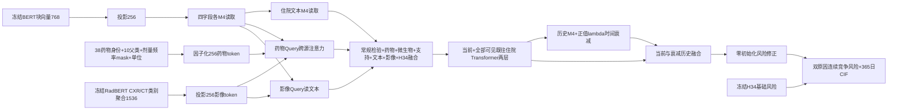
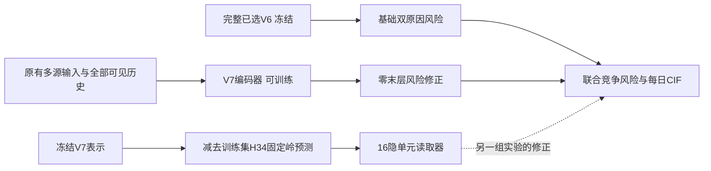

# 10_TRAINING_V7 · 1

源文件正文或经过字段白名单提取的汇总数据，来源身份见每段元数据。

## training/v7/__init__.py · lines 1–1

<!-- REVIEW_FRAGMENT {"path":"training/v7/__init__.py","part":1,"start_line":1,"end_line":1,"source_sha256":"6511eb3e0927a0605aa0d51c57eb8e4d3aa937d43469818e38621eb9b054194b","fragment_sha256":"6511eb3e0927a0605aa0d51c57eb8e4d3aa937d43469818e38621eb9b054194b","added_terminal_newline":false} -->
````python
"""冻结文本骨干的 V7 多源纵向竞争风险实验。"""
````
<!-- END REVIEW_FRAGMENT -->

## training/v7/audit_encoder.py · lines 1–25

<!-- REVIEW_FRAGMENT {"path":"training/v7/audit_encoder.py","part":1,"start_line":1,"end_line":25,"source_sha256":"54a10820a35c8e0e84b0c60af26e3a23baf1317350f6a2dbc35b80201f4cd39e","fragment_sha256":"54a10820a35c8e0e84b0c60af26e3a23baf1317350f6a2dbc35b80201f4cd39e","added_terminal_newline":false} -->
````python
"""离线读取本地 BERT 的实际参数数；不编码患者文本，不微调。"""
import json
from pathlib import Path
import time

from transformers import AutoModel
from patient_data.export_mimiciv import sha256

if __name__=='__main__':
    start=time.perf_counter()
    model_path=Path('training/model_cache/Bio_ClinicalBERT')
    model=AutoModel.from_pretrained(model_path,local_files_only=True)
    total=sum(p.numel() for p in model.parameters())
    pooler=sum(p.numel() for p in model.pooler.parameters())
    if total!=108310272 or total-pooler!=107719680:
        raise ValueError('local BERT architecture differs')
    result=dict(model='Bio_ClinicalBERT',implementation=type(model).__name__,
        total_parameters_including_pooler=total,encoder_parameters_excluding_pooler=total-pooler,
        pooler_parameters=pooler,hidden_size=model.config.hidden_size,layers=model.config.num_hidden_layers,
        backbone_attention_heads=model.config.num_attention_heads,v7_projection_heads=8,
        v7_backbone_optimizer_parameters=0,backbone_training_or_encoding_performed=False,
        source_sha256={str(p):sha256(p) for p in (model_path/'config.json',model_path/'pytorch_model.bin',Path(__file__))},
        inspection_seconds=time.perf_counter()-start)
    Path('training_runs/v7_first_2026-10-15_r2/bert_parameter_audit.json').write_text(json.dumps(result,indent=2),encoding='utf-8')
    print(json.dumps({k:v for k,v in result.items() if k!='source_sha256'}),flush=True)
````
<!-- END REVIEW_FRAGMENT -->

## training/v7/cached_followup.py · lines 1–102

<!-- REVIEW_FRAGMENT {"path":"training/v7/cached_followup.py","part":1,"start_line":1,"end_line":102,"source_sha256":"b473064b24edbd4c79431d579b73f93a45042984b9b3ca65148924464a67bf15","fragment_sha256":"b473064b24edbd4c79431d579b73f93a45042984b9b3ca65148924464a67bf15","added_terminal_newline":false} -->
````python
"""五个已选读取条件的两个追加种子；同冻结强基座。"""
import argparse
from dataclasses import asdict
import json
from pathlib import Path
import time
import numpy as np
import torch
from patient_data.export_mimiciv import sha256
from training.v6.early_stopping import EarlyStopping
from training.v6.risk import competing_nll
from training.v6.train import write_json
from training.v7 import cached_research as old

ROOT=Path('training_runs/v7_sequential_research_2026-10-15/cached_followup')
PROTOCOL=Path('docs/V7_CACHED_FOLLOWUP_PROTOCOL_2026-10-15.md')
VIEWS=('global','availability','linear','v7_frozen','routing_prior')
SEEDS=(7,101)


def source():
    a,f,_=old.checked();proof=json.loads((old.ROOT/'verification.json').read_text())
    if proof['maximum_error']!=0 or proof['report_sha256']!=sha256(old.ROOT/'report.json'):raise ValueError('cached proof stale')
    paths=(Path(__file__),PROTOCOL,old.ROOT/'report.json',old.ROOT/'verification.json',old.ROOT/'cache_contract.json')
    return a,f,dict(source_sha256={str(p):sha256(p) for p in paths},seeds=SEEDS,views=VIEWS,frozen_anchor_seed=42)


def metrics(a,tune,curve,nll,threshold=None):
    d=type('Data',(),dict(times=a['times'],events=a['events']))()
    return old.first.parent.detail(d,tune,curve,nll,threshold)


def fit(a,f,view,seed):
    folder=ROOT/f'seed{seed}'/view;folder.mkdir(parents=True)
    tr,va=a['train'],a['tune'];x=torch.as_tensor(old.views(a,f,tr,view),device='cuda')
    m=old.Reader(view,seed).cuda();opt=torch.optim.AdamW(m.parameters(),lr=.001,weight_decay=.01)
    torch.manual_seed(seed);rng=np.random.default_rng(seed);early=EarlyStopping(6,8,1e-4);hist=[];best=None;started=time.perf_counter()
    for epoch in range(25):
        if epoch:
            m.train();order=rng.permutation(tr)
            for start in range(0,len(order),256):
                p=order[start:start+256];opt.zero_grad(set_to_none=True)
                out=m(x[p],torch.as_tensor(a['anchor_a'][p],device='cuda'),torch.as_tensor(a['anchor_k'][p],device='cuda'))
                loss=competing_nll(out,*old.labels(a,p))+1e-4*out.delta.square().mean()
                if not torch.isfinite(loss):raise ValueError('nonfinite followup loss')
                loss.backward();torch.nn.utils.clip_grad_norm_(m.parameters(),1.);opt.step()
        aa,kk,curve,nll=old.predict(m,x,a,va);score=metrics(a,va,curve,nll)
        row=dict(epoch=epoch,annual=score['annual'],tuning_ibs=score['readmission']['integrated_brier_7_365'])
        hist.append(row);_,stop=early.observe(epoch,-row['annual']['f1']);key=old.first.selection_key(row)
        if best is None or key>best:
            best=key;torch.save(dict(state_dict=m.state_dict(),epoch=epoch,threshold=row['annual']['threshold']),folder/'best.pt')
        torch.save(dict(state_dict=m.state_dict(),epoch=epoch,threshold=row['annual']['threshold']),folder/'last.pt')
        if stop:break
    write_json(folder/'history.json',hist);outputs={}
    for which in ('best','last'):
        ck=torch.load(folder/f'{which}.pt',map_location='cuda',weights_only=True);m.load_state_dict(ck['state_dict'])
        aa,kk,curve,nll=old.predict(m,x,a,va);score=metrics(a,va,curve,nll,ck['threshold'])
        np.savez_compressed(folder/f'{which}_predictions.npz',curve=curve,log_amplitude=aa,shape=kk)
        outputs[which]=dict(epoch=ck['epoch'],threshold=ck['threshold'],metrics=score,
            checkpoint_sha256=sha256(folder/f'{which}.pt'),predictions_sha256=sha256(folder/f'{which}_predictions.npz'))
    info=dict(outputs=outputs,early=asdict(early),completed_epochs=epoch,seconds=time.perf_counter()-started)
    write_json(folder/'result.json',info)
    print(json.dumps(dict(seed=seed,view=view,best=outputs['best']['epoch'],f1=outputs['best']['metrics']['annual']['f1'],
        ibs=outputs['best']['metrics']['readmission']['integrated_brier_7_365'],seconds=info['seconds'])),flush=True)
    del m,x;torch.cuda.empty_cache();return info


def train():
    if ROOT.exists():raise FileExistsError('followup exists')
    a,f,contract=source();ROOT.mkdir();write_json(ROOT/'contract.json',contract);torch.set_num_threads(4)
    torch.backends.cuda.matmul.allow_tf32=False;torch.use_deterministic_algorithms(True)
    results={str(seed):{view:fit(a,f,view,seed) for view in VIEWS} for seed in SEEDS}
    write_json(ROOT/'report.json',dict(results=results,default_replaced=False,frozen_anchor_seed=42))


def verify():
    a,f,current=source();saved=json.loads((ROOT/'contract.json').read_text())
    if json.loads(json.dumps(current))!=saved:raise ValueError('followup source differs')
    torch.set_num_threads(4);torch.backends.cuda.matmul.allow_tf32=False
    report=json.loads((ROOT/'report.json').read_text());va=a['tune'];count=0
    for seed in SEEDS:
        for view in VIEWS:
            folder=ROOT/f'seed{seed}'/view;info=report['results'][str(seed)][view]
            m=old.Reader(view,seed).cuda();x=torch.as_tensor(old.views(a,f,a['train'],view),device='cuda')
            for which,expected in info['outputs'].items():
                if sha256(folder/f'{which}.pt')!=expected['checkpoint_sha256'] or sha256(folder/f'{which}_predictions.npz')!=expected['predictions_sha256']:raise ValueError('followup artifact changed')
                ck=torch.load(folder/f'{which}.pt',map_location='cuda',weights_only=True);m.load_state_dict(ck['state_dict'])
                aa,kk,curve,nll=old.predict(m,x,a,va)
                with np.load(folder/f'{which}_predictions.npz') as z:
                    for k,value in (('curve',curve),('log_amplitude',aa),('shape',kk)):np.testing.assert_array_equal(z[k],value)
                if metrics(a,va,curve,nll,expected['threshold'])!=expected['metrics']:raise ValueError('followup metrics differ')
            hist=json.loads((folder/'history.json').read_text());early=EarlyStopping(6,8,1e-4)
            for row in hist:early.observe(row['epoch'],-row['annual']['f1'])
            if asdict(early)!=info['early'] or max(hist,key=old.first.selection_key)['epoch']!=info['outputs']['best']['epoch']:raise ValueError('followup selection differs')
            count+=1;del m,x
    write_json(ROOT/'verification.json',dict(maximum_error=0,models=count,report_sha256=sha256(ROOT/'report.json')))
    print(json.dumps(dict(followup_verified=count,maximum_error=0)),flush=True)


if __name__=='__main__':
    p=argparse.ArgumentParser();p.add_argument('--mode',choices=('train','verify'),required=True)
    train() if p.parse_args().mode=='train' else verify()
````
<!-- END REVIEW_FRAGMENT -->

## training/v7/cached_research.py · lines 1–239

<!-- REVIEW_FRAGMENT {"path":"training/v7/cached_research.py","part":1,"start_line":1,"end_line":239,"source_sha256":"abab9787fbc2b3aafb4602c995ae2da57af81e007d8c02e3b5dd7a6a0c55c6a3","fragment_sha256":"abab9787fbc2b3aafb4602c995ae2da57af81e007d8c02e3b5dd7a6a0c55c6a3","added_terminal_newline":false} -->
````python
"""冻结强风险与候选表示；小容量机制筛查和独立重放。"""
import argparse
from dataclasses import asdict
import json
from pathlib import Path
import time
import numpy as np
import torch
from torch import nn
from torch.nn import functional as F
from patient_data.export_mimiciv import sha256
from training.v6.early_stopping import EarlyStopping
from training.v6.risk import RiskOutput,competing_nll
from training.v6.train import write_json
from training.v6.module_surgery import SurgeryModel
from training.v6.symmetric_context import SymmetricContextModel
from training.v7 import experiment as first
from training.v7.data import cache
from training.v7.model import V7Model
from training.v7.research_features import ROOT as FEATURE_ROOT,encode,scaled,REGIMEN

ROOT=Path('training_runs/v7_sequential_research_2026-10-15/cached')
PROTOCOL=Path('docs/V7_CACHED_RESEARCH_PROTOCOL_2026-10-15.md')
ANCHOR=Path('training_runs/v6_symmetric_context_2026-10-14/symmetric')
VIEWS=('global','v7_frozen','availability','linear','ple','velocity','density','curvature',
       'clinical_main','clinical_interaction','routing_uniform','routing_prior')
PFT=Path('patient_data/processed/v6_pft_set_interface_2026-10-13/interface.npz')
CXR=Path('patient_data/processed/v6_chexbert_cxr_2026-10-09/cxr_context.npz')


def load_npz(path):
    with np.load(path,allow_pickle=False) as z:return {k:z[k] for k in z.files}


def prepare():
    if ROOT.exists():raise FileExistsError('cached experiment exists; preserve scene')
    start=time.perf_counter();data=first.setup();d,c,ext,lab,rel,train,tune,base,drug,rad,*_=data
    ROOT.mkdir(parents=True)
    fresh=SurgeryModel(base,42,'control',[])
    strong=SymmetricContextModel(fresh,'symmetric').cuda().eval().requires_grad_(False)
    strong.load_state_dict(torch.load(ANCHOR/'best.pt',map_location='cuda',weights_only=True)['state_dict'])
    n=len(d.times);aa=np.zeros((n,2),np.float32);kk=np.ones_like(aa);context=np.zeros((n,34),np.float32)
    active=np.r_[train,tune];valid=np.zeros(n,bool);valid[active]=True
    with torch.no_grad():
        for start_at in range(0,len(active),128):
            ix=active[start_at:start_at+128]
            b=first.parent.make_batch(c,ext,lab,ix,rel['neighbors'],rel['offsets'],rel['gaps'],rel['note_times'],rel['admit'],history=True)
            out=strong(b);aa[ix]=out.log_amplitude.cpu();kk[ix]=out.shape.cpu();context[ix]=b[4][b[5]].cpu()
    # 同一个batch边界是旧风险重放合同的一部分；train与tune分开再核对调参。
    with torch.no_grad():
        for start_at in range(0,len(tune),128):
            ix=tune[start_at:start_at+128]
            b=first.parent.make_batch(c,ext,lab,ix,rel['neighbors'],rel['offsets'],rel['gaps'],rel['note_times'],rel['admit'],history=True)
            out=strong(b);aa[ix]=out.log_amplitude.cpu();kk[ix]=out.shape.cpu()
    old=load_npz(ANCHOR/'tuning_predictions.npz')
    np.testing.assert_array_equal(aa[tune],old['log_amplitude']);np.testing.assert_array_equal(kk[tune],old['shape'])
    np.testing.assert_array_equal(first.parent.probability_curve(aa[tune],kk[tune]),old['curve'])
    del strong,fresh;torch.cuda.empty_cache()
    m=V7Model(base,drug['drug_parent']).cuda().eval().requires_grad_(False)
    checkpoint=first.ROOT/'recommended/best.pt'
    m.load_state_dict(torch.load(checkpoint,map_location='cuda',weights_only=True)['state_dict'])
    embedded=np.zeros((n,256),np.float32);captured=[]
    handle=m.delta_head.register_forward_pre_hook(lambda module,args:captured.append(args[0].detach().cpu().numpy()))
    with torch.no_grad():
        for ix,b in cache(c,ext,lab,rel,drug,rad,active):
            m(b.to('cuda'));embedded[ix]=captured.pop()
    handle.remove();del m;torch.cuda.empty_cache()
    # 无监督冻结BERT摘要用于最后的严格内折模型，不复用监督V7表示。
    text=np.zeros((n,768),np.float32);history_text=np.zeros_like(text)
    text_present=np.zeros(n,bool)
    for i,refs in enumerate(d.text_refs):
        if refs:text[i]=np.asarray(d.text_vectors[[r for _,r in refs]],np.float32).mean(0);text_present[i]=True
    for i in active:
        previous=rel['neighbors'][rel['offsets'][i]:rel['offsets'][i+1]]
        use=previous[(rel['note_times'][previous]<=rel['admit'][i])&text_present[previous]]
        if len(use):history_text[i]=text[use].mean(0)
    rx,pft,cxr=(load_npz(p) for p in (REGIMEN,PFT,CXR))
    for a in (rx,pft,cxr):
        for k in ('hadm_ids','subject_ids','patient_splits'):np.testing.assert_array_equal(a[k],d.arrays[k])
    times=np.full(n,np.nan);events=np.full(n,-1,np.int64);times[active]=d.times[active];events[active]=d.events[active]
    arrays=dict(**{k:d.arrays[k] for k in ('hadm_ids','subject_ids','patient_splits')},train=train,tune=tune,
        valid=valid,times=times,events=events,anchor_a=aa,anchor_k=kk,context=context,
        context_raw=np.column_stack((d.history_raw,d.current,d.current_masks)).astype(np.float32),
        v7_hidden=embedded,text=text,history_text=history_text,regimen=rx['features'],
        pft=pft['aggregate'],cxr=cxr['cxr_onehot'],
        support=np.concatenate((c.arrays['support_values'],c.arrays['support_masks']),1).astype(np.float32))
    np.savez_compressed(ROOT/'cache.npz',**arrays)
    paths=(Path(__file__),PROTOCOL,Path('training/v7/research_features.py'),
        Path('training/tests/test_v7_cached_research.py'),ANCHOR/'best.pt',ANCHOR/'tuning_predictions.npz',checkpoint,
        FEATURE_ROOT/'manifest.json',FEATURE_ROOT/'verification.json',FEATURE_ROOT/'interface.npz',REGIMEN,PFT,CXR)
    write_json(ROOT/'cache_contract.json',dict(source_sha256={str(p):sha256(p) for p in paths},
        parent=data[-3],cache_sha256=sha256(ROOT/'cache.npz'),anchor_replay_error=0,
        no_confirmation_test_labels_cached=True,seconds=time.perf_counter()-start))
    print(json.dumps(dict(cache_ready=True,anchor_error=0,seconds=time.perf_counter()-start)),flush=True)


def checked():
    contract=json.loads((ROOT/'cache_contract.json').read_text())
    for p,h in contract['source_sha256'].items():
        if sha256(Path(p))!=h:raise ValueError('cached source changed: '+p)
    if sha256(ROOT/'cache.npz')!=contract['cache_sha256']:raise ValueError('cache changed')
    return load_npz(ROOT/'cache.npz'),load_npz(FEATURE_ROOT/'interface.npz'),contract


def views(a,f,fit,view):
    x=np.zeros((len(a['times']),512),np.float32)
    if view=='v7_frozen':x[:,:256]=a['v7_hidden']
    elif view!='global':
        source='clinical_interaction' if view.startswith('routing_') else view
        if view.startswith('routing_'):source='ple'
        x[:,:288],_=encode(f,fit,source)
        if view.startswith('routing_'):
            x[:,288:322]=a['context'];x[:,322:356]=a['regimen'];x[:,356:365]=a['pft']
            x[:,365:393]=a['cxr'];x[:,393:399]=a['support'];x[:,399:405]=f['clinical']
            z,_=scaled(np.log1p(f['los'])[:,None],np.ones((len(x),1),bool),np.isin(np.arange(len(x)),fit));x[:,405]=z[:,0]
    return x


def group_ids():
    groups=np.full(512,9,np.int64)
    for j in range(9):
        groups[j*24:(j+1)*24]=j;groups[216+j]=j;groups[225+j]=j
    groups[322:356]=10;groups[356:365]=11;groups[365:393]=12;groups[393:399]=13;groups[399:405]=14
    return torch.as_tensor(groups)


class Reader(nn.Module):
    def __init__(self,view,seed=42):
        super().__init__();self.view=view
        with torch.random.fork_rng(devices=[]):
            torch.manual_seed(seed)
            if view=='global':self.global_raw=nn.Parameter(torch.zeros(4))
            elif view.startswith('routing_'):
                self.shared=nn.Sequential(nn.Linear(35,16),nn.GELU(),nn.Linear(16,8))
                self.heads=nn.ModuleList(nn.Sequential(nn.Linear(520,16),nn.GELU(),nn.Dropout(.3),nn.Linear(16,2)) for _ in range(2))
                self.route=nn.Parameter(torch.zeros(2,15));self.register_buffer('groups',group_ids())
                if view=='routing_prior':
                    with torch.no_grad():
                        self.route[0,[0,1,5,8,9,10,11,13]]=.5
                        self.route[1,[2,3,4,7,9,12]]=.5
                for head in self.heads:nn.init.zeros_(head[-1].weight);nn.init.zeros_(head[-1].bias)
            else:
                self.head=nn.Sequential(nn.Linear(512,16),nn.GELU(),nn.Dropout(.3),nn.Linear(16,4))
                nn.init.zeros_(self.head[-1].weight);nn.init.zeros_(self.head[-1].bias)

    def forward(self,x,anchor_a,anchor_k):
        if self.view=='global':raw=self.global_raw.expand(len(x),4).reshape(-1,2,2)
        elif self.view.startswith('routing_'):
            shared=self.shared(torch.cat((x[:,288:322],x[:,405:406]),1))
            weight=15*torch.softmax(self.route,1)
            raw=torch.stack([head(torch.cat((x*weight[k,self.groups],shared),1)) for k,head in enumerate(self.heads)],1)
        else:raw=self.head(x).reshape(-1,2,2)
        return RiskOutput((anchor_a+raw[:,:,0]).clamp(-10,6),anchor_k*torch.exp(.25*torch.tanh(raw[:,:,1])),raw)


def labels(a,ix):return torch.as_tensor(a['times'][ix],device='cuda'),torch.as_tensor(a['events'][ix],device='cuda')


@torch.no_grad()
def predict(m,x,a,ix):
    m.eval();aa=[];kk=[];nll=0.
    for start in range(0,len(ix),512):
        p=ix[start:start+512];out=m(x[p],torch.as_tensor(a['anchor_a'][p],device='cuda'),torch.as_tensor(a['anchor_k'][p],device='cuda'))
        aa.append(out.log_amplitude.cpu().numpy());kk.append(out.shape.cpu().numpy());nll+=float(competing_nll(out,*labels(a,p)))*len(p)
    aa,kk=np.concatenate(aa),np.concatenate(kk)
    return aa,kk,first.parent.probability_curve(aa,kk),nll/len(ix)


def fit(a,f,view):
    folder=ROOT/view;folder.mkdir();train,tune=a['train'],a['tune']
    x=torch.as_tensor(views(a,f,train,view),device='cuda');m=Reader(view).cuda();opt=torch.optim.AdamW(m.parameters(),lr=.001,weight_decay=.01)
    rng=np.random.default_rng(42);torch.manual_seed(42);early=EarlyStopping(6,8,1e-4);hist=[];best=None;started=time.perf_counter()
    for epoch in range(25):
        if epoch:
            m.train()
            for start in range(0,len(train),256):
                # 一次每轮打乱，而非每个batch重新抽样。
                if start==0:order=rng.permutation(train)
                p=order[start:start+256];opt.zero_grad(set_to_none=True)
                out=m(x[p],torch.as_tensor(a['anchor_a'][p],device='cuda'),torch.as_tensor(a['anchor_k'][p],device='cuda'))
                loss=competing_nll(out,*labels(a,p))+1e-4*out.delta.square().mean()
                if not torch.isfinite(loss):raise ValueError('nonfinite cached loss')
                loss.backward();torch.nn.utils.clip_grad_norm_(m.parameters(),1.);opt.step()
        aa,kk,curve,nll=predict(m,x,a,tune)
        metrics=first.parent.detail(type('Data',(),dict(times=a['times'],events=a['events']))(),tune,curve,nll)
        row=dict(epoch=epoch,annual=metrics['annual'],tuning_ibs=metrics['readmission']['integrated_brier_7_365'],
                 tuning_death_ibs=metrics['death']['integrated_brier_7_365'])
        hist.append(row);_,stop=early.observe(epoch,-row['annual']['f1']);key=first.selection_key(row)
        if best is None or key>best:
            best=key;torch.save(dict(state_dict=m.state_dict(),epoch=epoch,threshold=row['annual']['threshold']),folder/'best.pt')
        torch.save(dict(state_dict=m.state_dict(),epoch=epoch,threshold=row['annual']['threshold']),folder/'last.pt')
        write_json(folder/'history.json',hist)
        if stop:break
    outputs={}
    for which in ('best','last'):
        ck=torch.load(folder/f'{which}.pt',map_location='cuda',weights_only=True);m.load_state_dict(ck['state_dict'])
        aa,kk,curve,nll=predict(m,x,a,tune)
        metrics=first.parent.detail(type('Data',(),dict(times=a['times'],events=a['events']))(),tune,curve,nll,ck['threshold'])
        np.savez_compressed(folder/f'{which}_predictions.npz',positions=tune,log_amplitude=aa,shape=kk,curve=curve)
        outputs[which]=dict(epoch=ck['epoch'],threshold=ck['threshold'],metrics=metrics,
            checkpoint_sha256=sha256(folder/f'{which}.pt'),predictions_sha256=sha256(folder/f'{which}_predictions.npz'))
    result=dict(outputs=outputs,early=asdict(early),completed_epochs=epoch,seconds=time.perf_counter()-started,
        parameters=sum(p.numel() for p in m.parameters()),stop_reason='patience' if stop else 'max_epochs')
    write_json(folder/'result.json',result);print(json.dumps(dict(view=view,epoch=outputs['best']['epoch'],
        f1=outputs['best']['metrics']['annual']['f1'],ibs=outputs['best']['metrics']['readmission']['integrated_brier_7_365'],seconds=result['seconds'])),flush=True)
    del m,x;torch.cuda.empty_cache();return result


def train():
    if (ROOT/'report.json').exists():raise FileExistsError('cached report exists')
    a,f,_=checked();torch.set_num_threads(4);torch.use_deterministic_algorithms(True)
    results={view:fit(a,f,view) for view in VIEWS}
    write_json(ROOT/'report.json',dict(results=results,default_replaced=False,confirmation_test_used=False))


def verify():
    a,f,_=checked();report=json.loads((ROOT/'report.json').read_text());proof={};tune=a['tune'];d=type('Data',(),dict(times=a['times'],events=a['events']))()
    torch.set_num_threads(4)
    for view,info in report['results'].items():
        x=torch.as_tensor(views(a,f,a['train'],view),device='cuda');m=Reader(view).cuda()
        for which,out in info['outputs'].items():
            folder=ROOT/view
            if sha256(folder/f'{which}.pt')!=out['checkpoint_sha256'] or sha256(folder/f'{which}_predictions.npz')!=out['predictions_sha256']:raise ValueError('cached fit artifact changed')
            ck=torch.load(folder/f'{which}.pt',map_location='cuda',weights_only=True);m.load_state_dict(ck['state_dict'])
            aa,kk,curve,nll=predict(m,x,a,tune)
            with np.load(folder/f'{which}_predictions.npz') as z:
                for key,value in (('positions',tune),('log_amplitude',aa),('shape',kk),('curve',curve)):np.testing.assert_array_equal(z[key],value)
            if first.parent.detail(d,tune,curve,nll,out['threshold'])!=out['metrics']:raise ValueError('cached metrics differ')
        hist=json.loads((ROOT/view/'history.json').read_text());early=EarlyStopping(6,8,1e-4)
        for row in hist:early.observe(row['epoch'],-row['annual']['f1'])
        if asdict(early)!=info['early'] or max(hist,key=first.selection_key)['epoch']!=info['outputs']['best']['epoch']:raise ValueError('cached selection differs')
        proof[view]=dict(best_last_error=0,metrics_equal=True,selection_equal=True);del m,x
    write_json(ROOT/'verification.json',dict(results=proof,maximum_error=0,report_sha256=sha256(ROOT/'report.json')))
    print(json.dumps(dict(cached_fits_verified=len(proof),maximum_error=0)),flush=True)


if __name__=='__main__':
    p=argparse.ArgumentParser();p.add_argument('--mode',choices=('prepare','train','verify'),required=True)
    globals()[p.parse_args().mode]()
````
<!-- END REVIEW_FRAGMENT -->

## training/v7/data.py · lines 1–68

<!-- REVIEW_FRAGMENT {"path":"training/v7/data.py","part":1,"start_line":1,"end_line":68,"source_sha256":"69129c82c0f60edc5fd26a2fab4eafb35683783fbc9b652b5ee68f84fa7a793f","fragment_sha256":"69129c82c0f60edc5fd26a2fab4eafb35683783fbc9b652b5ee68f84fa7a793f","added_terminal_newline":false} -->
````python
"""复用通过核验的 V6 成员和历史可见性；只缓存实际片段，避免全量 padding。"""
from pathlib import Path
import json

import numpy as np
import torch

from patient_data.export_mimiciv import sha256
from training.v6.clinical_facts_context import checked
from training.v6.unified_longitudinal import make_batch
from training.v7.model import V7Batch

DRUG_ROOT = Path('patient_data/processed/v6_audited_coarse_fine_2026-10-12_r2')
RAD_ROOT = Path('patient_data/processed/v6_radbert_imaging_2026-10-10_r2')


def load_sources(d, c):
    audit = json.loads((DRUG_ROOT / 'audit.json').read_text())
    if sha256(DRUG_ROOT / 'interface.npz') != audit['interface_sha256']:
        raise ValueError('drug interface changed')
    with np.load(DRUG_ROOT / 'interface.npz') as z:
        drug = {k: z[k] for k in ('hadm_ids', 'subject_ids', 'patient_splits', 'medications', 'med_present', 'drug_parent', 'med_names')}
    for k in ('hadm_ids', 'subject_ids', 'patient_splits'):
        np.testing.assert_array_equal(drug[k], d.arrays[k])
    if drug['medications'].shape != (len(d.times), 38, 11) or not np.isfinite(drug['medications']).all():
        raise ValueError('drug schema/finite mismatch')
    rad, _ = checked(RAD_ROOT, 'imaging.npz', 'full_radiology_processed', c)
    if rad['values'].shape != (len(d.times), 2, 1536) or not np.isfinite(rad['values']).all():
        raise ValueError('radiology schema/finite mismatch')
    hashes = {str(p): sha256(p) for p in (DRUG_ROOT / 'audit.json', DRUG_ROOT / 'interface.npz', RAD_ROOT / 'manifest.json', RAD_ROOT / 'imaging.npz')}
    return drug, rad, hashes


def make_v7_batch(c, ext, lab, relation, drug, rad, positions, *, history=True):
    b = make_batch(c, ext, lab, positions, relation['neighbors'], relation['offsets'], relation['gaps'],
                   relation['note_times'], relation['admit'], history=history, device='cpu')
    compact, _, labs, eos, context, current, past, present, gaps = b
    # 与父构造器完全相同的稳定 key 顺序；一个过去住院可按文本可见状态出现两份。
    unique = list(dict.fromkeys((int(p), True) for p in positions))
    seen = set(unique)
    for p in positions:
        selected = relation['neighbors'][relation['offsets'][p]:relation['offsets'][p+1]] if history else []
        for v in selected:
            key = (int(v), bool(relation['note_times'][v] <= relation['admit'][p]))
            if key not in seen:
                unique.append(key); seen.add(key)
    rows = np.array([p for p, _ in unique], np.int64)
    if len(rows) != len(context):
        raise ValueError('V7 key expansion mismatch')
    index = compact.clinical.snippet_index
    slots = np.empty(len(index), np.int64)
    count = np.zeros(len(rows), np.int64)
    for i, v in enumerate(index[:, 0].numpy()):
        slots[i] = count[v]; count[v] += 1
    tensor = torch.as_tensor
    return V7Batch(context, labs, eos, tensor(drug['medications'][rows]), tensor(drug['med_present'][rows]),
                   compact.med_features, compact.micro_values, compact.micro_masks,
                   compact.support_values, compact.support_masks, compact.clinical.snippet_vectors,
                   index, tensor(slots), tensor(rad['values'][rows]), tensor(rad['present'][rows]),
                   current, past, present, gaps)


def cache(c, ext, lab, relation, drug, rad, indices, *, batch_size=64):
    result = []
    for start in range(0, len(indices), batch_size):
        p = indices[start:start + batch_size]
        result.append((p, make_v7_batch(c, ext, lab, relation, drug, rad, p)))
    return result
````
<!-- END REVIEW_FRAGMENT -->

## training/v7/diagnostics.py · lines 1–79

<!-- REVIEW_FRAGMENT {"path":"training/v7/diagnostics.py","part":1,"start_line":1,"end_line":79,"source_sha256":"c0b373e319ca890b4b161b6ef1e5343fa3ce4c3a6ff22328daa5a0ffc93c6c63","fragment_sha256":"c0b373e319ca890b4b161b6ef1e5343fa3ce4c3a6ff22328daa5a0ffc93c6c63","added_terminal_newline":false} -->
````python
"""锁定 best 后的内容敏感性诊断，0新训练，不作为重新选点依据。"""
from dataclasses import replace
import json
from pathlib import Path

import numpy as np
import torch

from patient_data.export_mimiciv import sha256
from training.v6.train import write_json
from training.v7.experiment import ROOT, ARMS, setup, predict
from training.v7.data import cache
from training.v7.model import V7Model


def altered(b, source):
    if source=='text':
        return replace(b,text_vectors=b.text_vectors[:0],text_index=b.text_index[:0],text_slot=b.text_slot[:0])
    if source=='drugs':
        return replace(b,med_present=torch.zeros_like(b.med_present),coarse_meds=torch.zeros_like(b.coarse_meds))
    if source=='labs':
        return replace(b,labs=torch.zeros_like(b.labs),eos=torch.zeros_like(b.eos))
    if source=='radiology':
        return replace(b,rad_present=torch.zeros_like(b.rad_present))
    if source=='history':
        return replace(b,past_present=torch.zeros_like(b.past_present))
    raise ValueError(source)


@torch.no_grad()
def calculate():
    proof=json.loads((ROOT/'verification.json').read_text())
    if proof['maximum_error']!=0 or proof['report_sha256']!=sha256(ROOT/'report.json'):
        raise ValueError('best verification changed')
    d,c,ext,lab,relation,train,tune,baseline,drug,rad,contract,source,_=setup()
    batches=cache(c,ext,lab,relation,drug,rad,tune)
    result={}
    for arm in ARMS:
        model=V7Model(baseline,drug['drug_parent']).cuda().eval()
        checkpoint=torch.load(ROOT/arm/'best.pt',map_location='cuda',weights_only=True)
        model.load_state_dict(checkpoint['state_dict'])
        _,_,curve,_=predict(model,batches,d)
        with np.load(ROOT/arm/'tuning_predictions.npz') as z:
            np.testing.assert_array_equal(curve,z['curve'])
        deltas=[];representations={n:[] for n in ('text','lab','drug','rad')}
        for _,b in batches:
            out,reps,masks=model(b.to('cuda'),auxiliary=True)
            deltas.append(out.delta.cpu().numpy())
            for n in representations:
                representations[n].append(reps[n][masks[n]].cpu().numpy())
        delta=np.concatenate(deltas)
        reps={n:np.concatenate(v) for n,v in representations.items()}
        sensitivity={}
        for source in ('text','drugs','labs','radiology','history'):
            modified=[(p,altered(b,source)) for p,b in batches]
            _,_,other,_=predict(model,modified,d)
            difference=other[:,:,1:]-curve[:,:,1:]
            sensitivity[source]=dict(annual_readmission_max_absolute_change=float(np.abs(difference[:,365,0]).max()),
                annual_readmission_mean_absolute_change=float(np.abs(difference[:,365,0]).mean()),
                annual_death_mean_absolute_change=float(np.abs(difference[:,365,1]).mean()),
                all_horizons_causes_max_absolute_change=float(np.abs(difference).max()))
        result[arm]=dict(best_epoch=checkpoint['epoch'],delta_mean=delta.mean(0).tolist(),delta_std=delta.std(0).tolist(),
            normalized_source_embedding_mean_coordinate_std={n:float(v.std(0).mean()) if len(v) else None for n,v in reps.items()},
            ablation_sensitivity=sensitivity)
        del model;torch.cuda.empty_cache()
    return dict(results=result,source_sha256={str(Path(__file__)):sha256(Path(__file__)),
        str(ROOT/'report.json'):sha256(ROOT/'report.json'),str(ROOT/'verification.json'):sha256(ROOT/'verification.json')},
        new_training=0,scope='mask selected source in all current/past visits, or remove past relations; frozen H34 unchanged',
        limits='post-selection content sensitivity, not retrained causal/incremental-value ablation; not used for selection')


if __name__=='__main__':
    result=calculate();target=ROOT/'diagnostics.json'
    if target.exists():
        if json.loads(target.read_text())!=result:raise ValueError('diagnostics replay differs')
        write_json(ROOT/'diagnostics_verification.json',dict(maximum_error=0,diagnostics_sha256=sha256(target),new_training=0))
        print('V7 diagnostics replay exact')
    else:
        write_json(target,result);print('V7 diagnostics saved')
````
<!-- END REVIEW_FRAGMENT -->

## training/v7/drug_context_experiment.py · lines 1–103

<!-- REVIEW_FRAGMENT {"path":"training/v7/drug_context_experiment.py","part":1,"start_line":1,"end_line":103,"source_sha256":"a090d5ee5817b60189dada1347c854b6eab81940093f22ad51867be1c32e79e9","fragment_sha256":"a090d5ee5817b60189dada1347c854b6eab81940093f22ad51867be1c32e79e9","added_terminal_newline":false} -->
````python
"""药名语义/同分子记录动态：同冻结基座小容量配对筛查。"""
import argparse
from dataclasses import asdict
import json
from pathlib import Path
import time
import numpy as np
import torch
from patient_data.export_mimiciv import sha256
from training.v6.early_stopping import EarlyStopping
from training.v6.risk import competing_nll
from training.v6.train import write_json
from training.v7 import cached_research as base
from training.v7.drug_context_features import ROOT as DATA,view as feature_view,PROTOCOL

ROOT=Path('training_runs/v7_sequential_research_2026-10-15/drug_screen')
VIEWS=('name_source','name_identity','name_random','name_semantic',
       'dynamics_source','dynamics_main','dynamics_slope','dynamics_route')


def setup():
    a,_,_=base.checked();features=base.load_npz(DATA/'interface.npz');manifest=json.loads((DATA/'manifest.json').read_text())
    proof=json.loads((DATA/'verification.json').read_text())
    if proof['manifest_sha256']!=sha256(DATA/'manifest.json') or proof['maximum_error']!=0:raise ValueError('drug feature proof stale')
    for p,h in manifest['source_sha256'].items():
        if sha256(Path(p))!=h:raise ValueError('drug feature source changed')
    if sha256(DATA/'interface.npz')!=manifest['output_sha256']:raise ValueError('drug feature array changed')
    for k in ('hadm_ids','subject_ids','patient_splits'):np.testing.assert_array_equal(features[k],a[k])
    paths=(Path(__file__),PROTOCOL,DATA/'manifest.json',DATA/'verification.json',DATA/'interface.npz',base.ROOT/'cache_contract.json')
    return a,features,dict(source_sha256={str(p):sha256(p) for p in paths},views=VIEWS,seed=42)


def score(a,ix,curve,nll,threshold=None):
    return base.first.parent.detail(type('Data',(),dict(times=a['times'],events=a['events']))(),ix,curve,nll,threshold)


def fit(a,features,view):
    folder=ROOT/view;folder.mkdir();tr,va=a['train'],a['tune'];x=torch.as_tensor(feature_view(features,tr,view),device='cuda')
    m=base.Reader(view).cuda();opt=torch.optim.AdamW(m.parameters(),lr=.001,weight_decay=.01)
    torch.manual_seed(42);rng=np.random.default_rng(42);early=EarlyStopping(6,8,1e-4);hist=[];best=None;started=time.perf_counter()
    for epoch in range(25):
        if epoch:
            m.train();order=rng.permutation(tr)
            for start in range(0,len(order),256):
                p=order[start:start+256];opt.zero_grad(set_to_none=True)
                out=m(x[p],torch.as_tensor(a['anchor_a'][p],device='cuda'),torch.as_tensor(a['anchor_k'][p],device='cuda'))
                loss=competing_nll(out,*base.labels(a,p))+1e-4*out.delta.square().mean()
                if not torch.isfinite(loss):raise ValueError('nonfinite drug fit')
                loss.backward();torch.nn.utils.clip_grad_norm_(m.parameters(),1.);opt.step()
        aa,kk,curve,nll=base.predict(m,x,a,va);metrics=score(a,va,curve,nll)
        row=dict(epoch=epoch,annual=metrics['annual'],tuning_ibs=metrics['readmission']['integrated_brier_7_365'])
        hist.append(row);_,stop=early.observe(epoch,-row['annual']['f1']);key=base.first.selection_key(row)
        if best is None or key>best:
            best=key;torch.save(dict(state_dict=m.state_dict(),epoch=epoch,threshold=row['annual']['threshold']),folder/'best.pt')
        torch.save(dict(state_dict=m.state_dict(),epoch=epoch,threshold=row['annual']['threshold']),folder/'last.pt')
        if stop:break
    write_json(folder/'history.json',hist);outputs={}
    for which in ('best','last'):
        ck=torch.load(folder/f'{which}.pt',map_location='cuda',weights_only=True);m.load_state_dict(ck['state_dict'])
        aa,kk,curve,nll=base.predict(m,x,a,va)
        np.savez_compressed(folder/f'{which}_predictions.npz',log_amplitude=aa,shape=kk,curve=curve)
        outputs[which]=dict(epoch=ck['epoch'],threshold=ck['threshold'],metrics=score(a,va,curve,nll,ck['threshold']),
            checkpoint_sha256=sha256(folder/f'{which}.pt'),predictions_sha256=sha256(folder/f'{which}_predictions.npz'))
    info=dict(outputs=outputs,completed_epochs=epoch,early=asdict(early),seconds=time.perf_counter()-started)
    write_json(folder/'result.json',info);print(json.dumps(dict(view=view,epoch=outputs['best']['epoch'],
        f1=outputs['best']['metrics']['annual']['f1'],ibs=outputs['best']['metrics']['readmission']['integrated_brier_7_365'],seconds=info['seconds'])),flush=True)
    del m,x;torch.cuda.empty_cache();return info


def train():
    if ROOT.exists():raise FileExistsError('drug screen exists')
    a,f,contract=setup();ROOT.mkdir();write_json(ROOT/'contract.json',contract)
    torch.set_num_threads(4);torch.backends.cuda.matmul.allow_tf32=False;torch.use_deterministic_algorithms(True)
    results={name:fit(a,f,name) for name in VIEWS}
    write_json(ROOT/'report.json',dict(results=results,default_replaced=False,
        unavailable=['completed source-checked full clinical facts NPZ','confirmed home NIV absence','complete heart failure regimen'],
        limits=['drug-name embeddings only','recorded administration changes, not equivalent clinical escalation']))


def verify():
    a,f,current=setup()
    if json.loads(json.dumps(current))!=json.loads((ROOT/'contract.json').read_text()):raise ValueError('drug screen contract changed')
    torch.set_num_threads(4);torch.backends.cuda.matmul.allow_tf32=False;report=json.loads((ROOT/'report.json').read_text());va=a['tune']
    for name,info in report['results'].items():
        folder=ROOT/name;x=torch.as_tensor(feature_view(f,a['train'],name),device='cuda');m=base.Reader(name).cuda()
        for which,out in info['outputs'].items():
            if sha256(folder/f'{which}.pt')!=out['checkpoint_sha256'] or sha256(folder/f'{which}_predictions.npz')!=out['predictions_sha256']:raise ValueError('drug fit artifact changed')
            ck=torch.load(folder/f'{which}.pt',map_location='cuda',weights_only=True);m.load_state_dict(ck['state_dict'])
            aa,kk,curve,nll=base.predict(m,x,a,va)
            with np.load(folder/f'{which}_predictions.npz') as z:
                for k,v in (('log_amplitude',aa),('shape',kk),('curve',curve)):np.testing.assert_array_equal(z[k],v)
            if score(a,va,curve,nll,out['threshold'])!=out['metrics']:raise ValueError('drug screen metrics differ')
        hist=json.loads((folder/'history.json').read_text());early=EarlyStopping(6,8,1e-4)
        for row in hist:early.observe(row['epoch'],-row['annual']['f1'])
        if asdict(early)!=info['early'] or max(hist,key=base.first.selection_key)['epoch']!=info['outputs']['best']['epoch']:raise ValueError('drug selection differs')
        del m,x
    write_json(ROOT/'verification.json',dict(maximum_error=0,models_replayed=len(VIEWS),report_sha256=sha256(ROOT/'report.json')))
    print(json.dumps(dict(drug_models_verified=len(VIEWS),maximum_error=0)),flush=True)


if __name__=='__main__':
    p=argparse.ArgumentParser();p.add_argument('--mode',choices=('train','verify'),required=True)
    train() if p.parse_args().mode=='train' else verify()
````
<!-- END REVIEW_FRAGMENT -->

## training/v7/drug_context_features.py · lines 1–149

<!-- REVIEW_FRAGMENT {"path":"training/v7/drug_context_features.py","part":1,"start_line":1,"end_line":149,"source_sha256":"372db9434ba47f240a5fac1467897a882f393b94d7898595f5d98ce05aa0720f","fragment_sha256":"372db9434ba47f240a5fac1467897a882f393b94d7898595f5d98ce05aa0720f","added_terminal_newline":false} -->
````python
"""复用原用药真实性规则，派生同分子记录动态，不输出个体记录。"""
from collections import defaultdict
from datetime import datetime
import argparse
import json
from pathlib import Path
import time
import numpy as np
from patient_data.export_mimiciv import rows,sha256
from patient_data.v6_detail_extension import MOLECULES,molecule_matches,dose_mg
from patient_data.compact_multisource import INHALED_ROUTES,order_available
from patient_data.eos_med_context import SYSTEMIC_ROUTES
from patient_data.preprocess_events import ADMINISTERED
from training.v6.train import write_json
from training.v7.research_features import SNAP,ROOT as FEATURES,scaled

ROOT=Path('training_runs/v7_sequential_research_2026-10-15/drug_context')
DRUG=Path('patient_data/processed/v6_audited_coarse_fine_2026-10-12_r2/interface.npz')
NAMES=Path('training_runs/v7_sequential_research_2026-10-15/drug_names/names.npz')
PROTOCOL=Path('docs/V7_DRUG_CONTEXT_PROTOCOL_2026-10-15.md')


def route_kind(routes):
    kinds=set()
    for r in routes:
        if r in ('IV','IV DRIP','IV PUSH','INTRAVENOUS'):kinds.add('iv')
        elif r in ('IM','INTRAMUSCULAR'):kinds.add('im')
        elif r in INHALED_ROUTES:kinds.add('inhaled')
        elif r in SYSTEMIC_ROUTES:kinds.add('enteral')
        else:return None
    return next(iter(kinds)) if len(kinds)==1 else None


def summary(samples,los):
    x=np.zeros(12);valid=np.zeros(12,bool)
    if not samples:return x,valid
    ordered=sorted(samples,key=lambda r:r[0]);t=np.array([r[0] for r in ordered])
    x[:5]=[1,np.log1p(len(t)),np.log1p(t[-1]-t[0]),np.log1p((t<1).sum()),np.log1p((t>=los-1).sum())];valid[:5]=True
    first=[s for s in ordered if s[0]<1];last=[s for s in ordered if s[0]>=los-1]
    if los>=2 and first and last:
        gap=los-1;x[5]=(len(last)-len(first))/gap;valid[5]=True
        if all(s[1] is not None for s in first+last):
            x[6]=(sum(s[1] for s in last)-sum(s[1] for s in first))/gap;valid[6]=True
    start_route,end_route=ordered[0][2],ordered[-1][2]
    if t[-1]>t[0] and start_route is not None and end_route is not None:
        x[7]=start_route!=end_route;x[8]=start_route=='iv' and end_route=='enteral';valid[7:9]=True
    return x,valid


def derive():
    started=time.perf_counter();sm=json.loads((SNAP/'metadata/manifest.json').read_text())
    with np.load(FEATURES/'interface.npz') as z:ids={k:z[k] for k in ('hadm_ids','subject_ids','patient_splits')};los=z['los']
    order={str(h):i for i,h in enumerate(ids['hadm_ids'])};bounds={}
    for r in rows(SNAP/'cohort/admissions.csv.gz'):
        if r['hadm_id'] in order:bounds[r['hadm_id']]=tuple(datetime.fromisoformat(r[k]) for k in ('admittime','dischtime'))
    sources={};records={};pharmacy={};source_present=np.zeros(len(order),bool)
    for name in ('cohort/admissions','raw/emar','raw/emar_detail','raw/pharmacy'):
        p=SNAP/(name+'.csv.gz');sources[str(p)]=sha256(p)
        if sources[str(p)]!=sm['sources'][name]['sha256']:raise ValueError('drug raw source changed')
    for r in rows(SNAP/'raw/pharmacy.csv.gz'):
        h=r['hadm_id']
        if h in order and order_available(r,bounds[h])[0]:pharmacy[h,r['pharmacy_id']]=(r['route'].strip().upper(),r['starttime'],r['stoptime'])
    for r in rows(SNAP/'raw/emar.csv.gz'):
        h=r['hadm_id']
        if h not in order:continue
        try:t,s=(datetime.fromisoformat(r[k]) for k in ('charttime','storetime'))
        except ValueError:continue
        if not bounds[h][0]<=t<=s<=bounds[h][1]:continue
        source_present[order[h]]=True;molecules=molecule_matches(r['medication'])
        if not molecules or r['event_txt'] not in ADMINISTERED:continue
        key=r['emar_id'],r['emar_seq']
        if key in records:raise ValueError('duplicate execution parent')
        records[key]=(h,t,molecules,r['pharmacy_id'])
    details=defaultdict(list)
    for r in rows(SNAP/'raw/emar_detail.csv.gz'):
        key=r['emar_id'],r['emar_seq']
        if key in records:details[key].append(r)
    samples=defaultdict(list)
    for key,(h,t,molecules,pid) in records.items():
        detail=details[key];routes={r['route'].strip().upper() for r in detail if r['route'] not in ('',r'\N')}
        if not routes and (h,pid) in pharmacy:
            route,first,last=pharmacy[h,pid]
            if datetime.fromisoformat(first)<=t and (last in ('',r'\N') or t<=datetime.fromisoformat(last)):routes={route}
        for molecule in molecules:
            allowed=INHALED_ROUTES if molecule in ('albuterol','ipratropium') else SYSTEMIC_ROUTES
            if not routes or not routes.issubset(allowed):continue
            if any(r['complete_dose_not_given'].strip().upper() in ('Y','YES','TRUE','1') for r in detail):continue
            dose,_=dose_mg(detail,molecule) if len(molecules)==1 else (None,'compound')
            if dose==0:continue
            day=(t-bounds[h][0]).total_seconds()/86400
            samples[order[h],MOLECULES.index(molecule)].append((day,dose,route_kind(routes)))
    raw=np.zeros((len(order),12,12));valid=np.zeros_like(raw,bool)
    for (i,j),values in samples.items():raw[i,j],valid[i,j]=summary(values,los[i])
    with np.load(DRUG) as z:
        for k in ids:np.testing.assert_array_equal(ids[k],z[k])
        names=z['med_names'];present=z['med_present']
    with np.load(NAMES) as z:np.testing.assert_array_equal(names,z['names']);vectors=z['vectors']
    projection=np.random.default_rng(42).normal(size=(768,256))/np.sqrt(768)
    random=np.random.default_rng(42).normal(size=vectors.shape);random/=np.linalg.norm(random,axis=1,keepdims=True)
    count=present.sum(1,keepdims=True).clip(1)
    semantic=(present@vectors/count)@projection;random_view=(present@random/count)@projection
    a=dict(**ids,raw=raw,valid=valid,los=los,source_present=source_present,fine_present=present,
        semantic=semantic.astype(np.float32),random=random_view.astype(np.float32))
    for p in (Path(__file__),PROTOCOL,Path('training/tests/test_v7_drug_context.py'),DRUG,NAMES,
              NAMES.parent/'manifest.json',FEATURES/'interface.npz',Path('patient_data/v6_detail_extension.py')):sources[str(p)]=sha256(p)
    train=ids['patient_splits']=='train'
    return a,dict(source_sha256=sources,train_frequency_valid=int(valid[train,:,5].sum()),
        train_dose_valid=int(valid[train,:,6].sum()),train_route_valid=int(valid[train,:,7].sum()),
        source_visibility_is_partial=True,recorded_span_is_not_complete_duration=True,seconds=time.perf_counter()-started)


def view(a,fit_indices,name):
    x=np.zeros((len(a['los']),512),np.float32);fit=np.zeros(len(x),bool);fit[fit_indices]=True
    if name.startswith('name_'):
        p=a['fine_present'];x[:,500]=p.any(1);x[:,501]=np.log1p(p.sum(1))
        if name=='name_identity':x[:,:38]=p
        if name=='name_random':x[:,:256]=a['random']
        if name=='name_semantic':x[:,:256]=a['semantic']
    else:
        raw,valid=a['raw'],a['valid'];x[:,:12]=raw[:,:,0];x[:,12:24]=valid[:,:,5];x[:,24:36]=valid[:,:,6]
        x[:,36:48]=valid[:,:,7];x[:,500]=a['source_present']
        if name!='dynamics_source':
            values=raw[:,:,1:5].reshape(len(x),-1);mask=valid[:,:,1:5].reshape(len(x),-1)
            x[:,48:96],_=scaled(values,mask,fit)
        if name=='dynamics_slope':x[:,96:120],_=scaled(raw[:,:,5:7].reshape(len(x),-1),valid[:,:,5:7].reshape(len(x),-1),fit)
        if name=='dynamics_route':x[:,120:144]=raw[:,:,7:9].reshape(len(x),-1)
        duration,_=scaled(np.log1p(a['los'])[:,None],np.ones((len(x),1),bool),fit)
        x[:,501]=duration[:,0]
    return x


def main(mode):
    if mode=='build' and ROOT.exists():raise FileExistsError('drug context exists')
    a,meta=derive()
    if mode=='build':
        ROOT.mkdir();np.savez_compressed(ROOT/'interface.npz',**a);meta['output_sha256']=sha256(ROOT/'interface.npz')
        write_json(ROOT/'manifest.json',meta);print(json.dumps({k:v for k,v in meta.items() if k!='source_sha256'}),flush=True)
    else:
        saved=json.loads((ROOT/'manifest.json').read_text())
        if meta['source_sha256']!=saved['source_sha256'] or sha256(ROOT/'interface.npz')!=saved['output_sha256']:raise ValueError('drug source differs')
        with np.load(ROOT/'interface.npz') as z:
            for k,v in a.items():np.testing.assert_array_equal(z[k],v)
        write_json(ROOT/'verification.json',dict(maximum_error=0,manifest_sha256=sha256(ROOT/'manifest.json')))
        print('drug context source replay error 0',flush=True)


if __name__=='__main__':
    p=argparse.ArgumentParser();p.add_argument('--mode',choices=('build','verify'),required=True)
    main(p.parse_args().mode)
````
<!-- END REVIEW_FRAGMENT -->

## training/v7/drug_name_encoding.py · lines 1–35

<!-- REVIEW_FRAGMENT {"path":"training/v7/drug_name_encoding.py","part":1,"start_line":1,"end_line":35,"source_sha256":"5ed0560703db807358d05d8b80def592db65ba30654f4cf57c5cfc0b9901ec5d","fragment_sha256":"5ed0560703db807358d05d8b80def592db65ba30654f4cf57c5cfc0b9901ec5d","added_terminal_newline":false} -->
````python
"""离线冻结BERT只编码38个公开规范药名；不读取患者文本。"""
import json
from pathlib import Path
import time
import numpy as np
import torch
from transformers import AutoModel,AutoTokenizer
from patient_data.export_mimiciv import sha256

ROOT=Path('training_runs/v7_sequential_research_2026-10-15/drug_names')
SOURCE=Path('patient_data/processed/v6_audited_coarse_fine_2026-10-12_r2/interface.npz')
MODEL=Path('training/model_cache/Bio_ClinicalBERT')


if __name__=='__main__':
    if ROOT.exists():raise FileExistsError('drug name encoding exists')
    started=time.perf_counter();torch.set_num_threads(4)
    with np.load(SOURCE) as z:names=z['med_names']
    if len(names)!=38:raise ValueError('drug names changed')
    tokenizer=AutoTokenizer.from_pretrained(MODEL,local_files_only=True)
    model=AutoModel.from_pretrained(MODEL,local_files_only=True).eval().requires_grad_(False)
    tokens=tokenizer(names.tolist(),return_tensors='pt',padding=True,truncation=True,max_length=64,return_special_tokens_mask=True)
    special=tokens.pop('special_tokens_mask')
    with torch.no_grad():
        out=model(**tokens).last_hidden_state
        mask=tokens['attention_mask'].bool()&~special.bool()
        vectors=(out*mask[:,:,None]).sum(1)/mask.sum(1,keepdim=True).clamp_min(1)
        vectors=torch.nn.functional.normalize(vectors,dim=1).numpy()
    ROOT.mkdir(parents=True);np.savez_compressed(ROOT/'names.npz',names=names,vectors=vectors)
    report=dict(model='Bio_ClinicalBERT',drug_names=38,patient_text_encoded=False,backbone_trained=False,
        source_sha256={str(p):sha256(p) for p in (SOURCE,MODEL/'config.json',MODEL/'pytorch_model.bin',Path(__file__))},
        output_sha256=sha256(ROOT/'names.npz'),seconds=time.perf_counter()-started,
        limits='drug-name lexical embedding, not verified pharmacological manual semantics')
    (ROOT/'manifest.json').write_text(json.dumps(report,indent=2)+'\n',encoding='utf-8')
    print(json.dumps({k:v for k,v in report.items() if k!='source_sha256'}),flush=True)
````
<!-- END REVIEW_FRAGMENT -->

## training/v7/experiment.py · lines 1–393

<!-- REVIEW_FRAGMENT {"path":"training/v7/experiment.py","part":1,"start_line":1,"end_line":393,"source_sha256":"e1a9551d087fc45c41b0cfd2b2a02a61aa4e19d3909456f5b9ff208ca57c849f","fragment_sha256":"e1a9551d087fc45c41b0cfd2b2a02a61aa4e19d3909456f5b9ff208ca57c849f","added_terminal_newline":false} -->
````python
"""V7 首轮两条件：有限训练、时间测量及新进程独立重放。"""
import argparse
from dataclasses import asdict, replace, fields
import json
from pathlib import Path
import time

import numpy as np
import torch

from patient_data.export_mimiciv import sha256
from training.v6 import unified_longitudinal_experiment as parent
from training.v6.early_stopping import EarlyStopping
from training.v6.evaluation import paired_interval
from training.v6.multihorizon_readout import horizon_readout
from training.v6.risk import competing_nll
from training.v6.train import write_json
from training.v6.unified_longitudinal import f1_at
from training.v7.data import load_sources, cache, make_v7_batch
from training.v7.losses import objective, HORIZONS
from training.v7.model import V7Model

ROOT = Path('training_runs/v7_first_2026-10-15_r2')
PROTOCOL = Path('docs/V7_FIRST_EXPERIMENT_PRD_2026-10-15.md')
ARMS = ('nll_control', 'recommended')
MAX_EPOCHS = 30


def synchronized_time():
    torch.cuda.synchronize()
    return time.perf_counter()


def setup():
    started = time.perf_counter()
    d, c, ext, lab, relation, train, tune, _, fresh, teacher, old_contract, source = parent.setup()
    baseline = fresh.baseline.cpu()
    del fresh, teacher
    torch.cuda.empty_cache()
    torch.set_num_threads(4)
    torch.backends.cuda.matmul.allow_tf32 = False
    torch.backends.cudnn.allow_tf32 = False
    torch.backends.mha.set_fastpath_enabled(False)
    torch.use_deterministic_algorithms(True)
    drug, rad, hashes = load_sources(d, c)
    paths = [Path(__file__), Path('training/v7/model.py'), Path('training/v7/data.py'),
             Path('training/v7/losses.py'), Path('training/tests/test_v7_model.py'),
             Path('training/tests/test_v7_losses.py'), Path('training/v6/curve_score.py'),
             Path('training/v6/risk.py'), PROTOCOL]
    # 旧模型只读取已锁定调参概率；核验其报告/重放证据，不使用确认/测试结果。
    reference_roots = {'v6_original': parent.ROOT / 'original',
                       'v6_history_unified': parent.ROOT / 'history_unified',
                       'v6_symmetric': Path('training_runs/v6_symmetric_context_2026-10-14/symmetric')}
    for folder in (parent.ROOT, Path('training_runs/v6_symmetric_context_2026-10-14')):
        proof = json.loads((folder / 'verification.json').read_text())
        if proof['maximum_error'] != 0 or proof['report_sha256'] != sha256(folder / 'report.json'):
            raise ValueError('reference report verification changed')
        paths.extend((folder / 'report.json', folder / 'verification.json'))
    for folder in reference_roots.values():
        paths.append(folder / 'tuning_predictions.npz')
    hashes.update({str(p): sha256(p) for p in paths})
    contract = dict(parent_contract=old_contract, source_sha256=hashes,
        arms=list(ARMS), seed=42, horizons=list(HORIZONS), model=dict(d_model=256, heads=8,
        queries=4, ffn=1024, temporal_layers=2, encoder_dropout=.1, fusion_dropout=.3,
        bert_frozen=True, bert_parameters=108310272, bert_optimizer_parameters=0,
        radbert_frozen=True, cached_embeddings_reused=True, fine_drugs=38, parent_classes=10,
        radiology_categories=['CXR', 'CT'], radiology_input='category aggregate 1536, not individual report tokens'),
        optimizer=dict(name='AdamW', cached_projection_lr=1e-4, new_module_lr=3e-4,
        weight_decay=.01, clip=1., delta_penalty=1e-4), loss=dict(focal_gamma=2.,
        focal_alpha=.75, smoothing=.05, contrast_margin=.5, focal_coefficient=1., contrast_coefficient=.1,
        continuous_time_competing_nll_retained=True, contrast_sources_before_cross_attention=True),
        early=dict(patience=6, min_epochs=8, min_delta=1e-4, max_epochs=MAX_EPOCHS),
        batch_size=64, selection='maximum tuning annual F1; tie lower readmission IBS; tie earlier epoch',
        history_truncated=False, high_frequency_used=False, confirmation_or_test_used=False,
        automation_resumed=False, source_setup_seconds=time.perf_counter()-started)
    references = {}
    for name, folder in reference_roots.items():
        with np.load(folder / 'tuning_predictions.npz') as z:
            a = {k: z[k] for k in z.files}
        for k, values in (('hadm_ids', d.arrays['hadm_ids'][tune]), ('subject_ids', d.arrays['subject_ids'][tune]),
                          ('times', d.times[tune]), ('events', d.events[tune])):
            np.testing.assert_array_equal(a[k], values)
        references[name] = a
    return d, c, ext, lab, relation, train, tune, baseline, drug, rad, contract, source, references


@torch.no_grad()
def predict(model, batches, d):
    model.eval()
    aa, kk = [], []
    nll, count = 0., 0
    for p, cpu_batch in batches:
        b = cpu_batch.to('cuda')
        out = model(b)
        aa.append(out.log_amplitude.cpu().numpy()); kk.append(out.shape.cpu().numpy())
        nll += float(competing_nll(out, torch.as_tensor(d.times[p], device='cuda'),
                                 torch.as_tensor(d.events[p], device='cuda'))) * len(p)
        count += len(p)
    a, k = np.concatenate(aa), np.concatenate(kk)
    return a, k, parent.probability_curve(a, k), nll / count


def preflight(baseline, drug, b, d, positions):
    started = synchronized_time()
    model = V7Model(baseline, drug['drug_parent']).cuda().eval()
    groups, names = model.optimizer_groups()
    out = model(b)
    expected = model.baseline(b.context[b.current])
    torch.testing.assert_close(out.log_amplitude, expected.log_amplitude, rtol=0, atol=0)
    torch.testing.assert_close(out.shape, expected.shape, rtol=0, atol=0)
    second = V7Model(baseline, drug['drug_parent']).cuda().eval()
    for p, q in zip(model.parameters(), second.parameters(), strict=True):
        torch.testing.assert_close(p, q, rtol=0, atol=0)
    del second
    before = {n: p.detach().clone() for n, p in model.named_parameters()}
    opt = torch.optim.AdamW(groups, weight_decay=.01)
    parts = None
    model.train()
    for _ in range(3):
        opt.zero_grad(set_to_none=True)
        out, reps, masks = model(b, auxiliary=True)
        loss, parts = objective(out, torch.as_tensor(d.times[positions], device='cuda'),
            torch.as_tensor(d.events[positions], device='cuda'), reps, masks,
            torch.as_tensor(d.arrays['subject_ids'][positions], device='cuda'), recommended=True)
        if not torch.isfinite(loss):
            raise ValueError('nonfinite GPU preflight loss')
        loss.backward()
        norm = torch.nn.utils.clip_grad_norm_(model.parameters(), 1.)
        if not torch.isfinite(norm):
            raise ValueError('nonfinite GPU preflight gradient')
        opt.step()
    if any(p.grad is not None or not torch.equal(p, before['baseline.' + n]) for n, p in model.baseline.named_parameters()):
        raise ValueError('frozen H34 changed/received gradient')
    prefixes = ('lab_projection.', 'drug_numeric.', 'text_projection.', 'rad_projection.',
                'drug_cross.', 'rad_cross.', 'temporal.', 'history_pool.', 'delta_head.', 'contrast_projection.')
    changed = {g: any(n.startswith(g) and not torch.equal(p, before[n]) for n, p in model.named_parameters()) for g in prefixes}
    if not all(changed.values()):
        raise ValueError('module did not update: ' + repr(changed))
    # 所有字段压缩层必须既有梯度也发生更新；不能只检查宽泛模块前缀。
    field_updates = {}
    for i, pool in enumerate(model.field_pool):
        for n, p in pool.project.named_parameters():
            name = f'field_pool.{i}.project.{n}'
            field_updates[name] = (p.grad is not None and torch.isfinite(p.grad).all().item()
                                   and p.grad.abs().sum().item() > 0 and not torch.equal(p, before[name]))
    if not all(field_updates.values()):
        raise ValueError('field compression bypassed: ' + repr(field_updates))
    disconnected = [n for n,p in model.named_parameters() if p.requires_grad and p.grad is None]
    if disconnected:
        raise ValueError('trainable parameter disconnected from recommended loss: '+repr(disconnected))
    model.eval()
    original = model(b).log_amplitude.detach()
    no_history = replace(b, past_present=torch.zeros_like(b.past_present))
    sensitivity = float((model(no_history).log_amplitude - original).abs().max().detach())
    if sensitivity <= 0:
        raise ValueError('history had no fitted effect')
    # 对真实过去检验求导，不能仅凭序列长度变化称为读取历史内容。
    labs = b.labs.detach().clone().requires_grad_()
    model.zero_grad(set_to_none=True)
    model(replace(b, labs=labs)).log_amplitude.sum().backward()
    past_only = torch.ones(len(b.context), dtype=torch.bool, device='cuda'); past_only[b.current] = False
    past_gradient = float(labs.grad[past_only].abs().sum())
    if past_gradient <= 0:
        raise ValueError('past clinical contents received no gradient')
    result = dict(initial_baseline_error=0, arm_initial_parameter_error=0, h34_frozen=True,
        actual_updates=changed, field_compression_updates=field_updates, disconnected_trainable_parameters=disconnected,
        no_history_sensitivity=sensitivity, past_lab_gradient= past_gradient,
        trainable_parameters=sum(p.numel() for p in model.parameters() if p.requires_grad),
        frozen_model_parameters=sum(p.numel() for p in model.parameters() if not p.requires_grad),
        frozen_external_bert_parameters=108310272, optimizer_groups={g['group_name']:
            dict(lr=g['lr'], parameters=sum(p.numel() for p in g['params']), names=names[g['group_name']]) for g in groups},
        loss_parts={k:float(v.detach()) if torch.is_tensor(v) else v for k,v in parts.items()},
        seconds=synchronized_time()-started, device=torch.cuda.get_device_name(),
        gpu_total_bytes=torch.cuda.get_device_properties(0).total_memory,
        torch_version=str(torch.__version__), cuda_version=torch.version.cuda)
    return result


def selection_key(row):
    return row['annual']['f1'], -row['tuning_ibs'], -row['epoch']


def fit(baseline, drug, arm, train_batches, tune_batches, d, tune):
    folder = ROOT / arm
    folder.mkdir()
    model = V7Model(baseline, drug['drug_parent']).cuda()
    # 构造结束后重置 dropout 与批次随机流；预检和另一条件不能污染它。
    torch.manual_seed(42); torch.cuda.manual_seed_all(42)
    rng = np.random.default_rng(42)
    groups, _ = model.optimizer_groups()
    opt = torch.optim.AdamW(groups, weight_decay=.01)
    early = EarlyStopping(6, 8, 1e-4)
    history, best_key, steps = [], None, 0
    frozen = {n:p.detach().cpu().clone() for n,p in model.baseline.named_parameters()}
    torch.cuda.reset_peak_memory_stats()
    started = synchronized_time()
    for epoch in range(MAX_EPOCHS + 1):
        train_seconds = 0.
        online = None
        if epoch:
            model.train(); totals = {k:0. for k in ('total', 'nll', 'delta_penalty', 'focal', 'contrast')}
            pair_counts = dict(positive_pairs=0, negative_pairs=0)
            count = 0; norms = []
            train_started = synchronized_time()
            for j in rng.permutation(len(train_batches)):
                p, cpu_batch = train_batches[j]
                b = cpu_batch.to('cuda')
                opt.zero_grad(set_to_none=True)
                out, reps, masks = model(b, auxiliary=True)
                loss, parts = objective(out, torch.as_tensor(d.times[p], device='cuda'),
                    torch.as_tensor(d.events[p], device='cuda'), reps, masks,
                    torch.as_tensor(d.arrays['subject_ids'][p], device='cuda'), recommended=arm=='recommended')
                if not torch.isfinite(loss):
                    raise ValueError('nonfinite training loss')
                loss.backward()
                norm = torch.nn.utils.clip_grad_norm_(model.parameters(), 1.)
                if not torch.isfinite(norm):
                    raise ValueError('nonfinite training gradient')
                opt.step(); steps += 1; count += len(p)
                totals['total'] += float(loss.detach()) * len(p)
                for k in ('nll', 'delta_penalty', 'focal', 'contrast'):
                    totals[k] += float(parts[k].detach()) * len(p)
                for k in pair_counts:
                    pair_counts[k] += parts[k]
                norms.append(float(norm))
            train_seconds = synchronized_time() - train_started
            online = dict(**{k:v/count for k,v in totals.items()}, **pair_counts,
                          max_gradient_norm_before_clip=max(norms), optimizer_steps=len(train_batches))
        eval_started = synchronized_time()
        a,k,curve,nll = predict(model, tune_batches, d)
        metrics = parent.detail(d, tune, curve, nll)
        eval_seconds = synchronized_time() - eval_started
        row = dict(epoch=epoch, online=online, annual=metrics['annual'],
                   tuning_nll=nll, tuning_ibs=metrics['readmission']['integrated_brier_7_365'],
                   tuning_death_ibs=metrics['death']['integrated_brier_7_365'],
                   train_seconds=train_seconds, evaluation_seconds=eval_seconds)
        history.append(row)
        _, stop = early.observe(epoch, -row['annual']['f1'])
        key = selection_key(row)
        if best_key is None or key > best_key:
            best_key = key
            torch.save(dict(state_dict=model.state_dict(), epoch=epoch, threshold=row['annual']['threshold']), folder/'best.pt')
        write_json(folder/'history.json', history)
        # 每轮保存故障可恢复现场，但本轮入口不自动续训或越过预算。
        torch.save(dict(state_dict=model.state_dict(), epoch=epoch, optimizer_steps=steps), folder/'last.pt')
        print(json.dumps(dict(arm=arm, epoch=epoch, f1=row['annual']['f1'], ibs=row['tuning_ibs'],
                              train_seconds=train_seconds, evaluation_seconds=eval_seconds)), flush=True)
        if stop:
            break
    if any(not torch.equal(p.detach().cpu(), frozen[n]) for n,p in model.baseline.named_parameters()):
        raise ValueError('base changed during fit')
    chosen = torch.load(folder/'best.pt', map_location='cuda', weights_only=True)
    model.load_state_dict(chosen['state_dict'])
    a,k,curve,nll = predict(model, tune_batches, d)
    metrics = parent.detail(d, tune, curve, nll, chosen['threshold'])
    parent.save(folder/'tuning_predictions.npz', d, tune, a,k,curve)
    thresholds = {}
    for cause in (1,2):
        y = (d.events[tune]==cause) & (d.times[tune]<=365)
        thresholds[cause] = chosen['threshold'] if cause==1 else parent.best_f1(y,curve[:,365,cause])['threshold']
    multihorizon = {label:{str(day):horizon_readout(dict(events=d.events[tune], times=d.times[tune], curve=curve),
        day,cause,thresholds[cause]) for day in HORIZONS} for label,cause in (('readmission',1),('death',2))}
    # H6 的第一轴是归一化既往次数；按真实关系计数分层，避免猜测其尺度。
    counts = getattr(d, '_v7_prior_counts')[tune]
    strata = {}
    for label, selected in (('0',counts==0),('1',counts==1),('2_4',(counts>=2)&(counts<=4)),('5_plus',counts>=5)):
        if selected.any():
            strata[label] = dict(n=int(selected.sum()), annual=f1_at((d.events[tune][selected]==1)&(d.times[tune][selected]<=365),
                curve[selected,365,1], chosen['threshold']))
    result = dict(best_epoch=chosen['epoch'], completed_epochs=epoch, early=asdict(early),
        optimizer_steps=steps, stop_reason='patience_exhausted' if stop else 'max_epochs',
        checkpoint_sha256=sha256(folder/'best.pt'), last_sha256=sha256(folder/'last.pt'),
        predictions_sha256=sha256(folder/'tuning_predictions.npz'), metrics=metrics,
        multihorizon=multihorizon, prior_count_strata=strata,
        seconds=synchronized_time()-started, train_seconds=sum(r['train_seconds'] for r in history),
        evaluation_seconds=sum(r['evaluation_seconds'] for r in history),
        peak_allocated_bytes=torch.cuda.max_memory_allocated(), peak_reserved_bytes=torch.cuda.max_memory_reserved())
    write_json(folder/'result.json', result)
    return result, curve


def run():
    if ROOT.exists():
        raise FileExistsError('V7 run already exists; preserving it, no silent rerun')
    all_started = time.perf_counter()
    d,c,ext,lab,relation,train,tune,baseline,drug,rad,contract,source,references = setup()
    ROOT.mkdir()
    write_json(ROOT/'contract.json',contract); write_json(ROOT/'source_report.json',source)
    # 明确训练 source 统计；不由调参/结局决定药物词表或尺度。
    write_json(ROOT/'input_coverage.json',dict(training_discharges=len(train),
        fine_drug_present_discharges=int(drug['med_present'][train].any(1).sum()),
        radiology_present_discharges=int(rad['present'][train].any(1).sum()),
        radiology_categories_counts=rad['present'][train].sum(0).tolist(),
        drug_names=drug['med_names'].tolist(), all_38_audited_drug_slots_used=True))
    object.__setattr__(d, '_v7_prior_counts', np.diff(relation['offsets']))
    highest = train[np.argsort(-np.diff(relation['offsets'])[train])[:16]]
    cross = train[rad['present'][train].any(1) & drug['med_present'][train].any(1)][:16]
    selected = np.unique(np.r_[highest,cross])
    b = make_v7_batch(c,ext,lab,relation,drug,rad,selected).to('cuda')
    write_json(ROOT/'preflight.json',preflight(baseline,drug,b,d,selected))
    del b
    torch.cuda.empty_cache()
    print(json.dumps(dict(status='preflight_passed',parameters=json.loads((ROOT/'preflight.json').read_text())['trainable_parameters'])),flush=True)
    cache_started = time.perf_counter()
    train_batches = cache(c,ext,lab,relation,drug,rad,train)
    tune_batches = cache(c,ext,lab,relation,drug,rad,tune)
    cache_seconds = time.perf_counter()-cache_started
    cache_bytes = sum(getattr(b,f.name).numel()*getattr(b,f.name).element_size() for _,b in train_batches+tune_batches for f in fields(b))
    write_json(ROOT/'cache_report.json',dict(seconds=cache_seconds,cpu_tensor_bytes=cache_bytes,
        train_batches=len(train_batches),tune_batches=len(tune_batches),sparse_text_cache=True,
        tensor_transfer_included_in_train_seconds=True))
    results, curves = {}, {}
    for arm in ARMS:
        results[arm],curves[arm] = fit(baseline,drug,arm,train_batches,tune_batches,d,tune)
        torch.cuda.empty_cache()
    reference_metrics = {name:parent.detail(d,tune,a['curve'],0.) for name,a in references.items()}
    for value in reference_metrics.values():
        value.pop('nll')  # 此处没有重建旧 NLL，不能用0冒充其真实结果。
    intervals = {}
    for arm in ARMS:
        for name, a in references.items():
            intervals[arm+'_minus_'+name] = paired_interval(d.arrays['subject_ids'][tune],d.times[tune],d.events[tune],
                curves[arm][:,:,1],a['curve'][:,:,1])
    intervals['recommended_minus_nll_control'] = paired_interval(d.arrays['subject_ids'][tune],d.times[tune],d.events[tune],
        curves['recommended'][:,:,1],curves['nll_control'][:,:,1])
    report = dict(results=results,reference_metrics=reference_metrics,paired_intervals=intervals,
        total_run_seconds=time.perf_counter()-all_started, source_setup_seconds=contract['source_setup_seconds'],
        cache_seconds=cache_seconds, limits=['single seed, exposed tuning fold','combination architecture/input experiment',
        'no confirmed external validation','frozen cached BERT; not BERT fine-tuning duration'],default_v6_replaced=False)
    write_json(ROOT/'report.json',report)
    print(json.dumps(dict(status='completed',seconds=report['total_run_seconds'])),flush=True)


def verify():
    started=time.perf_counter()
    report=json.loads((ROOT/'report.json').read_text());saved=json.loads((ROOT/'contract.json').read_text())
    d,c,ext,lab,relation,train,tune,baseline,drug,rad,current,source,_=setup()
    for path,digest in saved['source_sha256'].items():
        if sha256(Path(path))!=digest:raise ValueError('V7 source changed: '+path)
    # 仅时间字段因进程不同而不同；其余合同和全部父合同须相等。
    saved.pop('source_setup_seconds');current.pop('source_setup_seconds')
    if current!=saved:raise ValueError('V7 reconstruction contract differs')
    tune_batches=cache(c,ext,lab,relation,drug,rad,tune)
    results={}; maximum=0.
    for arm in ARMS:
        folder=ROOT/arm;info=report['results'][arm]
        for file,key in (('best.pt','checkpoint_sha256'),('last.pt','last_sha256'),('tuning_predictions.npz','predictions_sha256')):
            if sha256(folder/file)!=info[key]:raise ValueError('saved artifact changed')
        model=V7Model(baseline,drug['drug_parent']).cuda()
        chosen=torch.load(folder/'best.pt',map_location='cuda',weights_only=True);model.load_state_dict(chosen['state_dict'])
        for n,p in model.baseline.state_dict().items():
            torch.testing.assert_close(p.cpu(),baseline.state_dict()[n],rtol=0,atol=0)
        a,k,curve,nll=predict(model,tune_batches,d)
        with np.load(folder/'tuning_predictions.npz') as z:
            for name,value in (('hadm_ids',d.arrays['hadm_ids'][tune]),('subject_ids',d.arrays['subject_ids'][tune]),
                               ('times',d.times[tune]),('events',d.events[tune])):np.testing.assert_array_equal(z[name],value)
            errors={name:float(np.abs(z[name]-value).max()) for name,value in (('log_amplitude',a),('shape',k),('curve',curve))}
            from training.v6.token_model import daily_probabilities
            daily,conditional=daily_probabilities(curve)
            for name,value in (('daily_event_probability',daily),('conditional_daily_event_probability',conditional)):
                errors[name]=float(np.abs(z[name]-value).max())
        error=max(errors.values());maximum=max(maximum,error)
        if error!=0:raise ValueError('independent replay prediction differs: '+repr(errors))
        actual=parent.detail(d,tune,curve,nll,chosen['threshold'])
        if actual!=info['metrics']:raise ValueError('independent metrics differ')
        history=json.loads((folder/'history.json').read_text())
        selected=max(history,key=selection_key)
        if selected['epoch']!=chosen['epoch'] or chosen['epoch']!=info['best_epoch']:
            raise ValueError('checkpoint selection differs')
        early=EarlyStopping(6,8,1e-4)
        for i,row in enumerate(history):
            if row['epoch']!=i:raise ValueError('nonsequential epoch history')
            _,stop=early.observe(i,-row['annual']['f1'])
            if stop and i!=len(history)-1:raise ValueError('trained past early stop')
        if asdict(early)!=info['early'] or (not stop and history[-1]['epoch']!=MAX_EPOCHS):
            raise ValueError('early stop state differs')
        last=torch.load(folder/'last.pt',map_location='cpu',weights_only=True)
        if last['epoch']!=info['completed_epochs'] or last['optimizer_steps']!=info['optimizer_steps']:
            raise ValueError('last checkpoint step/epoch differs')
        if np.max(np.abs(curve.sum(2)-1))>1e-10 or (np.diff(curve[:,:,1:],axis=1)<-1e-12).any():
            raise ValueError('curve conservation/monotonicity failed')
        results[arm]=dict(errors=errors,metrics_equal=True,selection_equal=True,early_stop_equal=True,h34_equal=True)
        del model;torch.cuda.empty_cache()
    proof=dict(maximum_error=maximum,arms=results,source_contract_equal=True,confirmation_or_test_used=False,
               report_sha256=sha256(ROOT/'report.json'),seconds=time.perf_counter()-started)
    write_json(ROOT/'verification.json',proof)
    print(json.dumps(proof),flush=True)


if __name__=='__main__':
    parser=argparse.ArgumentParser();parser.add_argument('--mode',choices=('train','verify'),required=True)
    args=parser.parse_args()
    run() if args.mode=='train' else verify()
````
<!-- END REVIEW_FRAGMENT -->

## training/v7/fixed_v6_cox_blend.py · lines 1–104

<!-- REVIEW_FRAGMENT {"path":"training/v7/fixed_v6_cox_blend.py","part":1,"start_line":1,"end_line":104,"source_sha256":"2bbb09ed4daeaf5a995535fb94fde9e8ee9cc16c6857be4a2414aefd1c1e34f6","fragment_sha256":"2bbb09ed4daeaf5a995535fb94fde9e8ee9cc16c6857be4a2414aefd1c1e34f6","added_terminal_newline":false} -->
````python
"""一次固定比例概率融合；不训练成员、不学习或扫描权重。"""
import json
from pathlib import Path
import numpy as np
from patient_data.export_mimiciv import sha256
from training.v6.evaluation import metrics, public_metrics
from training.v6.unified_longitudinal import best_f1, f1_at
from training.v7.sequential_readout import outcome_statistics, paired

ROOT = Path('training_runs/v7_fixed_v6_cox_blend_2026-10-15')
PARENT = Path('training_runs/v7_sequential_research_2026-10-15')
ANCHOR = Path('training_runs/v6_symmetric_context_2026-10-14/symmetric/tuning_predictions.npz')
PROTOCOL = Path('docs/V7_FIXED_V6_COX_BLEND_PROTOCOL_2026-10-15.md')


def read(path):
    return json.loads(path.read_text(encoding='utf-8'))


def calculate():
    with np.load(ANCHOR) as z:
        anchor = {k: z[k] for k in ('hadm_ids', 'subject_ids', 'times', 'events', 'curve')}
    with np.load(PARENT/'cached/cache.npz') as z:
        tune = z['tune']
        for key in ('hadm_ids', 'subject_ids', 'times', 'events'):
            np.testing.assert_array_equal(anchor[key], z[key][tune])
    with np.load(PARENT/'full_refit/predictions.npz') as z:
        np.testing.assert_array_equal(z['tune'], tune)
        cox = z['cox']
    full = PARENT/'full_refit'
    proof = read(full/'verification.json')
    if proof['maximum_error'] != 0 or proof['report_sha256'] != sha256(full/'report.json'):
        raise ValueError('Cox full-refit proof stale')
    reference_metrics = read(Path('training_runs/v7_first_2026-10-15_r2/report.json'))['reference_metrics']['v6_symmetric']
    fixed_threshold = reference_metrics['annual']['threshold']
    curves = dict(full_v6=anchor['curve'], cox=cox, fixed_blend=.9*anchor['curve']+.1*cox)
    label = (anchor['events'] == 1) & (anchor['times'] <= 365)
    results = {}; values = {}
    for name, curve in curves.items():
        if (not np.isfinite(curve).all() or (curve < 0).any() or (curve > 1).any()
                or np.any(np.diff(curve[:, :, 1:], axis=1) < -1e-10)):
            raise ValueError('invalid mixture curve')
        np.testing.assert_allclose(curve.sum(2), 1., rtol=0, atol=1e-9)
        annual = best_f1(label, curve[:, 365, 1])
        _, values[name] = outcome_statistics(curve, anchor['times'], anchor['events'], annual['threshold'])
        results[name] = dict(annual=annual, fixed_anchor_threshold=f1_at(label, curve[:, 365, 1], fixed_threshold),
            readmission=public_metrics(metrics(anchor['times'], anchor['events'], curve[:, :, 1], cause=1, ordering=True)),
            death=public_metrics(metrics(anchor['times'], anchor['events'], curve[:, :, 2], cause=2, ordering=True)))
    if results['full_v6']['annual'] != reference_metrics['annual']:
        raise ValueError('anchor classification differs')
    for cause in ('readmission', 'death'):
        if results['full_v6'][cause] != reference_metrics[cause]:
            raise ValueError('anchor daily metrics differ')
    people, inverse = np.unique(anchor['subject_ids'], return_inverse=True)
    rng = np.random.default_rng(42)
    weights = np.array([np.bincount(rng.integers(len(people), size=len(people)), minlength=len(people))[inverse]
                        for _ in range(200)], np.float64)
    targets = (anchor['events'][:, None] == 2) & (anchor['times'][:, None] <= np.arange(366))
    death_difference = np.trapezoid(((curves['fixed_blend'][:, :, 2]-targets)**2
        -(curves['full_v6'][:, :, 2]-targets)**2)[:, 7:], dx=1., axis=1)/358
    a, b = results['fixed_blend'], results['full_v6']
    comparison = dict(delta_f1=a['annual']['f1']-b['annual']['f1'],
        delta_ibs=a['readmission']['integrated_brier_7_365']-b['readmission']['integrated_brier_7_365'],
        delta_death_ibs=float(death_difference.mean()),
        **paired(values['fixed_blend'], values['full_v6'], weights),
        death_ibs_95ci=np.quantile((weights@death_difference)/weights.sum(1), [.025, .975]).tolist())
    paths = (Path(__file__), PROTOCOL, ANCHOR, PARENT/'cached/cache.npz', full/'predictions.npz',
             full/'report.json', full/'verification.json', Path('training/v7/sequential_readout.py'),
             Path('training/v6/evaluation.py'), Path('training/v6/unified_longitudinal.py'))
    contract = dict(source_sha256={str(p): sha256(p) for p in paths}, weights=dict(full_v6=.9, cox=.1),
        discharges=len(tune), patients=len(people), new_model_fits=0, weight_search=False,
        threshold='tuning best F1 and fixed old anchor threshold both reported',
        not_oof_weight_fitting=True, confirmation_test_evaluated=False)
    report = dict(models=results, fixed_blend_minus_full_v6=comparison,
        limits='one prespecified ratio; exposed tune; fixed-model patient bootstrap 200; no multiplicity adjustment',
        default_replaced=False)
    return contract, report, anchor, curves['fixed_blend']


def main():
    contract, report, anchor, blend = calculate()
    if ROOT.exists():
        if read(ROOT/'contract.json') != contract or read(ROOT/'report.json') != report:
            raise ValueError('independent fixed-blend recalculation differs')
        with np.load(ROOT/'predictions.npz') as z:
            np.testing.assert_array_equal(z['curve'], blend)
            for key in ('hadm_ids', 'subject_ids', 'times', 'events'):
                np.testing.assert_array_equal(z[key], anchor[key])
        (ROOT/'verification.json').write_text(json.dumps(dict(maximum_error=0,
            report_sha256=sha256(ROOT/'report.json'), contract_sha256=sha256(ROOT/'contract.json'),
            predictions_sha256=sha256(ROOT/'predictions.npz')), indent=2)+'\n', encoding='utf-8')
    else:
        ROOT.mkdir()
        for name, value in (('contract', contract), ('report', report)):
            (ROOT/f'{name}.json').write_text(json.dumps(value, ensure_ascii=False, indent=2, allow_nan=False)+'\n', encoding='utf-8')
        np.savez_compressed(ROOT/'predictions.npz', **{k: v for k, v in anchor.items() if k != 'curve'}, curve=blend)
    print(json.dumps(dict(comparison=report['fixed_blend_minus_full_v6'],
        models={name: dict(f1=v['annual']['f1'], fixed_threshold_f1=v['fixed_anchor_threshold']['f1'],
            ibs=v['readmission']['integrated_brier_7_365'], death_ibs=v['death']['integrated_brier_7_365'],
            mean_auc=v['readmission']['mean_auc_7_365']) for name,v in report['models'].items()}), ensure_ascii=False), flush=True)


if __name__ == '__main__':
    main()
````
<!-- END REVIEW_FRAGMENT -->

## training/v7/loss_comparison.py · lines 1–290

<!-- REVIEW_FRAGMENT {"path":"training/v7/loss_comparison.py","part":1,"start_line":1,"end_line":290,"source_sha256":"9a3fa6b0c33386542cf526d5f9cf5ab0939006e18057cb820053356a296f7f0d","fragment_sha256":"9a3fa6b0c33386542cf526d5f9cf5ab0939006e18057cb820053356a296f7f0d","added_terminal_newline":false} -->
````python
"""损失名称直接写组成；只改变原NLL/对比是否进入训练总损失。"""
import argparse
from dataclasses import asdict
import json
from pathlib import Path
import time

import numpy as np
import torch

from patient_data.export_mimiciv import sha256
from training.v6 import unified_longitudinal_experiment as parent
from training.v6.early_stopping import EarlyStopping
from training.v6.evaluation import paired_interval
from training.v6.train import write_json
from training.v6.multihorizon_readout import horizon_readout
from training.v6.curve_score import daily_cif
from training.v6.risk import competing_nll
from training.v7 import experiment as first
from training.v7.data import cache, make_v7_batch
from training.v7.losses import HORIZONS, soft_focal, contrastive
from training.v7.model import V7Model

ROOT=Path('training_runs/v7_loss_comparison_2026-10-15')
PROTOCOL=Path('docs/V7_LOSS_COMPARISON_PRD_2026-10-15.md')
CONDITIONS={
    'focal_smoothing_contrast':dict(label='Focal＋标签平滑＋对比',nll=0.,contrast=.1),
    'focal_smoothing':dict(label='Focal＋标签平滑',nll=0.,contrast=0.),
    'nll_focal_smoothing':dict(label='原竞争风险损失＋Focal＋标签平滑',nll=1.,contrast=0.),
}
OLD_LABELS={'nll_control':'原竞争风险损失',
            'recommended':'原竞争风险损失＋Focal＋标签平滑＋对比'}


def loss_terms(out,times,events,reps,masks,subjects,*,nll_weight,contrast_weight):
    if nll_weight not in (0.,1.) or contrast_weight not in (0.,.1):
        raise ValueError('unregistered loss coefficient')
    nll=competing_nll(out,times,events)
    curve=daily_cif(out)
    days=torch.as_tensor(HORIZONS,device=times.device)
    causes=torch.tensor([1,2],device=times.device)
    target=(events[:,None,None]==causes[None,None,:]) & (times[:,None,None]<=days[None,:,None])
    focal=soft_focal(curve[:,days,1:],target)
    penalty=1e-4*out.delta.square().mean()
    contrast=nll.detach()*0
    pairs=dict(positive_pairs=0,negative_pairs=0)
    if contrast_weight:
        contrast,pairs=contrastive(reps,masks,subjects)
    # 无NLL条件真的从优化图中省略该项；日志中的NLL不代表加入总损失。
    total=focal+penalty
    if nll_weight:
        total=total+nll
    if contrast_weight:
        total=total+contrast_weight*contrast
    return total,dict(nll=nll,delta_penalty=penalty,focal=focal,contrast=contrast,**pairs)


def setup():
    data=first.setup()
    old_saved=json.loads((first.ROOT/'contract.json').read_text())
    old_current=dict(data[-3])
    for path,digest in old_saved['source_sha256'].items():
        if sha256(Path(path))!=digest:raise ValueError('first V7 source changed: '+path)
    old_saved.pop('source_setup_seconds');old_current.pop('source_setup_seconds')
    if old_current!=old_saved:raise ValueError('first V7 source reconstruction differs')
    proof=json.loads((first.ROOT/'verification.json').read_text())
    if proof['maximum_error']!=0 or proof['report_sha256']!=sha256(first.ROOT/'report.json'):
        raise ValueError('first V7 proof changed')
    paths=[Path(__file__),Path('training/tests/test_v7_loss_comparison.py'),PROTOCOL,
           first.ROOT/'contract.json',first.ROOT/'report.json',first.ROOT/'verification.json',
           Path('C:/Users/Administrator/Desktop/研究 2.md')]
    # Windows原文通过额外只读挂载到容器；不依赖从外部重新取得文档。
    research=Path('/research/research_2.md')
    paths[-1]=research
    for arm in first.ARMS:
        paths.extend((first.ROOT/arm/'best.pt',first.ROOT/arm/'last.pt',first.ROOT/arm/'tuning_predictions.npz'))
    contract=dict(first_contract=old_saved,source_sha256={str(p):sha256(p) for p in paths},
        conditions=CONDITIONS,seed=42,batch_size=64,early=dict(max_epochs=30,min_epochs=8,patience=6,min_delta=1e-4),
        focal=dict(gamma=2.,alpha=.75,smoothing=.05),contrast_margin=.5,
        delta_penalty=1e-4,model_and_inputs_changed=False,nll_diagnostic_not_necessarily_optimized=True,
        original_loss_recommendation_incomplete=True,contrast_coefficient_is_implementation_choice=True,
        confirmation_or_test_used=False,automation_resumed=False)
    return data,contract


def preflight(baseline,drug,b,d,positions):
    report={}
    for arm,cfg in CONDITIONS.items():
        model=V7Model(baseline,drug['drug_parent']).cuda()
        torch.manual_seed(42);torch.cuda.manual_seed_all(42)
        groups,_=model.optimizer_groups();opt=torch.optim.AdamW(groups,weight_decay=.01)
        frozen={n:p.detach().clone() for n,p in model.baseline.named_parameters()}
        before={n:p.detach().clone() for n,p in model.named_parameters() if p.requires_grad}
        for _ in range(3):
            model.train();opt.zero_grad(set_to_none=True)
            out,reps,masks=model(b,auxiliary=True)
            total,parts=loss_terms(out,torch.as_tensor(d.times[positions],device='cuda'),
                torch.as_tensor(d.events[positions],device='cuda'),reps,masks,
                torch.as_tensor(d.arrays['subject_ids'][positions],device='cuda'),
                nll_weight=cfg['nll'],contrast_weight=cfg['contrast'])
            if not torch.isfinite(total):raise ValueError('nonfinite preflight loss')
            total.backward();norm=torch.nn.utils.clip_grad_norm_(model.parameters(),1.)
            if not torch.isfinite(norm):raise ValueError('nonfinite preflight gradient')
            opt.step()
        if any(p.grad is not None or not torch.equal(p,frozen[n]) for n,p in model.baseline.named_parameters()):
            raise ValueError('frozen baseline changed')
        required=('delta_head.','lab_projection.','text_projection.','rad_projection.','drug_numeric.',
                  'temporal.','history_pool.','drug_cross.','rad_cross.')
        changed={prefix:any(n.startswith(prefix) and not torch.equal(p,before[n]) for n,p in model.named_parameters() if n in before) for prefix in required}
        if not all(changed.values()):raise ValueError('no-NLL path not trained: '+repr(changed))
        disconnected=[n for n,p in model.named_parameters() if p.requires_grad and p.grad is None
                      and not (cfg['contrast']==0 and n.startswith('contrast_projection.'))]
        if disconnected:raise ValueError('unexplained disconnected parameters: '+repr(disconnected))
        report[arm]=dict(label=cfg['label'],nll_optimized=bool(cfg['nll']),contrast_optimized=bool(cfg['contrast']),
            actual_updates=changed,h34_frozen=True,unexplained_disconnected_parameters=disconnected,
            loss_parts={k:float(v.detach()) if torch.is_tensor(v) else v for k,v in parts.items()})
        del model,opt;torch.cuda.empty_cache()
    # 同一初值、同一批次测各项更新信号；不能用损失值大小代替。
    model=V7Model(baseline,drug['drug_parent']).cuda().eval()
    out,reps,masks=model(b,auxiliary=True)
    _,parts=loss_terms(out,torch.as_tensor(d.times[positions],device='cuda'),
        torch.as_tensor(d.events[positions],device='cuda'),reps,masks,
        torch.as_tensor(d.arrays['subject_ids'][positions],device='cuda'),nll_weight=1.,contrast_weight=.1)
    params=[p for p in model.parameters() if p.requires_grad]
    gradients={}
    for term in ('nll','focal','contrast'):
        g=torch.autograd.grad(parts[term],params,retain_graph=True,allow_unused=True)
        gradients[term]=torch.cat([v.detach().flatten() if v is not None else torch.zeros_like(p).flatten() for v,p in zip(g,params,strict=True)])
    def cosine(a,b):
        return float(torch.dot(a,b)/(a.norm()*b.norm()).clamp_min(1e-30))
    report['initial_gradient_diagnostic']=dict(
        raw_norms={n:float(v.norm()) for n,v in gradients.items()},
        optimized_contrast_norm=float(gradients['contrast'].norm()*.1),
        nll_focal_cosine=cosine(gradients['nll'],gradients['focal']),
        note='common initial zero delta head; contrast updates source heads, risk losses initially update output layer; diagnostic only')
    return report


def save_metrics(folder,d,tune,a,k,curve,nll,threshold,filename):
    parent.save(folder/filename,d,tune,a,k,curve)
    m=parent.detail(d,tune,curve,nll,threshold)
    multihorizon={label:{str(day):horizon_readout(dict(times=d.times[tune],events=d.events[tune],curve=curve),
        day,cause,threshold if cause==1 else .2) for day in HORIZONS} for label,cause in (('readmission',1),('death',2))}
    return m,multihorizon


def fit(arm,cfg,baseline,drug,tr,va,d,tune):
    folder=ROOT/arm;folder.mkdir()
    model=V7Model(baseline,drug['drug_parent']).cuda()
    torch.manual_seed(42);torch.cuda.manual_seed_all(42);rng=np.random.default_rng(42)
    groups,_=model.optimizer_groups();opt=torch.optim.AdamW(groups,weight_decay=.01)
    initial={n:p.detach().cpu().clone() for n,p in model.baseline.named_parameters()}
    early=EarlyStopping(6,8,1e-4);history=[];best=None;steps=0
    started=first.synchronized_time();torch.cuda.reset_peak_memory_stats()
    for epoch in range(31):
        online=None;train_seconds=0.
        if epoch:
            model.train();sums={k:0. for k in ('total','nll','delta_penalty','focal','contrast')};count=0
            pair_counts=dict(positive_pairs=0,negative_pairs=0);norms=[]
            t0=first.synchronized_time()
            for j in rng.permutation(len(tr)):
                p,cpu=tr[j];b=cpu.to('cuda');opt.zero_grad(set_to_none=True)
                out,reps,masks=model(b,auxiliary=True)
                total,parts=loss_terms(out,torch.as_tensor(d.times[p],device='cuda'),torch.as_tensor(d.events[p],device='cuda'),
                    reps,masks,torch.as_tensor(d.arrays['subject_ids'][p],device='cuda'),nll_weight=cfg['nll'],contrast_weight=cfg['contrast'])
                if not torch.isfinite(total):raise ValueError('nonfinite loss')
                total.backward();norm=torch.nn.utils.clip_grad_norm_(model.parameters(),1.)
                if not torch.isfinite(norm):raise ValueError('nonfinite gradient')
                opt.step();steps+=1;count+=len(p);norms.append(float(norm))
                sums['total']+=float(total.detach())*len(p)
                for k in ('nll','delta_penalty','focal','contrast'):sums[k]+=float(parts[k].detach())*len(p)
                for k in pair_counts:pair_counts[k]+=parts[k]
            train_seconds=first.synchronized_time()-t0
            online=dict(**{k:v/count for k,v in sums.items()},**pair_counts,max_gradient_norm_before_clip=max(norms))
        t0=first.synchronized_time();a,k,curve,nll=first.predict(model,va,d);m=parent.detail(d,tune,curve,nll)
        row=dict(epoch=epoch,online=online,annual=m['annual'],tuning_nll=nll,
            tuning_ibs=m['readmission']['integrated_brier_7_365'],tuning_death_ibs=m['death']['integrated_brier_7_365'],
            train_seconds=train_seconds,evaluation_seconds=first.synchronized_time()-t0)
        history.append(row);_,stop=early.observe(epoch,-row['annual']['f1'])
        key=first.selection_key(row)
        if best is None or key>best:
            best=key;torch.save(dict(state_dict=model.state_dict(),epoch=epoch,threshold=row['annual']['threshold']),folder/'best.pt')
        torch.save(dict(state_dict=model.state_dict(),epoch=epoch,optimizer_steps=steps),folder/'last.pt')
        write_json(folder/'history.json',history)
        print(json.dumps(dict(loss=cfg['label'],epoch=epoch,f1=row['annual']['f1'],ibs=row['tuning_ibs'],
            train_seconds=train_seconds),ensure_ascii=False),flush=True)
        if stop:break
    if any(not torch.equal(p.detach().cpu(),initial[n]) for n,p in model.baseline.named_parameters()):raise ValueError('H34 changed')
    last_metrics,last_multihorizon=save_metrics(folder,d,tune,a,k,curve,nll,row['annual']['threshold'],'last_predictions.npz')
    chosen=torch.load(folder/'best.pt',map_location='cuda',weights_only=True);model.load_state_dict(chosen['state_dict'])
    a,k,curve,nll=first.predict(model,va,d)
    metrics,multi=save_metrics(folder,d,tune,a,k,curve,nll,chosen['threshold'],'tuning_predictions.npz')
    result=dict(label=cfg['label'],coefficients=cfg,best_epoch=chosen['epoch'],completed_epochs=epoch,
        optimizer_steps=steps,early=asdict(early),stop_reason='patience_exhausted' if stop else 'max_epochs',
        metrics=metrics,multihorizon=multi,last_metrics=last_metrics,last_multihorizon=last_multihorizon,
        artifact_sha256={name:sha256(folder/name) for name in ('best.pt','last.pt','tuning_predictions.npz','last_predictions.npz','history.json')},
        seconds=first.synchronized_time()-started,train_seconds=sum(r['train_seconds'] for r in history),
        evaluation_seconds=sum(r['evaluation_seconds'] for r in history),
        peak_allocated_bytes=torch.cuda.max_memory_allocated(),peak_reserved_bytes=torch.cuda.max_memory_reserved())
    write_json(folder/'result.json',result)
    return result,curve


def run():
    if ROOT.exists():raise FileExistsError('preserve existing loss comparison')
    started=time.perf_counter();data,contract=setup()
    d,c,ext,lab,rel,train,tune,baseline,drug,rad,_,source,references=data
    ROOT.mkdir();write_json(ROOT/'contract.json',contract);write_json(ROOT/'source_report.json',source)
    highest=train[np.argsort(-np.diff(rel['offsets'])[train])[:16]]
    cross=train[rad['present'][train].any(1)&drug['med_present'][train].any(1)][:16]
    selected=np.unique(np.r_[highest,cross]);b=make_v7_batch(c,ext,lab,rel,drug,rad,selected).to('cuda')
    write_json(ROOT/'preflight.json',preflight(baseline,drug,b,d,selected));del b;torch.cuda.empty_cache()
    tr=cache(c,ext,lab,rel,drug,rad,train);va=cache(c,ext,lab,rel,drug,rad,tune)
    # epoch0必须与上一轮各条件保存记录逐项相同。
    initial=V7Model(baseline,drug['drug_parent']).cuda().eval()
    _,_,_,nll=first.predict(initial,va,d);del initial;torch.cuda.empty_cache()
    results={};curves={}
    for arm,cfg in CONDITIONS.items():
        results[arm],curves[arm]=fit(arm,cfg,baseline,drug,tr,va,d,tune);torch.cuda.empty_cache()
        original=json.loads((first.ROOT/'nll_control/history.json').read_text())[0]
        incoming=json.loads((ROOT/arm/'history.json').read_text())[0]
        for k in ('annual','tuning_nll','tuning_ibs','tuning_death_ibs'):
            if incoming[k]!=original[k]:raise ValueError('initial risk/input differs from first experiment')
    old_report=json.loads((first.ROOT/'report.json').read_text())
    for arm in first.ARMS:
        with np.load(first.ROOT/arm/'tuning_predictions.npz') as z:curves[arm]=z['curve']
    comparisons={}
    pairs=(('focal_smoothing_contrast','recommended'),('focal_smoothing_contrast','focal_smoothing'),
        ('nll_focal_smoothing','recommended'),('nll_focal_smoothing','focal_smoothing'))
    for left,right in pairs:
        comparisons[left+'_minus_'+right]=paired_interval(d.arrays['subject_ids'][tune],d.times[tune],d.events[tune],
            curves[left][:,:,1],curves[right][:,:,1])
    report=dict(results=results,reused_results={k:dict(label=OLD_LABELS[k],**old_report['results'][k]) for k in first.ARMS},
        original_v6_metrics=old_report['reference_metrics'],paired_intervals=comparisons,
        seconds=time.perf_counter()-started,initial_metrics_equal_to_previous=True,
        limits='single seed; exposed tuning fold; threshold/epoch selected there; no independent validation; fixed coefficient .1',
        confirmation_or_test_used=False,automation_resumed=False)
    write_json(ROOT/'report.json',report);print(json.dumps(dict(status='completed',seconds=report['seconds'])),flush=True)


def verify():
    data,contract=setup();saved=json.loads((ROOT/'contract.json').read_text())
    if contract!=saved:raise ValueError('loss contract reconstruction differs')
    for p,digest in contract['source_sha256'].items():
        if sha256(Path(p))!=digest:raise ValueError('loss source changed: '+p)
    d,c,ext,lab,rel,train,tune,baseline,drug,rad,_,_,_=data
    va=cache(c,ext,lab,rel,drug,rad,tune);report=json.loads((ROOT/'report.json').read_text());results={}
    for arm in CONDITIONS:
        folder=ROOT/arm;info=report['results'][arm]
        for name,digest in info['artifact_sha256'].items():
            if sha256(folder/name)!=digest:raise ValueError('loss artifact changed')
        model=V7Model(baseline,drug['drug_parent']).cuda()
        errors={}
        for which in ('best','last'):
            ck=torch.load(folder/(which+'.pt'),map_location='cuda',weights_only=True);model.load_state_dict(ck['state_dict'])
            for n,p in model.baseline.state_dict().items():torch.testing.assert_close(p.cpu(),baseline.state_dict()[n],rtol=0,atol=0)
            a,k,curve,nll=first.predict(model,va,d)
            name='tuning_predictions.npz' if which=='best' else 'last_predictions.npz'
            with np.load(folder/name) as z:
                for field,value in (('hadm_ids',d.arrays['hadm_ids'][tune]),('subject_ids',d.arrays['subject_ids'][tune]),
                                    ('times',d.times[tune]),('events',d.events[tune])):np.testing.assert_array_equal(z[field],value)
                difference={field:float(np.abs(z[field]-value).max()) for field,value in (('log_amplitude',a),('shape',k),('curve',curve))}
                from training.v6.token_model import daily_probabilities
                daily,conditional=daily_probabilities(curve)
                for field,value in (('daily_event_probability',daily),('conditional_daily_event_probability',conditional)):
                    difference[field]=float(np.abs(z[field]-value).max())
            if max(difference.values())!=0:raise ValueError('loss replay differs')
            if np.max(np.abs(curve.sum(2)-1))>1e-10 or (np.diff(curve[:,:,1:],axis=1)<-1e-12).any():raise ValueError('invalid curve')
            m=parent.detail(d,tune,curve,nll,ck['threshold'] if which=='best' else None)
            if m!=info['metrics' if which=='best' else 'last_metrics']:raise ValueError('loss metrics differ')
            errors[which]=difference
        hist=json.loads((folder/'history.json').read_text());best=max(hist,key=first.selection_key)
        if best['epoch']!=info['best_epoch']:raise ValueError('loss selection differs')
        early=EarlyStopping(6,8,1e-4)
        for i,row in enumerate(hist):
            if row['epoch']!=i:raise ValueError('loss epoch sequence differs')
            _,stop=early.observe(i,-row['annual']['f1'])
            if stop and i!=len(hist)-1:raise ValueError('trained after early stop')
        if asdict(early)!=info['early'] or (not stop and hist[-1]['epoch']!=30):raise ValueError('loss early stop differs')
        if ck['epoch']!=info['completed_epochs'] or ck['optimizer_steps']!=info['optimizer_steps']:raise ValueError('last counter differs')
        results[arm]=dict(label=CONDITIONS[arm]['label'],errors=errors,metrics_equal=True,early_equal=True,h34_frozen=True)
        del model;torch.cuda.empty_cache()
    proof=dict(maximum_error=0,results=results,source_contract_equal=True,report_sha256=sha256(ROOT/'report.json'),
               confirmation_or_test_used=False)
    write_json(ROOT/'verification.json',proof);print(json.dumps(proof,ensure_ascii=False),flush=True)


if __name__=='__main__':
    parser=argparse.ArgumentParser();parser.add_argument('--mode',choices=('train','verify'),required=True)
    args=parser.parse_args();run() if args.mode=='train' else verify()
````
<!-- END REVIEW_FRAGMENT -->

## training/v7/loss_comparison_readout.py · lines 1–204

<!-- REVIEW_FRAGMENT {"path":"training/v7/loss_comparison_readout.py","part":1,"start_line":1,"end_line":204,"source_sha256":"89fa75290e409a0801d940f45361423bfd533e6b4e19ecedfd2296ef08429cae","fragment_sha256":"89fa75290e409a0801d940f45361423bfd533e6b4e19ecedfd2296ef08429cae","added_terminal_newline":false} -->
````python
"""直接列出损失组成，重算最佳/末轮读出并生成中文结果。"""
import argparse
import json
from pathlib import Path

import numpy as np

from patient_data.export_mimiciv import sha256
from training.v6.horizon_objective import binary_metrics
from training.v6.multihorizon_readout import horizon_readout
from training.v6.unified_longitudinal import f1_at
from training.v6.evaluation import paired_interval
from training.v6.train import write_json
from training.v7 import experiment as first
from training.v7.loss_comparison import ROOT,CONDITIONS,OLD_LABELS
from training.v7.losses import HORIZONS

DOC=Path('docs/V7_LOSS_COMPARISON_RESULTS_2026-10-15.md')
NAMES={**OLD_LABELS,**{k:v['label'] for k,v in CONDITIONS.items()}}
ORDER=('nll_control','recommended','nll_focal_smoothing','focal_smoothing','focal_smoothing_contrast')


def read(path):return json.loads(path.read_text())


def load(path):
    with np.load(path) as z:return {k:z[k] for k in ('hadm_ids','subject_ids','times','events','curve')}


def calculate():
    report=read(ROOT/'report.json');proof=read(ROOT/'verification.json')
    if proof['maximum_error']!=0 or proof['report_sha256']!=sha256(ROOT/'report.json'):
        raise ValueError('loss comparison proof stale')
    arrays={};lasts={};paths=[Path(__file__),ROOT/'report.json',ROOT/'verification.json',
        Path('training/v6/horizon_objective.py'),Path('training/v6/multihorizon_readout.py'),
        Path('training/v6/evaluation.py'),Path('training/v6/unified_longitudinal.py')]
    for name in ORDER:
        path=(ROOT/name if name in CONDITIONS else first.ROOT/name)/'tuning_predictions.npz'
        arrays[name]=load(path);paths.append(path)
        if name in CONDITIONS:
            path=ROOT/name/'last_predictions.npz';lasts[name]=load(path);paths.append(path)
    base=arrays['nll_control']
    for a in [*arrays.values(),*lasts.values()]:
        for key in ('hadm_ids','subject_ids','times','events'):np.testing.assert_array_equal(a[key],base[key])
    metrics={};last_metrics={}
    for names,targets,which in ((arrays,metrics,'best'),(lasts,last_metrics,'last')):
        for name,a in names.items():
            info=(report['results'] if name in CONDITIONS else report['reused_results'])[name]
            saved=info['metrics' if which=='best' else 'last_metrics']
            targets[name]={}
            for label,cause in (('readmission',1),('death',2)):
                points={}
                for day in HORIZONS:
                    p=a['curve'][:,day,cause];y=((a['events']==cause)&(a['times']<=day)).astype(np.int8)
                    point=binary_metrics(y,p)
                    for old,new in (('auc90','auc'),('brier90','brier'),('logloss90','logloss')):point[new]=point.pop(old)
                    point['decisions']=horizon_readout(a,day,cause,saved['annual']['threshold'] if cause==1 else .2)
                    points[str(day)]=point
                    if name in CONDITIONS:
                        expected=info['multihorizon' if which=='best' else 'last_multihorizon'][label][str(day)]
                        if point['decisions']!=expected:raise ValueError('multi-horizon readout changed')
                targets[name][label]=points
    paired={}
    for key,expected in report['paired_intervals'].items():
        left,right=key.split('_minus_')
        actual=paired_interval(base['subject_ids'],base['times'],base['events'],arrays[left]['curve'][:,:,1],arrays[right]['curve'][:,:,1])
        if actual!=expected:raise ValueError('paired IBS/AUC readout differs')
        people,inverse=np.unique(base['subject_ids'],return_inverse=True)
        groups=[np.flatnonzero(inverse==i) for i in range(len(people))]
        y=(base['events']==1)&(base['times']<=365)
        thresholds={name:((report['results'] if name in CONDITIONS else report['reused_results'])[name]['metrics']['annual']['threshold']) for name in (left,right)}
        def delta(ix):
            return f1_at(y[ix],arrays[left]['curve'][ix,365,1],thresholds[left])['f1']-f1_at(y[ix],arrays[right]['curve'][ix,365,1],thresholds[right])['f1']
        rng=np.random.default_rng(42);samples=[]
        for _ in range(200):
            ix=np.concatenate([groups[i] for i in rng.integers(len(groups),size=len(groups))]);samples.append(delta(ix))
        paired[key]=dict(**actual,annual_f1_difference=delta(np.arange(len(y))),annual_f1_95ci=np.quantile(samples,[.025,.975]).tolist(),
            fixed_selected_checkpoints_and_thresholds=True)
    return dict(source_sha256={str(p):sha256(p) for p in paths},metrics=metrics,last_metrics=last_metrics,
        paired=paired,new_training=0,new_prediction_calibration=0,
        limits='single seed, exposed tuning fold, postselection descriptive calibration fit only, no new independent validation')


def publish():
    import matplotlib
    matplotlib.use('Agg')
    import matplotlib.pyplot as plt
    report=read(ROOT/'report.json');readout=read(ROOT/'readout.json');proof=read(ROOT/'readout_verification.json')
    if proof['maximum_error']!=0 or proof['readout_sha256']!=sha256(ROOT/'readout.json'):raise ValueError('readout not verified')
    probe=read(ROOT/'probability_probe.json');pre=read(ROOT/'preflight.json')
    infos={**report['reused_results'],**report['results']}
    rows=[];last_rows=[];time_rows=[];horizon_rows=[]
    for name in ORDER:
        info=infos[name];m=info['metrics'];ap=readout['metrics'][name]['readmission']['365']['average_precision']
        epoch=str(info['best_epoch'])+('（初始化）' if info['best_epoch']==0 else '')
        rows.append(f"| {NAMES[name]} | {epoch} | {m['annual']['f1']:.6f} | {m['readmission']['mean_auc_7_365']:.6f} | {ap:.6f} | {m['readmission']['integrated_brier_7_365']:.6f} | {m['death']['integrated_brier_7_365']:.6f} |")
        if name in CONDITIONS:
            m=info['last_metrics']
            last_rows.append(f"| {NAMES[name]} | {info['completed_epochs']} | {m['annual']['f1']:.6f} | {m['readmission']['integrated_brier_7_365']:.6f} | {m['death']['integrated_brier_7_365']:.6f} |")
            time_rows.append(f"| {NAMES[name]} | {info['completed_epochs']} | {info['optimizer_steps']} | {info['train_seconds']:.2f} | {info['seconds']:.2f} |")
        for day in (30,90,365):
            p=readout['metrics'][name]['readmission'][str(day)];f=p['decisions']['tuning_best_f1']
            horizon_rows.append(f"| {NAMES[name]} | {day} | {f['f1']:.6f} | {f['precision']:.6f} | {f['recall']:.6f} | {p['auc']:.6f} | {p['brier']:.6f} |")
    pair_rows=[]
    for key,v in readout['paired'].items():
        left,right=key.split('_minus_')
        pair_rows.append(f"- {NAMES[left]} 减 {NAMES[right]}：一年F1差{v['annual_f1_difference']:+.6f}、95%区间{v['annual_f1_95ci']}；再入院IBS差{v['integrated_brier_difference']:+.6f}、95%区间{v['integrated_brier_95ci']}。")
    fig,axes=plt.subplots(1,3,figsize=(15.5,4.8),layout='constrained')
    english={'nll_control':'Original survival loss','recommended':'Original + Focal + smoothing + contrast',
        'nll_focal_smoothing':'Original + Focal + smoothing','focal_smoothing':'Focal + smoothing',
        'focal_smoothing_contrast':'Focal + smoothing + contrast'}
    for name,color in zip(ORDER,('#777777','#222222','#2275b8','#c43d3d','#dd8c26'),strict=True):
        folder=ROOT/name if name in CONDITIONS else first.ROOT/name
        h=read(folder/'history.json');x=[r['epoch'] for r in h]
        axes[0].plot(x,[r['annual']['f1'] for r in h],'-o',ms=3,color=color,label=english[name])
        axes[1].plot(x,[r['tuning_ibs'] for r in h],'-o',ms=3,color=color,label=english[name])
        if name!='nll_control':axes[2].plot(x[1:],[r['online']['focal'] for r in h[1:]],'-o',ms=3,color=color,label=english[name])
    for ax,title,ylabel in zip(axes,('Annual tuning F1','Readmission probability error','Training Focal term'),('F1, higher better','IBS, lower better','Focal loss, unweighted'),strict=True):
        ax.set(title=title,xlabel='Epoch',ylabel=ylabel);ax.grid(alpha=.2);ax.legend(fontsize=6.4)
    png=ROOT/'loss_comparison.png';fig.savefig(png,dpi=170);plt.close(fig)
    probe_rows=[f"| {100*r['true_rate']:.0f}% | {100*r['focal_gamma2_alpha075_smoothing005_optimum']:.2f}% |" for r in probe['rows'] if r['true_rate'] in (.01,.05,.1)]
    gradient=pre['initial_gradient_diagnostic']
    text=f'''# V7损失组成核对与补充实验

2026-10-15。用户要求继续研究，并要求直接解释实际损失组成，追问为何没有采用外部报告推荐的损失。此次固定V7架构/输入/初值，只改变原竞争风险损失、Focal和平滑标签、对比项的组合，补做三次训练。

## 先回答原问题

上轮用过外部报告给出的Focal gamma2/alpha.75、Label Smoothing epsilon.05与对比margin.5。但实际总损失是：

`原竞争风险损失 + Focal(平滑标签) + .1×对比 + 1e-4×风险修正平方`。

其中，保留原竞争风险损失、设置对比相对权重.1、选用七个期限/两原因适配都属于实施选择，不能用“推荐联合损失”这种简称代替解释，更不能把上轮结果当作只用外部建议损失的效果。保留原损失的理由是增加对具体事件时间与竞争死亡的直接监督；它不是训练当前风险模型的必要条件，是否有益须实测。

[外部研究2第97行](<../../研究 2.md>)没有给完整总损失/对比配对及权重。0.5是距离裕度，.1才是此处对比损失相对权重。标签平滑先将二元0/1目标变为.025/.975，再计算Focal，不是额外独立加一个未知损失。本次仍固定.1来隔离原竞争风险损失是否加入，并不把.1称为原文给定值。锁定合同把该行误标为98，实际定位为97，参数内容无差别；原合同保留以便核验。

Focal减少易分类样本对训练的影响，原始证据来自分类/检测，不保证本队列PPV或风险概率必然改善。[Focal原论文](https://arxiv.org/abs/1708.02002)。均匀标签平滑按`(1-epsilon)y+epsilon/K`定义；本次K=2。[标签平滑原论文第7节](https://arxiv.org/pdf/1512.00567)。两者结合采用上轮明确的软标签公式，原报告未定义唯一结合方式。

## 实验范围与结果

同19401建模出院/5351患者，train13592、指定调参1531/402患者；冻结BERT/RadBERT/H34，256维/8头/M4/FFN1024及全部历史保持，seed42新初始化，差分LR/Dropout/优化器不变。新增三种：Focal＋标签平滑＋.1对比；Focal＋标签平滑；原竞争风险损失＋Focal＋标签平滑。共同风险修正平方系数1e-4仍保留。

上一轮两个已核验条件直接复用，不重训。所有新模型第0轮风险逐项等于上一轮；相同最多30/min8/patience6早停，仍按年度调参F1选点、并列低IBS。

| 实际损失组成 | 最佳轮 | 一年F1 | 平均AUC 7–365 | 一年AP | 再入院IBS | 死亡IBS |
|---|---:|---:|---:|---:|---:|---:|
{chr(10).join(rows)}

**最佳0表示初始化，没有接受训练后的临床权重；不能把该行分数当作Focal训练带来的收益。** 对应真实训练末轮另外列出：

| 实际损失组成 | 实际完成轮 | 末轮一年F1 | 末轮再入院IBS | 末轮死亡IBS |
|---|---:|---:|---:|---:|
{chr(10).join(last_rows)}

Focal直接替代原损失的两个条件均实际完成训练，未超过初始化；这只说明当前V7、参数与七期限双原因适配没有得到可接受收益，不能据此否定Focal在其他分类设计中的价值，也不能独立否定标签平滑或对比学习。已保存的原V6/对称背景仍作强参照，默认不替换。

| 实际损失组成 | 天数 | F1 | PPV | 召回 | AUC | Brier |
|---|---:|---:|---:|---:|---:|---:|
{chr(10).join(horizon_rows)}

{chr(10).join(pair_rows)}

200次患者聚类配对区间，固定已选阈值/模型，单seed暴露调参，不能替代独立验证。两个直接Focal条件均选第0轮，故两者区间为0只反映共同初始化，不能证明两种训练等效。全部7/14/30/60/90/180/365读出、AP/校准见`readout.json`。


## 为什么损失下降，风险概率却可能更差

按本次明确公式计算一个简化例子：假设单一二元任务中，所有人具有相同真实发生率，模型只能输出一个分数。对该参数组合取期望损失并数值求最小值，可得：

| 假设真实发生率 | 本次Focal＋平滑公式偏好的分数 |
|---|---:|
{chr(10).join(probe_rows)}

这是独立数学例子，不是本队列患者预测，也不保证神经网络达到这些最优值。它说明加权分类分数不能自动当作真实风险概率；把该损失直接用于多期限风险曲线，需要另外核对概率误差。公式、数值重算和普通二元交叉熵的最小值检验保存在`probability_probe.json`及独立证明。

同一初始、含较长历史/影像的真实预检批次，各项梯度范数：原竞争风险损失{gradient['raw_norms']['nll']:.6f}，Focal {gradient['raw_norms']['focal']:.6f}，.1加权对比{gradient['optimized_contrast_norm']:.6f}；原损失与Focal方向余弦{gradient['nll_focal_cosine']:.6f}。负值表示该批次存在更新方向冲突，不能用上轮混合训练代替只用Focal。该批次并非总体随机样本，不能把此数值外推全部训练；也未据此调权重。

## 时间与核验

| 新训练损失组成 | 完成轮 | 更新步 | 纯训练秒 | 含评价保存fit秒 |
|---|---:|---:|---:|---:|
{chr(10).join(time_rows)}

此次三次训练/核验前统计合计{report['seconds']:.2f}秒，RTX4070Ti，冻结向量复用。15相关测试通过，含去掉原损失后的梯度等价/时间约束排除、旧公式一致性和来源mask回归。实际GPU三种均验证有效风险/临床路径更新、基础风险冻结；不加对比时仅其独立投影头按设计没有梯度。

新的独立GPU进程重建来源/合同及best/last，保存幅度/shape/366日概率/每日事件概率和条件概率误差0；全部基础指标/早停/选点一致。补充读出逐项核对保存的最佳/末轮多期限结果、患者配对统计并独立重算一致。未使用确认/测试选点，未恢复长期automation，原资产保留。
'''
    DOC.write_text(text,encoding='utf-8')
    print(json.dumps(dict(report=str(DOC),plot=str(png)),ensure_ascii=False),flush=True)


if __name__=='__main__':
    p=argparse.ArgumentParser();p.add_argument('--mode',choices=('calculate','verify','publish'),required=True);args=p.parse_args()
    if args.mode=='publish':publish()
    else:
        result=calculate();target=ROOT/'readout.json'
        if args.mode=='calculate':
            if target.exists():raise FileExistsError('readout exists; use verify')
            write_json(target,result);print('损失组成读出已保存')
        else:
            if read(target)!=result:raise ValueError('independent loss readout differs')
            write_json(ROOT/'readout_verification.json',dict(maximum_error=0,readout_sha256=sha256(target),new_training=0))
            print('损失组成读出独立重算一致')
````
<!-- END REVIEW_FRAGMENT -->

## training/v7/loss_probability_probe.py · lines 1–51

<!-- REVIEW_FRAGMENT {"path":"training/v7/loss_probability_probe.py","part":1,"start_line":1,"end_line":51,"source_sha256":"2fec5b7d2b93b050723e2c5abd03d53bd2cdd35e31e5337d60aeb9696aa4d7a4","fragment_sha256":"2fec5b7d2b93b050723e2c5abd03d53bd2cdd35e31e5337d60aeb9696aa4d7a4","added_terminal_newline":false} -->
````python
"""简化数学例子：分类训练偏好的分数，不自动等于真实发生率。"""
import json
from pathlib import Path
import numpy as np

from patient_data.export_mimiciv import sha256

ROOT=Path('training_runs/v7_loss_comparison_2026-10-15')


def expected_focal(p,rate,alpha=.75,gamma=2.,smoothing=.05):
    q=(1-smoothing)*rate+smoothing/2
    return -alpha*q*(1-p)**gamma*np.log(p)-(1-alpha)*(1-q)*p**gamma*np.log1p(-p)


def minimum(rate,alpha=.75,gamma=2.,smoothing=.05):
    low,high=1e-9,1-1e-9
    for _ in range(100):
        left=low+(high-low)/3;right=high-(high-low)/3
        if expected_focal(left,rate,alpha,gamma,smoothing)<expected_focal(right,rate,alpha,gamma,smoothing):
            high=right
        else:
            low=left
    return (low+high)/2


def calculate():
    if abs(minimum(.5,.5,0.,0.)-.5)>1e-7 or abs(minimum(.1,.5,0.,0.)-.1)>1e-7:
        raise ValueError('scalar optimizer sanity check failed')
    rows=[]
    for rate in (0.,.01,.05,.1,.2,.5):
        p=minimum(rate)
        rows.append(dict(true_rate=rate,ordinary_binary_cross_entropy_optimum=rate,
            focal_gamma2_alpha075_smoothing005_optimum=p,expected_focal_at_optimum=float(expected_focal(p,rate)),
            expected_focal_at_true_rate=float(expected_focal(np.clip(rate,1e-9,1-1e-9),rate))))
    return dict(rows=rows,formula='q=.95*rate+.025; E(loss)=-.75*q*(1-p)^2*log(p)-.25*(1-q)*p^2*log(1-p)',
        source_sha256={str(Path(__file__)):sha256(Path(__file__))},new_patient_model_training=0,
        scope='synthetic constant-score binary example; not patient predictions; not proof that a neural model reaches these optima',
        implication='class weighting, focal modulation and smoothing alter the optimum score; risk calibration must be evaluated separately')


if __name__=='__main__':
    result=calculate();target=ROOT/'probability_probe.json'
    if target.exists():
        if json.loads(target.read_text())!=result:raise ValueError('probability probe replay differs')
        (ROOT/'probability_probe_verification.json').write_text(json.dumps(dict(maximum_error=0,
            probe_sha256=sha256(target),new_patient_model_training=0),indent=2),encoding='utf-8')
        print('概率数学例子独立重算一致')
    else:
        target.write_text(json.dumps(result,indent=2),encoding='utf-8')
        print(json.dumps(result['rows'],ensure_ascii=False))
````
<!-- END REVIEW_FRAGMENT -->

## training/v7/losses.py · lines 1–60

<!-- REVIEW_FRAGMENT {"path":"training/v7/losses.py","part":1,"start_line":1,"end_line":60,"source_sha256":"60f1e306015898108f6c43ecb8c88aeb8d7f8c36f79ba94c97472cc612015cdd","fragment_sha256":"60f1e306015898108f6c43ecb8c88aeb8d7f8c36f79ba94c97472cc612015cdd","added_terminal_newline":false} -->
````python
"""连续时间竞争 NLL + 明确定义的软标签 Focal + 不同患者负对。"""
import torch
from torch.nn import functional as F

from training.v6.curve_score import daily_cif
from training.v6.risk import competing_nll

HORIZONS = (7, 14, 30, 60, 90, 180, 365)


def soft_focal(probability, target, *, gamma=2., alpha=.75, smoothing=.05):
    if probability.shape != target.shape or not torch.isfinite(probability).all() or ((probability < 0) | (probability > 1)).any():
        raise ValueError('finite equal-shaped binary probabilities required')
    if ((target != 0) & (target != 1)).any() or not 0 <= smoothing < 1 or not 0 < alpha < 1 or gamma < 0:
        raise ValueError('invalid focal targets/settings')
    p = probability.clamp(1e-7, 1 - 1e-7)
    y = (1 - smoothing) * target.to(p.dtype) + smoothing / 2
    return (-alpha * y * (1 - p).pow(gamma) * p.log()
            -(1 - alpha) * (1 - y) * p.pow(gamma) * torch.log1p(-p)).mean()


def contrastive(reps, masks, subject_ids, *, margin=.5):
    anchor = reps['text']
    if subject_ids.shape != (len(anchor),) or margin <= 0:
        raise ValueError('patient ids/margin mismatch')
    positive, negative = [], []
    positive_count = negative_count = 0
    for source in ('drug', 'lab', 'rad'):
        left, right = masks['text'], masks[source]
        matched = left & right
        if matched.any():
            positive.append((anchor[matched] - reps[source][matched]).square().sum(1))
            positive_count += int(matched.sum())
        allowed = left[:, None] & right[None, :] & (subject_ids[:, None] != subject_ids[None, :])
        if allowed.any():
            # 只计算合法 pair 距离；零距离也有有限梯度。
            ii, jj = allowed.nonzero(as_tuple=True)
            distance = torch.linalg.vector_norm(anchor[ii] - reps[source][jj], dim=1)
            negative.append(F.relu(margin - distance).square())
            negative_count += len(ii)
    zero = sum(v.sum() * 0 for v in reps.values())
    pos = torch.cat(positive).mean() if positive else zero
    neg = torch.cat(negative).mean() if negative else zero
    return pos + neg, dict(positive_pairs=positive_count, negative_pairs=negative_count)


def objective(out, times, events, reps, masks, subject_ids, *, recommended):
    nll = competing_nll(out, times, events)
    penalty = 1e-4 * out.delta.square().mean()
    focal = contrast = nll * 0
    pairs = dict(positive_pairs=0, negative_pairs=0)
    if recommended:
        curve = daily_cif(out)
        days = torch.as_tensor(HORIZONS, device=times.device)
        causes = torch.tensor([1, 2], device=times.device)
        target = (events[:, None, None] == causes[None, None, :]) & (times[:, None, None] <= days[None, :, None])
        focal = soft_focal(curve[:, days, 1:], target)
        contrast, pairs = contrastive(reps, masks, subject_ids)
    total = nll + penalty + focal + .1 * contrast
    return total, dict(nll=nll, delta_penalty=penalty, focal=focal, contrast=contrast, **pairs)
````
<!-- END REVIEW_FRAGMENT -->

## training/v7/model.py · lines 1–239

<!-- REVIEW_FRAGMENT {"path":"training/v7/model.py","part":1,"start_line":1,"end_line":239,"source_sha256":"0215cc2c6427b63aa35da5e990a66c28ed4d6d47e0fd8d03c9117210020a313f","fragment_sha256":"0215cc2c6427b63aa35da5e990a66c28ed4d6d47e0fd8d03c9117210020a313f","added_terminal_newline":false} -->
````python
"""三层读取、药物/影像查询及显式历史衰减；不加载可训练 BERT。"""
import copy
from dataclasses import dataclass, fields, replace

import torch
from torch import nn
from torch.nn import functional as F

from training.v6.risk import RiskOutput

D_MODEL, HEADS, FFN, QUERIES = 256, 8, 1024, 4


@dataclass(frozen=True)
class V7Batch:
    context: torch.Tensor
    labs: torch.Tensor
    eos: torch.Tensor
    medications: torch.Tensor
    med_present: torch.Tensor
    coarse_meds: torch.Tensor
    micro: torch.Tensor
    micro_present: torch.Tensor
    support: torch.Tensor
    support_present: torch.Tensor
    text_vectors: torch.Tensor
    text_index: torch.Tensor
    text_slot: torch.Tensor
    radiology: torch.Tensor
    rad_present: torch.Tensor
    current: torch.Tensor
    past: torch.Tensor
    past_present: torch.Tensor
    gaps: torch.Tensor

    def to(self, device):
        return replace(self, **{f.name: getattr(self, f.name).to(device) for f in fields(self)})


def safe_attention(attention, query, keys, present, *, bias=None):
    """全空来源临时开放零占位；读取结果随后清零，避免全遮罩 NaN。"""
    any_key = present.any(1)
    safe = present.clone()
    safe[:, 0] |= ~any_key
    clean = torch.where(present[:, :, None], keys, 0.)
    if bias is None:
        result, _ = attention(query, clean, clean, key_padding_mask=~safe, need_weights=False)
    else:
        # 与时间偏置同用浮点 mask，避免 bool/float mask 类型不匹配。
        padding = torch.zeros_like(present, dtype=query.dtype).masked_fill(~safe, float('-inf'))
        result, _ = attention(query, clean, clean, key_padding_mask=padding,
                              attn_mask=bias, need_weights=False)
    return result * any_key[:, None, None]


class MultiQueryPool(nn.Module):
    def __init__(self, *, decay=False):
        super().__init__()
        self.query = nn.Parameter(torch.randn(QUERIES, D_MODEL) * .02)
        self.attention = nn.MultiheadAttention(D_MODEL, HEADS, .1, batch_first=True)
        self.project = nn.Sequential(nn.Linear(QUERIES * D_MODEL, D_MODEL), nn.GELU(),
                                     nn.Dropout(.1), nn.LayerNorm(D_MODEL))
        self.decay = decay
        if decay:
            self.lambda_raw = nn.Parameter(torch.zeros(HEADS))

    def time_bias(self, gaps):
        # softplus(lambda)>0；给定内容相同，间隔越久未归一化权重越小。
        bias = -F.softplus(self.lambda_raw)[None, :, None, None] * torch.log1p(gaps.clamp_min(0))[:, None, None, :]
        return bias.expand(-1, -1, QUERIES, -1).reshape(-1, QUERIES, gaps.shape[1])

    def forward(self, tokens, present, gaps=None):
        if self.decay and gaps is None:
            raise ValueError('decay pool requires gaps')
        q = self.query[None].expand(len(tokens), -1, -1)
        bias = self.time_bias(gaps) if self.decay else None
        queries = safe_attention(self.attention, q, tokens, present, bias=bias)
        pooled = self.project(queries.flatten(1)) * present.any(1)[:, None]
        return pooled, queries


class CrossSource(nn.Module):
    def __init__(self):
        super().__init__()
        self.attention = nn.MultiheadAttention(D_MODEL, HEADS, .1, batch_first=True)
        self.norm1, self.norm2 = nn.LayerNorm(D_MODEL), nn.LayerNorm(D_MODEL)
        self.ffn = nn.Sequential(nn.Linear(D_MODEL, FFN), nn.GELU(), nn.Dropout(.1),
                                 nn.Linear(FFN, D_MODEL), nn.Dropout(.1))

    def forward(self, q, q_present, keys, key_present):
        read = safe_attention(self.attention, q, keys, key_present)
        x = self.norm1(q + read)
        return self.norm2(x + self.ffn(x)) * q_present[:, :, None]


class V7Model(nn.Module):
    def __init__(self, baseline, drug_parent, seed=42):
        super().__init__()
        self.baseline = copy.deepcopy(baseline).requires_grad_(False)
        with torch.random.fork_rng(devices=[]):
            torch.manual_seed(seed)
            self.context_projection = nn.Sequential(nn.LayerNorm(34), nn.Linear(34, D_MODEL),
                                                     nn.GELU(), nn.Dropout(.1))
            self.lab_projection = nn.Sequential(nn.Linear(9, D_MODEL), nn.GELU(), nn.Dropout(.1))
            self.lab_ids = nn.Embedding(36, D_MODEL)
            self.eos_projection = nn.Sequential(nn.Linear(16, D_MODEL), nn.GELU(), nn.Dropout(.1))
            self.drug_ids = nn.Embedding(38, D_MODEL)
            self.drug_parents = nn.Embedding(10, D_MODEL)
            parent = torch.as_tensor(drug_parent, dtype=torch.float32)
            if parent.shape != (38, 10) or (parent < 0).any() or not torch.isfinite(parent).all():
                raise ValueError('38 by 10 nonnegative drug parents required')
            self.register_buffer('drug_parent', parent / parent.sum(1, keepdim=True).clamp_min(1))
            self.drug_numeric = nn.Linear(4, D_MODEL)
            self.drug_units = nn.Linear(7, D_MODEL, bias=False)
            self.drug_norm = nn.Sequential(nn.LayerNorm(D_MODEL), nn.Dropout(.1))
            self.coarse_projection = nn.Sequential(nn.Linear(4, D_MODEL), nn.GELU(), nn.Dropout(.1))
            self.coarse_ids = nn.Embedding(7, D_MODEL)
            self.micro_projection = nn.Sequential(nn.Linear(2, D_MODEL), nn.GELU(), nn.Dropout(.1))
            self.micro_ids = nn.Embedding(5, D_MODEL)
            self.support_projection = nn.Sequential(nn.Linear(2, D_MODEL), nn.GELU(), nn.Dropout(.1))
            self.support_ids = nn.Embedding(3, D_MODEL)
            self.text_projection = nn.Sequential(nn.Linear(768, D_MODEL), nn.GELU(), nn.Dropout(.1), nn.LayerNorm(D_MODEL))
            self.text_fields = nn.Embedding(4, D_MODEL)
            self.rad_projection = nn.Sequential(nn.Linear(1536, D_MODEL), nn.GELU(), nn.Dropout(.1), nn.LayerNorm(D_MODEL))
            self.rad_ids = nn.Embedding(2, D_MODEL)
            self.field_pool = nn.ModuleList([MultiQueryPool() for _ in range(4)])
            self.source_pool = nn.ModuleDict({n: MultiQueryPool() for n in ('lab', 'drug', 'coarse', 'micro', 'support', 'text', 'rad')})
            self.drug_cross, self.rad_cross = CrossSource(), CrossSource()
            self.fusion = nn.Sequential(nn.Linear(8 * D_MODEL + 8, D_MODEL), nn.GELU(),
                                        nn.Dropout(.3), nn.Linear(D_MODEL, D_MODEL), nn.LayerNorm(D_MODEL))
            self.gap_projection = nn.Sequential(nn.Linear(1, D_MODEL), nn.Tanh())
            layer = nn.TransformerEncoderLayer(D_MODEL, HEADS, FFN, .1, batch_first=True, norm_first=True)
            self.temporal = nn.TransformerEncoder(layer, 2, enable_nested_tensor=False)
            self.history_pool = MultiQueryPool(decay=True)
            self.history_fusion = nn.Sequential(nn.Linear(2 * D_MODEL, D_MODEL), nn.GELU(), nn.Dropout(.3), nn.LayerNorm(D_MODEL))
            self.delta_head = nn.Sequential(nn.Linear(D_MODEL, D_MODEL), nn.GELU(), nn.Dropout(.3), nn.Linear(D_MODEL, 4))
            nn.init.zeros_(self.delta_head[-1].weight)
            nn.init.zeros_(self.delta_head[-1].bias)
            # 对比读取跨源交互前的表示，避免正对已混入另一来源而形成捷径。
            self.contrast_projection = nn.ModuleDict({n: nn.Linear(D_MODEL, D_MODEL) for n in ('text', 'drug', 'lab', 'rad')})

    def train(self, mode=True):
        super().train(mode)
        self.baseline.eval()
        return self

    def text(self, b, n):
        width = max(1, int(b.text_slot.max().item()) + 1) if len(b.text_slot) else 1
        dense = b.context.new_zeros(n, width, D_MODEL)
        field = torch.full((n, width), -1, dtype=torch.long, device=b.context.device)
        if len(b.text_vectors):
            v, f = b.text_index[:, 0], b.text_index[:, 1]
            dense[v, b.text_slot] = self.text_projection(b.text_vectors) + self.text_fields(f)
            field[v, b.text_slot] = f
        tokens, masks, states, state_masks = [], [], [], []
        for i, pool in enumerate(self.field_pool):
            mask = field == i
            state, q = pool(dense, mask)
            states.append(state)
            state_masks.append(mask.any(1))
            tokens.append(q)
            masks.append(mask.any(1)[:, None].expand(-1, QUERIES))
        tokens, present = torch.cat(tokens, 1), torch.cat(masks, 1)
        # 字段 M4 的4×256压缩投影参与住院读出；未压缩的查询仍用于跨源读取。
        field_states = torch.stack(states, 1)
        field_present = torch.stack(state_masks, 1)
        return self.source_pool['text'](field_states, field_present)[0], tokens, present

    def visits(self, b):
        n = len(b.context)
        lab_mask = b.labs[:, :, 6] > 0
        lab = self.lab_projection(torch.where(lab_mask[:, :, None], b.labs, 0.)) + self.lab_ids.weight
        eos_mask = lab_mask[:, 32:].any(1)
        lab = torch.cat((lab, self.eos_projection(torch.where(eos_mask[:, None], b.eos, 0.))[:, None]), 1)
        lab_mask = torch.cat((lab_mask, eos_mask[:, None]), 1)
        lab_rep = self.source_pool['lab'](lab, lab_mask)[0]
        numeric = b.medications[:, :, :4].clone()
        numeric[:, :, :2] = torch.where(numeric[:, :, 2:4].bool(), numeric[:, :, :2], 0.)
        drug = self.drug_ids.weight + self.drug_parent @ self.drug_parents.weight
        drug = self.drug_norm(drug + self.drug_numeric(numeric) + self.drug_units(b.medications[:, :, 4:]))
        text_rep, text_tokens, text_mask = self.text(b, n)
        rad = self.rad_projection(torch.where(b.rad_present[:, :, None], b.radiology, 0.)) + self.rad_ids.weight
        drug_rep = self.source_pool['drug'](drug, b.med_present)[0]
        rad_rep = self.source_pool['rad'](rad, b.rad_present)[0]
        source_reps = dict(text=text_rep, drug=drug_rep, lab=lab_rep, rad=rad_rep)
        source_masks = dict(text=text_mask.any(1), drug=b.med_present.any(1), lab=lab_mask.any(1), rad=b.rad_present.any(1))
        drug = self.drug_cross(drug, b.med_present, torch.cat((text_tokens, rad), 1), torch.cat((text_mask, b.rad_present), 1))
        rad = self.rad_cross(rad, b.rad_present, text_tokens, text_mask)
        coarse_mask = b.coarse_meds[:, :, 2:].bool().any(2)
        coarse = self.coarse_projection(torch.where(coarse_mask[:, :, None], b.coarse_meds, 0.)) + self.coarse_ids.weight
        micro = self.micro_projection(torch.stack((torch.where(b.micro_present, b.micro, 0.), b.micro_present.float()), 2)) + self.micro_ids.weight
        support = self.support_projection(torch.stack((torch.where(b.support_present, b.support, 0.), b.support_present.float()), 2)) + self.support_ids.weight
        branches = [self.context_projection(b.context), lab_rep,
                    self.source_pool['drug'](drug, b.med_present)[0],
                    self.source_pool['coarse'](coarse, coarse_mask)[0],
                    self.source_pool['micro'](micro, b.micro_present)[0],
                    self.source_pool['support'](support, b.support_present)[0], text_rep,
                    self.source_pool['rad'](rad, b.rad_present)[0]]
        present = torch.stack((torch.ones(n, dtype=torch.bool, device=b.context.device), source_masks['lab'],
                               source_masks['drug'], coarse_mask.any(1), b.micro_present.any(1),
                               b.support_present.any(1), source_masks['text'], source_masks['rad']), 1)
        return self.fusion(torch.cat((*branches, present.float()), 1)), source_reps, source_masks

    def forward(self, b, *, auxiliary=False):
        hidden, source_reps, source_masks = self.visits(b)
        current = hidden[b.current]
        past = hidden[b.past] + self.gap_projection(torch.log1p(b.gaps.clamp_min(0))[:, :, None] / 6.)
        past = torch.where(b.past_present[:, :, None], past, 0.)
        seq = torch.cat((current[:, None], past), 1)
        valid = torch.cat((torch.ones(len(current), 1, dtype=torch.bool, device=current.device), b.past_present), 1)
        encoded = self.temporal(seq, src_key_padding_mask=~valid)
        history, _ = self.history_pool(encoded[:, 1:], b.past_present, b.gaps)
        read = self.history_fusion(torch.cat((encoded[:, 0], history), 1))
        delta = self.delta_head(read).reshape(-1, 2, 2)
        with torch.no_grad():
            base = self.baseline(b.context[b.current])
        out = RiskOutput((base.log_amplitude + delta[:, :, 0]).clamp(-10., 6.),
                         F.softplus(self.baseline.raw_shape.detach() + delta[:, :, 1]) + .1, delta)
        if not auxiliary:
            return out
        reps = {k: F.normalize(self.contrast_projection[k](v[b.current]), dim=1) for k, v in source_reps.items()}
        masks = {k: v[b.current] for k, v in source_masks.items()}
        return out, reps, masks

    def optimizer_groups(self):
        slow, fast, names = [], [], {'cached_projection': [], 'new_modules': []}
        for name, p in self.named_parameters():
            if not p.requires_grad:
                continue
            if name.startswith(('text_projection.', 'rad_projection.')):
                slow.append(p); names['cached_projection'].append(name)
            else:
                fast.append(p); names['new_modules'].append(name)
        groups = [dict(params=slow, lr=1e-4, group_name='cached_projection'),
                  dict(params=fast, lr=3e-4, group_name='new_modules')]
        flat = [id(p) for g in groups for p in g['params']]
        if len(flat) != len(set(flat)) or set(flat) != {id(p) for p in self.parameters() if p.requires_grad}:
            raise ValueError('optimizer groups duplicate or incomplete')
        return groups, names
````
<!-- END REVIEW_FRAGMENT -->

## training/v7/projected_strong.py · lines 1–81

<!-- REVIEW_FRAGMENT {"path":"training/v7/projected_strong.py","part":1,"start_line":1,"end_line":81,"source_sha256":"6c7c5bd0d72ca572b6a7280cb81c561024f6810b655226e664ad4bae542f8793","fragment_sha256":"6c7c5bd0d72ca572b6a7280cb81c561024f6810b655226e664ad4bae542f8793","added_terminal_newline":false} -->
````python
"""完整强V6冻结、V7端到端修正，加入每轮训练集固定岭去重。"""
import numpy as np
import torch
from training.v7.strong_anchor_experiment import StrongV7


def ridge_operator(context):
    """仅传入训练患者H34；截距不惩罚，岭系数固定1。"""
    if context.ndim != 2 or context.shape[1] != 34 or not len(context) or not np.isfinite(context).all():
        raise ValueError('finite nonempty training H34 required')
    design = np.column_stack((np.ones(len(context)), context)).astype(np.float64)
    penalty = np.eye(35); penalty[0, 0] = 0
    return design, np.linalg.solve(design.T @ design + penalty, design.T)


def fit_coefficients(operator, hidden):
    if hidden.ndim != 2 or hidden.shape != (operator.shape[1], 256) or not np.isfinite(hidden).all():
        raise ValueError('training hidden rows do not match fixed H34 operator')
    return (operator @ hidden.astype(np.float64)).astype(np.float32)


class ProjectedStrongV7(StrongV7):
    def __init__(self, base, parent, anchors, seed=42, *, enabled=True):
        super().__init__(base, parent, anchors, seed)
        self.register_buffer('projection_coefficients', torch.zeros(35, 256))
        self.projection_enabled = enabled
        self._capture = False
        self._captured = None
        self._current_context = None
        self.delta_head.register_forward_pre_hook(self._project_read)

    def _project_read(self, module, arguments):
        hidden = arguments[0]
        if self._capture:
            self._captured = hidden.detach()
            return None
        if not self.projection_enabled:
            return None
        context = self._current_context
        design = torch.cat((torch.ones_like(context[:, :1]), context), 1)
        residual = hidden - design @ self.projection_coefficients
        return (residual, *arguments[1:])

    def forward(self, batch):
        self._current_context = batch.original.context[batch.original.current]
        return super().forward(batch)

    @torch.no_grad()
    def representations(self, batch):
        if self.training:
            raise ValueError('projection fits require deterministic evaluation mode')
        self._capture = True
        try:
            self(batch)
            hidden = self._captured
            if hidden is None:
                raise RuntimeError('risk representation was not consumed')
            return hidden
        finally:
            self._capture = False
            self._captured = None


@torch.no_grad()
def estimate_projection(model, batches, operator, design):
    model.eval()
    hidden = np.concatenate([model.representations(b.to('cuda')).cpu().numpy() for _, b in batches])
    coefficients = fit_coefficients(operator, hidden)
    residual = hidden.astype(np.float64) - design @ coefficients.astype(np.float64)
    diagnostics = dict(training_rows=len(hidden), hidden_mean_square=float(np.mean(hidden.astype(np.float64)**2)),
        residual_mean_square=float(np.mean(residual**2)),
        coefficient_l2=float(np.linalg.norm(coefficients)),
        residual_cross_l2=float(np.linalg.norm(design.T @ residual)/len(hidden)))
    return coefficients, diagnostics


@torch.no_grad()
def refresh_projection(model, batches, operator, design):
    coefficients, diagnostics = estimate_projection(model, batches, operator, design)
    model.projection_coefficients.copy_(torch.as_tensor(coefficients, device=model.projection_coefficients.device))
    return diagnostics
````
<!-- END REVIEW_FRAGMENT -->

## training/v7/projected_strong_diagnostics.py · lines 1–43

<!-- REVIEW_FRAGMENT {"path":"training/v7/projected_strong_diagnostics.py","part":1,"start_line":1,"end_line":43,"source_sha256":"7241928c99309a5296244019d27f0db96059889e52200ddc152497068b6ea10b","fragment_sha256":"7241928c99309a5296244019d27f0db96059889e52200ddc152497068b6ea10b","added_terminal_newline":false} -->
````python
"""区分截距中心化与H34可解释的患者间变异；只诊断已验证权重。"""
import argparse
import json
from pathlib import Path
import numpy as np
import torch
from patient_data.export_mimiciv import sha256
from training.v6.train import write_json
from training.v7 import projected_strong_experiment as run
from training.v7.projected_strong import ProjectedStrongV7


def main(seed):
    folder = run.ROOT/f'seed{seed}'; proof = json.loads((folder/'verification.json').read_text())
    if proof['maximum_error'] != 0 or proof['report_sha256'] != sha256(folder/'report.json'):
        raise ValueError('projected replay stale')
    data, anchors, *_ = run.setup(seed)
    _, _, _, base, drug, tr, _, design, _ = run.prepared(data, anchors)
    model = ProjectedStrongV7(base, drug['drug_parent'], anchors, seed).cuda().eval()
    model.load_state_dict(torch.load(folder/'best.pt', map_location='cuda', weights_only=True)['state_dict'])
    hidden = np.concatenate([model.representations(b.to('cuda')).cpu().numpy() for _, b in tr]).astype(np.float64)
    residual = hidden-design @ model.projection_coefficients.cpu().numpy().astype(np.float64)
    centered = hidden-hidden.mean(0)
    total, variance, remaining = (float(np.mean(x*x)) for x in (hidden, centered, residual))
    result = dict(selected_checkpoint_sha256=sha256(folder/'best.pt'), training_rows=len(hidden),
        hidden_total_mean_square=total, hidden_centered_mean_square=variance, residual_mean_square=remaining,
        mean_component_fraction=1-variance/total,
        residual_fraction_of_centered_variance=remaining/variance if variance else None,
        limits='training representation diagnostic only; intercept removes shared mean; energy is not clinical information',
        source_sha256=sha256(Path(__file__)))
    path = folder/'representation_diagnostics.json'
    if path.exists():
        if json.loads(path.read_text()) != result:
            raise ValueError('representation diagnostics differ on independent recomputation')
        write_json(folder/'representation_diagnostics_verification.json', dict(maximum_error=0, diagnostics_sha256=sha256(path)))
    else:
        write_json(path, result)
    print(json.dumps(result), flush=True)


if __name__ == '__main__':
    parser = argparse.ArgumentParser(); parser.add_argument('--seed', type=int, choices=(42, 7), default=42)
    main(parser.parse_args().seed)
````
<!-- END REVIEW_FRAGMENT -->

## training/v7/projected_strong_experiment.py · lines 1–177

<!-- REVIEW_FRAGMENT {"path":"training/v7/projected_strong_experiment.py","part":1,"start_line":1,"end_line":177,"source_sha256":"bfa3935947bbedb62146c2d9f06551fb3682474cb756740174ca00346a38b7a2","fragment_sha256":"bfa3935947bbedb62146c2d9f06551fb3682474cb756740174ca00346a38b7a2","added_terminal_newline":false} -->
````python
"""单独检验强基座与端到端表示去重的组合；旧实验不修改。"""
import argparse
from dataclasses import asdict
import json
from pathlib import Path
import time
import numpy as np
import torch
from patient_data.export_mimiciv import sha256
from training.v6.early_stopping import EarlyStopping
from training.v6.risk import competing_nll
from training.v6.train import write_json
from training.v7 import strong_anchor_experiment as parent
from training.v7.projected_strong import ProjectedStrongV7, ridge_operator, estimate_projection, refresh_projection
from training.v7.query_replication import verify_result
from training.v7.sequential_readout import outcome_statistics, paired

ROOT = Path('training_runs/v7_projected_strong_2026-10-15')
PROTOCOL = Path('docs/V7_PROJECTED_STRONG_PROTOCOL_2026-10-15.md')


def setup(seed):
    data, anchors, parent_contract = parent.setup()
    if parent_contract != json.loads((parent.ROOT/'contract.json').read_text()):
        raise ValueError('strong experiment source changed')
    control = parent.ROOT if seed == 42 else parent.ROOT.parent/'strong_replication'
    report = json.loads((control/'report.json').read_text()); proof = json.loads((control/'verification.json').read_text())
    if proof['maximum_error'] != 0 or proof['report_sha256'] != sha256(control/'report.json'):
        raise ValueError('control replay stale')
    control_info = report if seed == 42 else report['result']
    control_folder = control if seed == 42 else control/'model'
    paths = (Path(__file__), PROTOCOL, Path('training/v7/projected_strong.py'),
             Path('training/tests/test_v7_projected_strong.py'), Path('training/v7/query_replication.py'),
             Path('training/v7/sequential_readout.py'), control/'report.json', control/'verification.json')
    contract = dict(parent=parent_contract, source_sha256={str(p): sha256(p) for p in paths}, seed=seed,
        projection='train only; refresh after each epoch; eval capture; ridge=1; no gradient through fitted map',
        max_epochs=16, min_epochs=8, patience=6, frozen_anchor_seed=42)
    return data, anchors, contract, control_info, control_folder


def prepared(data, anchors):
    d, c, ext, lab, rel, train, tune, base, drug, rad, *_ = data
    tr = parent.wrapped(parent.cache(c, ext, lab, rel, drug, rad, train))
    va = parent.wrapped(parent.cache(c, ext, lab, rel, drug, rad, tune))
    np.testing.assert_array_equal(np.concatenate([p for p, _ in tr]), train)
    context = np.concatenate([b.original.context[b.original.current].numpy() for _, b in tr])
    np.testing.assert_array_equal(context, anchors['context'][train])
    design, operator = ridge_operator(context)
    return d, train, tune, base, drug, tr, va, design, operator


def preflight(m, b, anchors, seed):
    initial = {k: v.detach().clone() for k, v in m.state_dict().items()}
    m.eval(); m.projection_enabled = False
    a = m(b); m.projection_enabled = True; z = m(b)
    torch.testing.assert_close(a.log_amplitude, z.log_amplitude, atol=0, rtol=0)
    torch.testing.assert_close(a.shape, z.shape, atol=0, rtol=0)
    torch.testing.assert_close(z.log_amplitude, m.anchor_a[b.positions], atol=0, rtol=0)
    torch.testing.assert_close(z.shape, m.anchor_k[b.positions], atol=0, rtol=0)
    groups, _ = m.optimizer_groups(); opt = torch.optim.AdamW(groups, weight_decay=.01)
    before = m.history_fusion[0].weight.detach().clone()
    torch.manual_seed(seed); m.train()
    for _ in range(3):
        opt.zero_grad(set_to_none=True); out = m(b)
        (out.log_amplitude.square().mean()+out.shape.square().mean()).backward()
        torch.nn.utils.clip_grad_norm_(m.parameters(), 1.); opt.step()
    if torch.equal(before, m.history_fusion[0].weight):
        raise ValueError('projected risk path did not update the encoder')
    if not torch.equal(initial['projection_coefficients'], m.projection_coefficients):
        raise ValueError('optimizer changed fixed map')
    if any(p.grad is not None for p in m.baseline.parameters()):
        raise ValueError('frozen H34 received gradients')
    m.load_state_dict(initial); m.zero_grad(set_to_none=True)
    return dict(initial_anchor_error=0, encoder_updated=True, projection_fixed_during_steps=True,
                baseline_frozen=True, trainable_parameters=sum(p.numel() for p in m.parameters() if p.requires_grad))


def comparison(d, tune, folder, info, control_folder, control):
    def read(path):
        with np.load(path) as z:
            for key, value in (('subject_ids', d.arrays['subject_ids'][tune]), ('hadm_ids', d.arrays['hadm_ids'][tune]),
                               ('times', d.times[tune]), ('events', d.events[tune])):
                np.testing.assert_array_equal(z[key], value)
            return z['curve']
    c = read(folder/'best_predictions.npz'); b = read(control_folder/'best_predictions.npz')
    _, cv = outcome_statistics(c, d.times[tune], d.events[tune], info['outputs']['best']['threshold'])
    _, bv = outcome_statistics(b, d.times[tune], d.events[tune], control['outputs']['best']['threshold'])
    people, inverse = np.unique(d.arrays['subject_ids'][tune], return_inverse=True)
    rng = np.random.default_rng(42)
    counts = np.array([np.bincount(rng.integers(len(people), size=len(people)), minlength=len(people)) for _ in range(200)])
    cm, bm = info['outputs']['best']['metrics'], control['outputs']['best']['metrics']
    df = cm['annual']['f1']-bm['annual']['f1']; di = cm['readmission']['integrated_brier_7_365']-bm['readmission']['integrated_brier_7_365']
    return dict(delta_f1=df, delta_ibs=di, **paired(cv, bv, counts[:, inverse].astype(np.float64)),
        patients=len(people), replicates=200, replication_recommended=bool(df >= .0001 and di <= .0001),
        limits='fixed fitted models/thresholds; exposed tuning; no multiplicity adjustment')


def train(seed):
    folder = ROOT/f'seed{seed}'
    if folder.exists():
        raise FileExistsError('projected strong run exists; preserve it')
    started = time.perf_counter(); data, anchors, contract, control, control_folder = setup(seed)
    d, train, tune, base, drug, tr, va, design, operator = prepared(data, anchors)
    folder.mkdir(parents=True); write_json(folder/'contract.json', contract)
    m = ProjectedStrongV7(base, drug['drug_parent'], anchors, seed).cuda()
    projection = refresh_projection(m, tr, operator, design)
    write_json(folder/'preflight.json', preflight(m, tr[0][1].to('cuda'), anchors, seed))
    groups, _ = m.optimizer_groups(); opt = torch.optim.AdamW(groups, weight_decay=.01)
    torch.manual_seed(seed); rng = np.random.default_rng(seed); early = EarlyStopping(6, 8, 1e-4)
    hist = []; best = None; mapping_seconds = 0.
    for epoch in range(17):
        tick = time.perf_counter()
        if epoch:
            m.train()
            for j in rng.permutation(len(tr)):
                p, cpu = tr[j]; opt.zero_grad(set_to_none=True); out = m(cpu.to('cuda'))
                loss = competing_nll(out, torch.as_tensor(d.times[p], device='cuda'), torch.as_tensor(d.events[p], device='cuda'))+1e-4*out.delta.square().mean()
                if not torch.isfinite(loss):
                    raise ValueError('nonfinite projected loss')
                loss.backward(); norm = torch.nn.utils.clip_grad_norm_(m.parameters(), 1.)
                if not torch.isfinite(norm):
                    raise ValueError('nonfinite projected gradient')
                opt.step()
            mapping_started = time.perf_counter(); projection = refresh_projection(m, tr, operator, design)
            mapping_seconds += time.perf_counter()-mapping_started
        aa, kk, curve, nll = parent.first.predict(m, va, d)
        if epoch == 0:
            np.testing.assert_array_equal(aa, anchors['anchor_a'][tune]); np.testing.assert_array_equal(kk, anchors['anchor_k'][tune])
        metrics = parent.first.parent.detail(d, tune, curve, nll)
        row = dict(epoch=epoch, annual=metrics['annual'], tuning_ibs=metrics['readmission']['integrated_brier_7_365'],
            tuning_death_ibs=metrics['death']['integrated_brier_7_365'], projection=projection, seconds=time.perf_counter()-tick)
        hist.append(row); _, stop = early.observe(epoch, -row['annual']['f1']); key = parent.first.selection_key(row)
        if best is None or key > best:
            best = key; torch.save(dict(state_dict=m.state_dict(), epoch=epoch, threshold=row['annual']['threshold']), folder/'best.pt')
        torch.save(dict(state_dict=m.state_dict(), epoch=epoch, threshold=row['annual']['threshold']), folder/'last.pt')
        write_json(folder/'history.json', hist)
        print(json.dumps(dict(seed=seed, epoch=epoch, f1=row['annual']['f1'], ibs=row['tuning_ibs'], seconds=row['seconds'])), flush=True)
        if stop:
            break
    outputs = {}
    for which in ('best', 'last'):
        ck = torch.load(folder/f'{which}.pt', map_location='cuda', weights_only=True); m.load_state_dict(ck['state_dict'])
        aa, kk, curve, nll = parent.first.predict(m, va, d)
        parent.first.parent.save(folder/f'{which}_predictions.npz', d, tune, aa, kk, curve)
        outputs[which] = dict(epoch=ck['epoch'], threshold=ck['threshold'], metrics=parent.first.parent.detail(d, tune, curve, nll, ck['threshold']),
            checkpoint_sha256=sha256(folder/f'{which}.pt'), predictions_sha256=sha256(folder/f'{which}_predictions.npz'))
    info = dict(outputs=outputs, completed_epochs=epoch, early=asdict(early), seconds=time.perf_counter()-started,
        projection_refresh_seconds=mapping_seconds, stop_reason='patience' if stop else 'budget_max_epochs')
    info['comparison'] = comparison(d, tune, folder, info, control_folder, control)
    write_json(folder/'report.json', info)


def verify(seed):
    folder = ROOT/f'seed{seed}'; data, anchors, current, control, control_folder = setup(seed)
    if current != json.loads((folder/'contract.json').read_text()):
        raise ValueError('projected source changed')
    d, train, tune, base, drug, tr, va, design, operator = prepared(data, anchors)
    m = ProjectedStrongV7(base, drug['drug_parent'], anchors, seed).cuda()
    report = json.loads((folder/'report.json').read_text())
    for which in ('best', 'last'):
        ck = torch.load(folder/f'{which}.pt', map_location='cuda', weights_only=True); m.load_state_dict(ck['state_dict'])
        coefficients, _ = estimate_projection(m, tr, operator, design)
        np.testing.assert_array_equal(coefficients, m.projection_coefficients.cpu().numpy())
        for key in ('anchor_a', 'anchor_k', 'anchor_valid'):
            np.testing.assert_array_equal(getattr(m, key).cpu().numpy(), anchors['valid' if key == 'anchor_valid' else key])
    verify_result(m, va, d, tune, folder, report, patience=6, min_epochs=8)
    if comparison(d, tune, folder, report, control_folder, control) != report['comparison']:
        raise ValueError('patient paired recomputation differs')
    write_json(folder/'verification.json', dict(maximum_error=0, projection_reestimation_error=0, best_last_replayed=True,
        metrics_selection_early_equal=True, report_sha256=sha256(folder/'report.json')))
    print(f'projected strong seed{seed} independently replayed, projection and probability error 0', flush=True)


if __name__ == '__main__':
    parser = argparse.ArgumentParser(); parser.add_argument('--mode', choices=('train', 'verify'), required=True)
    parser.add_argument('--seed', type=int, choices=(42, 7), default=42); args = parser.parse_args()
    {'train': train, 'verify': verify}[args.mode](args.seed)
````
<!-- END REVIEW_FRAGMENT -->

## training/v7/projected_strong_report.py · lines 1–96

<!-- REVIEW_FRAGMENT {"path":"training/v7/projected_strong_report.py","part":1,"start_line":1,"end_line":96,"source_sha256":"1c8d976737cfdd79cf644efc352cf8ffa9fc6b8fc4318ff00220d8cab533bfda","fragment_sha256":"1c8d976737cfdd79cf644efc352cf8ffa9fc6b8fc4318ff00220d8cab533bfda","added_terminal_newline":false} -->
````python
"""组合实验独立重放完成后生成聚合中文结果，不重新选点。"""
import json
from pathlib import Path
from patient_data.export_mimiciv import sha256
from training.v6.train import write_json

ROOT = Path('training_runs/v7_projected_strong_2026-10-15')
TARGET = Path('docs/V7_PROJECTED_STRONG_RESULTS_2026-10-15.md')


def main():
    if TARGET.exists():
        raise FileExistsError('projected results already exist')
    rows = []; sources = {}; detail = []; fits = 0; epochs = 0
    original = Path('training_runs/v7_sequential_research_2026-10-15')
    for seed in (42, 7):
        folder = ROOT/f'seed{seed}'
        if not folder.exists():
            continue
        report = json.loads((folder/'report.json').read_text()); proof = json.loads((folder/'verification.json').read_text())
        if proof['maximum_error'] != 0 or proof['projection_reestimation_error'] != 0 or proof['report_sha256'] != sha256(folder/'report.json'):
            raise ValueError('projected proof stale')
        control_root = original/('strong_anchor' if seed == 42 else 'strong_replication')
        control = json.loads((control_root/'report.json').read_text()); control = control if seed == 42 else control['result']
        fits += 1; epochs += report['completed_epochs']
        for name, info in ((f'不做去重，seed{seed}（复用）', control), (f'每轮训练集去重，seed{seed}（新训练）', report)):
            b = info['outputs']['best']; m = b['metrics']
            rows.append(f"|{name}|{info['completed_epochs']}|{b['epoch']}|{m['annual']['f1']:.6f}|{m['readmission']['integrated_brier_7_365']:.6f}|{m['death']['integrated_brier_7_365']:.6f}|{m['readmission']['mean_auc_7_365']:.6f}|")
        c = report['comparison']; hist = json.loads((folder/'history.json').read_text())
        best = report['outputs']['best']; last = report['outputs']['last']
        lo, hi = c['f1_95ci']; il, ih = c['ibs_95ci']
        p = hist[best['epoch']]['projection']
        detail.append(f"""### seed{seed}

实际{report['completed_epochs']}轮，选定第{best['epoch']}轮，停止原因`{report['stop_reason']}`。相对同种子不去重：ΔF1={c['delta_f1']:+.6f}，患者配对95%区间[{lo:+.6f}, {hi:+.6f}]；Δ再入院IBS={c['delta_ibs']:+.6f}，区间[{il:+.6f}, {ih:+.6f}]。两者均为候选减对照，IBS负值较好。固定402名调参患者、200次配对重采样、固定已选阈值；条件于已拟合模型和已暴露调参，未作多重比较校正。

末轮F1={last['metrics']['annual']['f1']:.6f}，再入院IBS={last['metrics']['readmission']['integrated_brier_7_365']:.6f}。选点遵循原年度F1/并列IBS，未按其他epoch较好的单项指标事后改选。

选定权重对应的映射使用{p['training_rows']}个训练出院。原表示均方{p['hidden_mean_square']:.6f}，移除后的均方{p['residual_mean_square']:.6f}；这是表示变化的工程诊断，不表示临床信息量。入口计时{report['seconds']:.2f}秒，其中逐轮重新估计映射{report['projection_refresh_seconds']:.2f}秒（初始化映射归入入口总耗时）。

按事前预算规则是否建议追加种子：`{c['replication_recommended']}`。该规则仅控制追加计算，临床成功需要独立验证。
""")
        diagnostic_path = folder/'representation_diagnostics.json'
        if diagnostic_path.exists():
            diagnostic = json.loads(diagnostic_path.read_text())
            dp = json.loads((folder/'representation_diagnostics_verification.json').read_text())
            if dp['maximum_error'] != 0 or dp['diagnostics_sha256'] != sha256(diagnostic_path):
                raise ValueError('representation diagnostic replay stale')
            detail.append(f"训练表示补充诊断：原表示去掉共同均值后的均方为{diagnostic['hidden_centered_mean_square']:.8f}，去重残差均方为{diagnostic['residual_mean_square']:.8f}，保留患者间中心化变异的比例为{diagnostic['residual_fraction_of_centered_variance']:.6f}。原未中心化能量主要包含共同均值，不能用“总能量移除比例”当成H34解释了多少临床信息。此诊断不用于重选权重或决定追加种子。\n")
            sources[str(diagnostic_path)] = sha256(diagnostic_path)
            sources[str(folder/'representation_diagnostics_verification.json')] = sha256(folder/'representation_diagnostics_verification.json')
        for name in ('contract.json', 'report.json', 'verification.json', 'preflight.json', 'history.json'):
            sources[str(folder/name)] = sha256(folder/name)
    if not fits:
        raise ValueError('no independently verified fits')
    text = f'''# 完整V6冻结＋端到端V7＋H34训练集去重：组合实验结果

已完成{fits}次新增拟合、{epochs}个实际神经epoch；同种子不去重的对照复用上一批已独立核验结果。原模型与旧实验保持，默认未替换。

这是用户要求补做的组合：完整强V6风险固定，重新训练V7编码器，在风险修正头之前减去H34可以线性预测的表示部分。它与旧的“冻结V7表示＋16单元小读取器”是不同实验。完整V6自身已经使用检验、文本、药物和历史；新增去重不构成新数据，也不能自动解释为新增临床信息。

## 匹配结果

|条件|实际训练轮数|选定轮数|年度F1↑|再入院IBS↓|死亡IBS↓|全年平均AUC↑|
|---|---:|---:|---:|---:|---:|---:|
'''+ '\n'.join(rows)+'\n\n'+'\n'.join(detail)+'''
## 实现与解释范围

V7表示在训练中变化，因此初始化及每轮结束都仅用训练患者、eval模式重估H34→256维表示的岭映射。岭系数1，截距不惩罚；轮内映射固定，梯度通过V7表示，不穿过映射求解。当前轮验证使用当前轮训练集估计的固定映射。没有新增表示缩放、零门、辅助损失、输入或网络宽度，其他条件与同种子对照一致。

该交替更新机制不能被称为每个训练步骤都严格正交，更不能说已经减掉完整V6解释的一切信息。验证只证明这个确定配方的表现，不涵盖其他岭强度、更新频率、完整训练梯度投影或全量OOF基座。

## 验证与来源

10项相关合成测试通过，覆盖关闭投影的原路径一致性、训练/留出隔离、共线与空输入、零末层恢复完整V6、实际风险头读取变换、原始表示提取与编码器梯度。真实GPU预检确认基座风险初始误差0、编码器实际更新、固定映射没有被优化器更新、H34冻结。

训练后独立新GPU进程重载best/last；分别从各检查点重新遍历训练患者拟合映射，与保存映射误差0，逐日概率重放误差0，指标、早停、选点和患者配对统计一致。确认/历史测试未参与模型或映射拟合。

前两次合成检查因表示捕获no_grad与正常可求导前向选择不同注意力内核而出现约1e-6差异，失败容器保留；在相同no_grad执行路径核对数值变换，再单独验证正常梯度后通过。真实实验沿用原setup关闭MHA快路径，不以放宽容差掩盖风险路径问题。

本地输出为`training_runs/v7_projected_strong_2026-10-15/`，含合同、预检、逐轮记录、best/last、预测和独立证明。患者级数据及权重不公开。

- [事前合同](V7_PROJECTED_STRONG_PROTOCOL_2026-10-15.md)
- [模型](../training/v7/projected_strong.py)、[训练/验证](../training/v7/projected_strong_experiment.py)、[表示诊断](../training/v7/projected_strong_diagnostics.py)、[合成测试](../training/tests/test_v7_projected_strong.py)
- [上一批完整结果](V7_SEQUENTIAL_RESEARCH_RESULTS_2026-10-15.md)

使用原离线GPU容器环境执行`python -m training.v7.projected_strong_experiment --mode train --seed 42`及独立`--mode verify --seed 42`；只有符合合同的信号才追加seed7。已有目录拒绝覆盖。`python -m training.v7.projected_strong_report`只生成经核验的聚合报告。
'''
    TARGET.write_text(text, encoding='utf-8')
    write_json(ROOT/'report_document.json', dict(report=str(TARGET), report_sha256=sha256(TARGET),
        inputs=sources, new_fits=fits, completed_epochs=epochs, default_replaced=False))
    print(json.dumps(dict(report=str(TARGET), new_fits=fits, completed_epochs=epochs)), flush=True)


if __name__ == '__main__':
    main()
````
<!-- END REVIEW_FRAGMENT -->

## training/v7/publish_report.py · lines 1–150

<!-- REVIEW_FRAGMENT {"path":"training/v7/publish_report.py","part":1,"start_line":1,"end_line":150,"source_sha256":"a855006ec15ad778710e887b8fe4c11e7b50175e5208381de72164aa43ff41bb","fragment_sha256":"a855006ec15ad778710e887b8fe4c11e7b50175e5208381de72164aa43ff41bb","added_terminal_newline":false} -->
````python
"""从已核验的聚合结果生成中文报告与科学图，不读取患者原文。"""
import json
from pathlib import Path

import matplotlib
matplotlib.use('Agg')
import matplotlib.pyplot as plt
import numpy as np

from patient_data.export_mimiciv import sha256

ROOT=Path('training_runs/v7_first_2026-10-15_r2')
DOC=Path('docs/V7_FIRST_EXPERIMENT_RESULTS_2026-10-15.md')


def read(path):
    return json.loads(path.read_text())


if __name__=='__main__':
    report=read(ROOT/'report.json');proof=read(ROOT/'verification.json')
    if proof['maximum_error']!=0 or proof['report_sha256']!=sha256(ROOT/'report.json'):
        raise ValueError('V7 result proof stale')
    for name,target in (('readout_verification.json','readout.json'),('diagnostics_verification.json','diagnostics.json')):
        p=read(ROOT/name)
        key='readout_sha256' if name.startswith('readout') else 'diagnostics_sha256'
        if p['maximum_error']!=0 or p[key]!=sha256(ROOT/target):raise ValueError('supplement proof stale')
    last=read(ROOT/'last_verification.json')
    if last['maximum_error']!=0 or last['report_sha256']!=sha256(ROOT/'report.json'):raise ValueError('last proof stale')
    readout=read(ROOT/'readout.json');diag=read(ROOT/'diagnostics.json')
    pre=read(ROOT/'preflight.json');coverage=read(ROOT/'input_coverage.json');cache=read(ROOT/'cache_report.json')
    source=read(ROOT/'source_report.json');bert=read(ROOT/'bert_parameter_audit.json')
    arms=('nll_control','recommended');names={'nll_control':'V7 NLL对照','recommended':'V7 推荐联合损失',
        'v6_original':'原V6','v6_history_unified':'V6统一历史','v6_symmetric':'V6对称背景'}
    histories={arm:read(ROOT/arm/'history.json') for arm in arms}
    fig,axes=plt.subplots(1,3,figsize=(15,4.2),layout='constrained')
    for arm,color in zip(arms,('#2366a6','#de7c24'),strict=True):
        h=histories[arm];x=[r['epoch'] for r in h]
        axes[0].plot(x,[r['annual']['f1'] for r in h],'-o',ms=3,color=color,label=arm)
        axes[1].plot(x,[r['tuning_ibs'] for r in h],'-o',ms=3,color=color,label=arm)
        selected=report['results'][arm]['best_epoch'];row=h[selected]
        axes[0].plot(selected,row['annual']['f1'],'*',ms=12,color=color)
        axes[1].plot(selected,row['tuning_ibs'],'*',ms=12,color=color)
        axes[2].plot(x[1:],[r['train_seconds'] for r in h[1:]],'-o',ms=3,color=color,label=arm)
    for name,color,style in (('v6_original','#888888',':'),('v6_symmetric','#222222','--')):
        m=report['reference_metrics'][name]
        axes[0].axhline(m['annual']['f1'],color=color,ls=style,label=name)
        axes[1].axhline(m['readmission']['integrated_brier_7_365'],color=color,ls=style,label=name)
    for ax,title,ylabel in zip(axes,('Annual tuning F1 (higher is better)','Readmission IBS (lower is better)','Measured training time'),
                              ('F1','IBS, days 7-365','Seconds per epoch'),strict=True):
        ax.set(title=title,xlabel='Epoch',ylabel=ylabel);ax.grid(alpha=.2);ax.legend(fontsize=7)
    png=ROOT/'first_experiment_summary.png';fig.savefig(png,dpi=180);plt.close(fig)
    rows=[]
    for name in ('v6_original','v6_history_unified','v6_symmetric',*arms):
        m=report['results'][name]['metrics'] if name in arms else report['reference_metrics'][name]
        ap=readout['metrics'][name]['readmission']['365']['average_precision']
        rows.append(f"| {names[name]} | {m['annual']['f1']:.6f} | {m['annual']['precision']:.6f} | {m['annual']['recall']:.6f} | {m['readmission']['mean_auc_7_365']:.6f} | {ap:.6f} | {m['readmission']['integrated_brier_7_365']:.6f} | {m['death']['integrated_brier_7_365']:.6f} |")
    timings=[]
    for arm in arms:
        info=report['results'][arm];h=histories[arm];times=[r['train_seconds'] for r in h if r['epoch']]
        timings.append(f"| {names[arm]} | {info['completed_epochs']} | {info['best_epoch']} | {info['optimizer_steps']} | {info['train_seconds']:.2f} | {info['evaluation_seconds']:.2f} | {info['seconds']:.2f} | {np.median(times):.2f} | {info['peak_allocated_bytes']/2**20:.1f} | {info['peak_reserved_bytes']/2**20:.1f} |")
    horizons=[]
    for day in (30,90,365):
        for arm in ('v6_original','v6_symmetric',*arms):
            p=readout['metrics'][arm]['readmission'][str(day)];f=p['tuning_best_f1']
            horizons.append(f"| {day} | {names[arm]} | {f['f1']:.6f} | {f['precision']:.6f} | {f['recall']:.6f} | {p['auc']:.6f} | {p['average_precision']:.6f} | {p['brier']:.6f} | {p['mean_predicted']:.6f} | {p['observed_fraction']:.6f} |")
    sensitivities=[]
    for arm in arms:
        for s,v in diag['results'][arm]['ablation_sensitivity'].items():
            sensitivities.append(f"| {names[arm]} | {s} | {v['annual_readmission_mean_absolute_change']:.8f} | {v['annual_readmission_max_absolute_change']:.8f} | {v['annual_death_mean_absolute_change']:.8f} |")
    intervals=[]
    for key in ('recommended_minus_nll_control','recommended_minus_v6_symmetric'):
        f=readout['annual_patient_paired'][key];b=report['paired_intervals'][key]
        intervals.append(f"- `{key}`：年度F1差{f['annual_f1_difference']:+.6f}，患者聚类95%区间{f['annual_f1_95ci']}；IBS差{b['integrated_brier_difference']:+.6f}，95%区间{b['integrated_brier_95ci']}。")
    recommended=report['results']['recommended'];control=report['results']['nll_control']
    contrast=histories['recommended'][-1]['online']
    text=f'''# V7首轮正式实验结果

2026-10-15，用户直接授权的首轮已完成。正式输出为`training_runs/v7_first_2026-10-15_r2`。V7两条件均完成实际GPU训练及早停；该单seed调参结果尚未支持替换原V6默认。

## 实际实现与冻结范围

全部有效临床表示256；8头/每头32；M4字段与住院读取、历史M4；FFN1024；历史Transformer2层；编码/attention Dropout=.1、融合/风险头=.3。冻结Bio_ClinicalBERT/RadBERT，文本768→256、影像类别聚合1536→256；BERT骨干仍是12层12头，不把V7的8头改进它内部。显式历史偏置`−softplus(lambda)×log1p(gap_days)`，是内容分数上的正值幂律时间衰减。

实际BERT参数{bert['total_parameters_including_pooler']:,}，去pooler为{bert['encoder_parameters_excluding_pooler']:,}；本轮BERT优化器参数0。V7有效可训练{pre['trainable_parameters']:,}参数，H34另冻结{pre['frozen_model_parameters']}参数。文本/影像投影{pre['optimizer_groups']['cached_projection']['parameters']:,}参数lr1e-4；其余新模块{pre['optimizer_groups']['new_modules']['parameters']:,}参数lr3e-4；AdamW衰减.01、梯度clip1。

三层读取为文本字段内M4、字段→住院M4、住院→历史M4。38药物身份、10药效父类、剂量/频率有效mask和单位因子化；保留旧七药效四来源、常规36检验九通道/EOS语境、五微生物/三支持与H34背景。药物Query读取字段查询和影像token；影像Query读取文本。冻结向量内不重建逐词交互，CXR/CT为类别聚合而非逐报告表示。

尚未接入药物升级斜率、完整route/duration或新的隐式生物标志物规则字典；本轮不能回答这些独立机制的效果。

## 数据与损失

建模队列19401出院/5351患者，训练{source['training_discharges']}出院/{source['training_patients']}患者，指定调参1531出院/402患者。全部{source['prior_visit_relations']}条训练历史关系保留，最多{source['maximum_prior_visits']}次过去住院，不截断；{source['text_visible_prior_relations']}条历史文本可见，{source['past_text_excluded_relations']}条因存档时间边界关闭文本，表格继续可用。细药训练覆盖{coverage['fine_drug_present_discharges']}出院，影像覆盖{coverage['radiology_present_discharges']}出院。严格AECOPD与竞争死亡/WorldA365标签保留，确认和历史测试不用于本轮选择。

对照：竞争NLL+1e-4修正平方。推荐：以上+1.0多期限Focal-smoothed+.1对比。Focal gamma2/alpha.75，标签平滑epsilon.05，即负/正目标.025/.975；7/14/30/60/90/180/365日×两原因等权。对比margin.5，文本↔药/检验/影像，同住院正对、不同患者负对，所有同患者负对与缺源排除，来源独立投影/L2范数。联合损失系数1/.1为首轮固定实施选择，外部报告未提供这两个系数。

两个条件同seed42新初始化，共同冻结H34，第0轮风险完全相同。最多30轮，至少8轮，patience6/min_delta1e-4，年度调参F1选点、并列选较低再入院IBS。对照最佳{control['best_epoch']}轮，推荐最佳{recommended['best_epoch']}轮；对照与推荐完成{control['completed_epochs']}/{recommended['completed_epochs']}轮。此配对分离联合损失效果；V7与V6比较仍混合了容量、输入和架构变化。

## 已选检查点结果

| 模型 | 一年F1 | PPV | 召回 | 平均AUC 7–365 | 一年AP | 再入院IBS | 死亡IBS |
|---|---:|---:|---:|---:|---:|---:|---:|
{chr(10).join(rows)}

F1/阈值均在同一暴露调参折选择，不能称独立验证成绩。IBS越低越好，AUC/AP/F1越高越好。多期限和双原因完整结果见`readout.json`与各条件`result.json`，以下摘30/90/365再入院：

| 天数 | 模型 | F1 | PPV | 召回 | AUC | AP | Brier | 平均预测 | 本库观察比例 |
|---|---|---:|---:|---:|---:|---:|---:|---:|---:|
{chr(10).join(horizons)}

本次采用性判断：推荐方案未在年度F1与全年概率误差上超过已保存的V6对称背景参照；小幅胜过V7 NLL对照并不证明整组超参数均有效。每来源/药物语义/时间衰减的独立增量需匹配消融，不能由组合结果直接接受或否定。

{chr(10).join(intervals)}

区间为200次患者聚类配对抽样，固定已选模型/阈值；不消除调参选择偏差，单seed，未做多重比较校正。

## 实测耗时

GPU `{pre['device']}`，FP32/关闭TF32，既有BERT向量复用，不重新编码或微调BERT。正式两条件及来源核验/缓存/统计合计{report['total_run_seconds']:.2f}秒；来源核验{report['source_setup_seconds']:.2f}秒，CPU稀疏缓存{cache['seconds']:.2f}秒、{cache['cpu_tensor_bytes']/2**20:.1f}MiB。下列显存为进程Torch峰值，不含桌面等其他GPU进程。

| 条件 | 完成轮 | 最佳轮 | 更新步 | 纯训练秒 | 每轮评价合计秒 | fit总秒 | 训练中位秒/轮 | allocated MiB | reserved MiB |
|---|---:|---:|---:|---:|---:|---:|---:|---:|---:|
{chr(10).join(timings)}

这些是冻结BERT的V7训练成本；BERT微调时间尚未测量。报告、重放与实现修复时间另外记载，不把它们混入纯训练时间。


## 来源内容敏感性

在已选best上，对当前与过去来源同时关闭其真实mask，H34基础风险保持；历史项仅关闭过去关系。以下为年度概率变化。它是内容依赖诊断，不能代替重训后的价值消融；不用于重新选点。

| 条件 | 关闭来源 | 再入院平均绝对变化 | 再入院最大绝对变化 | 死亡平均绝对变化 |
|---|---|---:|---:|---:|
{chr(10).join(sensitivities)}

已选推荐权重中，关闭药物后的年度再入院平均概率变化约0.1111个百分点，关闭过去历史约0.2898个百分点；检验/文本/影像也有非零影响。对照风险修正的记录间标准差较小，推荐权重的记录间修正变化更明显。该现象支持继续研究有效学习与来源使用，但不能把内容敏感性当作预测增量，也不能据此直接认定任一来源没有价值。

推荐末轮在线NLL{contrast['nll']:.6f}、Focal{contrast['focal']:.6f}、对比{contrast['contrast']:.6f}，正对{contrast['positive_pairs']}、合法负对{contrast['negative_pairs']}；完整分项和梯度范数见`history.json`。

## 验证与实现问题

24项相关测试全部通过，其中CPU运行暂跳过的真实CUDA精度检查另在GPU通过。真实三步预检核对所有四字段压缩参数非零梯度/更新、活跃模块更新、无悬空可训练参数、冻结H34、历史内容梯度、共同初值。新的独立进程重建原来源/合同，best每日概率/分数/选点/早停误差0；last重建对照末轮记录并再次重放每日曲线误差0；AP/校准/F1患者区间及内容敏感性也独立重算一致。

初次运行发现字段M4压缩结果被丢弃，已停止并保留源码、日志和检查点于`training_runs/v7_first_2026-10-15`。修正后两条件在r2从头初始化，不接续旧优化器或权重；初次运行不作为性能结论。该问题已加入单元回归和GPU逐参数检查。

原V6默认、旧数据/向量/权重保留；本轮未恢复长期automation，未推送。冻结的BERT骨干与现有向量仍可继续用于V7后续有明确机制的匹配实验。
'''
    DOC.write_text(text,encoding='utf-8')
    print(json.dumps(dict(report=str(DOC),plot=str(png),plot_bytes=png.stat().st_size)),flush=True)
````
<!-- END REVIEW_FRAGMENT -->

## training/v7/query_replication.py · lines 1–104

<!-- REVIEW_FRAGMENT {"path":"training/v7/query_replication.py","part":1,"start_line":1,"end_line":104,"source_sha256":"0f17d04bbded60d373c2734913674d88d9368a987498498c642b9569c1bd01fd","fragment_sha256":"0f17d04bbded60d373c2734913674d88d9368a987498498c642b9569c1bd01fd","added_terminal_newline":false} -->
````python
"""单个有明显F1线索的结构消融，追加一对同预算seed7。"""
import argparse
from dataclasses import asdict
import json
from pathlib import Path
import time
import numpy as np
import torch
from patient_data.export_mimiciv import sha256
from training.v6.train import write_json
from training.v6.risk import competing_nll
from training.v6.early_stopping import EarlyStopping
from training.v7 import sequential_experiment as phase
from training.v7.sequential_variants import Variant,SequentialV7
from training.v7.data import cache

ROOT=Path('training_runs/v7_sequential_research_2026-10-15/query_replication')
PROTOCOL=Path('docs/V7_QUERY_REPLICATION_PROTOCOL_2026-10-15.md')
VARIANTS=(Variant('control'),Variant('without_cross_query',cross=False))


def setup():
    data,parent=phase.setup()
    if parent!=json.loads((phase.ROOT/'contract.json').read_text()):raise ValueError('phase1 reconstruction changed')
    proof=json.loads((phase.ROOT/'verification.json').read_text())
    if proof['maximum_error']!=0 or proof['report_sha256']!=sha256(phase.ROOT/'report.json'):raise ValueError('phase1 replay stale')
    paths=(Path(__file__),PROTOCOL,phase.ROOT/'contract.json',phase.ROOT/'report.json',phase.ROOT/'verification.json')
    return data,dict(source_sha256={str(p):sha256(p) for p in paths},seed=7,max_epochs=12,min_epochs=6,patience=4,
        variants=[asdict(v) for v in VARIANTS],frozen_h34_seed=42)


def fit(base,drug,variant,tr,va,d,tune,*,model_factory=SequentialV7,folder=None,seed=7,max_epochs=12,min_epochs=6,patience=4):
    folder=ROOT/variant.name if folder is None else folder
    folder.mkdir();m=model_factory(base,drug['drug_parent'],variant,seed=seed).cuda()
    groups,_=m.optimizer_groups();opt=torch.optim.AdamW(groups,weight_decay=.01);rng=np.random.default_rng(seed);torch.manual_seed(seed)
    early=EarlyStopping(patience,min_epochs,1e-4);hist=[];best=None;started=time.perf_counter()
    for epoch in range(max_epochs+1):
        if epoch:
            m.train()
            for j in rng.permutation(len(tr)):
                p,b=tr[j];opt.zero_grad(set_to_none=True);out=m(b.to('cuda'))
                loss=competing_nll(out,*phase.tensor_labels(d,p))+1e-4*out.delta.square().mean()
                if not torch.isfinite(loss):raise ValueError('query replication nonfinite')
                loss.backward();torch.nn.utils.clip_grad_norm_(m.parameters(),1.);opt.step()
        aa,kk,curve,nll=phase.first.predict(m,va,d);metrics=phase.first.parent.detail(d,tune,curve,nll)
        row=dict(epoch=epoch,annual=metrics['annual'],tuning_ibs=metrics['readmission']['integrated_brier_7_365'])
        hist.append(row);_,stop=early.observe(epoch,-row['annual']['f1']);key=phase.first.selection_key(row)
        if best is None or key>best:
            best=key;torch.save(dict(state_dict=m.state_dict(),epoch=epoch,threshold=row['annual']['threshold']),folder/'best.pt')
        torch.save(dict(state_dict=m.state_dict(),epoch=epoch,threshold=row['annual']['threshold']),folder/'last.pt')
        write_json(folder/'history.json',hist)
        print(json.dumps(dict(variant=variant.name,seed=seed,epoch=epoch,f1=row['annual']['f1'],ibs=row['tuning_ibs'])),flush=True)
        if stop:break
    outputs={}
    for which in ('best','last'):
        ck=torch.load(folder/f'{which}.pt',map_location='cuda',weights_only=True);m.load_state_dict(ck['state_dict'])
        aa,kk,curve,nll=phase.first.predict(m,va,d);phase.first.parent.save(folder/f'{which}_predictions.npz',d,tune,aa,kk,curve)
        outputs[which]=dict(epoch=ck['epoch'],threshold=ck['threshold'],metrics=phase.first.parent.detail(d,tune,curve,nll,ck['threshold']),
            checkpoint_sha256=sha256(folder/f'{which}.pt'),predictions_sha256=sha256(folder/f'{which}_predictions.npz'))
    info=dict(outputs=outputs,completed_epochs=epoch,early=asdict(early),seconds=time.perf_counter()-started,
        stop_reason='patience' if stop else 'budget_max_epochs')
    write_json(folder/'result.json',info);return info


def verify_result(m,va,d,tune,folder,info,*,patience=4,min_epochs=6):
    for which,out in info['outputs'].items():
        if sha256(folder/f'{which}.pt')!=out['checkpoint_sha256'] or sha256(folder/f'{which}_predictions.npz')!=out['predictions_sha256']:raise ValueError('replication artifact changed')
        ck=torch.load(folder/f'{which}.pt',map_location='cuda',weights_only=True);m.load_state_dict(ck['state_dict'])
        aa,kk,curve,nll=phase.first.predict(m,va,d)
        with np.load(folder/f'{which}_predictions.npz') as z:
            for key,val in (('hadm_ids',d.arrays['hadm_ids'][tune]),('subject_ids',d.arrays['subject_ids'][tune]),
                ('times',d.times[tune]),('events',d.events[tune]),('log_amplitude',aa),('shape',kk),('curve',curve)):
                np.testing.assert_array_equal(z[key],val)
        if phase.first.parent.detail(d,tune,curve,nll,out['threshold'])!=out['metrics']:raise ValueError('replication metrics differ')
    hist=json.loads((folder/'history.json').read_text());early=EarlyStopping(patience,min_epochs,1e-4)
    for row in hist:early.observe(row['epoch'],-row['annual']['f1'])
    if asdict(early)!=info['early'] or max(hist,key=phase.first.selection_key)['epoch']!=info['outputs']['best']['epoch']:raise ValueError('replication selection differs')


def train():
    if ROOT.exists():raise FileExistsError('query replication exists')
    data,contract=setup();d,c,ext,lab,rel,train,tune,base,drug,rad,*_=data
    ROOT.mkdir();write_json(ROOT/'contract.json',contract)
    tr=cache(c,ext,lab,rel,drug,rad,train);va=cache(c,ext,lab,rel,drug,rad,tune)
    results={v.name:fit(base,drug,v,tr,va,d,tune) for v in VARIANTS}
    write_json(ROOT/'report.json',dict(results=results,default_replaced=False))


def verify():
    data,current=setup()
    if current!=json.loads((ROOT/'contract.json').read_text()):raise ValueError('query replication source differs')
    d,c,ext,lab,rel,_,tune,base,drug,rad,*_=data;va=cache(c,ext,lab,rel,drug,rad,tune)
    report=json.loads((ROOT/'report.json').read_text())
    for v in VARIANTS:
        folder=ROOT/v.name;info=report['results'][v.name];m=SequentialV7(base,drug['drug_parent'],v,seed=7).cuda()
        verify_result(m,va,d,tune,folder,info)
        del m;torch.cuda.empty_cache()
    write_json(ROOT/'verification.json',dict(maximum_error=0,models_replayed=2,report_sha256=sha256(ROOT/'report.json')))
    print('query seed7 matched pair replay error 0',flush=True)


if __name__=='__main__':
    p=argparse.ArgumentParser();p.add_argument('--mode',choices=('train','verify'),required=True)
    train() if p.parse_args().mode=='train' else verify()
````
<!-- END REVIEW_FRAGMENT -->

## training/v7/README.md · lines 1–91

<!-- REVIEW_FRAGMENT {"path":"training/v7/README.md","part":1,"start_line":1,"end_line":91,"source_sha256":"300c0fe7f557e927b4e06f898d423760616f9452dd117e26d4e71f3ef75019b9","fragment_sha256":"300c0fe7f557e927b4e06f898d423760616f9452dd117e26d4e71f3ef75019b9","added_terminal_newline":false} -->
````markdown
# 最新：现有研究线索顺序实验（2026-10-15）

追加组合实验已完成：[完整V6冻结＋端到端V7＋H34训练集去重](../../docs/V7_PROJECTED_STRONG_RESULTS_2026-10-15.md)，[合同](../../docs/V7_PROJECTED_STRONG_PROTOCOL_2026-10-15.md)。seed42实际16轮、best10，F1 .578879，低于同种子不去重的.581683；再入院IBS .099701，略低于.099908。未满足事前追加种子规则，停止此配方，不替换默认。映射仅用训练患者每轮更新，轮内/验证固定，best/last独立重估映射和每日概率均误差0。

入口`python -m training.v7.projected_strong_experiment --mode train/verify --seed 42`；按旧离线GPU环境执行，已有目录拒绝覆盖。`projected_strong_diagnostics --seed 42`诊断已核验权重的中心化变异，第二次调用独立重算；`projected_strong_report`生成聚合报告。组合没有复用旧冻结V7表示的投影，不把两类实验混称。

[完整结果与逐项决定](../../docs/V7_SEQUENTIAL_RESEARCH_RESULTS_2026-10-15.md)及[总合同](../../docs/V7_SEQUENTIAL_RESEARCH_PRD_2026-10-15.md)：56次新拟合/519实际神经epoch、两折OOF替代五折，所有批次独立重放0。完整强V6冻结后的端到端V7在两个种子有小幅F1提升；固定训练投影在三个读取器种子2胜1负；仍保留原默认。下方首轮说明保留当时的模型与状态，新实验没有改原入口或权重。

|模块入口 `python -m training.v7.…`|合同与用途|
|---|---|
|`sequential_experiment --mode train/verify`|[六项机制消融](../../docs/V7_SEQUENTIAL_RESEARCH_PRD_2026-10-15.md)：Focal/平滑、Query、衰减、检验键、Brier|
|`research_features --mode build/verify`|九项物理检验的首末、速率、曲率、采样密度与有来源的EOS/ICS组合|
|`cached_research --mode prepare/train/verify`|[完整强V6与小读取器](../../docs/V7_CACHED_RESEARCH_PROTOCOL_2026-10-15.md)|
|`cached_followup --mode train/verify`|[五个读取器追加seed7/101](../../docs/V7_CACHED_FOLLOWUP_PROTOCOL_2026-10-15.md)|
|`strong_anchor_experiment --mode train/verify`|[完整强V6冻结、V7端到端修正](../../docs/V7_STRONG_ANCHOR_PROTOCOL_2026-10-15.md)|
|`strong_replication --mode train/verify`|[端到端修正seed7复核](../../docs/V7_STRONG_REPLICATION_PROTOCOL_2026-10-15.md)|
|`query_replication --mode train/verify`|[同种子匹配Query对照](../../docs/V7_QUERY_REPLICATION_PROTOCOL_2026-10-15.md)|
|`residual_controls --mode train/verify`|[固定训练投影/缩放/合法零门](../../docs/V7_RESIDUAL_CONTROLS_PROTOCOL_2026-10-15.md)|
|`residual_followup --mode train/verify`|[固定投影追加两个读取器种子](../../docs/V7_RESIDUAL_FOLLOWUP_PROTOCOL_2026-10-15.md)|
|`two_fold_ensemble --mode train` / `two_fold_replay`|[两折患者OOF](../../docs/V7_TWO_FOLD_ENSEMBLE_PROTOCOL_2026-10-15.md)，原生XGBoost独立读取；原包装器验证错误现场保留|
|`two_fold_full_refit --mode train/verify`|[固定OOF权重的完整训练集重拟合](../../docs/V7_ENSEMBLE_FULL_REFIT_PROTOCOL_2026-10-15.md)|
|`drug_name_encoding` / `drug_context_features --mode build/verify` / `drug_context_experiment --mode train/verify`|[38药名冻结BERT、同药执行变化与route](../../docs/V7_DRUG_CONTEXT_PROTOCOL_2026-10-15.md)|
|`sequential_readout --mode calculate/verify` / `sequential_report`|仅重算聚合、患者配对区间和中文报告，不训练；已存在读出/报告拒绝覆盖|

GPU入口的Docker命令需要`--gpus all`，包括`residual_controls`及其他神经模型的独立验证。读取真实数据前沿来源合同检查，目录存在时拒绝重复训练。所有旧数据可见性、确认/测试隔离和公开边界继续适用。

---

# V7 首轮正式实验

已知检验输入后如何审查外部方案，见[适配说明、实际连接和未完成检查](../../docs/V7_LAB_AWARE_DESIGN_AND_STATUS_2026-10-15.md)。其中包含可直接交给其他AI的审查说明。检验已经进入融合与文本—检验对比；药物Query直接读取检验仍是候选实验。

最新补充：[损失组成核对与三次补充训练](../../docs/V7_LOSS_COMPARISON_RESULTS_2026-10-15.md)。此前`recommended`实际是“原竞争风险损失＋Focal＋标签平滑＋.1对比”，保留原损失/.1权重是实施选择，不能称原文完整复现。此次补做不加原损失的Focal＋标签平滑（有/无对比），及保留原损失但无对比；各8实际轮，共359.77秒。两个直接Focal条件均best0，末轮F1 .400818/.426304、IBS .205970/.205471；原损失＋Focal＋平滑best4，F1 .565321/IBS .100127。新GPU来源/best/last/概率/早停重放0，15相关回归与独立读出通过。这只针对当前V7七期限双原因适配，不直接否定分类方法。旧源码/权重/报告保留。

补充训练入口`python -m training.v7.loss_comparison --mode train`，既有结果拒绝覆盖；验证`--mode verify`。沿用下方镜像/离线/GPU/依赖，并额外只读挂载`-v "C:/Users/Administrator/Desktop/研究 2.md:/research/research_2.md:ro"`。输出`training_runs/v7_loss_comparison_2026-10-15`。读出`python -m training.v7.loss_comparison_readout --mode calculate/verify/publish`（三种独立模式）；简化概率例子`python -m training.v7.loss_probability_probe`。锁定补充合同的原文行号98为定位笔误，实际97，数值参数不变，原合同不改。

本目录实现用户在2026-10-15批准的256维、8头、M4、FFN1024与联合损失。固定合同见[PRD](../../docs/V7_FIRST_EXPERIMENT_PRD_2026-10-15.md)。这是两个seed42条件的有限首轮，不自动扩展参数网格。

首轮已训练并通过新进程重放，[中文结果](../../docs/V7_FIRST_EXPERIMENT_RESULTS_2026-10-15.md)。对照8轮/最佳6、推荐14轮/最佳8；正式总348.56秒。年度F1 .565321/.567023，推荐未超过已有V6对称背景 .577373；单seed暴露调参证据不足以替换默认。

Bio_ClinicalBERT（108310272参数，含pooler）与RadBERT冻结，复用已核验向量。V7实际训练11180112参数；冻结H34另有72参数。文本/影像投影lr=1e-4，其他新模块lr=3e-4，AdamW衰减.01。编码/attention Dropout=.1，融合/分类头Dropout=.3。



三层指字段内片段、四字段到住院文本、患者住院历史；住院八来源融合当前采用拼接MLP。这不代表冻结768向量内重新获得了逐词注意力。影像是已保存的CXR/CT类别聚合，本轮没有重建逐报告表示。时间衰减使用 `-softplus(lambda)*log1p(gap_days)` 作为注意力偏置；内容分数仍能改变最终权重。

`nll_control`保留竞争NLL；`recommended`再加多期限Focal和平滑标签、同住院跨源对比。对比读取交互前的文本/药物/检验/影像表示；所有同患者负对排除。缺源不冒充阴性。药物升级斜率、完整route/duration及文本隐式事实新字典尚未接入，不能从本轮效果推断其价值。

采用本机已存在的baseline镜像及隔离公开表格依赖。容器离线训练，工作区挂载到 `/workspace`：

```powershell
docker run -d --name aecopd-v7-first-20261015-r2 --network none --gpus all --shm-size 8g `
  -e PYTHONPATH=/workspace/training/runtime/public_tabular_2026-10-12:/workspace `
  -e CUBLAS_WORKSPACE_CONFIG=:4096:8 -e PYTHONDONTWRITEBYTECODE=1 -e PYTHONUNBUFFERED=1 `
  -v "${PWD}:/workspace" -w /workspace --entrypoint python aecopd-baselines:v1 `
  -m training.v7.experiment --mode train
```

已有输出时入口拒绝重复训练，不覆盖失败现场。独立核验使用相同环境的新容器，执行 `python -m training.v7.experiment --mode verify`；读出执行 `python -m training.v7.readout`，第二次独立调用逐项核验。前者只重建与重放，后者只统计已锁定预测。

`python -m training.v7.verify_last`完整重载末轮并对照逐轮记录，第二次独立调用验证保存曲线；`python -m training.v7.diagnostics`只对选定权重做来源mask敏感性，第二次调用验证；`python -m training.v7.publish_report`生成中文聚合报告和PNG。`audit_encoder`需embedding镜像离线读取本地BERT，仅数参数，不编码或训练。

正式输出 `training_runs/v7_first_2026-10-15_r2/`：来源合同、输入覆盖、GPU预检、稀疏CPU缓存、两条件逐轮时间/损失/早停、best/last、每日双原因概率、完整指标和独立重放证明。该目录含患者派生数据及权重，沿用项目本地保存边界。初次运行发现字段压缩结果被丢弃，已保留源码/日志/权重现场于不带r2目录，详情见其`IMPLEMENTATION_AUDIT.md`；不作为正式性能结论。

相关测试：`python -m unittest training.tests.test_v7_model training.tests.test_v7_losses training.tests.test_v6_unified_longitudinal -v`。GPU预检另外验证实际三步更新、历史内容梯度、共同初始风险和冻结H34。

2026-10-15追加：`python -m training.v7.strong_no_cross_experiment --mode train --seed 42` 在完整V6冻结风险上仅关闭两个跨源Query；相同环境执行 `--mode verify --seed 42` 独立重载，seed7同理。主F1选择与旧StrongV7一致，额外保存最低再入院IBS和IBS约束检查点，仅作辅助读出；BERT/RadBERT及全部输入保持。两个种子已完成，[配对结果与完整划分说明](../../docs/V7_STRONG_NO_CROSS_RESULTS_2026-10-15.md)记录一次改善、一次退步，不替换默认模型。相关新增测试：`python -m unittest training.tests.test_v7_strong_no_cross -v`。

`python -m training.v7.fixed_v6_cox_blend` 只计算事前固定90%完整V6＋10%Cox的概率曲线，再次执行仅核验。没有模型重训或权重搜索；[单比例结果](../../docs/V7_FIXED_V6_COX_BLEND_RESULTS_2026-10-15.md)显示概率误差改善、F1略降，与严格OOF学权重分开报告。两项追加实验的患者级产物均保留本地，不改历史结果。
````
<!-- END REVIEW_FRAGMENT -->

## training/v7/readout.py · lines 1–88

<!-- REVIEW_FRAGMENT {"path":"training/v7/readout.py","part":1,"start_line":1,"end_line":88,"source_sha256":"36bfb2958e546fb1f44f4afe6fa3fb3a58e8096da40261370bafa705f7f55085","fragment_sha256":"36bfb2958e546fb1f44f4afe6fa3fb3a58e8096da40261370bafa705f7f55085","added_terminal_newline":false} -->
````python
"""已锁定 V7/旧参照的 AP、校准与患者配对 F1 读出；0新拟合。"""
import json
from pathlib import Path

import numpy as np

from patient_data.export_mimiciv import sha256
from training.v6.horizon_objective import binary_metrics, ranked_curves
from training.v6.train import write_json
from training.v6.unified_longitudinal import best_f1, f1_at
from training.v7.losses import HORIZONS

ROOT = Path('training_runs/v7_first_2026-10-15_r2')


def calculate():
    proof = json.loads((ROOT/'verification.json').read_text())
    if proof['maximum_error'] != 0 or proof['report_sha256'] != sha256(ROOT/'report.json'):
        raise ValueError('V7 replay proof changed')
    paths = {'nll_control': ROOT/'nll_control/tuning_predictions.npz',
             'recommended': ROOT/'recommended/tuning_predictions.npz',
             'v6_original': Path('training_runs/v6_unified_longitudinal_f1_2026-10-14_r2/original/tuning_predictions.npz'),
             'v6_history_unified': Path('training_runs/v6_unified_longitudinal_f1_2026-10-14_r2/history_unified/tuning_predictions.npz'),
             'v6_symmetric': Path('training_runs/v6_symmetric_context_2026-10-14/symmetric/tuning_predictions.npz')}
    arrays = {}
    for name,path in paths.items():
        with np.load(path) as z:
            arrays[name] = {k:z[k] for k in ('subject_ids','hadm_ids','times','events','curve')}
        if len(arrays)>1:
            for k in ('subject_ids','hadm_ids','times','events'):
                np.testing.assert_array_equal(arrays[name][k],arrays['nll_control'][k])
    metrics = {}
    thresholds = {}
    for name,a in arrays.items():
        metrics[name]={}
        for label,cause in (('readmission',1),('death',2)):
            points={}
            for day in HORIZONS:
                y = ((a['events']==cause)&(a['times']<=day)).astype(np.int8)
                p=a['curve'][:,day,cause]
                point=binary_metrics(y,p)
                # 复用统计函数，但不沿用其固定90日的字段名。
                for old,new in (('auc90','auc'),('brier90','brier'),('logloss90','logloss')):
                    point[new]=point.pop(old)
                point['tuning_best_f1']=best_f1(y.astype(bool),p)
                points[str(day)]=point
            metrics[name][label]=points
        thresholds[name]=metrics[name]['readmission']['365']['tuning_best_f1']['threshold']
    common=arrays['nll_control'];subjects=common['subject_ids']
    people,inverse=np.unique(subjects,return_inverse=True)
    groups=[np.flatnonzero(inverse==i) for i in range(len(people))]
    annual=((common['events']==1)&(common['times']<=365))
    comparisons={}
    pairs=[(arm,ref) for arm in ('nll_control','recommended') for ref in ('v6_original','v6_history_unified','v6_symmetric')]
    pairs.append(('recommended','nll_control'))
    for left,right in pairs:
        pa,pb=arrays[left]['curve'][:,365,1],arrays[right]['curve'][:,365,1]
        def difference(ix):
            y=annual[ix]
            return (f1_at(y,pa[ix],thresholds[left])['f1']-f1_at(y,pb[ix],thresholds[right])['f1'],
                    ranked_curves(y.astype(np.int8),pa[ix])['ap']-ranked_curves(y.astype(np.int8),pb[ix])['ap'])
        rng=np.random.default_rng(42);samples=[]
        for _ in range(200):
            ix=np.concatenate([groups[i] for i in rng.integers(len(groups),size=len(groups))])
            samples.append(difference(ix))
        values=np.asarray(samples)
        point=difference(np.arange(len(annual)))
        comparisons[left+'_minus_'+right]=dict(annual_f1_difference=point[0],annual_f1_95ci=np.quantile(values[:,0],[.025,.975]).tolist(),
            annual_ap_difference=point[1],annual_ap_95ci=np.quantile(values[:,1],[.025,.975]).tolist(),
            patients=len(people),replicates=200,thresholds_fixed_per_selected_model=True,
            limits='conditional on tuning-selected checkpoints/thresholds; single seed; exposed fold; not unbiased validation')
    source_paths=[Path(__file__),Path('training/v6/horizon_objective.py'),Path('training/v6/unified_longitudinal.py'),
                  ROOT/'report.json',ROOT/'verification.json',*paths.values()]
    contract=dict(source_sha256={str(p):sha256(p) for p in source_paths},new_training=0,new_risk_calibration=0,
                  calibration_slope_for_descriptive_evaluation_only=True,confirmation_or_test_used=False)
    return dict(contract=contract,metrics=metrics,annual_patient_paired=comparisons)


if __name__=='__main__':
    result=calculate();target=ROOT/'readout.json'
    if target.exists():
        saved=json.loads(target.read_text())
        if saved!=result:raise ValueError('independent readout differs')
        write_json(ROOT/'readout_verification.json',dict(maximum_error=0,source_metrics_equal=True,
            readout_sha256=sha256(target),new_training=0,new_risk_calibration=0))
        print('V7 readout replay exact',flush=True)
    else:
        write_json(target,result);print('V7 readout saved',flush=True)
````
<!-- END REVIEW_FRAGMENT -->

## training/v7/research_features.py · lines 1–185

<!-- REVIEW_FRAGMENT {"path":"training/v7/research_features.py","part":1,"start_line":1,"end_line":185,"source_sha256":"12e88bc3003bec23e384b62522d6fb1feecea4f33b80bb4a2819d146998fdb19","fragment_sha256":"12e88bc3003bec23e384b62522d6fb1feecea4f33b80bb4a2819d146998fdb19","added_terminal_newline":false} -->
````python
"""一次解析常规检验，保留物理轨迹摘要；内折编码只拟合内折训练尺度。"""
from collections import defaultdict
from datetime import datetime
import argparse
import json
from pathlib import Path
import time
import numpy as np
from patient_data.export_mimiciv import rows,sha256
from patient_data.core_lab_value_audit import SNAP,EVENTS,accepted
from patient_data.eos_med_context import canonical_eos
from training.v5.numeric_preprocessing import robust_parameters
from training.v6.train import write_json

ROOT=Path('training_runs/v7_sequential_research_2026-10-15/features')
CORE=Path('training_runs/v6_core_lab_continuous_2026-10-14/interface.npz')
EOS=Path('patient_data/processed/v6_eos_med_context_2026-10-09_r3/eos_med_context.npz')
REGIMEN=Path('patient_data/processed/v6_discharge_regimen_interface_2026-10-14/interface.npz')
SPECS=(('arterial_ph','50820','units',-1),('arterial_pco2','50818','mm Hg',1),
       ('hemoglobin','51222','g/dL',-1),('albumin','50862','g/dL',-1),
       ('creatinine','50912','mg/dL',1),('bicarbonate','50882','mEq/L',1),
       ('wbc','51301','K/uL',1),('ntprobnp','50963','pg/mL',1),
       ('eos_absolute','51199','cells/uL',1))
CHANNELS=('first','latest','minimum','maximum','latest_age_days','observed_span_days',
          'distinct_sample_times','physical_recovery_velocity','last_three_curvature','sampling_density')
WIDTH=288
CLINICAL={0:(7.2,7.3,7.35,7.4,7.45),1:(45.,52.,65.),3:(3.,3.5),8:(100.,300.)}


def trajectory(samples,los,direction):
    if not np.isfinite(los) or los<=0 or direction not in (-1,1):raise ValueError('invalid duration/direction')
    values=np.zeros(10);valid=np.zeros(10,bool)
    if not samples:return values,valid
    grouped=defaultdict(list)
    for t,v in samples:
        if not np.isfinite([t,v]).all() or not 0<=t<=los:raise ValueError('invalid trajectory')
        grouped[t].append(v)
    t=np.array(sorted(grouped));v=np.array([np.median(grouped[x]) for x in t])
    values[:7]=[v[0],v[-1],v.min(),v.max(),los-t[-1],t[-1]-t[0],len(t)];valid[:7]=True
    extreme=int(np.argmin(v) if direction<0 else np.argmax(v))
    if t[-1]>t[extreme]:
        values[7]=-direction*(v[-1]-v[extreme])/(t[-1]-t[extreme]);valid[7]=True
    if len(t)>=3:
        slopes=np.diff(v[-3:])/np.diff(t[-3:])
        values[8]=-direction*(slopes[1]-slopes[0])/((t[-1]-t[-3])/2);valid[8]=True
    values[9]=np.log1p(len(t)/max(los,1e-6));valid[9]=True
    return values,valid


def derive():
    started=time.perf_counter()
    sm=json.loads((SNAP/'metadata/manifest.json').read_text())
    if sm['status']!='validated':raise ValueError('source unvalidated')
    paths=[SNAP/'cohort/admissions.csv.gz',SNAP/'raw/labevents.csv.gz',EVENTS/'events.csv.gz',CORE,EOS,REGIMEN]
    sources={str(p):sha256(p) for p in paths}
    for name in ('cohort/admissions','raw/labevents'):
        if sources[str(SNAP/(name+'.csv.gz'))]!=sm['sources'][name]['sha256']:raise ValueError('raw source changed')
    with np.load(CORE) as z:ids={k:z[k] for k in ('hadm_ids','subject_ids','patient_splits')};old_raw=z['physical_raw'];old_observed=z['concept_observed']
    n=len(ids['hadm_ids']);order={str(h):i for i,h in enumerate(ids['hadm_ids'])};bounds={}
    for r in rows(SNAP/'cohort/admissions.csv.gz'):
        if r['hadm_id'] in order:
            i=order[r['hadm_id']]
            if int(r['subject_id'])!=ids['subject_ids'][i] or r['discharge_landmark_eligible']!='t':raise ValueError('cohort mismatch')
            bounds[r['hadm_id']]=tuple(datetime.fromisoformat(r[k]) for k in ('admittime','dischtime'))
    if len(bounds)!=n:raise ValueError('missing clinical boundaries')
    arterial={r['source_id'] for r in rows(EVENTS/'events.csv.gz') if r['hadm_id'] in order
              and r['kind']=='lab' and r['concept'] in ('ph:arterial','pco2:arterial')}
    lookup={spec[1]:j for j,spec in enumerate(SPECS)};lookup['52073']=8
    observations=defaultdict(list);count=0
    for r in rows(SNAP/'raw/labevents.csv.gz'):
        count+=1;h=r['hadm_id'];item=r['itemid']
        if h not in order or item not in lookup:continue
        j=lookup[item]
        if j==8:
            try:
                t,s=(datetime.fromisoformat(r[k]) for k in ('charttime','storetime'))
                if not bounds[h][0]<=t<=s<=bounds[h][1]:continue
            except ValueError:continue
            v=canonical_eos(r['valuenum'],r['valueuom'],'absolute')
            if v is None:continue
        else:
            accepted_value,reason=accepted(r,bounds[h],SPECS[j][2],arterial if j<2 else None)
            if reason:continue
            t,v,_,_=accepted_value
        day=(t-bounds[h][0]).total_seconds()/86400
        observations[order[h],j].append((day,v))
    if count!=sm['sources']['raw/labevents']['rows']:raise ValueError('raw row count differs')
    raw=np.zeros((n,9,10));mask=np.zeros_like(raw,bool);los=np.empty(n)
    for h,i in order.items():
        los[i]=(bounds[h][1]-bounds[h][0]).total_seconds()/86400
        for j,spec in enumerate(SPECS):raw[i,j],mask[i,j]=trajectory(observations.get((i,j),[]),los[i],spec[3])
    np.testing.assert_array_equal(raw[:,:5,:2],old_raw)
    np.testing.assert_array_equal(mask[:,:5,0],old_observed)
    with np.load(EOS) as z:
        for k in ids:np.testing.assert_array_equal(ids[k],z[k])
        np.testing.assert_array_equal(raw[:,8,0],z['eos_values_raw'][:,0,0])
        np.testing.assert_array_equal(raw[:,8,1],z['eos_values_raw'][:,0,3])
        eos_max=z['eos_values_raw'][:,0,2];eos_observed=z['eos_value_masks'][:,0,2]
    with np.load(REGIMEN) as z:
        for k in ids:np.testing.assert_array_equal(ids[k],z[k])
        section=z['section_available'];positions=z['positions'];roles=z['roles'];classes=z['class_memberships']
        ics=np.zeros(n,bool);uncertain=np.zeros(n,bool)
        for i,role,c in zip(positions,roles,classes):
            if role==0 and c[0]:ics[i]=True
            if role in (3,4):uncertain[i]=True
    # 未记录ICS表示文书证据，不声称确认未治疗；未知另有mask。
    pair=eos_observed&section&~uncertain
    high=eos_max>=300
    clinical=np.stack((eos_observed,section,uncertain,ics,high&pair,high&~ics&pair),1).astype(np.float32)
    train=ids['patient_splits']=='train'
    arrays=dict(**ids,raw=raw,valid=mask,los=los,clinical=clinical,clinical_pair=pair)
    meta=dict(source_sha256=sources,raw_rows=count,specs=SPECS,channels=CHANNELS,
        train_coverage=mask[train,:,0].sum(0).tolist(),train_velocity=mask[train,:,7].sum(0).tolist(),
        train_curvature=mask[train,:,8].sum(0).tolist(),train_eos_ics_pair=int(pair[train].sum()),
        eos_ics_is_documentation_not_treatment_quality=True,old_five_axis_and_eos_replay_error=0,
        no_labels_used=True,seconds=time.perf_counter()-started)
    return arrays,meta


def scaled(values,present,fit):
    result=np.zeros_like(values,dtype=np.float32);parameters=[]
    for j in range(values.shape[1]):
        use=present[:,j]&fit
        if not use.any():parameters.append(None);continue
        p=robust_parameters(values[use,j]);parameters.append(p)
        result[:,j]=np.where(present[:,j],np.clip((values[:,j]-p['median'])/p['scale'],-8,8),0)
    return result,parameters


def encode(a,fit_indices,view):
    if view not in ('availability','linear','ple','velocity','density','curvature','clinical_main','clinical_interaction'):
        raise ValueError('unknown research feature view')
    raw,valid=a['raw'],a['valid'];n=len(raw);fit=np.zeros(n,bool);fit[fit_indices]=True
    x=np.zeros((n,WIDTH),np.float32);observed=valid[:,:,0]
    age,_=scaled(np.log1p(raw[:,:,4]),valid[:,:,4],fit)
    x[:,216:225]=observed;x[:,225:234]=age
    parameters={}
    if view not in ('availability','clinical_main','clinical_interaction'):
        for j in range(9):
            for c in (0,1):
                values=raw[:,j,c];present=valid[:,j,c];use=fit&present;offset=(2*j+c)*12
                if not use.any():continue
                if view=='linear':
                    z,p=scaled(values[:,None],present[:,None],fit)
                    x[:,offset:offset+12]=z/np.sqrt(12);parameters[f'{j}/{c}']=p
                else:
                    edges=np.unique(np.r_[np.quantile(values[use],[0,.2,.4,.6,.8,1]),CLINICAL.get(j,())])
                    if len(edges)<2:continue
                    if len(edges)-1>12:raise ValueError('too many finite PLE bins')
                    basis=np.clip((values[:,None]-edges[:-1])/(edges[1:]-edges[:-1]),0,1)
                    x[:,offset:offset+len(edges)-1]=np.where(present[:,None],basis,0)
                    parameters[f'{j}/{c}']=edges.tolist()
    if view in ('velocity','density','curvature'):
        channel={'velocity':7,'density':9,'curvature':8}[view]
        z,p=scaled(raw[:,:,channel],valid[:,:,channel],fit)
        x[:,234:243]=z;x[:,243:252]=valid[:,:,channel];parameters['dynamic']=p
    if view in ('clinical_main','clinical_interaction'):
        x[:,:]=0;x[:,:5]=a['clinical'][:,:5]
        if view=='clinical_interaction':x[:,5]=a['clinical'][:,5]
    if not np.isfinite(x).all():raise ValueError('nonfinite encoded features')
    return x,parameters


def main(mode):
    if mode=='build' and ROOT.exists():raise FileExistsError('features exist; no overwrite')
    a,meta=derive()
    if mode=='build':
        ROOT.mkdir(parents=True);np.savez_compressed(ROOT/'interface.npz',**a)
        meta['interface_sha256']=sha256(ROOT/'interface.npz')
        meta['code_sha256']=sha256(Path(__file__));write_json(ROOT/'manifest.json',meta)
        print(json.dumps({k:v for k,v in meta.items() if k not in ('source_sha256','specs','channels') }),flush=True)
    else:
        saved=json.loads((ROOT/'manifest.json').read_text())
        if saved['source_sha256']!=meta['source_sha256'] or saved['code_sha256']!=sha256(Path(__file__)):
            raise ValueError('feature source changed')
        if saved['interface_sha256']!=sha256(ROOT/'interface.npz'):raise ValueError('feature archive changed')
        with np.load(ROOT/'interface.npz') as z:
            for k,v in a.items():np.testing.assert_array_equal(z[k],v)
        write_json(ROOT/'verification.json',dict(maximum_error=0,manifest_sha256=sha256(ROOT/'manifest.json')))
        print(json.dumps(dict(feature_replay_error=0,seconds=meta['seconds'])),flush=True)


if __name__=='__main__':
    p=argparse.ArgumentParser();p.add_argument('--mode',choices=('build','verify'),required=True)
    main(p.parse_args().mode)
````
<!-- END REVIEW_FRAGMENT -->

## training/v7/residual_controls.py · lines 1–107

<!-- REVIEW_FRAGMENT {"path":"training/v7/residual_controls.py","part":1,"start_line":1,"end_line":107,"source_sha256":"68c347536366033556e3ce06c160589f2589b28f5c6f8ceceebd81c2b1b1beae","fragment_sha256":"68c347536366033556e3ce06c160589f2589b28f5c6f8ceceebd81c2b1b1beae","added_terminal_newline":false} -->
````python
"""固定训练映射替代批次投影；零门配非零末层的独立快筛。"""
from dataclasses import dataclass
import argparse
import json
from pathlib import Path
import numpy as np
import torch
from torch import nn
from patient_data.export_mimiciv import sha256
from training.v6.risk import RiskOutput
from training.v6.train import write_json
from training.v7 import cached_research as cache
from training.v7.query_replication import fit,verify_result
from training.v7.research_features import scaled
from training.v7.sequential_variants import Variant

ROOT=Path('training_runs/v7_sequential_research_2026-10-15/residual_controls')
PROTOCOL=Path('docs/V7_RESIDUAL_CONTROLS_PROTOCOL_2026-10-15.md')
VIEWS=('scaled_v7','fixed_projection','zero_gate')


def fixed_projection(x,h,fit):
    design=np.column_stack((np.ones(len(x)),x)).astype(np.float64)
    xt=design[fit];ht=h[fit].astype(np.float64);penalty=np.eye(xt.shape[1]);penalty[0,0]=0
    coefficients=np.linalg.solve(xt.T@xt+penalty,xt.T@ht)
    return h-design@coefficients,coefficients


def features(a):
    fit=a['train'];n=len(a['times']);use=np.zeros(n,bool);use[fit]=True
    original=a['v7_hidden'];residual,b=fixed_projection(a['context'],original,fit)
    views={}
    for name,value in (('scaled_v7',original),('fixed_projection',residual)):
        x=np.zeros((n,512),np.float32);x[:,:256],_=scaled(value,np.ones_like(value,bool),use);views[name]=x
    views['zero_gate']=views['scaled_v7'].copy()
    return views,b


@dataclass(frozen=True)
class DenseBatch:
    x:torch.Tensor
    a:torch.Tensor
    k:torch.Tensor
    def to(self,device):return DenseBatch(self.x.to(device),self.a.to(device),self.k.to(device))


class Model(nn.Module):
    def __init__(self,view,seed=42):
        super().__init__();self.reader=cache.Reader('scaled_v7',seed);self.view=view
        if view=='zero_gate':
            self.alpha=nn.Parameter(torch.zeros(2))
            with torch.random.fork_rng(devices=[]):
                torch.manual_seed(seed)
                nn.init.normal_(self.reader.head[-1].weight,std=.02)
                nn.init.zeros_(self.reader.head[-1].bias)

    def optimizer_groups(self):return [dict(params=self.parameters(),lr=.001)],{}

    def forward(self,b):
        if self.view!='zero_gate':return self.reader(b.x,b.a,b.k)
        raw=self.reader.head(b.x).reshape(-1,2,2)*torch.tanh(self.alpha)[None,:,None]
        return RiskOutput((b.a+raw[:,:,0]).clamp(-10,6),b.k*torch.exp(.25*torch.tanh(raw[:,:,1])),raw)


def batches(a,x,ix):
    return [(p,DenseBatch(torch.as_tensor(x[p]),torch.as_tensor(a['anchor_a'][p]),torch.as_tensor(a['anchor_k'][p])))
            for start in range(0,len(ix),256) for p in [ix[start:start+256]]]


def setup():
    a,_,_=cache.checked();d=type('Data',(),dict(times=a['times'],events=a['events'],arrays=a))()
    paths=(Path(__file__),PROTOCOL,Path('training/v7/query_replication.py'),
           Path('training/tests/test_v7_residual_controls.py'),cache.ROOT/'cache_contract.json')
    return a,d,dict(source_sha256={str(p):sha256(p) for p in paths},views=VIEWS,seed=42,frozen_anchor_seed=42)


def train():
    if ROOT.exists():raise FileExistsError('residual controls exist')
    a,d,contract=setup();ROOT.mkdir();write_json(ROOT/'contract.json',contract);views,b=features(a)
    np.savez_compressed(ROOT/'features.npz',**views,projection=b)
    torch.set_num_threads(4);torch.backends.cuda.matmul.allow_tf32=False;torch.use_deterministic_algorithms(True)
    results={}
    for name in VIEWS:
        factory=lambda base,parent,variant,seed:Model(variant.name,seed)
        results[name]=fit(None,dict(drug_parent=None),Variant(name),batches(a,views[name],a['train']),
            batches(a,views[name],a['tune']),d,a['tune'],model_factory=factory,folder=ROOT/name,
            seed=42,max_epochs=24,min_epochs=8,patience=6)
    write_json(ROOT/'report.json',dict(results=results,feature_sha256=sha256(ROOT/'features.npz'),default_replaced=False))


def verify():
    a,d,current=setup()
    if json.loads(json.dumps(current))!=json.loads((ROOT/'contract.json').read_text()):raise ValueError('residual source differs')
    report=json.loads((ROOT/'report.json').read_text())
    if sha256(ROOT/'features.npz')!=report['feature_sha256']:raise ValueError('residual inputs changed')
    actual,b=features(a);saved=cache.load_npz(ROOT/'features.npz');np.testing.assert_allclose(b,saved['projection'],atol=1e-10,rtol=0)
    torch.set_num_threads(4);torch.backends.cuda.matmul.allow_tf32=False
    for name in VIEWS:
        np.testing.assert_allclose(actual[name],saved[name],atol=1e-6,rtol=0)
        m=Model(name).cuda();verify_result(m,batches(a,saved[name],a['tune']),d,a['tune'],ROOT/name,report['results'][name],patience=6,min_epochs=8)
    write_json(ROOT/'verification.json',dict(maximum_prediction_error=0,feature_tolerance=1e-6,
        models_replayed=3,report_sha256=sha256(ROOT/'report.json')));print('three residual controls independently replayed',flush=True)


if __name__=='__main__':
    p=argparse.ArgumentParser();p.add_argument('--mode',choices=('train','verify'),required=True)
    train() if p.parse_args().mode=='train' else verify()
````
<!-- END REVIEW_FRAGMENT -->

## training/v7/residual_followup.py · lines 1–73

<!-- REVIEW_FRAGMENT {"path":"training/v7/residual_followup.py","part":1,"start_line":1,"end_line":73,"source_sha256":"d60f965678de5ea1347abe6628ec62db82db5278f8eded0911df20d28e9bb445","fragment_sha256":"d60f965678de5ea1347abe6628ec62db82db5278f8eded0911df20d28e9bb445","added_terminal_newline":false} -->
````python
"""固定去重出现小幅信号后，仅补两个廉价匹配读取器种子。"""
import argparse
import json
from pathlib import Path
import torch
from patient_data.export_mimiciv import sha256
from training.v6.train import write_json
from training.v7 import residual_controls as base
from training.v7.query_replication import fit, verify_result
from training.v7.sequential_variants import Variant

ROOT = Path('training_runs/v7_sequential_research_2026-10-15/residual_followup')
PROTOCOL = Path('docs/V7_RESIDUAL_FOLLOWUP_PROTOCOL_2026-10-15.md')
VIEWS = ('scaled_v7', 'fixed_projection')
SEEDS = (7, 101)


def setup():
    a, d, parent = base.setup()
    report = json.loads((base.ROOT/'report.json').read_text())
    proof = json.loads((base.ROOT/'verification.json').read_text())
    if proof['maximum_prediction_error'] != 0 or proof['report_sha256'] != sha256(base.ROOT/'report.json'):
        raise ValueError('residual replay stale')
    if report['feature_sha256'] != sha256(base.ROOT/'features.npz'):
        raise ValueError('residual features changed')
    paths = (Path(__file__), PROTOCOL, base.ROOT/'report.json', base.ROOT/'verification.json', base.ROOT/'features.npz')
    return a, d, dict(parent=parent, seeds=SEEDS, views=VIEWS,
                     source_sha256={str(p): sha256(p) for p in paths})


def train():
    if ROOT.exists():
        raise FileExistsError('residual followup exists')
    a, d, contract = setup()
    ROOT.mkdir(); write_json(ROOT/'contract.json', contract)
    x = base.cache.load_npz(base.ROOT/'features.npz')
    torch.set_num_threads(4); torch.backends.cuda.matmul.allow_tf32 = False
    torch.use_deterministic_algorithms(True)
    results = {}
    for seed in SEEDS:
        (ROOT/f'seed{seed}').mkdir()
        results[str(seed)] = {}
        for name in VIEWS:
            factory = lambda unused, parent, variant, seed: base.Model(variant.name, seed)
            results[str(seed)][name] = fit(None, dict(drug_parent=None), Variant(name),
                base.batches(a, x[name], a['train']), base.batches(a, x[name], a['tune']), d, a['tune'],
                model_factory=factory, folder=ROOT/f'seed{seed}'/name, seed=seed,
                max_epochs=24, min_epochs=8, patience=6)
    write_json(ROOT/'report.json', dict(results=results, default_replaced=False))


def verify():
    a, d, current = setup()
    if json.loads(json.dumps(current)) != json.loads((ROOT/'contract.json').read_text()):
        raise ValueError('residual followup source differs')
    x = base.cache.load_npz(base.ROOT/'features.npz')
    report = json.loads((ROOT/'report.json').read_text())
    torch.set_num_threads(4); torch.backends.cuda.matmul.allow_tf32 = False
    for seed in SEEDS:
        for name in VIEWS:
            m = base.Model(name, seed).cuda()
            verify_result(m, base.batches(a, x[name], a['tune']), d, a['tune'],
                          ROOT/f'seed{seed}'/name, report['results'][str(seed)][name], patience=6, min_epochs=8)
            del m; torch.cuda.empty_cache()
    write_json(ROOT/'verification.json', dict(maximum_error=0, models_replayed=4,
                                             report_sha256=sha256(ROOT/'report.json')))
    print('four residual followup best/last replay error 0', flush=True)


if __name__ == '__main__':
    parser = argparse.ArgumentParser()
    parser.add_argument('--mode', choices=('train', 'verify'), required=True)
    train() if parser.parse_args().mode == 'train' else verify()
````
<!-- END REVIEW_FRAGMENT -->

## training/v7/sequential_experiment.py · lines 1–174

<!-- REVIEW_FRAGMENT {"path":"training/v7/sequential_experiment.py","part":1,"start_line":1,"end_line":174,"source_sha256":"98f0349a8f4ed5438c06543c3d24e1787c398aa6e307f16227a4f8be54b0a308","fragment_sha256":"98f0349a8f4ed5438c06543c3d24e1787c398aa6e307f16227a4f8be54b0a308","added_terminal_newline":false} -->
````python
"""顺序第一批：缓存复用、有限早停、独立best/last重放。"""
import argparse
from dataclasses import asdict
import json
from pathlib import Path
import time
import numpy as np
import torch
from patient_data.export_mimiciv import sha256
from training.v6.early_stopping import EarlyStopping
from training.v6.train import write_json
from training.v7 import experiment as first
from training.v7.data import cache, make_v7_batch
from training.v7.sequential_variants import VARIANTS, SequentialV7, loss_terms

ROOT = Path('training_runs/v7_sequential_research_2026-10-15/phase1')
PROTOCOL = Path('docs/V7_SEQUENTIAL_RESEARCH_PRD_2026-10-15.md')
MAX_EPOCHS = 16


def setup():
    data = first.setup()
    previous = json.loads((first.ROOT/'contract.json').read_text())
    for p, digest in previous['source_sha256'].items():
        if sha256(Path(p)) != digest:
            raise ValueError('locked previous source changed: ' + p)
    paths = (Path(__file__), Path('training/v7/sequential_variants.py'),
             Path('training/tests/test_v7_sequential.py'), PROTOCOL, first.ROOT/'contract.json')
    return data, dict(parent=previous, variants=[asdict(v) for v in VARIANTS],
        source_sha256={str(p):sha256(p) for p in paths}, seed=42,
        early=dict(patience=6,min_epochs=8,min_delta=1e-4,max_epochs=MAX_EPOCHS),
        selection='annual F1; tie lower readmission IBS; tie earlier epoch',
        new_encodings=False, confirmation_or_test_used=False)


def tensor_labels(d, positions):
    return (torch.as_tensor(d.times[positions],device='cuda'),
            torch.as_tensor(d.events[positions],device='cuda'))


def preflight(base, drug, b, d, positions):
    results = {}
    for v in VARIANTS:
        m = SequentialV7(base,drug['drug_parent'],v).cuda().eval()
        before = {n:p.detach().clone() for n,p in m.named_parameters()}
        out = m(b); expected = m.baseline(b.context[b.current])
        for key in ('log_amplitude','shape'):
            torch.testing.assert_close(getattr(out,key),getattr(expected,key),atol=0,rtol=0)
        groups,_=m.optimizer_groups(); opt=torch.optim.AdamW(groups,weight_decay=.01)
        m.train()
        for _ in range(3):
            opt.zero_grad(set_to_none=True)
            loss,_=loss_terms(m(b),*tensor_labels(d,positions),v)
            if not torch.isfinite(loss):raise ValueError('nonfinite preflight')
            loss.backward();torch.nn.utils.clip_grad_norm_(m.parameters(),1.);opt.step()
        disconnected=[n for n,p in m.named_parameters() if p.requires_grad and p.grad is None]
        if disconnected:raise ValueError('unexpected disconnected parameter: '+repr(disconnected))
        if not any(not torch.equal(p,before[n]) for n,p in m.named_parameters() if n.startswith('delta_head.')):
            raise ValueError('risk path did not update')
        if any(not torch.equal(p,before[n]) for n,p in m.named_parameters() if n.startswith('baseline.')):
            raise ValueError('base changed')
        results[v.name]=dict(initial_error=0,actual_three_step_update=True,unexpected_disconnected=disconnected,
            trainable_parameters=sum(p.numel() for p in m.parameters() if p.requires_grad))
        del m,opt;torch.cuda.empty_cache()
    return results


def fit(base,drug,v,tr,va,d,tune):
    folder=ROOT/v.name;folder.mkdir()
    m=SequentialV7(base,drug['drug_parent'],v).cuda()
    groups,_=m.optimizer_groups();opt=torch.optim.AdamW(groups,weight_decay=.01)
    torch.manual_seed(42);torch.cuda.manual_seed_all(42);rng=np.random.default_rng(42)
    early=EarlyStopping(6,8,1e-4);hist=[];best=None;steps=0;stop=False
    start=first.synchronized_time()
    for epoch in range(MAX_EPOCHS+1):
        totals=None;train_seconds=0.
        if epoch:
            tick=first.synchronized_time();m.train();totals={k:0. for k in ('total','nll','penalty','focal','brier')};count=0
            for j in rng.permutation(len(tr)):
                p,cpu=tr[j];b=cpu.to('cuda');opt.zero_grad(set_to_none=True)
                total,parts=loss_terms(m(b),*tensor_labels(d,p),v)
                if not torch.isfinite(total):raise ValueError('nonfinite fit loss')
                total.backward();norm=torch.nn.utils.clip_grad_norm_(m.parameters(),1.)
                if not torch.isfinite(norm):raise ValueError('nonfinite gradient')
                opt.step();steps+=1;count+=len(p);totals['total']+=float(total.detach())*len(p)
                for key,value in parts.items():totals[key]+=float(value.detach())*len(p)
            totals={k:x/count for k,x in totals.items()};train_seconds=first.synchronized_time()-tick
        a,k,curve,nll=first.predict(m,va,d);metrics=first.parent.detail(d,tune,curve,nll)
        row=dict(epoch=epoch,annual=metrics['annual'],tuning_ibs=metrics['readmission']['integrated_brier_7_365'],
            tuning_death_ibs=metrics['death']['integrated_brier_7_365'],nll=nll,online=totals,train_seconds=train_seconds)
        hist.append(row);_,stop=early.observe(epoch,-row['annual']['f1']);key=first.selection_key(row)
        if best is None or key>best:
            best=key;torch.save(dict(state_dict=m.state_dict(),epoch=epoch,threshold=row['annual']['threshold']),folder/'best.pt')
        torch.save(dict(state_dict=m.state_dict(),epoch=epoch,steps=steps),folder/'last.pt')
        write_json(folder/'history.json',hist)
        print(json.dumps(dict(variant=v.name,epoch=epoch,f1=row['annual']['f1'],ibs=row['tuning_ibs'],seconds=train_seconds)),flush=True)
        if stop:break
    fit_seconds=first.synchronized_time()-start
    outputs={}
    for which in ('last','best'):
        saved=torch.load(folder/f'{which}.pt',map_location='cuda',weights_only=True);m.load_state_dict(saved['state_dict'])
        a,k,curve,nll=first.predict(m,va,d)
        threshold=saved.get('threshold',hist[-1]['annual']['threshold'])
        metrics=first.parent.detail(d,tune,curve,nll,threshold)
        first.parent.save(folder/f'{which}_predictions.npz',d,tune,a,k,curve)
        outputs[which]=dict(epoch=saved['epoch'],metrics=metrics,threshold=threshold,
            checkpoint_sha256=sha256(folder/f'{which}.pt'),predictions_sha256=sha256(folder/f'{which}_predictions.npz'))
    info=dict(variant=asdict(v),outputs=outputs,completed_epochs=epoch,steps=steps,early=asdict(early),
        stop_reason='patience' if stop else 'budget_max_epochs',fit_seconds=fit_seconds,
        training_seconds=sum(r['train_seconds'] for r in hist))
    write_json(folder/'result.json',info)
    del m,opt;torch.cuda.empty_cache()
    return info


def run():
    if ROOT.exists():raise FileExistsError('phase1 exists; keep scene, no implicit rerun')
    started=time.perf_counter();data,contract=setup()
    d,c,ext,lab,rel,train,tune,base,drug,rad,*_=data
    ROOT.mkdir(parents=True);write_json(ROOT/'contract.json',contract)
    rich=train[np.argsort(-np.diff(rel['offsets'])[train])[:16]]
    cross=train[rad['present'][train].any(1)&drug['med_present'][train].any(1)][:16]
    p=np.unique(np.r_[rich,cross]);b=make_v7_batch(c,ext,lab,rel,drug,rad,p).to('cuda')
    write_json(ROOT/'preflight.json',preflight(base,drug,b,d,p));del b
    tr=cache(c,ext,lab,rel,drug,rad,train);va=cache(c,ext,lab,rel,drug,rad,tune)
    results={}
    for v in VARIANTS:
        results[v.name]=fit(base,drug,v,tr,va,d,tune)
        write_json(ROOT/'progress.json',dict(completed=list(results),remaining=[x.name for x in VARIANTS if x.name not in results]))
    write_json(ROOT/'report.json',dict(results=results,seconds=time.perf_counter()-started,
        default_replaced=False,confirmation_or_test_used=False,seed=42))


def verify():
    started=time.perf_counter();data,current=setup();saved=json.loads((ROOT/'contract.json').read_text())
    if current!=saved:raise ValueError('phase1 source reconstruction differs')
    d,c,ext,lab,rel,_,tune,base,drug,rad,*_=data
    va=cache(c,ext,lab,rel,drug,rad,tune);report=json.loads((ROOT/'report.json').read_text());proof={}
    for v in VARIANTS:
        folder=ROOT/v.name;info=report['results'][v.name]
        m=SequentialV7(base,drug['drug_parent'],v).cuda()
        for which,expected in info['outputs'].items():
            if sha256(folder/f'{which}.pt')!=expected['checkpoint_sha256'] or sha256(folder/f'{which}_predictions.npz')!=expected['predictions_sha256']:
                raise ValueError('artifact changed')
            ck=torch.load(folder/f'{which}.pt',map_location='cuda',weights_only=True);m.load_state_dict(ck['state_dict'])
            a,k,curve,nll=first.predict(m,va,d)
            with np.load(folder/f'{which}_predictions.npz') as z:
                for key,value in (('hadm_ids',d.arrays['hadm_ids'][tune]),('subject_ids',d.arrays['subject_ids'][tune]),('times',d.times[tune]),('events',d.events[tune])):
                    np.testing.assert_array_equal(z[key],value)
                for key,value in (('log_amplitude',a),('shape',k),('curve',curve)):
                    np.testing.assert_array_equal(z[key],value)
            if first.parent.detail(d,tune,curve,nll,expected['threshold'])!=expected['metrics']:
                raise ValueError('replay metrics differ')
            for key,value in m.baseline.state_dict().items():
                torch.testing.assert_close(value.cpu(),base.state_dict()[key],atol=0,rtol=0)
            if np.max(np.abs(curve.sum(2)-1))>1e-10 or (np.diff(curve[:,:,1:],axis=1)<-1e-12).any():
                raise ValueError('invalid probability curve')
        hist=json.loads((folder/'history.json').read_text());chosen=max(hist,key=first.selection_key)
        if chosen['epoch']!=info['outputs']['best']['epoch']:raise ValueError('selection differs')
        early=EarlyStopping(6,8,1e-4)
        for i,row in enumerate(hist):
            _,stop=early.observe(i,-row['annual']['f1'])
            if stop and i!=len(hist)-1:raise ValueError('trained after stop')
        if asdict(early)!=info['early']:raise ValueError('early state differs')
        proof[v.name]=dict(best_and_last_error=0,metrics_equal=True,selection_and_early_equal=True)
        print(json.dumps(dict(verified=v.name)),flush=True)
        del m;torch.cuda.empty_cache()
    write_json(ROOT/'verification.json',dict(results=proof,maximum_error=0,source_contract_equal=True,
        report_sha256=sha256(ROOT/'report.json'),seconds=time.perf_counter()-started))


if __name__=='__main__':
    parser=argparse.ArgumentParser();parser.add_argument('--mode',choices=('train','verify'),required=True)
    args=parser.parse_args();run() if args.mode=='train' else verify()
````
<!-- END REVIEW_FRAGMENT -->

## training/v7/sequential_readout.py · lines 1–237

<!-- REVIEW_FRAGMENT {"path":"training/v7/sequential_readout.py","part":1,"start_line":1,"end_line":237,"source_sha256":"28993724ef3918892831e562f0cd20222ef3295bdc1b519a08ed9d6abe1cc944","fragment_sha256":"28993724ef3918892831e562f0cd20222ef3295bdc1b519a08ed9d6abe1cc944","added_terminal_newline":false} -->
````python
"""只读汇总本批已锁定实验；患者配对重采样不重新训练或选择模型。"""
import argparse
import json
from pathlib import Path
import numpy as np
from patient_data.export_mimiciv import sha256
from training.v6.train import write_json

ROOT = Path('training_runs/v7_sequential_research_2026-10-15')
OUT = ROOT/'readout.json'
FIGURE = Path('docs/figures/v7_sequential_research_2026-10-15.png')
OLD = Path('training_runs/v7_first_2026-10-15_r2')
STRONG = Path('training_runs/v6_symmetric_context_2026-10-14')
FOLDERS = ('phase1', 'cached', 'cached_followup', 'drug_screen', 'strong_anchor',
           'query_replication', 'residual_controls', 'strong_replication', 'residual_followup',
           'two_fold', 'full_refit')


def load(path):
    with np.load(path, allow_pickle=False) as z:
        return {k: z[k] for k in z.files}


def json_read(path):
    return json.loads(path.read_text(encoding='utf-8-sig'))


def summarize(metrics):
    return dict(f1=metrics['annual']['f1'], threshold=metrics['annual']['threshold'],
                ibs=metrics['readmission']['integrated_brier_7_365'],
                death_ibs=metrics['death']['integrated_brier_7_365'],
                mean_auc=metrics['readmission']['mean_auc_7_365'])


def outcome_statistics(curve, times, events, threshold):
    y = (events == 1) & (times <= 365)
    flag = curve[:, 365, 1] >= threshold
    tp, fp, fn = (np.asarray(v, dtype=np.float64) for v in (flag & y, flag & ~y, ~flag & y))
    targets = (events[:, None, None] == np.array([1, 2])[None, None, :]) & (times[:, None, None] <= np.arange(366)[None, :, None])
    errors = np.trapezoid((curve[:, 7:, 1:] - targets[:, 7:])**2, np.arange(7, 366), axis=1)/358
    denom = 2*tp.sum()+fp.sum()+fn.sum()
    return dict(f1=float(2*tp.sum()/denom) if denom else 0., ibs=float(errors[:, 0].mean()),
                death_ibs=float(errors[:, 1].mean())), (tp, fp, fn, errors[:, 0])


def paired(a, b, weights):
    def bootstrap(values):
        tp, fp, fn, error = values
        denominator = weights @ (2*tp+fp+fn)
        f1 = np.divide(2*(weights @ tp), denominator, out=np.zeros(len(weights)), where=denominator > 0)
        return f1, (weights @ error)/weights.sum(1)
    av, bv = bootstrap(a), bootstrap(b)
    return dict(f1_95ci=np.quantile(av[0]-bv[0], [.025, .975]).tolist(),
                ibs_95ci=np.quantile(av[1]-bv[1], [.025, .975]).tolist())


def calculate():
    data = load(ROOT/'cached/cache.npz'); tune = data['tune']
    times, events, subjects = data['times'][tune], data['events'][tune], data['subject_ids'][tune]
    models, statistics, sources = {}, {}, {}

    def remember(path):
        sources[str(path)] = sha256(path)

    def register(name, folder, info, prediction='best_predictions.npz', curve=None, metadata=None):
        metrics = info.get('metrics', info)
        entry = summarize(metrics)
        entry.update(metadata or {})
        pred_path = folder/prediction
        remember(pred_path)
        z = load(pred_path)
        if curve is None:
            curve = z['curve']
        for key, expected in (('subject_ids', subjects), ('hadm_ids', data['hadm_ids'][tune]),
                              ('times', times), ('events', events), ('positions', tune), ('tune', tune)):
            if key in z and not (key == 'positions' and z[key].shape != tune.shape):
                np.testing.assert_array_equal(z[key], expected)
        if 'predictions_sha256' in info and info['predictions_sha256'] != sha256(pred_path):
            raise ValueError('prediction hash differs: '+name)
        actual, values = outcome_statistics(curve, times, events, entry['threshold'])
        for key in actual:
            if abs(actual[key]-entry[key]) > 1e-12:
                raise ValueError('point metric differs: '+name+'/'+key)
        if curve.shape != (len(tune), 366, 3) or not np.isfinite(curve).all():
            raise ValueError('invalid curve '+name)
        np.testing.assert_allclose(curve.sum(2), 1., atol=1e-12, rtol=0)
        if np.min(np.diff(curve[:, :, 1:], axis=1)) < -1e-12:
            raise ValueError('nonmonotone CIF '+name)
        models[name] = entry; statistics[name] = values

    remember(ROOT/'cached/cache_contract.json'); remember(Path(__file__))
    for root in (STRONG, OLD):
        proof = json_read(root/'verification.json')
        if proof['report_sha256'] != sha256(root/'report.json'):
            raise ValueError('reference replay stale')
        remember(root/'report.json'); remember(root/'verification.json')
    strong = json_read(STRONG/'report.json')['results']['symmetric']
    register('reference/strong_v6', STRONG/'symmetric', strong, 'tuning_predictions.npz',
             metadata=dict(epoch=strong['best_epoch'], reused=True))
    old = json_read(OLD/'report.json')
    for name, info in old['results'].items():
        register('reference/v7_'+name, OLD/name, info, 'tuning_predictions.npz',
                 metadata=dict(epoch=info['best_epoch'], reused=True))

    proofs = {}
    def collect(value, folder, name):
        if 'outputs' in value:
            b = value['outputs']['best']
            register(name, folder, b, metadata=dict(epoch=b['epoch'], completed_epochs=value['completed_epochs'],
                     seconds=value.get('seconds', value.get('fit_seconds')), reused=False))
            remember(folder/'history.json')
            return
        for key, child in value.items():
            if isinstance(child, dict):
                collect(child, folder/('seed'+key if key.isdigit() else key), name+'/'+key)

    for category in FOLDERS:
        folder = ROOT/category; report = json_read(folder/'report.json'); proof = json_read(folder/'verification.json')
        if proof['report_sha256'] != sha256(folder/'report.json'):
            raise ValueError('stale independent replay '+category)
        error = proof.get('maximum_error', proof.get('maximum_prediction_error'))
        if error != 0:
            raise ValueError('nonzero or unknown replay '+category)
        proofs[category] = dict(maximum_error=error, report_sha256=proof['report_sha256'])
        remember(folder/'report.json'); remember(folder/'verification.json')
        if category == 'strong_anchor':
            collect(report, folder, category)
        elif category == 'strong_replication':
            collect(report['result'], folder/'model', category)
        elif category in ('two_fold', 'full_refit'):
            z = load(folder/'predictions.npz')
            for i, family in enumerate(('cox', 'tree', 'neural', 'equal', 'weighted', 'weighted_temperature')):
                if category == 'full_refit':
                    curve = z[family]
                else:
                    curve = z['outer'][i] if i < 3 else z['outer'].mean(0) if family == 'equal' else z['weighted' if family == 'weighted' else 'calibrated']
                register(category+'/'+family, folder, report['metrics'][family], 'predictions.npz', curve=curve,
                         metadata=dict(reused=False, ensemble=family in ('equal', 'weighted', 'weighted_temperature')))
        else:
            collect(report['results'], folder, category)

    people, inverse = np.unique(subjects, return_inverse=True)
    rng = np.random.default_rng(42)
    counts = np.array([np.bincount(rng.integers(len(people), size=len(people)), minlength=len(people)) for _ in range(200)])
    weights = counts[:, inverse].astype(np.float64)
    pairs = [('cached/availability', 'reference/strong_v6'), ('cached/availability', 'cached/global'),
             ('cached/linear', 'cached/availability'), ('cached/clinical_interaction', 'cached/clinical_main'),
             ('cached/routing_prior', 'cached/routing_uniform'), ('drug_screen/name_semantic', 'drug_screen/name_random'),
             ('drug_screen/dynamics_slope', 'drug_screen/dynamics_source'),
             ('phase1/without_cross_query', 'reference/v7_nll_control'),
             ('query_replication/without_cross_query', 'query_replication/control'),
             ('strong_anchor', 'reference/strong_v6'), ('strong_replication', 'reference/strong_v6'),
             ('residual_controls/fixed_projection', 'residual_controls/scaled_v7'),
             ('residual_controls/fixed_projection', 'reference/strong_v6'),
             ('residual_controls/zero_gate', 'residual_controls/scaled_v7'),
             ('two_fold/weighted_temperature', 'two_fold/cox'),
             ('full_refit/weighted_temperature', 'full_refit/cox'),
             ('full_refit/weighted_temperature', 'reference/strong_v6')]
    for seed in (7, 101):
        pairs.append((f'residual_followup/{seed}/fixed_projection', f'residual_followup/{seed}/scaled_v7'))
    paired_results = []
    for a, b in pairs:
        paired_results.append(dict(candidate=a, comparator=b, delta_f1=models[a]['f1']-models[b]['f1'],
            delta_ibs=models[a]['ibs']-models[b]['ibs'], **paired(statistics[a], statistics[b], weights)))
    seed_groups = {name: ['cached/'+name]+[f'cached_followup/{seed}/{name}' for seed in (7, 101)]
                   for name in ('global', 'availability', 'linear', 'v7_frozen', 'routing_prior')}
    seed_groups.update({name: ['residual_controls/'+name]+[f'residual_followup/{seed}/{name}' for seed in (7, 101)]
                        for name in ('scaled_v7', 'fixed_projection')})
    seed_summary = {name: {metric: dict(values=[models[k][metric] for k in keys],
        mean=float(np.mean([models[k][metric] for k in keys])), sd=float(np.std([models[k][metric] for k in keys], ddof=1)))
        for metric in ('f1', 'ibs')} for name, keys in seed_groups.items()}
    new_neural = [m for m in models.values() if 'completed_epochs' in m]
    return dict(models=models, seed_summary=seed_summary, paired=paired_results, proofs=proofs,
        source_sha256=sources, bootstrap=dict(replicates=200, seed=42, patients=len(people), admissions=len(tune),
        thresholds='frozen at saved model selection; no bootstrap threshold reoptimization',
        limits='conditional on fitted models and exposed tuning; no multiplicity adjustment; not an independent validation'),
        execution=dict(new_neural_fits=len(new_neural), other_member_fits=9,
            total_new_model_fits=len(new_neural)+9, completed_neural_epochs=sum(m['completed_epochs'] for m in new_neural),
            selected_initialization=sum(m['epoch'] == 0 for m in new_neural)), default_replaced=False)


def plot(report):
    import matplotlib
    matplotlib.use('Agg')
    import matplotlib.pyplot as plt
    plt.rcParams.update({'font.size': 10, 'axes.spines.top': False, 'axes.spines.right': False})
    fig, axes = plt.subplots(1, 3, figsize=(15.5, 7.0), gridspec_kw={'width_ratios': [1.2, 1.2, 1.5]})
    names = ('global', 'availability', 'linear', 'v7_frozen', 'routing_prior', 'scaled_v7', 'fixed_projection')
    labels = ('Global calibration', 'Lab availability/time', 'Lab physical values', 'Frozen V7 (unscaled)',
              'Soft clinical routing', 'Frozen V7 (scaled)', 'Fixed ridge residual')
    y = np.arange(len(names))
    for axis, metric in zip(axes[:2], ('f1', 'ibs')):
        means = [report['seed_summary'][n][metric]['mean'] for n in names]
        sd = [report['seed_summary'][n][metric]['sd'] for n in names]
        axis.errorbar(means, y, xerr=sd, fmt='o', color='#24618e', capsize=4)
        axis.axvline(report['models']['reference/strong_v6'][metric], color='#bb5839', ls='--', label='Frozen full V6')
        axis.set_yticks(y, labels if metric == 'f1' else ['']*len(names)); axis.invert_yaxis()
        axis.set_xlabel('Annual F1 (higher better)' if metric == 'f1' else 'Readmission IBS (lower better)')
        axis.set_title('3 reader seeds: mean +/- SD'); axis.grid(axis='x', alpha=.2)
    keys = [('cached/availability', 'reference/strong_v6'), ('cached/linear', 'cached/availability'),
            ('cached/routing_prior', 'cached/routing_uniform'), ('drug_screen/name_semantic', 'drug_screen/name_random'),
            ('strong_anchor', 'reference/strong_v6'), ('strong_replication', 'reference/strong_v6'),
            ('residual_controls/fixed_projection', 'residual_controls/scaled_v7'),
            ('residual_followup/7/fixed_projection', 'residual_followup/7/scaled_v7'),
            ('residual_followup/101/fixed_projection', 'residual_followup/101/scaled_v7')]
    pair_labels = ('Lab availability - V6', 'Lab values - availability', 'Prior - uniform routing',
                   'Drug names - random', 'Full V7 correction s42 - V6', 'Full V7 correction s7 - V6',
                   'Projection - scaled s42', 'Projection - scaled s7', 'Projection - scaled s101')
    lookup = {(p['candidate'], p['comparator']): p for p in report['paired']}
    ax = axes[2]
    for i, key in enumerate(keys):
        p = lookup[key]; low, high = p['f1_95ci']
        ax.plot([low, high], [i, i], color='#24618e'); ax.plot(p['delta_f1'], i, 'o', color='#24618e')
    ax.axvline(0, color='#bb5839', ls='--'); ax.set_yticks(np.arange(len(keys)), pair_labels)
    ax.invert_yaxis(); ax.set_xlabel('Paired annual F1 difference'); ax.set_title('200 patient bootstrap: 95% intervals')
    ax.grid(axis='x', alpha=.2)
    fig.suptitle('V7 finite research queue: exposed tuning, no default replacement', fontsize=14)
    fig.text(.5, .02, 'Same frozen V6 seed 42. Reader-seed variation is not full-model replication. Intervals do not adjust for model selection.', ha='center', fontsize=9)
    fig.tight_layout(rect=(0, .055, 1, .95)); FIGURE.parent.mkdir(parents=True, exist_ok=True)
    fig.savefig(FIGURE, dpi=170); plt.close(fig)


if __name__ == '__main__':
    parser = argparse.ArgumentParser(); parser.add_argument('--mode', choices=('calculate', 'verify'), required=True)
    mode = parser.parse_args().mode
    result = calculate()
    if mode == 'calculate':
        if OUT.exists():
            raise FileExistsError('readout exists; preserve it')
        write_json(OUT, result); plot(result)
        print(json.dumps(dict(execution=result['execution'], seed_summary=result['seed_summary'])), flush=True)
    else:
        if result != json_read(OUT):
            raise ValueError('readout independent recomputation differs')
        write_json(ROOT/'readout_verification.json', dict(maximum_error=0, readout_sha256=sha256(OUT),
            source_sha256=sha256(Path(__file__)), figure_sha256=sha256(FIGURE)))
        print('readout independently recomputed: error 0', flush=True)
````
<!-- END REVIEW_FRAGMENT -->

## training/v7/sequential_report.py · lines 1–160

<!-- REVIEW_FRAGMENT {"path":"training/v7/sequential_report.py","part":1,"start_line":1,"end_line":160,"source_sha256":"f6774d3b2cf41e417804a2ad2c132bcf78cdabe9530607fd4dccf5e0c0a5bf43","fragment_sha256":"f6774d3b2cf41e417804a2ad2c132bcf78cdabe9530607fd4dccf5e0c0a5bf43","added_terminal_newline":false} -->
````python
"""把独立重算后的聚合结果写为中文审阅报告。"""
import json
from pathlib import Path
from patient_data.export_mimiciv import sha256
from training.v7.sequential_readout import ROOT, FIGURE

TARGET = Path('docs/V7_SEQUENTIAL_RESEARCH_RESULTS_2026-10-15.md')


def main():
    r = json.loads((ROOT/'readout.json').read_text())
    proof = json.loads((ROOT/'readout_verification.json').read_text())
    if proof['maximum_error'] != 0 or proof['readout_sha256'] != sha256(ROOT/'readout.json') or proof['figure_sha256'] != sha256(FIGURE):
        raise ValueError('aggregate proof stale')
    if TARGET.exists():
        raise FileExistsError('results document exists')
    text = '''# V7现有研究线索顺序实验结果（2026-10-15）

本轮完成56次新模型拟合：47次神经模型/小读取器拟合及519实际神经epoch，另有两折3家族的6个成员和全训练集3个成员。复用了已核验旧对照，没有重训相同配方来增加数量。56指每个种子、每个条件或每个内折成员一次拟合，不把等权/加权/温度三种读出再算成新模型。

当前最有价值的线索是：**冻结完整强V6后，V7只学习风险修正**，两个种子均有小幅年度F1提升；**固定训练集线性去重**在三个读取器种子中有两个优于匹配对照，但方差较大。新检验物理表示、复杂临床路由和异构融合尚未显示足以替换原默认的稳定综合收益。所有候选与对照的权重、初值、末轮和失败证据原位保存。

这里的完成是把用户提供的具体线索逐项转化为实验、既有证据或已查明的数据条件；不声称所有可能改善已被穷尽。本轮停止扩大弱配方网格，原默认保留。

## 共同评价与时间边界

队列保持19401次出院/5351患者，训练13592次/3766患者，指定调参1531次/402患者。只使用训练及该调参数据开发；确认和历史测试的结局未进入本轮选择。BERT/RadBERT冻结，复用既有向量；药物名称另用冻结BERT编码38个公开标准名称，没有微调BERT。

任务仍为本库记录可观察的首次严格AECOPD再入院和在先竞争死亡（World A），一年每日S/F1/F2，当前FINAL小结属于回顾性研究可见范围。原有院外不可见性不被新增网络消除。World A的365日前没有提前删失，本轮Brier权重为1；没有编造失访时间或把竞争死亡当普通失访。

选点统一为年度调参F1最大，并列较低再入院IBS，再并列较早epoch。阈值由已保存模型在调参折确定。IBS越低越好；F1是选定阈值下的决策表现，平均AUC是排序，三个指标不能互相替代。8个新神经条件选中第0轮，意味着训练未超过初始风险，不能称为训练提升。

计算按缓存优先、弱条件早停、有限追加种子和并行重放安排。完整V7通常最多16/至少8/patience6；Query第二种子一对匹配缩短为最多12/至少6/patience4，因预算不同不当成完全同预算两种子估计。小读取器最多24/至少8/patience6。OOF从五折缩短为两折，所有内折处理和监督仍按患者隔离。

## 原建议的逐项处理与决定

|线索|本轮实际处理|结果与决定|
|---|---|---|
|高维新增模块可能干扰稳健主干|完整已选V6风险冻结，整个V7编码器端到端学习修正，seed42/7|两种子F1均小幅上升，IBS均略差；保留候选，不替换默认|
|OOF冻结基座|两折融合中基座/预处理从内折重新拟合；强V6修正实验明确使用完整训练冻结模型|后者不是OOF锚定模型；未把完整训练监督表示偷放入OOF|
|批次内正交|原公式已用合成例验证批次依赖/秩风险；改为仅训练集拟合固定岭映射H34→V7表示，再移除可预测部分|三个读取器种子2胜1负；岭残差不是严格正交，更不保证剩余信息有用|
|零初始化门|α=0配非零随机末层，合成测试确认门梯度可动且epoch0等于强V6|F1仅0.578125；合法实现可训练，但无自动性能下界或优势|
|临床阈值PLE|九个物理项目，有限训练分位点与临床节点，同容量原值线性读取为对照|首种子未超过线性；不扩分箱/嵌入网格|
|出院未纠正异常|复用原36异常方向状态；新增首末值、末次距出院、物理方向与节点表示|没有另用未来“稳态”标签，也不把最后测量当真实出院时化验|
|恢复斜率|按物理项目、唯一标本时刻构造首末变化/时间，方向和缺测mask保留|未超过来源/时间对照，暂缓扩大|
|恢复曲率|至少三个唯一时点才估计末三点速度变化|已快筛；稀疏项目可用性有限，未得到清楚增量|
|抽血密度|log1p(唯一采样次数/住院天数)，独立显式输入，保留LOS与观测来源|已比较；未超过简单可用性/时间对照|
|再入院/死亡原因分支与软路由|同容量普通与先验偏置来源路由，全部合法来源仍可学习；先验另追加两读取器种子|首种子小增量未呈稳定优势；不detach合法竞争风险梯度|
|EOS与出院ICS失配|只使用可判定的EOS与明确出院ICS记录，比较组成主效应和额外交互|F1相同，IBS略差；这是记录组合，不定性为治疗不足|
|高碳酸血症/家庭NIV交互|核对已有支持/过渡接口与文本事实目录|住院NIV不等于出院家庭NIV，尚缺全量可回溯的家庭设备处方/明确否认，不能未知填0|
|频繁加重/单药交互|复用严格既往次数与出院吸入方案资产核对|药物成分计数不等于治疗方案级别；需先锁定单方/复方、停用/保留语义，不把现有字段直接乘作治疗不足|
|心肺叠加/出院心衰管理交互|查既有CXR四状态、BNP和吸入药方案接口|吸入方案不是完整心衰/利尿治疗清单，缺少可判定完整管理状态，保留为数据依赖项|
|Focal＋标签平滑|新增无平滑直接Focal和NLL＋Focal；与旧平滑及对比结果合并解释|直接Focal去掉平滑仍明显退化，不能把差表现只归给平滑；保留竞争NLL|
|NLL＋指定时点Brier|固定系数1，30/90/180/365双原因，World A权重1|未超过初值；仅否定此配方的扩展优先级，不否定恰当评分原则|
|温度缩放|仅训练OOF四时点双原因Brier拟合共同温度1.006562|概率误差稍改善，未超过强V6；没有把标签平滑称为严格恰当目标|
|跨源Query|原NLL下保留/关闭，第二种子再做匹配对照|seed42关闭F1较高但IBS较差，seed7两者均选初值，未稳定复现|
|显式时间衰减|只关历史注意力时间偏置，保留全部历史和gap|该配方未超过初值；不能推成时间或历史没有价值|
|药物Query增加检验键|编码结构已实现并训练，检验token和mask进入键值|未超过初值，不扩大此连接|
|药物复合表示|原V7已有因子化药物身份/父类/剂量等相加投影|保留已有实现，不重复命名为新增创新|
|药物名称语义迁移|冻结ClinicalBERT编码38药名，比较来源、身份、同维随机和语义向量|语义相对随机仅小幅差异；名称词义不等于药理知识蒸馏|
|长期/升级记录|同药前后24h都有执行才比较频次/可核对剂量，保留记录跨度及route|已8条件筛查；坡度相对来源仅弱增量，完整疗程时长与执行跨度区分|
|文本隐式标志物的规则—神经抽取|复核已有clinical_facts目录、断言/时间/证据守卫和已验证局部接口|未找到已完成全量facts.npz；不能把目录或字典当已抽取数据。本轮不启动全队列本地LLM重抽或付费调用|
|三层M4、差分LR及超参数|沿用已修复M4风险路径、256/8头/FFN1024及.1/.3Dropout、差分LR|冻结BERT仍只训练其投影等网络；不引入BERT微调耗时|
|Cox＋树＋神经OOF融合|患者两折，3家族共6成员；固定24轮紧凑神经成员，另完整训练集3成员重拟合|融合改善部分单成员但未超过强V6；不预设+0.012～0.025 AUC|
|跨数据集教师蒸馏|目标医保字段、可见模态及标签对应未知|缺少可定义的教师输入/学生输入及监督桥，不能用别的数据集名称代替对齐证据|

## 最有希望的结构到底是什么

完整V6已经形成每日两原因风险，后续训练不改变其参数。V7接收原有全部合法输入，只输出幅度和形状的有限修正。另一种廉价实验先固定已训练V7的256维表示，再用训练集H34线性预测并移除其中可预测部分，最后训练一个16隐单元的小读取器。二者是不同实验，不把小读取器结果当成完整V7重训结果。



原批次Gram–Schmidt和双重零初始化未照搬，具体数学原因见[外部设计核对](V7_EXTERNAL_MATH_ENGINEERING_REVIEW_2026-10-15.md)。固定岭投影降低训练集内可线性解释成分，推断时不依赖同批其他患者；α零门仅保证初始化风险相同，训练后验证表现可以低于基座。

## 关键指标

下表是已锁定选点，不因另一轮IBS更低就重新挑选epoch。完整强基座seed42在第7与10轮年度F1相同，按IBS选择第10轮；第6轮虽IBS更低但F1较低，未事后改选。

|条件|年度F1↑|再入院IBS↓|死亡IBS↓|平均AUC↑|选定epoch|
|---|---:|---:|---:|---:|---:|
'''
    key_models = ('reference/strong_v6', 'reference/v7_nll_control', 'reference/v7_recommended',
        'phase1/without_cross_query', 'strong_anchor', 'strong_replication',
        'cached/availability', 'cached/linear', 'cached/ple', 'residual_controls/scaled_v7',
        'residual_controls/fixed_projection', 'residual_controls/zero_gate',
        'two_fold/cox', 'two_fold/weighted_temperature', 'full_refit/weighted_temperature')
    for name in key_models:
        v = r['models'][name]
        text += f"|{name}|{v['f1']:.6f}|{v['ibs']:.6f}|{v['death_ibs']:.6f}|{v['mean_auc']:.6f}|{v.get('epoch', '—')}|\n"
    text += '''
## 追加种子与患者配对区间

以下三个种子只改变读取器，完整V6及冻结V7表示都保持seed42，不能称为三个独立完整模型。标准差度量读取器随机性，不包含重新抽取数据、基座重训或选点的不确定性。

|条件|F1均值±样本标准差|再入院IBS均值±样本标准差|
|---|---:|---:|
'''
    for name, s in r['seed_summary'].items():
        text += f"|{name}|{s['f1']['mean']:.6f} ± {s['f1']['sd']:.6f}|{s['ibs']['mean']:.6f} ± {s['ibs']['sd']:.6f}|\n"
    text += '''
按402名患者做200次共同配对重采样，同患者全部重复出院保留，阈值固定为原选定值。区间条件于已拟合模型和已暴露调参折，未作多重比较校正，不是独立验证，也不用于再次选模型。以下差值均为候选减对照；F1正值较好，IBS负值较好。区间端点为0或零宽区间可能来自相同分类决定，不能证明总体等效或真实收益。

|候选－对照|ΔF1|患者配对95%区间|ΔIBS|患者配对95%区间|
|---|---:|---|---:|---|
'''
    for p in r['paired']:
        lo, hi = p['f1_95ci']; il, ih = p['ibs_95ci']
        text += f"|{p['candidate']} − {p['comparator']}|{p['delta_f1']:+.6f}|[{lo:+.6f}, {hi:+.6f}]|{p['delta_ibs']:+.6f}|[{il:+.6f}, {ih:+.6f}]|\n"
    text += '''


## 数据新接口与覆盖边界

普通检验源单次解析3152512行，新建九项物理轨迹：动脉pH/PaCO2、血红蛋白、白蛋白、肌酐、碳酸氢根、白细胞、NT-proBNP和绝对嗜酸细胞。保留来源标本/单位/时间规则，同刻取中位数后计算首末、极值、采样计数、速率和末三点曲率。五项旧物理首末与EOS独立对照误差0。仅训练行拟合缩放和有限PLE尾节点，不用调参分布定边界。

EOS/ICS有明确记录的训练组合为1211次出院；未知记录不作为无ICS。药物动态仅在首末24小时均有同药明确执行时计算频次变化；剂量需要组成与单位可核对。复方未知单成分剂量保留未知，不跨药比较毫克，不把无执行记录当停药。route规范化与记录跨度进入独立条件，但这些不是完整家庭设备、心衰管理或真实药物疗程。

文本补充抽取应沿用项目已有证据目录：保留原文证据、肯定/否认/不确定、当前/既往/计划、测量时间与提及时间、单位和来源。以训练样本人工核对再定字典，直接结构化检验冲突单列、未知保留；规则提候选、神经模型判断上下文、守卫拒绝无逐字证据。当前没有经过全量完成与来源验证的通用facts接口，因此没有据此声称已训练完整隐式标志物模型。现有经过验证的局部呼吸事实/PFT背景证据仍被保留。

## OOF融合的隔离和实际范围

两折成员均重新拟合自己的缩放、PCA和有监督参数。神经成员使用未在本队列标签训练的冻结BERT当前/既往文本缓存加结构化输入，是256→32→4的紧凑模型；不是11M参数完整V7的两折复现，也未用全训练V7表示充当OOF。Cox为双原因L2=10；树为100棵/深度3的离散人时风险集三分类，每段转为恒定强度，输出共同每日S/F1/F2。

OOF共同凸权重为Cox 0.601374、树0.165176、紧凑神经0.233450，两原因和全部时点共用；共同温度1.006562也仅在训练OOF估计。外层用两个内折模型概率均值；随后3个家族按相同超参数重拟合完整训练集，继续使用原OOF权重/温度。没有根据外层调参改权重。当前融合没有超过强V6，停止这一固定配方的扩展。

## 独立验证、失败修复与复现

36项相关合成回归全部通过。11个训练批次的best/last或成员权重已在新进程独立重载，源合同、每日风险、指标、早停和选点一致，最大预测误差0；检验和药物动态接口均从原始来源重建，误差0。统计汇总另用新进程重算0。不能把这些工程一致性写成临床泛化验证。

保留了两种实际错误现场：XGBoost2.1.3与sklearn1.6.1的包装器重载报`AttributeError: 'super' object has no attribute '__sklearn_tags__'`，改用原生Booster读取相同权重后独立重放0，没有重新调参；第一次残差验证容器遗漏GPU参数报无NVIDIA驱动，保留日志后用声明GPU的容器完成验证，不改训练源。原失败容器与日志均保留。

正式本地输出在`training_runs/v7_sequential_research_2026-10-15/`，包含每批合同/来源hash、best/last及每日概率、独立证明、`readout.json`和`readout_verification.json`。其中含受限派生数据和权重，不公开。代码/合成测试、合同及本报告和聚合PNG可以审阅；公开不包含患者行、标签/划分/预测、向量或权重。

复现入口和各批合同见[运行说明](../training/v7/README.md)。真实来源/hash/本地模型缺一时入口拒绝执行；克隆公开源码仅能运行不依赖患者数据的合成回归。

## 全部模型读出附表

附表包含47个新神经拟合的选点、3个复用旧参考和两组各6种融合读出。Cox/树每内折计一个家族成员；融合读出不额外计拟合。实际519神经epoch不包含epoch0，也不包含旧模型训练；树迭代和Cox优化步不混入神经epoch。

|条件/种子|实际神经epoch|选定epoch|年度F1↑|再入院IBS↓|死亡IBS↓|
|---|---:|---:|---:|---:|---:|
'''
    for name, v in r['models'].items():
        text += f"|{name}|{v.get('completed_epochs', '—')}|{v.get('epoch', '—')}|{v['f1']:.6f}|{v['ibs']:.6f}|{v['death_ibs']:.6f}|\n"
    TARGET.write_text(text, encoding='utf-8')
    print(json.dumps(dict(report=str(TARGET), sha256=sha256(TARGET), models=len(r['models']))), flush=True)


if __name__ == '__main__':
    main()
````
<!-- END REVIEW_FRAGMENT -->

## training/v7/sequential_variants.py · lines 1–100

<!-- REVIEW_FRAGMENT {"path":"training/v7/sequential_variants.py","part":1,"start_line":1,"end_line":100,"source_sha256":"4ab775145ccd561a8b7ddbf702cc59d5a783a0dd6cea9344a07c8f82c3efa4a2","fragment_sha256":"4ab775145ccd561a8b7ddbf702cc59d5a783a0dd6cea9344a07c8f82c3efa4a2","added_terminal_newline":false} -->
````python
"""有限单机制变体；原V7训练源码与已完成实验不修改。"""
from dataclasses import dataclass
import torch
from training.v6.risk import competing_nll
from training.v6.curve_score import daily_cif
from training.v7.model import V7Model
from training.v7.losses import HORIZONS, soft_focal


@dataclass(frozen=True)
class Variant:
    name: str
    nll: bool = True
    focal: bool = False
    cross: bool = True
    decay: bool = True
    lab_keys: bool = False
    brier: bool = False


VARIANTS = (
    Variant('focal_no_smoothing', nll=False, focal=True),
    Variant('nll_focal_no_smoothing', focal=True),
    Variant('without_cross_query', cross=False),
    Variant('without_explicit_decay', decay=False),
    Variant('drug_query_labs', lab_keys=True),
    Variant('nll_brier', brier=True),
)


class SequentialV7(V7Model):
    def __init__(self, baseline, drug_parent, variant, seed=42):
        super().__init__(baseline, drug_parent, seed=seed)
        self.variant = variant
        self.contrast_projection.requires_grad_(False)
        if not variant.cross:
            self.drug_cross.requires_grad_(False)
            self.rad_cross.requires_grad_(False)
        if not variant.decay:
            self.history_pool.decay = False
            self.history_pool.lambda_raw.requires_grad_(False)

    def visits(self, b):
        if self.variant.cross and not self.variant.lab_keys:
            return super().visits(b)
        n = len(b.context)
        lab_mask = b.labs[:, :, 6] > 0
        lab = self.lab_projection(torch.where(lab_mask[:, :, None], b.labs, 0.)) + self.lab_ids.weight
        eos_mask = lab_mask[:, 32:].any(1)
        lab = torch.cat((lab, self.eos_projection(torch.where(eos_mask[:, None], b.eos, 0.))[:, None]), 1)
        lab_mask = torch.cat((lab_mask, eos_mask[:, None]), 1)
        lab_rep = self.source_pool['lab'](lab, lab_mask)[0]
        numeric = b.medications[:, :, :4].clone()
        numeric[:, :, :2] = torch.where(numeric[:, :, 2:4].bool(), numeric[:, :, :2], 0.)
        drug = self.drug_ids.weight + self.drug_parent @ self.drug_parents.weight
        drug = self.drug_norm(drug + self.drug_numeric(numeric) + self.drug_units(b.medications[:, :, 4:]))
        text_rep, text_tokens, text_mask = self.text(b, n)
        rad = self.rad_projection(torch.where(b.rad_present[:, :, None], b.radiology, 0.)) + self.rad_ids.weight
        drug_rep = self.source_pool['drug'](drug, b.med_present)[0]
        rad_rep = self.source_pool['rad'](rad, b.rad_present)[0]
        reps = dict(text=text_rep, drug=drug_rep, lab=lab_rep, rad=rad_rep)
        masks = dict(text=text_mask.any(1), drug=b.med_present.any(1),
                     lab=lab_mask.any(1), rad=b.rad_present.any(1))
        if self.variant.cross:
            keys, present = torch.cat((text_tokens, rad, lab), 1), torch.cat((text_mask, b.rad_present, lab_mask), 1)
            drug = self.drug_cross(drug, b.med_present, keys, present)
            rad = self.rad_cross(rad, b.rad_present, text_tokens, text_mask)
        coarse_mask = b.coarse_meds[:, :, 2:].bool().any(2)
        coarse = self.coarse_projection(torch.where(coarse_mask[:, :, None], b.coarse_meds, 0.)) + self.coarse_ids.weight
        micro = self.micro_projection(torch.stack((torch.where(b.micro_present, b.micro, 0.), b.micro_present.float()), 2)) + self.micro_ids.weight
        support = self.support_projection(torch.stack((torch.where(b.support_present, b.support, 0.), b.support_present.float()), 2)) + self.support_ids.weight
        branches = [self.context_projection(b.context), lab_rep,
                    self.source_pool['drug'](drug, b.med_present)[0],
                    self.source_pool['coarse'](coarse, coarse_mask)[0],
                    self.source_pool['micro'](micro, b.micro_present)[0],
                    self.source_pool['support'](support, b.support_present)[0], text_rep,
                    self.source_pool['rad'](rad, b.rad_present)[0]]
        present = torch.stack((torch.ones(n, dtype=torch.bool, device=b.context.device), masks['lab'],
            masks['drug'], coarse_mask.any(1), b.micro_present.any(1), b.support_present.any(1),
            masks['text'], masks['rad']), 1)
        return self.fusion(torch.cat((*branches, present.float()), 1)), reps, masks


def loss_terms(out, times, events, variant):
    nll = competing_nll(out, times, events)
    penalty = 1e-4 * out.delta.square().mean()
    focal = brier = nll.detach() * 0
    if variant.focal or variant.brier:
        curve = daily_cif(out)
        days = torch.as_tensor(HORIZONS if variant.focal else (30, 90, 180, 365), device=times.device)
        causes = torch.tensor([1, 2], device=times.device)
        target = (events[:, None, None] == causes[None, None, :]) & (times[:, None, None] <= days[None, :, None])
        if variant.focal:
            focal = soft_focal(curve[:, days, 1:], target, smoothing=0.)
        if variant.brier:
            brier = (curve[:, days, 1:] - target.to(curve.dtype)).square().mean()
    total = penalty + focal + brier
    if variant.nll:
        total = total + nll
    return total, dict(nll=nll, penalty=penalty, focal=focal, brier=brier)
````
<!-- END REVIEW_FRAGMENT -->

## training/v7/strong_anchor_experiment.py · lines 1–123

<!-- REVIEW_FRAGMENT {"path":"training/v7/strong_anchor_experiment.py","part":1,"start_line":1,"end_line":123,"source_sha256":"202788acdf39827b48ae909cc45a191c0d2ba5753a994cbcc80aec372e7cfbb6","fragment_sha256":"202788acdf39827b48ae909cc45a191c0d2ba5753a994cbcc80aec372e7cfbb6","added_terminal_newline":false} -->
````python
"""完整V6预测冻结，V7仍端到端训练；不以冻结表示冒充整网比较。"""
import argparse
from dataclasses import dataclass,asdict
import json
from pathlib import Path
import time
import numpy as np
import torch
from training.v6.early_stopping import EarlyStopping
from training.v6.risk import RiskOutput,competing_nll
from training.v6.train import write_json
from patient_data.export_mimiciv import sha256
from training.v7 import experiment as first
from training.v7.data import cache
from training.v7.sequential_variants import SequentialV7,Variant
from training.v7.cached_research import checked as checked_cache,ROOT as CACHE_ROOT

ROOT=Path('training_runs/v7_sequential_research_2026-10-15/strong_anchor')
PROTOCOL=Path('docs/V7_STRONG_ANCHOR_PROTOCOL_2026-10-15.md')


@dataclass(frozen=True)
class StrongBatch:
    original:object
    positions:torch.Tensor
    def to(self,device):return StrongBatch(self.original.to(device),self.positions.to(device))


class StrongV7(SequentialV7):
    def __init__(self,base,parent,a,seed=42):
        super().__init__(base,parent,Variant('strong_anchor'),seed)
        self.register_buffer('anchor_a',torch.as_tensor(a['anchor_a']))
        self.register_buffer('anchor_k',torch.as_tensor(a['anchor_k']))
        self.register_buffer('anchor_valid',torch.as_tensor(a['valid']))

    def forward(self,b):
        if not self.anchor_valid[b.positions].all():raise ValueError('anchor unavailable')
        out=super().forward(b.original);delta=out.delta
        return RiskOutput((self.anchor_a[b.positions]+delta[:,:,0]).clamp(-10,6),
            self.anchor_k[b.positions]*torch.exp(.25*torch.tanh(delta[:,:,1])),delta)


def setup():
    data=first.setup();a,_,_=checked_cache();d=data[0]
    for k in ('hadm_ids','subject_ids','patient_splits'):np.testing.assert_array_equal(d.arrays[k],a[k])
    for k in ('times','events'):np.testing.assert_array_equal(getattr(d,k)[np.r_[a['train'],a['tune']]],a[k][np.r_[a['train'],a['tune']]])
    paths=(Path(__file__),Path('training/tests/test_v7_strong_anchor.py'),PROTOCOL,
           Path('training/v7/sequential_variants.py'),
           CACHE_ROOT/'cache_contract.json',CACHE_ROOT/'cache.npz')
    contract=dict(source_sha256={str(p):sha256(p) for p in paths},seed=42,max_epochs=16,
        parent_contract=json.loads((first.ROOT/'contract.json').read_text()),entire_v7_trainable=True)
    return data,a,contract


def wrapped(batches):return [(p,StrongBatch(b,torch.as_tensor(p))) for p,b in batches]


def run():
    if ROOT.exists():raise FileExistsError('strong anchor exists; no overwrite')
    started=time.perf_counter();data,a,contract=setup();d,c,ext,lab,rel,train,tune,base,drug,rad,*_=data
    ROOT.mkdir();write_json(ROOT/'contract.json',contract)
    tr=wrapped(cache(c,ext,lab,rel,drug,rad,train));va=wrapped(cache(c,ext,lab,rel,drug,rad,tune))
    m=StrongV7(base,drug['drug_parent'],a).cuda();groups,_=m.optimizer_groups();opt=torch.optim.AdamW(groups,weight_decay=.01)
    torch.manual_seed(42);rng=np.random.default_rng(42);early=EarlyStopping(6,8,1e-4);hist=[];best=None
    for epoch in range(17):
        tick=first.synchronized_time();online=None
        if epoch:
            m.train();total=0.;count=0
            for j in rng.permutation(len(tr)):
                p,cpu=tr[j];b=cpu.to('cuda');opt.zero_grad(set_to_none=True);out=m(b)
                loss=competing_nll(out,torch.as_tensor(d.times[p],device='cuda'),torch.as_tensor(d.events[p],device='cuda'))+1e-4*out.delta.square().mean()
                if not torch.isfinite(loss):raise ValueError('nonfinite strong loss')
                loss.backward();norm=torch.nn.utils.clip_grad_norm_(m.parameters(),1.)
                if not torch.isfinite(norm):raise ValueError('nonfinite strong gradient')
                opt.step();total+=float(loss.detach())*len(p);count+=len(p)
            online=total/count
        aa,kk,curve,nll=first.predict(m,va,d)
        if epoch==0:
            np.testing.assert_array_equal(aa,a['anchor_a'][tune]);np.testing.assert_array_equal(kk,a['anchor_k'][tune])
        metrics=first.parent.detail(d,tune,curve,nll)
        row=dict(epoch=epoch,annual=metrics['annual'],tuning_ibs=metrics['readmission']['integrated_brier_7_365'],
            tuning_death_ibs=metrics['death']['integrated_brier_7_365'],online_nll=online,seconds=first.synchronized_time()-tick)
        hist.append(row);_,stop=early.observe(epoch,-row['annual']['f1']);key=first.selection_key(row)
        if best is None or key>best:
            best=key;torch.save(dict(state_dict=m.state_dict(),epoch=epoch,threshold=row['annual']['threshold']),ROOT/'best.pt')
        torch.save(dict(state_dict=m.state_dict(),epoch=epoch,threshold=row['annual']['threshold']),ROOT/'last.pt')
        write_json(ROOT/'history.json',hist);print(json.dumps({k:v for k,v in row.items() if k!='annual'}|dict(f1=row['annual']['f1'])),flush=True)
        if stop:break
    outputs={}
    for which in ('best','last'):
        ck=torch.load(ROOT/f'{which}.pt',map_location='cuda',weights_only=True);m.load_state_dict(ck['state_dict'])
        aa,kk,curve,nll=first.predict(m,va,d);first.parent.save(ROOT/f'{which}_predictions.npz',d,tune,aa,kk,curve)
        outputs[which]=dict(epoch=ck['epoch'],threshold=ck['threshold'],metrics=first.parent.detail(d,tune,curve,nll,ck['threshold']),
            checkpoint_sha256=sha256(ROOT/f'{which}.pt'),predictions_sha256=sha256(ROOT/f'{which}_predictions.npz'))
    write_json(ROOT/'report.json',dict(outputs=outputs,early=asdict(early),completed_epochs=epoch,
        initial_anchor_error=0,seconds=time.perf_counter()-started,default_replaced=False))


def verify():
    data,a,contract=setup()
    if contract!=json.loads((ROOT/'contract.json').read_text()):raise ValueError('strong contract differs')
    d,c,ext,lab,rel,_,tune,base,drug,rad,*_=data
    va=wrapped(cache(c,ext,lab,rel,drug,rad,tune));m=StrongV7(base,drug['drug_parent'],a).cuda()
    r=json.loads((ROOT/'report.json').read_text())
    for which,info in r['outputs'].items():
        if sha256(ROOT/f'{which}.pt')!=info['checkpoint_sha256'] or sha256(ROOT/f'{which}_predictions.npz')!=info['predictions_sha256']:raise ValueError('strong artifact changed')
        ck=torch.load(ROOT/f'{which}.pt',map_location='cuda',weights_only=True);m.load_state_dict(ck['state_dict'])
        aa,kk,curve,nll=first.predict(m,va,d)
        with np.load(ROOT/f'{which}_predictions.npz') as z:
            for key,val in (('log_amplitude',aa),('shape',kk),('curve',curve)):np.testing.assert_array_equal(z[key],val)
        if first.parent.detail(d,tune,curve,nll,info['threshold'])!=info['metrics']:raise ValueError('strong metrics differ')
        torch.testing.assert_close(m.anchor_a.cpu(),torch.as_tensor(a['anchor_a']),rtol=0,atol=0)
        torch.testing.assert_close(m.anchor_k.cpu(),torch.as_tensor(a['anchor_k']),rtol=0,atol=0)
    hist=json.loads((ROOT/'history.json').read_text());early=EarlyStopping(6,8,1e-4)
    for row in hist:early.observe(row['epoch'],-row['annual']['f1'])
    if asdict(early)!=r['early'] or max(hist,key=first.selection_key)['epoch']!=r['outputs']['best']['epoch']:raise ValueError('strong selection differs')
    write_json(ROOT/'verification.json',dict(maximum_error=0,best_last_replayed=True,report_sha256=sha256(ROOT/'report.json')))
    print('strong anchor best/last replay error 0',flush=True)


if __name__=='__main__':
    p=argparse.ArgumentParser();p.add_argument('--mode',choices=('train','verify'),required=True)
    run() if p.parse_args().mode=='train' else verify()
````
<!-- END REVIEW_FRAGMENT -->

## training/v7/strong_no_cross.py · lines 1–12

<!-- REVIEW_FRAGMENT {"path":"training/v7/strong_no_cross.py","part":1,"start_line":1,"end_line":12,"source_sha256":"d121c18275aefc0655109ae6b89ae7a7323d7f9436bbcbedcd0985acf4ba46c6","fragment_sha256":"d121c18275aefc0655109ae6b89ae7a7323d7f9436bbcbedcd0985acf4ba46c6","added_terminal_newline":false} -->
````python
"""冻结完整 V6，仅关闭 V7 药物/影像跨源读取；不改历史模型。"""
from training.v7.strong_anchor_experiment import StrongV7
from training.v7.sequential_variants import Variant


class StrongV7NoCross(StrongV7):
    def __init__(self, base, parent, anchors, seed=42):
        super().__init__(base, parent, anchors, seed=seed)
        # 父类内部固定了变体；须同时更换实际前向开关和优化器可见参数。
        self.variant = Variant('strong_anchor_no_cross', cross=False)
        self.drug_cross.requires_grad_(False)
        self.rad_cross.requires_grad_(False)
````
<!-- END REVIEW_FRAGMENT -->

## training/v7/strong_no_cross_experiment.py · lines 1–261

<!-- REVIEW_FRAGMENT {"path":"training/v7/strong_no_cross_experiment.py","part":1,"start_line":1,"end_line":261,"source_sha256":"3ea4952fadecf1fb4d282978659477d1b0468a5fc209912d4a524731e2fe5712","fragment_sha256":"3ea4952fadecf1fb4d282978659477d1b0468a5fc209912d4a524731e2fe5712","added_terminal_newline":false} -->
````python
"""完整 V6 上关闭跨源 Query；原合同不改，辅助选点只保存不反馈训练。"""
import argparse
from dataclasses import asdict
import json
from pathlib import Path
import time
import numpy as np
import torch
from patient_data.export_mimiciv import sha256
from training.v6.early_stopping import EarlyStopping
from training.v6.regularization_search import validation_parts
from training.v6.risk import competing_nll
from training.v6.train import write_json
from training.v7 import strong_anchor_experiment as parent
from training.v7.query_replication import verify_result
from training.v7.strong_no_cross import StrongV7NoCross
from training.v7.sequential_readout import outcome_statistics, paired

ROOT = Path('training_runs/v7_strong_no_cross_2026-10-15')
PROTOCOL = Path('docs/V7_STRONG_NO_CROSS_PROTOCOL_2026-10-15.md')
PARTITION = Path('training_runs/v6_regularization_search_2026-10-12/validation_partition.npz')
ANCHOR = Path('training_runs/v6_symmetric_context_2026-10-14/symmetric/tuning_predictions.npz')


def read(path):
    return json.loads(path.read_text(encoding='utf-8'))


def split_summary(subjects, splits, train, tune):
    expected_tune, confirm = validation_parts(subjects, splits)
    np.testing.assert_array_equal(expected_tune, tune)
    np.testing.assert_array_equal(np.flatnonzero(splits == 'train'), train)
    with np.load(PARTITION) as z:
        np.testing.assert_array_equal(z['subject_ids'], subjects)
        np.testing.assert_array_equal(z['tuning_indices'], tune)
        np.testing.assert_array_equal(z['confirmation_indices'], confirm)
    groups = dict(train=train, tune=tune, confirmation=confirm, test=np.flatnonzero(splits == 'test'))
    people = {k: set(subjects[ix].tolist()) for k, ix in groups.items()}
    names = list(groups)
    if any(people[a] & people[b] for i, a in enumerate(names) for b in names[i+1:]):
        raise ValueError('patients overlap across model/validation partitions')
    if sum(len(ix) for ix in groups.values()) != len(subjects):
        raise ValueError('prediction cohort is not fully partitioned')
    return dict(total_discharges=len(subjects), total_patients=len(np.unique(subjects)),
                groups={k: dict(discharges=len(ix), patients=len(people[k])) for k, ix in groups.items()},
                validation_split='historical patient SHA256 parity split into tune and confirmation',
                patients_disjoint=True, confirmation_test_outcomes_evaluated=False)


def setup(seed):
    data, anchors, previous = parent.setup()
    if previous != read(parent.ROOT/'contract.json'):
        raise ValueError('locked strong parent differs')
    control_root = parent.ROOT if seed == 42 else parent.ROOT.parent/'strong_replication'
    report, proof = read(control_root/'report.json'), read(control_root/'verification.json')
    if proof['maximum_error'] != 0 or proof['report_sha256'] != sha256(control_root/'report.json'):
        raise ValueError('matched control proof is stale')
    info = report if seed == 42 else report['result']
    control_folder = control_root if seed == 42 else control_root/'model'
    d, _, _, _, _, train, tune, *_ = data
    split = split_summary(d.arrays['subject_ids'], d.arrays['patient_splits'], train, tune)
    sources = (Path(__file__), Path('training/v7/strong_no_cross.py'),
               Path('training/tests/test_v7_strong_no_cross.py'), PROTOCOL,
               Path('training/v7/query_replication.py'), Path('training/v7/sequential_readout.py'),
               PARTITION, ANCHOR, control_root/'report.json', control_root/'verification.json',
               control_folder/'best.pt', control_folder/'best_predictions.npz')
    contract = dict(parent=previous, source_sha256={str(p): sha256(p) for p in sources}, seed=seed,
                    max_epochs=16, min_epochs=8, patience=6, frozen_anchor_seed=42,
                    changed='cross=False; drug_cross/rad_cross frozen and bypassed',
                    loss='continuous competing NLL + 1e-4 delta square',
                    primary_selection='maximum F1; tie lower readmission IBS; tie earlier epoch',
                    auxiliary_snapshots='minimum readmission IBS and IBS<=anchor maximum F1; no training feedback',
                    split=split, confirmation_or_test_evaluated=False)
    return data, anchors, contract, info, control_folder


def batches(data):
    d, c, ext, lab, rel, train, tune, base, drug, rad, *_ = data
    tr = parent.wrapped(parent.cache(c, ext, lab, rel, drug, rad, train))
    va = parent.wrapped(parent.cache(c, ext, lab, rel, drug, rad, tune))
    np.testing.assert_array_equal(np.concatenate([p for p, _ in tr]), train)
    np.testing.assert_array_equal(np.concatenate([p for p, _ in va]), tune)
    return d, train, tune, base, drug, tr, va


def preflight(base, drug, anchors, batch, times, events, seed):
    control = parent.StrongV7(base, drug['drug_parent'], anchors, seed=seed).cuda().eval()
    model = StrongV7NoCross(base, drug['drug_parent'], anchors, seed=seed).cuda().eval()
    for name, value in control.state_dict().items():
        torch.testing.assert_close(value, model.state_dict()[name], rtol=0, atol=0)
    expected = control(batch)
    del control
    calls = []
    handles = [module.register_forward_pre_hook(lambda *args: calls.append(True))
               for module in (model.drug_cross, model.rad_cross)]
    initial = {n: p.detach().clone() for n, p in model.named_parameters()}
    out = model(batch)
    torch.testing.assert_close(out.log_amplitude, expected.log_amplitude, rtol=0, atol=0)
    torch.testing.assert_close(out.shape, expected.shape, rtol=0, atol=0)
    groups, _ = model.optimizer_groups()
    opt = torch.optim.AdamW(groups, weight_decay=.01)
    torch.manual_seed(seed); model.train()
    for _ in range(3):
        opt.zero_grad(set_to_none=True); out = model(batch)
        loss = competing_nll(out, times, events) + 1e-4*out.delta.square().mean()
        loss.backward(); torch.nn.utils.clip_grad_norm_(model.parameters(), 1.); opt.step()
    if calls:
        raise ValueError('disabled cross source was called')
    frozen = ('baseline.', 'drug_cross.', 'rad_cross.', 'contrast_projection.')
    for name, parameter in model.named_parameters():
        if name.startswith(frozen) and (parameter.grad is not None or not torch.equal(parameter, initial[name])):
            raise ValueError('frozen parameter changed: '+name)
    fields = {n: not torch.equal(p, initial[n]) for n, p in model.named_parameters()
              if n.startswith('field_pool.') and '.project.' in n}
    if not fields or not all(fields.values()):
        raise ValueError('M4 field compression did not update on real risk path')
    if torch.equal(model.history_fusion[0].weight, initial['history_fusion.0.weight']):
        raise ValueError('history encoder did not update')
    for handle in handles:
        handle.remove()
    return dict(shared_initial_state_equal=True, initial_anchor_error=0, disabled_cross_calls=0,
                field_compression_updates=fields, frozen_parameters_unchanged=True,
                trainable_parameters=sum(p.numel() for p in model.parameters() if p.requires_grad))


def aligned_curve(path, d, tune):
    with np.load(path) as z:
        for key, expected in (('hadm_ids', d.arrays['hadm_ids'][tune]), ('subject_ids', d.arrays['subject_ids'][tune]),
                              ('times', d.times[tune]), ('events', d.events[tune])):
            np.testing.assert_array_equal(z[key], expected)
        return z['curve']


def comparisons(folder, info, d, tune, control_folder, control):
    candidate = aligned_curve(folder/'best_predictions.npz', d, tune)
    people, inverse = np.unique(d.arrays['subject_ids'][tune], return_inverse=True)
    rng = np.random.default_rng(42)
    weights = np.array([np.bincount(rng.integers(len(people), size=len(people)), minlength=len(people))[inverse]
                        for _ in range(200)], np.float64)
    metric, values = outcome_statistics(candidate, d.times[tune], d.events[tune], info['outputs']['best']['threshold'])
    anchor_metrics = read(parent.first.ROOT/'report.json')['reference_metrics']['v6_symmetric']
    references = dict(matched_query=(control_folder/'best_predictions.npz', control['outputs']['best']['threshold']),
                      full_v6=(ANCHOR, anchor_metrics['annual']['threshold']))
    result = {}
    for name, (path, threshold) in references.items():
        other = aligned_curve(path, d, tune)
        other_metric, other_values = outcome_statistics(other, d.times[tune], d.events[tune], threshold)
        target = ((d.events[tune, None] == 2) & (d.times[tune, None] <= np.arange(366))).astype(float)
        delta = np.trapezoid(((candidate[:, :, 2]-target)**2-(other[:, :, 2]-target)**2)[:, 7:], dx=1., axis=1)/358
        result[name] = dict(delta_f1=metric['f1']-other_metric['f1'], delta_ibs=metric['ibs']-other_metric['ibs'],
                            delta_death_ibs=float(delta.mean()), **paired(values, other_values, weights),
                            death_ibs_95ci=np.quantile((weights@delta)/weights.sum(1), [.025, .975]).tolist())
    matched = result['matched_query']
    return dict(candidate_minus_reference=result, patients=len(people), replicates=200,
                replication_recommended=bool(matched['delta_f1'] >= .0001 and matched['delta_ibs'] <= .0001),
                limits='fixed fitted models and thresholds; exposed tune; no multiplicity adjustment')


def train(seed):
    folder = ROOT/f'seed{seed}'
    if folder.exists():
        raise FileExistsError('preserve existing no-cross experiment')
    started = time.perf_counter()
    data, anchors, contract, control, control_folder = setup(seed)
    d, train_indices, tune, base, drug, tr, va = batches(data)
    folder.mkdir(parents=True); write_json(folder/'contract.json', contract)
    p, cpu = tr[0]
    proof = preflight(base, drug, anchors, cpu.to('cuda'), torch.as_tensor(d.times[p], device='cuda'),
                      torch.as_tensor(d.events[p], device='cuda'), seed)
    if proof['trainable_parameters'] != 9337424:
        raise ValueError('unexpected active no-cross parameter count')
    write_json(folder/'preflight.json', proof); torch.cuda.empty_cache()
    model = StrongV7NoCross(base, drug['drug_parent'], anchors, seed=seed).cuda()
    groups, _ = model.optimizer_groups(); opt = torch.optim.AdamW(groups, weight_decay=.01)
    torch.manual_seed(seed); rng = np.random.default_rng(seed)
    early = EarlyStopping(6, 8, 1e-4); history = []; keys = {}
    anchor_ibs = None
    for epoch in range(17):
        tick = time.perf_counter(); total = count = 0
        if epoch:
            model.train()
            for j in rng.permutation(len(tr)):
                positions, cpu = tr[j]; opt.zero_grad(set_to_none=True)
                out = model(cpu.to('cuda'))
                loss = competing_nll(out, torch.as_tensor(d.times[positions], device='cuda'),
                                     torch.as_tensor(d.events[positions], device='cuda')) + 1e-4*out.delta.square().mean()
                if not torch.isfinite(loss):
                    raise ValueError('nonfinite no-cross loss')
                loss.backward(); norm = torch.nn.utils.clip_grad_norm_(model.parameters(), 1.)
                if not torch.isfinite(norm):
                    raise ValueError('nonfinite no-cross gradient')
                opt.step(); total += float(loss.detach())*len(positions); count += len(positions)
            if count != len(train_indices):
                raise ValueError('incomplete full training epoch')
        aa, kk, curve, nll = parent.first.predict(model, va, d)
        if epoch == 0:
            np.testing.assert_array_equal(aa, anchors['anchor_a'][tune])
            np.testing.assert_array_equal(kk, anchors['anchor_k'][tune])
        metrics = parent.first.parent.detail(d, tune, curve, nll)
        row = dict(epoch=epoch, annual=metrics['annual'], tuning_ibs=metrics['readmission']['integrated_brier_7_365'],
                   tuning_death_ibs=metrics['death']['integrated_brier_7_365'],
                   online_nll=total/count if count else None, seconds=time.perf_counter()-tick)
        if anchor_ibs is None:
            anchor_ibs = row['tuning_ibs']
        history.append(row); _, stop = early.observe(epoch, -row['annual']['f1'])
        choices = dict(best=parent.first.selection_key(row), min_ibs=(-row['tuning_ibs'], row['annual']['f1'], -epoch))
        if row['tuning_ibs'] <= anchor_ibs:
            choices['ibs_guard'] = parent.first.selection_key(row)
        for which, key in choices.items():
            if which not in keys or key > keys[which]:
                keys[which] = key
                torch.save(dict(state_dict=model.state_dict(), epoch=epoch, threshold=row['annual']['threshold']), folder/f'{which}.pt')
        torch.save(dict(state_dict=model.state_dict(), epoch=epoch, threshold=row['annual']['threshold']), folder/'last.pt')
        write_json(folder/'history.json', history)
        print(json.dumps(dict(seed=seed, epoch=epoch, f1=row['annual']['f1'], ibs=row['tuning_ibs'],
                              death_ibs=row['tuning_death_ibs'], seconds=row['seconds'])), flush=True)
        if stop:
            break
    outputs = {}
    for which in ('best', 'last', 'min_ibs', 'ibs_guard'):
        ck = torch.load(folder/f'{which}.pt', map_location='cuda', weights_only=True); model.load_state_dict(ck['state_dict'])
        aa, kk, curve, nll = parent.first.predict(model, va, d)
        parent.first.parent.save(folder/f'{which}_predictions.npz', d, tune, aa, kk, curve)
        outputs[which] = dict(epoch=ck['epoch'], threshold=ck['threshold'],
            metrics=parent.first.parent.detail(d, tune, curve, nll, ck['threshold']),
            checkpoint_sha256=sha256(folder/f'{which}.pt'), predictions_sha256=sha256(folder/f'{which}_predictions.npz'))
    info = dict(outputs=outputs, completed_epochs=epoch, early=asdict(early), seconds=time.perf_counter()-started,
                training_seconds=sum(row['seconds'] for row in history), default_replaced=False)
    info['comparison'] = comparisons(folder, info, d, tune, control_folder, control)
    write_json(folder/'report.json', info)
    print(json.dumps(dict(completed=True, comparison=info['comparison'])), flush=True)


def verify(seed):
    folder = ROOT/f'seed{seed}'
    data, anchors, contract, control, control_folder = setup(seed)
    if contract != read(folder/'contract.json'):
        raise ValueError('no-cross sources differ')
    d, _, tune, base, drug, _, va = batches(data)
    model = StrongV7NoCross(base, drug['drug_parent'], anchors, seed=seed).cuda()
    info = read(folder/'report.json')
    verify_result(model, va, d, tune, folder, info, patience=6, min_epochs=8)
    history = read(folder/'history.json')
    minimum = min(history, key=lambda row: (row['tuning_ibs'], -row['annual']['f1'], row['epoch']))
    eligible = [row for row in history if row['tuning_ibs'] <= history[0]['tuning_ibs']]
    guarded = max(eligible, key=parent.first.selection_key)
    if (minimum['epoch'] != info['outputs']['min_ibs']['epoch'] or guarded['epoch'] != info['outputs']['ibs_guard']['epoch']):
        raise ValueError('auxiliary checkpoint selection differs')
    for name in ('anchor_a', 'anchor_k', 'anchor_valid'):
        np.testing.assert_array_equal(getattr(model, name).cpu().numpy(), anchors['valid' if name == 'anchor_valid' else name])
    if info['comparison'] != comparisons(folder, info, d, tune, control_folder, control):
        raise ValueError('paired comparison differs')
    write_json(folder/'verification.json', dict(maximum_error=0, four_snapshots_replayed=True,
        metrics_selection_early_equal=True, report_sha256=sha256(folder/'report.json')))
    print('no-cross four snapshots independently replayed; maximum error 0', flush=True)


if __name__ == '__main__':
    parser = argparse.ArgumentParser(); parser.add_argument('--mode', choices=('train', 'verify'), required=True)
    parser.add_argument('--seed', choices=(42, 7), type=int, default=42); args = parser.parse_args()
    {'train': train, 'verify': verify}[args.mode](args.seed)
````
<!-- END REVIEW_FRAGMENT -->

## training/v7/strong_replication.py · lines 1–48

<!-- REVIEW_FRAGMENT {"path":"training/v7/strong_replication.py","part":1,"start_line":1,"end_line":48,"source_sha256":"159567d4c99e48cb4f8152786be35d92ec96a40638e739815f80b8b021c29a7e","fragment_sha256":"159567d4c99e48cb4f8152786be35d92ec96a40638e739815f80b8b021c29a7e","added_terminal_newline":false} -->
````python
"""强基座端到端方案只追加一个表示种子，复用有限训练函数。"""
import argparse
import json
from pathlib import Path
import torch
from patient_data.export_mimiciv import sha256
from training.v6.train import write_json
from training.v7 import strong_anchor_experiment as first
from training.v7.query_replication import fit,verify_result
from training.v7.sequential_variants import Variant
from training.v7.data import cache

ROOT=Path('training_runs/v7_sequential_research_2026-10-15/strong_replication')
PROTOCOL=Path('docs/V7_STRONG_REPLICATION_PROTOCOL_2026-10-15.md')


def setup():
    data,a,parent=first.setup();proof=json.loads((first.ROOT/'verification.json').read_text())
    if proof['maximum_error']!=0 or proof['report_sha256']!=sha256(first.ROOT/'report.json'):raise ValueError('strong proof stale')
    paths=(Path(__file__),PROTOCOL,Path('training/v7/query_replication.py'),first.ROOT/'contract.json',first.ROOT/'report.json',first.ROOT/'verification.json')
    return data,a,dict(source_sha256={str(p):sha256(p) for p in paths},seed=7,parent=parent,frozen_anchor_seed=42)


def train():
    if ROOT.exists():raise FileExistsError('strong replication exists')
    data,a,contract=setup();d,c,ext,lab,rel,tr,va,base,drug,rad,*_=data;ROOT.mkdir();write_json(ROOT/'contract.json',contract)
    train_batches=first.wrapped(cache(c,ext,lab,rel,drug,rad,tr));val_batches=first.wrapped(cache(c,ext,lab,rel,drug,rad,va))
    factory=lambda base,parent,variant,seed:first.StrongV7(base,parent,a,seed=seed)
    result=fit(base,drug,Variant('strong_seed7'),train_batches,val_batches,d,va,model_factory=factory,
        folder=ROOT/'model',seed=7,max_epochs=16,min_epochs=8,patience=6)
    hist=json.loads((ROOT/'model/history.json').read_text());old=json.loads((first.ROOT/'history.json').read_text())
    if hist[0]['annual']!=old[0]['annual'] or hist[0]['tuning_ibs']!=old[0]['tuning_ibs']:raise ValueError('strong seed7 initialization differs')
    write_json(ROOT/'report.json',dict(result=result,initial_anchor_error=0,default_replaced=False))


def verify():
    data,a,current=setup()
    if current!=json.loads((ROOT/'contract.json').read_text()):raise ValueError('strong replication source differs')
    d,c,ext,lab,rel,_,va,base,drug,rad,*_=data;val=first.wrapped(cache(c,ext,lab,rel,drug,rad,va))
    m=first.StrongV7(base,drug['drug_parent'],a,seed=7).cuda();r=json.loads((ROOT/'report.json').read_text())
    verify_result(m,val,d,va,ROOT/'model',r['result'],patience=6,min_epochs=8)
    write_json(ROOT/'verification.json',dict(maximum_error=0,best_last_replayed=True,report_sha256=sha256(ROOT/'report.json')))
    print('strong seed7 best/last replay error 0',flush=True)


if __name__=='__main__':
    p=argparse.ArgumentParser();p.add_argument('--mode',choices=('train','verify'),required=True)
    train() if p.parse_args().mode=='train' else verify()
````
<!-- END REVIEW_FRAGMENT -->

## training/v7/two_fold_ensemble.py · lines 1–265

<!-- REVIEW_FRAGMENT {"path":"training/v7/two_fold_ensemble.py","part":1,"start_line":1,"end_line":265,"source_sha256":"41d05df2eb82f25b92aa842a18f25ba4c0790f8671df7a5ba0e75330344dfbee","fragment_sha256":"41d05df2eb82f25b92aa842a18f25ba4c0790f8671df7a5ba0e75330344dfbee","added_terminal_newline":false} -->
````python
"""真正患者隔离的两折：不复用监督基座，统一每日竞争概率。"""
import argparse
import json
from pathlib import Path
import time
import numpy as np
import torch
from torch import nn
from torch.nn import functional as F
from sklearn.decomposition import PCA
from scipy.optimize import minimize,minimize_scalar
from xgboost import XGBClassifier
from patient_data.export_mimiciv import sha256
from training.v6.train import write_json
from training.v6.risk import RiskOutput,competing_nll
from training.baselines.continuous_competing_cox import (
    fit_competing_cox,predict_cumulative_incidence,CompetingCoxModel,CauseSpecificCox)
from training.v7.cached_research import checked,ROOT as CACHE_ROOT,load_npz
from training.v7.research_features import scaled
from training.v7 import experiment as first

ROOT=Path('training_runs/v7_sequential_research_2026-10-15/two_fold')
PROTOCOL=Path('docs/V7_TWO_FOLD_ENSEMBLE_PROTOCOL_2026-10-15.md')
BOUNDARIES=np.array([0,7,14,30,60,90,180,365])
FAMILIES=('cox','tree','neural')


def patient_folds(subjects,train):
    people=np.unique(subjects[train]);people=np.random.default_rng(42).permutation(people)
    allocation={int(s):i%2 for i,s in enumerate(people)}
    folds=np.full(len(subjects),-1,np.int8)
    folds[train]=[allocation[int(s)] for s in subjects[train]]
    return folds


def preprocess(a,f,fit,saved=None):
    use=np.zeros(len(a['times']),bool);use[fit]=True
    raw=a['context_raw'].copy();present=np.ones_like(raw,bool);present[:,4]=raw[:,5]==0
    if saved is None:
        from training.v5.numeric_preprocessing import robust_parameters
        context_parameters={str(j):robust_parameters(raw[use&present[:,j],j]) for j in (0,2,3,4)}
        lab,lab_parameters=scaled(f['raw'][:,:,1],f['valid'][:,:,1],use)
        age,age_parameters=scaled(np.log1p(f['raw'][:,:,4]),f['valid'][:,:,4],use)
        pc=[]
        for source in ('text','history_text'):
            model=PCA(n_components=16,svd_solver='randomized',random_state=42,iterated_power=3)
            model.fit(a[source][fit]);v=model.transform(a[source][fit]);scale=np.maximum(v.std(0),1e-6)
            pc.append(dict(source=source,components=model.components_,mean=model.mean_,scale=scale))
        saved=dict(context=context_parameters,lab=lab_parameters,age=age_parameters,pca=pc)
    else:
        lab=np.zeros((len(raw),9),np.float32);age=np.zeros_like(lab)
        for j in range(9):
            for target,values,mask,ps in ((lab,f['raw'][:,:,1],f['valid'][:,:,1],saved['lab']),
                                         (age,np.log1p(f['raw'][:,:,4]),f['valid'][:,:,4],saved['age'])):
                p=ps[j]
                if p is not None:target[:,j]=np.where(mask[:,j],np.clip((values[:,j]-p['median'])/p['scale'],-8,8),0)
    for key,p in saved['context'].items():
        j=int(key);raw[:,j]=np.where(present[:,j],np.clip((raw[:,j]-p['median'])/p['scale'],-8,8),0)
    core=np.column_stack((raw,lab,f['valid'][:,:,1],age,f['clinical'],np.log1p(f['los']))).astype(np.float32)
    table=np.column_stack((core,a['regimen'],a['pft'],a['cxr'],a['support'])).astype(np.float32)
    embedded=[]
    for p in saved['pca']:
        values=a[p['source']];z=((values-p['mean'])@p['components'].T)/p['scale']
        observed=np.linalg.norm(values,axis=1)>0;z=np.where(observed[:,None],np.clip(z,-8,8),0)
        embedded.extend((z,observed[:,None]))
    neural=np.column_stack((table,*embedded)).astype(np.float32)
    if not all(np.isfinite(x).all() for x in (core,table,neural)):raise ValueError('invalid inner preprocessing')
    return dict(cox=core,tree=table,neural=neural),saved


def period_rows(x,times,events,indices):
    xx=[];yy=[]
    for j,(left,right) in enumerate(zip(BOUNDARIES[:-1],BOUNDARIES[1:])):
        ix=indices[(times[indices]>left)|((times[indices]==0)&(left==0))]
        if not len(ix):continue
        outcome=np.where((events[ix]>0)&(times[ix]<=right),events[ix],0)
        xx.append(np.column_stack((x[ix],np.full(len(ix),j))));yy.append(outcome)
    return np.concatenate(xx).astype(np.float32),np.concatenate(yy)


def interval_cif(probabilities):
    p=np.asarray(probabilities,dtype=np.float64)
    if p.ndim!=3 or p.shape[1:]!=(7,3) or (p<0).any():raise ValueError('invalid period probability')
    p=p/p.sum(2,keepdims=True);n=len(p);curve=np.zeros((n,366,3));curve[:,0,0]=1.
    survival=np.ones(n);cif=np.zeros((n,2))
    for j,(left,right) in enumerate(zip(BOUNDARIES[:-1],BOUNDARIES[1:])):
        daily_survival=np.clip(p[:,j,0],1e-12,1.)**(1/(right-left))
        share=np.divide(p[:,j,1:],p[:,j,1:].sum(1,keepdims=True),out=np.zeros((n,2)),where=p[:,j,1:].sum(1,keepdims=True)>0)
        for day in range(left+1,right+1):
            cif+=survival[:,None]*(1-daily_survival)[:,None]*share;survival*=daily_survival
            curve[:,day]=np.column_stack((survival,cif))
    return curve


def tree_predict(model,x):
    p=np.stack([model.predict_proba(np.column_stack((x,np.full(len(x),j)))) for j in range(7)],1)
    return interval_cif(p)


class CompactNeural(nn.Module):
    def __init__(self,width):
        super().__init__();self.network=nn.Sequential(nn.Linear(width,256),nn.GELU(),nn.Dropout(.3),
            nn.Linear(256,32),nn.GELU(),nn.Dropout(.3),nn.Linear(32,4))
        with torch.no_grad():self.network[-1].bias[:2].fill_(-2.);self.network[-1].bias[2:].zero_()
    def forward(self,x):
        raw=self.network(x)
        return RiskOutput(raw[:,:2].clamp(-10,6),F.softplus(raw[:,2:])+.1)


@torch.no_grad()
def neural_predict(model,x):
    model.eval();aa=[];kk=[]
    for start in range(0,len(x),512):
        out=model(torch.as_tensor(x[start:start+512],device='cuda'));aa.append(out.log_amplitude.cpu().numpy());kk.append(out.shape.cpu().numpy())
    return first.parent.probability_curve(np.concatenate(aa),np.concatenate(kk))


def fit_neural(x,a,fit):
    torch.manual_seed(42);m=CompactNeural(x.shape[1]).cuda();opt=torch.optim.AdamW(m.parameters(),lr=.001,weight_decay=.01)
    rng=np.random.default_rng(42);tensor=torch.as_tensor(x,device='cuda');m.train()
    for epoch in range(24):
        ix=rng.permutation(fit)
        for start in range(0,len(ix),256):
            p=ix[start:start+256];opt.zero_grad(set_to_none=True);out=m(tensor[p])
            loss=competing_nll(out,torch.as_tensor(a['times'][p],device='cuda'),torch.as_tensor(a['events'][p],device='cuda'))
            if not torch.isfinite(loss):raise ValueError('nonfinite inner neural fit')
            loss.backward();torch.nn.utils.clip_grad_norm_(m.parameters(),1.);opt.step()
    return m


def save_cox(model,path):
    values={}
    for name,cause in (('readmission',model.readmission),('death',model.death)):
        for key in ('coefficients','event_times','baseline_hazard_increments','converged'):values[name+'_'+key]=getattr(cause,key)
    np.savez_compressed(path,**values)


def load_cox(path):
    z=load_npz(path)
    return CompetingCoxModel(*(CauseSpecificCox(*(z[name+'_'+k] for k in ('coefficients','event_times','baseline_hazard_increments','converged')))
        for name in ('readmission','death')),horizon_days=365.,l2=10.)


def common_weights(curves,times,events):
    days=np.array([30,90,180,365]);causes=np.array([1,2]);target=(events[:,None,None]==causes[None,None,:])&(times[:,None,None]<=days[None,:,None])
    values=curves[:,:,days,1:].reshape(3,-1).T;y=target.reshape(-1)
    def fun(w):return float(np.mean((values@w-y)**2))
    result=minimize(fun,np.ones(3)/3,method='SLSQP',bounds=[(0.,1.)]*3,
        constraints=[dict(type='eq',fun=lambda w:w.sum()-1)],options=dict(ftol=1e-12,maxiter=100))
    if not result.success:raise ValueError('convex weight optimization failed')
    return result.x,fun(result.x)


def temper(curve,temperature):
    survival=curve[:,:-1,0];daily=np.maximum(0,np.diff(curve[:,:,1:],axis=1))
    events=np.divide(daily,survival[:,:,None],out=np.zeros_like(daily),where=survival[:,:,None]>1e-12)
    q=np.concatenate((np.maximum(0,1-events.sum(2))[:,:,None],events),2)
    logits=np.log(np.clip(q,1e-12,1))/temperature;logits-=logits.max(2,keepdims=True)
    p=np.exp(logits);p/=p.sum(2,keepdims=True)
    new=np.zeros_like(curve);new[:,0,0]=1.;s=np.ones(len(curve));cif=np.zeros((len(curve),2))
    for day in range(1,366):
        cif+=s[:,None]*p[:,day-1,1:];s*=p[:,day-1,0];new[:,day]=np.column_stack((s,cif))
    return new


def score(a,ix,curve):
    d=type('Data',(),dict(times=a['times'],events=a['events']))()
    result=first.parent.detail(d,ix,curve,0.);result.pop('nll');return result


def train():
    if ROOT.exists():raise FileExistsError('two-fold exists; preserve scene')
    started=time.perf_counter();a,f,cache_contract=checked();train,tune=a['train'],a['tune'];folds=patient_folds(a['subject_ids'],train)
    ROOT.mkdir();torch.set_num_threads(4);torch.backends.cuda.matmul.allow_tf32=False
    torch.use_deterministic_algorithms(True)
    paths=(Path(__file__),PROTOCOL,Path('training/tests/test_v7_two_fold.py'),CACHE_ROOT/'cache_contract.json',CACHE_ROOT/'cache.npz')
    write_json(ROOT/'contract.json',dict(source_sha256={str(p):sha256(p) for p in paths},
        folds=2,strict_patient_oof=True,supervised_v7_hidden_used=False,neural_fixed_epochs=24,
        deploy='average two inner fold models',confirmation_test_used=False))
    np.savez_compressed(ROOT/'folds.npz',positions=train,subject_ids=a['subject_ids'][train],fold=folds[train])
    oof=np.empty((3,len(train),366,3));outer=np.zeros((3,len(tune),366,3));details=[]
    for fold in (0,1):
        fit=train[folds[train]!=fold];hold=train[folds[train]==fold];folder=ROOT/f'fold{fold}';folder.mkdir()
        if set(a['subject_ids'][fit])&set(a['subject_ids'][hold]):raise ValueError('patient leakage')
        x,prep=preprocess(a,f,fit)
        # 自有预处理仅含数值数组/尺度；保存后重放，不反序列化外部文件。
        torch.save(prep,folder/'preprocessing.pt');indices=np.searchsorted(train,hold);tick=time.perf_counter()
        model=fit_competing_cox(x['cox'][fit],a['times'][fit],a['events'][fit],l2=10.,max_iter=40,tolerance=1e-6)
        if not model.readmission.converged or not model.death.converged:raise ValueError('inner Cox did not converge')
        save_cox(model,folder/'cox.npz');oof[0,indices]=predict_cumulative_incidence(model,x['cox'][hold],np.arange(366))
        prediction=predict_cumulative_incidence(model,x['cox'][tune],np.arange(366));outer[0]+=prediction/2
        np.savez_compressed(folder/'cox_predictions.npz',hold=hold,hold_curve=oof[0,indices],tune_curve=prediction)
        print(json.dumps(dict(fold=fold,family='cox',seconds=time.perf_counter()-tick)),flush=True)
        tick=time.perf_counter();xx,yy=period_rows(x['tree'],a['times'],a['events'],fit)
        tree=XGBClassifier(n_estimators=100,max_depth=3,learning_rate=.05,min_child_weight=10,reg_lambda=10,
            objective='multi:softprob',num_class=3,tree_method='hist',n_jobs=4,random_state=42)
        tree.fit(xx,yy);tree.save_model(folder/'tree.ubj');oof[1,indices]=tree_predict(tree,x['tree'][hold])
        prediction=tree_predict(tree,x['tree'][tune]);outer[1]+=prediction/2
        np.savez_compressed(folder/'tree_predictions.npz',hold=hold,hold_curve=oof[1,indices],tune_curve=prediction)
        print(json.dumps(dict(fold=fold,family='tree',seconds=time.perf_counter()-tick)),flush=True)
        tick=time.perf_counter();neural=fit_neural(x['neural'],a,fit)
        torch.save(dict(state_dict=neural.state_dict(),width=x['neural'].shape[1]),folder/'neural.pt')
        oof[2,indices]=neural_predict(neural,x['neural'][hold]);prediction=neural_predict(neural,x['neural'][tune]);outer[2]+=prediction/2
        np.savez_compressed(folder/'neural_predictions.npz',hold=hold,hold_curve=oof[2,indices],tune_curve=prediction)
        details.append(dict(fold=fold,fit_admissions=len(fit),hold_admissions=len(hold),
            fit_patients=len(np.unique(a['subject_ids'][fit])),hold_patients=len(np.unique(a['subject_ids'][hold]))))
        print(json.dumps(dict(fold=fold,family='neural',seconds=time.perf_counter()-tick)),flush=True)
        del neural;torch.cuda.empty_cache()
    weights,value=common_weights(oof,a['times'][train],a['events'][train]);weighted=np.einsum('m,mntk->ntk',weights,outer)
    metrics={name:score(a,tune,outer[j]) for j,name in enumerate(FAMILIES)}
    metrics['equal']=score(a,tune,outer.mean(0));metrics['weighted']=score(a,tune,weighted)
    # 温度仅在训练OOF上估计，目标仍是已预定四时点Brier。
    oof_mix=np.einsum('m,mntk->ntk',weights,oof);days=np.array([30,90,180,365])
    y=(a['events'][train,None,None]==np.array([1,2])[None,None,:])&(a['times'][train,None,None]<=days[None,:,None])
    objective=lambda logt:float(np.mean((temper(oof_mix,np.exp(logt))[:,days,1:]-y)**2))
    temperature=minimize_scalar(objective,bounds=(-.3,.3),method='bounded',options=dict(xatol=1e-4))
    if not temperature.success:raise ValueError('OOF temperature fit failed')
    calibrated=temper(weighted,float(np.exp(temperature.x)));metrics['weighted_temperature']=score(a,tune,calibrated)
    np.savez_compressed(ROOT/'predictions.npz',positions=train,tune=tune,oof=oof,outer=outer,
        weighted=weighted,calibrated=calibrated,weights=weights,temperature=np.exp(temperature.x))
    write_json(ROOT/'report.json',dict(metrics=metrics,weights=weights.tolist(),oof_brier=value,
        temperature=float(np.exp(temperature.x)),fold_details=details,seconds=time.perf_counter()-started,
        limits=['two folds use half-training per model','compact neural member, not full V7','outer tuning exposed'],default_replaced=False))


def verify():
    a,f,_=checked();contract=json.loads((ROOT/'contract.json').read_text())
    for p,h in contract['source_sha256'].items():
        if sha256(Path(p))!=h:raise ValueError('twofold source changed')
    torch.set_num_threads(4);torch.backends.cuda.matmul.allow_tf32=False
    folds=patient_folds(a['subject_ids'],a['train']);train,tune=a['train'],a['tune'];saved=load_npz(ROOT/'predictions.npz')
    outer=np.zeros_like(saved['outer'])
    for fold in (0,1):
        fit=train[folds[train]!=fold];hold=train[folds[train]==fold];folder=ROOT/f'fold{fold}'
        prep=torch.load(folder/'preprocessing.pt',map_location='cpu',weights_only=False)
        x,_=preprocess(a,f,fit,saved=prep)
        models=[load_cox(folder/'cox.npz'),XGBClassifier(),None];models[1].load_model(folder/'tree.ubj')
        ck=torch.load(folder/'neural.pt',map_location='cuda',weights_only=True)
        models[2]=CompactNeural(ck['width']).cuda();models[2].load_state_dict(ck['state_dict'])
        for j,name in enumerate(FAMILIES):
            predict=lambda values:predict_cumulative_incidence(models[j],values,np.arange(366)) if j==0 else tree_predict(models[j],values) if j==1 else neural_predict(models[j],values)
            source=load_npz(folder/f'{name}_predictions.npz')
            for key,positions in (('hold_curve',hold),('tune_curve',tune)):
                actual=predict(x[name][positions]);np.testing.assert_allclose(actual,source[key],atol=1e-10,rtol=0)
                if key=='tune_curve':outer[j]+=actual/2
            np.testing.assert_allclose(saved['oof'][j,np.searchsorted(train,hold)],source['hold_curve'],atol=0,rtol=0)
        del models;torch.cuda.empty_cache()
    weights,value=common_weights(saved['oof'],a['times'][train],a['events'][train])
    np.testing.assert_allclose(weights,saved['weights'],atol=1e-10,rtol=0)
    np.testing.assert_allclose(outer,saved['outer'],atol=1e-10,rtol=0)
    weighted=np.einsum('m,mntk->ntk',weights,outer)
    np.testing.assert_allclose(weighted,saved['weighted'],atol=1e-10,rtol=0)
    np.testing.assert_allclose(temper(weighted,float(saved['temperature'])),saved['calibrated'],atol=1e-10,rtol=0)
    report=json.loads((ROOT/'report.json').read_text());curves={name:saved['outer'][j] for j,name in enumerate(FAMILIES)}
    curves.update(equal=saved['outer'].mean(0),weighted=saved['weighted'],weighted_temperature=saved['calibrated'])
    for name,curve in curves.items():
        if score(a,tune,curve)!=report['metrics'][name]:raise ValueError('ensemble metrics differ')
        if np.max(np.abs(curve.sum(2)-1))>1e-8 or (np.diff(curve[:,:,1:],axis=1)<-1e-12).any():raise ValueError('invalid ensemble curve')
    write_json(ROOT/'verification.json',dict(maximum_error_tolerance=1e-10,models_replayed=6,metrics_equal=True,
        report_sha256=sha256(ROOT/'report.json')));print('two-fold six models independently replayed',flush=True)


if __name__=='__main__':
    p=argparse.ArgumentParser();p.add_argument('--mode',choices=('train','verify'),required=True)
    train() if p.parse_args().mode=='train' else verify()
````
<!-- END REVIEW_FRAGMENT -->

## training/v7/two_fold_full_refit.py · lines 1–81

<!-- REVIEW_FRAGMENT {"path":"training/v7/two_fold_full_refit.py","part":1,"start_line":1,"end_line":81,"source_sha256":"1a79040ebf7351bcdd7b2096024b09a99cee2034a474f82a67a0e2fcc59068db","fragment_sha256":"1a79040ebf7351bcdd7b2096024b09a99cee2034a474f82a67a0e2fcc59068db","added_terminal_newline":false} -->
````python
"""固定OOF权重，仅把三个成员重拟合到完整训练规模。"""
import argparse
import json
from pathlib import Path
import time
import numpy as np
import torch
import xgboost as xgb
from patient_data.export_mimiciv import sha256
from training.v6.train import write_json
from training.v7 import two_fold_ensemble as base
from training.v7.two_fold_replay import native_tree

ROOT=Path('training_runs/v7_sequential_research_2026-10-15/full_refit')
PROTOCOL=Path('docs/V7_ENSEMBLE_FULL_REFIT_PROTOCOL_2026-10-15.md')


def setup():
    a,f,_=base.checked();r=json.loads((base.ROOT/'report.json').read_text());proof=json.loads((base.ROOT/'verification.json').read_text())
    if proof['report_sha256']!=sha256(base.ROOT/'report.json'):raise ValueError('twofold proof stale')
    paths=(Path(__file__),PROTOCOL,base.ROOT/'contract.json',base.ROOT/'report.json',base.ROOT/'verification.json',
           Path('training/v7/two_fold_ensemble.py'),Path('training/v7/two_fold_replay.py'))
    contract=dict(source_sha256={str(p):sha256(p) for p in paths},weights=r['weights'],temperature=r['temperature'],
        single_full_training_refit=True,hyperparameters_unchanged=True)
    return a,f,r,contract


def train():
    if ROOT.exists():raise FileExistsError('full refit exists')
    started=time.perf_counter();a,f,parent,contract=setup();ROOT.mkdir();write_json(ROOT/'contract.json',contract)
    torch.set_num_threads(4);torch.backends.cuda.matmul.allow_tf32=False;torch.use_deterministic_algorithms(True)
    train,tune=a['train'],a['tune'];x,prep=base.preprocess(a,f,train);torch.save(prep,ROOT/'preprocessing.pt')
    tick=time.perf_counter();cox=base.fit_competing_cox(x['cox'][train],a['times'][train],a['events'][train])
    if not cox.readmission.converged or not cox.death.converged:raise ValueError('full Cox did not converge')
    base.save_cox(cox,ROOT/'cox.npz');curves=[base.predict_cumulative_incidence(cox,x['cox'][tune],np.arange(366))]
    print(json.dumps(dict(full_family='cox',seconds=time.perf_counter()-tick)),flush=True)
    tick=time.perf_counter();xx,yy=base.period_rows(x['tree'],a['times'],a['events'],train)
    tree=base.XGBClassifier(n_estimators=100,max_depth=3,learning_rate=.05,min_child_weight=10,reg_lambda=10,
        objective='multi:softprob',num_class=3,tree_method='hist',n_jobs=4,random_state=42)
    tree.fit(xx,yy);tree.save_model(ROOT/'tree.ubj');curves.append(base.tree_predict(tree,x['tree'][tune]))
    print(json.dumps(dict(full_family='tree',seconds=time.perf_counter()-tick)),flush=True)
    tick=time.perf_counter();neural=base.fit_neural(x['neural'],a,train)
    torch.save(dict(state_dict=neural.state_dict(),width=x['neural'].shape[1]),ROOT/'neural.pt');curves.append(base.neural_predict(neural,x['neural'][tune]))
    print(json.dumps(dict(full_family='neural',seconds=time.perf_counter()-tick)),flush=True)
    curves=np.stack(curves);weights=np.asarray(parent['weights']);weighted=np.einsum('m,mntk->ntk',weights,curves)
    calibrated=base.temper(weighted,parent['temperature'])
    outputs={name:curves[j] for j,name in enumerate(base.FAMILIES)}
    outputs.update(equal=curves.mean(0),weighted=weighted,weighted_temperature=calibrated)
    scores={name:base.score(a,tune,curve) for name,curve in outputs.items()}
    np.savez_compressed(ROOT/'predictions.npz',tune=tune,**outputs)
    write_json(ROOT/'report.json',dict(metrics=scores,weights=parent['weights'],temperature=parent['temperature'],
        seconds=time.perf_counter()-started,default_replaced=False,
        artifact_sha256={p.name:sha256(p) for p in ROOT.iterdir() if p.suffix in ('.pt','.npz','.ubj')}))


def verify():
    a,f,parent,current=setup();saved=json.loads((ROOT/'contract.json').read_text())
    if current!=saved:raise ValueError('full refit source differs')
    report=json.loads((ROOT/'report.json').read_text())
    for name,h in report['artifact_sha256'].items():
        if sha256(ROOT/name)!=h:raise ValueError('full refit artifact changed')
    torch.set_num_threads(4);torch.backends.cuda.matmul.allow_tf32=False
    prep=torch.load(ROOT/'preprocessing.pt',map_location='cpu',weights_only=False);x,_=base.preprocess(a,f,a['train'],saved=prep);tune=a['tune']
    cox=base.load_cox(ROOT/'cox.npz');tree=xgb.Booster();tree.load_model(ROOT/'tree.ubj')
    ck=torch.load(ROOT/'neural.pt',map_location='cuda',weights_only=True);neural=base.CompactNeural(ck['width']).cuda();neural.load_state_dict(ck['state_dict'])
    curves=np.stack((base.predict_cumulative_incidence(cox,x['cox'][tune],np.arange(366)),native_tree(tree,x['tree'][tune]),base.neural_predict(neural,x['neural'][tune])))
    weighted=np.einsum('m,mntk->ntk',np.asarray(parent['weights']),curves)
    outputs={name:curves[j] for j,name in enumerate(base.FAMILIES)}
    outputs.update(equal=curves.mean(0),weighted=weighted,weighted_temperature=base.temper(weighted,parent['temperature']))
    saved_predictions=base.load_npz(ROOT/'predictions.npz');maximum=0.
    for name,curve in outputs.items():
        maximum=max(maximum,float(np.max(np.abs(curve-saved_predictions[name]))))
        np.testing.assert_allclose(curve,saved_predictions[name],atol=1e-10,rtol=0)
        if base.score(a,tune,curve)!=report['metrics'][name]:raise ValueError('full refit metric differs')
    write_json(ROOT/'verification.json',dict(maximum_error=maximum,models_replayed=3,metrics_equal=True,report_sha256=sha256(ROOT/'report.json')))
    print(json.dumps(dict(full_refit_replayed=True,maximum_error=maximum)),flush=True)


if __name__=='__main__':
    p=argparse.ArgumentParser();p.add_argument('--mode',choices=('train','verify'),required=True)
    train() if p.parse_args().mode=='train' else verify()
````
<!-- END REVIEW_FRAGMENT -->

## training/v7/two_fold_replay.py · lines 1–61

<!-- REVIEW_FRAGMENT {"path":"training/v7/two_fold_replay.py","part":1,"start_line":1,"end_line":61,"source_sha256":"1e4834d7c13b1be278bb869b3ea206375bcf404cc1e10450535a7c92289bf441","fragment_sha256":"1e4834d7c13b1be278bb869b3ea206375bcf404cc1e10450535a7c92289bf441","added_terminal_newline":false} -->
````python
"""用XGBoost原生Booster重放，绕开2.1.3/sklearn1.6的标签接口冲突。"""
import json
from pathlib import Path
import numpy as np
import torch
import xgboost as xgb
from patient_data.export_mimiciv import sha256
from training.v6.train import write_json
from training.v7 import two_fold_ensemble as run


def native_tree(model,x):
    probabilities=np.stack([model.predict(xgb.DMatrix(np.column_stack((x,np.full(len(x),j))))) for j in range(7)],1)
    return run.interval_cif(probabilities)


def verify():
    a,f,_=run.checked();r=run.ROOT;contract=json.loads((r/'contract.json').read_text())
    for p,h in contract['source_sha256'].items():
        if sha256(Path(p))!=h:raise ValueError('original training source changed')
    torch.set_num_threads(4);torch.backends.cuda.matmul.allow_tf32=False
    folds=run.patient_folds(a['subject_ids'],a['train']);train,tune=a['train'],a['tune'];saved=run.load_npz(r/'predictions.npz')
    outer=np.zeros_like(saved['outer']);maximum=0.
    for fold in (0,1):
        fit=train[folds[train]!=fold];hold=train[folds[train]==fold];folder=r/f'fold{fold}'
        if set(a['subject_ids'][fit])&set(a['subject_ids'][hold]):raise ValueError('patient leakage')
        prep=torch.load(folder/'preprocessing.pt',map_location='cpu',weights_only=False)
        x,_=run.preprocess(a,f,fit,saved=prep)
        cox=run.load_cox(folder/'cox.npz');tree=xgb.Booster();tree.load_model(folder/'tree.ubj')
        ck=torch.load(folder/'neural.pt',map_location='cuda',weights_only=True)
        neural=run.CompactNeural(ck['width']).cuda();neural.load_state_dict(ck['state_dict'])
        functions=(lambda v:run.predict_cumulative_incidence(cox,v,np.arange(366)),
                   lambda v:native_tree(tree,v),lambda v:run.neural_predict(neural,v))
        for j,name in enumerate(run.FAMILIES):
            source=run.load_npz(folder/f'{name}_predictions.npz')
            np.testing.assert_array_equal(source['hold'],hold)
            for key,positions in (('hold_curve',hold),('tune_curve',tune)):
                actual=functions[j](x[name][positions]);error=float(np.max(np.abs(actual-source[key])));maximum=max(maximum,error)
                np.testing.assert_allclose(actual,source[key],atol=1e-10,rtol=0)
                if key=='tune_curve':outer[j]+=actual/2
            np.testing.assert_array_equal(saved['oof'][j,np.searchsorted(train,hold)],source['hold_curve'])
        print(json.dumps(dict(fold_replayed=fold)),flush=True);del neural;torch.cuda.empty_cache()
    weights,value=run.common_weights(saved['oof'],a['times'][train],a['events'][train])
    np.testing.assert_allclose(weights,saved['weights'],atol=1e-10,rtol=0)
    np.testing.assert_allclose(outer,saved['outer'],atol=1e-10,rtol=0)
    weighted=np.einsum('m,mntk->ntk',weights,outer)
    np.testing.assert_allclose(weighted,saved['weighted'],atol=1e-10,rtol=0)
    np.testing.assert_allclose(run.temper(weighted,float(saved['temperature'])),saved['calibrated'],atol=1e-10,rtol=0)
    report=json.loads((r/'report.json').read_text());curves={name:saved['outer'][j] for j,name in enumerate(run.FAMILIES)}
    curves.update(equal=saved['outer'].mean(0),weighted=saved['weighted'],weighted_temperature=saved['calibrated'])
    for name,curve in curves.items():
        if run.score(a,tune,curve)!=report['metrics'][name]:raise ValueError('ensemble metrics differ')
        if np.max(np.abs(curve.sum(2)-1))>1e-8 or (np.diff(curve[:,:,1:],axis=1)<-1e-12).any():raise ValueError('invalid ensemble curve')
    write_json(r/'verification.json',dict(maximum_error=maximum,models_replayed=6,metrics_equal=True,
        weights_replayed=True,calibration_replayed=True,source_contract_equal=True,
        compatibility_reader='native XGBoost Booster; sklearn load error preserved',
        verification_source_sha256=sha256(Path(__file__)),report_sha256=sha256(r/'report.json')))
    print(json.dumps(dict(two_fold_models_verified=6,maximum_error=maximum)),flush=True)


if __name__=='__main__':verify()
````
<!-- END REVIEW_FRAGMENT -->

## training/v7/verify_last.py · lines 1–73

<!-- REVIEW_FRAGMENT {"path":"training/v7/verify_last.py","part":1,"start_line":1,"end_line":73,"source_sha256":"6ac773344516cf07443ca2130a1e3df28b35d9c947d918ec980b559f13f90043","fragment_sha256":"6ac773344516cf07443ca2130a1e3df28b35d9c947d918ec980b559f13f90043","added_terminal_newline":false} -->
````python
"""新进程完整重放 last，逐项对照末轮记录，并二次核对每日曲线。"""
from dataclasses import asdict
import json
from pathlib import Path
import time

import numpy as np
import torch

from patient_data.export_mimiciv import sha256
from training.v6 import unified_longitudinal_experiment as parent
from training.v6.train import write_json
from training.v7.data import cache
from training.v7.experiment import setup, predict, ROOT, ARMS
from training.v7.model import V7Model


def calculate():
    started=time.perf_counter()
    proof=json.loads((ROOT/'verification.json').read_text())
    if proof['maximum_error']!=0 or proof['report_sha256']!=sha256(ROOT/'report.json'):
        raise ValueError('best proof invalid')
    d,c,ext,lab,relation,train,tune,baseline,drug,rad,contract,source,_=setup()
    saved=json.loads((ROOT/'contract.json').read_text())
    saved.pop('source_setup_seconds');contract.pop('source_setup_seconds')
    if contract!=saved:raise ValueError('last reconstruction contract differs')
    batches=cache(c,ext,lab,relation,drug,rad,tune)
    result={};artifacts={};maximum=0.
    for arm in ARMS:
        folder=ROOT/arm
        last=torch.load(folder/'last.pt',map_location='cuda',weights_only=True)
        model=V7Model(baseline,drug['drug_parent']).cuda()
        model.load_state_dict(last['state_dict'])
        for n,p in model.baseline.state_dict().items():
            torch.testing.assert_close(p.cpu(),baseline.state_dict()[n],rtol=0,atol=0)
        a,k,curve,nll=predict(model,batches,d)
        m=parent.detail(d,tune,curve,nll)
        tail=json.loads((folder/'history.json').read_text())[-1]
        if (tail['epoch']!=last['epoch'] or m['annual']!=tail['annual'] or nll!=tail['tuning_nll']
            or m['readmission']['integrated_brier_7_365']!=tail['tuning_ibs']
            or m['death']['integrated_brier_7_365']!=tail['tuning_death_ibs']):
            raise ValueError('last metrics differ from actual terminal epoch')
        target=folder/'last_replay.npz'
        errors={}
        if target.exists():
            with np.load(target) as z:
                for name,value in (('hadm_ids',d.arrays['hadm_ids'][tune]),('subject_ids',d.arrays['subject_ids'][tune]),
                                   ('times',d.times[tune]),('events',d.events[tune])):
                    np.testing.assert_array_equal(z[name],value)
                for name,value in (('log_amplitude',a),('shape',k),('curve',curve)):
                    errors[name]=float(np.abs(z[name]-value).max())
            maximum=max(maximum,max(errors.values()))
            if maximum!=0:raise ValueError('last independent curve replay differs')
        else:
            parent.save(target,d,tune,a,k,curve)
        if np.max(np.abs(curve.sum(2)-1))>1e-10 or (np.diff(curve[:,:,1:],axis=1)<-1e-12).any():
            raise ValueError('last curve conservation/monotonicity')
        result[arm]=dict(epoch=last['epoch'],metrics_equal_to_terminal_epoch=True,h34_equal=True,
            readmission_ibs=m['readmission']['integrated_brier_7_365'],death_ibs=m['death']['integrated_brier_7_365'],
            prediction_errors=errors)
        artifacts[str(folder/'last.pt')]=sha256(folder/'last.pt')
        artifacts[str(target)]=sha256(target)
        del model;torch.cuda.empty_cache()
    return dict(arms=result,maximum_error=maximum,all_sources_reconstructed=True,
                report_sha256=sha256(ROOT/'report.json'),artifact_sha256=artifacts,
                source_sha256={str(Path(__file__)):sha256(Path(__file__))},seconds=time.perf_counter()-started)


if __name__=='__main__':
    result=calculate()
    target=ROOT/('last_verification.json' if all(v['prediction_errors'] for v in result['arms'].values()) else 'last_first_replay.json')
    write_json(target,result)
    print(json.dumps(dict(maximum_error=result['maximum_error'],proof=str(target))),flush=True)
````
<!-- END REVIEW_FRAGMENT -->
