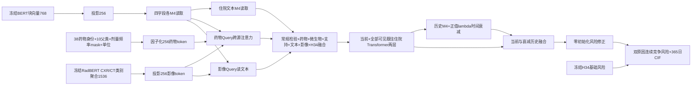

# 最新：现有研究线索顺序实验（2026-10-15）

[完整结果与逐项决定](../../docs/V7_SEQUENTIAL_RESEARCH_RESULTS_2026-10-15.md)及[总合同](../../docs/V7_SEQUENTIAL_RESEARCH_PRD_2026-10-15.md)：56次新拟合/519实际神经epoch、两折OOF替代五折，所有批次独立重放0。完整强V6冻结后的端到端V7在两个种子有小幅F1提升；固定训练投影在三个读取器种子2胜1负；仍保留原默认。下方首轮说明保留当时的模型与状态，新实验没有改原入口或权重。

|模块入口 `python -m training.v7.…`|合同与用途|
|---|---|
|`sequential_experiment --mode train/verify`|[六项机制消融](../../docs/V7_SEQUENTIAL_RESEARCH_PRD_2026-10-15.md)：Focal/平滑、Query、衰减、检验键、Brier|
|`research_features --mode build/verify`|九项物理检验的首末、速率、曲率、采样密度与有来源的EOS/ICS组合|
|`cached_research --mode prepare/train/verify`|[完整强V6与小读取器](../../docs/V7_CACHED_RESEARCH_PROTOCOL_2026-10-15.md)|
|`cached_followup --mode train/verify`|[五个读取器追加seed7/101](../../docs/V7_CACHED_FOLLOWUP_PROTOCOL_2026-10-15.md)|
|`strong_anchor_experiment --mode train/verify`|[完整强V6冻结、V7端到端修正](../../docs/V7_STRONG_ANCHOR_PROTOCOL_2026-10-15.md)|
|`strong_replication --mode train/verify`|[端到端修正seed7复核](../../docs/V7_STRONG_REPLICATION_PROTOCOL_2026-10-15.md)|
|`query_replication --mode train/verify`|[同种子匹配Query对照](../../docs/V7_QUERY_REPLICATION_PROTOCOL_2026-10-15.md)|
|`residual_controls --mode train/verify`|[固定训练投影/缩放/合法零门](../../docs/V7_RESIDUAL_CONTROLS_PROTOCOL_2026-10-15.md)|
|`residual_followup --mode train/verify`|[固定投影追加两个读取器种子](../../docs/V7_RESIDUAL_FOLLOWUP_PROTOCOL_2026-10-15.md)|
|`two_fold_ensemble --mode train` / `two_fold_replay`|[两折患者OOF](../../docs/V7_TWO_FOLD_ENSEMBLE_PROTOCOL_2026-10-15.md)，原生XGBoost独立读取；原包装器验证错误现场保留|
|`two_fold_full_refit --mode train/verify`|[固定OOF权重的完整训练集重拟合](../../docs/V7_ENSEMBLE_FULL_REFIT_PROTOCOL_2026-10-15.md)|
|`drug_name_encoding` / `drug_context_features --mode build/verify` / `drug_context_experiment --mode train/verify`|[38药名冻结BERT、同药执行变化与route](../../docs/V7_DRUG_CONTEXT_PROTOCOL_2026-10-15.md)|
|`sequential_readout --mode calculate/verify` / `sequential_report`|仅重算聚合、患者配对区间和中文报告，不训练；已存在读出/报告拒绝覆盖|

GPU入口的Docker命令需要`--gpus all`，包括`residual_controls`及其他神经模型的独立验证。读取真实数据前沿来源合同检查，目录存在时拒绝重复训练。所有旧数据可见性、确认/测试隔离和公开边界继续适用。

---

# V7 首轮正式实验

已知检验输入后如何审查外部方案，见[适配说明、实际连接和未完成检查](../../docs/V7_LAB_AWARE_DESIGN_AND_STATUS_2026-10-15.md)。其中包含可直接交给其他AI的审查说明。检验已经进入融合与文本—检验对比；药物Query直接读取检验仍是候选实验。

最新补充：[损失组成核对与三次补充训练](../../docs/V7_LOSS_COMPARISON_RESULTS_2026-10-15.md)。此前`recommended`实际是“原竞争风险损失＋Focal＋标签平滑＋.1对比”，保留原损失/.1权重是实施选择，不能称原文完整复现。此次补做不加原损失的Focal＋标签平滑（有/无对比），及保留原损失但无对比；各8实际轮，共359.77秒。两个直接Focal条件均best0，末轮F1 .400818/.426304、IBS .205970/.205471；原损失＋Focal＋平滑best4，F1 .565321/IBS .100127。新GPU来源/best/last/概率/早停重放0，15相关回归与独立读出通过。这只针对当前V7七期限双原因适配，不直接否定分类方法。旧源码/权重/报告保留。

补充训练入口`python -m training.v7.loss_comparison --mode train`，既有结果拒绝覆盖；验证`--mode verify`。沿用下方镜像/离线/GPU/依赖，并额外只读挂载`-v "C:/Users/Administrator/Desktop/研究 2.md:/research/research_2.md:ro"`。输出`training_runs/v7_loss_comparison_2026-10-15`。读出`python -m training.v7.loss_comparison_readout --mode calculate/verify/publish`（三种独立模式）；简化概率例子`python -m training.v7.loss_probability_probe`。锁定补充合同的原文行号98为定位笔误，实际97，数值参数不变，原合同不改。

本目录实现用户在2026-10-15批准的256维、8头、M4、FFN1024与联合损失。固定合同见[PRD](../../docs/V7_FIRST_EXPERIMENT_PRD_2026-10-15.md)。这是两个seed42条件的有限首轮，不自动扩展参数网格。

首轮已训练并通过新进程重放，[中文结果](../../docs/V7_FIRST_EXPERIMENT_RESULTS_2026-10-15.md)。对照8轮/最佳6、推荐14轮/最佳8；正式总348.56秒。年度F1 .565321/.567023，推荐未超过已有V6对称背景 .577373；单seed暴露调参证据不足以替换默认。

Bio_ClinicalBERT（108310272参数，含pooler）与RadBERT冻结，复用已核验向量。V7实际训练11180112参数；冻结H34另有72参数。文本/影像投影lr=1e-4，其他新模块lr=3e-4，AdamW衰减.01。编码/attention Dropout=.1，融合/分类头Dropout=.3。



三层指字段内片段、四字段到住院文本、患者住院历史；住院八来源融合当前采用拼接MLP。这不代表冻结768向量内重新获得了逐词注意力。影像是已保存的CXR/CT类别聚合，本轮没有重建逐报告表示。时间衰减使用 `-softplus(lambda)*log1p(gap_days)` 作为注意力偏置；内容分数仍能改变最终权重。

`nll_control`保留竞争NLL；`recommended`再加多期限Focal和平滑标签、同住院跨源对比。对比读取交互前的文本/药物/检验/影像表示；所有同患者负对排除。缺源不冒充阴性。药物升级斜率、完整route/duration及文本隐式事实新字典尚未接入，不能从本轮效果推断其价值。

采用本机已存在的baseline镜像及隔离公开表格依赖。容器离线训练，工作区挂载到 `/workspace`：

```powershell
docker run -d --name aecopd-v7-first-20261015-r2 --network none --gpus all --shm-size 8g `
  -e PYTHONPATH=/workspace/training/runtime/public_tabular_2026-10-12:/workspace `
  -e CUBLAS_WORKSPACE_CONFIG=:4096:8 -e PYTHONDONTWRITEBYTECODE=1 -e PYTHONUNBUFFERED=1 `
  -v "${PWD}:/workspace" -w /workspace --entrypoint python aecopd-baselines:v1 `
  -m training.v7.experiment --mode train
```

已有输出时入口拒绝重复训练，不覆盖失败现场。独立核验使用相同环境的新容器，执行 `python -m training.v7.experiment --mode verify`；读出执行 `python -m training.v7.readout`，第二次独立调用逐项核验。前者只重建与重放，后者只统计已锁定预测。

`python -m training.v7.verify_last`完整重载末轮并对照逐轮记录，第二次独立调用验证保存曲线；`python -m training.v7.diagnostics`只对选定权重做来源mask敏感性，第二次调用验证；`python -m training.v7.publish_report`生成中文聚合报告和PNG。`audit_encoder`需embedding镜像离线读取本地BERT，仅数参数，不编码或训练。

正式输出 `training_runs/v7_first_2026-10-15_r2/`：来源合同、输入覆盖、GPU预检、稀疏CPU缓存、两条件逐轮时间/损失/早停、best/last、每日双原因概率、完整指标和独立重放证明。该目录含患者派生数据及权重，沿用项目本地保存边界。初次运行发现字段压缩结果被丢弃，已保留源码/日志/权重现场于不带r2目录，详情见其`IMPLEMENTATION_AUDIT.md`；不作为正式性能结论。

相关测试：`python -m unittest training.tests.test_v7_model training.tests.test_v7_losses training.tests.test_v6_unified_longitudinal -v`。GPU预检另外验证实际三步更新、历史内容梯度、共同初始风险和冻结H34。
